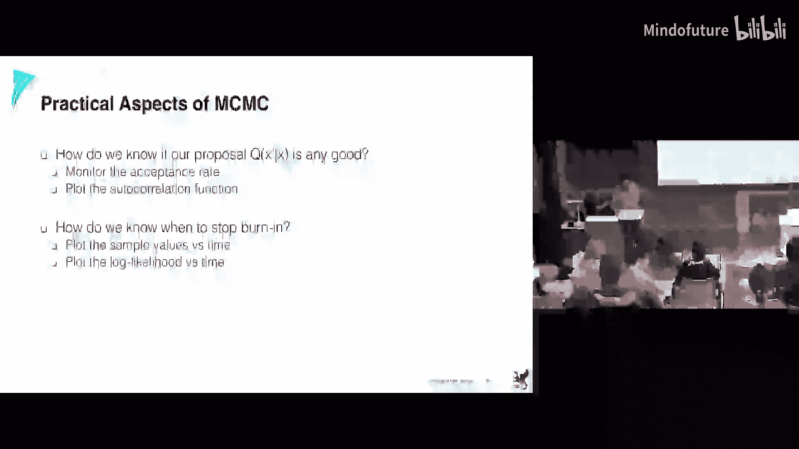
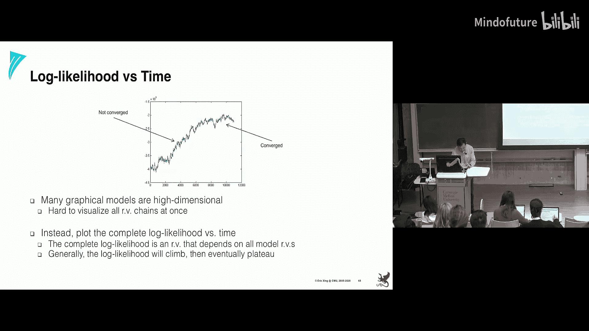
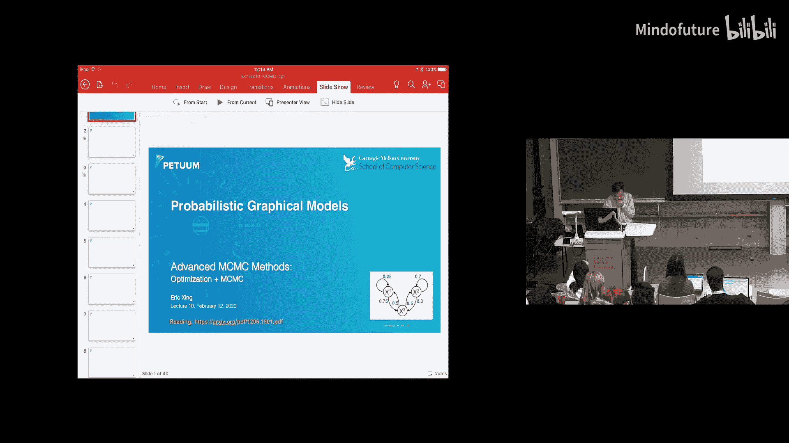
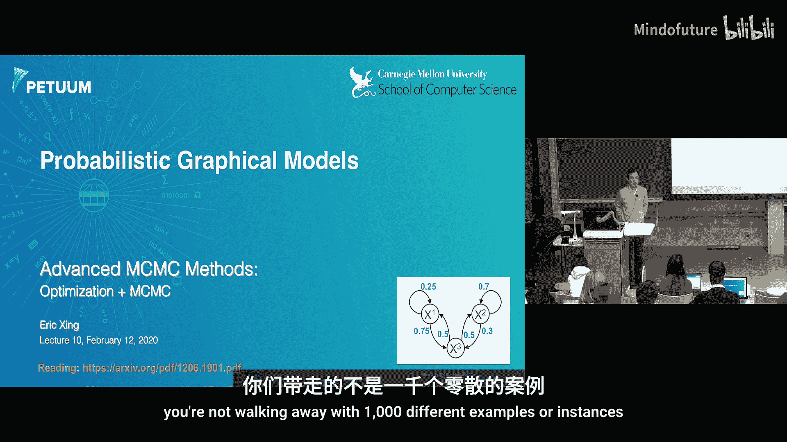
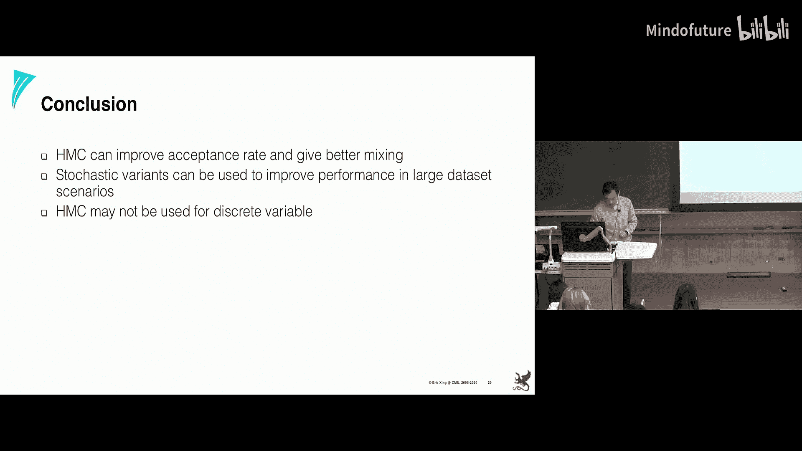
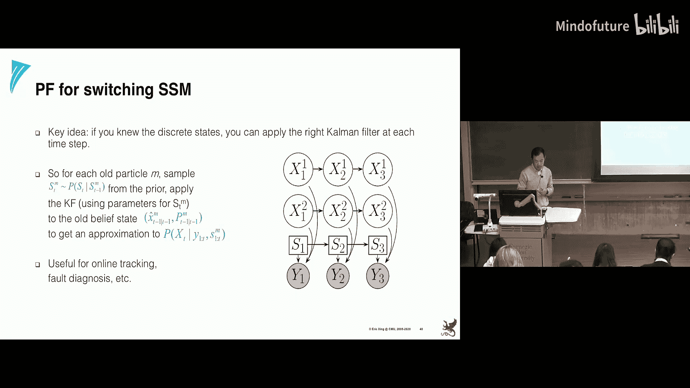

# 【卡耐基梅隆】概率图形模型 ｜ Probabilistic Graphical Models 2020 p10 P10_Lecture_10_高级MCMC方法 -BV1ebpGzhEA9_p10-

So I'm going to take the first few minutes to finish off some of the leftover slides from last time。

 And then we're going to learn some new techniques。So as you know。

 we talked about sampling algorithms last time， right。

 sampling algorithm is a alternative to the variational methods where you are not going to， you know。

 do a lot of the close form energy computation， but you draw sample from some distributions。

And then you do something you know， against the samples to let them represent a complex distribution。

 In a sense， it is a much more flexible and universal technique than original inferences。 You know。

 the same proposal distribution can be used for sampling many different distributions。But。

The core idea， you know， underlying sampling is this thing called a proposal。 right。

 It's allowing you to bypass， you know， the very difficult to sample original target distribution。

 It could be a distribution。 That is hard to express you know， in an atic form。Or， you know。

 are hard to evaluate， you know， given any samples。

But you can use a proposal which typically is a gausing。 you know， to draw sample and then， you know。

 use some kind of a transformation or manipulation of sample to represent。The true distribution。But。

 and if you recall， we talked about a Monte Carlo technique。Right。

 which is to use an invarient proposal to draw sample from。 And then you either weight it。

 you re weight it or resample from it and so forth。And。

The other idea is to use something called a M C， M， C。

 which is to employ a changing proposal distribution。Of the form like this。

 where every time you use the previous sample to define the next proposal。

And we shown that it is going to converge to the target distribution。And also。

 it is likely to have a better acceptance rate because the proposal is catching up， you know。

 different modalities in different in a complex distribution。 But still， you know。

 people may not be happy enough to， you know， to work with such proposal because。

We are going to run into maybe， cases where， you know， you still see lot of some rejected it。

Or sometimes the sample not very useful。 So here are two notions of the usefulness。

When working with the queue。2 things you need to do in practice。

 Why is to really monitor the acceptance rate。 If you really run into a region where， you know。

90% of samples is rejected， then you need to do something。Another slightly more misleading。

 more kind of you know， hard to recognize danger is something called autocor。 Remember。

 when we are doing you know， estimation， sample based estimations。

 assumption is that all samples are independent and identically distributed。

Drawn from the distribution， right， But if the samples are correlated。

 then their value can be compromised。So how can we actually know we are doing the right thing or the sample are good。

So， just to。You know。Take a look about the， the issue behind the， the acceptance rate。

These are potential kind of issues， right， You may basically have a mismatch。Of the mode。And then。

 you know， samples you draw from here， for example， may actually get a a poor acceptance risk。

But if you have a high variance， you know， proposal like this， Again， it is not ideal。

 So what you want to do is to really monitor whether a proposal is giving you a reasonable acceptance rates。

 And here are some kind of practical， you know， a guidance about what's good， right， generally。

 if your proposal has a 50% rate of acceptance。You are O。 You can actually go with that。

And why is okay， You can see that here I have some special cases where a， you know， a， you know。

 a specific， you know， true exception rate， you know， can be even computed analytically。

 You can see that if you use a Gaussing to sample a Gaussing。

 the optimal exception rate is roughly at here。In one dimensional case。 And if the dimension is high。

 you actually will approach to some numbers like this。 Therefore， you know。

 numbers of this ballpar is understood as good enough。

Autocor can be computed using this equation if you have a two samples， which are key steps apart。

You can compute the auto correlation function。 You know， of， you know， the two samples using this。

And you can see these two curves。 One is showing a low auto correlation， meaning that when you。

You know， have you know，K， going from a small big， you have a sharp drop of the auto correlation。

 That means you have a pretty good， you know， uncorrelated sequence。

And you can get roughly identical and independent distributed examples by just picking examples every say 5 or 10 examples that makes them deco。

And here you have a high correlation， a high auto correlation where the R isn't dropping over K。

 Then you really， really cannot do much because it basically said that you need to drop the whole sequence。

Okay， and in fact， you can even use this equation to compute a effective sample size。 Okay。

 if your sample get 100 samples。What it is equivalent to another number of independent samples。

 So this equation gives you that calculation。So you can get a rough sense about how many samples enough。

There are other techniques of modeling the condition of the sample of the of the process。

 One is called the mixing。 You know remember that there is a burning rate that you get the samples not necessarily coming from the true distribution。

 And you want to wait for a while， right。And so when that， that stage is， is ending。 Well， typically。

 when people are doing MM C， you sample independently from multiple chains。 Basically， you are you。

 you are running several computers together and each draw basically from that target distribution and can monitor。

 you know， the convergence of， you know， the sample。And here is what we called a well mixed chains。

 You can see that these four colors or three colors。

Are producing a sample trajectory that are not too much different from each other。

That means that they probably are converging to the same distribution already。 You know。

 you can start collecting samples from here。And in this case。

 you can see that depending on how you start the， the sampling process with running initialization。

 they are still quite different。You know， in whatever statistics they compute。

 And that means you haven't really reach into the convergence part。 Therefore。

 it's called poorly mixed than little time to continue burning。So that they can reach to this phase。

Another technique for monitoring is to really monitor some kind of statistic， you know。

 computed out of the samples。One such statistic is the likelihood of data under computed under the samples。

 you get， you are say you are sampling from the hidden parameters or you are sampling from the the。

 the， the model parameters。And then you can plug them in to compute the likelihood of data。

And the sample that is。You know， converging usually give you the best likelihood of the data because it's a good match Why it's mismatch。

 You can see， you know， again， the curve demonstrating this kind of polylutonium behavior of the samples。

So these are typical tricks or heuristics people use to determine when your sampling procedure is working and working well。

This is different from what people do in variational inference or optimization technique。

 where you iterative and reach a fixed point and you monitor the convergence， you know。

 of ingredient type of behavior。 In sampling， it is less。Kind of smooth in terms of converence。

 You can see that there are a lot of little Z zs that because some is fantasticastic。

And the gradientding pay the herministic。Right， so therefore， you know。

 they give you some different behaviors。Okay， so as a summary。

 these are the take home message you want to learn from Monte Carlo methods。And again。

 I want to emphasize Monte Carello methods is viewed as a complement。

To the optimization technique that we started earlier。

The key word optimization is to compute a gradient。Okay， or compute a direction that you want to。

 you know， increment the current status and move to the next status。

Could be coordinate descent could be gradient descent。

 But sampling is about drawing examples in the satorcastic fashion， and hopefully。

 they converge to some final， you know， equilibrium。So to， to， to。

 to now I'm going to move to the next lecture。Where you can see scenario scenarios where these two seemingly very kind of different techniques。

Sometimes could be combined to generate even better you know， results。 So that's actually where。

I want to present to the convergence point of this technique。Okay， so let me switch slides。

And。Start from this one。

Actually， any questions for the M， C and M，M C methods。Until now。If not。

 let's talk about a little bit about the advanced MCM methods。

I found it very intriguing because you can see this kind of combination of some of the fundamental technique。

That we study so far。 In fact， in the in， just like in every science in physics or in mathematics。

 you know， unification convergence and eventually compositionality， you know。

 across different methods is always， you know， a a nice goal， you know， for the field itself。And。

 you know， from now and then， you know， in this like in this class， I will be showing you， you know。

 different efforts and ways to achieve this unification or to pursue such unification so that hopefully at the end of the class。

 you're not working away with， you know，10 different examples or instances。

 You see a few fundamental principles。 And you can improvise and combine with new methods。

So， let's begin with the。Again， you know， a， a。Statement of why， you know。

 we need to do such innovation。So we've learned MM C already， which we argue that it is a better。

Technnic than M C， right， And it also has advantage over the grading methods， because。You know。

 it gives you simplicity， you know， in doing the， the implementation computation。But even M M C。

 you know， which has a moving， you know， proposal， or maybe give something。

 which has a equal to one acceptance rate， can still be not so good enough。 Okay。

 so let's talk about metro hasing， which does have a less than one acceptance rate。

And then we talk about the， you know， even with with one， Let's see what other issues we have。

 So here is a kind of a illustration of what could happen。

Suppose that your previous example is in here。Is in here， okay？And you use a proposal。

 which is a Gausing。To draw the next example。Which is like this。

 So this is a symmetric Gaussing example。 right， So you know， basically。

 the probability of going here， here， here and here and other direction are equal。Right。

 so you have a equal probability of getting example from all these different places。But就。

It is in here。 This is a very interesting region， you know， in terms of the true target distribution。

Why it is interesting。 Well， this whole thing in the whole joint distribution of the。

 of the equilibrium or the target is a highly asymmetric。Okay， for example。

 if you are going this direction。You know。It's very easy to move sample into a high probability region of the target。

Right。And。But if it is going this direction。Then just a tiny bit of movement。

Will basically relegate you basically down to a region that is a very， very low probability。Right。

 this equi probability contour here is very dense in this direction， but it's very sparse in here。

So in a sense that， you know， your proposal here really， really， know is you know。

 at the risk of slipping into， you know， a low population region。 if it go this way。

 But if you move in this direction， then， you know， that risk is lower。So in a sense。

 what I'm saying that this particular proposal does have the risk of having a very low acceptance rate。

Okay， if you just don't take extra care。At least a half of the samples will be going to an extremely low poverty region。

So that's one problem problem with。Lower substance rate。The other problem is。On the。You know。

 even you are you are in a better place。 Okay， so you are in here。

You are in a rather kind of a safe region。呃。And you use a maybe a small kind of。You know， say。

 even if you use a small variances。Okay， like this， only in here。

And then you may imagine that I control it in a way that it is going to， you know。

 use I use a gi sampling。 for example， I will have a high acceptance。But。Small variants。

 which allows you to avoid risk， you know， to go， you know， across the， below， you know。

 across the cliff is causing high correlations between samples。

 as we see already in the previous cases， you can compute that。

 And here is actually is the illustration of all these。Comp of all these correlations。

So there are issues in MCM C Y is sub substance one is correlation。And that's the typical behavior。

 you know， under a random work。Meaning that your proposal， using your proposal。

 you basic example randomly， you know， with the proposal and bet on acceptance。Now。

Going back to here。What would be the ideal scenario that you want to generate a sample。You know。

 that， you know， by methods that maybe be allowing you to do better than random work。

Maybe here is all this。From this graph， you may want to say that。You know。

 even though my proposal is like this。If I'm a。Giving a tendency of drawing samples more toward that direction。

That will get me better chance of having high assessment rate。Right。And in this case。我。

I want to still keep。My variance high so that I get a low auto correlation。But again。

 getting the balance high is making you a risk of， you know。

 maybe going this way and go off the probability。 I want to maintain the direction to be either here or at least in here so that I should not you know。

 suffer from a high exception， a low exception rate。Right。So what I'm trying to say is that。

Other the random work。If in your proposal， you have a way to control the direction of the next sample。

Then you could， you know， avoid， you know， low exception rate and also， you know。

 hopefully keep you know， also low auto correlation。So that's where actually， the needs arise。

Some great information， which gives me the direction of where I should go or where I should find a better region for acceptancearies。

 you know， can be helpful。And also， maybe I should even approximate， you know。

 the distribution so that I will have more flexibilities in computing the samples and so forth。

 But let's focus on this first in the。Next fuel。Slice up。So this is advanced topic。

 So I need to dive into some mathematics and some historical literature just to give you some flavor。

 some taste about how sophisticated， you know，Tecnologists are， you know， engineering， you know。

 existing algorithm。 I think these ideas are quite， quite interesting。

For those of you who may have been in a physics company before。

 Have you heard about this word Hamiltonian。RightIt is a broader term of the energy expression。

 you know， in physics literature， right in physics， when we talk about energy。

 usually we talk about potential energy。And kinetic energy。Right， so Hamilton Hamilton is a。It， it。

 a term corresponding to the summation of that。 Just， for example， think about an atom orbiting。

 you know， the， the nuclear。And they have a potential energy by staying on the orbit。

But on the other hand， if you don't move， what will happen。For a item， stay under audit。

They will collapse to the core， right， That means it has the tendency of you know。

 going to a low energy state。But why they are staying on the orbit is because they move。

 That means there is a kinetic energy。You know， corresponding to the speed， the velocity of of the。

 the， the the objects that can counter or console the other part of the energy， right。

 So Hamilton basically is Hamilton is basically corresponding to。Okay， I need to charge my pen for。

 I guess。Or I don't use the pen。 I I will。 If I charge， I will lose my。I didn't bring my iPhone。

 so I couldn't recharge it。 It's funny。 I would not use the pen。Yeah， it's all a battery。嗯。

charge here。I can charge where。Can that charge yours。 Yeah， for just a five minutes。 Thanks a lot。

I can use my finger to write。 So this is fine。 Alright， so this is basically the the， the Hamilton。

 and it has the the kinetic part and the the potential part。 And there are some interesting。

 you know， transformations relates to two important quantities。 One is called the position。

 The other is called the speed， the velocity， okay。😊，And then， you know。

 you can write down the energy state of that object using this distribution。Okay。So what。

 what has to do with our you know， probabilistic modeling and sampling， well。Typically。

We are interested in a target distribution， which correspond to a subset of parameters like x。

How about we call the x， those position parameters。

And then waste the introduction of the Hamiltonium。

You actually are effectively introducing some auxiliary parameters。And also， a aux distribution。

 which contains those terms。So why we do that。Just give you a hint。

 The goal is to be able to compute easily。The gradient。Okay， of。

That target distribution versus the position parameter。Okay， and in a very， very simplistic fashion。

ok。Okay， so a few words about what is Hamilton dynamics。

It begins with the following key building blocks。Position vector X， momentum vector P。

And kinetic energy and potential energy。 Now， I use the notation U just to be consistent with the literature。

Okay， and we define H to be the sum of the kinetic and the potential energy。And that's pretty much。

 you know，You know， expressed in this harmonic system， where you can see there is a kind of a slope。

 and you have a a ball。Rolling over there， it has the potential due to gravity and also the speed and the。

 the kinetic due to the speed。And the。These are the identities。Existent in the Hamiltonian system， O。

The derivative。Of the first derivative of x over t。

Equals to the partial differential of the Hamiltontonian versus the P。ok。

And there is a nice picture here。 The derivative of P over T。

Is equal the minus of the partial of partial derivative of H over x。Okay。Again。

 just to be consistent with the notation in the literature， we' are going to use P and Q。

To denote the position and momentum。Proomes。Instead of a P and X。Okay。So we want to， you know。

 use this。Eventually， to help getting。You know， the gradient of U over x。

To be able to compute easily from the next example。ok。And that's actually why， you know。

 you have this and this over T， because now we're discretizing you know。

 the entire trajectory over the T so that your next example， you know。

 can be dependent on the previous example。Not only by the transition kernel。

 but also by the gradient。ok。And that's how basically the green information can be used to influence where you draw the examples。

 If you use only the transition model， there' is no way for you to control that direction。

 So that's the key idea。And just to have a example。

 and here is a very commonly used form of the kinetic energy， which is quadratic to the momentum。

And also， the potential energy。Which is also quadratic to the position。

And then you can see this equation can come down in a very trivial way。

 You can see these very interesting dependencies。O， between the P and the Q vectors。

And you can actually use this to even。Deiveve the close form of the。Position and also the momentum。

Over time。 But， of course， in， in a， in a real kind of a proposal distribution。

 your U of Q is never that simple。O， it could be a very complex distribution over the queue。

But the K， which is auxiliary， you know， for your computation of the Hamiltonian。Usually。

 I always take the form of a P square over 2。So remember， again， this is here。 U and K。

 U is the potential function， which is our original target proposal。Okay。

 that can have arbitrarily complex form that you want to sample from。But the K is a auxiliary。

 which you made very simple to be taking this ktic form。So now how to compute the next。啊。P， a next Q。

 which is our position parameter of interest from the previous one。Well， with the help of the。P。

 which is the momentum， which is the auxiliary random variable。 You get a very， very easy update。

 okay。So P of T plus epsilon or Q of T plus epsilon。Actually， comes from a， you know。

 the previous one。Times a gradient。ok。And as we divided before， the gradient actually can be。

You know， compute it from， you know， the。Potential the。

 the the momentum from the previous time point。Okay。And likewise， just to be symmetric。

 the potential also can be computed from the various potential。Plus。

 a turn dependent on the gradient。Offfer the potential functions over the position。Okay。Got it。

So this is called the Uus equation。So with this， you can already， you know， basically get a proposal。

You know， based on this， this is basically your next sample of the x。Right。

 and you can probably go through acceptance test and so forth and go with a sequence。

People actually played with this U equation。Do I have the panel already。Thanks。Okay。

 so let's look at this。 Right。 So the key idea is that now I get basically this one over this one and this one over this one。

 But then there is a term。That is cross。To here。And this one， of course。

 has to be computed every time。So in a sense， I'm using a auxidary random variable to make my computation of the next step。

In a burst straightforward forward。In principle， you can basically generate a sequence of Q T。

T plus  one， and all time to。This。You know， using this u equation。

 which is always in the direction of your gradient。Okay。But。It turns out that。

If you don't qualify these samples。People find the sequence to be divergent。Okay， for example， if we。

 we compute it， we have a a expression in the past of this system。

And if you don't take the close form and using the user equation to you know， simulate。

People find that you actually get a sequence of divergence rather than the true kind of a sequence。

 which is a circle。So why that's the case。Basically means that your gradient is a little bit overshot。

Okay， and then you keep adding to that。 and you cannot really correct that。

And this is because you can analyze this a little bit。And it turns out that you can establish。

 you know， this expression of the next step versus the previous one。 And it's。Kind of a。

Divergent series due to this updated equation。And how to test that is very easy。 You just， you know。

 power particular。You know， transformation matrix N times and see how big it is。

It's going to explode to infinity。Okay。And it's easy to see it， because。It is a full matrix。Okay。

 and you can compute the trace of this the determinant of this。

 and you will find that it is bigger than one。 Therefore， it is always average。Okay。

So that method isn't working in practice。Then comes to the next method called the leapfrog method。

Which is to make use of a half step。You know， to update the P。And then the full step to update the Q。

 The Q always take a full step。 The P always take a half step。 and then the full step。ok。

And these equations are pretty straightforward。 It is still using the Hamiltonian system where you know。

 the， the P dot。Eals to you know， to Q and Q dot equals to P and so forth。

But you can also verify the A J break nature of this new transformation。Turns out that。You know。

This new update。Actually， is updated from this part。

And the the transformation matrix has this very interesting property called a sheer transformation。

Okay， shear transformation has you know， a， you know， a half matrix that is having zero elements。

Okay， and the other part is not zero。And it can prove that this one has a determinant of one。

 Therefore， it is preserving the volume okay， of opposite system。Again。

 the details can be available from the little paper that I posted by Rph Neil。 You know， you know。

 I put on the， on the website。But。Just to recap as a comparison。

 this leapfrog method is going to give you a convergent sequence。And the U method is non convergent。

Now， we can see how to use such technique to。Construct a MC，M C from the the Hamiltoning dynamics。

Okay， we define， you know， now a。Auxiliary distribution。Which has a。The potential part。

 energy part and the kinetic energy part。And this。Pential energy comes from our original target distribution。

Imagine that we have a patient setting where， you know。

 Q are the parameters want sample from such such the topic， frequencies and so forth。

And the the pi denotes the prior。 And this one is a likelihood。 Therefore。

 by sampling from the posterior of the queue。 Okay， this is the posterior。

So supposedly a very hard for sample distribution。And then the kinetic energy takes a very trivial quadratic form。

Okay， so the key idea is to use the Hamiltontonian dynamics now to start proposing the next step。

Right，You basically， you know， start from a Q 0， and then you draw。The P。You know。

 from a normal distribution， you know， a very， very standard distribution。

 And then you use the L steps to leapfrog to the next queue。玩。And maybe kill 2， and so forth。

And then， you。Reject or accept。Based on the change of the Hamiltonian。Remember this Q and Q1 and Q2。

Are basically computed using this equation。Okay，They are not a random work from the proposal。

Originally， when we use a， you know， a Q。Of say， a little queue to draw the samples。

It's a random sample from the proposal， right， And right now。

 we are drawing the next queue using this equation。Which has the gradienting information。

From the you。Over。Over the queue。So here is basically the， the， the formula。

Sometimes people don't do just the one leap frog， but all steps of leapfrog。ok。And。

 and then at the end of day， you are going to do a full step update。

 And then you can still go with the acceptance three test。 The test is a little bit tricky in here。

 but it's analytical and explicit。And you can prove that this formula still gives you the detailed balance。

It is aoric。And。But it has a。Better property in terms of， you know， say。

The autocor and also the acceptance rate and so forth。So， for example， in here。

 you can see this random work with metropolitan versus a Hamiltonian。

 You can see that the samples you draw are much more concentrated。On the。

High probability part of the distribution。Rather than going other directions。

And you can also see the 2D examples where again， here。

You can see what some kind of autocor structure， right across samples。 But in here。

 you don't have such autocor anymore。And this is a。100 dimensional gaussian distribution。

 which is even harder to draw。And usually， you know， in higher dimensional states， you are likely。

 you are very unlikely to move out of the neighborhood of the previous sample。 If you do MMC。

 remember， MM C is the defined proposal from the first from the previous example in the very high dimensional space is's very hard to escape。

From the kind of the， the modality defined by the previous examples。Therefore。

 you see this extremely high auto correlation。But now， because we have a gradient correction。 Okay。

 over the next example， you are more easy to escape from that。 And therefore。

 the samples generated are much more uncorrelated。So here are some numbers。

You can see that the acceptance rate now becomes a lot higher。Do I have the。

 They didn't put the allor， but I can't see it from the graph。So that's Hamiltonian versus M。

M C versus standard M，M C， random work， M， CM C。Then along this idea， which really， you know。

 promotes the use of gradient。 you know， over the， the sampling procedure， you can see the idea。

 The gradient belongs to O， P T。Right， and then the sampling idea belongs to M，M C。

 That's why you can see this marriage of the two seemingly very different approach now to together produce high quality samples。

So on this idea， there has been a lot of kind of little innovations or， or， you know。

 heuristics to make it simpler or more effective in certain circumstances。For example， here。

 there is another algorithm called the launch vending and CMC。

That's basically the case where you do only one step of leappro。 Remember， in our previous algorithm。

 which is a very generic algorithm， you can do all steps of leappro。Before you test that example。

Okay， it's to really allow you to move arbitrarily far along the。

 along the gradient and then see whether it is accepted or not。

 But if you only want to do one leap block， then the。

Agriism can be aggregated into a more compact one。 You just basically， you know。Bring in。

 for example， this term into here。And then bring in this term into here and replace， you know。

 the intermediate steps。You can actually get a pretty compact expression of the new Q and P as a function of the older P and the older Q。

 one step away， not half step away。Okay。So you can derive this， hopefully just from here by yourself。

And then that。Also requires a a acceptance rate test， which is defined by this particular proposal。

whyhy this is kind of sometimes favored， because it gives you a very clean way of exposing。

You know how to compute， you know， the gradient。Of the likelihood function versus the position versus the parameters。

 you know， in a single computing step where。All the issues are going to run into， you know。

 for the calculation of the gradient can be solved at once。For example， one of the issue is about。

The size of the data。 If you have a large data set。Then computing the whole gradient thing here。

You know， of course， can be quite complicated， right quite， quite expensive。

Because it requires a summation over all data sets。

Then srcchastic gradient lunch vending is to allowing you to really。

Have some control over the size of the sum。Okay。You can basically select a subset of the samples。

To compute this gradient。And then hopefully go back to to here。

 So this is not quite the same as the full gradient。But again， you know， remember that the weekend。

Tat this as just a compounded proposal。 for the next example。They will be qualified using。到一般。

A acceptance。In the test。Therefore， you know， a wrong examples will still be rejected。

 but the high public examples will be taken。 So in this way。

 you compute the gradient in a much easier fashion。

So you can see in all the technique we developed in the optimization literature， stochastic gradient。

Griient， conjugate gradient can all be applied in here to you know， augment， you know， the。

 the proposal distribution for the next example。ok。So in some sense， what you see is now， you know。

 a maybe a practice or maybe a a a exercise to。Come up with。More expressive and effective proposals。

So， let's look at。Originally， we go with a proposal。Alpha x。Which is easier to sample。

With regard to the target user X。Right， and but we are going to use that proposal forever and use rejection of importance。

 waiting and so forth to qualify the examples。And then， next。We start to use a proposal。

That is moving over time。So that it will be， you know。Here， it's converging to x。Right。

And here includes， you know。Mop is hasting and keeps。And so forth， here you have what importance。

And waited sampling。And so forth。And then， you know， what way。Tt today is。A。

Upgrade of the second technique so that it is going to be。X。You know， come from， you know， a oracle。

Which contains。The proposal。Okay， and also， some gradient information。停。

It's about you draw it from here。And then you are going to plug them into， you know， the gradient。

Increment and then determine the next examples。 So in a sense， it is another proposal， but it's not。

 you know， expressed in a anatic form anymore。 It is in a oracle that has two steps。

 draw random example from here。 and then you know， you know， leads to a gradient increment。

 And then that gives you the next x。Okay。And。And also， the proposal are not directly coming from X。

 It's actually a proposal of the P of the momentum because that makes the， the。

 the gradientding calculation even easier。So this is basically the。

 the whole kind of sequence of technique that people developed you know， over the history of M。

M C literature so that you can， you know， really， you know， enjoy basically， you know。

 both the efficiency and also the simplicity of many of the computations。Need it， you know。

 for computing or to inference under the original food distributions。Okay， so I'm going to be。

Pause for a moment here to take any questions。 So here are some take home messages。Any。

 any other questions so far。So theres a cabinet。 you know。

 Hamilton M C is not usable for discrete variables。 Do you know why。Yeah。Yeah。

 you cannot take gradient in town discrete great variables。Any other questions？No。O。

Then let's look into some of the supplementals and see whether we have even more ideas to play with。

 Again， this whole you know， area of approximate inference。 You know， it still very active， okay。

 there are a lot of lot of techniques that we can cover。

 But I'm going to just pick on some bigger ideas。

We can still do better on the proposal from another dimension， okay， so。诶。So that's basically。

 you know， you know， the the topics in the following few pages。So， so far。As we just roll down。

 you know， there are a few ideas for proposal。 One is just tribal proposals like a。嚟高醒。

And the other is slightly less triviale a a moving Gaus that is defined。 you know。

 on your previous example and so forth。 And then we have yet another， you know fancier one。

 which is you draw proposal from Gaoing。 and then use know。

 use it to compute gradient and then come up with an examples。

 It looks like that Gausing entity or whatever trie control draw from is the key。 you know。

 for building a proposal。In a sense， in building the proposal， we don't。Look too much into the P。

 the original target distribution。Except in two places。 Okay。

 I'm using this as a review as well to go back to what we did over。 So in the previous places。

 you know， three algorithm， M C， M，M C and Hamilton M， C， M， C， A。

 where are the original P distribution touched upon。I can remember two spots， actually， three spots。

So in M， when do we look at the P。Yeah， when we are calculating the R。Or maybe the weight。

Right we look at the屏。But we don't look at the P when we do S the Q。And in MC，M C。

When do we look at the P。It is also in computing the exception rate。 It is when we compute the A。

 we actually look into the P， right now in HM C。温度为 look开的屁。The original distribution。

There are some difficulties in notational swapping。 Remember。

 there was a step where we compute the U over x。Something like that。 Are you over。

The U actually is our P。Right is's our original target。 So that's basically it is when we are。

Looking at the gradient。Over x。That we look at that。 So in a sense。

 we are looking at that for the proposal already。 The proposal itself is influenced by P。

 But in the way that is gradienting。Theres another technique that。

Arguably it simpler where your queue could directly take advantage of some knowledge bo。

So remember our versional inference recap。You know， the versional inference is about really。

 you know， introducing， you know， a。Srogate distribution over the hidden variables。

 which satisfy this lower bound。And instead of computing the P， we are going to compute the the Q。

 right， So that's basically you know， in the version of inference literature。And we argue that。

 you know， the Q is close enough to the P so that you can use it for inference。Okay。

 so we choose this。诶 ok。So that's variation inference。

 Your whole goal is to compute this to approximate that。The other caveat is that what about。诶。

We also。You know， basically， you know。Move the targeting here。

We also replace this with another set of parameters。ok。And the。

And make this P also a little bit easier。 So it's like I'm having a complex one in a P。

And I'm using the queue to， to move up and approximate it。But now I'm also start to approximate P。

In here， I'm going both way。Okay， and therefore， maybe you know， at the end of day。

 I'm going to have this one。Which is， you know， reasonably close to the true。 But on the other hand。

 making the calculation of the queue easier than before。It's becoming rehay。

 But that's actually what happened in the in the next few lectures。 Were going to discuss。

Some deep neural network algorithms such as variation auto encoders and weak sleep algorithms。

 They actually start to fall into this。Catego of business where at the end of the people。

Forget about the original target to optimize。You know， people are focusing on oracle。

 which basically is iterating between some P and some Q and converge。

 whether that P is the original P1， maybe， but it's not quite the same。 Okay。

 So that's kind of the bigger idea。 But the whole goal is really to draw this you know。

 basically these two thing close with each other to have something that is workable。

 That's the whole point。So that basically， you know， is used in， you know， M。

M C in the following way。 you can now。Come up with a proposal that is set to be that approxiating。

 you know， distribution。Okay， which is you know， easier than the previous。O。

 I make that as a proposal。And if you are able to solve a variational inference problem where the P is close enough to the。

 to the， to the original P， then you may have a good acceptance rate。

 And then they eventually will hopefully gets you faster to converge to P。So。Let's see。

 What's the rationale here， What's the whole picture mean， I think this is already getting lost。

 We want to sample from X。Okay。And we， you know， start from you know， in theal inferences。

 We do this with a Q of x。Okay。And typically， in V， I， in V E。We directly， you know， minimize。

You know， the K L between P and Q A Q and P。加钱俾。And in variational in in M， M C， you basically are。

Getting this up and getting this done。To a point， which is a P of estimate。Through some K L measure。

 And then you use this as a proposal。And do sample again and hopefully， still move to P， X。Are you。

 are you still with me。Okay， so it's becoming a kind of a heuristic and greedy push in V E。 You know。

 we， we know that versional inference， you know， is not going to get you to the true distribution。

 We knew that because we are already choosing to to be a。You know。

 an approximating family of the original one， which may not include the original distribution。

RightIt's remember the marginal polytope1。 it's a sub polytope right in the， in the。

 in the meanfield cases。And we're going to stop there。But in here， you get to this point。

 you are not going to stop。 You are going to use that as a proposal to push further to P using a sampling scheme。

So that's another way of combining the O P T you versus M CM C。 This part is O， P， T。

 and this part becomes the M， C。Kind of a。Akward， but that's what can be done， at least in principle。

 because proposal can be anything。 as long as you are able to draw sample from here。

 we just left the proposal to be the solution of our V E。 and then go on with the。Sumpling step。O。

And also。You know， it can be iterative because once you get， you know， the sampling part。

 you actually are filling in the hidden parameters and almost like， you know， rebridging the the the。

 the， the， the， the， the E step， you know， using sampling。 and then you can recalculate。

The approximation and guess it even closer。 So this becomes the iteration rule。

So that basically gets you， you know， a newer algorithm， which。Is。Arguably。Giving you better results。

You know， in terms of the likelihood estimation。停。Okay， so that's the new idea。 Adive proposal。

 you know， using the， the diversional inferences， it increase the mixing rate。

And with all these nice properties that we expect to come from。Okay， so basically， idea2。On MCMC。

Plusus OPT。Questions， yes。Good question。I don't think it is really。Meant to be compared。

They are just two different methods， each of which work in their specific territories。

When they are both used。Actually， I don't know a literature where you have a square comparison。

 because in here。O， here is how you can see it。 In fact， these two OP T methods can also be combined。

 the Hamiltontonian methods。Really help you to draw samples。

From a complex distribution where you can take a gradient towards that hidden verb。

For them the parameters。And。It's kind of narrow。 big， for example。

 continuous description only are not discrete。 but this approach is very general。

 It's like a bigger graphic model of arbitrary form。And then， you know。

 you just need to sample any hidden variables of interest in those graphic models。 And therefore。

 the proposal， you know， is a not just in difficult， but it's very， very compounded， very。

 very complex， you know， in terms of the structure， not in terms of the， the algebra。

Vial inferences the， the， the， the the variation of approximation as a proposal allows you to work on。

 you know， you know，A， a approximation that is a manageable， you know， you know， in it basically。

 you can imagine that my。My Q of E， S， T。Could be just a simpler one。Which has。

This a discrete in the factored form， for example。 And therefore。

 that allows you to sample each of them independently。 for example。 So this is a structure design。

And then how to sample each， You can use the Hamilton MCM C to again， do it。

So I think they are designed for different levels of sampling complexity and task。The H。

 the Hamiltontonium is more about the overcoming the。Analytical。

 edge break difficulties of getting good samples。And this why is' mobile structure。The question。

Other questions？So this lecture is a little bit less structured because I'm just give through you。

 you know， a bag of different tricks。 But what's the gist of that。 You can see nowadays。

 people are talking about compositionality in machine learning。

 meaning that you want to bring in different techniques together you know。

 in the composable way to solve larger scale problems。And also。

 larger scale problems is always you know more than just a single algorithm or a very simple model。

 So here you can see the ideas， right， when you are working with a large model， you know。

 say a deep genetic model of many， many layers。How do you sample， You know， this is a very question。

 There are maybe 100 parameters of variables for sample。And with what we learned so far， you can see。

You know， A。 So this large model could be just F of a gigantic x and theta。

And you need a sample from that。It turns out that you can divide them into。you know。诶啊。Product。

Of maybe F 1， F2。And all these sub functionss。And each of it basically contain a subset of random variables。

 You have to draw samples from， or you have to estimate。Some of them can be taken care of by a queue。

 just a direct variation of approximation。Some of them can be draw can be approximate a sample。

 but then you have maybe three different ways of sampling it。

1 is to overcome the AB complexity using Hamilton， and one may needs you to break it down further into smaller approximations and use M。

 C，M， C or variational MC，M C to sample from。Basically。

 different methods can be combined to work on a larger model of all different facets and needs。

So that's where， you know， I think the， the research become complex and heuristic。

 People actually did try this。You know， in many ways。Okay， so I still have a few minutes。诶。Yeah。

 let's together look at yet another sampling， a problem。And see you know， where it can be used。

Do we still remember this？This is about weighted rembling。It means that， you know， you， you know。

 may get samples。You know， which are misrepresenting the true distribution in the sense that you accumulated a lot of。

 you know， samples in the low property region of the original distribution。

 just because your proposal is too bad。Okay。And then in the high property region。

 because of a mismatch， you don't get too many examples。

But then you can start computing the weights of all these samples。Which gives you this equation。

And then you can now do a pass of this sample to kind of reinsiate it。Right。

 and that basically gives you hopefully the correct。

 more correct kind of expression of the true distribution using samples。

 just by reding some of the high weight samples。And discarding some of the low weight samples。

 even though they are very populated in the previous round of examples。

 So that's the idea about the weight re。This idea has been used， you know。

 in a task known as the sequential M，M C。And leads to a algorithm known as the particle filtering。

So the sequential M，M C is， you know， is， is basically to sample。it's essentially this problem。

Let me see， I didn't prepare this part， but let's see。Imagine that we have a M C。

 We have a hidden markov model。With a very complex transition functions， P of X。都为又是X orY。

P alpha for x。T plus 1 given x。 say this one is kind of complex。 And then we have also the ys。

 which are the emissions。And I want to。Maintain a distribution of P of X T。

 given all the examples of a Y to T so far。That's my task。And we know the， you know。

 previously the forward algorithm for， for， for M for for the H M M， which you know， is very。

 very handy。And discretere。 But what if it is a continuous distribution or it's a distribution where this particular expression is very hard。

 you know， for you to， for you to compute。So here we have a sampling based approach。

So the starting point is that you have this already， which is the current。啊。

Distribution of the last hidden states。Given the sequence so far。Okay。And this distribution。

 you know， can be sampled from， right， And we sample the following way。We rewrite this distribution。

停。And。Using this breakdown。It's just to basically separate the contribution from the sequence up to time T-1。

And also， you know， the emission probability of， you know， basically， and this is X T。This is。Y提。

And then there is a whole bunch of other sequences in here。

So we want to basically separate this part。安打牌。From that rewriting of the。

Of the conditional distribution。And by looking at this equation。You can already see。Not。

This is equivalent to drawing samples from this part of the distribution。

 and then weight every sample。From that equation。You see that。Right。

It's a typical way of expressing basically a distribution using the samples。

So we now express this part。As a set of samples。Now， our goal is to。

Introduce one more piece of information， which is， you know。Y T plus one。And also。

 we want to now compute， you know， the P of X T plus  one。

 given this a new example of T plus  one plus the older。Case。So this is set up。

You start from a previous distribution， which now is represented by the samples。

And then receiving one more evidence。 And then you update into the next one。

And here is the equation using the sequential M C technique or using the weighted resump technique。

Because you can establish a connection。Of this time update。With respect to the previous。

Predictive distribution。And also， the transition model。ok。So basically， you know。

 you are going to now build a time estimate of the new state。Only based on the previous。

Distribution based on in the using the sample up to last time point over the transition model without seeing a new evidence。

And this equation is。Expressible by what， by the samples， right， so。Remember this one。Is this one。

Right， we use a sample to express the previous。啊。Hidden variable distribution。And then。Now。

 this integration。Over this can be now replaced by a。

Plug in of all the samples over this transition model。Okay， so this is called time update。

 So what you do is that you know， from the previous distribution， now。

 you basically can express this time update using， you know。

 this weighted sum of the transition model based on the reweighted samples。

And then you bring in the new evidence。And that's the equation of the newer。Predictive distribution。

Based on the previous prediction。Wast time update at。No evidence。ok。in here。This part。

It's already long。And。Let's see。Yeah， okay。So this part and this part。

 we actually knew how to draw sample from already from the time update。Right。

 and this part and this part is basically， you know， a way。 you know， it。

 is's a basically a weighting of the samples from this distribution。平是。

Okay from the anized weight plus the normalized weight。

So that basic can be again repressed by samples where I draw this sample from this distribution。

 which is already expressed in here and then update the weights using this equation。

 using this image model。So the same picture here。You started from that distribution。

And then you are going to， you know， draw samples from this distribution。

Which is the time update in here。ok。And then you are going to compute the weights。

Of the newly short example。Which gives you that。And then this weight and these examples will give you the expression of the next。

predictive solutions。You can see some from here to here。

 we have the time increment on both the hidden variable and also the evidence。

And what you are propagating are basically a set of samples。Which gets sampled。Weighted and reampled。

 Okay， so this is known as the particle filter is。 people view this as particles。

 And just you filter through you know， these particular phases。And keep propagating forward。

So this method is very， very popular， you know， in sequential inferences。

Because in many of the sequential models。Your。You know。Distribution over a transition model over x。

Can be very complex like this。 This is a tradition where the hidden variables are like this。

Aus three layers。Okay， with the continuous and discrete。

 This is known as a switching state space model。 We haven't talked about common future。

 but this is a even a more electric inference of that。

The point is that sampling this distribution is very， very difficult。

 doing inference on these hidden variables are very difficult。

 If you use any analytical methods such as H M M， These are the inference or even approximate inference with with the variationable technique。

But you can easily maintain a sample of all this over time using the sequential carlo。

 because you can see that all you need to do is to be able to。Start from some set of examples。

And then， you know， compute a weight using the emission in this case。

The weight is basically the emission of this guy。 given the three guy。 That's actually usually easy。

You can compute the weights， and then you can just filter the particles using these weights in the next phase and maintain basically a moving kind of。

Collection of examples。So this technique has been used for， you know。

 many of the kind of online tracking for detection and and so forth under， you know。

 either arbitrary kind of complex dynamic models and emission models。

I give people the freedom of introducing complex models for time series model。Okay， so with that。

 I think I covered a couple of techniques， you know， in sampling based approaches。

And there are a lot of variations of this based on the task you have to work with。诶。

I think I'm going to close here。 And starting from next time， we will be presenting a battery of。

Not deep neural network models starting from its origin coming out of the graphic model literature。

 And then we see how people evolve this technique into， you know。

 a lot more application oriented innovations and， and and inference technique。

All right。Thanks。