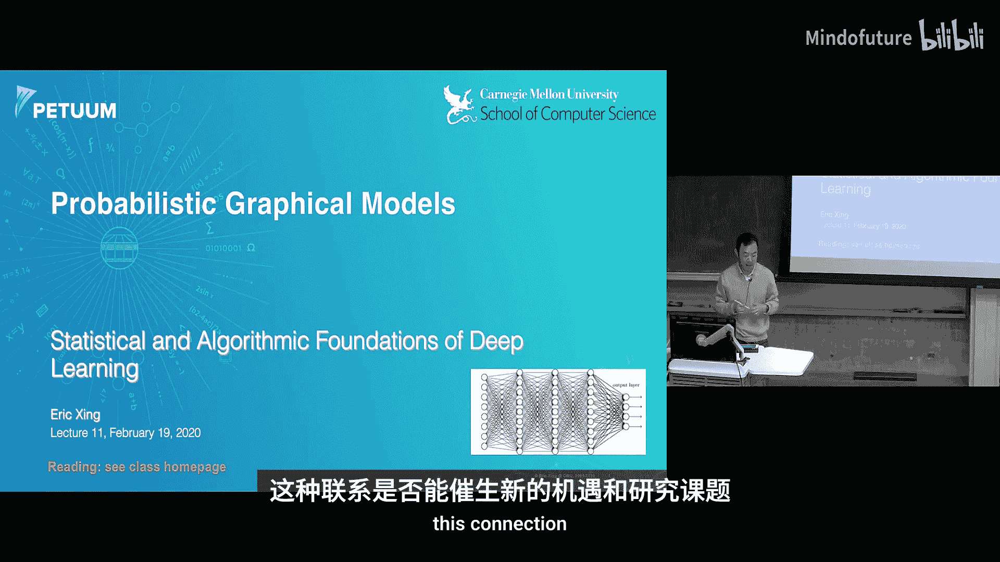
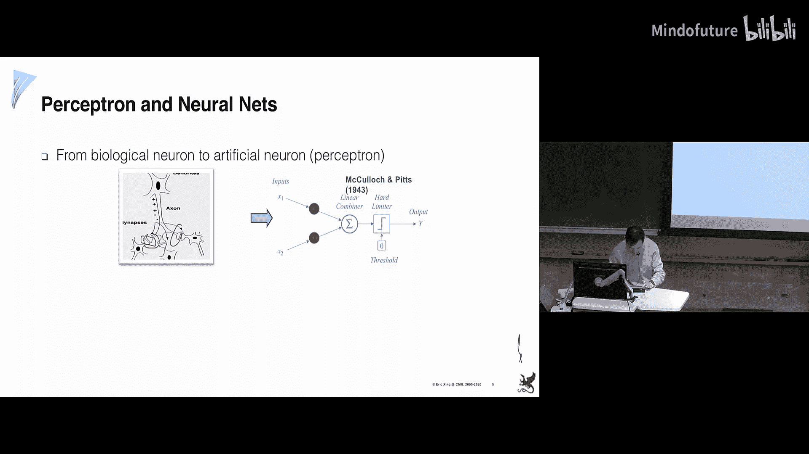
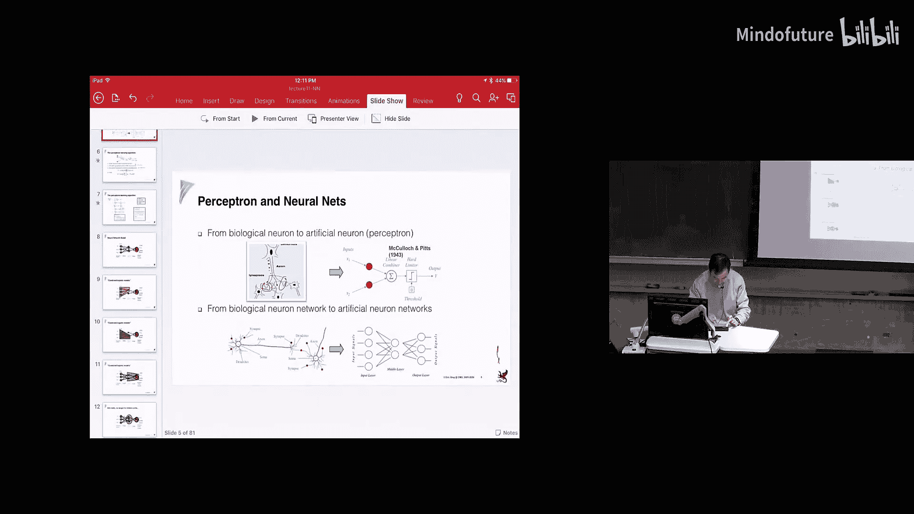
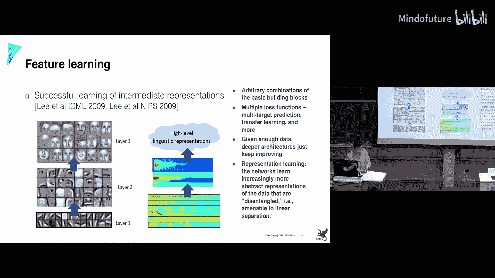
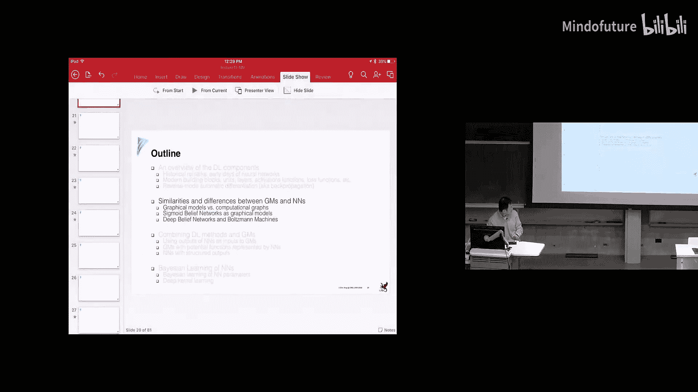
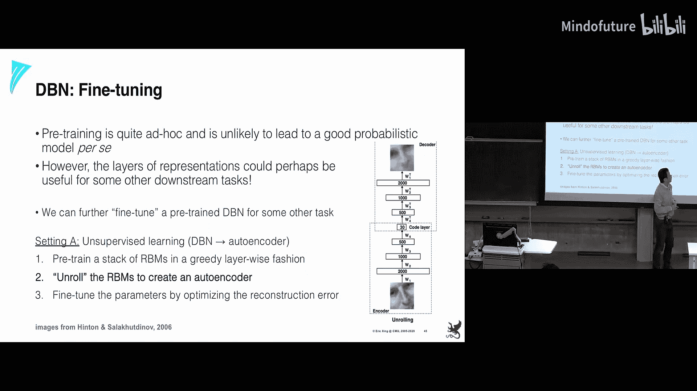
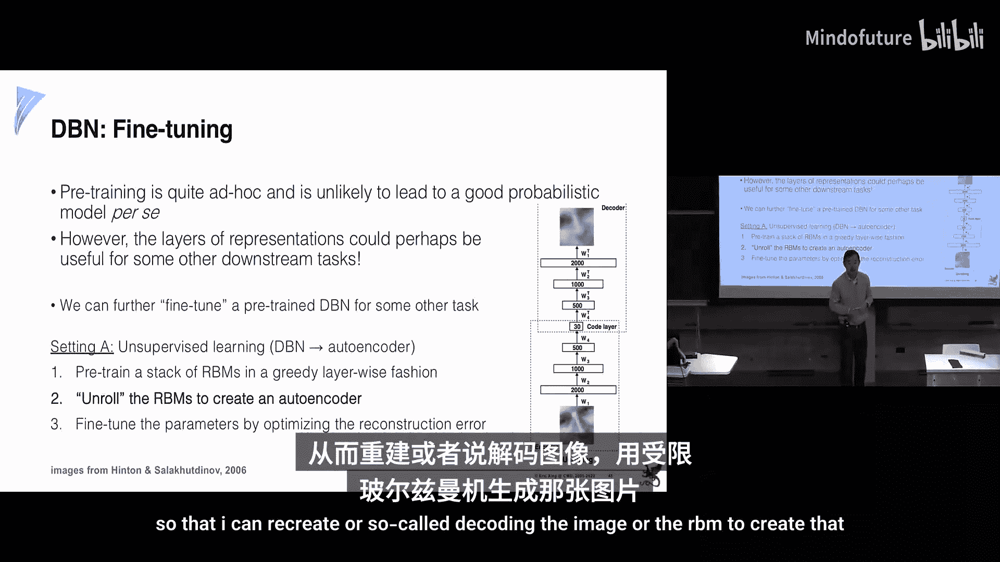
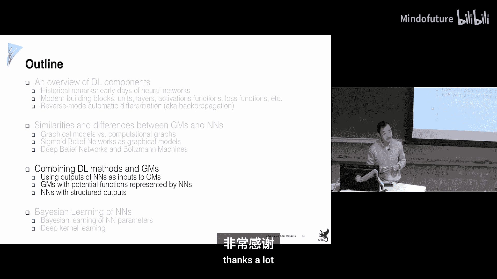

# 【卡耐基梅隆】概率图形模型 ｜ Probabilistic Graphical Models 2020 p11 P11_Lecture_11_深度学习的统计与算法基础 -BV1ebpGzhEA9_p11-

So we are going to start a a new section in the lecture in the next few lectures。

We're going to talk about deep learning。Of course， you can imagine deep learning is a very。

 very big topic。 And there are several classes on campus dedicated to deep learning or maybe a subset of deep learning。

 like deep reinforcement learning and so on， right。So。

 so why are we going to include such a body material here， You know， what's the difference。

The difference is that here I'm going to use the next four or five lectures to focus on the foundational issues。

 underlyingline the deep learning to build connections of this research topic or field。

 how they connect to other areas of deep machine learning。

And also to see whether there are opportunities and， and topics that could get catalyzed， you know。

 as a result of this connection。

So just to begin with， right， So in a sense， machine learning in the old days are somewhat， you know。

 like deep learning。You know， at least from many people's eye， you know。

 like public or or or less kind of sophisticated application people。

They view machine learning as a learning as creating a learning machine。 Therefore。

 you throw in data and you get something out of it。 You crank the， the knobs。

And tuning parameters and so forth So get something。But as you can see， as this field evolves。

 we know a lot more theory and a lot more inner fabrics， you know。

 insight all the different machineries and building blocks。Now， deep learninging。

Which is actually as old as machine learning。 maybe even not， if not older is kind of like that。

 right， And I think the way we understand deep right now is that you， you。

 you build this vast network of arbitrary layers and arbitrary width and connectivity。

You have a input。You have a output。And then， that's it。You are going to train it。

So the question we want to ask is that is they learning equivalent to machine learning。

Are it the same thing， or what is the difference， right。So， I'm going to cover。

This list of materials， hopefully， today， of course， you can see there are a lot of topics to cover。

 I'm going to probably only be able to cover the first two bullets。

 And these ones are a little more technical and narrow。 And I leave them as the supplementary。Okay。

 let's start from here。 An overview of deep。 You may already know that。

 but just for the sake of completeness and contextualize the whole thing。

 I want to speak a few words about that。 Oh by the way。

 I forgot to mention in from one of the visitors in my last office， our， you know。

 one student expressed concern that oh， I met too dumb that I couldn't follow all topics all the materials in classroom。

Okay， rest assured you are not dumb at all。 Most of if you will be all， you know。

 able to get what I'm saying in the classroom， you know。

 real time and go home without any actual effort。 You know， the whole thing you are genius。

 I really admire you。 I was not able to do that。 Okay。

 I remember that even 20 years ago when I took such a class from Michael Jordan's class， You know。😊。

It took me a week， okay， after the class to catch up the whole thing。

Here is really about giving you some hints， some pointers。

 and maybe some inspirations for you to know what to look for in your reading。

It is absolutely not for everyone to digest the whole thing real time and then go home and rest assured with all the information。

 So if you are not there， don't worry， this is expected。

 If I'm teaching you something that you can know real time， I will be very frustrated。

 I mean the stuff I thought is just too trivial。 you don't need a teacher at all。

 So so rest assured with our part， you will see something today。

 which probably will be a little bit confusing and and a bit complicated for you to， to understand。

 to understand。 it's okay。 you will be able to understand it after three or several rounds of reading and materials for reading are as I already。

 yes。Where I want？Where are scrap notes。 or it， it was not posted。 I'm going to ask the the T S。

 It supposed to be posted， but may not be real time because they need to edit and compile and review。

 So， yeah， I will tell them to， to do it faster。Other questions？Yeah， I'm mainly trying to。You know。

 kind of you know， relaxed a little bit。 you know， of course。

 you to take notes and listen very carefully。 But please have the right expectation， you know。

 on how much you can get out of a single class session。 So let's see how much we can do today。 Okay。

 let's see This part， I I， I hope you can easily get it， right。😊。

Which is the history of deep learning。So。Ne neuroologists， you know， physicians， you know。

 had long time interest about how human brain work。And they discovered a lot。 You know， for example。

 we know that in human brain， we have a roughly 10 billion you know neurons。Okay。

 and each neuron look like this。 there is a cell which， you know， shoots out spikes。

 which are called axoms。And then， you know， there are this little。You know， little， you know。

 almost like connectors， which are called ddrites， which is the place that a signal is either received or generated。

And then， you know， there is this intersection in here， which I called a synes。 that is where。

 you know， some kind of aggregation of the signals take place。

 And there are a lot other kind of details， you know， you know， to describe this system。And then。

 you know， there was a inspiration。 There was a desire to。You know， engineered artificially。

 such a thing， you know， using， you know， a， you know， human understandable and controllable manner。

 just like， you know， people build planes after study the birds and people build other machines after studying animals。

 there's the same effort in here。So in 1914， 43。myello and the Pi。

 there are a lot of stories between this pair of student teacher。

But they published a paper which proposed for the first time something called an artificial neuron。

 a perceptra。Which if you look at the graphical illustration of that。

 it's identical to what you see in biology。 You have inputs。You have a linear combinator。

Then you have a gate。Which could be just a hot limiter。As using a threshold， and then an output。

So this two person， McCl actually is a physician。 He is a practicing physician。

 And then Pi is a mathematician。 You can see the combination of the collaboration。😊。

And they were hoping to use this to simulate brain activities。Of course。

 to simulate brain activities。m sorry。How can I。simulate。I couldn't move forward， very strange。

Let's use another display mode。I'm going to do this。

O， great。You need to have multiple such neurons like what we see here。 Therefore。

 you can see it forms a network。Okay。So how does a network look like， Well。

 let's begin by first looking at the mathematics behind a perceptron， okay。So。There are inputs。

 and there are a linear combinator。Okay， and then there is a which can be basically described by this action some。

Weaied some of all the inputs， because you can imagine every downr have different， you know。

 biological。You know， a property like conductivity。With thicknessness and so forths， therefore。

 the signal on different neurons wall be different， right， They are for to have a weight combination。

And then this is a gate function， which is also known as the activation function。

 And then you can use a sigma it， which is a soft can of a threshold。And then， you know， you know。

 you get a output， which could be something like this。Okay。Now。

The only thing that is unknown from here are actually the weights。 Therefore。

 you can learn the weights by maximizing some kind of target function。

 And we actually knew in the past， you know a， you know a graphical model。

 which use this kind of conditional functions。😊，Right， which is the logistic regression。

Right in our logistic regression， we also know how to learn the weights。Which is that， you know。

 your output is like this。But you are going to maximize the likelihood of the output。

 given the input。RightBy assuming certain noise model。And。And then， you know， in this case。

 the likelihood function is a logistic function。Here， some， for some reason。

 they use a different approach because not only they care about the sign of the output。

 which is like a 0 and 1 or plus 1-1。 They actually do care about the magnitude of the output。

And therefore。A different loss， which is the square residual loss， is introduced。

I know who you can imagine that it could also be interpreted as， you know， a conditional。

 because if you assume the output is not logistic but gausing， then you have this kind of structure。

ok。Everything hopefully， hopefully very intuitive and simple。 And then you just do， you know。

 the gradient。Descent algorithm， you write down the laws， you take the derivative。

 And we knew that one nice property of the sigmoid function is that it its derivative looks very nice。

Right， it's ver symmetric。 It's basically the signal itself or one minus a signal。Right。

And then you have all these and that。 So basically， this is a trivial rule。 And you get， you know。

 what we called a perception learning algorithm。 The perception learning algorithm is basically gradientding descent。

In fact， you can see that in the literature of entire machine learning。

 there are not too many new ideas about optimization。 Every algorithm called it you know。

 percept learning algorithm or even down the road back propagation or even you know。

 variational E M and all that。 They all basically are versions of the grading descent。

 So grading decent is a very， very powerful algorithm。So here， of course。

 this gradient is computed over the entire data set。And if you have a lot of， lot of data。

 this will be a very cumbersome summation。 Therefore， there is a stochastic version where。

 which where I did it。 Okay， it's not even written written here。

 But you can imagine that I take this summ sign off。

 And then you can see every example will give you a signal of update。Okay， so very， very simple。Now。

 put this into the neural network。 You have this。Which may appear to be。

Trivie and nothing different from what we did before， Right， So after all。

 we have maybe this is a single perceptionceptron。 and that is a single perceptionceptron。

 And lastly， I have another single perceptionceptron， okay。😊，Now， I ask， can we use the same。Idea。

In our perception learning to learn all the weight in here and there。Again， this is a review。

 I suppose you've see this already before， But if not， think about my question。

 I have an algorithm already， right， which is gradient descent。

 and I have the analytic form of the gradient。Which is based on minimizing the square loss。

Of the output and the observation。Can I do the same thing in here？要 be can。Okay。

 there are some pe new questions。How can I learn things in here Here， it's。

 it's an intermediate layer but you don't see a output。Right。

 so there isn't a observed output that you can compare with。 Then what do you do。

At least there needs to be something。Something needs to be done， right？Okay。

That basically leads you to this very famous algorithm called back propagation。

 And it's mathematically correct。 Okay， formal。Imagine that we have this。

sequence of in the input variable。 It will be generating something called a intermediate form like a 2。

3，4 in the middle that you are not going to be able to see。And then， it's going to get the output。

And there is a black box in the middle。Every edge is associated with a weight。 Therefore。

 you need to now take a derivative of the output to the with respect to the input。And edge Bly。

 how do you do that if you have this intermediate sequence。Well， you use something called a channel。

Right， you introduce whatever intermediate term， which is the parent。Of the last output。

And then you sum over all these parents and have a partial differential over each one of them。

 And then a partial differential of that against the original argument。 right， So it's very very。

Straightfor。 And if this one is also having a predecessor， then you do it once again。 right。

 the parents of the I1。 And then you do， by the way， there is a notational error here。

 which should be I 2。Okay。And so forth。Right， so this is the A break formula we should all know from maybe first year calculus。

Now， if you look at this exact procedure， I need to start from here， which is the note 5。

To hear what graphically， I could imagine these two things are not being touched upon。To act on。

And then lastly， I'm going to act on that。So you can see generating F amounts to starting from X and computing the next phase and go to the the the output and then learning。

 okay， which requires you to do you know， you know， sequential sequence of derivatives。

Goes back and touch every node in that order。So in a sense， this graph。

Can be also viewed as a computation graph that recognize our documents。 You know， the every。

 the steps you use to generate the output and also the steps you need to follow to compute the gradients。

Right， so now again， a keyword computing graph。I it a graphic model， Well maybe I maybe not。

 because graphic model also has other issues。 You actually designed all the nodes and connectivity due to some conditional independences here。

 I talk nothing about that。Okay， so this algorithm actually is back prop。

You see all the back algorithm and all over the place。 In fact， they are all doing this。

 That's why there is a way to even automate this nowadays， you know， using Tensorflow that， you know。

 there are these many functions people use， and you can basically do a library of all possible derivatives that you ever run into and then make it a library。

O。So， now， let's look at。You know， take a maybe you know。

 a 5000 m birds eye view of the whole thing and see what are the building blocks We actually need to build a deep network。

Obviously， we need to have something called a activation function， which is in here。And。

It could be just a linear combination。 It could be a rectified， linear function。

 It could be a sigmoid tangent and a lot of things。 there's a library there。

Another thing is the structure。Or maybe the layers。And people could use all these different ideas。

 It could be a fully connected layer from， you know， you know，You know， like like this。

Or it could be a convolution layer where， you know， you're gonna connect， you know， the next。

 the node in the next layer to a subset of the node from the previous layer。

 And then there can be an overlapping idea which basically covers this。 Therefore。

 there is a overlap best called it convolution， right。You can have a recurrent you know。

 connectivity， which can be enrolled into a horizontally mini node kind of hidden layer。

It could also be a block kind of structure。 And with some kind of a detour or bypass。

 a short circuit， you know， from here to here to communicate additional message such as a residual。

 right， So these are ideas now youll see often in those nice names， convolutionary network。

 restnet and so forth。And， of course， there should be a loss function。

 How to qualify the goodness of the output。😊，You can use cross entropy laws， mean square laws。

 We saw this already， and so forth。No。This is a fragment of the Google nets。Which was a benchmark。

 that people。You know， compete against or measure against， you know， in the several years ago。

 you can see this network。Is essentially a composition of many of these， right It has， in fact。

 it it， it has this a nice kind of structure that allows all these ideas to be combined and put into a show。

😊，You saw the convolutional part in here。You saw average and max pulling in here。

 which is a particular way of gating。The inputs。And specifically used for convolution。

And you will see a fully connected layer here。You may see a few more things。Yeah。

 such as the concatenation of the same thing over and over， they could be repitive， repetitive。

And then you can use different loss functions。Right，So that's pretty much， you know。

 how people come up with all sorts of deep network models。

 It's really allowing a arbitrary combination of all the basic building blocks。

 So it's highly composable。And it could accommodate multiple loss functions， all at once。Okay。

 and allow different tasks to be completed， such as you know， multitask。

 multit prediction in the sense that your last layer doesn't have to be one node。

 but the multiple nodes， each of them predicts a label。Or a sequence。

And you can even do transfer learning that you train the thing on one data set or one task and maybe move the whole thing or a part of that into another。

You know，呃 task or model。And typically， people have this faith。 Okay， it's like， it's a faith。

 I think it's not proven。 like you， if you have enough data。

 the deep architecture will keep learning， keep learning。And until they do。Something nice。

 That's a faith。 It's like I have a face on you。 I， I keep teaching you。

And you will get smarter and smarter and so forth， which is reasonable， right。And。

Something behind the thing that people are imagining or maybe people are investigating is why this can happen。

 or at least people have one agreement， you know， you know， on this， which is actually。

They feel the deep neural network is doing something called a representational learning。 In fact。

 right now， we have another good conference called Icle。

 It's the International Conference of Represental learning。

When Professor Yang Le Kung created this conference， there was a debate。

 Should we call it the conference of deep learning or something， I think he was wise enough to。

Kind of push the foundation and fundamentals and code representation learning。

 which is a great idea because it accommodates many research topics。

 which are not using deep learning， but still push for representations。And basically。

 what does the representation mean， It means that the network can increasingly learn the abstractions or abstract apps representations from the data and disentangle them。

 Okay， I will give you examples about what do we mean by disangle disentangle them。 For example。

 it was observed that when you train a deep neural network。With， say， facial data。

It turns out that you look at the weights， O， in each layer。

I think this was originally Andrew Ying's work。 I remember that when we bumping into each other at the airport。

 he pull out his computer and becoming so excited about his finding and start talking to me about all this。

 I was like 2007 or something。😊，And that's what they discovered。 You know， on the first layer。

 the weights are like this。And the second layer the weight are like this。

 It's kind of magical that when you push up the layer， you start to see faces。

 Here you see the parts on the face。 And here you'll see， like edge detectors and so forths。😊。

Of course， I have to also be honest， this。Show， showing， showcasing cher pickingking。

 there are many other weight， which does not mean anything。 Okay。

 but at least the good thing that there are something。 Like。

 remember this a cat face story in the in the， in the in the， in the， in the in the media。 Again。

 it's， it's cher pickingking。 but it's not。😊，Meaningless， because there are kind of enough。

 interesting stuff in each layer。Likewise， in language。

 people also found that if you have a audio played in here。They will pick up signals。 Okay， you know。

 all different granularity all the way to sentence level entities。Very interesting。

So that's why people call deep network to be doing representation learning。

Even without supervision or with supervision sometimes， and each layer has some interability。停就 that。

Deep network has a very high level overview。I hope you are with me until now。

 because these are pretty hopefully straightforward。 Now。

 I'm going to get something into a little bit deeper。Oops， looks like I'm moving here， but not here。

Let me unplug。Okay， now it seems to be working。

right。O。So now let's see， you know what we see so far。

 how are they different from what we learned thus far， okay。Fund before previous lectures。Now。

 in graphical model。I think representation for， you know， in terms of the nodes and edges are very。

 very carefully matriculously kind of designed， right， They every node basically has a meaning。

You know， it's either the observation data or the hidden courses。

 And then every edge also had some kind of meaning because you want to reflect or capture dependencies。

Right， so for example， here are some examples。And here is another example。

 And you design all these grids or you design all this， really， you know， with a， you know。

 with an idea about what they。Than to do， you know， in your mind。And here's a topic model thing。

 right， So all these designs are very， very。Application and idea specific。Now， in deep learning。

The representations。 And also， they have a lot of other functions。 I'm going to say in the second。

 why the structure is useful in deep learning， as we see， first of all， the representations。

Are there for computing。 They are really， you know。

 a vehicle to organize your computation from input to output or from output to input。 You know。

 when you do from the estimation， the in representation were not man。

 but it happened to have that kind of meaning when you design that。

 you didn't say this node has to capture the notes。 and that node has to capture the ear。

 You don't mean that。 You just put all the notes here as a placeholder。

 You don't even know what they are holding。 to begin with。

 It's only after someone who are curious enough to look into those ways。 They find， oh。

 there are something interesting there。And so， so that's interesting。 That's a very big difference。

 In fact， one is a computational vehicle， and the interpretation is a byproduct。

 even if they don't have any interpretation， it's okay。 Okay， I can still do it in here。

 that's very different。 And you begin with a meaningful design。 And then， in fact。

 you want to even qualified model by their ability to recover those originally intended design。

And yeah， so learning the inference here， you know， really becomes a holy gra of the whole research。

And it's based on a very rich toolbox of well studied and structure dependent technique。

 You have this E， M message passing V I MCMC， we learn all this over。Okay， and then the。

 maybe the umost kind of way we qualify or we vet all this method is to ask， are they accurate。

Are they accurate against a ground truth of all these hidden variables。So in deep learning。

 I guess the， the sentiment is very different。You know， first of all。

 people don't worry too much about learning。I think nowadays。

 particularly so if you look at the the thousands of deep learning papers in CBPR。

 N O P and other conferences or even in M， L， it's more about having very。

 very amazing architectures of the graph。😊，Right，When you look ask them about what's your algorithm。

 or algorithm。 No， maybe I can speak， say it's a back。 or we say I just call a tensorflow library。

 They do it for me already。 I don't。 I don't worry about that。 right。

 So this a field of influence and learning in deep learning is kind of gone。Okay， mostly at least。

 there are some people still worry about that。 but not not people。

 That's why even a high school student sometimes could publish a paper in CPR because they need to design。

 But then everything else is taken care of already。It's very interesting。呃。And then， you know， here。

 you know， of course， we are going to talk about the issues about qualifying the algorithms and so forth。

 because here your representation in the middle one is not the holy grail。 It's just a byproduct。

 You are not really designed that to discover those。 Therefore， the inference are correct or not。

 is's hard to tell。 and maybe not even meaningful to tell。 You care about the end goal。

 Did you achieve。You know， a prediction task or something。Okay。

 so here I get back to what graphic model they represent。The model。 And here。

 they represent computation。Okay。And。Then the utility of the graph， of course， become very different。

Right， in graphic model。I can name a few utilities。

 You can view this as a review of what we learned so far。 we're going to now resurface all the names。

 Hopefully， still remember。First of all， it is a vehicle for synthesizing the global laws。

 You have a global loss of the whole model。 And if you remember， they are represented as an equation。

 Either in the undirect graph model case， using the Hamishly Clifford the build on potentials or using the base factor the build on local conditionals。

 right， So potential functions， feature functions are all used。

 So graph helps you to kind of aggregate together using equations like this。😊，And then furthermore。

 the graph becomes a vehicle for you to design and carry out efficient inference algorithms versus trivial algorithms。

 For example， we have some product mean field approximation。

 This actually all because I want to look at this graph。Right， if there is a big tree with。

 I may want to do mean field to break them down into pieces。 If it is a tree itself。

 then I run message passing to get a convergent correct algorithm。

 So there is a clear guidance from the graph。 What do you do with inference。And then， of course。

 it is a vehicle to inspired approximation when you， for example， run into， you know。

 a a large tree with model like a easy model of grids。

 you actually can design approximations which disrupt the least number of edges in the original graph。

 like， you know， what we're doing here。 You can approximate with a trueing field or cut a few edges away。

 I make them into a tree。 something like that。And then it is also a vehicle to monitor。The theory。

 theoretical and empirical behavior of the accuracy of the inference。

 because you actually could have known the ground truth。Because you有有有 design that way。And then。

 of course， at the end of day， you know， the loss function is a major kind of you know， gateway to。

 to， to really monitor or qualify the algorithm for learning and inference。 You want to minimize。

 for example， the loss。 maximizeize the likelihood and sos。 So that's basic graphic models。

You can see a big departure， you know， in against all this。For example， here is a neural network。

 It is a network for translation。And you can see there are two parallel sentences from here and there from top and bottom。

 And then these nodes in the middle are often called soft attentions。Okay， they are put there。

 They are continuous differentiable functions。And you use the graph as a vehicle to conceptually。

 you know， kind of synthesize a complex process。 You know that just like were human， I hear English。

 I want to translate them to French。 My brain is a mess。 You know。

 have a lot of wire and networks and so forths， but somehow magically， I can throw out a translation。

 This is exactly what's happening here， right You hope that this whole thing in the middle。

 magically would work。And you use back prop and all that， you know， to really， you know。

 learn the weights。 And you may be lucky enough to find some of the attentions in here are interpretable。

 But you don't don't care。 The， the， the thing you care is about it。

 Do it get good translation or not。It could also be a vehicle to organize purely computational operators。

 such as we see in this。Recurrent neural network。 you have computer modules。

Which are take average over， say， local distributions determined by all the local nodes。

It's a certain type of pulling method in a sense。 And then you do this before this and then。

Subsequent that。 So you literally walk the graph to organize your computation。

And it is also a vehicle， of course， to design the processing steps and， and the。

 the modules of the computation。 And there isn't really obvious utility in evaluating the inference algorithm。

 How do you call a in After all， there is only one inference algorithm。

 There is which is back problem， But even。For that one， how do you evaluate school or not。

 Do you actually go back into every node and say how accurate it is recovered。No one do that죠。呃。

So you can see the philosophy is very different。 Well utility of the loss function。 Well。

 the loss function actually。For the sake of training is usually the mean square laws or some entrepreneurpy loss at the output site。

 But at the end of day， people don't care about that。

 People care about how my translation works using say blue score or something like that。

 So there's a different loss function。You know， to evaluate。

Then the loss function you use for training。 You can see this Miss lineman。Right。

 so you can maybe say that this is more like a art。 It's， it's less close to a mathematical practice。

 but a a art。Is that the bad thing。Or good thing。What's your opinion？In the early days。

 this caused a lot of debates and bad feelings， bitterness and so forth。Now。

 I think people are willing to reconcile， because it worked。Okay， so that's very important。

 So what's， what's your view。Someone to speak up。You may say， well， after all， why。

 why don't we still need to have a graphic model， Because nowadays this， this， this。

 this technique is ruin the world， right， maybe。10 years from now， we don't know yet， right， Well。

 I think it's a great thing to have all this。 It's just like， you know， when when I just stand。😊。

In here， at the beginning of class， I look at you guys。

 I suddenly have this a very interesting kind of reflection。

 It's like how I teach you about all this。😊，I actually don't know how your brain work。You know。

 I actually don't know which neuron gets fired or suppressed in your brain so that you remember particular equation and so forth。

But because of that， should I give up teaching， give up my job and become something else。 No， right。

 It's still fun to teach。 And I have a faith that you guys can learn something out of it magically by wiring your brains and then it work。

😊，I think that's the spirit I learned from this community。 They care a lot about getting things done。

They may care a little bit less about how things worked。 But people， you know， some people do' care。

 That's a good combination of the community In the traditional machine community。

 we see the other extreme。😊，People want to basically know the nuance and mathematics for the sake of knowing that。

 even to the point that I want to prove a theorem because I need to push the theorem through with all the。

 you know， mathematics work。 I drop this condition。 I bring in that assumption and so forth。

 therefore， I prove something。 But that condition or assumption whenever true in real world。 Then。

 yeah。What's the deal。So I think that's what I learned from this community。 I think it's very。

 very exciting。😊，Okay， so let's go back to， you know， the， the science part。

This is a side by side comparison。I hope you got the points。 And then in the future。

 when people were questioning you about why you do this and not doing that。

 At least you have an intelligent answer for that。And here is even the older slice I used in early days when I was asked to moderate。

 basically the whole branch， you know， in the field to contrast them。

I found this to be quite amusing。 You know， I was asking， do they really。

 really equal a smaller and bigger， or I don't know。 But I see the difference。In fact。

 the difference of the style is also very interesting， right。The red ones are the commonality。

 They they oil graph。 They also have some machine task。 and there is the objective of， you know。

 you know， build global value out of localist design。 So these are common things。

 But starting from here， a lot of differences， you can see that。In a sense。

 this D L community is a little bit more imaginative， creative and romantic。😊，you。

 you can see all these words， the vocabularies like neuron。 And later on。

 you will see interesting names like wake up and sleep and so forths。 Okay。

 and here you see kind of a more boring words like variable， like likelihood and so forths。😊。

So it's more kind of a kind of accessible by the public and by the community。And algorithm， again。

 here you have the great simplicity of relying on one big work algorithm。

 And here there is a whole kind of bag of different ideas。

Evaluation is based on blackboard score and performance。 And there， almost every intermediate step。

 you know， in your influence and learning could be evaluated formally and empirically。

Implementations here， I think， yeah， there are countless tricks。 Okay， some are told。

 some are untold to get it to work。There， I think。It's most standardized。And then there are， okay。

 on the experiment part， usually here that's youll see where the big industry have advantage because they have a big real data。

 And over there， you know， there is a limitation。Okay， now。

 let's go to the less entertaining part and dive a little bit deeper into the。

 the hard mathematical part。So so far， we've seen graphical models and deep neural networks。You know。

 you know， being different in so on and so forth way。 But actually。

 if you look at 30 or 40 years back， these two communities， you know， are are very。

 very deeply kind of overlapping， at least if not the same。 okay， you see。Big names like Hinton。

 Smoanki and all these people。 And even you know， our own， you know。

 Roland was also one of the key players， even in its early phase。And many deep learning models。

In the good old days were actually formally mathematically a graphic model。

And let's see a few examples。Still remember this model。The RBM， which is a two dimension two layer。

 you know， you know， mark random field， right， And you can write down， you know。

 the join distribution using。Singleton potentials。And the pairwise potentials and weight and so forth。

 were a standard。ok。So now， let's see how this connects to deep neural network。It's not deep at all。

 Just two layers， right。Okay， now let's do some math。You want to learn the weights。

And you take derivative。 And then you see a very interesting regularity or structure， you know。

 in the equation。Here， there is a step that needs you to take expectation of something。

With respect to the posterior， the hidden variable given the observation。And in here。

You need to take expectation to a distribution that is joined over。V and H， both layers。Imagine。

 of course， we can start to compute。 what is this。 And we know that the inference like this is very difficult。

 right， So typically， people do sampling。And some hidden， given the observe。In fact。

Can be very easy because if you remember the structure。All these are hidden ones。

Given the observation 1 are independent of each other due to the Mark of property。 Therefore， its。

 it amounts to really。Sampling each individual separately and put them together。 So that's not， not。

 not hard。This part is a bit difficult。Okay， because youre， you sample the V。

 the observed ones and the hidden ones are not observed。 Therefore， they are all coupled together。

And。ok。And turns out that， you know， people recognized。You know。

 the very different natures of these two sampling step， even though they appear in the same equation。

 and they start to give interesting names already， which I find to be very amusing。

 The first term is known as the clamped weak positive face。

It's about drawing the invisible conditioning on the visible。 Well， imagine I'm a human， I。

See things。 And I want to， you know， come up with the hidden semantics between it。 So I'm weak。

 So this is why it's called weak。 It， it kind of draw analogy to a person who is weak。In here。

You start to， you know， impute or draw samples for the V， which are the visible layer。

 even though you observe it already。 But this is for inference。

 You have to still sample it from your distribution。Then Hton feels this is like people asleep。

 You don't see the real world anymore。 You just want to dream about it。Okay。

 so that's basically why it's called the week sleep step。In fact。

 this is a term we' are going to revisit in the next few lectures。

 which actually inspires the current variational encoders and generative adverse network models and so forth。

There are some mass connections between them。And we also know that the second term。

 the negative phase， is heavily dependent on the mixing property。 It's a hard to sample distribution。

O， so that's the first thing。 So far， you don't see any connection to network here。

 It deep learning yet。 It's just a， you know， a two layer。Conditional random field。

 a true graphic model。The second model I want to present is called the sigmoid belief networks。诶。

In the this has been one of the earliest kind of a popular practical model in artificial intelligences for decision making。

 You know， for example， diagnosis in hospital system expert system was actually exist30 years ago using this kind of technique。

 Many， many symptoms。 The doctor， you know， you know， collect it。 And then you run through a network。

 which combines all this。 And then they will give you a prediction of the disease。

For whatever reason， people want to stick to a very。

 very simplistic gate function or integration function， which is a sigma。 Sigmoid is a very。

 very popular function used all of place。 It gets differentiable。 It is a linear combination。

 It's a log linear model。 It has your all nice properties， but。😊。

One caveat is that it does not allow complex combinations， like comb combinations， X。

 or kind of interactions and so forth。Should we design a another F that gives you this。

Or we stick to this， but manipulate the， the arrangement， the structure model。

 where people choose the following。 People come up with something like this。

By introducing aili random variables like a hidden variable。

 I put relays in the middle to take signals and recombine them。

 It turns out that you can prove this creates all sort of nonlinear effects。You know。

 without you explicitly write down the nonlinear function。

 So it's kind of a very easy way to achieve complex effects and learning capacity。

 That's actually probably people believe how human brain。No， is functioning。 You。

 you have all these nonlinear kind of capability of remembering a processing functions。

 or processing signals。 But our neuron is a linear processor。 right。

 The network itself does the nonlinear part。Mathematictically。It creates some difficulties。

 Remember our explain away graphic model， right， If you have a common consequence， you know。

 you know， from multiple sources， once this is observed， then all these are coupled， therefore。

When you are writing down the conditional of this， given that。It become non factorizable。

 It become coupled。And that does come come away。 creates a computational difficulty。

 as we will see in a second。Okay， so now how to learn the sigmoid。There's a page of equation。

 It's pretty trivial。 In fact， I encourage you to to work through that。Okay。

 it took me about the three minutes to walk through every step to convince that it is going through。

I hope you can also stare at it and， and derive it at the end of。

 you basically start from the logistic loss function。And all logic the the， the。

 the likelihood function on logistic regression and then take derivative over w。

And you will end up like this。Okay， this is a very， very interesting， you know， gradientd rule。

 which。Wants you to sum over all the visible random variables and all the hidden random variables。

And then so that you can compute expectation over the hidden， given the visible and so forth。

And again， sumation can be replaced by sampling， as we know。

 So we need to sample from this distribution。 Now， this distribution is hidden given visible。

 and it is a soid it。 We knew that it is due to the explain away effect。 It is going to be very hard。

Right，You cannot sample one by。 Well， in fact， each of the elements is like this。

 but you have this a huge thumb here， which actually creates a lot of trouble。Okay。

 so there's no negative face。 That's a good thing。 It's not like the RBM。

 you have both positive and negative。 And we knew that the positive face is supposed to be simple。

 Some hidden given the observed。 But in this case， because of the explain away。

 you still run into difficulties。Okay， now let's look at this particular equation illustration。

 which I found to be very interesting。So go back to the RBM。 You have these two faces。And in a sense。

 you need to sample H and V。Right， and typically if you do give sampling。 remember。

 Gi sampling is asking you to sample every random variable given the rest。

And another idea is called a block if sampling。 You sample every block random variable。

 given the rest。 How about we make these two blocks。Then what you are doing are literally like this。

You start from the visible。有 some后的 hidden。And then given the hidden。

 you sample the visible again and all this。 right， This is a literally， you know。

 a computational step。When you are doing the Gi sampling and， of course。

 this whole thing will go infinity。And then you will be looking at the equilibrium。

 Maybe at the infinity。 There is a still infinite lung sequence that you want to collect sample from and start using the hidden or the visible altogether of the。

So if you look at this， maybe I would rearrange it a little bit。I put it。 Okay， I would。 So。

 for example， I would just you know， instead of unrolling it horizontally， I put them like ups。

 you know， like on top of each other。Something like this。What is this model。

This is a sigma network that I just talked about。 In fact。

 this whole thing looks like a infinitely deep sigma network。Okay。

 so that's actually very interesting。 Now。 A graphical model when it is in action under computation like sampling。

😊，It gives you actually， you know， a model。That looks like a deep believe network or the the deep Sigma network。

 at least in the computational nature， you literally need to walk up or walk down， you know。

 depending on which one you， which block your star first， you know， to do sample。

And it will go infinite long。 That means it will go infinitely high。 right。

 So that's the first kind of interesting kind of connection that establish， you know。

 the connection between a shallow and very， very concise graphic model versus something that is deep and a little bit ambiguous you know。

 network model。😊，Okay， so these two things are computationally equivalent。Okay。And also。

 you can see some other nice， interesting。Properties。It， it could， So for example， you know。

 we are talking about。You know， this now infinitely， you know， infinite layers of RBMs， right。

 And at the bottom， there is an observation phase。 And this is。Infinite。Okay。Now。

 if I decide to clamp this and that。And leave the other thing up there。

Do you see what Im what I'm doing， I'm basically not explicitly spell out the bottom two layers or maybe three layers as the deep。

As the Sigma network and the live whatever above。O， to be remaining the same。

How many layers do I have in here。Infinity -2。You're still getting infinity。Right。

 so this is still A RBM。Right， so you can see the magical thing， which is that， you know。

 A RBM or a infinitely deep sigma network is equivalent to having a finite layers of sigoidoid plus A RBM on top of it。

😊，Okay。And again， all these are kind of a postmod intelligence。 You know。

 people realize that afterwards， but it， it gives you a lot of computational advantage in the end。

By the way， I forgot one important thing。 This is not quite the freestyle。Sigma network。

I didn't bring that issue up， but now you can see why that's not freeedyle in。

 in our deep Sma network， Did I say any anything about the parameters。The weights。Well， every layer。

Should have its weights。Right， there is no constraint in here， when I'm unrolling this。

Did you notice that the weights in here were here are the same。Okay， so therefore。

 it is a weight cramped。Infinite layer sigma network。 That's something you want to remember。 Very。

 very important。Only when the weights are all claimed to be the same， you have these equivalent。Okay。

 so then。It gives you some kind of idea about training the network。

Which is more kind of a stage wise。 For example， you can imagine that you could just。You know。

 either train from the infinite layer using some way。By clamping their weights。

And then you can extract a RBM out of it。Or you can start from a single kind of， you know。

 RBM where maybe youll just pay the cost and train it anyway。Okay， and then start to。

Stack it on top of。Like what we do here on top of one more layer。

And then allow the whole thing to be retrained。 You have the new in input data。

And somehow it become heuristic and ad hoc， but it will get you something。

 And because of you have the face that after all， these are all the same。At infinite phase。

 therefore， I will， I will somehow get， you know， a full RBM or a finite step RBM plus the sigma network trained somehow right So I can that's kind of the the wisdom people start to play with。

 Well see a few examples。 how to get the network。Okay， so move on。

What I just talk about where you see a RBM on top。And a few sigma network at the bottom。

And now with the weight un tight actually is by itself also a model。 Okay， people actually， you know。

 independently worked out a model which exactly look like this。😊，It's called deep belief nets。Okay。

It's a hybrid bracket graphic model。 Sometimes we call it a chain graph。

 We didn't actually cover that in our main lectures of the representation。 But just for information。

 this chain graph was used in the past to describe graphic models like this。And again。

 exact inference is complicated because of this explain away effects。But in training。

 people actually do the following， as I suggested， you pre train。Maybe this part。

And then you start to propagate。In the ad hoc way to do fine tuning。And， of course。

 there isn't a were proper idea， picture of the joint training of everything and。

And then across the inference it's very， very easy。 It's just。

Feed forward or feed backward by running， you know。

A belief propagation or a back propagation type of operation。Okay， let's see how it worked。

 So here is the network just to take a closer look。

 You can actually write down the join distribution in this way。This is a。RBM。

 and these are the sigmoids。Okay。And you can write down the log。Of the。俾得。

And we already see all these challenges。 And let's see how the training actually work。Well。

 you started from here。Okay。And then， you know， you can do one layer of inferences in here。Right。

And then， you know， you just assume everything above is just a RBM。 Therefore。

 you have the RBM because this layer become observed。And everything above is undirected。 Remember。

 learning RBM， you know， sampling the weak face， which is the hidden given the visible。

 is actually not that difficult。Right， so you can do this。

 and then you learn the weights of the RBM in here。 And then you stack it into here。 Actually。

 I think the next phase。Is that you are going to now build one RBM off because you。

 once you have this being trained， you can now impute the values in here。 This become observed。

And therefore， you can start another RVM in here and train it。Right。

The difference is that when you train every layer。You can choose to train one stop。 For example。

 you have this。 you impute this and you estimate weight。Just once I move up。

 all you do iterations in here multiple times。Okay， you。

 you have this and you reimpute this and you use that weak sleep procedure I wrote before and then get the weights better estimated。

 maybe until convergence。 And then you impute this part and go above。

 These are basically flexibilities people can play with。Okay， again， if you just go infinitely high。

 then。You do once is equivalent。To you do it many times。Right。

 in infinity times some number is still infinity。 basically you can do finite its here。

 So1 and 10 and 100 doesn make difference。 but usually people don't go infinity there。

 maybe you go 10 layers or 100 layers。 Then some more work you done。 you。

 you do in every layer can cause a difference。 What difference is we don't know。

 It's actually just a ad hoc idea。 You can you feel it's making sense。So this actually gives a very。

 very powerful practical algorithm called the layerwise pre training。😊。

People literally just train all these little， you know， a blocks。Using， you know， this idea。

 layer by layer。And in fact， in you， let's see in how it。

 it worked in in in real practice computer vision applications。

 things starting here becomes almost like a acomist art。 You can see it's very interesting。

 I have this image。😊，I want to do something in the future， for recognizing image。

But my goal is not to my， my， my idea， my technique is not to train a classifier。 say he this one。

 And there is a single output。Because I knew that I need all these internal representations and so forth to。

To generate features and so forth， therefore。For whatever reason， I decide to use a deep。

Newer network， a deep sigma network， for example， then the way to train that is to start from here。

 I train this layer。Then I train this RBM。 I train that RBM。

 I can decide an arbitrary number of RBMs to be pre trained like this。Yeah with me。

 This is very mechanical。 It's doable， right。So you pretrain basically a stack of R BMs in this very greedy layerwise fashion。

 How hard you train depends on you。 You train 10 cycles，100 cycles until convergence。

 that's up to you。And then， even more interesting。I'm going to enroll this RBM even further。

 I will basically put the whole thing upside down and go the other way now。

So that I can recreate or so called decoding the image or the RBM to create that picture。

 I can measure a loss。 Basically， the pixel wise differences of that picture versus this picture。

Right， so I can， again， train those models。In fact， at this step， I'm not yet using this signal。

 I'm just basically keep training， keep training until they generate something。O。

 this basically is the observation of the last layer of the RBM。

Then I'm going to move on and fine tune， so to speak。All the weights。Every layer has a weights。 Now。

 they are enclaimped。 They are free form。Okay， they can be all adjusted just by doing a back prop from here to here。

 using the。Residule the difference between the output and input。So this is， you know， called。Okay。

 there are interesting names for this community。 right， These are called encoding。

 and these are called decoding。ok。And now you can see that when you work on this。

 you don't need to have any knowledge about what is the equivalent between RBM and the infinite sigma network and so forth。

 It's becoming very robotic。 You， you just have these layers and your train and the mathematical equivalent of what you are doing is。

 is irrelevant。And then at the end of the day， you get a network。You know。

 which hopefully can be further tuned for classification of other things。

 facial recognition so forths。 But this unsupervised pre training thing， which does not require。

 you know， the supervision from the output to the input。Is actually， you know， a， you know。

 a key foundation for some of the neural networks。Okay。

So now you can see why people do this or what's behind it。 It's kind of， you know。

 justified by its equivalentence to how people would train a RBM formally。

 And what I'm doing here is literally just use a computing graph to enroll every of the computing step。

 And then in every step， I do a little bit more。 Now actually leads to some of the ideas。

 I'm going to discuss about learning to optimize optimization。

 That's actually a key idea behind a neural network training procedure。

 But I' going to say that in a second。 But let's see I have a few more models。 I should。

 maybe I should just。😊，Just gloss gloss over or maybe just bypass。

 There is another model called the deep Bo machine， which is also similar to what we see just now。

 It's a hybrid graphic model。 You know where you know， you basically drop the edge of all the。

 dropped the errors of all the edges。 right， This is a deep belief network with RBM on top and sig mode at bottom。

 And here you have RBM all over the places。You can imagine that the idea could be the same in terms of training。

Okay。So，So you can see that here are some comments。

Which I kind of said already between the graphical model and the deep network design principle and the utility。

 And in the deep network， I think the primary goal is really to。

Com up with a representation of the distribution of the random variables。

 using a vast kind of connection of latent representations。

And when you add layers of latent variables， you just allow the representation to increase and allow more expression or more distribution to。

 to be represented。So that's kind of the common ground between deep network and the graphic model。

 They want to represent complex distribution of the。Observations at a bottom layer。Of course。

 the modern graphic models don't even worry about that。

It's becoming a pure process or protocol oracle defined kind of model。

 that is not necessarily representing a distribution。

 It just want to do a functional transmission of input output。

 That's something we' are going to talk about later。So不。

One diving point that you see already is that these are hidden variables。Are auxiliary。 Okay。

 they are not the kind of first class citizen in our model。 You don't care about their numbers。

Honestly， right， You just， they are just a relay relay or a a proxy to kind of generate some intermediate representations。

And at the end of day， the usefulness are really judged by their usefulness or the downstream task。

In contrast。You know， you that this this is open thing that I want you to take home and think， right。

 In contrast， you could do， you know， a。Better job in the inference。

In figuring out all the values of the hidden variable， you actually could theoretical quickly do it。

 This was a paper I wrote how many years ago was like。Sa 17 years。

 you can guess how old I am right now， right，17 years ago。 And look， look this model。

 I call it a sigma network。It's sleep network by look and by design， it's the same。

What we did at that time is to study the quality of Ming field。

 B B proagation and other across inference algorithm on inference in this graph。

We treated it as a formalographic model。 We actually could simulate all the true values of the hidden verbal。

 and then we can show different algorithms Does a different job in terms of recovering the truth。

 And these are two ideas about the you know， meanfield approximation。 I basically。

Create a meanfield based on block， kind of a factorization。

 or based on this kind of a block factorization， right。

 And you can have other ways At the end of day， you can compare the accuracy of you know， you know。

 of the recovery of the hidden variables using different algorithms。

 The result was actually quite shocky。We be， we compared the B proagation， a mean field of this kind。

 a mean field of that kind here This mean field is a is a kind of a single term mean field， right。

 There's no edge left。 and you just make the whole thing a product of all the single term marginal。

 here， some edges are remained。 And you can imagine you can see that the accuracy。

 that one is the highest。 and B B proagation here， The accuracy is terrible。Okay， and now， of course。

 there is a time measure。 that's a more practical issue。Now， you may couldn't help but ask。

Back promulation is actually this algorithm。O， it's just a message passing， one way or the other。

It actually generates you the worst accuracy in terms of recover nodes。

But that's the workhorse algorithm nowadays used in every BD proation or in every neural network。

Meaning that we are not necessarily recovering， you know， the true value。

 if there is of the hidden variables。But on your hand， at the end of day， it worked the whole thing。

 So， so how how do we reconcile this， Do we want to do better job in the inference。And。

So this is more like a religion。 you know， when I， when I。Teach religion。I I。

 I guess people don't really， really dive into the details and explain all the facts。

 because that will hurt you to be less faithful and and and confident about that religion。 right。

 I will tell the an outcome， you know， you will be saved， you will be blessed and so forth。 But how。

 you know， you figure out， maybe that's fine。 I think that that's how I see this whole thing。

 sometimes truth may hurt。 And if you really， really get to index into all these late variables。

 you may not get good outcome。 Whether it's a good thing or bad thing。 I have no judgment。

 I think it's everybody's own decision。Alright， so just to wrap up。

 I want to give you some more profound hint about what actually is happening。

In that kind of approximations。Remember that we say。Through here and through here。

 two examples that A RBN。Or a graphical model， you know。

 could be enrolled into a infinite sequence of， you know， directed models or other models。

And in here， it's a computing graph that every step is basically， you know。

 a particular step in the inference algorithm。Now， remember， that指纹 we do a。Gradient descent， say。

 you know， modeling， you know， a particular model， we take the gradient。Then what you do is this。

 right， You just take a step and you go this and that and so forth， and you get to the end。

The theory says that if you do infinite many steps in gradient， you get to the。That that。

 that the choice。Which is similar to what we claim here。 If you enroll infinite times。

 you get the true inference。But remember， in this enrolling。

 the two equivalents are built on two things。One is that the weights are clamped。

 They are the same weights， Very important。And secondly， in every step in here， you do it once。

 you move on to the next stage。 right， That's basically what we recover the authentic。You know。

 initial optimization algorithm。But in practice， when people do deep learning。

 what they do is that within every step。I'm going to redo the optimization my multiple times to react estimate weight。

And then I move on to the next step。And then we do again。 And then at the end of， I do finite depths。

 not infinite。So I kind of want to see this example。 say I used to give this lecture in in in Rome。

 and I was trying to come up with a entertaining example。 Say， we build a real way from Rome to ops。

The long尾。I need to make hops in the middle。And I should be persistent and go all the way to the end。

But it turns out that when the Europeans are building these railways。

They didn't all at once go out the way to the end。 They say， hey， from Rome to Florence to Venice。

 I'm going to build this。 I'm gonna re this。 make it perfect。And then this part。

 I'm perfect and perfect。 At the end of the day， building the hops between them becomes a task itself。

Whether I'm reaching ops or not， well's maybe I I I almost forgot about the task already。

Is this useful or obviously it's useful。 The railway from Rome to Florence is taken by many people。

 It become wide， it become modernized and so forth。

You can kind of imagine what deeper is doing is this。It becomes not about。

Driving to the ultimate infinitely， you know， you know。

 asymptotically converging step toward the end in learning that model。

 you basically are enrolling them into a finite phase。 And then you do a lot of work just， you know。

 in perfecting every phase。So that's why you have this a new equation， which is to optimize。

That algorithm of optimization。O， optimizing the optimization。So this is very， very interesting。

 And in finite steps。So sometimes people view a deep learning with finite steps to be justified by doing what I just said。

 You know， you may have a formal representation that you only want to learn。

 but that's just a vehicle to inspire your algorithm At the end of day， you take a transition。

 And then you redo every step in the middle to get to some point。Okay。I think this vision was very。

 very interesting。 And there are some papers discussing in。

 especially Dunkey's paper who initialize this idea， this， this insight。

 and then many other discussions。So then you can imagine that all this。

All these other models that we use in graphical model literature， such as a CRF。

Could actually be treated differently。 Now， you originally you trade C， What is CF。

 CRF is this model， right。And then you run gradient descent， you know， in many， many different ways。

 you， we actually have algorithm and with no。 we can。 But alternatively。

 you can just build a CF like this step by step。 And then you do hard work in every layer。

You will get something that is not what you expect。 Sometimes I'm curious。

 if we turn all our current you know graphic model and roll their inference step and then redo the inference in every step。

 you know， using a iteration。 It's basically doing optimization within optimization。

 What you are going to get。 I don't know。 It's a very very interesting question。😊。

So these are the open topics。 People are still puzzling。

 but I think that's a good way to end today's lecture。

 So a conclusion is that these two communities had a lot of common， but a lot of differences。

 even the fundamental ones。But the winners usually know both。

 and they actually could draw lessons and experiences from both sides and try to come up with something that is even more creative and and interesting。

😊，So。I have some supplemental， which gives you more kind of examples about how to combine deep learning and deep and graphic models and how to do Beijing learning。

 also in deep network。So you can go over that yourself。 And from next lecture。

 we are going to get closer to the front area of the deeper network research。

 talking about Vs and guns and other modern techniques and also give you some of the mathematical foundations of their。

Of their root in graphic models。Alright。 Thanks a lot。

