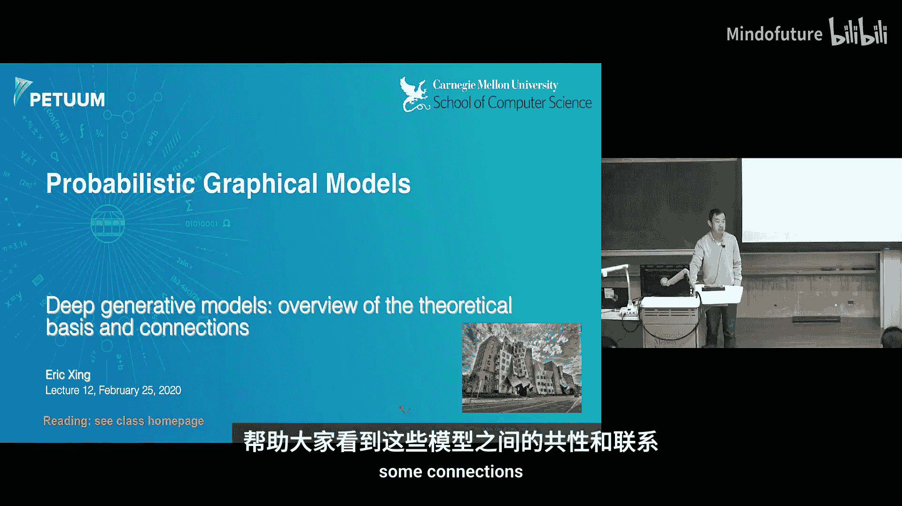
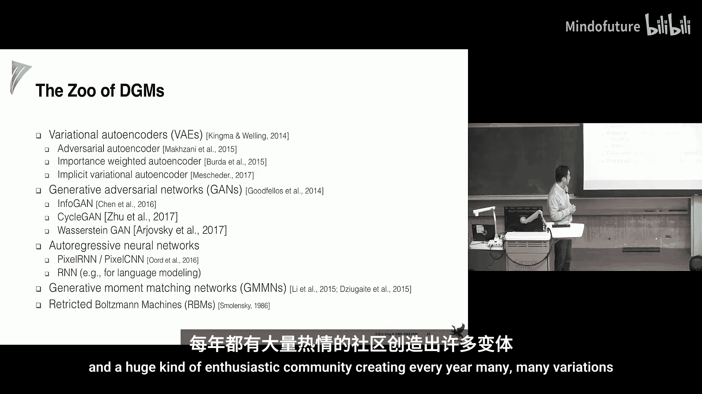
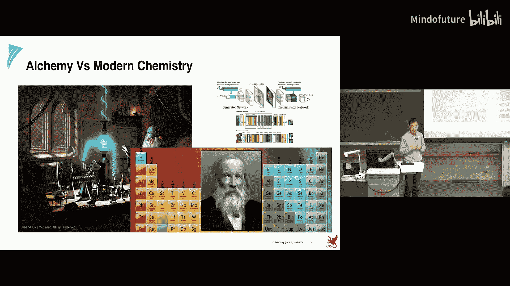
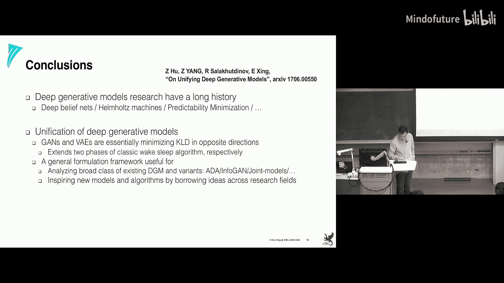

# 【卡耐基梅隆】概率图形模型 ｜ Probabilistic Graphical Models 2020 p12 P12_Lecture_12_深度生成模型_1 -BV1ebpGzhEA9_p12-

So today is the second lecture of the， the deep learning。Module。

 and I'm going to talk about the deep generative models。

Which is probably one of the most popular thing nowadays in this community。You know。

 I if you look at the conferences like CB PRR and A， L， this N，OP and C conferences。

It's not exaggerating to say maybe 90% of papers is about about deepgenative models， Gu models。

 V E models and so forth。 even in mainstream conferences like I L nips for machine learning。

A huge proportion。 More than a half is about that。 Why it's so interesting and what。

 what are the main problems Again， you know， on campus， we have。

Go a couple of deepening classes telling you how to massage how to play with these kind of models。

 I'm not going to repeat all that。 Okay， I'm going to give you the less kind of directly usable。

 but hopefully more unifying and cleaner， theoretical andpinnings of these models。

 So that you can see a unity and some connections。

So what is a deep gene model。I think people probably， you know， were inspired by a picture like this。

Say you want to produce mountains。Such as， you know， in， you know， painting， for example。

 And this is a authentic picture。 And that's a Wangal painting。

 And then you want to create some kind of a Vanangal style re of the picture。 And now。

 deep charity models can produce something like this。Kind of can see that， you know， the shape。

 the context， the， the texture， the color gets morphed into a particular style。 Okay。

Similar operation can happen in text in music， in a lot of things。Of course。

 there is a big issue about how to determine it is a good not。 Did you achieve your goal or not。

 That's very subjective， especially in the space of painting and music。 It's more subjective。

Especially in music。In fact， a noise can be called music。 So， you know， very hard to evaluate。

 But in text， you generate article， if it's nonsense， people can really， really tell it。

 right So there are some different study also about how to evaluate。 That's not the topic today。

 Why are going to talk about how to produce this content。 You know， and what's the theory behind it。

So， again， going back to history。Deep generative models really， you know。

 are probabilistic distributions of random variables， right。

 And you can use it to sample basically instances。 And this word deep really means that you have multiple layers of the hidden random variables like this。

Okay。And a few examples， we learned about last time， you know。

 the sigmoid B networks in which you know， the， the lower layer connects to the upper layer by a sigmoidoid function like this to define the conditional distribution。

And so these are really very， very kind of。Authentic and， and genuine probabilistic models。

 And you are really using the base rule。 You know， there is a。

 there is a joint distribution of the whole thing， which is a factored over P of X I。

Given X I of pi of I， right， And then the bottom layer of the visible。

Can be produced by marginalizing P of x of x minus the V， something like that。 right， And therefore。

 this is the distribution you sample the image or the whatever downstream from。

 So that's a deep generative model。But even very early in the history。

 this very kind of clean and principled idea。 It's already getting twisted。For example。

 here is a early example of the neuraler network models that is deep。 called the hammpquest machine。

 Okay， so hammp machine is you know， graphically， you know。Express expressible like this。

 But this graph is not meant for already， you know。

 presenting a distribution or a unique distribution。 It is actually used to， you know。

 record or document two computing processes。 Remember。

 we say that deep network at some point becomes a computing graph that help you to organize or express a process of computing。

 right。 So this is the case。 you have a generative bias expressed by some hidden random variables there。

 And then through a sequence of you know， a generation process。

 which could be a distribution using this weights as the model parameter， you get you know， you know。

 some kind of data。 or if you already have data that you assume the data are produced by this process。

 Therefore， the data could be called input inputs。And then there is another process。

 So here we have the P of theta。Offer the x。And then there is another process。

 which is a P of the hidden。 Okay， and the parameterss my5hi。Which is called a inference model。

And this inference model and the that model may or may not be related。Okay， typically， you know。

 in the， in the classical world， the inference model is a posterior of basically the hidden。

 given the the the X。 but they doesn't have to be。 You can have any inference model taking the inputs and going up。

And then you kind of using that as some link to put them together。

 alternating the inference and learning methods。And this process， not the global mass expression。

 which is missing， defines the model。 Okay， that's the ha machine。There are actually even。

 so this is about the computing process。 You also， again， don't need to even， you know。

 use only this approach。 There are other ways to define a deep jumping model。

 One of this is called predictability minimization， which is a training procedure。Okay。

 it's just not just the tool process， a training procedure。 That is even more interesting。

 It was again， you know， invented by Schmidter Ha。 you know， a long time ago。

 So the idea is that again， here， my goal is to learn the latent representations of some observation data。

😊，Okay， and then I want the learning effects to achieve a particular the learning outcome to achieve a particular effects。

 which are the predictability of the latent variabless。So he wants to。 this model is like this。

 I'm going to learn these three latent representations。

And then I also define another three representations with which mirrors this。Okay。

 and then every time I'm going to use this two learned thing。To predict that。Okay， and I want。

 you know， the learned outcome to be minimally predictable of that one。

 which is not included in the inputs。 And I want the predicting machine itself to be max。

 maximally able to predict。 So there is the attention。 Okay， the inputs are minimally predictable。

 but the machine you use to predict are maximally predictable。And then you do this for each of these。

Mirrral， you know， with all but one of the latent variabless corresponding to that predicting notes。

 So that's why it's called predictability minimization。In fact。

 you can see this idea was kind of similar to the other idea used in the the generative networks。

 which we are going to talk about in a second。 And there was a huge debate between this author and that author。

 you know， in both private and public value。 you know， to claim credits of this whole thing。

 still not resolved。 you can see there are some similarities of the idea One is， you know。

 know learning representation and then qualified representation using some kind of additional loss。

 There are two loss functions out there。 Okay， that is kind of you know， playing against each other。

 So this training procedure could also define a model again， implicitly。 There is no equation。

That you can use to define what is this model， Sa， writing down the posterior of this one。

Given other them， such thing doesn't exist anymore。Okay。

 so these are the early forms of deep traffic models。 You can see they were all invented you know。

20 to，30 years ago。 It's very， very you know， classic， you know， old in a sense。

 But the word model already ever since then， is already， you know， not very rigorous。对。Okay。

 and then learning procedures going with that not going with in the independent parts is also evolving in some very weird fashion。

 which actually could sometimes cross into the define definition of the model。

 either to install them or to give them the vehicle for learning and inference computation。

So here we can see a few examples。 So such as， you know， for example。

 we know that to train a deep generative models。You could directly use sampling procedure。

 We like a training is about fitting in the latent variables。 And then， you know。

 using a E M type of idea to learn parameters and so forth。 right。

 So you could just directly infer the hidden random variables。

 given the observation using a set of model parameters， which is probably the posterior of the model。

 given the data in this case。 And then this is called data augmentation。

It's asymptotically exact in getting down the true model of X， given all the these。

And then we learned a technique known as the variational inference where we introduce a auxiliary distribution called the variational distribution to approximate the posterior of that。

P of Z， given x。Right， and then you are going to learn the best two sets of parameters。

 One is the theta， which is the original generative model parameter。

But now you have a new set of parameters， pie a P， which is the parameters of this inference model or the variational inference model。

 And then here's a loss function， which we already shown using the jaen z quality that they are the likelihood。

 lower bound of likelihood。You may always。So maybe I give you a very。

 very kind of intuitive project I came up with today when I drive。 Why， you know， you know。

 what's the core difference between this and that in terms of the intuitive of idea。

 Why we need auxiliary。 say you， you climb a cliff。You could just， you know， you know。

 scale up directly。 You know， if， if you are a monster master， you know， cliffhanger。

 you you you we saw some movies， right， It's a so solo phrase， something like that。

 We give you a kind of an idea about how to climb this directly。Right， like this。

And then there are other ideas which like， what if I'm， Im。

 I'm climbing sometimes the experience the climbers want to go into a crev， you know， you know。

 in in in inside that surface， because now you can go this， this that bounce back and forth。

 that sometimes makes the climbing easier。😊，Right， right。

 So this thing is basically the other side of the cliff。

 It gives you the stepping stone to go back and forth。

So you kind of can see that the sampling correspond to this idea。

 and this one correspond to that idea。Okay， and they， of course， could be。You know。

 this one could be a little bit inexact， because what if for this whole thing go the other direction。

 then you kind of go somewhere else。Now。That's the two idea。

 which at least has a very clean mathematical picture。Then there is a third a which is kind of weird。

 called awake sleep。Suddenly， at least these two things are having the common goal。

 which is to maximize the likelihood of the data。 This one is also using a alternating step。

But somehow you can see that the loss function in the ultimate step become different。

 as I'm going to explain， you can already see the differences。 You know， here， no problem。

 We are learning the。Generative model and inference model。 But in here。

 the loss function become different。It's like when you go here。You climb there。 when you go here。

 you climb there。 So what is this， I don't know。 Okay， sometimes it's lost。

I mean that all these methods actually being used later on to compute or to even design the model itself。

But with all these early efforts， there is now a resurgence of deep generative models。 You know。

 again， starting from the RBM， we knew that RBM， you know。

 is equivalent to a infinitely deep thick network。 right， you know， a deep gene model。

 And then we have a few others like a deep believe networks and deep what machines and that。

 you should go back and read about the discussion。 Then at about six years ago， we。

Kind of run into the first modern day actively used deepaginive model known as the variational auto encoder。

Okay， so here， in fact， there the ideas are all old ideas。 but somehow the execution was excellent。

 Then it produced some very nice results。So the model looks like， you know。

 you have hidden variables， you have X。 Then there is a generative model。Again， very。

 very familiar idea。 But this gen model could be very， very deep。Okay。And then here again， go back。

 You have the posterior of the hidden random variable。 given the X。 You call it a inference model。

 And again， this inference model is also very deep。 many， many， many layers。

These two models doesn't have to be。Symbolically or ageically equivalent as。You know。

 conditional and posterior。 Okay， they can be different。They are learned with a shared loss function。

 I'm going to show you in a second。And then that's the deep journey model。 Okay， it's very。

 very similar to what we see before， but it's using a variational inference approach。 you know。

 minimizing a loss。And then almost the same year， in fact， it's about yeah， the same year。

 good fellow and， and， and his advise as and collaborator invented another model known as the generative aver network model。

 which is even more mysterious。😊，So here， basically， you know， we are going to， you know。

 have a process。 It's a process that start from some hidden codes。Or random， they call them code。

 It's actually late random variables。 But this code doesn't not doesn't have any meaning。

 It come from a uniform or Gaussian distribution。And then there is a kind of a transformation process。

Okay， and this whole thing is not defining a generative model。

 It's not really a model because it doesn't define a very explicit distribution。Here。

 you just can imagine 100 steps of transformation with you know。

 multiplications and transitioning convolution and all that。 And then you produce some data。

 And then there is another kind of what here you have a model called discriminator。

 which will compare this with that， which is a database of a real data。 say images。

And then you decide whether this generated image is fake or draw from here。

 because I didn't tell you。If it is a fake， you would reject it。

 and given this whole process a low score， therefore， they need to improve the theta。 Otherwise。

 you accept it。 and also， you learn this file so that this discriminator are becoming better and better smart and smarter。

 even though this is becoming also better。So this is similar to the predictive minimization machine that we talk about in terms of the the。

 the in the spirit。So this is called the generative of aversar network model。And then again。

 there is a whole kind of sequence of you know， other models。

Which I'm not going to even draw a graph and discuss about。

 They are all combinations of earlier ideas or newer accentations。So we are， we。

 we have a zoo of such models。And the。Before I start to dig into the math。

I want to clean up the notation a little bit again， as I mentioned。

 this community deep deep learning is for whatever reason， very。

 very free thinking or maybe not conventional in terms of naming their， their creation。

 maybe one of the reason I guess is that many of the innovators are very young students like you guys。

 they didn't little literature enough yet。And therefore。

 they didn't realize some names have certain meaning。 But on other hand， they are very。

 very intuitive and creative。 They can actually grasp the essence of what is being created。

 So now youll see all these， you know， new names。What is known as the posterior distribution in the literature of statistics。

 which is also known as an inference model in early day machine learning and also variational approximation in describing this kind of models。

 now have a following list of name， partialial list of names， It's a list actually goes longer。

 But when you see something like a recognition model。

 inference network recognition network probablybabilistic encoder。These are the same thing。Okay。

 they all mean a posterior distribution or something close to that。That's basically， this part。Okay。

 the inference model， okay。And then the model， sometimes it called。

 which is a prior times a conditional going from top to bottom。

 which is also known as the generative model。 or the likelihood model now has all these names like generative network。

 a generator and decoder and sos。So， yeah， it's a little bit difficult， know。

 create some difficulties in， you know， helping people to connect dots。 hopefully you you， you。

 you should be at least familiar with all these things。 In fact。

 I may be also interchanging between different words in the subsequent lectures。Okay。

 so now be let's dive into the math。 you know， for all these models。

 Let's begin by what we already know， variational inference。 Just to recap。

 Veral inference is about learning this whole thing。For the hope of learning this。O。

 you want to learn P of data， which is the model。 And you use a stepping stone。

 the P Q of5 to be the ladder。And then， you know， the goal is to the， the trick is to now。

 instead of learning this， you define the lower bound of the likelihood。

 which is also known as the free energy。Like this。 And then you are going to start a alternating procedure like the E。

 M。 In the E step， you maximize that bond with respect to。

The inference parameter5hi with the generating parameter theta fixed。In fact， symbolically。

 you can even come up with a close form expression。 like this。Okay， but， of course， in practice。

 it is very difficult because here I'm talking about proportional。

 The normalization is very difficult。 And also， this whole thing can be also very complicated if you have a huge network。

And in the M step。In fact， it doesn't make any sense to call them E and M anymore because both are M or M。

 right， So， but we are trying to draw correspondence to the E M algorithm。

 So you here you hold the inference parameter their fixed。

 meaning that your hidden variables are all imputed。

And then you are going to treat them as all observed data。 You learn the generating parameters。

 So very， very clean idea。 right， There is a single loss function that is used all the time in different procedures。

Not wake sleep algorithm。I found it， you know， actually published very early by Hinton in a science paper。

 It's a very high profile publication， in fact。 but math was very， very murky。 Okay。

 so it is essentially doing the same。 I'm going to learn a inference model。

 I want to learn the inference model。 and also a geneative model。

 You still find these two terms here。😊，But it turns out that the loss function， you know。

 that I used to learn， which is supposedly this， the free energy gets somehow changed。

 It's like I'm climbing this。But now I see this。 And well， somehow， if I'm here。

 I start to pursue another goal。Okay， and I'm hoping that they may eventually kind of go together。

 but I don't know。 I'm going to pursue a local goal。 You know， nevertheless。

 And here is how the goal looks like I can see that in fact， if you don't have a sharp eye。

 you may not even realize the goal is changed， but you can see。The part of the loss function。

 which is a K， L between the， the inference model and the posterior。

 which you want to minimize the K L， becomes now measured differently。 It's reversed。Okay。

 why that's the case。Well， it's actually because of laziness。

It's because of a computational conveyings。And here a what。So my original goal is this。

 the free energy， which is expressed as a constant plus， you know。

 a difference between the posterior and the inference。

And in one of the step where I want to you know， hold Phi constant and do theta。

And the the equation will be reducing to this。 You need to compute a expectation of that。Okay。

 and then what do you do， expectation of this turnover that if we are in a convenient world with sample from this and do sumation。

 right， So you need sample from this inference model， hopefully from the previous step。

And this is also known as what。嗯。This is known as the weak step， because when you sample the Z。

You are using the observation X， right， Therefore， you are awake。

 You actually are knowing about the environment。The next step。Becomes a little bit tricky。 Okay。

 if we look at the original loss function and I minimize this with respect to phi。

It turns out that you need to。Compute， you know， a gradient。Of five。From here。

Why need to have credit？ You may say， why don't I just sample and so forths。 Well， look at this term。

This term K L is actually about what is' about expectation with respect to the Q of the a Q of x。

Well， no， let's say queue of。X and z over phi。You need to use that as a V called computer expectation。

And also。You need to have。The Q of phi divided by P of theta。Okay， whatever it taste inside。Right。

 you can see that this target of optimization5 is both in the argument of expectation and also in the distribution that you need to use to take expectation over。

Therefore， you cannot sample it。 You are learning it yet。 right， So that's becoming not easy。

 Therefore， you have to do a gradient。 You directly take gradient of that。

 which gives you this equation， which after a few steps， get you this equation。

 This is becoming troubleworthy。 It looks like a beign equation。That you， you know。

 you can still into compute。 But hopefully it's becoming easier than that。 I don't know。

 But this one exposes the difficulty about even if you can do that。

 There is a log over a distribution。Log reasonable or distribution。

 You usually don't want to take it as it is without some other transmission。

 because if you have a probability of。001， for example， when you took the log， how big it is。

It's very big。Right， and probably usually are very big because you usually have a deep models。

 You need to multiply multiple， you know， between0 and one things。 Therefore。

 this number is very big。You end up with some quantity， which is the gradient that are extremely。

Vent。Okay， so that's basically what is Monte Carlo estimation， you know， you know， impressed people。

Okay， it have arbitrarybitrarily large magnitude。 Therefore， it have arbitrary large variances。

 Therefore the computation just cannot go through。So that's actually how， you know。

 people find this algorithm to be very difficult or the variational inference to be very difficult。

Okay， so。Then， you know，Hinton at all find this a very interesting idea。 They say， okay。

 this one is really， really annoying。 It's very difficult and generating high variances and so forth。

How about。I'd forget about it。 I'm going to now swap this。Swap this basically means that now。

 in this case， you need to only sample from this distribution for the Z and X。O。

 and compute the expectation of that。There is no such a kind of arbitrary， large scaling term。 Okay。

 in this whole thing， okay。But in here， you can see that first of all。

 my loss function is different from the authentic from the original one。

 and the procedure also becomes now sampling the X， which was actually in the data。

 I try to ignore the data。 I'm going to sample from the previous。

Previously learned a generative model， you know， prompted by theta。

And that's why it's like dreaming the data rather than collecting the data from real world。Okay。

And you can do this top down。Yeah。So that's basically the weak sleep algorithm。 Okay。

 it has a procedure which do the dreaming step or the， the sleep step and also the weak step。

But mathematically， it is also， you know， change the target already。 Okay。

 you change your pole already。And， and you get some results， which at that time was， in fact。

 the reason why this algorithm wasn't very popular is because if you presented it to a statistician。

 they laugh。Hey， what are doing， You know， somehow you change your power already。

 and you are still trying to run a procedure。 And what， what do I get all of it。 Well at that time。

 because the models are all shallow and not interesting， Obviously。

 the model isn't getting you a good result。 if you。

 if you measure the accuracy of this model against some other more expensive but accurate kind of a procedure。

 this one doesn't have advantage。Basically， it's， it's been wrong。

 but not been too wrong yet so that you don't see crazy results。Now。

 if you have a deep network that is very， very deep and we make you very， very wrong。 In fact。

 you could generate a crazy picture。 Some people may like it。

 So that's something whats expected at the beginning。😊，O， so let's week sleep。

 Theres a recent approach which actually do this job in a different way。

 that give rise to another model。But again， you want。

 I want you to make sure you understand this a different thing。 Okay。

 I'm going to cross off the original laws， which is correct and replace with an incorrect loss。Okay。

 so this is comparison。VE M and week sleep。And this is an important picture for you to remember。

 They basically all want to learn this， the inference model。And then， you know。

 there are both two steps， E and M， wake and sleep。And in the weak step， they are very， very similar。

 Okay， targeting the same loss function。 K L between the inference and the material。

And learning basically， the inference model。 But in the sleep algorithm， I changed the pole。Okay。

 just to repeat。And， and， of course， it gets your audience benefits and low variance。

 you can sample from the generative model and so forth。But。It's too objective。

And it is not guaranteed to converge。 It may converge， but it may not。ok。And this one guarantees。

To converge， because it is heavy， it's a fixed point equation。

 Now you have a single kind of a convergence point。Okay。

 now that literature brings us to the modern day deep Genty model known as the V E。

 What is the V A E。It's very hard to call to determine whether V E is a model or it is a process or it is a oracle protocol。

 It's very hard。 It's the whole， It's the whole thing， including the model。

 and also the way computed。The key idea is this。 Again， you want to do the inference model。

And we knew that in the inference model， learning， we have this， you know。

 explosion of the variance and so forth。 We didn't like it。

Instead of changing the pole as a date in week sleep。What Max waiting at all。Me you know。

 quite a few authors actually in that same year around that time， you know。

 came up with similar ideas is to reproterurize。Okay。

Re parameterize this this inference model to make it easier。 So it's a very， very trivial idea。

 In we do reproization all the time。 You know， in， in our， you know， for example。

 if you generate a Gausing distribution from a uniform proposal， you know。

 if you look at the my lab code or our code， it's about reproizing the model。 Okay。

 and turn them kind of into a， mean and variance that you like。So， you hear。Instead of， you know。

 using， you know， a， heavily promptized， you know， you， you know， inference model。

 I'm going to assume a， you know， this one is the original thing。 I'm going to now use a new idea。

Which is that I assume a noise generator from a trie distribution like a， you know。

 standard Gaussing。And then I'm going to do a deterministic transformation。Okay。

 from the noise and also the input into the。Okay， this is my repromptriized approach of this。

So in a sense， it's instead of a arbitrarily kind of composed deep probabilistic model or network model。

 I'm going to basically。Take a particular way of writing this model。

 which is starting from a noise and then using a deterministic multi layerer transformation。

And if that's the case， suddenly， the derivative， the gradient。 Okay。

 with respect to the inference parameter5hi。 by the way。

 the inference parameter Phi now is no longer the， the numbers in the probabilistic distribution。

 it is going to be the transformation parameters。O， weights and so forth in this process。

The parameter the， the gradient of this， with respect to those parameters。

 suddenly not take this form。Okay， which does not have that arbitrarily large scaling term。Okay。

 which is the log of some probability。And so that's actually giving you a proper kind of a lower bound of the。

 of the gradient。Okay， at least empirically。诶。It doesn't guarantee you absolutely have low variance。

 even though the expression here doesn't have that big term。 But in practice when you produce。

 you still may not have control。 But at least mathematically， you know， they are not changing the。

 the the loss function。 Okay， it ispriized， you know， a particular inference model。

And that's basic liberational auto encodeder， okay。So， mathematicalally clean。

And computationally not too difficult。 And that's the protocol。

 And the mathematical cleanlines also come from the authors of this model。 You know， Max and at all。

 they were trained， you know， originally as。The radicalical physicists， and they are very， very。

 very deeply rooted in， you know， the mathematical literature that literature。

 they kind of want to deviate least away from that principle by using some well understood tricks。

 such as report。Now， look at the results after I train this model， P of theta。O， by the way。

 training P of a phi of Z。It's about helping to train this。 right， So eventually， they get this。

And then they start to not only just estimate the correctness of the datata。

 They actually want to see what kind of data I can generate from these models。

And they tried the images。Which like this， it's kind of a not very satisfying blurary。

You can recognize if it's not very satisfying。 Honestly。

 that wasn't a very impressive lot when when when the paper was very published。

Taxt was a little bit interesting。Because in our， you know。

 visual world and and verbal world are almost opposite， right， when you draw or take picture。

 you want them to be focal and sharp。 When you speak your language。

 sometimes you want to be ambiguous。Right you want people to guess and so forth。

 or you want to be avoid being vulnerable。 So， for example。

 it turns out that when you ground the model with these two observation sentences。

 I want to talk to you and she did not want to be with him and so forth。 then the。

Sentences generated from this model。 It' like this。 I want to be with you。 I want to be with you。

 I don't want to be with you。 I don't want to be with want things like that。

 something in the middle start to happen。That's just an observation。

 People actually don't actually know why that's the case。Very quickly， another model。

 which turns out to be complementary to what I just observed what we just observed。

 which is known as the generative adversial networks。嗯。It has two main components。 One is， again。

 the generative model。There isn't a inference model in this particular prescription， no variational。

 no inference model。Pure generation。1 latent the code coming from some prior。

 and then one transformation， as I said。 and then a discriminator。 I think I said it before。

 And let's just look at it more graphically， right， to expose what you need to learn。

 you need to learn the generative model like this。 and you need to learn it such that we should beat the discriminator as best as possible。

Right， so that's a lost function to basically describe that ability to beat the discriminator。

You also need to learn the discriminator， which is to really do the best job possible to correctly classify the sample being real or fake。

Okay， very， very interesting interplay between the two things。And as a vehicle。

 you actually need to involve a real data set， which defines， by the way， a implicit distribution。

 And then you need to have this。 And then these two will be kind of。Played against each other。Okay。

Okay， so this is the， Oh yeah， there are some caves in terms of addressing mathematical issues like vanishing greetings and so forth in therefore。

 instead of you know， minimizing this guy， I'm going to maximize that guy。

 that's just kind of little technical details that you can go through by yourself。Now。

 let's clean up the mass of the gun model because it so it looks so different from everything else。

When it's first proposed， you know， it was a little bit you know。

 confusing to people in terms of what this， what this whole thing is doing， You know。

 how can I even analyze that， You know， whether it is So at that time you can see in the early days。

 the only way to qualify a model。 I， I believe there were some apps， you know。

 a crazy amount of apps coming there， giving you all these rendered pictures and all that。

 And each one called them to be a good model， right。

 that's the only way people can do it because the math is in clear。Then， of course。

 I look at the quality of the image， and it's interesting。 that it's good。Okay， so。And。

 but there are some kind of important kind of concepts that people start to realize。In this。

 you know，Basic formulation。 you already can kind of see， you know。

 what is the optimum result people can achieve， you know， in optimize the whole thing， you know。

 the dream framework。If your generating process is becoming identical to the data distribution。

 obviously， you get the best result。Right， you can maxally cheat the discriminator。

And the discriminator， again， can do best if it is a z random probability of each。

 That's kind of people see， okay， this is kind of a trivialality that you reach optimum by achieving that。

 which is at least know where the target is， even though the results is not necessarily easy to achieve。

Now， interestingly， the picture being generated from those are very different from the A E。

One thing we see that is， they are sharp。Okay， they actually are visually acceptable。

But people also see， which is not shown here that they are very narrow。Okay。

 they usually pick up the major modes in your data。 In this case， you know， bedrooms and yeah。

 almost all bedrooms， maybe a few， you know， living rooms and so forths。

Even though the data set may have many other things。 So in a sense。

 the generation are focusing on a few areas on the whole thing， as people observed。ok。

So I'm not going to go on on because there's a whole zoo of deep generative models。Okay。

 and a huge kind of enthusiastic you know， community creating every year， many， many variations。

And without too much enlightening， you know， story or connection on the mathematical side。

And that's where this criticism of this community being echemist you know， you know come up。 In fact。

 I I might be the first to in that world in in economy then picked on in other conferences。 I， I。

 I gave this picture as early as maybe 2016 or something in one of the summer schools。And， you know。

 we machine learning people want to be the chemist， right， We use a product table。

 And when we put you know， elements together。First of all。

 by looking at where they are in period table， we know whether they can come together or not。

 whether their electron orbits are complementary or not， right， soing and cride could come together。

But the soing and a chloride mag cannot because they are not， you know， compatible。 And also。

 you can calculate or maybe can predict what's the physical properties like hardness。

 temperature and so forth for that。 right， So that's good about that。 But right now， as an echemist。

 you mix。You， you， you try， and you may sometimes blow up your lab。 But if you're lucky。

 you'll get something very， very interesting。

Not basically is what's needed at some point for this whole body of research。

And so in the next few minutes， I'm going to give you one such effort。 You know。

 that helps unifying some of the。You know， the the， the models that we learned so far。

 And this is based on a paper written by one of my students and also many follow up works。ok， so。

Let's take a kind of top down more kind of holistic view of all the deep generative models。And see。

First of all， is there a way to even make their equation expression look a little bit dis to each other。

For example， this is the gun model。诶。And this is the best effort available at them to describe mathematically what our model is。

 right， There should be a indicator function， which indicates whether the sample X is from a。

Oracle or from a data set， In a sense， you can， in principle， write down a conditional of the X。

 given the one， even though that conditional can only go this far。

 you cannot put equation there anymore。 because this one has does not have equation。

 That part is a transformation plus a noise right So there isn't anything to write。

And then your sample basically come from， you know， these two。

 you can draw samples in these two ways。Depending on the value of the y。

And the code space in this case is degene。 There is no kind of a code If you draw from real data。

 So this equation is fine。 It's operationalable， but it's very different from you know。

 our entire literature of， say， variational inference。

In likelihood driven learning on weak sleep and so forths。O， so now。

One effort that is done is to rewrite this equation。 Okay， with a new formulation。

And here is the new part， the new formulation。First of all， you know， we introduce the explicit。

 implicit distribution。Of a P of X given y。It is implicit， you know。

 because beneath that there are many steps。But symbolically， you can write that。And then this one。

 you could call it。A generative model， because you are generating the examples。Okay。

 from some maybe hidden variables or other indicators。And then， there is a discriminator。Well。

 there isn't a counterpart in the literature in the correspond discriminator。

 We have inference model， but not discriminating models。 So we， but the way。

 you know parameter it this way。 So don't mistake。 This one is not the earlier inference model that we used in VM and weak sleep。

 It is a discriminating distribution。O， Y given X。In fact。

 a shorthand for this is to write a reverse of that， which is to you know， indicate the other sign。

It turns out that by introducing these little instruments。

You can now rewrite the original set of loss functions into a new form， which is like this。

In one step， you learn the discriminator by maximizing this whole thing。

 which is the expectation of the discriminating function。And with expectation to this。Okay。

 which kind of look like a posterior or inference of the hidden states。

Because why is always observed。 You need to at the end of day determine whether it is true or round label。

And then the other stage step is to learn the generative model parameters。Okay， which is here。

 But it turns out that the loss here is not quite the same as is。 It is the reverse of that。

So you can see a flavor of this to the weak sleep。 but in two steps， I'm not using the single。

 the same loss。 It's a different loss。 At least this one look a little bit more similar to the weak sleep。

 Okay， In fact， I will comparison here。 the gun objective and the variational E M objective。

 By the way， I， I think in one of the early slices I didn't explain。

 but you should know there are different ways to express the variational E M loss function。

 One way is I believe it's like this。It's like you， you have two terms。 One is the the， the。

 the constant term of likelihood。 The other is a K L between the inference model and the post model。

 But the other way is to express it as the K L between the inference model versus the prior of the late variable。

 And then here there is a term that is on the log of the likelihood X given Z。 you know。

 expected over you know， the inference model， because its conditioning on the in the the inference algorithm。

 So this term is sometimes known as the reconstruction term。Okay。

 it tells you how good you re reconstruct the， the， the ver visible data conditioning on the hidden。

 The hidden one requires you to draw in that inference model。 So it's a nice connection。Okay。

And that's basic version E M， then， you know， we know that we need to learn these two models。 again。

 remember this term genetic model and inference model。 they are opt the same laws。Now。

 after rewriting the G model， you kind of see a similarity。This part and this part。Right， here。

 you are also going to now optimize over a distribution of Y given X。 In this case， it's X given Z。

 But in that case， it's Y given x。What。One way to draw a connection that the the Y here actually correspond to the X in here because they are all observed。

Okay， why here is the label。And here， X is the image。 But here in the in gun model， the image。

 you don't have it。 You need to generate it。 Therefore， it is not observed。 Therefore。

 my X becomes the hidden correspond to the Z in here。 So in a sense， they are similar to each other。

And then the thing that we use to impute， you know， the hidden variable。 In this case， Z。

 in that case， X is very similar。 It is the inference model， basically。But there isn't a turn here。

 you know， for that part， you know， which is the the K L between the posterior and the， the， the。

 the hidden the prior， because in， in gam mode， there is no prior of the。 It's just triviale。Okay。

But the。The other differences you may notice already is that here， you know， the two steps。

It's a same loss function here。 Theres a differences。 Okay， there is。Little R here。

Which gives you two different losses。Okay， so that's you know。

 the relationship between VE M and the the gun。O， now why I do all this。Why this connection。

 just because I want to connect them or I can draw inside from them， usually when people。

When you know， A， you know， A。Actually， I say， you know， a legitimate researcher， you know。

 build a connection theory or a unification theory。 The connectivity and unification is not go。 Okay。

 it is a vehicle to get something out of it， for example。

By making connection between the Gm and the V E M。Can we learn something more about what's happening in the genetic process of gun。

 which we didn't know。 For， why gun pictures are sharp， Why they pick on a few modes。

 but not other modes。In this literature， there are a lot of theoretical analysis about why about that。

 because there are the vehicle for all these equations。 People understood very well。 Now。

 by having the equations in the gun community similar to this， maybe you can gain some more insight。

 And that's what we are going to do。So remember， in the VEM， you know， community。

There is a different way of expressing that， which is to really just put the learning target。

The inference model Q in a single term。Which basically can expose the trend of this particular entity。

 the inference model during the learning， because you are iteratively learning subjective。

 If the goal is to minimize the K L in there， then you can see the trend。

 It is approaching the posterior。In every step。Measured by the K L divergence， okay。In here。

 it's a little bit harder to say because you are in here。 and there are two terms， right。Now。

 can we go further from there to make the procedure even more interpretable， as we do in E M。我。

Lot of math。But， I guess。You could， you know， basically save all this。To your homework rating。

But I want you to focus on this。This is a lemma that's proven in the paper。

 which is very interesting。Instead of just looking at a whole kind of operation problem。

Let's look at a particular step。 Okay， in that optimization。

 say we start from the last step of the inference parameter and the learning parameter。

 Phi 0 and theta is 0。And let's look at how the update look like。 Okay， in a single step。The update。

 of course， the magnitude of the updates is defined by the gradient， right。

 And it turns out that the gradient of this whole loss function。

 which we wrote down already in the previous slides。Which respect to theta looks like this。

It's very interesting。In here， you can see that it is a K， L between two terms。Okay， this is what。

 This is what this is actually the posterior of the， of the X， given why。

 Y is the observed label being from true picture or fourth picture。

 And this is the distribution of the pictures。And this is our inference model。Right， which is。

 you know， you know， in fact， it's， it's theta， but it which makes them look like a generative model from the Z to that。

 But we can also call them the inference because it is defining the current form。

In action of the X being generated from the y。ok。So it could also be understood as inference。

 So it's measuring these two distances。 One is a evolving model， The other is the reference model。

Johnson's inequality。 We don't care about that because there isn't any， you know， you know， you know。

Varant form as a result of that。Okay。Okay。Whilehy this is interesting。Okay。

 let's look at how each of these turn look like。 That requires a little bit of math。Okay。

 well here are some definitions。 I just want to again， clean up the nomenclature a little bit。

 So now you are you are altogether knowing what we are talking about， right， So this one。

 we can call them a prior distribution。You know。Prometerter set to the original the previous you know estimation。

 and for only the image， the x。Call them prior。Then， given the label。

Which is indicating truth or false， whether it is the true image or generated images。

You can basically fold this into a posterior。Of the x。ok。So that's the posterior。

 This is our variational distribution。Okay， and our Le1 tells that I want to minimize the distances between this。

And this。Clear。I cannot start to plot this， you know， this。When we are here。

 we start to look like where we are doing in the VE M algorithm。

 where you are basically closing the distances between the two posteriors or to a distribution of the hidden run variables。

 In that case， the Z， in this case， the X。This part is very very important。 I actually start to plot。

 What is the posterior and what is the inference model， okay。The posterior。

 forgetting about all this other very hair math。 Okay， just recap this equation。Right， we knew that。

And you can show that this green stuff， which is the posterior。

Conditioning on the previous es of the Phi and theta is what's plotted in here。Okay。

 it is literally a mixture model of the data distribution， the empirical data distribution。

 like you don't actually know the form。 but you have the data and also。This guy。

Which is the inference model from the previous step。Okay。

 how together there are equation devations in here。 I'm not gonna to explain。

 But this one is a mixture of these two。As of now。ok。And then you want to basically， you know。

Do a update of the green distribution。Okay， so that do update of not green of the red one。 Okay。

 so that they move to from this step to the next step。To this one。Okay， which is the inference model。

And then， you know， your distance is， I I have an equation here。 No， I don't。

The distance is measured by the K， L between this guy and Da guy。Right， therefore。

 you want to now move the green， you know， to a， to a mixture model。 you know。

 of this newer version of the data and also the the。The posterior from the last round。

And you get something like this。Right。This is theta equals to 0。And this is notta become a new one。

Get it。Okay。So your moving target is to really change this green stuff so that it become closer to the mixture of the blue and red stuff。

 And I guess you there。And the closeness is defined by what is known as this K L divergence。Okay。

 it's remember in the。If， if you remember well， maybe you don't， K。

 L is a asymmetric measurements right K， L from A to B is different from K L from B to A， right。

 And in this case， we are using the forward K L where the moving target is in here。

And the in reference party is in there。And that kind of K， L captures， you know， you know。

 forces the， the， the， the the argument， the red argument to be capturing the major modes of the latter。

I'm not going to show that It's well known facts in the statistical literature。In fact。

 if you print put the green stuff here and the rest of here。

 then the K L will be doing a different way of matching the whole distribution。Okay。And therefore。

 you know， because it is only capturing the major mode， but not many other modes。

 you see that this new estimation are missing some of the modes， this particular。Is now missing。

 And the bigger ones are captured。Go it。Yes a red thing now becomes。This。Okay， red is supposed。

To capture the green。In the next step， but unfortunately， it captures only some modes。

 but not auto modes。And J equality is symmetric。 Therefore。

 doesn't make any differences in impacting direction。So now you'll probably see why the。

 the guy image are sharp。Right， sure because it is about capturing some of the major modes in the high fidelity way in my learned posterior or in my learned inference model。

 Therefore， when I use that inference model， turn around， become a generative model。

 I'm going to generate pictures from certain modes。Okay， for example。

 if you you can try your experiment。 I think nowadays， there are many， many ims out there。

 If you throw at the gun machine， you know，10 Van go picture， then， you know， maybe10 run up picture。

 and and maybe a few your picture， you can tell basically what you get all of it。 It's not going to。

Look at your， your style unless you put a lot of your pictures there。Okay， somehow there is a bias。

 you know， for the popular mode modes。Okay， are we， are we still together on the gun model。

 Hopefully it's intuitive now， Now， let's see what is the V A E。 Okay。

 V A E has a very nice looking loss function， because it is following the old literature of a variational inference。

 You have this nice kind of a loss function。 which is to minimize you know， this K L。

 and also this part， which is the reconstruction model， remember。

And how they connect to the gun model and also the variational inference or the weak sleep model。

 well。It turns out that it's very， very difficult to match。Because the。For example。

 there is no why in the， in the V E model。 There isn't a indicator telling you whether it's a fake picture or a true picture。

Right， well， then to make these two connection together， I probably need to introduce a why。

 no matter what。 So therefore， one trick is to now introduce a fake discriminator。

 It's a perfect degeneative parameter discriminator。

 which basically is that all the pictures are fake。Because it's all generated。

But at least symbolically， you will habit it。And then you can write down another generative distribution like this。

 which is very similar to what we see in the gun model， okay。

There are something that is not done in a gun model， which is to make an inference about the Z。Right。

 latent the code that is before seeing the real the synthetic data X。 In fact。

 there are variants and inside the gun literature now allow people to even do inference on Z。

 So it is doable。 just don't care why I care about that。 know know I care about X only right。

 But in here we in the V literature Z is important because that's the root of the the root to tie the two process of inference model learning and gently modeling together。

 They are tie together at the Z level。 That's why it is important。But in here。

 I need to take all of them together。 Z and Y and X。And therefore。

 my inference model in here needs to contain a no， no myaginative model in here need to contain by both the Y and Z。

 given the x。So with that， it turns out that you can now write down the loss function like we did before in a different way。

 using Lama 2， as in Lama 2， so。What's。People doing in learning the way in model。It turns out to be。

Equient to what's happening here。 It is to compute the K O divergence between these two distributions。

And this part。Is the inference model promptized by theta about the。What is this。

 This is the degenerated indicator， whether it is from real data or not。You know， it's degeneerative。

 therefore you don't need to do really inference on that。 Its a placeholder。

The Z are your hidden random variables， right you need infr that。

 But you can see that this particular term happens on this side of the equation。In our gun model。

 anything I need to be inferred happens in here。 But now it's in here。 This is a moving part。

 The theta gets keep updating， and it is on here。And this part， the Eta model is， you know， you know。

The inference model， the authentic inference model that is computing the posterior of the Z。

 given the X。 This is more like a generative part of the model。So just to put it side by side。

The most important part is here。ok。Both the gun model and the V E model can be reprourized or reformted as minimizing a K of divergence between two。

Distributions，1 is a reference。 One is something you need to update。And in here。

 you are updating this part， which is to generate the x。And。

 but it is on the left hand side of the K L。Okay， and this is the。

 the environmentvari or the reference part。And this part。Your model to be updated is in here。

 Theaginative model。 It is on the right hand side of the ha divergence。And whatever here。You know。

 is the part that is referenced。Other things are。You know。

 sometimes there are kind of there's equivalentence between the two sides， you know， on other parts。

So with that， you kind of start to appreciate the difference between the V E and the the gun model。

 again， asymptotically。You can imagine that the， the， the K L really inspires the， you know。

 the convergence， you know， to the reference point。But because of the asymmetry。In the。O， now， O。

 I didn't label。 Which one is the gun model in this two。 So the red one is the approximation。The。

 the blue one is the reference point。Okay， and the approximation is computed。

 The red one is computed from either a gun or a V E loss function or driver。

So can you tell me which one is gun and which one is， Im， I'm glad that I didn't label it。

 So now you can guess it。😊，This one is what。啊子。Speak up。Those who believe with V。

 please raise your hand。Wow， great。 congratulations。 All right。 right， What that it is。Really。Oh。

 okay。 well， I wrote a model covering model missing。 I didn't really write it。 But good， you。

 you know， basically， A K L is covering the modes。 The other is missing the modes， right that。Okay。

 thank you。You can say I'm actually not by reading the slides。

 That's why I don't even remember what I wrote some time ago。 Anyway， good。 but you you got it。 Yeah。

 So you you know， for example， if you want to generate sharp pictures and you know， you want to。

 you know， recreate some character or some figure， you know， in your， you know， genetic machine。

 you may want to use because it is going to capture very， very you know。

 a high fidelity for those training kind of a major training information。

 But if want to give a healthy kind of a blend integration， you use the the V model。

But now we have a mathematical foundation in there already。Right， so you know what's going on。

 In fact， you know， there are later efforts which allows you to do the so called conversationality。

 Compality is all about putting all these terms together。Ok。

 you can why not just jointly model these two loss functions with a plus。Right。

 that's doable because we knew how to do each of them。 Therefore。

 you get some kind of combination models， You can graph another。

 graft another more strange loss into the whole thing。 And then。

This whole literature of the deep gentle models is actually essentially doing that。

 either intuitively or subconsciously or subconsciously or intentionally。Allright。

 so now I think it's time to close。I want to go get back to you for a recap of unification。

 Let's start from the weak sleep algorithm。 Again， week sleep is about you know， alternly， you know。

 optimize， you know， a learning， basically the inference model。And also， the generative model。

And for a convenience reason， the loss function becomes also alternating。

 They basically use the two loss functions。Now。VE。When you actually just stare at one of the。

 you know， functions， you know， in the W algorithm and replace them with the parameters and variable names or symbols used in the V literature。

You can see that what V is doing is to do basically， the wake up step。O。

 only one of the steps in the weak sleep algorithm， which is in here。

 are this one is identical to the red equation over there。But on the other hand。

 the V E is not only about learning the Q Eta， which is the inference parameter。

 They also need to learn the theta， which is the the geneative parameter， right， And in that part。

Very interesting，ly， they don't really， really， you know， change the goal or switch the K L。

Basically， a new term is added to really， you know， capture the original， you know。

 A K divergence of the posterior versus the prior。So that's basically what the V E M is doing。

 It's not involve a sleep algorithm。And it does not use that river scale， you know， to。

 to approximate the variation of free energy。Okay， no， that's basically。

 It stick to basically that weak face care。Gangoo is literally the opposite。Okay。

 if you again plug in all these little symbols in here， you know。

 replace y by H and the Phi by you know， lambda by5。

 you can see that the equation inside the gun is equivalent to the sleep step。But also， you know。

 they need to also learn not only the， the， the5 parameter， but also the the parameter。

 and in the The parameter， they start to use again， a different loss function。 Okay。

 that is in the spirit of the week of the week sleep。 You， you just swap this， the， the。

 the loss function。So it basically stick to minimizing the sleep face scale。

 That part isn't changing。Yeah， but it is that that's basic direction， you know。

 basic determining the direction of the approximation with a reference。 You use that direction。

 The weak sleep， the wake at the sleep part direction。And not the weak part。But。I think that's it。

 And， of course， using these different loss functions， you know， in two steps。

 in two alternative steps。So in this formalism， you probably don't see actually the aver any every exist。

 There is no kind of adversary。 It's such a single clean equation that helps to really， you know。

 you know， unify some kind of ambiguity because， you know。

 sometimes people play up that a part to be very kind of a different mathematically different mechanism for model。

It don't have to be。 You know， you can basically use the existing framework to reproize and reformte it。

And then you can use existing technique to still solve it。Okay。So。Good。

 that's the end of today's lecture。 You know， we see now the gun models and V E models are essentially。

 you know， very， very similar， highly related things。And down the road， you can。

Extrapolate this formalism by adding， you know， more terms。

And that gives you a way to analyzing broader class ofgenative models and variance that create。

 In fact， all these new models that I， I， I put。You know， in the， in， in the， in the literature。

That's the end of play。