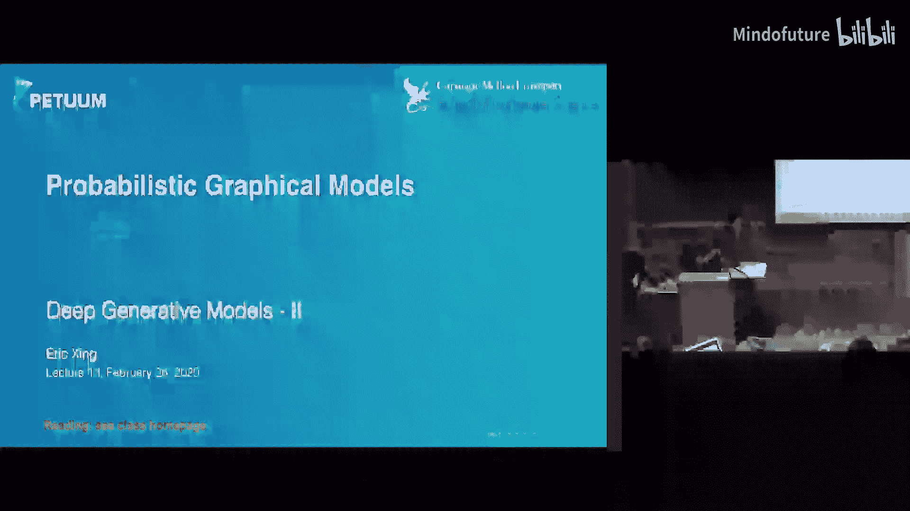
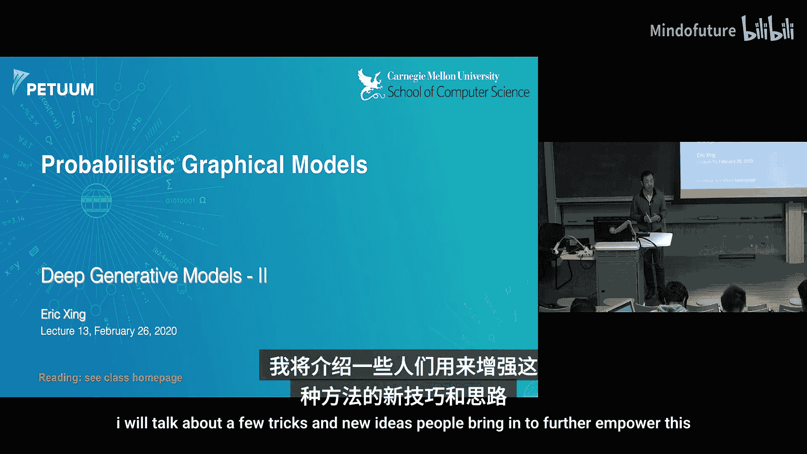
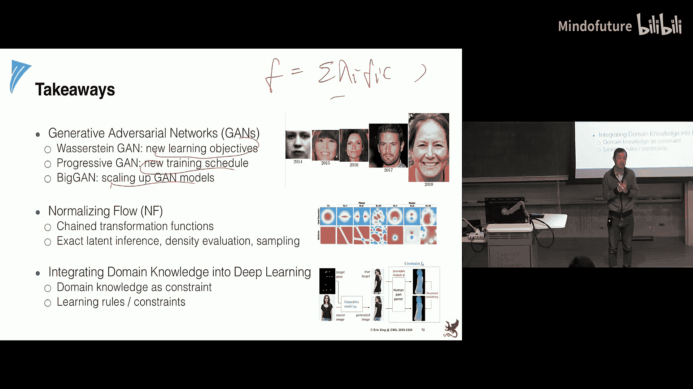

# 【卡耐基梅隆】概率图形模型 ｜ Probabilistic Graphical Models 2020 p13 P13_Lecture_13_深度生成模型_2 -BV1ebpGzhEA9_p13-

Okay， so let's continue on the discussion on deep generative models。

Last time I think I gave you a overarching view about the statistical mathematical foundation of a couple of deep geneative models。

 especially when they embedded in the history of graphic models and variational inferences of that。

And this today's lecture will be a little bit more pragmatic。

 I will talk about a few tricks and new ideas people bring in to further empower this approach。

 which make them become more and more practical and and useful。 Okay。

 so this is the plan of the of the class。 roughly， I'm going to talk about the4 to5 different models。

 So it will be kind of superficial。 Okay， but I post papers that you can。

 you can read yourself on the detail part。 But I give you the high level ideas about what happens。

Okay。So we see this in the past few years since invention of the gun model every year。

 there are visible， very visible， tangible improvements on the quality of the production。

 And you can see， you start from something like vague。

We knew that it is already better than other approaches like V E because it is having this domain。

 this modality， kind of a coverage property under the gun loss function。

 You still remember that we that has something with the K or divergence rec of us。But then， you know。

 that alone is actually not enough。 Okay， this one is still not too good。 You see every year。

 up to here。It's quite decent already， right。 And up to here， you see all the details， you know。

 the wrinkles， everything， you know， on the face already。

 It's some sometimes it's very difficult even to tell whether it is a synthetic image， you know。

 or fake one， just even by human being。I， I read some Facebook and some blogs。

 and they say the trick is to really look at maybe it are their their ears kind of look really。

 really natural and symmetric。 Other the teeths look like you know， a artificial teeth or real one。

 And I you need to look into very details。 And then you sometimes can spot some synthetic natures。

But overall， the quality is very good。 So how to achieve that， how people have done to achieve it。

Okay， so that's to recap。 This is the generative a network models。Okay。By calling them networks。

 I means every component， such as this a whole generator process。

 such as this discriminator is no longer just a trivial function like a softm。

 like a logistic and so forth。 It could be by itself a big network of many。

 many layers and parameters， okay。And so in here， you can see that it implicitly outputs。You know。

 a distribution。 okay， or for generated images， it is a implicit distribution because you cannot write a legal form。

 This， you know， a hidden code is trivial。 It come from a standard normal。

And then it goes to a multi stage generation process to get the nonlinear transformations of all kinds。

 I remember。There is a proof many years ago that even a single layer， a two layer， you know。

 a network function， can simulate any arbitrary complex functions。Okay， if you remember that。

 I think somewhere else you can see the proof。 It's kind of intuitive that you can imagine because you already can。

 you know， have all the9 linear combinations by having two layers and hidden variables。Therefore。

 this one can be arbitrarily rich。And then you generate the picture， and so forth。

There is something already quite strange in this authentic vanilla game。

 which is that you cannot perform inferences in Z， because the posterior of Z。Given， say， the why。

Its very， very it， it's symbolic， but it is not in implicit form。At least in the original design。

 But people also say that why I care about having a Z。

 the Z doesn't have any meaning in this case because it's a random code right So， but in principle。

 you actually could you know， infer the Z there are some models that I mentioned last time already that allows to that if you really care。

 So that's basically the gun model has a generative mark has a disc part And you need to learn two sets of parameters。

 The geneative parameters and the discriminating parameters。Okay。

And then here is the training mechanism。 Right， You are going to train the discriminator here by。

 you know， optimizing the， the， the， the。The cross entropy。Of the prediction。

 which drives the D model。More and more discriminating。And then in this part。

 you also minimize something equivalent to a log loss to make sure that they can maximally fool。

 you know， the discriminator and here you optimize the chip。And then there are analysis。

 one of which is shown last time already to further qualify this part to express them in terms of minimizing the distributions between a target and a source。

 so that， you know， you are learning something that can be measured against other things。 right。

 So that's usually the foundation of any learning data driven algorithm。

So here becomes the loss in the original good fellow paper。 Even though implicit。

 one can show that the loss function can be formulated as the Johnson Shannon。

This divergence between the empirical data distribution and the generative distribution。 By the way。

 this one is not expressible。 It's the whole bag of data。 Therefore。

 it's only symbolically express here。 Okay， it's showing that what you do here is after all opting this。

 but it's not like you directly can do something on that。But at least people know what's happening。

You know， in the learned model versus the the training data。Then in a later analysis。

 which I actually shown last time in last lecture， which was done here by one of my gra students。

It was showing that what's actually being done here in learning the generative model is to minimize the K L between。

 you know， the inference model and the you know， the， the。

The variation of the posterior distribution。RightSo we know that。Now， knowing that tells you how to。

 you know， do the moment match and so forth， right， a mod match， not moment match， sorry。

 And you know basically why you get a good result。But also。

 you can use that to explain why you didn't get good results。Okay， for example。

Suppose youre training data。Is that of a distribution that lies in the so called the lower dimensional manifold of a higher dimensional distribution。

 So this is a little bit harder to So suppose that for example。

 you have this a three dimensional space where your data are actually just on this a flat plane。

That's basically meaning this flat plane is a lower dimensional manifold。But in theory。

 you still can write it down into a higher dimension distribution because I may be slightly deviating from the plane。

Although I spread very， very widely， you know， in that。Let me call this X under Y under z。You know。

 I have a huge variance along X and Y。 I have a tiny variance on Z。

 That basically effectively leads you to a sub many distribution。 suppose my data is like this。Okay。

And then， you know， when you want to learn something。You know， as for example。

 this is a P distribution。 I want to learn a Q distribution， which is defined， for example。

 in the full space， which is three dimensional like this one。

It turns out that those Janen Shannon divergence。And that K L Kobec labor divergence。

 they are not very good at。Measursure the distances。 Sometimes they have a degenerated numbers。Okay。

That's a mathematical phenomenon。 that you could imagine why it's happening。 For example。

 because the distance is， let's use K L as an example。

 K L is basically about taking a integration of some Q versus a log of Q over P。Right。Now。

For this argument。To be kind of a meaningful， they have to be 9，0。Otherwise。

 it would really generate very little impact on the integral。N。

0 means that these two things need to overlap quite a bit。

In a sense that if you have two distributions， PM and Q dates。

 which started from being very little overlapping or non overlapping， then this distance。

Becomes degeneerrated。O， it's not meaningful basic to to to。

 to to tell how far two descriptions are away。So that's the intrinsic nature of。

 of some divergence measure， which really assume that the two kind of argument have to overlap a bit to allow the integration of the cross kind of interaction to happen。

So it it undefined or infinite。The loss function therefore fails to drive， you know。

 the learning of the queue into a product it basically lose the target already。So this is like I。

 I'm trying to imagine the scenario。 if you should miss， for example， if your missile， you know。

 can begin with capturing the target， even fake， you know， very weak one。

 then you get closer and closer and closer。 You amplified signal and becomes more and more accurate。

 That's how usually cruise missile were kind of designed。

But if you start shooting the air and see no target to begin with。

 then they couldn't even decide where to go in the first place。 Then you lose to go。

 right So that's the problem with the， the K， L and Janen Shannon divergence。Okay。

 so that basically is a key kind of weakness People discovered。 People say， oh， to correct the gun。

 you know， because of the degeneration of the distance。

 the only thing to do is to just redefine a distance。 Everything else should be the same。Okay。

 so that's basically comes to this new idea。 The loss function are now re investigated。

 and people find that this one， which is called the the v stand distance。

 which is known in mathematics。And also， in statistics。

 is also known as the Earth's moverss distances。 is actually a good one。Okay， for example。

The earth and the mobile distances， actually is sensitive。

To the shape of distribution more so than the Shannon Janen Shanon divergence and K。 Why。

 because it is empirically measuring this。 It's not about how overlap they are and so forth。

 It's about if you just treat the target and whatever source distribution as two piles of dirt。

You need to， whatever shape they are， they， you need to move， you know。

 the dirt from one to the other。And also， the distance it takes to move。For example。

 these two distributions， if you put it here in here， they actually look the same。

 Their math is the same。Okay， but if you move it to the third place。You know。

 moving this one and moving that one will give you two distances that are different。Right。

 because this one may take closer distances to move to the third places。 And that one。

 because it is less in here， More in here， it will take more distances。So that， that's it。 You know。

 there is a mathematical form for the Earth's move distances。

 but this one solved the problem of two distribution being non overlap in a head space can still be properly measured。

Okay， so very intuitive。And then it comes to the math。 Okay。

 you can write down the divergence function like this， which， by the way， requires， you know。

 some kind of technical conditions what people called this D， which is the discriminator。

Needs to be lipsious continuous so that when you compute the superpre， you need to。

 you can take derivatives。Okay， this is not impossible。 You can craft a discriminator。

 which is differentiable， fine。But sometimes， you know。

 there are ill conditioned kind of scenarios where you see wild gradient。Okay， you know。

 it is differentiable。 But what if the， the gradient from that is a too wild example too being。

 you have either something called the diminishing gradient where you start into the valley。

 and therefore， your gradient are just flat。That that means you cannot make progress。

However many step you have。Or it is in a steep kind of place where like you are on top of a Clevelandland。

 A little gr to just get you to the， the， the bottom of everything。That's no good either。

 So there are some way to engineer or control the gradient。 One is known as the gradient clipping。

And that's a picture showing you without it basically， it computes。

The norm of all the gradientings and then rescale the gradient against that norm so that they are kind of contained。

 You know， with a controlable。 This is actually a free parameter， in know to define the threshold。

And that basically make a gradient like this。 now like this。 They achieve the same effect。

 by the way， roughly the same way。 But they are a lot more benign to handle， okay。

So with these two thing together， you get something。That is working， right， For example， here。

 you see an example of the the wasstein Gu versus the vanilla Gum。And you can see that here I have。

 you know， two， you know，呃。Distributions。Sorry。😔，1 is， you know， you， you know， you， you have。

 for example， a a data distribution and a variation into gradient。

 And this is the gradient from the gun discriminator。

 You can see it's either very stiff in here or very flating here。 right。

 That's kind of what we call the the， the kind of the， the E conditioned gradient。

But this one from the Barstein can see it's kind of a nice looking or very kind of walkable， okay。

Alright， so that's one idea。 Wasa Stanan， Very， very clever， very。

 very minor disturbance of the whole idea。 But that one shot is。Really you know。

 improving the models a lot。Okay。Second idea。It's known as the progressive gum。

So this is another interesting idea。Suppose that I want to train。Very， very high resolution images。

You know， training those images really require a very， very kind of complex structure。

 lot of big data and so forth。You have。Multiple options。

 One option where I'm gonna talk about in a second is to young。 Just head on。

 address the business problem and make it work。The other idea is to kind of take a short cut and detour and try to navigate。

 It's like， you know， remember， if you drive a car to climb a mountain， you need to do the exact lot。

 right， So that's the one way。You begin by a lower resolution training image。

And you begin with a very， very shallow。夹冇都。Okay。And once you have that model。

 you are going to add some stack on top of it。You initialize， you know， with the previous results。

 plus this new layer， you have a slightly higher resolution image。

 You just keep going and going and going。 And until you get a really， really big model。

 But every time you are not going to be necessary to train the whole big model because you are gradually expanding the size。

 that kind of I would bypass the the size bottleneck。Right， and also。

 it creates an operation pass that is easier to climb just like you drive your car， you know。

 on the highway， you know， in， in the mountain。 You know， it， it， it kind of make the path easier。

So that's known as the。Progressive gun。2 ideas now。 the third idea， as I said， is just head on。

 You know， we have a big gun model。 and I don't want to bother myself with all this progressive。

 maybe just because I don't have a low resolution image or I don't want to make low resolution image by sub Pauling。

 Okay， then to really。Deal with the， the size in。Directly， there are also a few ideas。 Yeah。

 you increase the number parameters。 but just make the model big for sure。

 And you need to now handle deal with buying power GPs and and so forth。

 that part you have to swallow。 basically， the bullet pay a better cost。

 But such higher power the GPO does exist right now。 So it's good。Then training， you know。

 you need to not increase the batch size。So that you can allow this。Monster， you know， you know。

 model with a lot of parameters to be able to not over feeling basically。 you know。

 you have enough data。 Okay， but of course， it also increased the computational cost because usually a batch need to be kept in the memory of the GPU。

 And， you know， GPU memory is very， very expensive。It's not it's very limited。

 So you have to deal with that。呃。I think Johnsonen was very。

 very happy with the inventor of the of the gun model。

 That's actually a big market for his business right now。 So keep bigger models。

And then you can simplify the architecture。To improve scalability， That's more like amic part。

 You can shortcut a few connectivity。 You can remove some unnecessary structures and so forth。

And you see this better and better quality pictures， you know， being generated。Okay， three ideas。O。

Every good is everyone's good。This is also too difficult， right。Now。

 let's go on to another idea that is popular to again， you know， amplify or transform a originally。

Very simple model into something more powerful。So this idea is known as the normalizing flow。 Okay。

 again， the idea is very simple。 The goal is to how to transform a simple distribution。 Let's say。

 a uniform distribution。To a complex one。O， how to make it arbitrly complex。

We kind of do that all the time。 You know， In fact。

 if you go to our our library or any other Python library to some Gaussing。

 it's actually transformed from uniform。 So we， we know that。 But how to go even further。Well。

 very very。You know， unsurprising， you just keep basically evolving the distribution， you know。

 all the way into。A step youre happy with。In fact， here I have examples exactly as what I said。

 You start from a uniform or a unit gausing。After a few what is known as the polar transformation。

 what is known as the radio transformation。 You can imagine if in the polar coordinate system。

 you have the pole and you have the radio， right， these two dimension can all be transformed in nonlinear way or whatever。

 and you get something very， very， very interesting。 right， So up to here。

 you can hardly recognize where the original thing is。So this idea is proven powerful。

How to do it mathematically。It turns out to be not too difficult。

So what's happening is that you started from a kind of a source distribution。You draw Z。

 You apply a F transformer on Z。 You get x。And the mass behind it is。You know， it's not it's， it's。

 it's again， if you want to make the mathematics very beautiful and all under control from， you。

 you learn model in a。Generative and also， you know。

 inferential kind of E M fashion or iterative fashion。

 You need to be able to infer the original Z so that you can pass the message back， right。Therefore。

 one requirement is that your transmission need to be invertible。That's not too difficult。

 There are functions having that behavior。 And then your density can be actually computed， you know。

 analytically， you know， using a change a variable type of you know， theorem。 right。

 So and here you see there， I， I need to know the， the the， the， the。

 the invertable form of the transformation。 And also， I need to be able to compute the determinant。

Of the Jacob of that。And while， you can further constrain the Jacob bin so that the determinant is computable is easy。

 One idea is to make the Jacob bin in a triangular matrix。Yeah， so these are just， you know， very。

 very standard engineering， you know， applied mathematical engineering to make the whole work。

And then once this， you know， idea is now in in the play， you can apply multiple times。

To have a sequential transformations。And that basically amounts to just having multiple。

 multiple locations of this。 And in the log space， you become estimation sum of all these transmissions。

对。So that idea， you know， leads to a number of interesting variations。

 And this one is one of the popular ones。That you started from one step kind of you know。

 from the input。 And then these are basically all the layers that you can， you can basically use。

 right So this one is called the the， the， the activation normalization。

 and the invertable one by one combvolution and fine coupling。 So you can basically insert many。

 many different effects that you want。And， of course， you know。

 this could go all the way to a few dozen layers or even hundreds。So that's idea。

Building from you can see in one thing that has been advocated in the deep learning community。

 which I like very much， is this notion called compositionality。Right。

 so you can see that bigger kind of structure and models can really， really build very。

 very nicely on smaller building blocks， which has nice mathematical property。 And， you know， they。

 they， they generate some decent images。Not as good as the gun model， honestly。

That's what people compared。 But it's very， very easy and cheap。To compute。ok。These are two。

 a few kind of very， very straightforward tricks， which does not require too strong mathematical self。

I'm going to end with another bigger idea， which is more profound and more versatile。

 And then we're going to close the deepgenative model lecture。

So this idea is about how to integrate domain knowledge in。 You can see topics already very big。

 How to integrate domain knowledge。That's almost a half space of the whole learning universe。

 right you， you you， you need to you know， use data。

 but also the entire story about the patient inference and regularized machine learning is about how to marry the data with knowledge。

 therefore。Why are going to talk about that in the world of deep learning。

In the world of9 deep learning， we probably still remember a few ideas。

 I talk about the Beijing inferences。啊。For example， if you still remember， how do we。De with the。

Data sparsity problem in learning H M M， you know， models for the casino。 if you remember that。

Did the sprsity mean that I， I didn't see a particular dice rolling configuration。

 or I didn't see enough switching between the dis。 What do you do。If you remember a trick。

In our parameter or estimation。Hey， time to claim some credit。Ideally， in the future。

 I want this to jump out of you almost like instantly， you know。

 because these are almost like you know， the， the most， most fundamental kind of weapon。 You know。

 if you are soldier， imagine these are your， your billionard。

 that you have to pull out whenever you are in danger， right。Yeah， want to suggest something。

 Don't be afraid。 It's fine to be wrong。我れな。You basically， okay。

 so you are going to add some numbers into those zero values， which is they have a good name。

 in fact。Sal count， yes。Silal account actually can be explained in two ways。

 One is explained as aba prior that you have， I believe it's a prior， right。

 where the alpha is the Sil account。And the other could be just a a regular， right。

 You can basically just， think about the， the， the log of the。

 the prior part and then make the loss function to be in the log space。 Then you， you know。

 remember in our learning of linear regression and logic regression。

 You can basically in claim the value and so forth。Yeah， so these are basically what we do。You know。

 to incorporate prior knowledge， because prior knowledge is here is saying that I don't believe those numbers should be 0。

 Okay， that's my prior knowledge。 Therefore， I'm going to put some numbers there。

 say these are numbers in my imagination。 So I put it。In deep learning。

 it's a little bit harder because， of course， learning deep learning is about learning the weights。

 You can say the weights are 90。 Well fine。 this is too trivial。

 simply by saying some weights should be 0 should be 90。 is not enough。

 And also there are too many ways for to take care of。 You can either say there are all 90 or0。

 That's not good。And there are other things like， I I have a few other things。

 Let me give you examples。What are the。Human knowledge。For example。

 here is a piece of human knowledge。 We all use it very， very comfortably， right。

 How to change a verb into a past tense。You just add a E D in most of the time。 I a rule。

 where you use it。You don't need to use millions of examples to train that。 I， I just tell you。

 remember this rule。 people got it。And there are other examples， you know。

 which you will see more interesting。 But I'm gonna to show you in the， in a second。 that's。

What do I miss in here。Yeah， so again， in deep learning， you know。

 you need to rely very heavily on label data， and it's not interpretable and hard to encode human limitations intentions and knowledge。

 That's basically what I already said。 deep learning becomes。A difficult。

 more difficult than the general machinery models for regularizations of that kind。

And say how to incorporate this rule into your language model。

So here are some common ideas we learned before。You， you want to learn a model。Say， aaginative model。

And you can condition the model on inputs。And in most cases， the inputs are。You know。

 just trading data。And， and in this case， you know， imagine that you。

 you do image Then there are a lot of images。And。You can imagine that I have， more kind of you know。

 a richer definition of the X， which。Could be more than just it could be a sentence label or some other things。

You can call them knowledge。 You can call them data。

 but how to incorporate a data or a knowledge that is not in the form of a training data point。

For example， a rule is not turning the point， right， How can you incorporate that with it。

So imagine a very abstract way。 Suppose that I can have a constraint function。

EW whichhich are additionally parameterized。In fact， here。

 discriminator is almost like an inspiration of such a thing。 You know。

 it's a different function from the generative model， and it is to discriminating fake from truth。

It's using basic separate loss function。 And then what people do is to combine this one with the original loss function so that you can coing it。

Or you can alternatively treat it。 That's also fine。

So if you can really incorporate the knowledge also into a constraint function。

And then you can imagine that， you know， I can push the model such that this value。

 when it's becoming higher， then the knowledge is respected。For example， imagine this very。

 very empirical task about post image generation。You can imagine these are very interesting applications。

 right， if you are run a fashion app， you know， you can pretty much try on fashions for people。

But it turns out that。Use gun to generate image。Sometimes give you scary results。

This one is not too bad。 They could be worse ones。 You can， you already can policy。

 This head isn't quite nicely positioned。Right， you could often， even in fact。

 this dress is also kind of inverse。And you may we a limb out so forth。And。

 but what if you have a a pose which pushed constraint。Which says that hey， for a non acrobat。

 a real human， a normal human。 And then he should have his she have。

 have her head on the top and lean at here and and arms here and and legs and so forth。

 There is a regular position， a pose that you want to contrain。

 As that this one is not a gymnast or acrobat。Okay。So how to basically， you know。

 encourage a generation of a picture that is a respect country。

 What typically what you do is that after you generate not the end of the job yet。

 you are going to run a passer。Okay， maybe the password can be parallel applied to a real image。

And a generated image。And then you compare whether the structure is consistent。Right。

 so this is a little bit different from the gun model in the sense that in the traditional gun model。

 you only say whether this one is fake or true comparing to a real image。But in here。

 you are comparing whether the content， the post， the post makes sense or not。

 It's a much more complex comparison。And you imagine that if this one is kind of becoming integrated into the model。

 you are likely to have a generation machine that is， you know。

 more kind of consistent with human gesture。 right， So that's an image example。

And that's also telling you why， you know， rules can be very important in addition to the labels or even in absence of the labels。

 labels sometimes are less meaningful or interesting。 You say， oh， this is a true image。

 That's a label。 So what。It is still don't know why is true。 So here you have the reason。

In language generation， same thing。 for example， people， sometimes。

 especially in childbos in these days， you know， a caregiving conversational system for depressed people or for patients。

 you need to not only generate the right content。But also， you need to have the right sentiment。

 You need to show sympathy， empathy， you know， all that kind of thing， right， how to generate it。

 all how to sense， you know， the， the， the party of the dialogue have that kind of sentiment。

 So here's a sentence。This is a terrific movie， okay。But， you know。

 the director could have done better。I can tell you for a naive kind of， you know， you know。

 a language classifier。 It's not necessarily easy to detect the sentiment sentiment behind this movie。

 So maybe you can help me。 Do you think this sentence is reflecting a positive sentiment or negative one。

Imagine the way you speak。 maybe you are a direct person。 Maybe you are a very。

 very diplomatic person。 depending on who are you do speak differently。 But let's imagine。

We are just。Pretty normal guys and girls and， how should we speak。Yeah， it is a possible a negative。

有个 way negative。And why it's negative。We have a pretty good， positive stuff。 Pra movie。Right。

 and yeah， there are something not so good。 But if you can't number words， they are roughly the same。

 right， So it's not like。You know， one is dominantminating the other one。 So obviously。

 why you feel it' negative。ま。Yeah， the but basically is dominating basically the sentiments。 right。

 So this is a rule。 You know， we， we， we， we learn English。

 We know that there is a particular way of expressing or revealing the sentiment。

 and but is one such way。 So it becomes a rule。 It's a logical rule。That rule can be very。

 very helpful。 you know， when you know it in generating the sentence or when you perceive the sentence and usually。

 you know， train a similar capability。Is almost impossible or even if possible to have a lot of。

 lot of examples labeled ones。 Okay， because if you count the words and so forth or count the world back kind of you know。

 volume and so forth， you know， it's hard to distinguish， right。

So these are examples basically about the rules that you do want to incorporate into a complex model。

 sayy this P of theta model。And how do that， Well we know that way。Can。Describe。

 or we can capture that constrain with a function。And then we also know that just like what we do in our gun training with the discriminator。

 we can also， you know， fold that into a loss function so that the value okay of that constrain function under the expectation of the generation P theta is those is the model who generates the x。

Right， and if under this distribution， they are big。You say that it is a good distribution。

 P is good。Okay。Okay， so that basically gives you a very generic kind of idea about aggregating。

 you know， a multiple source of losses。This is the regular objective， such as Que entropy and sos。

 These are the regularization。 So it is a greater idea than the standard。You know， you know。

 a sparsity regular and so forth。So you can put there symbolically。Now。You need to compute it。

 And as we know from last time， you can kind of already guess this term can be difficult for compute。

Do you still remember why that's the get's why there is a difficulty， I believe two lectures go。

Oh no， last lecture， actually， I mentioned it。You need to basically take a derivative of this guy。

Vs as theta。And what will happen when you take the derivative。Okay， you miss once。

 but I can't tell you again。 I wanted to remember。 Okay， so this is a very basic trick。Usually。

 when we are taking derivative of expectation against a distribution of something。

You need to use the log probability trick。 And at the end of day， there will be a turn。

 which is the log of the probability itself。 and something else。

And we say that this one will explore the magnitude of that term。 Therefore。

 you have a extreme instability。Okay， or high variances。Okay。

 so I'm not going to copy the equation here。 You can go back。

 It's the same equation that we reviewed last time in the week sleep algorithm。 If you remember。

 why we do the wake up the the sleep step， is's because。That true K。

 O is giving you this nasty property。 Then we swap the E K O direction。 You get a a better one。

So these are the mathematical insight I really wanted to get。 You know。

 that's usually why some people have a good math intuition without doing too much data when you stare at this。

 you already see something wrong， okay。Allright， so。Then， you know。We have， again。

 out of our standard tool box， a few ideas。The original one is no good。

 Let's introduce something called a， maybe a。A variation of approximation。O。

 to the true distribution。 So basically， this one is too hard to deal with。

And this is not a K L divergence。 Therefore， you cannot solve functions。 right。 Therefore。

 I'm going directly approximate the P using a Q function。Then I have a kind of a a mini max。

 On the one hand， I want to maximize this loss。Under a you know， approximating distribution。

On the other hand， I need to， you know， minimize the discrepancy between the approximating distribution versus the true 1 I want to learn。

 Therefore， I now explain this term into two terms。Okay，1 is the K， O。

 The other is the the expected loss。And this technique， again， has been used many， many oftentime。

 you know， in machine learning， It's called the regularized space method。And there。

 I think there is a pointer somewhere you can read the original paper。

 which was written a long time ago。Okay。Yeah， that's a reference point。 So introduce a variational。

 you impose contrain on Q instead， and then you encourage。So suddenly， there is。

A new entity introduced in this framework。And you will see how we call it。

 It's a very interesting idea。Okay， so you have this new objective function。

 and you can also introduce one more parameter。Which is a scaling parameter alpha to kind of control the relative contribution of these two parts。

 right， This is the original data driven loss。And this is the new knowledge driven loss。

 And which one you believe more， Remember in our Beijing influence and in our regularized regression。

 we also have that parameter。Regulation constant like allows you to determine the balance。

 You can also learn it， by the way， if you really， really want to use the data driven approach。Okay。

 so we're here。嗯。And there are again， free parameters like lambmbda and so forths， which are， again。

 allowing you to control the contributions from all different parts。

Then we apply the E M I with type of approach to do alternating optimization。

 Our goal is to learn the Q as a stepping stone。 Remember my mountain climb cliff hand kind of example。

 this Q is the stepping stone for you to learn the P。And。Then， you know， with the queue。

 you can learn the P。The theta under P， you know， with this and alternative。And here， of course。

 you can have tricks to a promptize the learning function or the constraint function。

 One technique is known as the soft constraint， which is not just discrete label。 say 0 and one。

 It is more like a smoothing kind of differentiable loss to honor the rules。 Okay。

 that's just a choice。Okay， so let's see how this learning algorithm can take place。Okay。

So you consider learning this model， a supervised learning。Im。

 I'm not not putting everything back into the bigger context because the label。

 the data does have label as well。 These are the hard labels。Plus， of course， my softm rules， right。

And your target input space is X and y。And then you have a few other rules， R。

Which are weighted by Lada。 You have multiple rules。And I consider them to be all data of。

 of some sort。 In fact， in our recent more unifying framework。

 maybe I will cover that by before the end of the semester。

 These are all called generic generalized experiences。 Your data points are experiences， right。

 Your rules are experiences and down the road over here that even reinforce learning the reward function is experience。

Okay， and there are many， many experiences。 They can all be treated the same way。 Therefore。

 we don't need to use names like supervised， unsupervised 3 in4 or active and so forth。

 They are all the same learning。 That's possible。But going back。Given air rules。

I'm going to now alternating between training the variational。And also。

 going back to training the true generative model。Using the variation in here， that's very important。

 It is easier to compute。Okay。And here it inquiry already the last previous version of the true and the set rules。

So this idea is reported in this paper， which is now a very。

 very important kind of cornerstone paper for many of techniques。Followed on， you know。

 on knowledge integration。 But there was actually something kind of， I wouldn't say similar， but。

Kind of count you know， maybe analytical kind of you know， in for the same goal。

It's called knowledge distillation by Hton。So here is the knowledge in Basically idea is that you want to learn a difficult target。

And。Instead of learning target directly in a single one shot， you are going to iterate， you know。

 using， you know， a auxiliary queue。And I don't know why I think the deep learningening community。

 as I mentioned， they are very， very good at gaming good names of the technique。

 So they call this queue Nowaday where a queue， but teachers。Okay， so these are the。

 we call them variational approximation。 They call them teachers。

And now I also call them teachers because I like the name。Okay， so it's not just one teacher。

 The Hton paper was advocating ensemble of teachers。 You are going to have all that many。And then。

 you know， what's happening is that we are going to match those teachers match those students with the teacher using kind of a soft soft prediction。

 The teacher are predicting predicting soft value value。 It's not just 01。

01 are usually the labeled data。 very soft very hard。 but the teacher are coming from a model Q。

 You can actually generate。Whatever softness that you want by designing the function。 right。

 So just like， you know， when I teach you， I don't want you to just recite or memorize something。

 right， I， I'm teaching you in a soft way， that you can think。So that's the mechanism。

 And then by doing so， this interaction between the teachers and students eventually gets the students closer to some or one of the teachers。

Or maybe the average of the teachers。 And then。Miche accomplished。

So this is kind of similar to what we do， you know， because we are also talking about you know。

 learning， you know， using。Training this teacher。In one step and then use the teacher to train the students in the other step。

And just to dig a little bit deeper into the math。That part。Is basically word true labels。providedvi。

In the training data。Therefore， in a sense， that loss is measuring just the the discrepancy between your Y label。

 which is a hard label， versus something that you predict。From the current generator。

Imagine that this is， say， a gun model， which predict produce image X and also the label of the X， Y。

 okay， and it's soft。And then。Now that we have a queue。Q is also producing y。Right。

 just like the theta the the P， But P is something that is evolving。 It it's been training， you know。

 in every。Q is going to be something like this， which is the current version of the P。Plus。

 those sum of the experiences。And you can introduce either a soft max function or something to generate a soft prediction。

And they can be also compared with this。Okay。In a sense， in this way。

 you also can learn the parameter or you can leverage on。

 You can measure the quality of this teacher at this point。All drive， you know。

 the theta to be closer to what you have now， because here you have this and some new knowledge constraints。

I didn't encode it。And then you introduce a weighted partition， right， You， you weigh this by pi。

 you weigh that by1 minus pi。And that gives you the whole loss。

 And then you are going to update your data。Okay， so the， the whole design is inence。

 quite intuitive intuitive clean。And here is basically an a graphical illustration， right。

Your goal is to learn this guy。Which is prompt by spec theta。

 It's the original gun model parameters plus maybe the discriminators and everything。

And this is a network。Then there are， you know， two type of losses， right。

 One is basically measured between this and this， the label data。Okay。

 and the other is this a soft loss。Because of the teacher。

And that of loss is providing another pooling force with the knowledge of constraints。

And you can imagine that here I can have also unlabeled data because the training this， you know。

 can use a self labeling。It's like the teacher can have in his pocket， multiple textbooks。Okay。

 and always a different rules and everything。 Then I'm going to repeatedly engage with this student and hopefully draw him closer to me。

And how to， But is the teacher also a kind of static， what the teacher also evolves。Okay。

 you basically have this， you know， little box where the teacher gets also updated from the current version of the students and at the same time。

 incorporate all the logical rules。You can see this a whole machinery。

 which is called by us a teacher student model， Ha the label data， has the unlabeled data。

 has the rules。 These are the three pockets of inputs。

And then you have a auxiliary model called teachers。 and you have the target model。

 called the students。Okay。So this is a big idea， a bigger idea because the I， the， the。

 the technique applies to all kinds of rules。You know。

 as long as you can express them in terms of AI function。OK， a teaching function。

And it will be using all data， labeled or unlabeled。Okay。But， of course， you need to， in fact。

 it give you the opportunity to even design the architecture of this model and also the teaching model so that you can control or interfere or。

 you know， or impact。You know， the rate or the efficiency of the learning。Okay。Let's see what I have。

 Yeah， you know， there are some free parameters that you can keep learning。 You can。

 you can actually get for， you know， if you want， such as the London。

 which are the importance of the rules。And and。There are maybe even the the F function has a p。

 And that's， you know， even the more kind of technical parameters inside each rule。

 you can also learn it。 Okay， if you care to， to use a data dream approach。O， with that。

 I think I'm ready to close。 Oh I buy still early。Okay。

 maybe we can have time to take some questions。 Any questions until now。

Are we still aligned on the teacher student model。Okay， so the， the devils， of course。

 are in the details because it sounds like quite easy， right， it's all like nice looking。

 intuitive thing。 But， of course， you know， there are non tri， you know， undertakings， you know。

 for any practitioners。Writing the rules into a function。Requires a lot of skill。Okay。

 the easier one could be just a delta function that rule honored， rule not honored。

 that's pretty trivial。 But remember， many of these functions need to have nice properties like differenti abilitiesities and that kind of thing。

 So different functions do have different effects。And also。

 how to expand the space of the inputs beyond the logical rules is actually very interesting。

 One of our recent work is to， again， as I mentioned。

Put the reward function in reinforced learning as a type of a teaching function here。Therefore。

 you know， reinforcement becomes just an instance。Of experience driven or knowledge driven machine learning。

Okay， with the same equation。 In fact you can introduce the same auxiliary function like this。

And do reinforcement learning。 I think there is a topic called variational reinforcement learning。

That's roughly in this， in line with this idea。 You need to put some variational distributions as a placeholder。

 But I believe this framework is making things more clean now。 And also。

 it is potentially admissible to more other learning paradigms。

 As long as you believe that these are the three sources of your data。Therefore。

 we have a more general ways of defining the experiences then， you know。Lossing here。

 architectureit in here still is a hot topic。 You can， you know， really。

 you can maybe insert a LTM model in here。So that you can build sequential models。You know。

 for language and for other things。Or maybe even a combinations of that with you know。

 convolution networks and so forth。Okay， now let's look at some results。 So here is。

A picture you saw。You can kind of see the comparison， right。嗯。This is。The base model。

You can see that generation isn't very ideal。And if you just have a fixed constraint。

 which is not a soft rule， but a fixed one， therefore。

 it is a one time shot that you cannot differentiate and incrementally update。Wow。

 this image is kind of scary。And then you allow the constraint to be learned。Okay。

 their weights Lambda can be adjusted。You start to see， you know。

Better and better images all the way to a target image that everything has accomplished。

So you can see the in terms of the numbers， there are some measurements of quality from quantitative and human valuation。

 You can see that the score。You know， from these learn constraints。Can be significantly， you know。

 better than many of the alternative approaches。Some approaches manage to get a good number。

 that is kind of mechanical。just like， for example， in N L P。

 we measure quality of the language by a blue score。

 and you can actually achieve sometimes a good blue score。 But even so， when people read it。

 it doesn't make too much sense。 So that's why the human kind of evaluation is introduced。

 You want to achieve a balance of you know， more kind of objective。Quality and also。

 more subjective quality。ok。So。That's a summary。So under the umbrella of the deep generative models。

 is especially the generative a network models， people keep kind of innovating on different components in that model including like a new distance function for the objective right。

 and a procedure for training。Progressively， one and more fancier， complex model。

Or to scale up root force fashion， you know， on larger models。

And then there are also quite intuitive and straightforward ways of evolving from simple model to complex one。

 which is known as the normalizing flow。And then there is this a bigger general purpose framework of knowledge injection and。

 and， and and learning inside the deep learningening framework using a teacher student models。

I think that's all any questions for today。Yes。嗯。Yeah。If people， you know。

From a layman's perspective。We imagine that there is a wise man or a， a kind of a particular agent。

 which can suggest me a function。 and all definition function could be a mathematical expression。

 any form。I tell you that's impossible because the machines are never intended。

 They cannot write your equation。 right， Usually in machine learning， when we say learn function。

 we usually say it is a kernel based approach where we learn the weights of some base functions。

Right， so that's basically about functional learning。

 Fun learning is not about learning the form of the the expression of function。

 It's about learning the weights of the basis of function。

 And then we claim that this combination of the basis can be arbitrarily rich。 Therefore。

 they can kind approximate anything。 So in this case。

 we can see I made it clear that my F is not expressed as a sum of the lambda and little F I。Right。

 so here the F I are what you can imagine as the kernel function。

 which is a basic deelta function or some kind of additional kernel。

And then the weights allows you to kind of do linear or non nonlinear combinations of that。

And that part can be data driven。And it's actually good to have a data approaching here because you may have all the rules。

 but you don't know how important they are relatively and also compared to data。Right。

 so that's why in a true Beijing setting， people， you know， the， the the， the imaginary counts。

 the zero counts。Sometimes was set as also a hyperprometer。

 You can actually learn that with a hyper prioror over those hyperparmeters。

And then get you some flat speed to accommodate， you know， different natures of the training data。

Good question。 Yeah， so it's， it's， it's to some degree learnable， but not totally freetyle learning。

More questions。I have another five minutes， so I could dismiss you now。

 or I can have us another three minutes。So now， if you learned all this and you didn't ask too much questions。

 What do you want next， Do you want to take something like this。

 Go and play with it and build your tool or you。You。

 you prefer beauty yourself when you are working on a project。

I'm trying to get a temperature of the needs。You know， in a class like this。Please speak up。

 This isn't a difficult question， hopefully。It's not even a technical question， right。

 It's really a market question。 I'm trying to see what is needed here。

Or maybe I should alternatively ask， could you find。

A supply of these kind of implementations in the easily used fashion now or。Sometime later。

And if you find it， what do you do with that。Still no question and no answer。And why why， why。

 why do you guys come here。To get a credit， I guess， right。Sure， I ask because， you know， you know。

 I'm also。Working on a startup。And while trying to build the world best and largest and first。

AI took it for people to build stuff， using building blocks。

And I wonder if I make this stuff a building block， Do I have a audience to use it or not。

 Let's to put it straight。 This is the question。For free， by the way， no charge。呵呵。😊，Yes， please。

Very interesting， but like there is no easy toolbox that you can go and use for that kind of up。

So having that centralized would be useful， I mean。

 specifically their applications over the image base， but there are like thoughts of applying it to。

Generating kind of regression based problems from different distributions。

 But that seems like a problem on its own just because there is no。

Easy brain where like pipe ores that have that built in where you can go and play。Right， right。

 and of course， it's a reason why there isn't such tool。 It's expensive to build。 It's not easy。

 And if people spend money building it and use it， then you bankrupt yourself。 right。

 So that's something I do worry about as the， the leader of the business as a professor， of course。

 I would love to， to have that made available to you。 So yeah。

 we are thinking about building two boxes like this for my next year's class。So that， you know。

 people can， maybe even starting from the fourth semester class for you know， intro machine learning。

But， you know， any two boxes start with something simple。 This is really really advanced。

 You will wait until sometime。 But other tools like a HM M， A C， you know。

 a regression could be made very easy。 On the hand。

 you can you can download H M M and C all over the place。

 So I wonder whether it's nice to have a central place that you can do experiments。

 You can dragon play。 You can also contribute deposit your own。

 That's the idea that I've been thinking。 let me know you don't have answer today。

 feel free to write to me if you want to be a user or want to be author。 of those those two boxes。

 Thank you very。😊。

