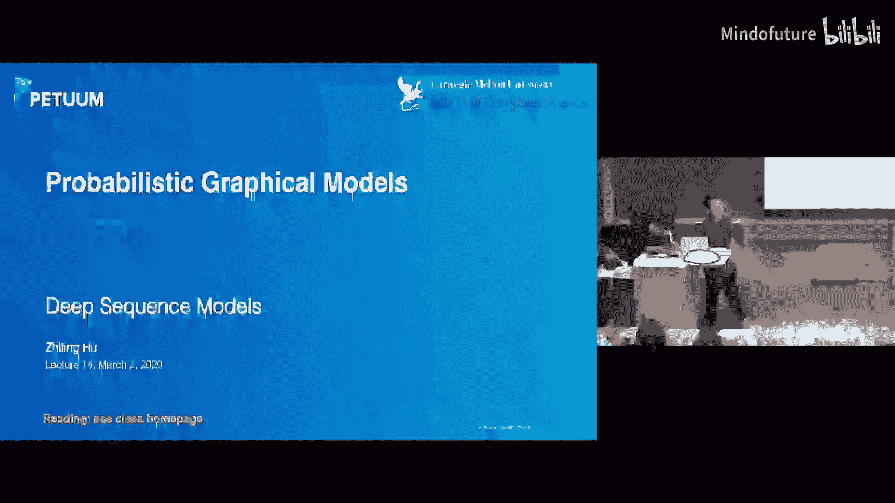
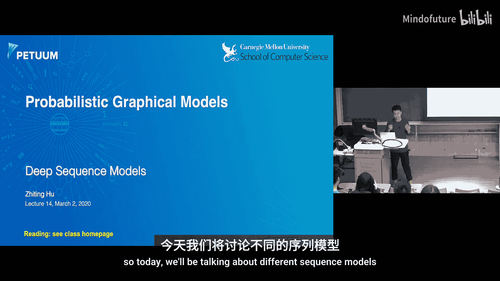
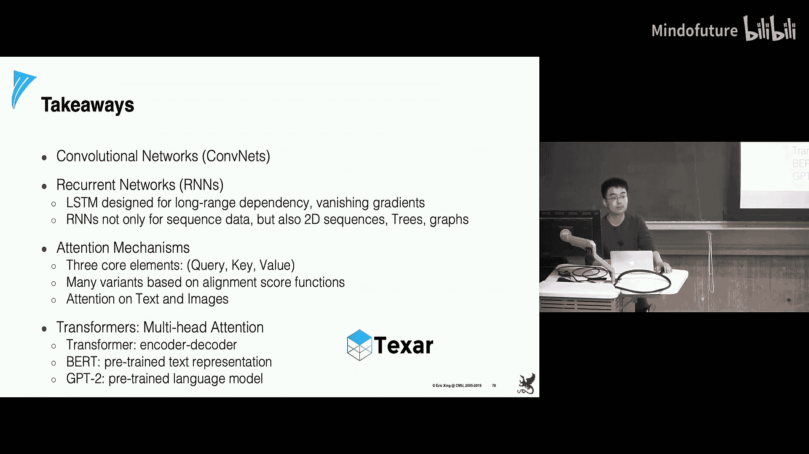

# 【卡耐基梅隆】概率图形模型 ｜ Probabilistic Graphical Models 2020 p14 P14_Lecture_14_深度序列模型 -BV1ebpGzhEA9_p14-

Okay， so。I guess we can get started。So hi， everyone。 I'm， I'm Jting， a guest lecturer today。

 I'm a PhD student in the machine learning department。So today。

 we'll be talking about deep sequence models。

So let me first give give you a high level of view of this section of I of this course。

 right deep learning and geneative models。So in the past， like a。3。Classes we have been talked about。

 like on the foundations of deep learning， like in the perspective of deeper。

Probbil st graphical models。And。And we， we had two two lectures right about。

Are basically deep models in which we have been focusing on the inference and learning algorithms。

So today we'll， we'll be talking about essentially the model architectures。

 say how these deep models and other deep learning models are composed with basic deep learning building blocks。

And then in the next lecture。We'll give a unified view of these TV models。So today on the outline。

 we'll be talking about four fundamental and very popular model architectures。

 including the convolutional networks。Recurrent networks。 and。Litan mechanisms。

And the last one is the transformer， which is essentially it kind of a specialized form of attention mechanisms。

Okay， so let's first go to the first part， Cam networks。I'm。

 I'm gonna like kind of like give it very quick and very。

Basic level of introduction of all these architectures。

So our convolutional networks are explicitly are inspired。嗯。From our like biology， right。

 is a kind of like a biologically inspired variant of M LP， which is the multiple there。Perception。

 right。So here this is the ML LPR 40 connected neural networks。 So given inputs like an image。

Each newogram right on in， in in the neural rear will be connected to every pixel cells。

 every pixelel in in in the input image。 So this is fully connected。But in convolutional networks。

So we have the the concept of our receptive fields。So here each each new like in the in。

 in the convolutional network will kind of like a has has a kind of receptive field。

 like is connected to a local region of the input image。Right， and so these。

 these cells are like new。Are sensitive to small sub regionsgions of the， of the visual field。

And we basically call this cell or like a new one as a local filters。And the list sub regionss。

 right， are tail to like cover the entire visual field or the entire input image。

So on the basic properties of convolal networks， basically， it has like a sparse connectivity。

Like each neuron is connected to a sub， a subset of neurons from the precing there。And like here。

 this， this neuro was connected to like three neurons in the last layer。

And the the ways are basically shared， like here on。This this。

 this link kind of share the weights with these two links。So we can see this， least three links。

 like red， black and green。Are basically kind of like a filter， right， And we。

 we kind of like use this filter to like traverse the whole input image so that you get the。

 the local features right of the whole image。And with in and at higher level， like we have。

 we basically get increasingly global receptive fields。Because on this。

 this neurons basically receive information from all the in neurons， right。

Based on this hierarchyical structure。So these simple cells will detect， detect the local features。

 and the complex cells will pull the outputs of the simple cells。And so that it will get the。

 the full information of the input。So these are basically three properties of convolional networks。

 It's pretty simple， actually。And with split biological structure， right。

 with increasingly global receptive fields。The result is that we get a hierarchical representation learning。

So this is the raw image， right， raw pixel cells。 And at at a lower level。

 we can basically gather featuress like these very basic， like edges and like corners， like。

And if we kind of like go deeper， we get this increasingly。

More abstract and higher level features of the image like this。

 we can see like more complex shapes and like textures。And if we go further。

 we get like higher level features。Yeah， so with， with this basic building block。

 like the convol over there。We see， like， there's。There are a lot of like variant of this conversionvol network。

 So at the beginning， like 2012， we have Alexnet， which is kind of like one the first place in the imagenet image classification competition。

And then later on， we have like VG G， like， which is kind of like a much deeper than the Alexnet。

And we have like Google Nets， or 22 layers。And now， the state of art is usually the less net。

 which can easily go to like hundreds of theirs。 And each there basically is a convolutional。

 convolutional there。Yeah， so this is a very， very quick。Go through of convol networks。 is。

 is pretty simple。 And basically， you， you， you just need to know about the。

 the three basic properties of the， of the architecture。So the second part current the network。Okay。

 so what's， what's the difference between like conversionvol networks and recurren networks。So。

Convolution networks is are basically used for like spatial modeling， right， as we see。

 like given image， we kind of like。Move the filter right across the whole image。 Basically。

 we get the local， especiallyly local features。And the recruit networks is different。

 It for like sequence modeling。And basically here， this is kind of like a convolution network or whatever。

 like fit forwards， like a fully connected network， right， given inputs。

 we do this fit forward fit forward computation。 right， we get the features layer by layer， right。

And the output depends only on the current input， like an an image。But for sequence modeling。 Yeah。

 this is the kind of the the schema of this fit forward competition。for like a sequence modeling。

 right。 now， the hidden layers and the outputs will additionally depend on the previous state of the hidden hidden layers。

 So it this not only depends on the input， but also the。The on the state of。

 of the previous hidden theres。Like， if we journalist this skimmer， right， we basically have a。

Have a loop here。 And if we unrule this loop。We get something like this， right。

 the input is based is in a， in a form of a sequence， right， You can imagine like this is a sentence。

 right， and X 0 x 1 x2 are the tokens in the sentence。And we feed these tokens like one by one。

 right， And we compute these hidden states。St by step， right。

 And the least hidden state will depend not only on the current token of the sentence。But also。

 the hidden state from the previous step。So this is a sequence modeling。And you can， you can see。

 right this computation steps kind of it is kind of like a variable， right， in， in this。

 in this sequence modeling， this is different from this spatial modeling。

 which we have kind of like fixed the number of computational steps。Okay。

 so rerent networks can have different forms。Right say we。

 we can see this image classification like spatial modeling as a special case of this sequence modeling。

 which in which we only basically have one， a single step of modeling This is one to one。😊。

And we want to like image captioning， right， the input is a single image。

 and the output is a sequence of tokens。 So this is a one too many computation。

We can also do like magnitude to one， right， like I say in sentence， sentiment classification。

 input is a sentence a sequence of tokens， and output is a single label。

 like the sentiment label of the sentence。Or like a V video recognition。

 basically giving a sequence of video frames。 we want to。Predict the， the like。

 the activity presented in this in this video。 So this is a menu to one competition。

And many too many， like the machine translation given a sentence of in， in a source language。

 like English。The output is another sentence， like in， like in Germany， in Chinese or like Japanese。

So we， you， we also call this as a sequence to sequence modeling like from a sequence to another sequence。

Or like many too many in a different form， right on。Saying named entity recognition， right。

 input is a sentence。 And for each token in this sentence。

 we want to kind of like predict the label for this particular token。 So in this kind of like task。

 the output， the than of the output is always the same as the， the length of the inputs。

So for this task， we should call this as sequence tagging or sequence labeling。

This is different from machine translation， right， because here you。

 we don't know like whether the the outputs， the length of the outputs will be in the will be the same。

With s of the inputs。 So you can see this is a slightly difference。So yeah。

 with list different architectures。 right， So how about the computation in each of the steps。So here。

 this is basically the computation of of issue step in Luc the networks。

Here we we call each of this step as a cell。 right， we compute English cell。

 We compute like given the inputs， given the hidden state from the last step。

We do this competition like we， we have a weight W and like10 and tang H and other like different competitions。

 basically。So this is the equation of each the competition each step。But what's the problem here？

So finishing and exploding ingredients in recruitment networks on。Its basically the。

 the key like the issue of this model。On the。So basically。

 the issue is because like when we compute the gradient of， say， a particular hidden state， right。

 H 0， say， right， least， least hidden states。This gradient will involve many factors of W。

 right if we like， we want we want， we do like a gradient back back prop， right。

 like from this steps all the way back to this hidden state。And we based。

 based on the train rule of gradient， right， we like a compute gradient。

 and we can see like the gradient will involve a kind of a sequence of factors of W， right。

 kind of like being like multiplied together。And if the largest singular value of， of this W is like。

Larger than one willll get the exploded ingredient because you can see like if we multiply W like again and again。

 we， we， we get like the the will get larger and the larger， right， and。At the end。

 you were basically exploding。So under if the singular value。

 larger singular value is like smaller than one least gradient will get。Smaller and smaller。

 And at the end， close to 0。So this is basically the。

 the the problem of this optimization or training of the model。For exploitding gradient。

 a simple way is to like on。Do like gradient clipping。 right if say if the gradient is on。

Kind of like exceed the thresholds。 We can like， kind of like do the clipping。

But the list is kind of for ad hoc。 say， like for finishing ingredient。

 we don't have a a very kind of like a effective way to like。看到 like a fix list issue。

So this is the first standard and basic recruitment network。On tour address list two problems。

There's we。So， yes， another issue that。Because of this like expd ingredient advantage ingredients。

 So if the sequence is very wrong， right。The optimization of the， of this step， like the。

 the early steps will be not effective。So the problem here is like， if the sequence is too too long。

 we cannot really like effectively learn this long term dependency because of this optimization issue。

Say， like in this sentence， right， we want to predict the next token。

 like this is a kind of sequence model task。Given this， I live in France， right， and I know。

A reasonable prediction is French。 So least one， O， this sequence is not very， very long。

 So this prediction might be not lack code。But if the sentence is kind of longer， right， say。

There is an additional tokens like in France and a beautiful country。 And I know。

Say we want pretty list。 And you can see the。The distance from this to this slot to this token is much longer。

 right， So basically， this prediction will be much harder than this prediction。Yeah。

 so this is the the kind of a key issue in sequence modeling。

 how we can like effectively model this long term dependency。Okay， so。With these two issues， right。

 this。Finish gradient or exploding gradient。 and the long term dependency。嗯。In kind of like啊。1997。

 we have a kind of a new version of recur network， which is called like a long long short term memory LTM。

So this， this particular version of recruitment networks is basically designed to like explicitly alleviate the long term dependency problem or。

And also， the finished ingredient problem。So this is the standard recurring networks we have just seen。

And the this is like L TM。 Basically， we have a kind of like more complex cell in each step。

So let's take a closer look at this particular cell。So we can see here， basically。

If you see three sigma here， how basically they are the gate functions。Let make decisions of reading。

 writing and recting the information of the， of each cell。

So here are the first gate is the forget gate， which you decide whether to like e the sale。

Or quarterly that。So the second gate is the input gate。

 which decide whether to like a write to the cell and the output gate decide like how much we want we want to review the cell to。

 to the to the output the environment。So for， follow forget， forget gate， right， basically this。

 this is the computation of the forget gate。 by the way。

 you don't have to like remember all the computations here where I'm just trying to give you a high level idea on the the mechanism inside this particular model。

So we have list on the input， like from previous states， previous step and the input of the current。

Current the sequence， basically。And we compute this F， F kind of like the forget gates。

 which is a scatter， kind of controls the， the proportion of information we want kind of like a forget。

Right， and the input gate is like on。Here， like given the inputs right of the， of this step。

 we compute this I T， which is another scatter controls the proportion of like information we want。

To write into the， into the current sale。And this is the the information， like。We want。

 we basically want to write right to the cell。And the wish list， too。We combine this， this two right。

 This is the information from the last last step。 And we kind of like a wait list that which the forgetting kind of like wait。

So， and here this is the input weights。 And this is the information。 we kind of like a compute。

 We just compute like a English。As the current step。

 So we do this weight on some of the two cell state and get the state of the current counter cell。

Then with with this information， right， C， T。We use the output gate to decide like what to output from the current sales state。

So O T is the third are scatter， which controls the。

 the proportion of the information we want the output。So we kind of multiply this together with the。

 with the information of the cell。 and the H T is the information。

Are to be output and to be like fed into the next step。Okay， so with this structure， right。

 architecture。We can see， like if we compute the gradient like using the train rule。

 right in back propag。We can see like we， we can be sure that there is no modificationplication with matrix W。

During the back provocation。And there is a kind of pathway of like， pepper getting the gradient。

All the way through the multiple steps。And in this back prop。

 we can see the only thing we multiply onto the the gradient is the different values of get gates。

And because these for gates have different values。 Right。

 least we'll see like this we are kind of like less prone to like vanish or explod ingredients。Yeah。

 so this is the kind of like a high level intuition of L TM。 right we。

 we add like different gate into the into the into the competition of each at each step。

 and we build this pathway to like app gradient without like multiplying W。

 the same W again and again。Okay， so we with this basic like sales like the the standard recur。

sell or the L TM cell。 we can compose this given the architectures we have seen。Or like even further。

 we can compose more complex model architectures to model different types of data。

I say we can have bidirectional recruitment network。So like， say， given a sentence， like。

 or like speech or in speech recognition， like， the input is kind of like a segment of。Audio signals。

We can like use this by directional on network networks to like modelular dependency in the in both directions。

So this allows the hidden state to capture both the past and future information。

We can also have like a tree structures， recruitment network。

So this is the sequence structure of like the train structure， the SM。And for its tree structured。

 basically each hidden state will condition on both the inputs and the hidden state of arbitrarily managed child unit。

So we we basically get a tree structure， like， say， in。In a for a sentence analysis， right， we have。

 we may have like a passing key of， of the particular sentence。

And we can use the key structure F TM to encode the， the， the passing tree of the sentence。

And the get the feature of the centers。Or like we can have recurren networks to， for 2D sequences。

 So this is an image。 the given the pixel cells here。We。

 we can use like a P convolutional network to like， do this like。Le mode by feature extraction。

Or we can use like LM or recruitment network。Here， like， say。

 this is a model like organized by the rules。 We like model the first rule。

 And then the second and third。 So we model this rule by the rule。

Or we can have a different order of this。Of this pixel， like， this is a particular like。

Diaagonal bioN。Right so this， this， this， this particular pixelel or this feature will be like depending on all the features of these pixelels。

Yeah， or even further， like we can have。没款。怀有。开こも。然后考虑。So here are， yeah。 So you can。

 you can like take all this as input to this particular sale。

 This depends on how you want to do the modeling。Yeah， so yeah， this is here， listen say， you。

 you can like decide like how much information you want to take， like for this competition。Yes。

 so our。For this kind of like instead of like a predefined fixed topology of S TM， right。

 we can also have like a more flexible like graph structure， the R TM。Like say for like image。

 kind of like segmentation。So like there are different segments of the image。And each， each segment。

 each segment can be represent as a node。In the graph。

 And we kind of like do this like feature learning right by。

Charavering the whole graph basically so each， the feature of each a particular node will depend on the features。

Of all its neighbors， basically。So， so look， look， look。

 the high level idea is that you can basically have whatever architecture are based on the type of data and based on how you want to model。

 how you want to model your particular data。Okay， so this is the。Second part。

 the convolutional network。So， so， so so far， do you have any questions。

About the conversion network and the recurren networks。Okay， so yeah， let's move on to the。

 the third part， the attention mechanism。So let me first give you some examples of what do we mean by attention mechanism。

So basically， with attention， right， we want to like， choose which features to。

 to pay attention to when we do the prediction of generation。

Say here this is the task of image captioning， giving a input image。 We want to generate a sentence。

 which is， which describe the activities in， in， in the particular input image。So here。

 given this image， right， we generate this sentences。And we can show that， with attention mechanism。

When we generate this particular token， like freebe。

You can see this model will be like attending to this particular region of the input image。

 which is where the with B are appear in this image。

And here you can see like a stop sign right this is the particular region we are interested in when we generate this particular token。

Yeah， so this is the the visualization of attention on in this task image captioning。

And in text domain， right in say machine translation。Given us input in sentence， right in English。

 the output is a sentence in a， in a different language。And we can， we。

 we know like there is a kind of like alignment between the tokens right of the two sentences， right。

So here， likes say， this particular tokencc will essentially attend to this particular token in the source sentence。

 like agreement， right。So attention mechanism basically can learn this alignment between the input and output。

And why we want to at least attention。The first is that again， as we。

So like long term dependency is the key issue in sequence monitoringing。

And with this our a mechanism， we can basically like shorten the path。Or between the， like the。

 the the output and the inputs。So here this is the standard rerent network like to predict this token。

If the corresponding input token is like is here， then we can see this gradient bypo path is very。

 very wrong。 right， you have to like model this long term dependency。And as we see， like。

 there is a gradient vanishing problem。But with attention mechanism， we can see like。

 there is a pathway like from this token， output token to this input token。

 right through this attention mechanism。So we can see this path is kind of shortened。

 like with this attention。And the second advantage is that we can get a fine grain representation instead of a single global representation。

Again， like with with this example like machine translation。So without the attention mechanism。

 right。So we'll first use an encoder to get the。The， the feature of the whole sentence， right。

 and the whole output sequence will be depending on this particular single hidden stay hidden vector。

 right produced by the encoder。 So this is the standard current network。But with attention。

We can see like this， this particular token right will be。

We use the kind of like a more fine green representation defined by laser attention。 So。

 and all these tokens like have a different， will have a different representation。

 right based on list of attention。Well see more details on this how we will compute this attention for each particular token。

So anyway， with attention， well get the fine green limitations。And the。

 the third advantage is that we get a improved interpretability。

 be we can like visualize this on attention。This， basically a distribution and see less like why well have this particular token。

 Because on which this visualization， we know there is a token here in the input like agreement。

 So this this translation will， will kind of like a return a token here。Okay。

 so with these advantages of a tang mechanism。So next is how we can do this attention。

How we can compute this attention in the model。So this is the kind of like the computation。

Are the competitions involved in， in the attention mechanism。

So given the input right on a sequence of tokens， say。

We first encode each token in in the input sentence into vectors。 So this is the hidden states。

Corresponding to the input sentence。And the we see is as the key vectors。The keys。

And when we do this generation， right， in， in the decoder。With decocodes， like I say。

 this particular token。We see list as a query。 So we can see when we do this decoding。

 we will perform a linear combination of these vector。 So the first step like we， we use query。

To leg嘅。To compute the similarity。With these key vector。 So basically。

 we kind of multiply these factor with these factors one by one。

 And we get the similarity between these two between these factors， right。

 using the kind of like a cos similarity。And we get list scores。Which is called like alignment score。

And then we do a soft max normalization to get the distribution This is the attention distribution or attention weight。

And then with these attention weights， we will like compute a weighted song by。By like sum。

 by summing up these factors weighted by these attention waves。And get the decoder state。So here's。

 here's more details。 We have these attention weight。

 and this is the encoders hidden state at each step。And then we list。

On the the state as the value vectors。 And we compute the list weight song to get the outputs on hidden state。

So basically， this is， we can see this as a query key and valued system。

The query is the decoder state。Right， to generate this particular token， right in outputs。

 we use the hidden states of this step as the query。

And we use the or which the encode state as the keys。

 And we compute the similar between the query and the keys。And get list on。呃，Attention weight。

And then we use this on encode states again， right， as the as the value state， as the value vectors。

And then we compute the weighted sum of these value vector， right， weighted by this attention。

Attention wage。And guess these hidden states of the particular step。

And then we use list that the hidden states as。Basically。

 like we re the token based on this hidden state。Okay， so。

So there are key is the key three core components， query and key and values。

And they are given ways to compute the similarity between a queryium and the key。

Or like we call alignment of scores。We can use like a cos similarity to compute to like a computer similarity。

 right。Or like say。There are a lot of like different extensions like dot products and like C scale dot products。

 so there are different。attention mechanisms， depending on like how we want to compute the alignment score or how we want to like aggregate these the value vectors。

eitherither by like a weighted sum or like by other ways， basically。mSo the same。

 right in image captioning。On the input， lets the here query is still the， the state of the decoder。

And the key now is a little bit different is the visual feature maps produced by the convolutional network。

So like I say， these are different the keys， right， are corresponding to different regions。Of the。

 of the input image。And again， like a value is less， is still the the same with the， the keys。

 like the visual visual maps。And here we can in like， as we。As I mentioned。

 like there are different ways to do this on。Agregdation of the value vector。

 we can do like soft attention or like a harder attention。By soft attentions。

 we like we do this weight some， right， or by harder attention。

 we kind of like pick the the kind of like the weights， the。

 the largest weights and use the kind of like the corresponding feature map as the output state。

So the different like effect， like with the soft attention， we can see this visualization， right。

 attention visualization is like more like diffuse and smooth。And with harder attention。

 we can see like for different tokens， the model will attend to a particular small region。

 a small local region in the input image， like。Okay。

 so for even like more complex applications like image paragraph generation。

 So this is a little bit different task when different from like image captioning。 like we went。

 we want to generate a single sentence。To describe the input image。Here。

 we want to search a whole paragraph to describe the more details of the input image。

So it either will basically involves like a long term visual and language reasoning。

 right because like， the output sentence is the output paragraph is very wrong。

 And you have to like model the dependencies of this long sequence。And。This basically we wanted like。

 the description to be like very contentable， like to like a grandund sentences on the visual features。

So how do we do this， Allright， So this is the model architecture of the whole whole system。

Given the input image。Which first， like do this kind of segmentation or like detection。

To like detect the semantic regions。Right of the， of the whole image。

And then we do like image captioning for each of the regions。So like say for this particular region。

 right， we generate a sentence like man holding a baseball bat。And for this purple。Brs。

 we have like people playing baseball。so we have like the， the local phrases or captions。

For each of the semantic regions。And then， which list on。Semantic regions and captions。

 we use an attention here。By attending to both the feature regions and the and the phrases。

But and we basically integrate all this information into a kind of a final generator。

And then this generator is a kind of hierarchical text generation。 because like here。

 we want generate a whole paragraph， right。We first generated the the hidden state of each of the sentences in the paragraph。

 which kind of control the topic of the particular sentence。And then we can voice each sentence。

 which generate。The particular tokens， the sequence of tokens in the particular sentences。

And all these sentences will like。Put together， will be put together to like form a outputpo paragraphgraph。

And at the end， we use like the game mechanism with a learning。

 which like sentence discriminator and like topic transition discriminator to enforce the。The。

 kind of like a together， high quality of these sentences and the topic transitions between the sentences。

Yeah， so it's kind of a multi level at the at the virtual learning。Yeah， so this is an example。

 like a given list。Image， right we detect these regions。And like I say， for， for this box， the。

 the big box are in orange。We say， like people riding a bike。

Right and others like men wearing a black shirt。And then we use the attention to aggregate all this building the。

 the regions and the phrases into this output paragraph。Like， say。

 a group of people are riding bikes， right， basically is informed by this particular。Short phrase。

And we can see others like he's wearing a black shirt and jeans。

This is basically informed by this local phrase。Yeah。

 so this is an an application of attention mechanism in this kind of like。嗯。Complex application。Yeah。

 so this is the attention。 So of the key I， key idea here is like it contains three components。

 query， key and values。And we see like a different application of attention on like image and text tasks。

So the， the last approach， transformer。It's kind of we we can basically see this as a special form of attention。

 which we call it as like multi head attention。And they are given the applications of this attention mechanism like transformer for machine translation and birds。

 I believe many of you have like heard this。The state of art on text embedding model。Yeah。

 so we're transformers， right？This basically， this model， this particular architecture。

 produced the state of art results， like in machine translation on like three years ago。And。

 and report， right， for like a text representation learning。And for language modeling in like G G2。

 like these are all based on the transformer architecture or the mod head attention architecture。

So this is the architecture。Of， of transformer or like multihand attention。So again。

 we'll see these three components in attention， right， these the query， key and values。

And you can see basically， we first compute the similarity between the queries and the keys right in。

 in kind of like a specialized form。And then we aggregate on the values with the。

 the alignment score computed by Q and K and K。Right， and then we get attention。

So this particular form is called like scale without product attention。

And then on which list building blocks， we basically replicate these building blocks for multiple times。

And we call this as a multi head attention。 So one replication is， is one head。

 And we have like H on replication of this attention mechanism。So we get the multi attention。

And we concatenate all this the， the out weight。Hating backs here， right we do the concatenation。

And yeah， this， this core components is then a a component here， like in in the transformer， right。

 This multi head attention。 And then we do like whatever。

 like a residual addition and like a normalization。 And we do like a fit forward computation。

And again， like a residual kind of competition。So these are kind of like a lot。

 a little bit more details here。But anyway， like the core components is the multi head attention。

Yeah， so with， with this particular components， right。Then we use this to。

Compose like so called encodeder and decoder， like in machine translation。

Right so here are given the inputs， like we kind of stack this on attention components。

Right to get get encoder here， basically for a machine translation model， right。

 the encoder will consist of like。Tens of these building blocks， like stack。

 with stack this building blocks together together in coder。And then the same for decoder， right we。

 we have this， the same architecture for like multi head with multi head attention。Yes we look close。

 take a closer look。For the encoder， right here。The attention we call this a self attention because here。

 query and key and values are all the the， the hidden state of the of the encoder。 So it's like。

Basically attending to itself， right。And then for decoder here for decoder again。

 we have the level attention with query key and values set to the state of the decoder state。Yeah。

 and this is a mask because like on each each token， right。

 as step T will attend to the previous tokens， right， it will not like attend to the future tokens。

So this the future tokens are masked。But is， the mechanism is essentially the same is the the same like architecture。

And then we have attention between decoder and the encoder。 right。

 This is basically the same as we have seen in the standard attention， Basically。

 like the encoder state will serve as the keys and values。

 and the decoder state will serve as the query。And we。

 we have less attention from the decoder to the encoder。Okay。

 so this is the multi head attention implemented in in， in the transformer， for machine translation。

And basically， with the same architecture， we can get a text la model， birds。

So this bird is usually is used to like kind of extract the features of the， the inputular text。

So conventionally before birth， right， we have like conventional word embedding methods。

 like a world to vector or life。So for this kind of a conventional word embedding， we have。

 we basically have a pretrained matrix。Each rule is an embedding vector of a particular world。

Like say here for Fox light on， it corresponds to a vector in the matrix。

 And this matrix is pretrained。With a large copies of text。And for different training methods。

 we have different method。 We have different method to pre trainist matches like water vector or glove。

But anyway， the same here is that。We have a matrix per matrix。 and given， say whatever piece of text。

 right， say Wikipedia documents。We， we kind of like map each of the tokens。

Into the vectors right based on this， this matrix， right。We kind of like do the table lookup。

So this is the conventional word embedding。 So each token will correspond to a particular factor。

And and birds is a， is a difference。 It's not a pretend matrix。 It's essentially a model。

To extract contextualized word embeddings。So here for each token， right in the inputs piece of text。

The embedding of this particular token will depend on the context， like the。

 the previous tokens and the， the， the follow up tokens in the sentence。

So it's not like in conventional word embedding。 right。

 each token will correspond to a fixed factor here。

 Each token will correspond to a factor that is deep。Determined by the contact context and。

 and the model。And for each， each layer right on in， in the birds is again the。

 the standard multi attention。Right， and we we basically like cheat list multi layersers of encoders as a as a black box。

 the bird model。And how we， how do we use these birds like to， to like。Downstream tasks， right。

 so we can use birds for sentiment sentence classification。Given sentence， right。

 we extract the features of the， of the tokens。And we have a kind of a specialized special token here。

 like classification。And this token will， again， like has have a hidden state。

 Right extracted by the by the bird model。And we apply a classifier on top of our list。

 this feature vector。And the dual is classification。And with this model， we basically as reported。

 right， we get very great results like across like 12 N L B tasks。

We can see like for sentiment classification， we get the lazless state of art by birds， right。

 And basically， we get the。3 points of improvement in terms of accuracy with this new type of embedding。

Yeah， so basically。So how do we train this bird model， like， this， this is a very giant model。

 The model architecture， as we see， is is， is simply a very big transformer encoder。

With over like the million3 parameters。And to to train this model。

 right we we used like a data set contains like billions of tokens and a a collection of like free ebooks。

So the training procedure is like this。The， the first objective is called the mask language model。

The idea is that we max  some% of words from the input。And has。

 and the model is trained to reconstruct those words from the context。So here's an example。

 this is the input like the， the training data。And we render mask like a 50% of tokens。

 like here for this token， we replace this with a mask token。And then the。

 the task here is like given this inputs with mask。We change this model to like recover this。

 this particular， this particular token， right the branch was token。So this is。

 we can see this is a classification task。Yeah， so this is the first objective。

Used to change this bird model。And the second objective is the course。

 so calledled two sentence task。which， which is to understand the relationship between sentences。

So the idea here is that we concate two sentences from the training data。And。

And we input this to into， into the model。 And the task is to predict whether。Sentence B is like。

basically predict the likelihood that sentence B belongs after sentence A， right， So here。

We basically construct this， this kind of binary classification task right by from the training data。

 right， And we want the model to be able to recognize whether B follows a in the original training data。

Yeah， so we with list two tasks are two objectives。The bird is trained with like massive。

 like computation computation resources。Like with4 T P4 T U ports。

 this can be trained like in four days。 But if we want to like train this birds like with our standard like GPO desktop top。

 it will kind of like take you like 100 days， basically。 So this is a very huge model。

Are trained on a large hubs of data， right with massive computational power。Okay， so。This is birds。

So the next is like a little bit about tax， which is kind of a general purpose tax generation toolkit。

On Tensflow and actually， actually also on pet watch。

This this tool was basically built to like for easy implementation of these techniques。

 like bird's attention。And like machine translation， all these different tasks。嗯。

Say like the conventional world embedding on text。To implement list like word to vector or graph。

We basically like， say we first like load data， right and get a batch of data。

And then like it creates the word em better， right， which contains the， the。

 the pre chain matrix of what vectors。And then we we we just like fiddler。

The data batch into the emr and get the， the， the feature factors， the embeddings of the。

 of the tokens。And then we use the tokens like inside like input these tokens， the。

 the feature vectors into a classifier to do classification。And therefore this embedded better。

 we can like。Baically specify like whether we want to load the to vector per chain the embeddings or like a cloud per chain the embeddings。

So this is the with Ta， you can very easily implement these useless word embeddings。

And to switch from like， this conventional world embeddings to like bird embedding。We can。

 we can create a bird embedded， like， say essentially， bird is just a transformer encoder， right。

And then we we load the pretrain weight of the better model and then do this embedding。

 like the data embed。 and all the downstream code can keep can be like capital the same。

 like we in feed the this embeddings into the classifier and the classification。Okay， and say。

 we want to use T to do sequence to sequence modeling， like in machine translation， say。

So again we have。 we can like get the em better as and encoder。And the， the， the。

 the hidden state of the encoder and to say we want to use the attention decoder for like generating the target sentence。

Right， so with this decoder， we fit the the inputs。The the grand truth is right， of。

 of the target standardss， right。And also， this these encoders。

 feature feature factors are fed into this decoder。And then we use the like a soft max cross the H P。

 which is essentially the maximum likelihoods。Okay。

 and here we can like specify the hyperpar of the decoder architecture。

 like what recurrent network cell you wan to use and how many layers and what。

 what type of attention mechanism you wantan to use to do the modeling。Okay。

 so I guess this is pretty much in this in this lecture。

 we basically quickly went through all these four very popular model architectures。In。

 in deep learning on convolutional networks for spatial modeling。

Recrued networks for sequence modeling and the attention mechanisms for like addressing the long term dependency issues and increasing and increasing the interpretability of the modeling。

And the three core components in attention mechanism， like query， key and value。

 And given the extensions of variance of this mechanism based on how you computes the alignment score。

Right， and for transformer， which is essentially a special form of attention called like multi head attention。

 right， And this basically the state of architecture for like a transformer。

For machine translation and bird for pretrain。Tax experimentment and G， G2。

 which I haven't really like are discussed in this lecture。

 but is a basically appreciated language model。Okay， this is pretty much please。

 Do have any question。

Okay， cool。 I'm happy to take questions off， thanks。

