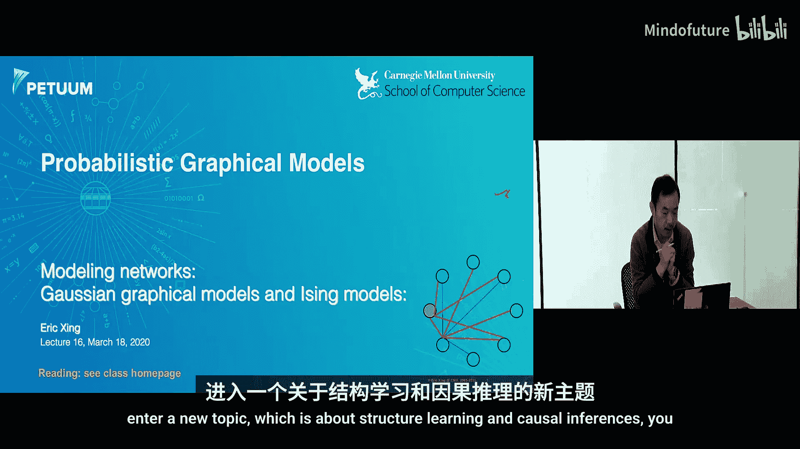
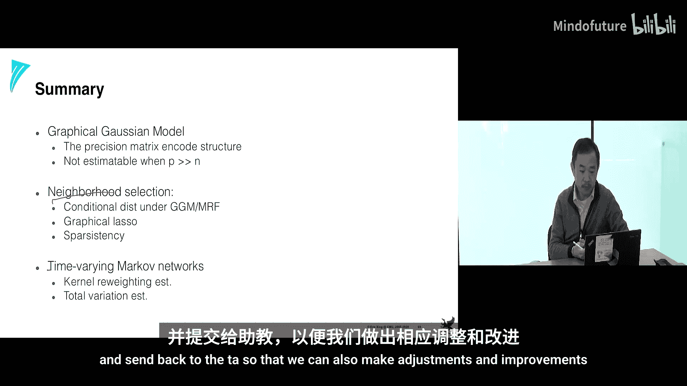

# 【卡耐基梅隆】概率图形模型 ｜ Probabilistic Graphical Models 2020 p16 P16_Lecture_16_结构学习 -BV1ebpGzhEA9_p16-

Well， well， let's get started。 You know， I guess this is a very exotic experience for all of us。

 but Yeah， let me announce a few rules。 you know， for the online teaching during my session。

 I would like all of you to mute yourself so that we don't you know， crossfire， you know。

 with a lot of background noises and everything。 in case you have a question。

 you can use the raise your hand function。 or you can use a chat function to put your question I will try to respond。

 but in case we don't respond， we can again， bring it to the office hour or after class for。

 for discussion。 today， I'm still teaching from a conference room。At CM M U。

 But if the campus end up closing， then I will be teaching from home。

 which will have less support from the crew。 but hopefully。

 we can still figure it out the lecture will be recorded。 it will be posted right after。

I were still making annotations on my， on my on my， on my iPad。To make sure that， you know。

 the flow goes very naturally。And also， I will be trying to slow down the presentation and。So that。

 you know， we can make sure that the， the things are delivered clearly。诶。Okay， we'll get started。

Are you already Just clap your hands or raise your hands。Who， all right。

I will be sitting instead of standing， because。Well。

 I may be pointing to the to the to the projector， but。You'll also see me on the on the slides。

 So today， we are going to。Enter a。New topic。Which is about structure learning and causal inferences。

 you know， in。

Graphic models， and also in data modeling。So just to give you the bigger context。You know， so far。

 except for the first few lectures， you know， we usually assume that we have a good amount of knowledge of the domain。

 and then we use this knowledge to design， you know， the the model right。 and， for example。

 you will see a mixture model， which we assume that we know there are multiple clusters in the data。

And we could design a hidden markov model where we assume that we know the dependencies between。

 you know， the concepts。And also， we could go even more fancy and come up with a deep neural network architecture and so forth。

Another way people use domain knowledge is to design expert systems。Or knowledge graphs。

Where concepts entities are connected， you know， in。You know， in a graphical structure。

But with all this， usually it's about knowledge first and then knowledge drives the structure design。

And that it's a very convenient way to encode commoninologist。But， you know， today。

 and I'm going to start coming from the other direction， this direction。

In which we assume that we only have data and we want to actually learn something from data。

 especially the dependencies or the correlations or the causal structures。Between entities so that。

 you know， we can tell a story or we can use the knowledge to do something else。

So this is about structure learning。And there has been。

 you know a lot of study in fact for this topic as well。

 which is less kind of mathematically elegant than what we've learned so far where we come from a structure and also and then use that to learn a model for the data。

But what I'm going to talk about are the subset of this topic。

 where the mathematics are a little bit more clearer and more elegant。

That involves learning structures with some limitation constraints。 For example。

 we can learn structures which is assumed to be a tree structure。

And they actually provide a nice mathematical guarantee versus an entry。And then you can also， learn。

 you know， structures with directionality or without directionality。 And we're going to talk about。

 you know， approaches in this direction。 Today， we are going to talk about the unstructured graph learning。

Which is in the form of a Markov network。And next week。

 we have two invited guest lectures talking about Beijing network learning or direct graph learning。

 usually giving you a knowledge about the causal relevance between random variables。By the way。

 so I'm not going to talk about tree learning today。

 There has been some materials I provided earlier。 I believe it's in lecture 3 or somewhere in the in the appendix。

 basically， just to briefly give you a recap， you know， when random variables。

In the way which I draw here， are connected you know with a tree， for example。Something like this。

There is a way to learn such a tree。 if it is not given directly from data in a mathematically guaranteed way。

 The idea is to compute what is called the mutual information between every pair of random variables。

And mutual information is defined by。If you recall， what is that。

It is the K L divergence between the joint distribution of X， I and X J。Versus the。Product。

Of for the marginal of the two nodes。Basically， this is to assume that these two random variables are fully dependent。

 This is to assume that the two variables variables are totally independent and the distances measured by K or between them is the neutral information。

 And you can compute， you know， pairwise neutral information for every pair of random variables。

 which is of complexity。 N square。 N is the number of nodes。And then you。

 after you have all this pairwise nutrient information information。

 you can run a maximum spending tree algorithm to find the maximum spending tree。 Okay， you know。

 that connects all these nodes。 And the result of the tree is actually， you know。

 the most likely structure underlyinglined the data。 So this is called the cho algorithm。

 If you are interested， you can go to the the appendix to locate the mathematics。Okay。Okay。

 so today we' are going to talk about this topic， how to learn an undirect graphic model。

And just to give you a context， you know， this technique has been often applied in network research where。

 you know， we want to really learn complex networks out of data。

And here are some examples of typical networks。 you know， in you know， in social media。

 you want to learn， you know， networks among people。 and here you can learn networks among， you know。

 websites or servers。I addresses。 And here there is a hidden network between maybe genes or proteins in a biological system。

In some cases， the network is a real thing， but you don't know it。 And you want to recover it。

 such as the Internet。 It is a real network connecting I P addresses。In some cases。

 the network is a implicit one， such as social network and where you want to really uncover it。

 you know， from just activities of data。And in some cases， the biological one well。

 we believe there is a real physical network， but no one has the ground truth to really。

 really know about it。 and therefore you need to you know use the the data， you know。

 resulting from the network， such as the gene regulation activities。 you know。

 that triggers the activation and suppression of a gene and then reverse engine network。Of course。

 there there is a task。 there is a challenge of how to validate them。

 I'm going to say a few words if we have time at the end of the class。Now， learning network。

 you know， is a somewhat arbitrary practice in the good old days。 It's a very， very kind of you know。

 how should I say， unstandardized heuristic。 I think we saw this graph before。 how to learn。

 for example， the social network of figures inside the Bible， right。

 We talked about the co occurrenceencies of the names， you know， in a page of the Bible。

 in a paragraph or in a line or a sentence， all this can result in different networks。

That basically proposed， you know， suggests the need of a more principled approach。

To make the problem more complicated， the network itself may not be a static entity。 So in this case。

 you know， we have， for example， data of voting records of a congressman。

 congresswoman and man and inside you know。You know。

 in the in the Congress and their political or personal relationship may evolve over time。 Therefore。

 you may be running into a network that is changing。

Over time and how to learn that is becoming even more interesting， but more challenging。

And this is another example of biological network where you can see the biological entity is evolving over time。

 And these are the two pictures of the expression of the same geneing over the course of an embryo of the Drophila evolution。

And because the location of the gene is different at different time points， obviously。

 their dependencies or their influences of other genes will be also changing over time， right。

So how to learn a graph or a network， even a undirected one， you know， from。

 say noal activities or time series data of no activities is the topic I're going to discovered today。

So， there are two approaches。Which are considerably optimal。Right。And you know， one is based on。

 you know， you know， you know， a， maybe a。Huristic。You know， which allows you to。

Search the structure of space。And optimize some kind of loss objective。

 It could be the log likelihood， but it could also be many other functions。

This heuristic usually don't give you guarantee， but they give you very efficient algorithm。

 which you can quickly converge to a result。The other approach is a more principled one， you know。

 with a more kind of explicit objective function and also algorithms。

 which are designed to optimize the loss function in the principled profession。

 And very often with a convergence guarantee and correct guarantee。 So today。

 we' are going to focus on the latter approach。So what is the key idea， you know。

 between this you know， underlying this mathematically more principled approach of network inference。

What， one of the key idea is to really draw a equivalence between structure search。

 which is combical， which is discrete to a singular search problem。

 which is to optimize the parameters。You know， of some model in a continuous parameter space。

 because there you can compute gradient。 You can calculate， you know， you know， you know。

 the change of the loss function more conveniently。 And also， you can drive you know。

 iterative convergent algorithms more easily。 So how to make this connection。

Let's consider this social network。 This is a little kind of a fragment of the social network。

 and on every note you observe data， such as voting yes and no， in a binary form， or you know。

 a real kind of vector， which gives you his behavioral activities or other things。 know。

 it could be just fraction number of his interest on different options of activities and so forth。

And remember， how do we model， you know， a data set of either discrete or binary nodal value。

One of the way to model that is to use a Mark random field。 right If you remember。

 the Mac random field defines potential functions， you know， on clicks in the graph。

And one of the representation is to define clicks only on singletons and on pairs of nodes which are connected。

 And then， you know， with them， you know， with a potential weight。Now。

 if you look at this mathematical model， there is actually a explicit A you know a implicit connection between the promptterization and the structure of the model。

 because。Each of the pairwise weight。Actually， is attributed to， you know。

 a edge that connects the pair of random variables of interest。

And if the value of that weight becomes 0， then you can just intuitive。

 intuitively conclude that there is no edge。Between the set of random variables。

 the pair of random variables。So in a sense， if you can learn the value of the parameters， you know。

 from data and by looking at the magnitude of the value of every， you know， pair potential weights。

 you actually could derive the structure of the of the graph。

 So that's basically where we draw a connection between structure learning and parameter learning。

And again， just to， you know， recap， you know， if you were able to learn， you know。

 the parameters of the pairwise potential weights。Then if you organize them in terms of a matrix。

 then there is a  one to1 correspondence of the 0 and 90ness of this matrix。Against。

The structureer auto the graph， okay。So that's the idea。 Therefore。

 in this particular way of modeling the data。We are basically building a connection from structure learning to parameter learning。

Okay， so now let's look at one of these macroranum field models。

This is a model called multiver Gaussing distribution。Okay。

And it is not very obvious at at the first sight that it is a algorithm field。

 because they typically。The way we write down a multi Gausian distribution is to use this very standard form where you have the the mean vector and a covariance matrix to define the join distribution。

Now， without loss of generality， let's assume the min to be0。 We can always you know。

 shift data to recenter it。 And then let's introduce a new， you know， matrix。

 which is the inverse of the covariance matrix。And in that case。

 you can now rewrite the joint distribution of this multipleburg distribution， you know。

 in this form。Which actually now exposes the more explicitly the fact that it is on my current field。

 basically the。The numbers in the precision matrix Q。You know。

 correspond to the weights of the singleton and pairwise potentials in this continuous valued micro field。

You can see that these Q Is correspond to the diagonal value of the position matrix Q and this pairwise potential weights Q I J correspond to the of diagonal numbers in the Q matrix in their corresponding positions indexed by I and J I and J are the index of the random variables。

 right。And therefore， you know， Gaussian graphic model is a pairwise microm field。And the。

 the covariance matrix。Carries structure informations you know of the graph。You know。

 in an indirect way， because only when you are able to invert it to turn it into precision。

Then you can read off the structure of the graph connecting all the axis， you know， from Q。ok。

That's basically written here now。If。It it sounds like the problem is solved already。 You know。

 if you want to learn the graph。You can just compute the covariance matrix。应度。

This theta equals to what equals to X， I and X， J。And we'll just sum over them。

And you'll get the precision covariance matrix， right？so诶。And then， we invert it。

And we get a Q already， right， So sounds like the problem is solved。In fact。

If you look at the both the theta， a sigma and Q， you actually could have a two graphs。Originally。

 people。Didn't even bother to learn about the Q。 They just basically directly inspect the。

 the precision the the， the covariance matrix sigma。 And when there is a zero entry， you know。

 in sigma， I J， then。Obviously， it suggests that the X and the and， you know the the X。

 I and X J are marginally independent of each other。 Therefore， you could directly draw a a graph。

 which is known as the correlation network。Okay。But the Cor network isn't。

The macro field structure that I just talked about in the in the in the。

 in the Gaussian graphic model， a few slides ago， because in there， you know， it is the。

Configuration of the Q matrix that defines， you know， the graph structure。

And the key differences here is that a 0 in the Q matrix。

Correspond to not the marginal dependencies you know， specified by the sigma， but a conditional。

Independences between X and the X， I and X， J， given the rest of the nodes in the graph。

And this difference is important because if you remember。

 when we define the topology of the graphic model in our first two lectures， you know。

 we actually already specified explicitly that a absence of edge inside a graphic model correspond to conditional independences。

 not much depends， because they were leads to a lot of downstream nice effect。

 such as a factoribility in the graphic model and and causality if that directed and so forth。 right。

 So it is the， you know， it is the， you know， conditional independences inside。You know。

 the graph that is more interesting， which correspond to the Markov network definition。When we say。

 okay， we like a Q over sigma， but it doesn't make the problem harder because the Q simply equals to sigma inverse。

 We can just first compute sigma from data and invert it。 We get a Q， we still get a structure。

Right so that seems to be an algorithm already。So not does it really work？Okay， in the class， I ask。

 but because we are having some challenge now in a real time interaction， let me answer that for you。

Invering this sigma。No呃。I's not so difficult， you know， conceptually。

 but computationally can be very difficult。 First of all， if you have remember。

 this algorithm inversion is of complexity N cube N not N cubic。Okay， not not quadratic。Therefore。

 you know， if you have a larger network， say a few thousand words， then inverting that in， you know。

 that covariance matrix can be very， very expensive。And secondly， you know， in larger graph。

 if you don't have enough sample， then your sigma matrix maybe degenerate。Therefore， you know。

 you may not be able to invert it。Right， so there are a number of difficulties。Therefore， you know。

 there is a need。To bypass this inversion step and say， can we directly learn the cube。Okay。Because。

 you know， in fact， inside Q， if it is a really meaningful structure。

 you see actually a lot of zeroes。Therefore， you know。

 you don't actually expect them to be a full matrix。 and therefore， it is not likely to be。

Resultant from inversion of another full matrix， right。

 there should be a direct mechanism to learn the queue with such a， you know。

 a structure sparsity encoded already。That basically becomes a very， very， you know。

 interesting challenge， but also a opportunity。 So we see the need for sparsity。Right。

 it makes empirical sense because， you know， a natural networks for genes and for people should be should be spae。

 Otherwise， it's not even meaningful if you say everything is connected to everything else。And also。

 it makes the people of sense because that makes it possible to learn， you know。

 from high high dimensional data with not enough data points。 You know， if you assume it is sparse。

Okay。Okay， so let me first introduce a heuristic algorithm。And to， to make this work。

 at least learn the structure and directly possible。

 And then let's talk about the statistical andpinning between behind it。So， there is an a。不是。Okay。

 so I said that there is a simple heuristic built on the Laso algorithm。

 and this is the mathematical formula of the Laso where we basically are solving this linear regression with an assumption that you know the beta is actually constrained。

Okay， you know， with a certain constant。Right， or maybe actually。

 there are different ways of constraining it。 This is just one way to constrain。

 But there are other ways。 For example， you can do a L2 norm and so forth。Anyway。

 so the idea of Laso is that you are going to now solve， you know， you know。

 imagine if we project this idea into a graph node and kind of setting。

 you can assume that I have one note of interest。And all the other notes。Okay。

 which we call them collectively X minus I to be the input。 you know， into this target note。

 X I equals to beta X minus I。ok， plus a noise。Then if you are able to estimate make a data。

 then they will give you basically the weights of， you know。

 all these other nodes to this target node， okay。And。

The lastu idea is that we are going to do a sparse regression of all the other nodes。 you know。

 into this target node， the blue one from the green ones。And once that is estimated。

 we are going to get a structure like this。Okay， this is suggest a very simple sparse regression。ok。

And， you know， in the literature of regression， there has been a fair amount of， you know， a theory。

 you know， for this particular estimator。And one of the， you know。

 explanation of what's happening is that。🎼You know， you can write down this， you know。

 a regularized regression in the form of a， you know， a constraint of problem。

 These two are equivalent to each other where you basically assume a standard regression subject to that the coefficients are constraint。

 You know， in a box。 Okay， this is known as the box constraint or the the the L1 constraint。

 which looks like this。So in this graph on the lower left corner。

You see this eoidal kind of loss function shape， which actually defines the loss function from here。

 Your goal is to minimize， you know， remember this space。Is the space of beta。

 Suppose we have just two dimensional beta， right， And by changing the value of the beta。

 you are going to minimize， for example， the loss function from somewhere into here。

But then here the diamond box is corresponding to the kind string。

Meaning that whatever beta you solve， it has to be staying in this diamond。

Then the joint solution of a optimization and also the constraint has to be the intersection of this a tool。

Little figures， Therefore， they interested in here。Right。

And this graph also explains why the solution would be intuitively sparse。

 because if you look at the shape of this constraint。Which is a diamond。It is the extreme point。

 The corners in here， which is more likely to be touching the loss function of the other part of the organization。

 And therefore， when we touch in here， then by definition， the beta 2 is already equal to 0。

 the beta 1 will be in here。 So that's the idea。 If you imagine a higher dimensional space。

 this high dimensional ellip side will be touching you know， the high dimensional diamond， you know。

 in some corner space， which correspond to many beta values will be 0。

So that leads to basically something like this。 You are going to end up with a regression where only a few of the beta will be9 zero。

 and that leads to a so to speak， a very sparse neighborhood。Of， you know， the why。

In the collection of the X。And there are some guarantee， you know。

 some theoretical proof to guarantee that if the true kind of a regression， you know， a setup。

 you know， was known， then you have a high probability of recovering the truth。

 If some condition are met。 So we' are going to， you know， skip the discussion of the conditions。

Okay， so now if you do， you know， the regression once you get something like this。

 you can do it again。For another node， and then you get another set of neighborhood of the second node。

 and you do on and on。 And in the end， you magically end up with a graph which allows all the nodes to be connected in the sparse way。

There is one caveat which needs some special attention。 For example。

 when you do regression over this note。And you will be having its neighbor like this。

And then when you do regression of that node next， then you will be redo basically， you know。

 this particular edge and may have a different be value。 And which one is true。 If one is 0。

 the other is not0， Then which one do you choose。 Well you use some kind of formula。 You know。

 to either threshold it or to select one of it。So this is a algorithm known as the graphical laso。

 Basically， you are going to do the Laso regression for every node with respect to all the other nodes in the in the whole collection。

 and you end up with a graph。 and my husband had a very。

 very famous and and and widely referred paper， proving that this procedure will have a high probability of recovering the true you know。

 beta value or the true structure of the of the graph。停。收。You may wonder， you know。

 this looks like a very weird algorithm。 you know， instead of estimating the Q。

 I'm now estimating the neighbor of every you know random variable using a linear regression。

 You know， why this is working。Okay。嗯。Well， you can look at the paper in here and which give you a very。

 very kind of in depth theoretical discussion。 But here I want to give you a more high level understanding of what is happening。

 Okay， why， for example， you know， a Gausian graphic model， you know， leads to can be equivalent。

 you know， to a sequence of linear regressions， you know。

 in terms of recovering the structure in the graphic model， Why it is happening。

So to understand that， you want to look more deep into， you know， the， the algebra。

Of a gauss graph model。 So here I rewrite a。The， the， the。

 the expression of a multi bird Gaussian distribution and the also the underlying Gaussian graphic model。

Let's look at the behavior of all their parameters。So if you notice。

 the two key parameters are the mu and the sigma。ok。And remember， mule is a vector。

And sigma is a matrix。Okay， they basically have all the secrets of what we call a structure of the corresponding gauss in graphic model。

Now， let's look at you know， a division， you know， of these parameters。 say we are interested in。

 you know， dividing the entire set of random variables。 into two subsets。 Let's say this is x 1。

 This is x 2。 By the way， here， X 1 X  to correspond to two subfactor。

 not necessarily just a single random variable。 The whole thing is a whole vector of many random variables。

 Okay， then you can。Corspondingly， divide the matrix also into this structure。

And let's give a name for that。And with these the two subsets of the whole set。

 you can now ask questions like， what is the marginal distribution of the second subset。

What is the conditional distribution of the first subset of random variable skipping。

 the second subset and the reverse and so forth。 right。

 So this is the standard manipulations of a multi bird gaussing distribution。

 It turns out that after working out the the algebra， you can easily get the following thing。

The marginal distribution of a subset is expressed in this form。Which can be easily read of。

From the given， you know， you know parameterory of the whole distribution， I。

 it is just a sub vector and the sub matrix of the original mean vector and the original in covariance matrix。

And the conditional distribution of a subset random variable， given the others。Caour some to。

 you know， you know， a。Another Gausian distribution。

 who is the Ming conditional M and the conditional variance。Ceverance。can be。

Derived from the original， you know， mean vector and co covariance right matrix using the following formula。

 You can see that they correspond to some reasseemblage of the original corresponding building blocks in the mean vector and in the covariance matrix。

 So these are formulas that is nice to remember。 Okay。

 How do you basically directly write a conditional mean and conditional covariance。

Given the original full joint M and joint covariance。ok。

And there is another technique people often use， which is about how to invert a matrix here。

 I'm not going to say too much。 It's very edge break。 Basically， if you have a。

matrix of the following structure。 You can apply inversion， kind of a matrix。

 inversion diagonal matrix on the left and on the right to invert this one into a to turn this one into a diagonal。

 And then， you know， diagonal matrix can be inverted very easily， right。And then you can basically。

 you know， get the following kind of expression。That， you know。The。

The diagonal matrix啊 the the the the呃 the。The way to invert， basically you。

 the origin matrix is to first diagnose it。Using this and then invert the diagonal matrix。

And then you basically get you know， you know air anatic expression of the inversion of any arbitrary given matrix。

And there are also different ways of diagnosing it。

 therefore you can have this two equivalent expression of the inversion of the original matrix okay。

And。That actually leads to what is known as the matrix inversion Lama。 You know， that establishes。

 you know， the， again， the relationship of the inversion of a sub matrix。Versus。You know。

 elements in the original full matrix to be inverted。停。

We are going to use it for some applications later on。

 This is known as the matrix in version of Lama。 Remember in here。

 why it is already potentially useful。 If you look at my earlier equation in here。You know。

 to write down the conditional M and conditional covariance。

 you need to manipulate sub matrixrices in the original full matrix of variance covariance。

 And then here you already need to apply operations like inversions to the sub matrices。

 And that's where this kind of technique will be used。 You know。

 to make the computation very explicit。Okay， so now let's look at our。

 go back again to look at our Gaussian。 you know， multi Gaus distribution。

 Here is the covariance matrix of the Gausian。And they correspond to this kind of a general expression。

 you know， of the component matrices。And if we divide our random variable in such a way that we only worry about one of the variable I and also all the rest of the random variable x minus I。

 then we want to define you know， the partition of the original co matrix in this way。

 The first element is a just a single scalar。 And then here you have a n minus-1 dimensional sub matrix。

 N minus-1 dimensional vector and。A minus-1 dimensional vector。

 And then using the matrix inversion Lama。Remember  Q equals to inversion of the covariance matrix。

 You actually can get the following expression。Okay。Where， you know， you can。Actually see， you know。

 where the queue and the the。The Q-1， you know， correspond to， you know， in this original。Expression。

 okay， so in here， you can see that each of the。You know， components in the precision matrix。

Can be expressed as the sum operation over the sub matrices in the original covariance matrix。Okay。

 so now with this， we can write down the conditional distribution of a particular random variableb in this multi word Gausing。

 given the rest of the random verb。Both and here are just the expression of the conditional mean and the conditional covariance。

 It's kind of scary to look at the equations。 But you can go back to the standard formula I gave in the previous slide。

 reconstruct all these equations。By assuming， in fact， I already copyied these things in here。

 they actually are used to derive this equation。By assuming the mu be 0。

 you can actually come down to a very， very simpler form， which looks like this。O。So remember。

 the conditional distribution of P of x given x minus I。Is a one dimensional Gaussian distribution。

 which can be parameterized by a Ming。Which is expressing here， and a covariance。

And it is one dimensional Gaussian。 Therefore， Ming and covari are both， you know， a Taylor。ok。

All right。So， now， let's see。How does this look like。So just look at， you know。

 the connection of this conditional distribution。Versus what we expect from a a typical standard regression。

Right。So so in here， basically， whats saying that X。Comes from， you know， a Gaussian distribution。

And the mean of the Gausing is defined by this matrix。 Therefore。

 X basically can be expressed as the， you know， Q。Right， so that's basic expression。

 And this sigma basically comes from a。Normal distribution with a 0 min， and this one being a noise。

So this expression。Which， you know， is directly coming from the conditional distribution of a single random variable in the multi word Gausing。

 given the rest。It's no different from what people expect from a linear regression。Okay。Therefore。

 you know， you know， in in a linear regression， what we do is to， you know， learn， say， X， I。

Given you know equals to beta X， I minus I plus lambda， and then。Beta subject to some constraint。

 And we learn basically， the beta to be a vector of0 and then0 components。They translates to。

 you know， basically， you know， something about the Q matrix。Because if we look at this Q vector。诶。

For every note X I。You know， this Q vector， this Q vector is what。Is basically， you know。

 corresponding to the original。You know， a Q matrix。Which remember。

 encodes the Markov network of the Gausyn graphic model。 This Q vector。

 which is the regressional coefficients。You know， offer， you know， a particular random variable Q。

 I is actually a particular column or row。In the Q matrix。Of course。

 they are reilled by a diagonal number， you know A Q， I， I。But if you look at， you know， the。

Ignore the value of the Q， but only the0 and90ness of the Q。What if I have a particular， you know。

 say this is a Q vector。Or maybe this is the。Let's call this a beta vector。First。

 imagine this regression。 If in a beta vector， I have one of the component to be 0。Okay。

 meaning after this one。Has a particular number 0。 Then that also correspond to in the Q vector。

 this particular number to be 0。Right， in terms of a zeroness and unzeness。

 not just the value of that。I hope you can。See this connection。

And then once we learn that a particular component in the Q vector is 0。

 then we can also safely draw the conclusion that a particular number in this bigger Q matrix to be also 0。

Right， therefore， each time you learn a Q， I。Okay， which correspond to the ice column in the Q matrix。

 You actually correctly learn a column worth of numbers in the precision matrix。

 And if I run Q from one to N， then you can gradually learn all the columns in the Q。Okay， and the Q。

 by the way， is a symmetric matrix。 Therefore， all the roles of the Q are， you know， can be equally。

 you know， filled in。 Therefore， you can basically learn a matrix。Of the Q in this way。

So what I meant to say is that this0 and 90ness， you know， resulting from a La Sur question。

 you know， for， you know。The auto regression function in here allows you to。You know。

 iteratively and sequentially learn the precision matrix Q in terms of their 9，0 entries， you know。

 being entries being 0 or 9，0。系。ok。So that's basically， you know。

 the intuition behind algorithm just to recap。 Orin， you know， we say that， you know， you know。

 the conditional independent structure， you know， of a Gaussian graphic model is in Q， not in sigma。

 but Q could be correlated related to the sigma by an inversion。

And then we conclude that this past doesn't go through because you have all this mathematical issue。

 We want to learn the queue directly。And then we say that， you know。

 there is a way to establish every column inside the queue。Okay。

 to correspond to a regressional coefficient of the auto regression problem， Q， I。

Versus X I versus X minus I， you know， in this single regression form。 and therefore。

 by learning the beta， you learn the Q I vector， and then you learn the Q matrix。Okay。

 so this is a rather indirect way of learning the Q。 And here to learn beta。

 you need to put a sparsity constraint so that you can consistently recover the0 and 90 value and elements of the Q。

 And you don't actually you know， draw consistency on the magnitude of the Q numbers。

 And that's why we call this algorithm structure learning。

 We are only caring about the0 and 90ness of elements in that Q， not the magnitude of that。

And there is a guarantee that that090ness can be correctly recovered using this algorithm。

 The value is a different situation we can discuss later， if we interested in that。Okay。

 so that's basically the whole story of this so so called graphical La regression algorithm。

 And there has been a number of alternative formulations you know， solving the same problem。

 which I will quickly run through， but I'm going to skip the mass due to the time limit。

The algorithm we just heard about is known as the myhaus and Bman algorithm。

 which is to docyclic class。And once you do any of them using the neighborhood selection。

 you are going to recover the co Q matrix。There is another slightly more sophisticated algorithm which directly solves the Q okay。

 by you know， computing first the sample covari matrix directly from data。

And then use it to define the following operation problem。Which is actually， you know。

 a maximum likelihood estimation in the original Gausian graphic setting。Okay。

 but this Q matrix gets regularized in the， in the L1 way so that they become sparse。

And then there's an algorithm which is very similar， you know to the the graphical regression。

 which again goes down to learning the Q from every column。八爵。In here。

 there is a single loss function。Defined over all the columns rather than for every last。

 you solve them separately。 Therefore， this algorithm is iterative。

 and you're going to resolve basically in the regression。 You know when you have， you know。

 some other kind of parts of the k matrix estimated。 Therefore。

 there are some dependencies between different last problems。

 which gets you to a more stable solution。 But again， you know due to time limit。

 I'm not going to discuss the technicalities in here。ok， so啊。

What we've recovered discussed so far is to solve。A model known as the。

Continuous multivari Gaussian distribution， which is also known as the Gasographic models。

 where the random variables are continuous。What if the nodal value。

 every node or every random variables are discrete， such as in the social network。

 we model people how they vote， right So it's a binary value。Well similarly。

 at least from a symbolic perspective， writing down a Maco random field for discrete node is no different from a continuous note。

 You still have a pairwise Mac random field。And you can still write down， you know。

 a joint distribution using singleton and pairwise potentials weighted by the parameters。Right。

 and also the。Weights can review the structure of the graph， depending on whether they are 0 or not0。

And intuitivetu， you can guess that the value of the theta。

Can actually also be recovered by a auto regression type of mechanism where you pick every time one of the X and then do a regression function over。

The other X。But in this case， X。Are discreet， not continuous。Therefore。

 you cannot use a simple linear regression， you know， to， to， to make the connection。

 What is needed is something called a logistic regression where you know， your model， you know， the。

 you know， the the conditional likelihood， you know of discrete random variables。

Rather than the continuous random variables， Therefore， the conditional of one random variable。

 given other random variable is no longer a gaussin distribution。 It is a logistic distribution。

 or the regression function。哎。So， and we know how to solve logistic regression， therefore。

 the algorithm still goes through and people can also prove that it gives you consistent estimation of the structures。

So， that's。Discte graph。There are even more interesting scenarios of maybe。Ver valued notes。

 for example， if I have a。In a graph where。Every X I。

It's not a one dimensional continuous number or a binary discrete number， but is itself a vector。ok。

And maybe this guy is also a vector。And how to draw a connection between whether there is a node or not。

 And in fact， these two vectors may be of different dimensions， just like you， you know， are。

 you know， having interest in five activities。 And another guy have interest in 10 activities。

 How can I draw a connection between you2， right， So these are， again， you know。

 making the estimation of the graphic models more kind of complicated。

And I'm not going to discuss the mechanism here， but there are kind of papers discussing how to estimate graph of this kind using partial correlation computations and other techniques。

So this is a whole domain of area for graph estimation。

 using either partial correlation computing or regressional technique to estimate you the neighborhood of every node and typically this forms a family of you know structure learning algorithms which enjoy some nice statistical guarantees。

So with that， I'm going to move into applications of our basic technique to some more interesting setting so that you can estimate graph structures in more challenging scenarios。

This is just a very quick review of some of the early work done in my group and also in the community。

 For example， I mentioned about the need forestimating， you know， evolving social graphs， right。

And why evolving social graphs is you know， you know， interesting and also harder to， to estimate。

 Well， it's interesting because the graph， you know， in real world is evolving。 Therefore， you know。

 your data coming from a time series of you know， a noal activities。

 are not necessarily I D samples that you can just collapse and then run a maximum likelihood estimator of a single structure for all the data。

And then how can we actually and estimation in this scenario。You know。

 it's actually becoming quite challenging。Because if you look at a particular time point， say T star。

And you look at how many samples are available for this particular graph。 In the extreme case。

 you have only maybe just one examples。And then， in fact。

 each particular graph may have just one examples。 Therefore， you know， as meetingating， you know。

 a model out of one data point is never a good idea。 You know， in， you know statistical estimation。

So， but that doesn't doesn't mean you cannot do anything with that because one key kind of insight。

 you know， for this type of structure estimation problem is that these different graphs over time are not totally independent of each other。

Okay， there， in fact， they are highly dependent because they evolve over time just by modifying a small subset of nodes and edges。

So if that's the case， can you actually come up with an algorithm which can estimate in time specific graph using the entire set of data examples。

So here I want to introduce a few algorithms。Okay， one algorithm is known as the kernel relatedweighted L1 regular regression。

Again， it is a neighborhood selection acquisition on every note against others。And run it quickly。

And therefore， the loss function look very much the same of what we learned so far on ID examples for a single graph。

But the breakdown of this loss function。It's a little bit more interesting。Thenhan a ID estimator。

Here， when summing over a time series of node examples or examples， we are going to now you know。

 introduce a weight function。The weak function is defined over two， you know， time points。 Okay。

1 is the time point T of your estimation。 You want to estimate a network at time T。 The other is。

The time he prime where the example is coming from。And the the weight function is kind of measuring。

And， and considering the distances between these two time points。Okay。

 and then you do a weighted sum of the conditional likelihood。Of a note of interest。

 I given the rest of the note。Okay， and the weighted sum is weighted over 10 points。

 That's sum over 10 points。And intuition is like this。

Suppose that I'm interested in this graph at time T。And I have one examples。

But I also acknowledge that all the other examples， which are not from this time point T。

 may be relevant to the graph at time T after all， because it is coming from a graph。

 That is not too much different from time T。 Okay， the closer the time is to the T of interest。

 Maybe the example is telling more about the graph of time T。Therefore， what you can do is to。

 you know， do this kind of reweighting。Okay， of you know， the examples。

So that if you focus on a particular time point here， you can kind of treat all the time points。

Examples。But done waiting the examples。That come from a time different from the time of estimation。

Okay， so this is kind of a intuitive。Kind of an estimator or a strategy that you would want to use to blow up the number of examples from one to all the examples you have in hand。

 just by introducing this weight function。哎。So this is a typical nonmetric technique， you know。

 when we do kernel density estimation， this is again， you know， a very。

 very common technique to build a density estimator， you know， by， you know， waiting samples。

 you know， you know， either close or far away from the center of the gravity。And again。

 the loss function can be a logistic loss or can be a conditional gaussing loss。

 depending on you modeling conditional continuous random variables or discrete variables。

 and then you again do the kind of neighborhood selection for every node。And the。

 the algorithm basically look the same as if you do the standard graphical La so。

 The only exception that your samples are getting rateed。 So this is a very。

 very seamless algorithm that is reusing most of the exist technique。

And there is a nice set of theoreticalpher guarantee that tells you that if， you know。

 your samples are evolving， you know， according to a certain， you know。

 a rate of change and also the dependencies between random variables are nice behaving。

 you know which are described in these conditions。You actually could get the similar guarantee as if you are trading ID data from this whole data set。

Okay， so this is the guarantee where tells you how you can recover， you know。

 the structure of even the evolving graph for every single time point。

 you know you know with a high confidence。There is another algorithm which is similar in spirit。

 but use a different technique to capture this in continuity。So it was published in this paper。

It's called temporary smoothed L1 regression。And you。

 you can see the loss function is a bit different from the previous one。

 The previous one are using a loss function， which are reing the examples。In here and some over time。

 Okay， it is ready for just one graph at 10。 T。And some overall examples。In here。

 the strategy is to estimate all the graphs together。Okay， from time T to time one。 Okay。

 and therefore， the samples， you know， that defines the conditional likelihood from。X1， given X， X I。

 given X minus I is not going to be rate weighted。 They literally will be， you know， just。

The sum of their conditional likelihood， without reing。

But because now you are estimating all the networks together in a single of my vision function。

 you are allowed to directly measure the differences between the neighboring graph。

So here we introduce a two sparsity。 One is that every graph needs to be sparse。And then， here。喂。

Enforce that the differences between。The adjacent pair of graphs in time to be also sparse。

So what's the intuition。 Well， this is to assume that the evolution of the graph structure is smooth or gentle over time。

 Therefore， between two graphs that are just next to each other in time sequence。

They should be minimally different from each other。 Therefore， there is this arsity preferences。

 So graphically you can see we do graph La like all this graphical la in a single equation。

 But then because for a particular edge， like this one。

We introduce the time differences to be small so that they tend to be if graph。

 if an edge present in a graph before， then it is more likely to be also present in the graph next。

And。Using come duality， you can rewrite this regularized you know。

 slightly more complicated regular regression formalism。Using a constraint box constraint， you know。

 a optimization where here are the two constraint sets。 One is the same constraint we see before。

 you know， on every single edge。Okay， to be basically in the constraint inside a diamond space。

And the other is known as the total variation differences。

Where the differences of the two edges or two weights gets also constrained down to a small number。

 okay。And you can run， you know， a number of different object algorithms。

 projection gradient and other things to achieve the solution。

 It's a little bit less efficient than the the graphic call so for every single graph separately。

 but still it is solvable to the order of a few thousand nodes。And again。

 there is a way to establish a consistency guarantee。That， you know， the estimated results。

 you know are。Recoverying the true graphs。 if certain conditions are met。Okay。Okay。

 so if you are interested in looking at the theoretical analysis of these two algorithms。

 I encourage you to go read this paper in analysis of P statistics where some of the proofs are provided。

Now let's take a quick look of what you get out of this slightly more elaborate algorithm。

 which can be quite fun， in fact。Because in the past， you know， there isn't really a very。

 very convenient and mathematically safe way to estimate evolving graphs with those algorithms now you can。

 and let's see what the result look like。So we apply this algorithm to you know a set of social network time series data。

 The first one is the Congress voting record and in a particular time period。In fact。

 in the period of 12 months。And it's about the voting record of the 100 senators。And。

Here is the outcome of the evolving graph。It's kind of interesting to read these graphs if I interest。

 you can see the paper。They display something that people kind of expected。

And some are more interesting。 for example， the graph itself。

For all the three kind of time points that I would choose to show show a very explicit you know。

 partisan structure， right， you have the。The Democrats， the Republicans。

 highly networked within among them， right。But what's more interesting is that there are some notes which are in the middle。

 meaning that their voting behavior are。In the kind of the middle between the Republicans and the Democrats。

 Again， these are a data set。About 10 years ago， you may not know all these senators already。

 I actually don't really remember who they are， but there are some names which is worth looking。

 For example， who is in the middle and who is。So forth， no， there is a guy， you know， for example。

 this senatoranitary chafe。And if you look at his own neighborhood。At a particular time point。

 when he was just entered the， you know， the Congress。He was actually a high。

Be associated with the rest of the Republicans。Then， you know， after a few months。

 he's voting records。Start to show connections to the other side of the aisle。And in fact。

 after a few months， he is， you know， you know， becoming more associated with the Democrats。

And less associated with his Republican colleagues。

 I believe this guy was either lost his re electionction or change party affiliation to the other side。

You know， you know， after， you know， his first term。

But this graph actually shows a very interesting estimation in that is kind of predictive of his political movement you。

 during this particular time period。We have another candidate senator Nelson。

 who demonstrated the opposite behavior， you know， coming out of the Republican the Democratic Party to the Republicans。

 you know， after， you know， a certain period of time。Another application is in biology。 Again。

 biological networks are also evolving over time or over different biological context Here。 you know。

 we have a set of， you know， a biological examples coming from， you know， a collection of cancer。

 the brain breast cancer collection。The breast cancer cell lines that we study demonstrated a few different disease stages。

 they come from normal stage， malignant stage， and in fact。

 my colleague has been working on using some medicines to revert the oncogenic cells to its normal form。

And here， basically， she shared with us the converted， the reverted cell lines from the malignancy。

But this reversion was only from a pure morphological kind of observation。

 you put the cell under microscope。 They look normal。

Are they really molecularly normal iss not known。 Okay， so she basically give us a problem。

 Can we use a network inference to determine whether those cells in here。

 which are morphologically normal after drug treatment really normal in terms of their gene expression networks。

 But again， the problem become very difficult because we don't have enough samples to estimate the network at every time point or every evolution point。

 And therefore， we want to establish a procedure which can still use all the examples。But hopefully。

 estimate all the networks in a dependent fashion。 Right， So for example， here I have five networks。

And I'm going to introduce a formula which penals， you know。

 the total variations of networks that is adjacent， you know， in their time points。By the way。

 this a total variation， you know， regularization is particularly useful。

When you actually know the dependency structure between the networks。

 not the dependency structure between the genes， but the whole network， they evolve over time。

 If you know how they evolve in terms of the time sequence。

 you can directly introduce this loss function， according to the edge。

The original number per match technique， which you weighted sum of all samples。

Cannot make use of such a dependency structure。So with that， we actually come up with a estimator。

 which are like this。Here we have all the networks。And here， we have。The sparsity constraint。

And also， the total variation constraint for the differences between networks。

 And this part is the regressional kind of loss， you know， of graph reconstruction。And at the end。

 we actually were able to estimate these five networks。I'm about to finish。

Please keep on mute and I will wrap up in three minutes。So these are the estimated networks。

 you know， from five different cancer stages。And we actually present this back to the collaborators。

 And she actually was able to find that some of the， you know， for example， this network in T 4。

 which is known to be the cancers stage， is indeed quite abnormal because there are elevated network activities in this tumor related cell functions。

😊，But when she look at all these reverted cells， there are three different types of reverted cells。

She were able to actually， know find out which particular network activities are are in the suppressed and which are。

Not to be suppressed and therefore， determine whether the cell is at the molecular level。

 truly becoming more normal or actually not normal at all。

 even though they are morphologically in terms of shape， look like normal。Right。

So this is kind of a application which has been published and adopted in different studies to leverage graphic models' ability to estimate time evolving network structures to determine cellular functions。

And we also， you know， have follow up work， you know。

 to estimate more fancier networks and more complex scenarios， such as you know， directed graph。

 You know， over time evolution networks， or if you have missing data。

 How do you estimate network structure and I mentioned earlier， if you have multi attribute data。

 Let's say every node is a picture， for example， how do you estimate their network。

 there are various different algorithms coming into that。So to conclude， today， you know。

 we learned a set of algorithms， which allows you to estimate the。

Connectivity or the topology of a Markov random field， graphical models。

They usually take advantage of the neighborhood selection algorithm。

 which allow you to turn the commatorical structure search or the matrix inversion estimation problem into a sequential linear regression style problem to you know to give a more efficient but also consistent solutions。

And then the technique can be further， you know， you know。And extend it into complex scenarios。

 such as time series， time vary network scenarios to allow， you know。

 a multiple graphs to be estimated based on very small sample sets。So we start。

I'm going to wrap up today。Let me see on Z。 Do we have other people。Good。Well， unfortunately。

 I haven't， you know， figured out how to make this lecture more engaging by taking questions and and having answers。

 But let's try to get used to this。 Hopefully， in the next few lectures。

 we can make better use of Zoom to allow questions and allow more live discussions online okay。

Please write your response and feedbacks in Piazza。

 or directly write to me in email and also make sure that if you already received the class survey。

 you want to really finish it and send back to the TA so that we can also make adjustments and improvements accordingly。

Thank you very much。