# 【卡耐基梅隆】概率图形模型 ｜ Probabilistic Graphical Models 2020 p17 P17_Lecture_17_因果关系_1 -BV1ebpGzhEA9_p17-

So hello， this is Qunzhang from philosophyo department and I hope you are well。

 So in this lecture as well next one， you will see something about causality。

 essentially you can see why we have to use causality。

 how causal models are related to graphical models and how we can discover causal information and how we can in the causal effects。

 given the causal structure and some observational data and finally you can also see why it's really essential to do something called counterfactual inference。

 and then you can see we can benefit， how you can do so and how what we can benefit from those operations。

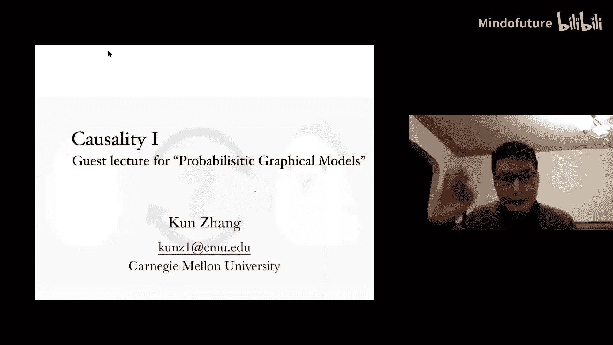

So if you have questions， please directly raise your hands or just send a message to the Ts。

So I would be very happy to take questions because there are so many concepts I really want to make sure we'll be on the same page。

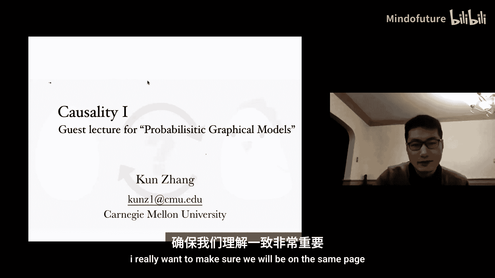

O。So we know that in our daily life and also in science scientific discovery。

 we really have to distinguish between causal connections from associations right here we can see a very simple example in the telegraph that said couples who shares housework are more likely to divorce。

This sounds very astonishing why and when we see this kind of information we want to go further because we want to get something that is useful。

 that is helpful right and it's not surprising that there was a lot of follow up discussions。

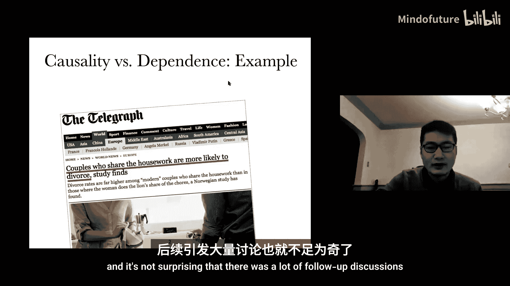

Right here you can see I try to see whether sharing housework really leads to divorce。

 You want to see the code connection because if you just see association， you don't know what to do。

 But once you see the code of connection， you know oh， to achieve that goal， I should do this。

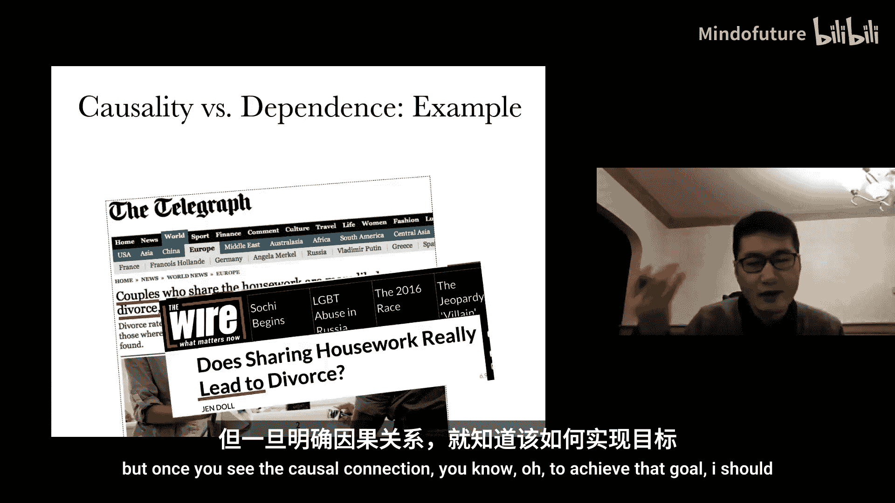

。And here this characteric basically explained my experience， first of all。

 generally speaking causality implies dependence。And I think all of you are familiar with the propaganda in statistics。

 which says implies correlation， but correlation doesn't imply， right， So basically it's correct。

 but maybe you want to make it more informative。 and now we can say cac implies correlation。

 but correlation doesn't directly imply ca。 However， in many cases。

 I make use of the dependence to the structure， dependence pattern or some multiple the distribution over multiple variables。

 you can really discover some information of caus from the dependence pattern。

 including the correlations。So if you look at this character， you can see oh。

 when we were very young， usually we used to think that correlation impliesus， right。

 I can I can still remember that when I was very young sometimes yeah。

 if I saw very strong coincidence of correlation I would like to say， oh yes。

 they are they are related if if I change this one that when we change and then later after taking some classes。

 that the classes are change my mind， but after doing research in this field for some time now I'm very optimistic。

 essentially you can say that in almost all situations， I analyzing observational data。

 which gives you the dependence pattern， you can really find causality under some assumptions。

So we'll make the assumptions very， very clear to everyone。What's association。

 So essentially if two variables are not independent， then they are associated。

 they are the way for them to be related， or if you make prediction。

 you can see one one one variable would be useful for you to predict the other。

When we say x is the cause of y。 we have to go to another level we cannot just use the association because causality is a is the property of the process。

 underlying process。 So what do we mean by X is the cause of Y basically here。

 you can see at the bottom， this is the definition。 First of all。

 we have to define a particular change of the system called intervention。

 So we define causality based on the notion of intervention。 here， the definition says the following。

If you do intervention on X， right， and you have two different values for x。

 which which are X Y next to。 And you find that the corresponding distribution for y。

It could be different， as you can see from this equation， then you say x causess the y。

So this is the definition based on intervention。 Now， what's definition of intervention， right。

 So information， sorry intervention is defined this way。 If you want to intervene on X。

 then in the system， you can only change the variable X without changing any other variable。

At least for the moment， so if you want to intervenex， make sure you just change this variable。😡。

And this action， make sure this action will not change any any other variable。

 Now it's very natural to see why this is the definition of concession right in the system。

 this action changed only the value of x and then you see a change in the distribution Y。

Right since every basically all other variables have the same value。

 then you can see the distribution， the difference in the distribution Y must be caused by the difference in the value of x。

 then you can say oh， x causes y。😊，Right， so this is intervention based definition of ca or causality。

So if you have questions， please just raise your hand because I'm paying attention to。

 to the participant。Window right right now， I want to see whether you have questions， okay。

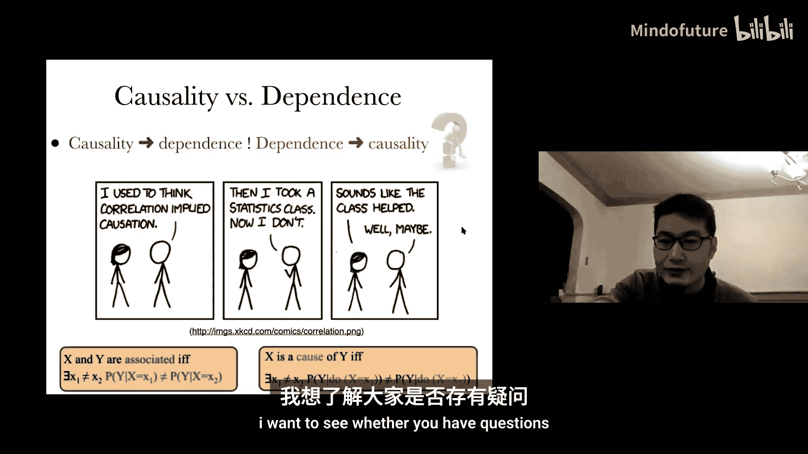

So now let's try to see a lot of phenomena by making use of the notion of intervention。

Here two examples on the left， you can see we want to see the causal relation between two things。

 One is the hot weather。 the other is high sales of ice cream。

 are they causally related is one of them the cause of the other。

 so how can we verify that usually we can easily determine causal， at least for two reasons。

 First of all， in our experience right we still remember or we can imagine the effect of interventions。

 Second of all， we have temporal precedence information in most situations。

 So here you can think of intervention if you find a way to to change the first event right to make it very hot then you can see oh。

 it's very likely that the ice cream you will see the high sales of ice cream right so you can see oh if I if I intervene on a it's possible to see the change in B。

 however。You can find a way to intervene on B without chain A at all， right。

 so you can just hire a lot of people to buy ice cream。

RightAnd then you cannot see the hot weather as a consequence of that。

 so here you can say our hot weather is a cause of high sales of ice cream clearly we can have noise in the system right。

 they are not necessarily deterally related and we'll come back to this point later。😊。

And now let's have a look at a second example here。

 suppose this guy goes to work by bus in the morning so around age 30 this guy is leaving home at the same time the bus is coming so if you think of those things as final variables right if this guy is living home this variable takes value one otherwise takes value zero。

Then you can see the two variables are clearly related or correlated， they are dependent。Now。

 the question is whether they have a direct cold inference in between。So do you have any idea。

 just try to think of the relationship from the perspective of interventions。Any input， any response？

They are clearly called related right， do you think they are causally related。

 Do you think one of them is the cause of the other？Okay， same see something。yes， so yes， sorry。

 I cannot see your name。 I only see the email address。 Yes， the bus caused the man to leave。Okay。

 so suppose this because case what does mean， First of all， intuitively。

 it doest seem to be the case， why， because the man does not see the bus coming， right。

 theres no physical way for them to be related。Then why do you think bus coming will cause the guy leaving home？

Right， so clearly they are related。 Now let's try to do interventions。 What's intervention。

We have to change the target variable， only the target variable by the action。

 So now the bus is coming。 you want to do intervention。 of course this is very dangerous。

 but suppose you can do this， right， I can do this。 I just simply jump in front of the bus right。

 Hopefully the bus will stop this is very bad but this action will not directly change any other variable in in this system。

 right， and you can say bus will stop， but this guy will still leave home as usual。Right。

And similarly， when this guy is about to leave home， I just simply close the door。

This is also intervention， because this action will not directly change bus coming。

And as a consequence， you can see， oh， this guy will stay home while the bus will still come as usual。

So if you think of the intervention， you can see they are no causal relation between them。

 then how can you explain the dependence， Basically here， we have a common cause。

 Hopefully the common cause is something like a bus timetable。

 Both of them operate according to the bus timetable。Right。

 and now you can see we have to really pay attention to the definition of intervention。 Why。

 then's suppose I do the following change。I want to change the first thing。

 I want to change the time that bus is coming。 What can I do， I just directly change bus timetable。

Right as a consequence， I can change first the first variable， However。

 this is not intervention because this action will also directly change the second variable。

 which is about whether the guy is coming is living home So this is not valid intervention。

 although by this action， I can see the difference， I can see the change in some other variables。

 I cannot say anything about causality， right because all of them can be caused by my single action。

So make sure it's intervention and then you can see the causal relations by making use of interventions and effects。

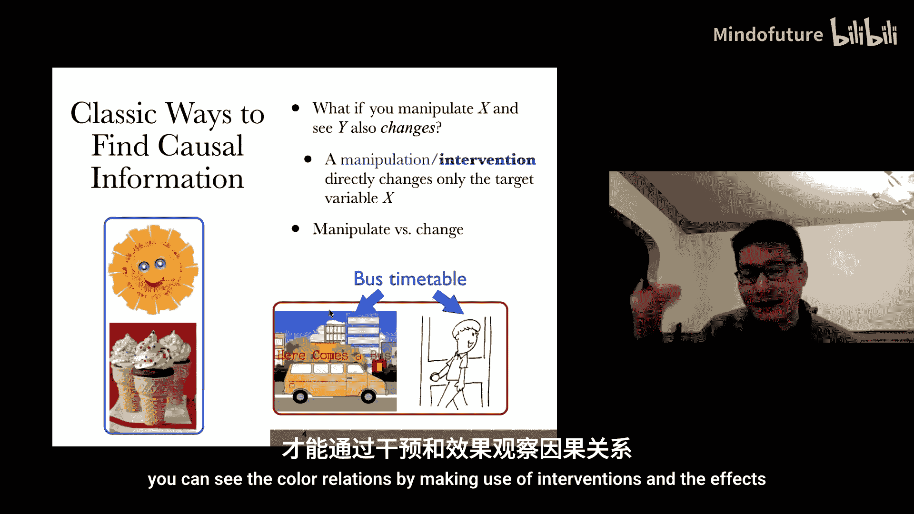

Okay， so usually we use direct graphs to represent call relations。

 Sometimes the graphs can be can be cyclic and we'll talk about that point later。

 So usually we use a directcyclic graph。 And I think Erica has been talking about Ds for quite some time。

 So you are familiar with that， if you have a direct age from A to B basically just means that a the direct cause of B relative to this to this set of variables。

 So this is very intuitive， right。Okay， so in this class。

 I'm going to talk about the I just talk about definition of causality in terms of interventions and I'm going to talk about what we can benefit from causal thinking or why we should use causal thinking in some situations very intuitive。

 but in some cases， maybe we should need to think a little bit about the process and causality and you see the difference between call graphic model and graphical models essentially you have to enforce some additional constraints or assumptions to make sure that the graphical model is causal。

And then you can see the basic idea of identification of color effects and finally you can see why and how to do confe reasoning and in next lecture youll see how we can do color discovery and the implication of causality in machine learning。

Okay。So first of all， I think everyone know that we have to distinguish between dependence and causality。

If you just want to make passive prediction， giving I data， then probably fine， right。

 you can just make use data， you can forget that causalusity dependence would be enough。

 but if you want to change something or if you want to change the system to achieve your goal。

 you have to care about causality and this example discussed by F a long time ago。

You can see if you want to change the incidence of cough， right。

 you cannot make usually correlated variables which is which include yellow fingers。

 you have to go to the causes here， smoking is the cause。

 so you have to go to that level to achieve your goal regarding the incidence of some disease for instance。

That's very clear and then let's have a look at an example called Simpson paradox。Yeah。

Here you can see a real data set published in the 1970s。

 so basically in the hospital we have two groups of patients with kidney stones。

 one of them has small stones， the other has large stones， so we have two groups right here。不。

And a second。The system is very slow。Okay， so right here we have small stones。

And then here we have large stones， we have two groups。

 and also we have two treatments A and B right here。

So you can see that for each group treatment A is better than B。

 as you can see from the higher recovery rate， here's 93% versus 87% and for the other group is 73% versus 69% so in each group a is better however。

 if you just merge the data now we can see oh。For the data。

Consulting of both both groups be seem better because the higher recovery rate。

 So now comes the question， suppose you are a doctor and suppose that you only care about the recovery rate。

 We just want to maximize the chance of recovery。Now， giving a new patient。

Would you like to recommend A or B。Maybe you can just do a quick vote or you can just read your you can use yeses。

 no。 If you want to go go with a， please use yes， otherwise， just click on no。嗯。嗯，哼。😊，I see， yes， no。

佢就佢系 ok。So I can see more A than B。 good。 So basically now I can see oh。A wait click。

 So there's the first click on participants。And then you can see， yes， no buttons。Okay， good。

So now this is the reason why call we call this problem paradox。If I know that the stone is small。

 I would say a。 If I know the stone is large， I would say a， right。

And if I only care about the last row of this table。I will I will say B is a contradiction。

 So I would recommend A or A， which turn out to be B。 That's why paradox。 of course。

 you know what I said， what I just said is not really accurate。Because in principle。

 even if I have no idea about the size of the stone。

 I should still recommend a because a is always better in this case。

 we see this very very strange phenomenon just because of the relationship between correlation and causal effect intuitively when you make recommendation right here in this graphraal model。

 you only care about the property of the causal influence of treatment on recovery。😊，Only the line。

 the solid line。 However， the correlation between treatment and recovery can be rather arbitrary because of the the third variable stone size。

 which influence both of them。So here we says don't say the direct common cause of treatment and recovery。

 because they this common cause， the dependence pattern between treatment and recovery could be rather arbitrary as a consequence。

 you cannot say you cannot clearly see the causal influence of treatment on recovery right here。

Right。Oh right here。You cannot just you cannot clearly see the property of this connection from the dependence pattern。

 Okay， so this is a very important problem。 and there are so many related problem， related examples。

嗯。So here I can see oh。I'm I'm learning how to。Give lecture。This way， me see， okay。

 now you can see another example。 So on the left， you can see the scatter plot of exercise and cholesterol given each age group。

 right， and you can see for each age group。😊，On average， the more exercise you do。

 the less cllateral you are going to have。 That's good。 That means oh I should do more exercise。

 However， if you ignore the age information， you can see the distribution of exercise and collateral on the right。

 They are clearly positively correlated。😊，Right， so that means oh， a the data or con distribution。

 The more exercise you do， the more collect you are going to have。You can see it's very strange。

 so basically the sector statement is okay， let me see a question。Why the group size are different。

 Probably the group size。 yeah， you are totally right。 So basically。

 you the question is about the group size。 Let me go back to the question。

 Let me go back to the first example。You are totally right。 right here。

 You can see stone size is a direct cause of both recovery and treatment。

And if stone size called is only one of them， then it's not a common cause。

 not a direct common cause， then there are no such phenomena。

 you are totally right and later you can see that in order to identify causal effects。

 we just want to do something like what you just suggested。Perfect。😊，O， so in this example。

 I can see something similar， right if I know the edge information。

 I know oh they are negatively correlated， but if I don't know the edge information。

 they are positively correlated。😊，However， if you make recommendation， right， in this case。

 if you make recommendation， you have to go to the color level because you want to change something。

 you want you want to achieve your goal or you want to improve something。Okay。

 so there's a second example and the third example is about some particular type of dependence in the data。

 So let's go back 60 years in America。 probably you would find that female students are kind of smarter they male students on average。

 why we believe that according to the whole population。

 female and male kind of equally smart in some way。 now you can see this kind of strength dependence。

 why essentially this is because selection， and if you work with internet data， right。

 you always have this issue。So in this case， you can see gender and IQ at this moment are both causes of being admitted to college。

Although they are independent at the beginning according to the population。

 once this you have the common effect which is being admitted to college。

 once you have once you know this， given that they are college students。

 then they will become dependent gender and IQ will become dependent in most cases。

 so this should become a selection。And if you only see the selected sample。

 you will see this dependence between gender and IQ and if you go to the whole population。

 this dependence relationship will disappear right and in most cases you want to analyze the gaming sample to say something about the population that's why you should pay attention to the selection and try to find a way to correct for such selection biasers。

And right here you can see another related example。

 which is very famous is called survival ship bias， survival ship biasers。

 this is basically in World War II they they wanted to put armor on the airplanes on the aircrafts in order to increase the chance of survival。

So right here you can see the holes on the returning flights。

 you can see oh there are a lot of holes here， other holes here and there And now the question is where I should armor。

Right， to make the airplanes better to increase the chance of of returning。

 Where should I put put the armor， Should I just put the armor here。Right here， you the area。

Or you see this area。Right here， you can see in this area， I can see a lot of holes and in this area。

😊，They are basic， they are no。What should I do， essentially for this problem， you can see， oh。

 I want to infer。嗯。Yeah。Check。Essentially， I want to see the following。 I right here。

 you can see the patterns of the holes on the returning flights。😊。

But that's not what I really care about。 I want to pay attention to the flights that didn't return。

 right， And then I want to see the reason why they didn't return。

 and then I want to find a way to solve the problem。 So we have to go to the process process level。

 Now， basically， this is the very simplified call explanation。

In hit and where the hole is are both causes of a survival， right， now we are given。's not working。

 So we are given two things。 We are given probability。We are given。Proability。Of。Where are the whole。

哦。It's not working， it's not working right。你咪着少买嘢。去吧。So， we know the probability of。Where the whole。

Is， and we know。Given survive， right given is oh， this is very bad。 So basically。

 we are given the patterns on the return aircrafts and we want to infer the following thing。

 We want to infer the patterns of the holes。For the flights that didn't come back right and right here I make use of some other assumptions we can infer that quantity by making use of this pattern if you have the process in mind。

O。😊，Okay。Yeah。When I checked it out yesterday， it worked worked very， very nicely。

 I don't know what happened。 a few years later。 Okay， now let's have a look another example。

 which is kind of very well known one。 It's Mon hall problem。 If you know the problem。

 Could you please just click yes or raise your hand。Whatever coming， whatever is coming， okay， okay。

 good， good， I see 2，3。OhGood， thank you。 So essentially， I can skip the example。

 skip the procedure of the game， and let's just try to give a good explanation。

 So in order to increase the chance of winning money， right， we should change the mind。

 We should change our mind， why。😊，You can see right here。

Where the money is is independent from your initial choice， right because when you made a decision。

 you have no idea where the money is it was run and then。

After you see which door is opened by the host now you can see basic you see the common effect。

 then the two initially independent variables will become dependent。 This means oh。

 my initial choice contains some information about where the money is right。

 so you should at least at least rethink your decision and then after some calculation。

 you can say oh， I should change my mind。Okay， so this is basically called by the dependence given the effect or this is called by the actual information that you can see by considering the effect。

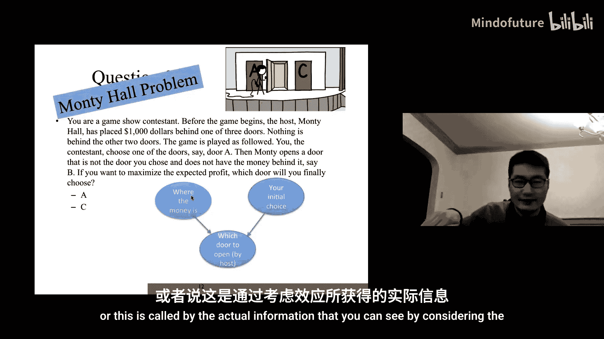

So。As you can see from those example， the causal thinking makes a difference， although in most cases。

 we just think of the causal information or causality as a background information， right。

 we make use of causality all the time。And first of all， if you know causality。

 we can make active manipulations instead of just passive prediction， right。

 you can change something， you can change the system to achieve a goal。 and second of all。

 you can do generalization or adaptation in new environments。

 I will give an example on this in a second and if you know the causal if you have the causal picture。

 then you can do information information theory or information integration。

So here you can see some examples， suppose x called y and that y calls z。

 Now what's the relationship between x and z？You can see， oh。

 maybe there's another way for x to direct cause z， but even if that's not the case。

 I know x cos z by a y right so the peak now you can see you can make the world bigger and bigger by making use of those。

Pieces of causal understanding of the world。And but if you know that x and y are dependent and that y are there are dependent。

What's the connection？ What's the relationship between X and Z， You have no idea about it， right。

In this case， X， Y dependent， Y z dependent， X and Z can be identical。 X and Z can be correlated。

 and they can be independent。 So you have no idea you cannot go from the small pieces of the world to a big picture。

 right， So that's why with the causal information with call understanding。

 we can go from part of the system to the whole system。

And all creativity is basically a color problem usually when what do we mean by being creative。

 first of all， you have to write right you have to ask right questions。

 you want to say what if right you want to what if something has been different you want to make a difference and then you have to answer the question properly。

 what can I do so you have to integrate information from different aspects， right。

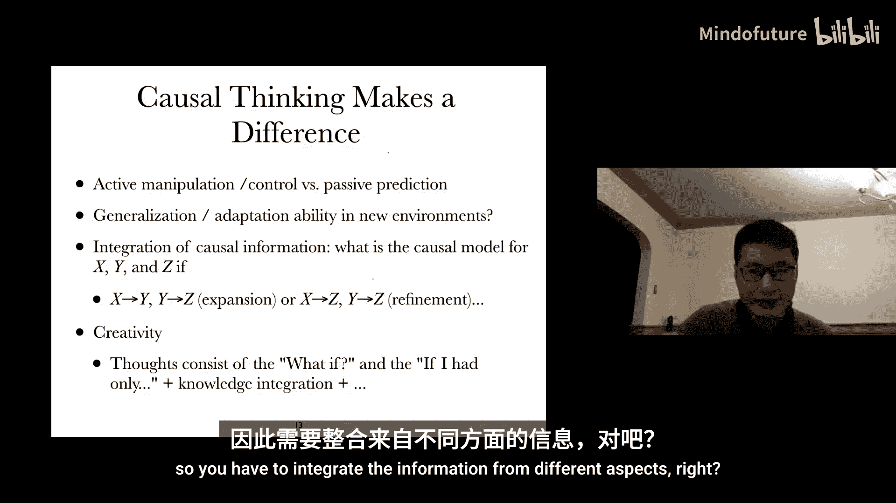

So here let me give an example to illustrate the point regarding why some kind of call information or some particular understanding of the system can be used to improve the prediction performance in some complex situations。

So here in this example， suppose you can see this is my figure， right。

 this is my figure and right here you can see my shadow。😊，Okay， in the first scenario， you just see。

s my shadow。Can you say anything about my figure， Can you make prediction。

From my shadow to my figure。Just make the use of your experience。Have a look at questions。Oh， yes。

 thanks， I think that's right。 Yeah， yesterday I tried the yeah。

 use the I or something and it worked fine， but now it not work very nicely。 So I yeah， you're right。

 I will just do  Taping。 So this is the first scenario。

Do you think you can predict my figure from my shadow。Okay， second。You only see my figure。

 of course this is a new environment， you have no idea where the light is from right it's just a new environment Can you say anything about my shadow if you see my figure。

Or could you predict some of it， but not of it， Yeah you are right。

 because project you can just predict some of the foreign suppose you want to predict my height。

Now in the height of my figure of the height of my shadow。 Okay， let's just consider that。

So the second scenario， you want to predict my shadow from my figure。

 which one do you think is simpler to do according to your experience？Right you would say。

 I think most of you might say the first one is simpler。Maybe can do okay。

 If you think the first one， predicting my figure from my shadow is simpler， please click yes。

 Otherwise， if you think that predicting my shadow from my figure is a simpler。

 please please click on no。Oh。切。Professor， can you please unblock your video？Yeah， I did that。

 thank you。Yeah， so okay， now actually say， yes， yes， no， good， no， yes， no， no， no， no， yes， yes。

 yes， okay， so。Let me give let me give another example， which is similar。Now。

 suppose you just write down digit 5。Right， and then you ask someone to make prediction to see whether this is the five。

It's very easy。Right， but now you are just ask someone。 Oh， can you predict the pattern of 5。

 Basically， my handwriting digit 5。It's going to be very difficult， right。

 If you know the label and want to predict the actual pattern of the digit。

Handwritten digit is going to be very hard。 But if you have the handwritten digit and want to predict the level。

 it's going to be relatively easy。 according to your understanding of the problems。

Right of the process。So essentially， you can see in this case， prediction is not really symmetric。

 Why its because of the changing environment here you don't know。

 you have no idea about the environment。 You don't know where the light is from， right。

 And from the generative process perspective， you can see my figure is the cause of my shadow， right。

😊，This is the cause， this is the effect， and then in any case。My。

 the effect contains the information of the cause。I just want to make use of this color process together with some constraints I learned in my experience。

To recover the information of the cause from effect， however。Right， on the other hand。

 the effect must contain some information that cannot be explained by the cause。

Which is about the environment。If I have no idea about the environment。

 then I cannot predict the effect from the cause very reliably。😡，However。

 under some very mild assumptions， I can predict equal calls from effect in a very easy way。😊，Okay。

 so first of all， this is not rigorous， second of all， later。On Wednesday。

 you see kind of a better way to think of this problem。 It's not necessary to be causal。

 We just make use of some dependence pattern in the data you can use， you can say oh。

 it's a kind of independence implied by causal process， usually we say so， but you can in some cases。

 even if the system is not causal， you can still make use of this kind of independence or dependence or irrelevance of the modules to make prediction。

This is particularly useful for domain adaptation。😊，Okay。Questions。Yes， you're right。

 The lighter source is unknown。 so this is a new environment。

 You have no idea where the light is from。😊，But still you can see in the first scenario。

You just see my shadow， then you know the model， essentially， you know the model。

 you know net from the code to the effect， right， and then together with some other assumptions in this case。

 which are usually the case， you can make prediction。But right here。

 it's really hard for you to make prediction because shadow can be everywhere and shadow can be long or short。

OK， can you repeat its connection to domain adaptationsure。

So in domain adaptation， we are given distribution， we are given data generated by one distribution。

 right， and we want to make prediction in another scenario， which has a different distribution。

What can we do， We have to find， we have to find and make use of the connection between the two domains or the two scenarios。

 right， And just now we can see that in this example， predicting my figure。

From my shadow is easier than predicting my shadow from my figure right。

 so the two variables do not seem to be symmetric in this case。

 given that the environment is changing。Given that this is a new environment。

So you have distribution shift problem。 Now you have to find a connection。 The causal direction。

 this is essentially what we can make use of。 So the causal model。

 causal mapping or the causal process is rather stable， right。

 and then you can make use of this understanding of the system and then you try to identify this source of the change and then make use of the source of change and environment part to make prediction。

 We come back to this point on Wednesday。

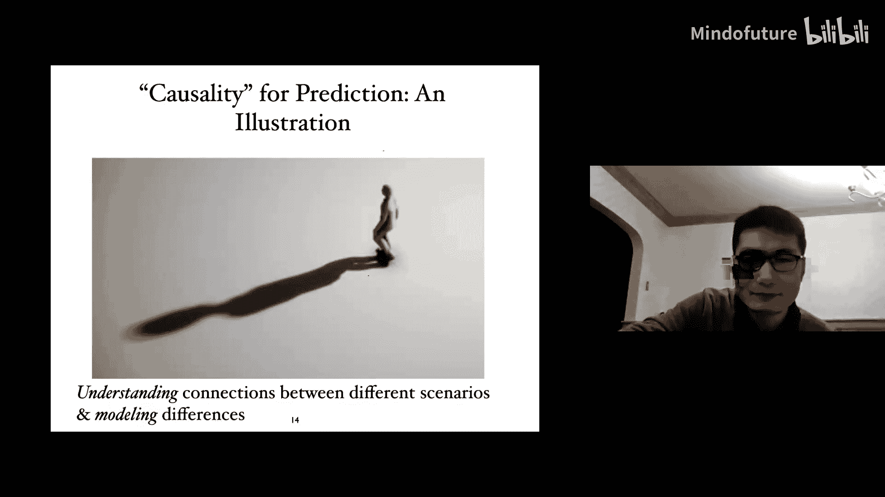

Okay， here you can see some more problems in machine learning。So right here。

 this is a photo categorization system developed by Google Photo released in 2015。 And right here。

 you can see right here， I think you can see my， you can see the mouse， right。😊，No response。 Okay。

 right here you can see， unfortunately， the African Americans were classified as gurillas。

 It was such a mistake， right， huge mistake。 Why did that happen， How can you solve the problem。

 And first of all， you can see according to the news report。

 it's not so easy to solve the problem because two years later，2 and a half years later。

 Google claimed that they solve the problem by removing gurillas from the set of label， So now。

 you know， goerrillas cannot complain， right， That's why they solved the problem。😊。

You can see why it's difficult。 But for our， for us， right， it's really easy。

What caused the difference。 So this is another example。

 I think all of you know this is adversarial attack。 So now you can see the panda。

 but if you add some noise or change some particular pixels or all of a sudden the machine will say or is not is something different。

😊，What cause the difference， Why do we have this phenomenon， Why do。

 Why do we have this kind of attack。So essentially， roughly speaking， we have this observation。

 we have our decision process right， we understand the scenario which is something。

 we make use of experience， we understand it then we make use we make prediction based on some features and machines use another process to make prediction to make decision as long as the two processes are different。

Then its it's always possible to change something so that the decision given by the machine is different while our decision the same。

 right， or in some cases， you can just make make the change so that our decision becomes different and machine different machine decision is the same。

RightIn both cases， we said we have other serial attacks。They are called type two and type1 attacks。

 so now the problem is whether the decision the machine decision process and our decision process are consistent in some way。

 right so what we what process do we use when we see a picture right we don't directly make use of the pixels。

 make use of our features。We have to find high level features by making use of our experience。

 We learn those hidden things first and then we make a decision right。

 So this is different from current machine learning systems generally speaking。

How can we solve the problem Probably， you can just enable the machines to think causally to think in a generative way of to think in our manner。

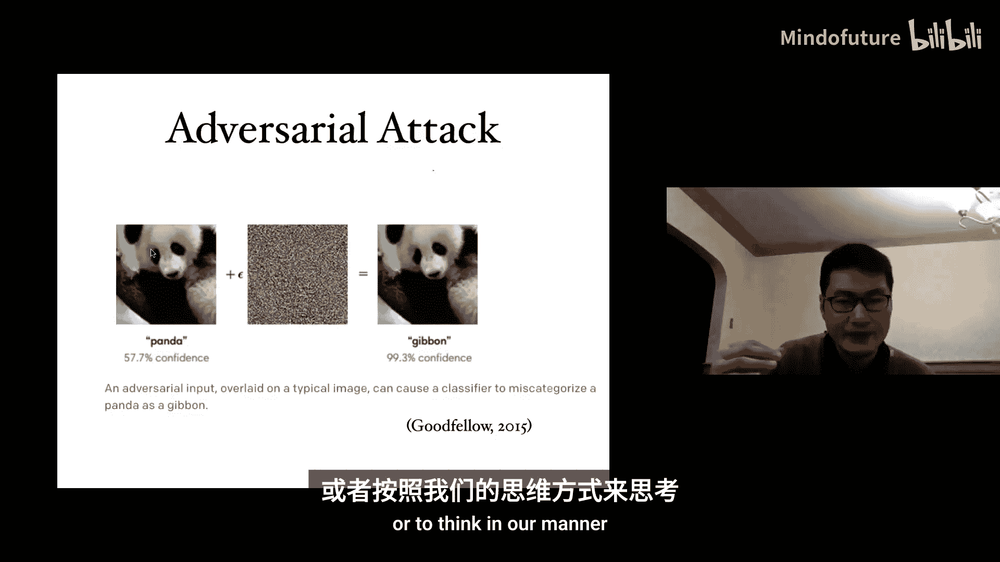

Okay。Yeah， we have been talking about artificial intelligence。

 so traditional machine usually assumes that we we have fixed distribution for the data。

 That's why you can train something on the train set and then apply the same thing to the test set right to the test data because you know of the underlying property is the same。

 But in reality most of the time， this is not the case and actually you can see we human beings can easily do a lot of things and for machines really hard right here。

 if you play badminton very well right， you can easily learn to play ping pong and you can easily apply ping pg very well because there's the way for you to transfer your the sub skills you have and right here is another example you can say as human driver。

 you can make right decision， even if this is a complete new scenario。 But for machines。

 this is rather difficult。basicallysically， to。When we say， we are intelligent。

Roughly leaking women the following offense。We are able to understand the system。

 We have our understanding。 here， I'm not giving a definition of understanding later。

 I try to give some explanation of understanding because of understanding， we can do control。

 We can do intervention to achieve our goal。And we can decompose a very complicated。

 very complex tasks into small tasks， right， We have the modules underlying the complex sense。

 and we can do information feeling。 We can just combine the small pieces to form a big picture and we can learn with few examples by making use of our understanding。

 and we can do not only interpolation， but also expolation， right， in the last example。

 you can see that even if this scenario， even if this getpoint is not contained in the training set。

S of the training set， I can still make use of the information I learned from training set to make prediction or to make the right decision How can we achieve those things。

Right maybe you want to keep this in mind or maybe you have some answers。

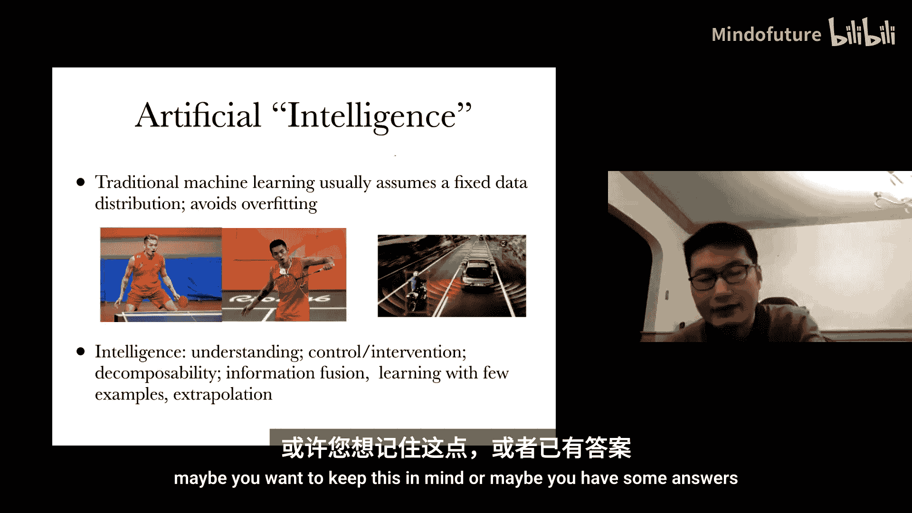

Yeah。So how can we understand or how should we view intelligence here。

 I just want to give a very rather unusual way to think of intelligence。Clearly， you can， you can。

You can talk about intelligence in many different ways， right。

 You can try to achieve intelligence by making use of the by studying。

 by examining how the brain works and then try to develop some system like that， right， but here。

From this perspective， we want to find the principle to underlying intelligence。

 So what's intelligence first。We can think of the problem from the evolution selection and evolution perspective essentially we want to define intelligence because we have two properties first we survived。

 second will we prosper right and first that means first you have a very good ability to make prediction across scenarios otherwise it's really it's not very likely for you to survive across different scenario at some point they say oh all of a sudden you you cannot make good prediction you cannot act properly and then other species will be will basic will be more prosperous so how can you make prediction across all scenarios across a large number of scenarios essentially we have incomp representation of the external world with these representation you can explain what you see you can see the connection between different scenarios。

 different contexts， different tasks and so on and you make。

Most of this company representation could make very nice predictions。And second of all。

 we are creative right， we prosper， we can change the world in the right way to do so we have to make use。

 we have to obtain and make use of the causal representation of the world right and now you can see。

 oh， we have the ability to have both of them and in particular there does not seem seem to be a significant gap between the two representations。

When we were very young， we couldn't really do interventions， right in the world。

 we could only cry and observe and think。And we learned some intercompent representations and later we had we could do more interventions。

 we made sure a lot of relations are causal， but theres no big gap。

 that means by making use of the observations and analyzing the data in some way。😊。

Based on some assumptions， we can find code information so we can go from 0。1 to 0。

2 and also we want once we have 0。2， we can solve problem belong to the first category prediction problems in a better way。

 So essentially， you can see how we can learn code relation and how we can make use of code relation to solve other problems。

O， so now let's have a very quick look at the chotograph model。 Do you have questions。

 If you have questions， you can either raise your hand or say something。😊，Oh， Eric。

 should we take a break？Yeah。Can anyone give a response？Are we supposed to take a break here。

啊 Ericric don't usually take a break butO yeah。是。After to you， Okay， good， usually， okay。

 we'll continue。 Okay， let's continue， so。哦 you learn the graphical models。 So first of all。

 let's have a look at dis separation。 Oh I want to see whether you learn the concept， dis separation。

 So if you learn the concept， please just let me know。😊，You can raise a hand。Then I can directly see。

 Okay， good。Perfect， thank you。So let's give this。

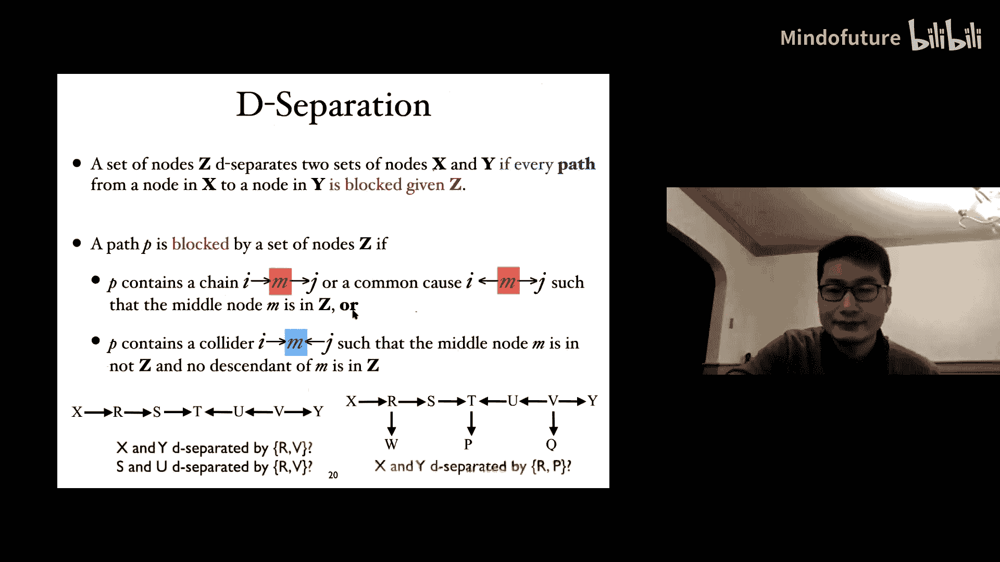

And intuition let's give the basically in say if X Y are de separated by this。

 then they are condition income given Z in the director graph。 Okay， let me ask you a question。

 What does D mean here。第se version，我当地名。Co。嗯。O， check the window dependence。Any other idea？

What does D means here。Any other idea？Okay， so dependence is not really wrong， right。

 but originally D means the directional。 This is essentially the thing you used for directed graphs for undirect graphs。

 the the criteriaion is very different， right， You learning that。 So here D stand for directional。

 That's why you care its because you care about thearrow has， you care about direction。

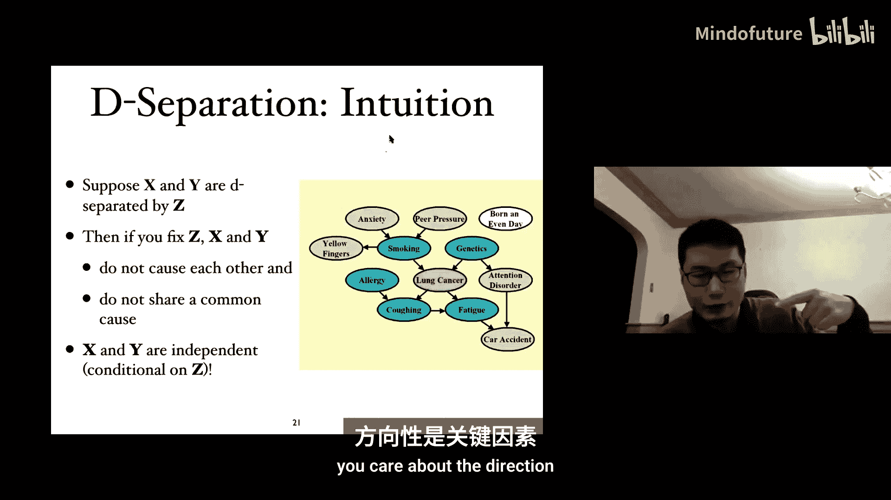

ok。We have local mark condition and glow mark condition and for deck they are equivalent local mark conditions says each variable is independent from the nonde given parents G mark can says that if they are dis separated the name they are conditionally independent now。

😊。

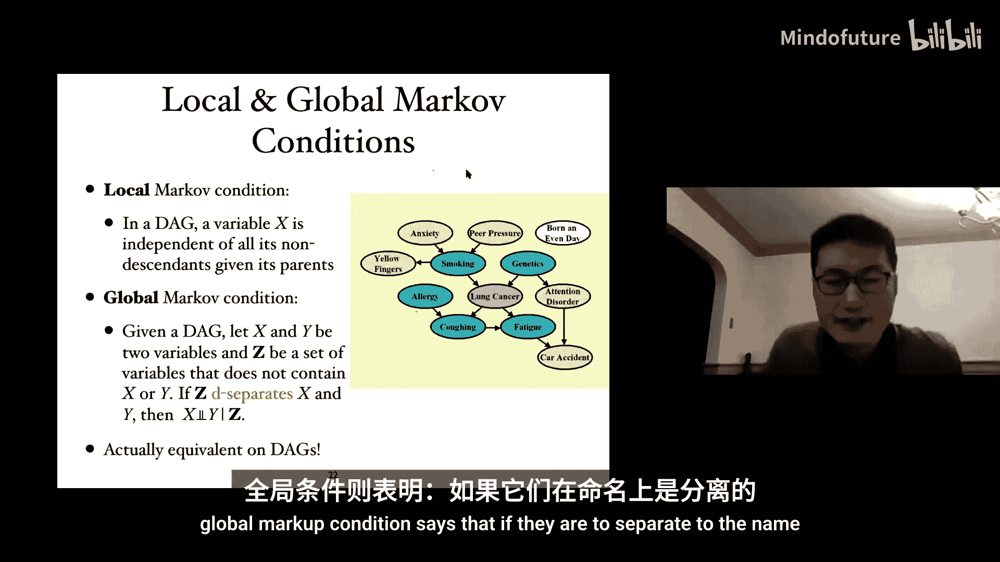

On the right， you can see some directedcycl graphs。You learn that。

 How can you be sure that these kind of graphs represent causal relations。Right。

 usually we use those graph to as a compact way to represent the properties of the distributions。

 You can factorize the distribution this way， right。

 You can see conditional independent relation this way。How can you be sure that they are causal？

Remember， we define causality in terms of intervention。

Because causality and dependence are on different levels。

 you have to find a way to jump from one level to another， right to the other here we consider two。

What can we do， You have to find a way to describe the effect of interventions。

 So here to make sure that this graphical model is causal， we have three conditions。

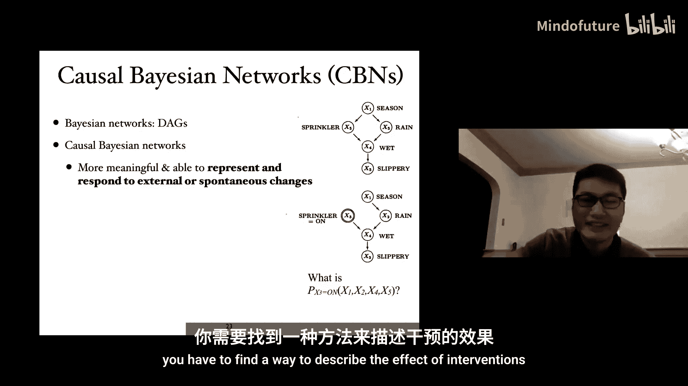

And clearly， as you can imagine， we have to make use of the distribution of the data resulting distribution of the variables。

 resulting from intervention。😊，Right here， you can see we do intervention on X。

And then we have a new distribution for the variables。

 and then we can say a direct s graph G is a causal basicesian network choographic model if those three conditions holds two。

The first condition is rather。Its rather trivial， it says the new distribution is still markov relative to the distribution to the graph means that if their are condition independent in the original graph。

 then they are still independent in the new distribution。It just means that oh， by this intervention。

 I will not have any new age right any actual age and second one says that if you do intervention。

 then you you know the value， if you set the value if you set the x3 to on then the probability for x3 to be on is one right this also trivial the third thing is rather important is said that if you do intervention here say on x3。

 then other code modules for other code module， the conditional distribution is the same。😊。

So you only， if you do intervention on x3， you only change this module。

 you cut off all those edges into x3 and you set the value of x x3 to on， that's all。Right。

 so right here you can see two graphs and on the top， you can see the original chograph。

 and on the bottom， you can see the graph after you do intervention on x 3。

 you set the value of x3 to on。😊，YouNow you can see how you can go from the first to the second。

 You only cut off those ages。 You have the value， and then you can do inference。

 You can in the value or the distribution of x 5。Right， given the intervention。 and you can。

 we can do this operation just because of those three conditions we just mentioned。😊。

At now we have those three conditions regarding the effect of interventions。

 we say this graphal representation is causal。😊，O。Again， if you have questions， just let me know。

Otherwise， we just go further。

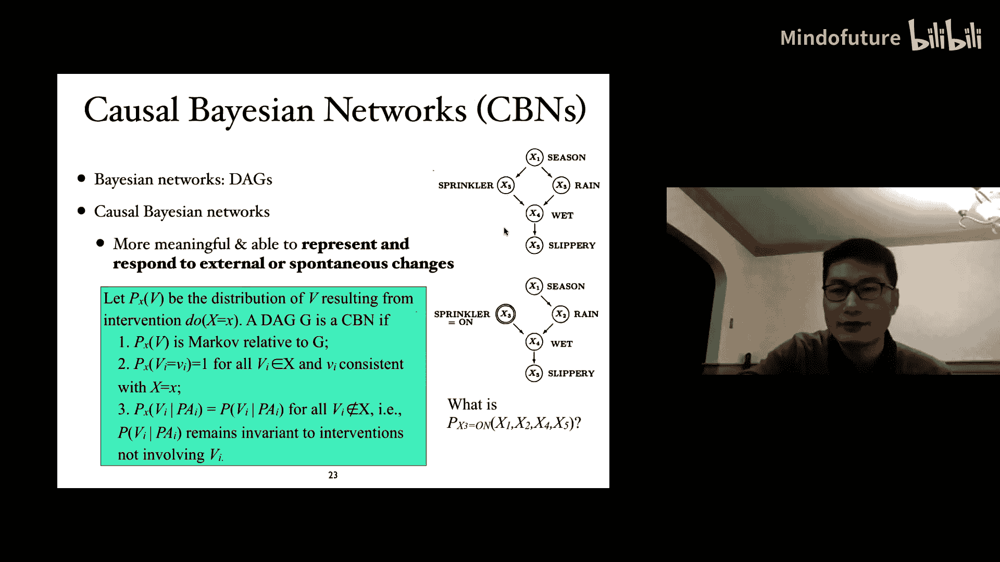

Alternatively， or here can represent correlation by making user graphical models and usually when use graphical model。

 you also use some conditional distribution to describe the mechanism， right。

 to see how the causes influence the effect alternative。😊。

We can use structure code model to represent code relations。😊，Right。

 given so essentially you can see a set of equations In each equation。

 we set the value of the variable， the X I as a function of its parents and some hidden factor or noise。

 X I is F I， a function F I of the parents and EI。And EI is an exogenous variable error。

 error or disturbance orted oitted factor。So now we have a set of the questions。😊。

If the system is causal， then each equation represents an autonomous mechanism， In other words。

 each equation is not relevant to the other equations， although variables can be dependent。

 each pair of the variables can be dependent， but those equations are not related。

 this is known as modularity， and this is the most important property of a causal system。

 and this is also why we really care about the causal understanding of the world。

 even if you have no idea about the interventions。I don't want to make intervention， right。

 I just want to make prediction， but still you care about modularity。

Because if the module modules are independent。In meaningan that they are irrelevant。

 I can I can locate where the changes are， then I can still make use of my understanding of the other pieces and make the final prediction。

 So this is the very important modularity is the essential property of a system。😊，Yes。

And each equation basic just describes how you assign the value to the variable on that hand side of the equation。

 It's structure equation， and that's why it's called structural。

 It's describes the property of the structure underlying the the variables。😊，Okay， now。

Generally speaking， we have three types of problems in artificial intelligence。

 and later you can see we have more actually。😊，And those three questions are kind of well addressed and are very important。

 the first thing is to make prediction。On the left， you can see the values。

 observed values of three variables as one to three。

 and from this you can directly make use of prediction right you don't have to go to the color representation at all。

 this prediction。😊，For prediction， you only care about the condition distribution you can use linear regression。

 you can logistic regression as a deep network to find some property of this condition distribution。

 and the second problem is to make use to predict the effect of interventions。

 Remember the example I gave， right you want to predict the effect of treatment。

 You want to compare treatment A with treatment B。😊，So here the question is something like this。

Would the person cough if we make sure that he or she has yellow fingers。

 so by make sure here you can see I really do something， it's not just observation。

 I make sure this I just change， I just make sure act two take this value and then I want to see the value of the distribution rank three。

This is a mathematically speaking here。 We want to see the distribution of x3。

 given the intervention on x2。To set the value of x2 to one， say。So to answer this question， clearly。

 you have to go to the call picture。 You have to make use of the causal understanding of the problem。

 because essentially。Although x2 and x3， right or in the linear case。

 suppose have the same correlation。😊，The dependence correlation coefficient could do the same， right。

 however。However， the answer to the intervention question could be very different。

 If x2 is the cause of x 3， then this is。😊，Sounds like a conditional distribution X X3 give x2。

 And if x3 is the cause of x 2， instead， then this conditional distribution is simply X3 distribution X3。

 You can just ignore the condition set， because that intervention will not change the cause。😊，Right。

 so to answer this question， clearly， you have to go to the color color level。

The last type of question in known is contractual questions， so the question is something like this。

😊，Would a particular person， George cough， had He had yellow fingers。

Gailling that he doesn't have yellow fingers and cough and coughs。So right here。

 if you compare this question to the second question， you can see we have more more information。

 First of all， we want to see the intervention effect。 We want to see the effect of。

Intervention on this guy to make sure that he has yellow fingers。 But here we have a condition。

 We observe something。 We observe that the same guy does not have yellow fingers and that he coughs。

😊，We can go further because now we can in in the second type of questions。

 we just want to in something regarding the population。 right。

 I have no idea which one you talking about， which particular object you are talking about or subject you are talking about or person or unit you are talking about。

 I just want to give a prediction regarding the distribution or based on distribution。

But in configuration reasoning， we are we know what we are talking about。

 Maybe you are talking about this particular person of this particular day， you observe something。

 and then you want to see the effect of interventions。😊，Okay， so you have more information。

 you can have a better better way to solve the problem。😊，Okay。First。

 let's see how we can identify quality effects。And you know。

 the golden standard to identify quality to make use of randomized controlled experiments。

If I want to see the effect of treatment on recovery or if I want to see whether treatment has the effect on recovery。

 what can I do， I have two groups of patients， right， for one I have to guarantee。

 I have to guarantee the following thing。Apart from treatment。This variable。

All the other variables must either take the same value or the same distribution across the two groups。

Right they either have the same value or they have to follow the same distribution。

And vary at random across the two groups。 Then if I observe some difference in recovery。

 I know this must be caused by treatment。😊，And then I can say， oh。

 treatment has an effect on recovery。And then you can see that it's really hard to do these kind of experiments because you have to make sure the patients in the two groups have exactly the same value for the other features or the same distribution for the other features。

 how can you guarantee that， especially in many cases。

 you have no idea what other variables you have to consider。😊，Right， how can you do this alignment。

Then we have to solve the problem by making use of our causal understanding and observational data。

 and sometimes this is known as observational studies of causal effects or generally we have say identification of causal effects sometimes people also say causal inference problems in contrast next time you will see we'll talk about causal causal discovery causal discovery aimed to discover causal information by analyzing data they are very different they are two fundamental problems in causality。

😊，Okay， so why do we care about the called effect in this example， Remember this example， right。

 Simpson paradox。You can see if you make prediction， just a prediction。

 you make use of a condition distribution of our guarantee right here。

You want to see the given this treatment you want to see the effect of treatment on recovery。

 according to the distribution， and this is the only prediction and this is the rule Qian rule and some rule。

 right。If you do， if you want to see the effect of treatment on recovery， what can we do。

 You have to make use of the distribution， probability distribution of R of recovery。

 given the intervention on treatment。And this describe the property of this particular causal link right here。

 This code link， I only care about this one。 That's why I。I do intervention。

 I don't care about any other factor， giving a keeping a patient， I just do intervention。

 and then I want to see whether intervention will。Make a difference in recovery。

 This is what we want to find。 How can you find this quantity。

How is this guy is this quantity different from the conditional distribution。

 That's the essential question， right。So you can see。According to the definition of intervention。

 when you do it， when you do intervention， you cut off the edges into the sky。

Right so this edge is not the anymore， if you don't have this age。

 then this conditional distribution， prob distribution of stone size。

 given treatment will become the marginal distribution of stone size。

Because after you call this guy off， stone size and treatment will be independent。Right。

So in order to find this quality effect， we just need to， in this example。

 we just need to replace this。conditional distribution with this marginal distribution。Is that clear。

 as long as this example is clear to you， then we can quickly go through some techniques。😊。

Why did the variable you summing overchan？From S to R。Oh， I'm sorry。 wow， this is a stupid mistake。

 it should be S right here。 It should be S。Sorry。Yes， you're right。Thank you very much。 right here。

 we has let you what I can do。Oh。嗯。Yeah， this should be， these are to B S。 Okay， apart from that。

 is this example clear to you。Okay。Okay， so now all questions。What is P guarantee？Okay， so。

suppose you want to find conditional就术 should SD parent。No。No， this is just the application of the。

This is nothing but the application of the sum and product rule in pro theory I want to find I want to predict R from T。

 I want to predict recovery from treatment。Then， basically。

 this is implied by the conditional distribution， and this is how you capture a conditional distribution from this conditional and this conditional。

😊，Application of sum and product rules。O， standard。No other question， let me just go further。

Now let's have a look at this picture to see why we have that phenomenon， we have this paradox。

So right here in the blue line just indicates the recovery rate of different treatments。

For different groups。Right here treatment A， this is yeah for small stone group treatment A is better than B。

 and red line shows the recovery rate for the large stone group A is again better than B。 However。

 here， I have a lot of patience and right here a lot of patients with small stones receive treatment B。

 we have a lot of you here we have a lot of patients here。 as a consequence。

 when you use the product and change and some rule to catch the condition distributionEssential you just wait you just take the average。

Across all patients。As a consequence right here， the mean would be close to this guy。

 and here the mean would be close to that guy。 So you can see a very different pattern if you。

 if you calculate the condition distribution， right。

And if you do the marginal distribution of S instead， you don't care about the size。Any more。

 as a consequence， you see this。Oh。So this is啊。Probability or expectation of R given intervention on T right here。

 You the all A is better than B， right， because now you use the same。Wait。😡，To text the average。

 which is P， not P given given。Not the probability of stone size giving treatment。

This is the difference between conditioning and manipulating if you do manipulation or if you do intervention。

 you have to cut some edge off and then you can the expression could be very different and this is what you care about if you if you want to see the causal effect。

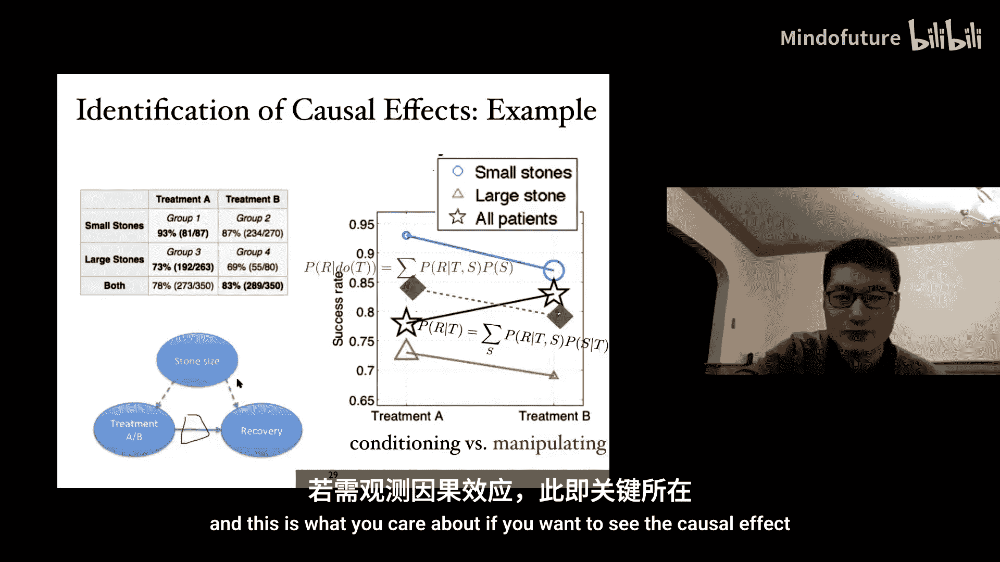

What's definition of causal effect essentially is just the probability of the target variable given intervention on the variable you can do you want to change。

 so the probability distribution of y going to X and you can understand this this quantity very intuitively to do so。

 you do intervention， you cut those things off。Right you have directly sets the x value to some specific value。

 and then you want to infer the probability distribution of y。This is a basic definition。

 and in some cases， maybe you just care about average effect。

 that's expectation according to this excuse this distribution， expectation why。

 according to this distribution。 So if you know this distribution essentially can derive other measures。

😊。

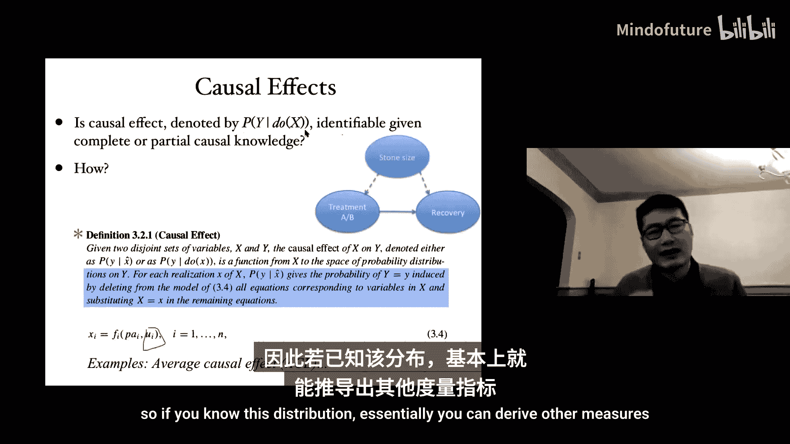

Second question is whether this color effect is identifiable this is a very fundamental question in causality and a lot of researchers in statistics and as well as computer science still do research in this direction so given what do mean by identifiability of color effects this is a setup we are given two cents first you are given chotograph。

😊，Quantative graph。For the process， and then you have observation data or observed data for some variables for the observed variables in this case。

 suppose we don't observe stone size， but only treatment and recovery right and this is hidden Now the question is whether you can recover the influence the causal effect of treatment on recovery。

😊，So the identifiability is defined this one it's the same as identifiability of a parameters in statistics。

😊，Giving the same code structure and the same distribution for the observed variables。

You want to see whether the result。For this quantity。

 distribution Y given to x is the same across all possibilities。So you can have different models。

 right， Supp you have two different models， different underlying processes with the mechanisms。

And suppose the two models have the same code structure。

And the same observed data for the observed variables。😊，Only the observed variables。

 if you observe everything， then it's always identifiable right。

 we only observe the data for those two variables in this example。

 then you want to see whether the two models will give the same answer to this question If they give the same answer。

 we say oh a causal effect of X and Y is identifiable if they don't say it's not identifiable then this quantity may not make sense because you don't have a unique solution。

😊。

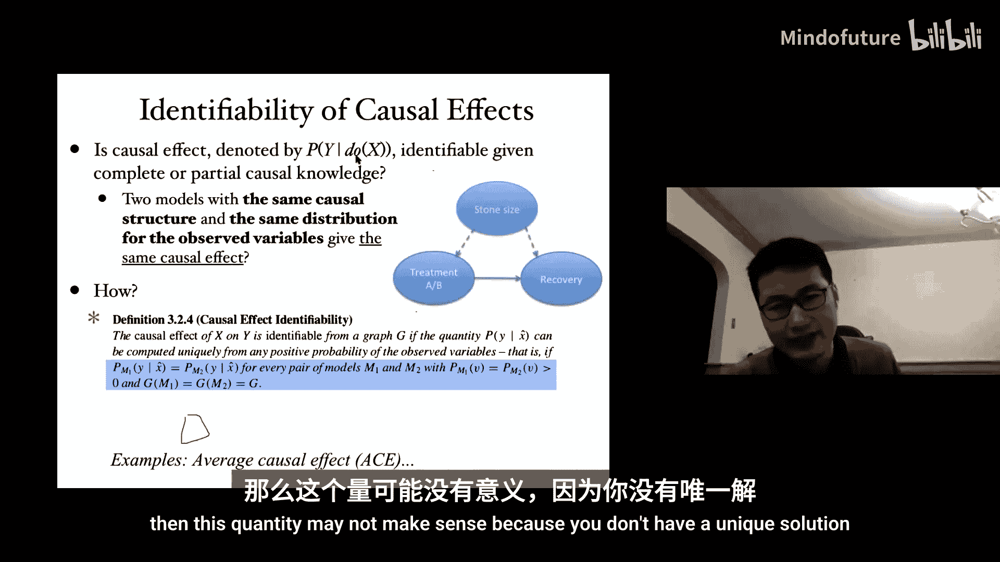

Okay， so that's the identifiability。 And then this example。

 you can see the key issue to ask question is to control the compoundfounding bias。 In this case。

 if you don't observe the age group age， then essentially is not identifiable。

 So in on what conditions is the called effect identifiable Here I'm going to give two criteria very quickly。

 they are very popular in the field。 The first one is known as back criteria。😊。

So here we have ordered pair XI and XJ。We have set our variables Z。😊。

Let's consider a specific example。 Suppose they is x 4， single variable。

 We say Z satisfies the back dog criterion relative to the ordered pair， X， I， X， J。😊。

If two conditions holds true， the first one says that no node in z is a descendant of X。

 that's why it's called backdo， right， So this is not inside of X can only be in front of the back door of X I and the second one says that Z blocks every path between X I and Xj that contains thearrow into X this just mean that oh z blocks every back door path。

BetweenX andXG relative toXG toXI。So right here， we only care about those passes into X I。

 which are called back door passes。Now let's verify whether this condition those two condition holds to for different sets of variables。

 what if this is x3 and x4？😊，If these x and x4， do you think they satisfy the backdo criterion relative to X I Xj in this example？

If your answer is yes， please click on yes。If the answer is no， just click on no。

 I want to see how many of you。Haveve idea about it。Oh。Okay， yes。Wonderful， yes。

And let's consider another example Thank you suppose z just x4 with single variable x4 do you think they satisfy the backdo criteria relative to order the pairer X XG？

Yes or no。Yeah。If you provide answer before， please change your answer。Okay， some said yes。

 some said no。 So here let's have a look at this example。 given x4， you can see yes。

 this path is blocked。 However， this path X I x3 x 1， x 4， x 2 x 5 X J。

 this part M path is open If you condition on x 4， Z 4 does not right according to de separation Z 4 does not block this path。

 that's why。😊，For this set of variables， Z is done on satisfy by criteria。You can check this。

 You can have a close look afterwards。And then if they satisfied the vector criterion relative to X。

 Y， then the call the effect of X of x on y can be captured this way。

 So essentially you can see the only difference from the conditional distribution Y given x is to replace the conditional distribution of Z given x by the marginal distribution of z。

😊，哎， have a look have a look at this question later。This is the front door graph。

 and you can see from this example from this graphal representation it's very clear。

Right now we care about the front door is in front in front of X relative to。Yhy， you have to。

 if you want to go from x to Y， you have to go through Z。 That's the essential criterion。

 No essential condition。So z intercepts all direction passes from X， sorry from x to y。

 no back door path from X to z。No back door path right here。

 you can have backdo path between from x to y， as you can see from this path。

 Supp this is the unobserved common cause。A confounder you have back door path here and all back door passes from z to y are blocked by x。

 and then we can say z satisfy the front door criterion and then we can do another we can we have another way to do correction right here you can identify co the x on X on y。

This way， okay， some of them may know something about iorability。 So in potential outcome framework。

 right， people use the iability of condition Iability to specify the condition under which cause effects are identifiable。

😊，Actually， they are equivalent。😊，嗯。Let me just give some very quick explanation。

 This is the back criterion。 and if they satisfy back criterion。

 we say they called effect fact x on y is identifiable。 So according to aorability。

 the condition that follows Y small x is independent from x given y So here why small x is a random variable。

 what random variable is in this guy。 First， we have according to the potential outcome framework we have y as a function of x and U X is the value of some particular random variable right here。

 particular cause U is a specification of the unit unit U could be a particular person。

 particular day right particular scenario。 So this is y as a function of small x and U is a value attain by y variable y in unit U。

😊，For for this particular person。Under the intervention。On X。 So right here， this is the。

 this is the。This is a value of y after you do intervention or X for this particular unit。

 And now you can just ignore the unit。And this guy will become a random variable because the value could be different。

 it varies across different units， different persons。

So y as a function of small x is a random variable it called counterual variable and y given small x。

😊，What's that， you can think of y giving small y as the function of small x as a description of the causal mechanism from x to Y。

😊，Right， so all the factors that are involved in this process will influence this random variable and iorability says that。

Y given small x is independent from x going z， what does I mean look at this picture。

 So y giving small x basically is a code maximum involved from x to y right here and this is x。

 if z blocks the back backdo parties， then given z how。😊。

The random variable X would be independent from y from how y is generated from X。

 although x and y are dependent， right， how y is generated from X and the column mechanism will be independent from X。

 given z。Right， the two processes are not related。 if you condition on the。Quions。Oh。

we are going to stop。 so this is iorability and now you can see basically they say the same thing if they satisfy this criterion and then we have ignoreorability and we can identify the color effects。

 So potential outcome framework and graphical criteria are somehow consistent about there exist some slight some very subtle difference I'm not going to talk about the difference best you have a very rough and fundamental understanding of the criteria are giving in different disciplines or in different by different people。

😊，Del Ruin from Harvard developed a potential outcome framework and Lu Paul from UCLA。

 as well as Peter Ss and Clark Limer from CMU develop the graphical criteria for identification of color effects。

Okay， so I'll stop here next time at the beginning。

 you see a unification of the criteria and then you see how and why we do counter reasoning and then you can see how we can discover causal information from observational data。

😊。

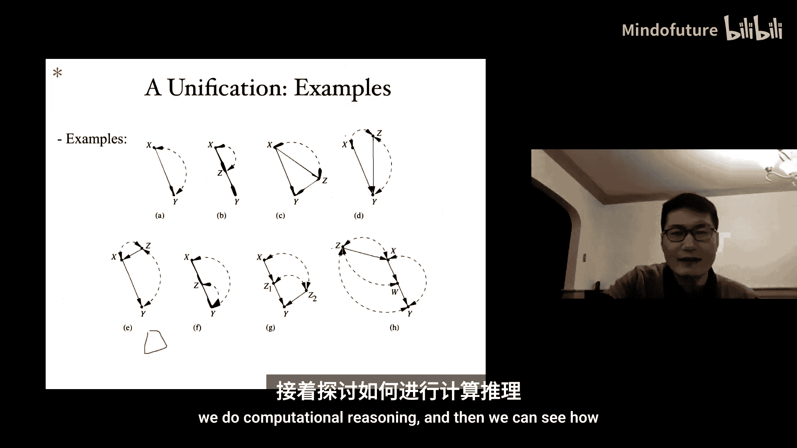

Okay， thank you very much。

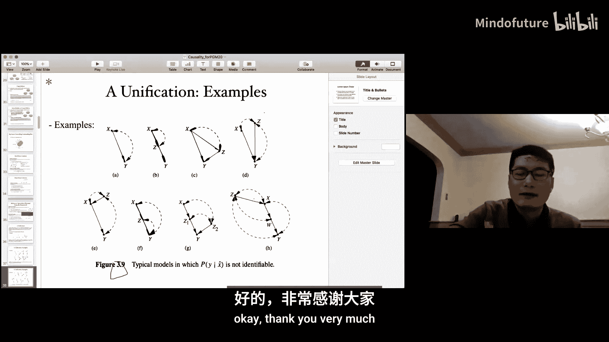