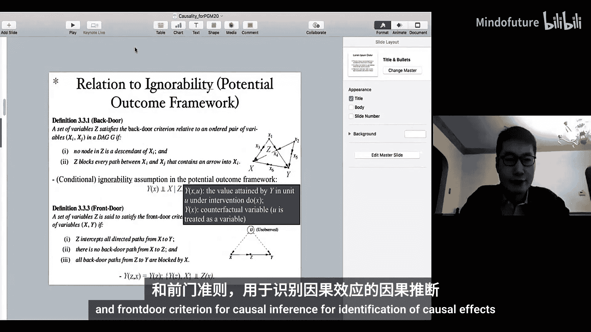
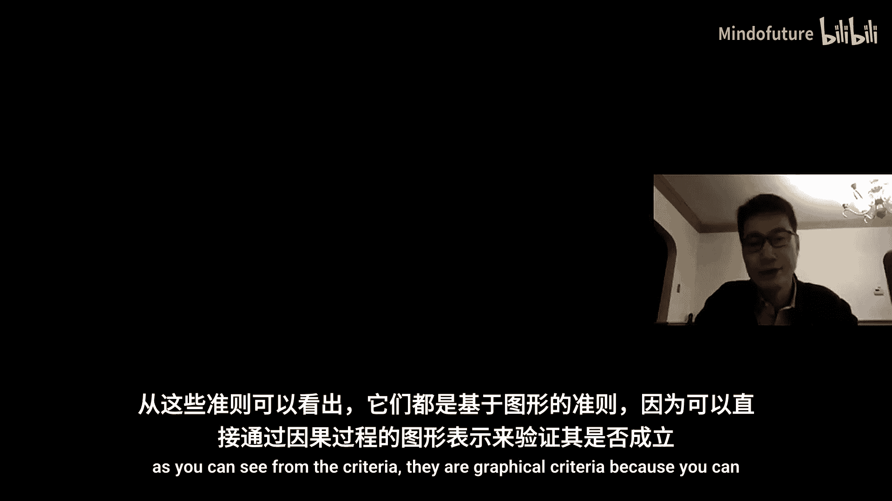
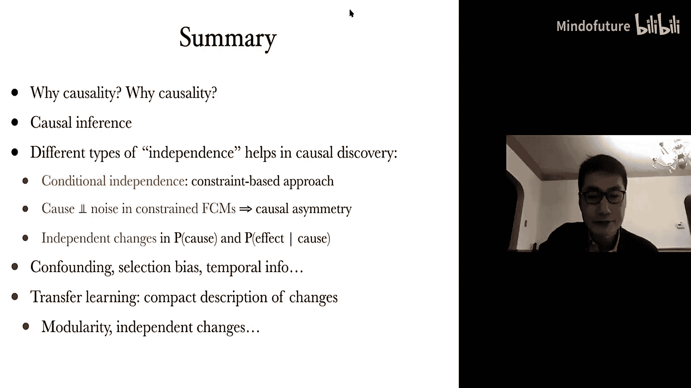

# 【卡耐基梅隆】概率图形模型 ｜ Probabilistic Graphical Models 2020 p18 P18_Lecture_18_因果关系_2 -BV1ebpGzhEA9_p18-

Okay hello everybody。 So this time we are supposed to focus on causal discovery before that let's just finish the material that we were supposed to cover last time which about。

Casal inference and counterual reasoning。 So last time we。

 I briefly mentioned the back door criterion and front door criterion for causal inference for identification of causal effects and。

As you can see from the criteria， they are graphical criteria because you can directly verify whether they hold true by making use of the graphical representation of the causal process so right here I try to establish the connection between the graphical criteria including front door and back door criteria and the potential outcome criteria。

So here the first one breakdo criterion is related to the socalled conditional iorability here in the potential outcome framework。

 you have to consider this y small x as the random variable and this random variable to represent the causal mechanism or to represent the property of this structure equation model associated with the causal process from x to y because because this y small x just means that means the random variable of y given the intervention on x to set the value of x to small x。

 that's why it's just about this causal mechanism。Right here， we can see。

last time we verified this condition。 and now let's have a look at the front door criterion。

 So this is the front door criterion。 Z basically intercepts all direct directed pathway from X to y。

What does it mean So here you can see theorability potential outcome framework the criteriaion says oh y given small x and z is the same as y of small Z。

 What doest mean it mean that if you given if you are given z。

 then X will not directly influence y according to the column mechanism right it's the same thing and then what does this mean is a second condition。

Remember， Y smallx is a cold mechanism right here。Call the mechanism from。Yes看。Yeah。

Max them from z to y right here。 and this is the one part of this random set of random variables right here。

 and the second one says the generating process of x somewhere somewhere here。

 so the first one is right here。哦。Thank you。So this is the causal process from z to y。

 everything that is involved in this causal process。

 and the second one is including all those random variables that are involved in the generating process of x。

And those things， the concateation of those two things would be independent from the causal mechanism from x to Z。

 As you can see from here， the causal mechanism from x to Z is right here， right。

 So those three things。This thing， the column mechanism from x of z would be independent from the remainingisance。

 although the other those two things y came y as a function of small z and x may be dependent because of u right here。

 you can see u is involved in the first part in the generatingative process from z to y because u is part of the。

Mechanism， right， and you is also part of the mechanism to generate X。They can be dependent。

 They can be dependent。 But here， as long as they are independent from the generation process from X to to Z。

 we say this condition holds true。 So essentially， this is the another way to put the frontal criterion。

So now you can see the graphical criteria and potential outcome for criteria are closely related。

 and in most cases， they are equivalent， sometimes they could have some subtle difference。Okay。嗯。

So people tried to give a sufficient and necessary conditions for identification of code effects with the graphical criteria here I'm going to give a sufficient condition。

 so some very similar necessary and sufficient condition were also given in the literature they are slightly more complex here let's have a look at the sufficient condition is very simple just said following them the condition for identifying the effect of y of x on y given by the probability distribution of y given intervention X right here。

Is that there exists no bidirect path between X and any of its children。But as here。

 you can see we use the do to denote intervention there exist other notations， for instance。

 Peter expertise from CMU uses the set right here and actually he used this notation earlier。

 but pros notation do got more popular。Okay， so here this condition says there is no。

 there exists no bidirect path between X and any of any of its children。 Now， let's verify this。

 In example， A you can see oh， there bidirect path between X and Y。😊，And bydirect path。

 I mean the following thing right here， we have some random variable here。

 which is the common cause or direct common cause of x and z。

 so essentially if they're the bidirect path we say x Y are confounded in this sense。

And here the same thing happens and here you can see Z1 is the child of X and they the bidirect path。

 The definition of bydirect path is the path consisting of only bydirect ages。😊。

So this is by directed。 this is bydirect。 That's why we say between x and Z 1。

 there are the by directed path。 Now， let's quickly verify this condition on the graphical representations here。

 you can verify that。In all those examples， this condition holds true right here x causess y。

 there are no bidirect path between x and y， and here x causes y x calleds z。

 theyre the bidirect path between z and y and again。

 this condition holds true okay so you can verify this condition and as long as this condition holds two。

 we know that the causal effect of x on y is identifiable。

And similarly here you can verify you can consider those examples and in all those examples。

 this condition does not hold true， so it's not clear whether the effect of x and y is identifiable actually fortunately this condition is almost sufficiently necessary condition。

 so in all those examples actually the causal effect of x and y is not identifiable。😊。

And you can say buy direct parties。And then in some cases。

 we can further benefit from additional constraints on the call mechanism。B instance here。

 in this case， we have Z X， Y。And there's the bidirect path between x and y。

 so according to the previous condition you can see we cannot say they call the effect of x and y is identifiable because the bidirect path right。

 however， if you assume the system is linear as you can see from this figure to the right。Now。

 they call the effect of x and y represented by the parameter Al become identifiable。

 So this is the very famous its called instrument variable this is the instrument variable Here you can see how we can solve the problem First。

 you can do regression you can regress Y on you can re y on the。哦， first， you can regress x on Z。

 then you can recover bit， the value of bit。 and then you can regress y on Z。

 then the the linear coefficient of regression would be阿尔法 time be。

🎼RightAlthough there are the bydirect part， they don't care because that part this pass is not effective relative to the。

 That's why the linear regression linear regression is阿尔法 time beta。

 You know贝塔 you know阿尔法 time time贝塔。 That's why you can just recover阿尔法。

So we can identify the color effect presented by the linear encrypt in this case， however。

 in the general non primary case， it's not necessary to be identifiable。Yeah。

And last thing regarding identification of color effects is the definition。

The definition of propensity score and how to use it。

 so let's consider this example here we have a lot of covariance other features and we have X Y。

 we want to identify the causal effect of x on y and in the general case。

 we just use probability distribution of y given2 x to denote this causal influence。

And you can derive the average e effects or other measures by making use of this probability distribution。

So now we can see this is right here。You can see the。

 the expression for this conditional distribution right here， you have to。

Consider the average of probability of Y game excellence C here or C contains the other covariance。

With a weight probability distribution of C of the covariance， right。

 so if you have random mind control experience。This part PC in the two groups， you have the same PC。

 right， You have the same distribution for C。 That's easy。 However。

 if you don't have randomly controlled appearance across the control and treatment group。

 probability distribution of C could be different。 Actually。

 you are you are considering you are considering probability distribution of C giving giving X。

 you could only discover this condition distribution from the group。

How can you just make use of the same distribution across the two groups。

 the two groups have different values of x right in one group you have in one then control group x might be0 and in the treatment group x takes value of1 so you want to calculate this guy。

How can you do this， We have to do something like matching。

 We have to match the distribution of C curves across two groups。

And one way to do so is to directly match the distribution of the covariance。

 Usually the covariance could be high dimensional。 You can have a lot of other features。

 including gender age， location， climate and so on could be a lot of features。

 it's kind of troublesome because you have to consider you have to match the distribution of a high dimensional vector。

 So instead of considering C。 you can do something。 you can do something different， very different。

By making use of the so called propensity score。 So what's percent propensity score。

Properency score is actually a random variable。 is's a function of the covariance is defined this way。

Proensency score is a function of C actually is a probability for x to be1 given C。

 Now you can see since the value of x is is given， this is just a function of C。

 Since C the random variable， this H is also random variable。

 So propensency score is the random variable。 and you can show that。Give this guy。

 Give this prop score X。The variable you do intervene on and see other careervaris become conditionally independent。

And because of this property， we say HCC， the prop score and C are confounding equivalent in the following sense。

Originally， we wanted to test the average of the mechanism probability to distribution y given x and C according to the distribution of PC right distributions PC。

 we want to marginalize out C in this way and after some transformation you can see finally we can just ignore C。

 but make use of H random variable prop score H instead。

 so here you can see equivalently we just calculate the average of the distribution y given x and H。

With the weight probability of H。H is compared to C。

 H is much simpler because no matter how high dimensional C is。

 H is just a single scalealar variable is the function of C， but it's just a scalar variable。

 It captures all the relevant information in C relative to X， the random variable。 Now。

 this is much simpler。So this why this is why Pro score got a lot of applications in identification of causal effects。

So instead of matching the distribution of the covariance across two groups。

 you just match the distribution of the prop score， which is random variable across two groups。

And in particular， this random variable is very simple because it's just a scal random variable。O。

So finally， let's have a quick look at what we can benefit from the so called counterfeual reasoning。

😊，Is there any question？Yeah。Yeah。O。嗯。Remember， so far。

 we had a look at the three two kind of questions。 First one is about prediction， right。

 you are given data。 You want to make use of the condition distribution implied by the data to make prediction。

So， essentially， you care about some problem， yeah。Questions， I heard someone say something。啊。对。no。

 ok。So this is about prediction。 You only you just care about the data。

 You don't care about the quantum mechanism at all in this simple setting。

 And the second question is about intervention。 you want to you want to intervene on X2 and then see the effect on X3。

 according to the population。 So you have a group of people。

 you want to see the intervention of X2 on x3 in this group of people。So the question is。

 would the person， the person which is not specified cough？

If we make sure that she or he has yellow fingers。 So by make sure better we do that。

 we do intervention， right， to guarantee that's the case。And furthermore。

 we can answer the so-called counter questions So the question is something like this。

 would George a particular person cough had he had yellow fingers。

 given that he does not have yellow fingers and coughs So compared to the second question you can see now we first of all。

 we care about the effect of interventions had he had yellow fingers， and furthermore。

 we are given evidence of the same unit of the same person we are talking about。

 So it's something like given the observation here as evidence we want to see something about the same unit of same person under intervention right here。

 So compared to intervention effect， this question is more informative more specific because I have evidence about this particular thing I'm talking about。

Let me just give an example to show what we can benefit from this way of thinking here。

 suppose x calleds y with this functional color model so we can see how x influence y here is noise and usually noise E is independent from x otherwise Y we have a confounder and once you consider compoundunder again the noise will become independent from other causess So here when we say x calleds y without coner。

 then error term E would be independent from x。 and now we find an individual with the specific values for x and y so small x and small y The question is what would y be if x had another value had been another value。

 say X prime。So let me give an example， suppose x is say a attendance rate。Let's talk about me。

 Sose I'm last semester。 I took some class。 X is the attendance rate， and y is the final grade。

 final grade I obtained in that class。 So last semester。 I had this X value for the attendance rate。

 I have this small Y value for the final GP。 Now I want to see。

 I want to do some I want to reflect what I did。 I want to see what I should what I。

 what change I should， I should make next time， right， I want to basic reflect my previous behavior。

What can I do I want to ask this question of last semester。

 if I if I were intervened to take the value of X prime for the attendance rate。

 what would be my GPA， right？So now， how can you answer this question。You may say that oh。

 now x takes another value， x prime， then I can just use the best value according to the conditional distribution of y game x right here。

 right？As the answer， So this is the expectation of y given x equal to x prime。

You may say this is the best prediction。Yes， this is the best prediction。

 but this is not what we want here we have additional information We know that we are talking about me right。

 we know that I have some specific property and when you do intervention on X the particular thing the attendance rate of the class。

My specific property will not be changed by that， and we can make use of that property， okay。军鲜。

You have a question。Thank。Are you speaking， I cannot hear you。Oh sorryrry， I don't have a question。

 Just click on。Okay， good。 so now we can see we can we can make use of the additional information compared to the regular prediction task。

 how so intuitively let me just make it very quick， because we have to cover some other things。

 So essentially you can this is the answer。 How can we find this answer。 let me skip this。

 So this is a question。 I want to see this is just shorthand for the long question。

 I observe this x take this value Y take that value。 right， I already observe that as the evidence。

 Now I want to see the value of y give an intervention on x to set the value of x to small So x prime。

 So this value different from the previous one。 and I want to see the value of y。

 This is the question。 So we are talking about particular situation or particular unit particular person。

And we observe this and we want to make a change and see the effect， that's it。

So here you can see the general framework to solve the problem。

 basically the framework is as follows， given the evidence we have to derive the property of this particular person。

 of the specific property of this particular unit。Represented by you。

 you can see you here represents exogenous noise， right， for each person for each unit。 we have some。

 basically， there's some noise by noise。 I mean， those things that are not not included in the model。

And in the color process， those things will will influence the the variable we observe right。

 so from the evidence， we can infer the distribution。

Or value of the exogenous noise and then we keep their value and change the value of x and then we can do inference。

 we can do prediction here you can see the example from X Y observation evidence we can see the value of E remember E represents my specific property。

 which is independent from a attendance rate。After find the E。

 then I just set the value of cap x to x prime， and then I use E and x prime to find the value of y according to the structure equation model or the code mechanism。

 so we have this value， and this is exactly this value。

Right here indicated by the blue star right here。So you can see this value can be very different from the expectation of y given x prime。

O。any questions regarding confidential reasoning？To summarize with controversial reasoning。

 you can really make use of the specific property of the unit。

 right if you talk about some some particular event。

 you can just see the particular property of the event and then you can make a specific change and see how this particular change influences the final outcome then in this way you can do something like attribution。

 you can see oh for this event， what is the very what is the most important cause and then you can do something to prevent that from happening。

Next time。Or next time you can improve the result by making use of the important causes。

Is this like taking advantage over this specific interval instead of a whole support for this example。

Yes， R is speaking。 youre you're right。 It's because if you talk about prediction， right。

 you have no idea about noise。 It's complete random variable， which which is independent from X。

 right so。If you talk about prediction， then the value of y， given x text value x prime。They value。

 the value Y can be any。Anywhere right here， right this will give rise to the conditional distribution of y giving x equal to x prime。

 however， when we talk about a particular person， we have information of the noise。

And given the information of the noise and new value X， you can immediately derive the value of y。

 which is the answer to the counteractual question we are concerned with。😊，Yes。Or isn't from a has。

 Isn't P E giving X independent of X。 or this is the no。 P， E given X is a posterior of x of E。Oh。

There's some confusion。 Let me go back to the slide。

And then well go back to the we'll go to the next question。Right here。

This is the distribution of the exogenous thing given evidence right。

 this is nothing but the posterior and in this particular example where x callss y with this function of color model from X Y we can infer the value of E right of course you can infer the posterior of E given the evidence it's not posterior given x is the posterior given the evidence。

And here you can see， oh， E takes this value。 If I know the value of x and y。X块钱。And外 slow。Yeah。

come on window度 please come。O， the chat window does not show up。好， now it comes。So， next question is。

How do you find out the most important causes using con reasoning。 Okay， a very good one。

 now you suppose you have you consider two possible causes， right X， X and z。

 there are causes of of Z Y。 So X and Z cause of Y。 Now you can by doing this。

 You can see how much you can change how much you can change in y by making certain changes in X and in Z。

 right？ And then you can see which changes will finally lead to more changes in y。哦 in some cases。

 you want to see which change in X or in Z can finally lead to the expected change in Y。

That's why you can find the right cause to achieve your goal。

 or you can find the right way to make a difference， to achieve the expectation over why。

How you to achieve the expected outcome。Okay。🎼So please visit the slide later and I know this is very brief and then let's talk about causal discovery and how to make use of some causal thinking to understand some machine learning problems。

So， basically。You can see a lot of examples in which we have to do college discovery and this is a very nice example published in science a couple of years ago。

 so you can the conclusion they gave is that the large scale psychological differences within China can be explained by rice versus weed agriculture in other words。

 they believe that agriculture causes psychological differences within China。

You can see in these kind of examples， first of all， you cannot really do intervention， right。

 you cannot really force people to change their agriculture and second of all。

 even if you can do intervention， you have to wait really a long time to see the effect。

That means it's not practical， so in many cases it's not practical。

 in many cases it' is not impossible， so you have to discover the causal relations by analyzing observation of data or by doing data analysis or by doing machine learning。

Here basically， you can see how the in for the final conclusion we have different variables with observed some dependence and conditional dependent finally under some further assumptions we can draw the conclusion that S cause why。

😊，This is another example， the data was collected by my collaborrate Marlene Nobeck。

 her last name is very nice， no back， just go forward。So。

She collected eight variables of 250 skeletons all over the world。And those random variables include。

The sex。Location。啊。第。And a lot of profits of the crial of this part by the cranial size and different the shape differentiation and so on。

 so basically they want to understand as in archaeology they really want to understand why people from different areas are different look different。

 they want to see the reasons and given these causal interpretation or causal given this causal understanding。

 they want to make prediction into the future right in the future maybe some conditions will be different then how will the people human beings look like。

And here you can see some other examples in each example。

 we are given only two random random variables basically we are giving IID observations of the random variables IID draw from the distribution and by analyzing the data points or the underlying distribution。

 we want to see which one is the effect and which one is the cause and furthermore you can derive the code model from the code to the effect。

And in the last example， you can see this more complicated， so we observe Xs。

 we observe a lot of random variables like the pixel pixel values of images。

 and then we want to discover not the causal relations between the observed random random variables instead in most cases we want to first discover the underlying causal variables hidden variables and second we want to see the causal relations between the underlying variables at the same time。

 so sometimes you want to derive the underlying concepts by analyzing observed data right the concepts could be color。

 shape and so on at the same time you care about the causal relations between the concepts。

 So how can we make use of the machine learning techniques to discover this hidden world by analyzing observed random variables and this has been we have been doing this for two years so our group we have made some。

Progress and。Now， I think some very interesting results will be published in the very near future。

Regarding how we can estimate the hidden variables as well as their causal relations by analyzing the observed random variables。

😊，Okay， it's another complex， more complex and very more complex example。So。

Traditional college government methods fall into two categories， one is called cons based methods。

 and the other is called Sc based methods， later you see why we call them cons based and Sc based。

So in order to discover cost structure。Or in some cases， called model from statistical data。

 from observation data， we have to establish the connection between code structure and statistical properties of the data。

 right， So what assumption can we use to establish such connection。Essentially。

 it's about modularity。 Its something derived from modularity。 Remember modularity。

 when we say x to Y without confounder， without a late in the common cause。

We mean the following thing， there are two generating processes。One for x。

 the other for y from x and the two generating processes are not relevant。

 they are completely irrelevant， you can change something here in the process from x to Y and the other one will not be changed by that and similarly you can change the generating process for x and the mechanism from x to Y will not be changed by that so the world will consist of a lot of small modules and those modules are not irrelevant are not relevant。

And then later you can see this will give rise some statistical properties of the random variables。

Okay， let me just。Mion one concept， which is the causal sufficiency。

 as you can see from the name is very intuitive。 I say the causal。

 the set of random variable is causal is sufficient moving the following thing。嗯。

Any direct common cause， any direct common cause of the two random variables in the set。

V is also in the set。So here you can see if if v is X， Y Z。

 then is causally sufficient because the direct common cause of x and z， which is z X and y。

 which is z is also in the set of random variables。

 and if if V is only the set of the set of X and y。

 then it's not causal sufficient because direct common cause of x and z sorry。

 direct common cause of x and y， which is z is not in the set V。 So it's very intuitive。

 here you can see I use the direct common cause。Right， and in most cases。

 people just say common cause。 and this is more rigorous here。

 Z is the direct common cause of x and Y。 but even if z is only the cause of x。

 you can say z is the cause of X。 And since S causes Y， this is also called Y。 So in some sense。

 you can say z is a common cause of x and Y。 even if they is not direct cause Y。

 That's why that's not rigorous。 So let's just use direct common cause。

 And we define confounder as hidden direct common cause of two random variables。

 So if this is missing z is not included in the set of random variables。

we are considering then we can say that z is the confounder in this relative to these set of random variables。

So previously in Eric's lecture， I think you got to know that de separation implies conditional independent relations according to the markup condition。

Basically， if x and y are dis separated in the graph， then according to the global markov condition。

 we know that X and y are conditionally independent given Z。 However。

 this is just one directional relationship， we want to go back to the graph right。

 so we have to find some condition so that we can go back otherwise。

 if you consider counterpositive of this markov condition。

 we can see the following thing if they are not if they are not disse。Then X， Y will be disconnected。

This means you can always find a triviale solution to satisfy markov condition you can always use a fully connectedinetic graph right because for a fully connected graph。

 you cannot see any conditional independent relationship according to the markov condition right and if you see the condition independent relationship in the data basically that can happen by accident you don't care So with the fully connected graph markup condition will always hold true。

 However， the fully connectedine graph is not informative we want to find a graph which is minimal and informative and can be used to explain the relations in the random variables what can we do So we have to find another condition in addition to the markup condition。

What's that， essentially。For this type of method， we have to assume faithfulness here faithfulness assumption is something like fastness in the relationship。

 so I'm faithful because I have a unique mapping right there the one to one correspondence some between some something。

😊，Here it's the same thing Markov conditions said that。H random variable。Questions。

我 maybe maybe just。I can not要 you。Okay， good。 Thank you。So market said that given graph。

 we can see independent relation or conditional independent relations。

 so each random variable is independent from nondeants given parents or according to the global market condition which is equivalent to the local market condition on deck。

 it says if they are disem， then they are condition independent given the separation set。😊。

Now we can go further。We can go back by make use of the faithful assumption。

It says that all observed independence or conditional independent relations in the data are actually entail by the mark condition on the graph。

😊，That means theres no extra or fake conditional or accidental conditional independence relation in the in the data。

 If you see conditional independent relation in the data。

 then this relationship must be the property must correspond to the property of the graph。Okay。

 this is rather strong。 and sometimes you can test this condition is testable。 and in some cases。

 it is not testable。Oh。If you want to see more detail， talk to me after class。Okay。

 so here you can see some cases where the faithfulness assumption is violated。

We have three variables here， health condition， risk of mortality， health lifestyle。

 so you can see we can have two calledpathies from health condition to the risk of mortality。

And if a equals minus bc， then this guy also。A cause of the final effect will be independent from the final effect。

 They are independent because A equals minus B， C， the cause effects got canceled out。

And similarly here， swimming skills could be independent from the risk of joining。

Given there are two called passes and given that the two called passes just got cancel out。

So in those cases， we have violation effectiveness， but generally speaking。

 this condition should hold true if you have enough data why again this is because modularity consider this this example right if this is really a good description of the underlying code process then we have modularity condition which says that this module right here to generate healthy lifestyle would be independent from the generating process from those two variables those to random variables to the risk of mortality right they are different color modules and those color module independent meaning that they involve the parameters。

Were chosen by nature independently。 There is no way for them to be related。 They are not coupled。

 If they are independent， then the chance for you to have the condition that a equals minus B is basically has measure 0。

This is the justification for fitness based on modularity。However， if you have finite data， right。

 they may be close， A can be very close to minus BC and you cannot really distinguish you cannot really verify whether a is minus B or not given you have finite data。

So because that some people assume strong businessness。

 So A had to be significantly different from minus B in order to derive something about color structure given data。

Now， faceness just eliminates such possibilities as a consequence。 you can see whenever I see。

Those random variables， then I'm sure that has condition。

 has condition is not independent from a risk of mortality because they are the causal path between them as long as they are the causal paths。

 they cannot be independent。Because you cannot see the independence from medical condition on the graph。

Now we can just have a look of the two types of methods for color discovery。First。

 let's have a discussion。 First， can we find a skeleton of the color structure by skeleton。

 I mean the undirect graph。So if there's a， if x the direct cause of y。

 then there's the age between them。 for now， let's just ignore the error。

 ignore ignore the causal direction。 we just want to find a skeleton。

 Can we find a skeleton from data right， And the second thing is the suppose we have the skeleton。

 then can we find the direction between random variables。Yes， we can do something。First。

 you can show the following。Given markup condition and facing assumption。

 then you can show that two random variables are adjacent in the chotograph if and only if they are dependent conditioned on any subset of the remaining variables。

It also means that if x and Y are conditionally independent。

 given any subset of the remaining variables， then they are not adjacent。

This way you can find agency， right？ So this is the first， the answer to the first question。And。

The second question is about whether we can find a direction in some cases， the answer is also yes。

 right here in this corner， you can see suppose we have three variables， X， Y， Z。And again。

 suppose we have causal sufficiency。 for now， let's assume we have causal sufficiency。

 there are no hidden direct common cause or two variables。

Now suppose we observe the independence between y and z and this is the only independent relationship regarding X Yz。

 they are independent， then you can see that this is the only possibility to explain this independence y and z are common causes of x and this is known as v structure right you have a v structure here。

So in other now， with the same skeleton， you may have some different causal structures。

 as you can see from here， right， and those three possibilities have very different conditional in kind relation。

Compared to this one。Right for this structure， y and they are independent and for the remaining three possibilities。

😊，Y and they are not independent。 and furthermore， you can see that y and they are conditionally independent given X。

They are different。 so in this case， we can we can discover the unique structure。

 given that why and they are independent。And we can go further。

 we can determine the directions from more ages according to the orientation propagation now you can see how we can solve the problem first of all。

 you want to do independence test in some specific way to determine the skeleton or the adency between random variables and then you find base structure and then you can do orientation propagation in the following way。

So here you can see example。 We have 1，2，3，4，5，5 random variables。 We observe data from data。

 we can find independence or condition independent relation。

 Suppose we have a reliable procedure to infer independent and condition independent relations。😊。

First， in order to achieve data efficiency， we start with the marginal independence。 So first。

 we test for marginal independence without condition on any any any random variable。

 So you can see here any pair of the random variables is conditionally dependent。

So we cannot remove any edge。 We start with this fully connected graph。

 fully connected ondirect graph。 And then if we condition on a single random variable。

 you can see our A independent given B。AE independent given B A呃D independentent given B and A andD also independent given B right and given this。

 we know that。A and C are not adjacent and E are not adjacent and D not adjacent and so on。

 as long as they are condition independent， giving anything， they are not adjacent。

 and then we increase the size of condition set。Now we condition on two variables。

 and then you can see B and E are condition in你看的 getting CMD。

Then we can remove the the edge between B and E and then you cannot go further because you cannot condition on more random variables。

 giving some constraints because here we have to condition on subset of the adjacent variables it's not necessary to consider other variables and there the proof for this and this is the PC algorithm and before the PC algorithm。

 there was another one called SS algorithm， SS stand for expertise， Cl glmer and Richard shines。

In that algorithm， you you do condition in test between each pair random variables。

 given any subset of the remaining variables， and later in PC， this procedure was refined。

 you only need to condition on a subset of the adjacent variables and you can show that that's enough。

Okay， now as the first step， we find a skeleton right here， and then we can find this structure here。

 C and D are independent given B， right。And they are not independent given。Given E or given B and E。

 then we know this is the base structure。 C BE will form a base structure。 They are independent。

 given something else。 Now this guy。ok。So in the previous example， we don't have B。

 that's why the two random variables are marginally independent and we know oh。

 this is base structure but you can have other variables as common causes of CMD or as intermediate variables between CMD doesn't matter this is still a base structure and then you try to go further right unfortunately in this example you cannot go further。

 you cannot determine any other causal direction。This is a piece algorithm。😊，Step A。

 you find you initialize this graph with a complete undirect graph and step B。

 you just find skeleton。 and in step C， you find all way structure， all structures from data。

 basically， you consider all those。嗯。Triles and then also triples with this pattern and then test you see whether X they are conditioning and giving a subset of random variables。

 which does not include why if that's the case is a base structure， if that's not the case is' not。

And then you do orientation propagation。 What does it mean Here， I give two the examples In total。

 there are only four or four rules。 and they have been shown to be complete。 Basically， you can find。

 you can only find such information。Theres no additional information you can make use of to discover the direction in the chograph。

The first one is to avoid spurious waste structure。

 so as you find this structure you can see this direction and this is。Questions。系。Okay。

 so here I know the direction for this age。 I don't know the direction for this age。

 Then for this age， the direction must go this way。 Otherwise， we are going to have a base structure。

 right。And we know this is not the case， because if this， if this one were a base structure。

 we would have founded in step in step C。And right here we have the rule called away from cycles because we assume the underlying code structure is a dead so here we have this direction and this direction then for this one。

 it must go this way， otherwise we have a cycle of course you can see you you may say oh this is not reasonable you you made so many so many assumptions Yes you're right and later there are exist other methods in which we can avoid the load assumptions including acyclic city and called sufficiency and other assumptions so basically we are able to discover the original the true color information in very general situation right now with suitable methods。

How can we present okay questions？Is the away from cycles example or in the example， isn't。

A spirit re structure created。Okay， let's go back。So here。If you have this edge， right。

 if you go this way， then this is not a B structure because for those three variables to form a B structure。

Two of them right there must be exist one pair of the random variables which is not adjacent and you can see from here in this example X Y。

 they cannot be adjacent if each pair is adjacent then definitely it' not re structure。啊 good。嗯。

So now you can see in some cases， we we have some information of the color directions。

 but in some cases we have no idea that means we cannot use the deck to represent the final output of the algorithm。

 What can we do so。First， we can define some equivalent class two decks are independence equivalent if and only if they have the same skeleton and the same wave structure。

Okay， and then we can only recover such an equivalent class from data by making use of conditional independent relations and such equivalent independence equipment class can be represented by the socalled pattern or CP CPD stand for completed partially directed psychograph。

Here you can see an example so some ages are directed and some ages are not if they are not directed it just means that the call direction could go either way。

Okay， so the interpretation is rather simple。 If you have this， then we have this direct edge。

 we know that in each possible solution。Which is the tag in the solution class。

 the call direction must go this way。All the time。And if you have this ondirect edge。

 we know that oh， in some cases， goes this way and in some cases they goes it the other way。

 and in this case we know that they are not adjacent in any member of the equipment class。

This is how integrates the result so in this case， in this example。

 how many decks do we have in the equation class so clearly it's two right go this way and go this way。

😊，嗯。Okay， so now let me give another example。In the slides， you can see more examples。

 but now I just want to make it more， more brief。 So we are giving data。

As you can see from here and from data， whenever needed。

 we can discover independence and condition impairment relations。

 and then we can find a chotograph in the following way。 First， we find independence between x1 x 3。

 then we can remove the adjacency， remove the edge between them。

And then when we condition on single random variable。

 we can see independent between x 1 and X4 given me x 2。 That's why we can get rid of this age。

 And similarly， we can get rid of the age between x 3 and x 4。And then we can find that x1。

3 and 2 form a V structure because13 are independent。

 and they are not independent condition in given two。

 so they are independent given something else and then we know this is the V structure and then we can go further by make use of the first rule。

Right here。This one for this age， the direction is determined and this one is not determined right then the age must go this way otherwise we have a thick V structure regarding x1 x1 and x4 right and then the dependence pattern or independent pattern would be totally different So the age this age must go this way So in this case you can determine the causal adjacency and also the causal directions of all causal edges。

嗯。You can see some examples。 I gave a couple of five examples in the slides， I would say。

Let's skip that。Given the limited time， you may want to have a look afterwards。Okay。

 so you can see from data， we can make use。 We can do independent test and condition test。

 We can find a direction， and sometimes you have some background information。

 and then you can refine your result。And this way， by doing data analysis。

 you can really find something novel compared to the domain knowledge。Okay。

 now let's have a look at this case。You have four variables， x1，2，3，4。

You observe from data you discover independent between one and two and condition independent between1 and4 and given three and independence between condition in between two and4 given three。

 Now， can you just apply the previous procedure to find the causal structure。

Maybe you can do this as exc right now。So one，2， not adjacent， one，4， not adjacent，24， not adjacent。

 then you can find this structure， then you do orientation prop。What result would you have。Yeah。

 so the result basically we talk about this example。1， two node adjacent， one four node adjacent。

 two four node adjacent with structure here。 and then we have this orientation。

 we have we can determine the direction between3 and 4 I make use of orientation provocation。 Okay。

 now the question is， do you think it's possible at all to have a confounder behind X 3 and x 4。

Is it possible。No， it's not possible。Because嗯。Because if you have a compound here， right。

 see here as a common code， the common code of x3 and x4， and we can see。If you have see here。

 then condition on if you condition on x3， X 1 and x4 will not be independent。

 will not be conditionally independent because we have a collider。Or common effect here， X3。

If you consider this part， and you just。If you have a componenter here， see， now you can see， oh。

 when you condition I3， this path。Will be open， meaning that generally speaking。

 X 1 and X 4 will not be independent， conditionally independent given x3， right。That's not the case。

 So we cannot have a compound here。 It's not possible。

And this that's why this is called why structure， if you have a y structure。

 then you know that right here it's not possible at all to have any confounder and this has a lot of applications。

You may read this slide later。 So this real application。 You can really determine the causes of。

The biomass of the plants。In this example， okay， I skip it。

Now let's have a look another example or some other examples。Basically， oh， I should put this way。

This is very simple。 and in our daily life， in many cases。

 we make use of this rule of this observation to infer causal relations here。As long as。

buy something down。Okay。We have ABC， right， and we have condition support。

 We have condition independence between A and B A and C given B， and then。We have ABC。

As long as this is not the case， as long as。B is not the cause of a。

 then we know that keeping their condition independent。

 we know that we can determine the causal direction between B and C。

 and we can further infer that there are no confounder between them that means or B must be a direct cause of C why this is because if if a is the cause of B。

Or if there the common cause for。A and B， they。This。

 the direction between B and they must go this way， right otherwise。Otherwise， you have a colidder。

 be the colidder， then A And C cannot be condition independent。 So we have。

Then do he mother go this way。If this is not the case。

Let's consider some examples in the first example that A B rain B be slippery ground and C B。

 the chance of falling down。 So given B and C are independent， we know B is not the cause of a of A。

 That's why we know slippery ground It must be a direct cause of falling down。

And you can apply this way of thinking to many other examples， even history and culture。

 you can really determine code relations this way。Of course。

 we just take independent condition independent relations as input。 In many cases。

 you may want to have a lot of data points， or you may want to resort to some dominology to verify whether you have independent condition independent relations。

You can run the variables。ok。Now let's have a look another example。

 so here again we have four random variables x1234， we have independence between one and3。

And between1 and 4 and between 2，2 3。 Now， can you just work a work out the example， sorry。

 work out the solution。Again， I give you 20 seconds。嗯。嗯。😊，Yeah。They are not ja。 They are not ja。

 They are not ja。 Then you want to find a re structure。ok。So， here you can see。Basically。

 one and4 not adjacent，1，3， not adjacent， 2 and3 are not adjacent， right， And then further。

 if you apply the PC rule。You can find a V structure x1，2。

4 will be a V structure Y is because x1 and x4 are independent right they are marginally independent then we have a V structure here。

Thank。So this guy must go this way。 We have a structure。 If there are no coner。

 we have to go this way。 and similarly，2，3，4 seem to form another base structure because two and three are conditionally are independent。

 marginally independent。And here， of course， we come back in more general。

 You can always condition on some other variables， right。😊，🎼Now we can see， oh， theres some problem。

 So the contradiction，4 causes 2 and two causes 4。 What does it mean， Why do we have this phenomenon。

 This is just because there must be some confounder behind X 2 and X 4， and you can even go further。

We have a compounder and there cannot be any direct code influence between x2 and x4。

 because if there are any， if there are any， then now you can see x2。

 suppose we have code inference from x2 to x4， then x2 and x1 and x 4 will not be independent。

Because eventually x1 has called the influence on x4 right here。O， so we can see。In some cases。

 we are sure that there are no confounder， and in some cases。

 we are sure that there must be some confounder。And similarly。

 you can apply this way of thinking to infer confounders and to the college discovery even in your daily life。

 so here let x1 be whether I'm sick， so let's consider events x1 is I'm not sick。A 2。

 Im in class A 3， you are given in class X 4， you are now sick。

Now you can see basically x1 is independent from x3， one is independent from4。

 so you can verify those conditions。And then you can see that， oh。

 there must be a compounder behind x 2 and x for x 3 mean that。

The fact I mean the fact that I'm in class does not cause that you are in class。

 we are both of us are in class。Because some， because for some other reason。

 which is the confoer wass that。The schedule， right， iss a It's a current schedule。O。So。

And those things， those rules we just talk about were integrated in the fast called inference method。

And fast called inference method don assume call efficiency and also it allows the selection buyers。

 basically you can see some actual dependent relations caused by selection biasers and the result produced by FI isstically correct。

 even if they are compoundfoers or selection buyers。However。

 one thing that they call the process over the measured variables， if you have compounds， right？

Over the measured variables is not necessarily a deck anymore。Right。

 as you can see from here we have if you have error less than variable here， if you observe error。

 then this is a deck， you have a deck to represent the code mechanism over the five five random variables But if L is hidden you only observe four random variables now the code process over the four random variables Xs cannot be represented by a regular deck What can we do we have to use another thing。

😊，Cause the pe。Partial ancesal graph to represent the output of FI。 And clearly。

 this is more complex than the pattern。Yes。For a pattern。

 we just have directed edge and undirect edge or absent of the age， right。

 only three different possibilities regarding the relationship between two random variables。

 Now we have in total， we have five possibilities。And here。

It means x1 and x2 are not adjacent and here we have circle here。

 it just means that means but the way the circle means the following thing if you observe a circle just means right here we can have an arrow head or arrow tail。

That means。If it's the tail， then that compounder， if the head， sorry。

 if the tail x1 is the cause of x2， is the head then that compounder。

 so finally it means x2 is not ancestor of x1。Because we always havearrow head here。And similarly。

 here we can， in this case， we have two circles。And then it just means that they are no set to de separate as1 from x2。

And if you observe this， we say x1 is a cause like2， and if you see this kind of age。

 we say there no， theres a latent common cause， there's a latent direct common cause for x1 and x2。

 or there's the compounder for x1 and x2。Okay， so the algorithm of FI is really complex。

 I'm not going to talk about the detail， but as long as you can integrate sorry。

 you can interpret the results it's fine。 So here by making use of these different patterns。

 you can just integrate interpret the result by FI。Okay。Any questions？No， okay， let's go further。

I I will spend two minutes on the score based method as you can see from this illustration。

 we have different， we just consider different causal graphs and then we see which of them will give the best score right sometimes we want to search for the best deck and sometimes we want to search for the best economy class represented by a pattern and for college discovery in most cases。

 we just direct search for the best economic class because we cannot determine the unique deck by making use of data in most cases under the traditional assumptions。

So this is GS Gry equipment search。 This score is assumed to follow some properties。

 which include score equivalent， locally consistent and decomposable properties。

 And then you can use the BRC score for the search， then it was shown that if you have enough data。

 then finally， the search procedure will give you the best the optim solution。

 So its symptomtically correct。The search procedure consists of two呃 two phases。

W whichch are the forward grid search and backward grid search This is kind of very regular very common thing in machine learning right if you want to find a mark equivalent sometimes you have to do this you add you add random variables and finally you get rid of unnecessary random variables it's the same thing。

Let me just use example to illustrate the procedure。 So suppose this is the underlying chograph。

 We have X， Y， Z。X they are common causes X are causes y then first we may find this age suppose this parameter in the linear case。

 suppose this parameter is very large and then we find this age at the same time we know that this is the waste structure because every time we just search over the space of equi classes when you use G。

Here you can see another example for simplicity， suppose all those causal edges have positive effects and suppose all ages have the same same parameters。

😊，ACa here assume linear。They。You can see that it's very likely to have this edge。In the first place。

This one。Yeah。Between x and y。Why this is because the correlation between X Y might be very。

 very large because of the multiple pathway between them so you have this one in the first place and then you have the other edges and then that's why you can see we have to you make use of the the second step which is to remove unnecessary edges now you can see oh this edge is not useful and at all given we have those edges then you can get rid of this edge and find it right you can use this class。

Okay。So just now you saw the classical methods for college discovery now let's just spend several minutes on the new methods and later you can just read the slides it's not possible to cover every detail。

So we can go further if you the classical methods， essentially it's the inverse problem。

The cost structure cost structure gives rise to the conditional independent relations in the data。

 However， the making is not one to one。 That's why you cannot， in most cases。

 you cannot recover the unique structure。 And in particular， if you have only two random variables。

 traditional methods。Can only say whether they are independent or dependent right you cannot say whether x calledd y or y calleds z or the other componenter。

 what can we do you have to make use of stronger assumptions regarding the quantum mechanism and then all of a sudden you can see more information about the causality。

So here you can see the problem set up， we have data pairs。

 we have observational data for two random variables and the question is whether we can find the color direction between them unfortunately we can。

So by making use of function color models， we can a function color model is just a way mathematical way to represent effect as a function of the direct causes and noise right here。

 Y is the function of X and E。 And if there are no component behind X and Y X and E would be independent。

 Okay， this function color model here， you can see some typical function color models。

 well defined function color models。With which we can discover causal direction and causal models。

Before this， let me just give a remark if you don't have any constraint on F。

 then giving any to random variable x and y， you can always represent one of them say x as a function of the other variable and input noise。

 you can always construct such such a function。However， if you have constraints on the function。

 this is not the case anymore， as you can see from the slide in one minute。

So the first one is the linear nonian model effect fact is the linear function of the direct causes and some independent error term。

 and this is called additive knowledge model。 we have no nonlinear function。 Actually。

 this something is still very strong because in most cases， the noise is not really additive。

 So this is another model called personal linear model we developed this model a long time ago to solve some real problems and this you can see this is more general to see examples later。

 So in the linear case， we can easily go from correlation to the asymmetric causal relation。

If we assume that。Variables， or if you assume the noise terms are non高ing。

 here you can see a last question。😊，I generated x first and then I generated y so basically x causeds y in this way and then in the first row you can see the Gausian case where x and E are both gaussian you can see the scatter plot and then I try to explain y with x by doing linear regression I regress y on the x this is the regression line and here you can see the scatter plot of the residual and x。

And you can see the same in the reverse direction， I regretgress X on Y。 You can see in both cases。

 the error term is uncorrelated from the predictor and also they independent。

 because in the Gausian case， independence is equivalent to uncorectness。Right now。

 you can see another example at the bottom。So in this example。

 X and E followed the uniform distribution。 If you regress y on x by linear regression can see you just recover the original code process。

 the residual will be independent from x。 However， if you regress x and Y by doing linear regression。

 you can see you can see a very different pattern right now， this residual is first of all。

 uncorrelated from y。 because whenever you do regression by construction。

 the residual is uncorrelated from the predictor， they arecorrelated。 However。

 clearly they are not independent。 as you can see from here。

 the distribution of residual given y will change across different values of y。

 So they are not independent。 This means that in the wrong color direction。

 the error term is not independent from y， although they are uncorrelated。

So you呃 you can see a lot of examples。 basically more generally。

 we have the linear能高新 acycl called model linear能高新。Icycl called the model。

 so you can just write on set of equations， structure models or equivalently you have graphical representation with parameters and in matrix form。

 we have this x set of vector observed random variables is a linear transformation of itself plus some noise。

In this matches representation， all diaries are just zero。😊。

Baically each of them does represent a self loop if we have non zero entry here just means that x1 will influence self right for simplicity we assume there are no self loop。

 then all di are zero and the problem is how we can recover these metrics from data。

So in generally speaking， we have this method form to represent causal relations and the problem is how we can recover this structure from data。

If you assume all knowledge terms or disciplines， EIs are nonian and also they are assumed to be mutually independent。

 if you assume they are no confounder for now， then we can recover the deck uniquely by making use of the connection between this linear nasian call model and independent component and independent component analysis。

 ICA。Here you can see a high level idea， so right here you can just rewrite the code model then you can see oh with a specific linear transformation。

 the components of E will be independent。And ICA apply the linear giving observed random variables Xs in the random back X。

 we apply linear transformation W to match the outputs as components of y independent so both of them aim to produce independent components and both of them use linear transformations and then if you find W with ICA with some specific operations。

 you can recover the information of B okay I'm going to skip this but maybe you can read this later and you can show that the solution is unique。

Because if the underlying graph is the deck， then there's only one way。

 only one solution to be giving the W noted that the solution to W is not unique because no matter how you promote the roles of W or rescale the roles of W。

 do you do not change the independence relations between the components。

Right between the components Y。 however， if you go from all those W to B。

 although all those W solutions might be different， the solution to B is always the same。Okay。

 this is I。 I'll skip this and then just。Make a final remark。You can see why IC works and。

Demonstration， and in particular， please read this in practice。

 most variables are non Gausian because of chrom decomposition theorem。

 which is complementary to central limit theorem。 This is very important。

 This is why we can make the use of non Gausian method， or non nonlinear method。And okay。Finally。

 let me just show a single slide。 have to skip all those things。So in practice。

 we have to consider a lot of issues， including non nonlinearities。

 mix categorical and continuous render variables， member error selection biasers compoundfoing missing values and temporal information and nonsity or heterogeneated the data So basically all those problems have been tackled in some way。

 although a lot of work need to be done， especially to solve the problem of compounding。

 and the problem of discovering latent variables as well as their causal can be considered as a specific problem specific problem to deal with the compounding and。

Okay， I can skip this。 You want， maybe you want to do the slide。Okay。So to summarize。

 we have about causality because if you want to change something。

 you really have to make use a code representation and you can do code inference by code inference them in two sense。

 you can identify code effects and you can do counter reasoning to explain a specific event。

 a specific phenomenon。By make use of different types of independence。

 we can do causal discovery with condition independence we can develop the contrain based method of traditional score bias method and with independent noise condition in the functional called model。

 we can even find causal causal asymmetry between two random variables and as a consequence you can recover the underlying data uniquely from data under some assumptions and we can make use of independent changes in non-tationary or heterogeneous data to find causal orientation and also causal edge and in practice we have to find very good solutions to the problems of compounding。

 select bias and we have to find a way to make use of temporary information and so on and also some machine learning tasks including transfer learning depends on how you can make use of the property the property of the joint distribution of the data maybe you have to combine or leverage different distributions of the random variables or maybe you have to。

And connection between different distributions and so on。 So in all those problems。

 it seems that causal view provide some provides some useful guidance as to how to solve the problem。

 because eventually you want to find a complex representation of the change in the distribution。

 And this is consistent of this is something like modularity， right。

 modularity tells you that all those modules are independent。

 even that change that change independently。 And finally。

 you can find a good representation of the change of the distribution。

 and then you can make good prediction， even in those very complex situations。 Okay， Thank you。

 sorry， I'm running late。Okay， if you have questions， please stay otherwise you can leave。

