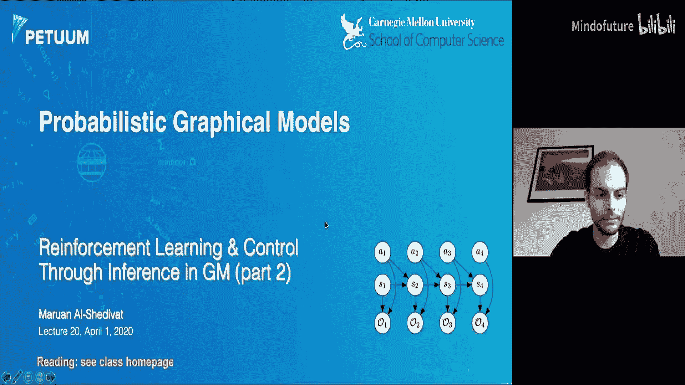
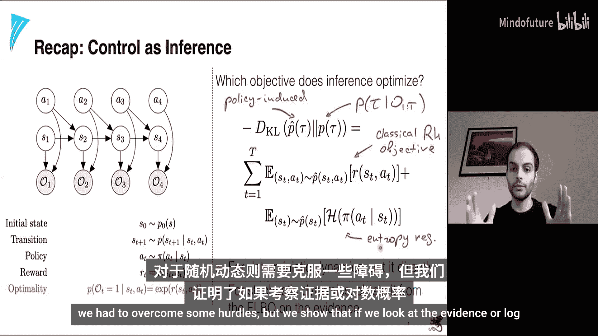
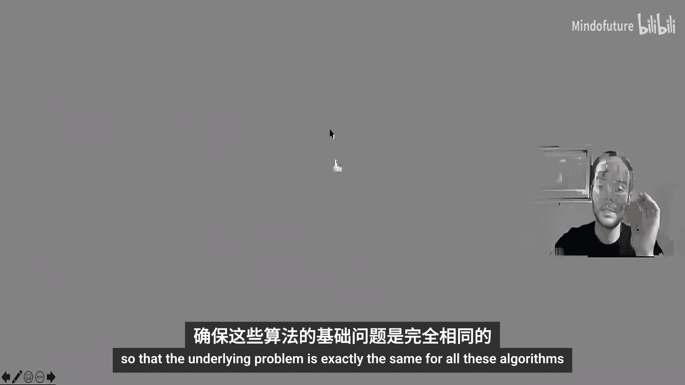
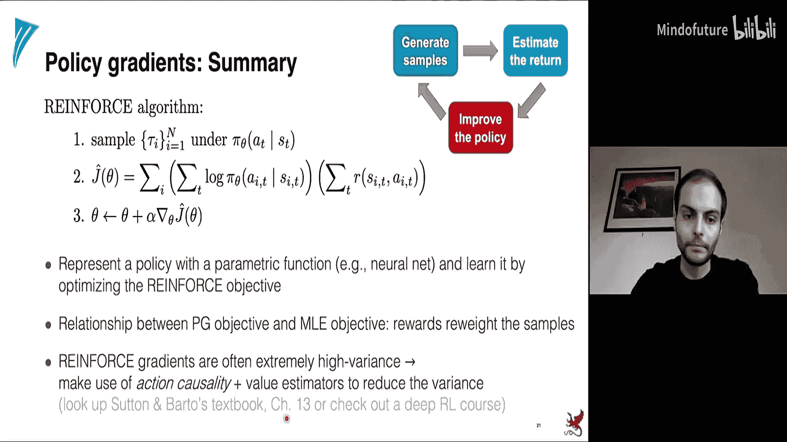
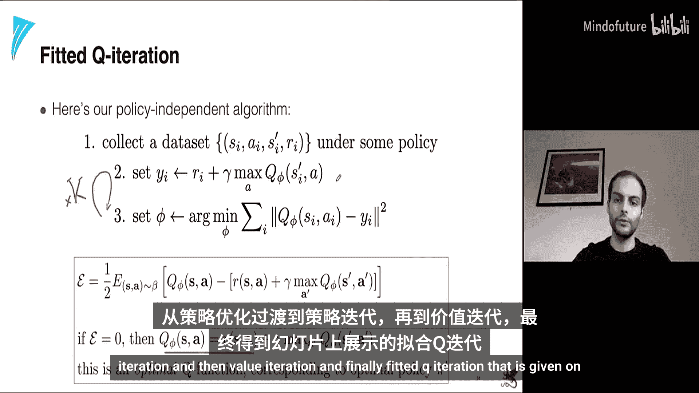
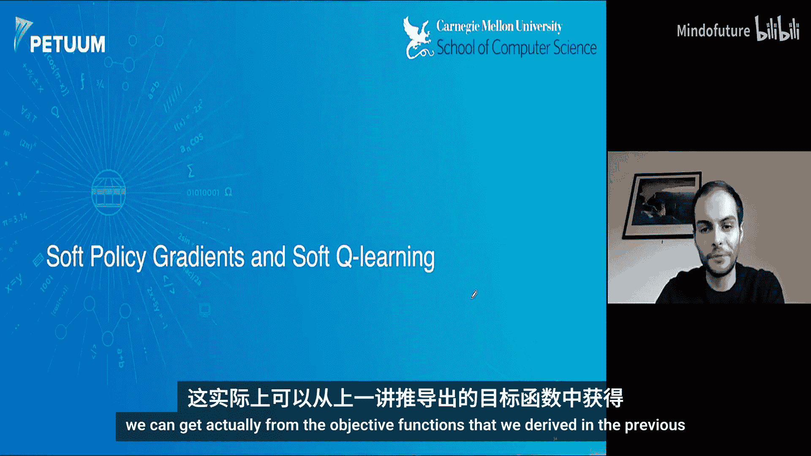
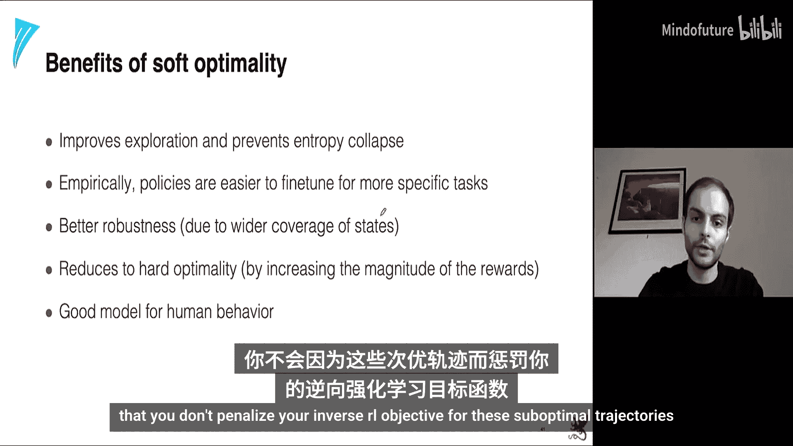
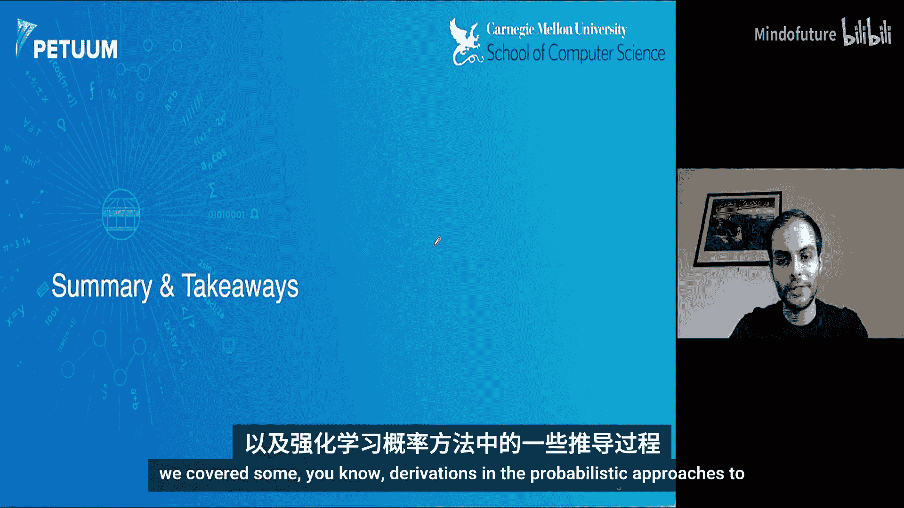
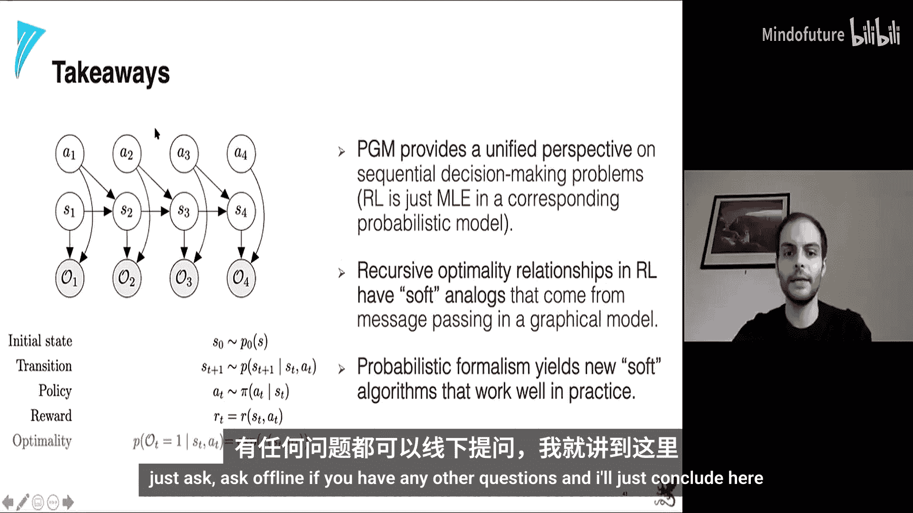

# 【卡耐基梅隆】概率图形模型 ｜ Probabilistic Graphical Models 2020 p19 P19_Lecture_20_作为推断的强化学习_2 -BV1ebpGzhEA9_p19-

Let's get started， so welcome back to the second lecture on reinforcement learning Control through inference in GM。

All right， so last time we went through a lot of materials that introduced the probabilistic perspective on reinforce learning。

 is it just a notes on the materials used in this module。

In the previous part we've covered the basics of reinforcement learning， the basics of MDP。

 I'm going to start with a quick recap of what we've covered and the main equations and results that we've got and then we're going to move on to part two here and we'm going to look into max entropy Ar algorithms I'm going to first introduce you to policy gradients and the standard classical Q learning algorithms and then from there we're going to build into soft Q learning and soft policy gradients that fall。

Outs from our control as inference or ourLAs inference framework。Okay。

 so let's start with a quick recap so first the two things that we introduced last time on the lefthand side of the slide we have the MDP。

 the marker of decision process， we have an environment。

 we have an agent interacting with the environment environment sense states and rewards to the agent。

 agent senses them and takes actions right and we define an MDP as the distribution over the initial state。

 the distribution over sort of basically the transition operator。

 distribution over the successive states given the previous states and action。

 policy is probabilistic throughout these this module。

And we have some reward function that is typically unknown so on the right hand side is the graphical model representation of this where we have standard hidden markov model with auxiliary observable variables and the only thing that we did is basically we augmented this graphical model with this additional conditional probability distribution where say the probability of being optimal at a given time step T is proportional or actually equal to the expd reward at that time point。

To make everything mathematically consistent rewards in this case must be scaled or shifted such that they are negative so that we don't get probabilities greater than one。

 but other than that is basically our standard markov chain hidden model。

So in the classical setup we introduced notions of the value functions， we started with the rewards。

 then we sum the rewards along the trajectories and called those returns and then we said that the expected return given the current state is the value of the state in the expected return given the current state and the current action is the value of the state action pair。

And again， these expectations are taken with respect to the dynamics as well as the policy。

 therefore these value functions depend on the policy。

 and we introduce some recursive relationships that we call Belelman optimality equations for these value functions that are basically saying that if we have optimal functions。

 optimal Q and optimal V， they are related to each other through this maximization operator。

And here I'm just giving you the diagrams we have the equations in the previous lecture and then finally once we have the optimal access to an optimal value function we can derive musical the corresponding optimal policy just by by arc maxing the S function along the action。

Right now on the other side on this side of the controller is inference what we had we also basically re derivedived expressions that are very similar to the expressions of the classical setting so first we introduce this probability over trajectories right given this graphical model we can condition on the fact that you know we want to be optimal throughout the trajectory so what is the probability of a trajectory if if everything if we know that we're acting optimally right and this is basically a proportional to the probability of the trajectory so this。

You know， the expression of the square brackets multiplied by they expiated some of their rewards just by the definition。

Now we introduced a couple of quantities that were called V of ST and Q of ST8 right and these were the log the logars of the certain quantities that were called backward messages with a little bit of abuseive notation we introduced in this way and just to remind you this backward message was equal to the probability of being optimal from point T until the horizon until the end。

 given that we've taken action A from the state ST right and we named them intentionally V and Q because the relationship between them turned out to be very similar to the optimality relationship the Belmon optimality on this this is given right now on the slide we have the log integral of the exponentiald Q plus the log probability of the probability of action given ST which was our prior probability of taking a certain action from a certain state。

And this log integral X is basically a softmax， log sum x， which is very familiar to all of us。

 and therefore this framework sometimes is called soft or this equation is soft optimality condition。

Right and finally， we got this expression for the optimal policy or basically the conditional distribution of an action taken at time T given ST。

 given the fact that we want to be optimal throughout the entire trajectory and very conveniently it became equal to of the difference between the Q function and the V function and this difference is often called the advantage。

 the advantage of taking action atT from the state ST instead of following the policy onward。Okay。

All right， so then we asked the question， so we started with the inference in this graphical model and we were able to derive these conditional distributions by using the base rule。

In the structure of the graphical model， but the question was which objective does this policy optimize this inferential policy and it turned out that if we start computing the if we compute the coac linearimar divergence between the trajectories that were induced by the policy。

 this P hats and the trajectories that are actually optimal with respect to the graphical model and known rewards we can actually compute the objective that's given on the slide which is the expected。

Cumology of rewards plus sometro entropy bonus for the entropy of the policy。

Right and the first part of the objective was identical to the classical ourL objective。

 the second one was just a regularization term for deterministic dynamics we got this directly by looking at the Koak La dirgence and for the stochastic dynamics we had to overcome some hurdles。

 but would show that if we look at the evidence or lock probability of。

So all of these algorithms are trying to so that the underlying problem is exactly the same for all these algorithms。

 so the first algorithm is called policy gradients that tries to directly optimize this stochastic objective with respect to parameters of the policy because we directly are searching for the policy that would maximize this objective。

There is there are value based methods that try to get rid of the policy and instead have some representation of the V function or the Q function or both。

and derive the policy directly from these DQ functions。

So as we know that if we have access to the optimal Q function。

 we can easily derive the policy by arc maxing the Q function， right？

Now there is a set of methods that actually represents both the V function and Q function as well as the policy。

And that allows to stabilize the learning a little bit more and reduce the variance。

Of this objective and the gradient of this objective。

 so basically the point is that you have separate set of parameters for V andq functions as well as the separate set of parameters for the policy and then you'll iterate between optimizing V andq and the policy。

Finally， there's a set of methods called model based methods that also in addition to estimating the policy or the value of functions。

 they also try to model the transition dynamics of the environment and how can you use the transition dynamics well one way once you have a good estimate of the transition dynamics within the environment you can use it for planning so what planning does is basically instead of rolling out within the environment you can try to roll out or try to predict how the environment would behave according to your model and then you can try to you know solve the problem of finding the optimal trajectory from the current state。

And then once you found the optimal trajectory you can try and select the action the first action along this optimal trajectory right so this is the planning based planning based policy。

 oftentimes it's very expensive so in practice you would use planning in conjunction with policy learning and for instance this is something that is done in Alphago where MCTS those planning and then you distill MCTS into a policy that is just recurren on that。

Okay so in this lecture we're going going to look at any of these methods。

 I encourage you to look them up on your own， we're going to just focus for the purpose of simplicity on policy gradients and value based methods and so the first one the first method is is's called policy gradients let's just look how it works in more detail how exactly we're going to go about optimizing this stochastic objective。

So we're going to call call a J of theta as the subjective depends on theta。

And the first question that we have is how are we going to estimate this expectation right so to estimate this expectation we should be able to sample trajectories from this and typically when you have access to an environment。

 you can follow the student code to sample the trajectories but you start with some initial state the environment gives you this initial state and then you iterate from time。

1 to 10 point T and at every time point you're going select an action from your current policy。

And then you're going to select the next state and the corresponding reward from the environment。

So as long as you have a policy and access to the simulator。

 you just plug in your policy in the simulator and you can generate to bunch of these trajectories。

And therefore， you can after generating a bunch of the trajectories。

 you can get a Monte Carlo estimate。Of these of this objectiveive function。

So it's basically some of the rewards along the and trajectories that you generated using your policy that you run in the environment right now。

Once we know how to compute an estimate for the。Objective function so how do we improve the policy well the answer is simple we should take the gradient of the policy right respect of the objective function with respect to policy parameters。

Now note that here in this objective we literally have no mention of the parameters of the policy so if you naively would compute the gradients you would get basically zero but in fact all these samples all these rewards all the states and actions actually depend on the policy so to do that we need to sort of preserve this dependence on the parameters right and to do this we can slightly rewrite the subjective function we can compute we can rewrite the expectation in the integral form we can push through the integral differentiation operator because it's linear。

Right and get this objective on the right hand side。And then further。

 we can rewrite this gradient of the probability distribution in the following form and this is called the。

More gradient trick。Right so how do we get this it's pretty simple， the gradient of the probability。

That depends on theta is equal to the basically。The same gradient or the same probability but multiplied and divided by that probability。

 and we're going to combine these two terms， the denominator and the gradients。

 and this is equal actually to the gradient of the log。So this is just an equivalence relationship。😊。

And what it gives us， it gives us this probability distribution that is under the integral so we again can take and convert this integral objective into an expectation。

And once we have the expectation， we're able to sample trajectories。

 again from to say distribution over trajectories， and now use a different objective function with this gradient in order to estimate the gradient of J data。

你看。So again， this conversion from basically the objective function to another surrogate objective function allows us to preserve the parameter。

 the dependence of the objective on the parameters。

 so that we don't just get zero when we differentiate through that。

 there are more general methods that are available in the literature that look you know a gradient estimations and such stochastic computation graphs and I highly recommend this paper by John Schulman。

We also looked at estimating different higher order gradients and if it is possible。

 whenever you compute the higher order gradient of this objective。

 you will have to do some tedious manipulation of the。Of the corresponding objective function。

 and you'll get another surrogate objective function that would preserve certain terms that allow you to compute higher order gradients。

Algebratically， it could be tedious so there is a way to do that using automatic differentiation。

Finally， if you're interested in this topic there is a very nice survey that came out recently called Monte Carlo Gring  estimationation and machine learning it's pretty comprehensive and it goes through a bunch of different estimators this estimator is just one way to do that it's called the score function estimator or it sometimes also called a reinforce estimator because we'll see reinforce algorithm uses this estimator it has advantages and disadvantages but we'll come to that later。

Okay， so now we know how to compute the gradient with respect to the policy parameters， right。

 but remember that this P theta of tau is actually the distribution over the entire trajectory。

 which is the distribution over the dynamics right as well as the policy。Okay。

 let's write it out more explicitly and in this case what we'll get which is the gradient of these three terms know that these two terms do not really depend on the parameters。

 so we're very lucky that the dynamics and everything that is related to the environment is not in the objective which means that we don't really need to know the dynamics in order to compute these gradients。

 which is very convenient。Right in the end， what we get is this。

 so the gradient of the J theta is equal to the expectation with respect to trajectories sampled under our policy。

 and then we just compute the sum of the gradients of the log。

Proability is under the current policy of actions given the states。

And then the sum is also weighted by a sum of rewards。So what does this remind us？so basically。

 what happens is that we sample a bunch of trajectories under our policy。I'll say in time。

 we get a bunch of trajectories and then we try to maximize or try to encourage the policy to imitate or to try to basically fit the trajectories that are of higher rewards and the sort of downweigh the trajectories that have much lower or negative rewards。

So this is what intuitively the algorithm does。Interestingly。

 if you look at imitation learning or behavioral clo where a bunch of trajectories is already given to you and the only goal is to imitate the expert。

 right the objective function would look like the one that is given at the bottom of the slide。

Which is basically saying that would'd like to optimize like to maximize the likelihood of the trajectories under the given policy right so we're trying to imitate the expert as well as possible。

 so the only difference between this policy gradient this reinforced objective and this imitation learning objective is that instead of the expert we're just reweighting if we don't have trajectories from the expert right but we have access to some reward we're basically reweighting the corresponding likelihood。

So in a sense， it's a weighted likelihood objective weighted by the rewards。你看。Any questions so far？

Yeah。Okay。Okay， so once we have this weighted objective， we can just plug in。

In our favorite optimization， algorithm， let's say asGD and we can optimize these parameters。

 so everything everything is pretty much given here is the only point is that again to approximate the expectation we can we can get the an unbiased estimator of the gradients by simply sampling trajectories under the given policy。

In the environments。So the point is that these methods are also sometimes called on policy policy optimization of policy learning。

 because you need to be on policy， right you need to sample trajectories from the current policy in order to obtain an revised estimate of this objective。

Right you can just go and sample from some other arbitrary policy and then compute this objective because in that case it will not there will be some sort of bias that would be proportion to the discrepancy between the。

Policy that you use to sample trajectories and policy that you are currently optimizing。

This is just to remind you our loop that we're going to be using throughout the lecture again with generally samples who estimate the returns in this case the model that we're fitting is is pretty simple。

 it's just this estimate of the return then we improve the policy well let's say a gradient step。

Okay看。And the reinforce algorithm is super simple as just two steps， for sample。

 compute the objective， and just improve the policy。

There are a few quick notes on this simple algorithm we just derived。Right so first of all。

 we can represent policies in different ways， typically you would represent it by some parametermetric function。

 for example， a neural net you can learn it by。You're using gradient de send them the parameters of the function。

There is this relationship that I mentioned between policy gradients and maximum likelihood objective in behavioral cloning and the relationship is that in policy gradients again you upweight the samples proportionally to the rewards while in behavioral cloning you assume the trajectories are already optimal so whatever samples that you get you already have high rewards so you don't need to even bother with them。

Okay finally， this algorithm has， even though it's simple， it has a few notable problems。

 so one of them is that the estimate of the gradients or the estimate of this objective function is quite noisy。

So it might be very high variance depending on the schasticity of the environment and depending how good the initial policy is so that might slow down learning by a lot when you have a lot of noise and you don't have enough signal it might slow down learning a lot also when the rewards are very sparse so in certain environments maybe you get positive rewards in very rare situation at the end of the trajectory so in that case most of the trajectories initially are going to be just getting zero rewards。

so when you're getting zero， basically your objective your entire objective will be multiplied by。

Zero， so you will not have enough signal to learn， so you would need to roll out as many as possible random projectjectors and hopefully hit at some point some non negative sorry non nonze reward that will give you enough signal to learn。

There there is a way to improve this objective to use action causality in the sense that you try to upgrade the actions proportional to the cuccmulative returns that action actual effects or basically restructure these two terms slightly differently to account for this causality。

 I'm not going to cover this in the lecture， but you can look this up in chapter 13 of them sentence and part book。

All right。

So this concludes the most basic policy gradient algorithm。

 so the next step I'm going to go into the Q learning。

Any questions so far？No questions okay great yeah feel free to either either type questions in the chat or raise your hand i'll try to monitor。

So okay， so Q learning right the approach where we try to。

Actually get rid of the policy right and directly work with with the value of functions so how can we do that right if we look again at the gradient of the objective that we just derived it actually depends on the parameters of the policy right here and how can we like get rid of direct dependence on the policy well one way to look at it。

Remember that we have if we have an optimal Q function。

 we know that we can induce or derive a derive policy from this optimal Q function by simply or max。

Right。嗯。This is good， but we need to have access to an optimal Q function right。

 so what do we do if we don't have one？Well， if we don't have access to an optimal Q function。

 what we could do， we can start with EQ function that corresponds to some policy。

 given a policy we can always get the corresponding Q function。If you remember how we do that。

 we can just compute this expected return under a policy condition on the state in action。

And then we can derive a policy from this Q function if we want to let's try to use this trick and sort of plug this into the objective function that we have here and try to get rid of the policy in the expression。

Yeah。Right so can we learn the Q function through interaction of the environment so the answer is okay try doing that so let's say we have a Q function that corresponds to some policy now if we arc max this Q function and design a new policy which will be a deterministic policy in this case。

 pi prime but it turns out that pi prime will be better than the original pi and better in the sense that in the sense that I introduced action in the previous lecture right。

 one policy is better than the other is if for every state the corresponding value for this pi prime is better equal or equal to the policy pi right so we'll try to use this inequality in order to improve the policy given that we have Q function。

Okay， so again， so let's say we'll start with some policy we can generate a bunch of samples then we can fit model to return and in this case we're going to be fitting the Q function right we're going to directly optimize the Q function then we're going to improve the policy and the policy improvement is basically given on the slide you're going to use this artrc max operator to get a better policy by prime than the original policy and then you're going to go again regenerate the samples fit the model and iterate through these three steps。

Okay。So the algorithm here that we have is called policy iteration， so it starts with evaluating Q。

 so once we evaluated Q under some policy， we can go and up native policy and then iterate between the steps。

All right， so let's look at it a little closer。Right so what is the Q function。

 the Q function by definition satisfies this recurrent relationship where we have the reward for a given state in action。

 plus gamma discounted expected value of the next state。

 where the expectation is taken with respect to the transition dynamics in the environment。

So once we wrote it this way， the only thing that we need。

We need to be able to estimate this view function for the given policy。

 so let's say we have a policy so how do we estimate the view functional in this case we can use our standard backup diagram that's。

I introduced in the previous lecture， so starting with a state S。

 we're going to act according to the policy， we're going to get to different state action pairs and then from there we're going to go and transition according to the transition dynamics and then eventually get to some S primes for each of these nodes we can assuming that we know V。

 we can just back up。Through there and recompute the value of the V at the original state right so given a state we're going to just expand a little bit or maybe expand all the way through the tree till the bottom and then once we at the bottom of the tree we can back up all the way through tree up and compute the value of the V at this state right and these transitions are happening according to the dynamics that we have here right and having with respect to the policy。

Okay so here's the algorithm that we've derived so far right given the original V function。

 let's say we start with some v we can compute Q after we compute the Q we can go and compute the updated policy pi prime once we go pi prime we'll have to go and reeval the V function again so we're going to take pi prime plug it in this expression and recompute the new value function for the pi prime and once we have again the new value function and we're going to go recompute the Q function and just iterate between these steps so step by step we slowly eliminateliating you know the dependence on on the pi we still have pi in the update rule right here so but before before I go and eliminate this pi from this equations let's just look in this diagram。

Right for policy iteration just to build a bit of intuition so again the two entities here that we're working with are the V function and the pi function right and we start from some random V that corresponds to some random pi we're going to go we start with some policy pi we're going to evaluate V right we're going to evaluate V and we're going to get to some V that correspond to the current policy then we go and go and greedily sort of greed optimize greedily find the policy that is greeded with respect to the current V we know that it's going to be slightly better than the previous original random policy and now for this new policy we're going to go and reevaluate again the V function and then we'm going to iterate and in the end this iterative procedure which canverse to the V star and pi star。

So under serving conditions， you can prove that actually this iterative procedure converges to the optimal P star and p star。

 but I'm going to go into these details in the lecture。Okay。

 now let's try to actually finally get rid of all the policy expression in our algorithm and our expressions。

 so how do we do that？Remember that we。Re drive this greedy policy through the Q function right so in fact if we have a parametric representation of the Q function let say tabular representation of the Q function。

 I actually don't need to represent the policy because it can be directly induced from the Q。

RightSo this is what we're going to do here exactly。

 we're going to use that expression for the policy and then we're going to write down the second step instead of trying to derive the pi prime from the pi policy we're going to directly go from Q to the V function。

All right， and where's this expression coming from。

 well it's coming from the fact from the relationship between the optimal v star and Q star remember that if we have the optimal V function and the optimal Q function。

 the relationship between them is going to be basically v is equal to the max over a QSA。Right。

 so instead of representing policy through the Q function。

 we're going to go and directly work with V function in the Q function and use that relationship now as the next step。

We would want to sort of。Get rid of the view function as well right because basically V and Q are now sort of interchangeable because one can be derived from the other under the optimality condition so we can exploit that too but you know so far I've talked about the tabular case right what do we do in case of high dimensional environments？

Right， or high dimensional。observationsations or even actions so in this case。

 we can represent Q function parametrically and we're going to say that it's parameterized based on parameters fee。

You instead instead of doing instead of directly representing this Q function as a table where you know at the first step we'll have to iterate through all the states and all the actions and go and update our tabular representation of Q but have to do something else because now we are not able to iterate or generally will not be able to iterate through all the states and all the actions we'll have to do something smart and update the parameters of the queue right so how can we do that well we still assume that we have some states and action pairs as well as successor states。

So as long as we have some SI and corresponding actions AIs， we can compute this quantity of Yi。

 right， which is equal to the reward of the current state in action plus gamma discounted expected value at the next state。

Okay， so assuming that we can compute these Y's， we can plug them back in into this equation and just solve our regression problem right with respect to parameters of the Q function。

So instead of writing these YI directly into the Q table， if we don't have a tabular representation。

 we can overcome this by solving this regression problem。

Now note the relationship between the Q function that I just mentioned and the V function is through the maximization over the action。

So we can now substitute this by a max over the action the current estimate of the Q function with parameter fine。

Right so here's the final algorithm that we're going to get once we do that。

 so first we're going to collect a data set。Of state action。

 successor states and successor and the corresponding a reward under some policy okay。

 so why do we need that while we need this Ss and AIs in order to compute this YI values that are equal to the estimates of the value of the corresponding state。

Once we have this data set， what we could do， we could compute this YI。

Using this relationship under the current queue with a current set of parameters。

And then we can solve the regression problem for the parameters of the Q function and in fact we can repeat this step as many times as we want on the data set that we we collected under some policy right and then after we repeated this on a data under some policy right we can go and refresh the data set or maybe go and acquire more data。

And then keep repeating this So at which point are we going to stop well。

 we know that we are optimal right when the error。That is given on the slide this error of the Q function。

I is equal to zero right so if the Q function is optimal then this relationship should be should be satisfy right so the optimal this is the optimality equation basically the for the Q function so as long as this error is small enough。

We should't be able to stop。And at the point when we stopped， we have a nearly optimal Q function。

 and then we can derive the corresponding nearly optimal。Policy by coning the anX and the Q function。

Okay。So this is the fitted Q iteration algorithm。Are there any questions so far？Yes。Yeah。Okay。

 so just to recap again， real quick we started with policy gradients。

 we showed how to optimize parameters of the policy directly by optimizing the stochastic objective and then we asked the question can we get rid of the policy if we're just interested in learning the value functions in some cases we can represent these value functions in a tabr in the Tular setting。

In some cases， we have to approximate them with some maybe continuous functions。

 so we iteratively removed the dependence on the policy and we went from policy optimization to policy iteration and then value iteration finally fitted iteration that was given on the slide。

Okay， so these were two classical algorithms， right the value based learning and the policy based learning。

That。W arrives for。The arbitrary MDD now。We can look into soft policy gradients and the software learning that we can get actually from the objective functions that we derived in the previous lecture and so how are we going to do that well remember again the graphical model that we have and the corresponding optimization problem that corresponds to the inference right in the previous lecture we show that by optimizing this objective equivalently we again in the policy that is。

Optimmal inferential policy for this graphical model。

Right so can we just take that objective then and plug it into our reinforcement learning framework and optimizing get some different maybe policy learning or human learning algorithm and the answer is yes。

 that's exactly what we're going to do right so let's try to optimize again the stochastic objective with respect to the policy but now you know this objective function is going to be substituted with a different objective function that we got from the soft soft ArL framework。

O。😊，All right， so let's first expand this objective function a little bit and on the slide right now I just wrote down on the approximation of the DKL。

 the K Laar divergence where we have the original term that depends just on the reward and the other term that just depends on the entropy。

 these are two different expectations， we can actually combine them together into a single expectation。

Right where we take the expectation with respect to state action pairs that are sampled from the policy induced distribution。

RightAnd the only difference between this very classical policy gradientd objective on this one is that we have log probability of the under the policy that we're trying to optimize。

So what we could do now is basically take the gradients。

all this objective with respect parameters of the policy right and there is nothing nothing hard or complex here it's exactly the same policy gradients approach that I just derived for the original ArL objective。

 but now you're going to have an additional term in there。

So self policy gradients are basically the same policy gradients。

 but the only thing that you do is you have this an aary regularization term and you're addressing the derivation is going to be exactly the same。

 the reinforced algorithm that you're going to get is going to be exactly the same。嗯。

With an additional term in there so I'm not going into these details。

 but what is interesting is how the soft policy gradients related to the Q learning right so the question are are is this objective can we actually get rid of the policy the same way or maybe even more efficient way than we got rid when we try to go from the policy gradient objective to the value of base objective？

So this is， again， the gradient。😊，Of our stochastic objective we're going to use a couple of tricks here so first we expand the expectation right and we're going to approximate it with a bunch of end trajectories。

We push through the。Gradients with respect to the parameters theta through the expectation we get this gradient of the log probability under of the actions given the states under our policy。

 and then we're going to introduce basically expand this term。In the objective， right。

 remember that our optimal policy。the inferential optimal policy that we derived last time is equal to the exponent of the difference between the optimal Q function and the optimal value function。

Right and then well， so now to get rid of the policy right or the parametrical representation of the policy of what we could do。

 we can use this relationship。And now parameterize directly the Q function and the V function。

With some parameters theta and plug them into this objective function right so we don't need to you know gradually go step by step eliminating the policy and then slowly like using using the optimality conditions。

the recursive optionalology relationships between QV and pi prime here we can just directly use this you know expression for the optimal policy。

 for the inferential optimal policy and just plug it into into our objective function and when we do that now that we can directly represent V as the log of sum x of the Q right with respect to the action。

And we'll end up having an objective that only depends on the Q function right away so first of all。

 this additional term in the middle is equal to the Q approximately equal to the Q of state ST plus one given that you're taking action at plus one right and then after a couple of more steps in rearranging the terms what we get basically is the gradient of the Q。

With respect to parameters of the Q and I'm abusing a little bit of the notation because the parameters of pi here that we denote theta may not be identical to the parameters of the Q。

 but assuming that you repprimetize everything you're going to get the gradient of the Q function multiplied by this reward plus softmax of the Q theta at the next state and then given that you've taken the next action。

Sorry softmax is with respect to the next action and then minus the current estimate of the Q or the current state in the current action right so this new objective is the objective for the soft queue learning right and then we directly got it from the objective for the soft policy gradient。

By simply substituting the policy using the relationship that should hold at the optionality。

Right and again， to get the self policy gradient， we simply just added one little term to the objective function。

你看。All right。So how softQ learning works well now we can parameterize our function generally with a neural net that takes in action and states and outputs some estimates of the Q value。

Remember that in the original Q learning or fitted Q learning algorithm we had these three steps where we collect the data set under some policy。

 then we compute theses using thecurrent relationship under there is the current policy and then we refit the Q function to better approximate these estimates of the values Y's。

Right so in the Q learning again， our update of the parameters is given on the slide right so it's the original parameters plus alpha multiplied by the gradients of this objective function okay so if you just expand this argument over phi right and substitute phi with theta。

 this is the gradient that you're going to get。Right。

And the target value function that you are trying to estimate is going to be computed through the max operator now the only difference between soft Q learning and Q learning algorithmically。

 it turns out that the update operation is going to be exactly the same。

 but instead of the Mac you're going to have the softm here。

so you're going to use the softmax operator to compute the target value。

 you're going to plug it in back in here， and now you can compute the gradient of this whole expression with respect to the parameters of the Q function and then keep iterating between these two the algorithm is then going to changing is going to be identical to the original Q learning where we collect some data and the in between the steps and then maybe recollect the data again and again。

So this is just an illustration from。The paper that introduce softq learning and the soft policy ingredients and they show that even when you have you know pretty complex multimodel distribution over the rewards。

 so in this case it's two dimensional environment where an agent must move to areas of higher reward。

 what turns out is that when you，Learn your soft View function or you learn your soft policy。

 you use your soft policy gradient， the agent ends up exploring the whole space and eventually sort of hitting all the high reward areas in the environment。

Right so what are the benefits of such soft optimality well among many other benefits there are you know a few specific that we can highlight。

 so first of all it improves exploration and prevents this entropy collapse of the policy and by entropy collapse what I mean is that you know sometimes when you when you do policy gradientd or you do the learning maybe you will find one mode of your reward distribution and maybe you will keep just going to that one mode and eventually your policy over time by optimizing through optimization will eventually become less and less and less entroic meaning it will be less and less random more and more deterministic so in certain cases where you have these different modes it's。

Maybe not desirable because maybe some of these modes have higher rewards than other modes and if you discovered one modes。

 your policy might collapse so the soft optionality allows you to sort of improve exploration and prevent this entropy collapse。

It turns out that empirically these policies are easier to fine tune to more specific tasks。

 let's say you're pre traineding the policy， your soft policy， self policy gradient。

On one task then it's much easier going to be defined to this policy this more entroic policy to other tasks。

 the policies might end up being more robust thanks to the wider coverage of the states。

And it's much easier it's pretty easy to reduce your policy to the hard optimality right you can increase the temperature or sorry decrease the temperature in your you know x ofq minus v if you want to and the policy will basically reduce to less。

Lesscent trafficpic policy。And you know， sometimes when you use this framework for inverse reinforcement learning where you're trying to infer words that an expert and a human is trying to optimize。

 or you believe the human is trying to optimize。Using this stochastic or probabilistic framework oftentimes approximates the human behavior better。

Because human behavior might be prone to mistakes， maybe sometimes humans are taking some random trajectories that are all equivalently equivalent under the。

Objective function that the human is trying to optimize。

 so you want your framework to make sure that you don't penalize your inverse RL objective for these suboptimal trajecties。

Okay， to summarize the key takeaways from this module。

Right so what we did we started we covered some basics in the classical reinforcement learning as well as we covered some you derivations in the probabilistic approaches to reinforcement learning we've introduced this graphical model with aili variables and everything basically fell out from trying to solve this graphical model just a few a few key points here that I think are important to emphasize first of all pGM provides a unified perspective and a bunch of sequential decision making problems and this is perhaps one of the most important。

You know， reasons why this framework is interesting from a PGM perspective。

It allows us to relate sort of recursive optimality relationships in ourL with very you know soft analogs that fall out from basically the message present in a graphical model。

 right which is quite beautiful and finally this formalism leads us to discover certain soft versions of the algorithms with interesting relationships between those algorithms。

 but also these algorithms turn out in practice to to work pretty well。

Right and we really did not cover much of this practical implementation in either of these lectures。

 but I encourage you to either try to implement some of these algorithms。

 maybe in your projects or hopefully you'll get to play with some of this in your next homework。

And try to see for yourself good how good it works。All right， so that's it for this module。

 are there any questions？We'll have plenty of time for questions at this time。Yes。

 someone raised hand。Yeah， I was just wondering if the soft versions of these algorithms were inspired from graphical models or they came up through some other ways and then later people realized that like graphical model unifies everything。

Yeah， that's a good question， I think as far as I know。

 people have been trying different regularization techniques on top of policy gradients as well as pure learning independent of the graphical models。

So people have tried to use entropy bonuses， different exploration bonuses， etc。

 which is sort of pretty ad hoc if you think about it。

 but then the graphical model for Mooon sort to unifies everything and allows you to explain why certain things are advantageous。

From this very realisticistic perspective。Um。Yeah， okay。Thank you。So in VersarL。

 I should add that inversesar actually or this probabilistic approach to inversesarL came actually from the graphical model perspective。

 so Brian Zieber's thesis actually introduces inversesarL problem from this graphical model perspective as a solving basically a CRF model。

Yeah。Yeah I thank you啊。うし。はいはいいいいいいいいいいいバいバいバいバいバい。Yeah。

Yeah one more question yeah so initially it was mentioned that converting like we unifying this in terms of a proistic graphical model we can use some algorithms that are prevalent in PGM to help us solve RL more like better。

😊，But in the end， we just converted everything to a optimization problem which the Ar community already does。

😊，Right。Yes。So are there any methods that？Yeah right right right that's that's that's a great question so I guess there are two answers you could still do planning right and then I mentioned there are different types of algorithms that you can have right there's like policy optimization there is value based a critic model based right so I think and there are papers recent papers that try to combine model based kind of inference in this framework where we combine basically planning with reinforcement learning。

And then you can have a very like algorithms that。Similar some to some extent to alphapha go approach where you do MCTS。

 but you do planning using the graphical model instead of。

And you do some sort of particle filtering throughout your your graphical model and then you use that information to inform how to update the policy so there are certainly other methods more advanced methods that we did not cover in this lecture。

 but in the end you usually typically reduce the problem to an optimization problem so。

And there is this equivalence between the optimization problem right and the inferential approach。

 we know that solving we know how to solve optimization problems very well。

 so this is therefore this is an advantage。嗯。Does that answer your question thank you？Yeah。

 so that's that may be one answer or the other answer， I would say。

We did not cover that in this lecture either but you can technically combine different subproblems of sequential decision making so let's say you don't actually know the reward and maybe you're in a multi goalal multitask can set up can you combine maybe inverse RL NRL or combined behavioral cloning where you have multiple experts or an expert showing you multiple tasks how do you kind of learn a policy out of that given that you have also access to maybe a reward that the expert is getting so。

So the framework allows you to convert this into an optimization problem or each component can be converted into an optimization problem and in the end。

 what you get is basically a slightly different objective function or potentially an objective function that consists of different terms right and using this new objective you'll be able to solve the new problem。

But yeah， I agree that in the most simple case， soft policy gradients are basically policy gradients with the same objective。

 both like an additional term， and it's kind of unsatisfying maybe， but you know。

 in more complex scenarios that be more interesting。Yeah。Other questions？無い無い無い無い無い無い無り無い。嗯。Okay。あ。

Yeah。Okay， if there are no other questions， just feel free to email me， just ask offline。

If you have any other questions， and I'll just conclude here， thank you。

