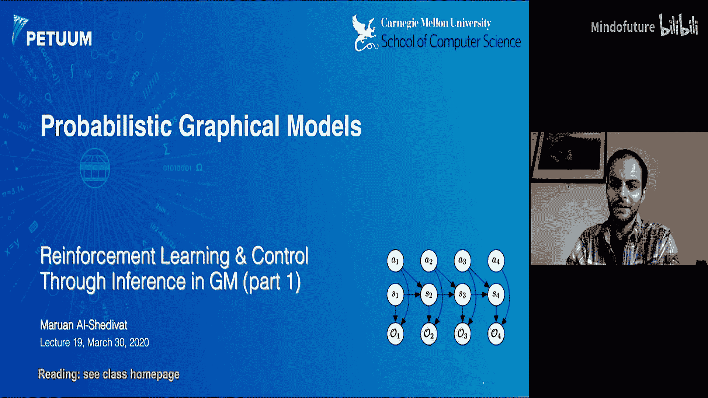
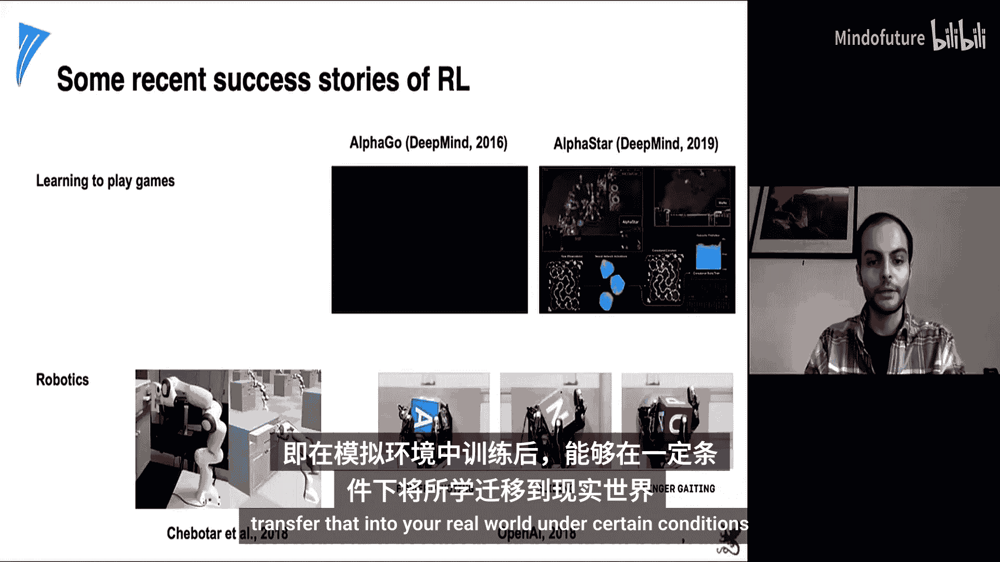
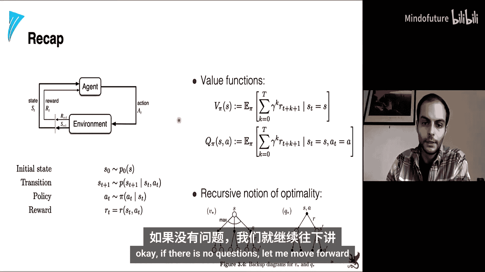
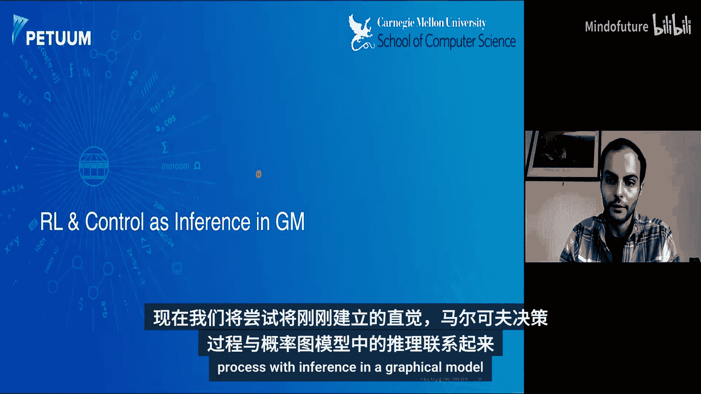
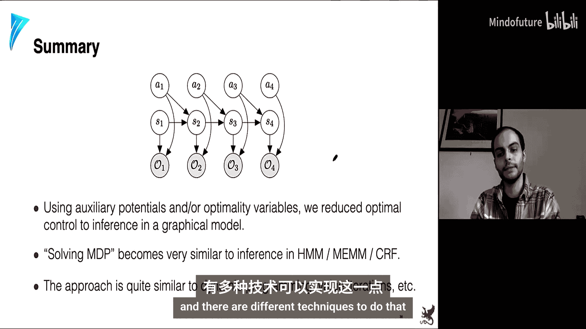
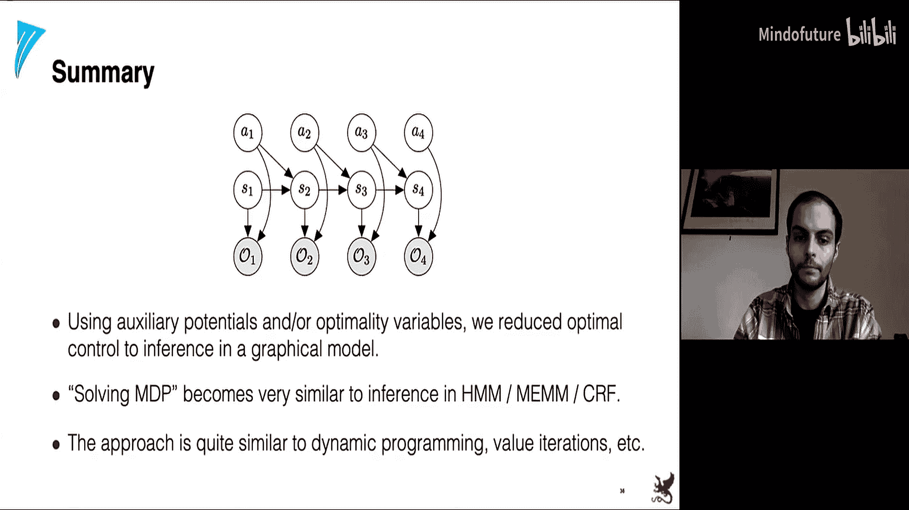
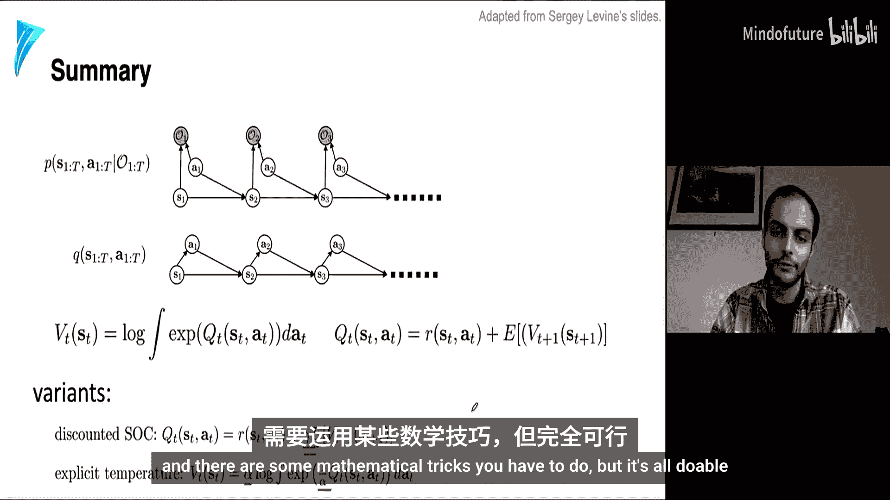
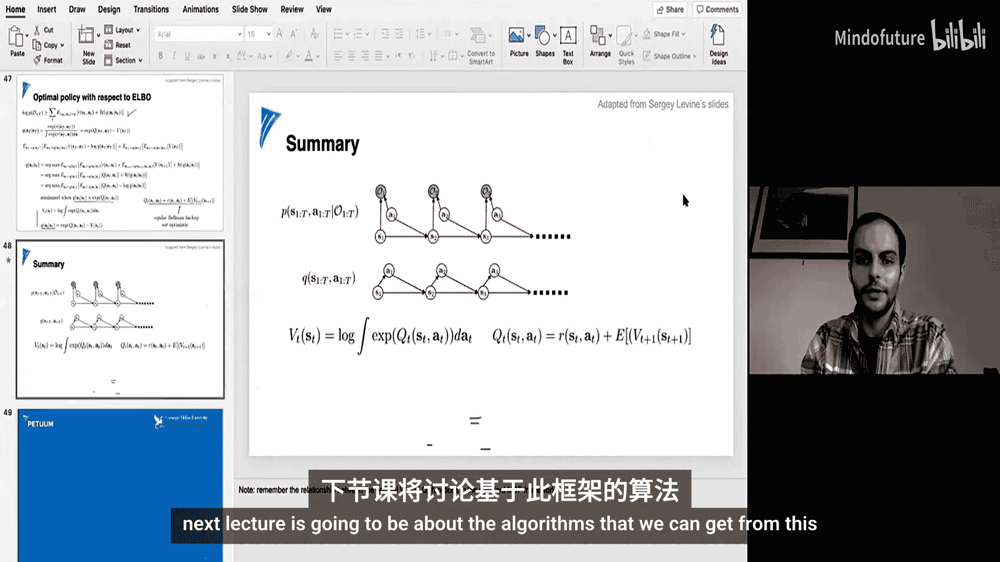

# 【卡耐基梅隆】概率图形模型 ｜ Probabilistic Graphical Models 2020 p20 P20_Lecture_19_作为推断的强化学习_1 -BV1ebpGzhEA9_p20-

Okay， so high class， I hope you had a good weekend。

 so this is our second week of online teaching maybe should ask you guys to send us feedbacks based on your experience so far。

 you know on your Zoom if lecturing outcome and also your experience。

And send us emails about any suggestions and and any issues that you run into Okay。

 so today I have another guest lecturer Morang， who is a PhD student from my group to deliver two lectures on reinforcement learning as probabilistic inference。

Again， you know make sure that you know you you know enjoy the class and also stay engaging。

 you can raise your hands， type your questions through chart。

 we have Ts answering your question on the chart and Mora himself is also monitoring any hand raising for questions。

🤧Okay， so Mauen， thank you， why don't you get started right， thank you Eric for for a quick intro。

So today's lecture is going to be the first part of the two parts of for learning and control through the lines of realistic inference and graphical models。

 as Eric said， I'll have plenty of time throughout the lecture stopping and giving you time to ask questions。

 but feel free to raise your hand whenever。So you know。

 just looking at what you guys have covered in PGM so far。

You know you had a few modules up until now with the first module being our presentation in exact inference and you looked at the approximate inference and you looked at deep learning and generative models and actually that module was introduced back in 2015 it was pretty new module and this year you also looked into structured learning causal inference and finally we're here at module 5 RL and control as inference and GM and actually the goal of these two lecture module is not to you know tell you everything about RL but rather give you a gentle introduction to the basic concepts of RL and then really put emphasis and focus on the connections between the control for reinforcement learning and inference in a certain probabilistic graphical model right and we'll see that certain connections and certain。

You know， certain connections that we can draw between the two can give rise to new algorithms。

 reinforcement learning algorithms that we'll talk about。Okay。

 so this is just a quick note on the material I use in this lecture。

 some of this material I sent to the TAs so they can give you as a reading assignment。

 feel free to check them out after the lecture。I wanted to point out that actually in one of the previous guest lectures you've already probably encountered Arll。

 so before the spring break， I believe Zdding gave a lecture on tax generation and other generative models and one of the equations that came up in his lecture is the one that I have here on the slide。

And you have this basically objective function L that has had to arguments the Q and theta where Q is our generative model for the text。

 and then you try to optimize this three part objective function for now just ignoring DKL and the entropy parts we can look at the first term and this first term was actually the reward term right it was some sort of non-differiable function that try to assign higher values to better generative texts denoted y and try to compare the generative text to the gold standard text which is Y star。

So the problem with this term is that you can just directly go and optimize it with the standard back propagation or standard schastic optimization techniques。

 you need to do something different and this difference are the keys that are used in reinforcement learning。

More generally objectives of this sort as this term are called stochastic objectives and they're called stochastic because it's usually an expectation of some function。

 a function of x where x is a random variable sampled from some parameter distribution so in case of RL。

 least parameter distribution will be our policy we're going to be sampling actions from this policy and then our reward will depend on the actions that we're going to be taking so such objective functions often come up in R as we'll see in this lecture in the next lecture。

Okay so this is just a quick recap but now let me show you the plan for the module so in the first part which is today's lecture we're going to just go through some concepts。

 the basic concepts in our own control and then I'll introduce this graphical model that you see on the right that sort of you know using inference in this graphical model will be relevant to actually doing reinforcement learning and we'll see how that is relevant and the second part we're actually going to go through practical algorithms that you can implement and we'll look at classical key learning policy gradienting methods as well as soft key learning and soft policy gradient methods that can be derived from this inferential framework。

Okay。All right， so so far we're familiar with two paradigms。

 like large paradigms of machine learning， which is supervised learning and unsupervised learning。

 and from a probabilistic perspective， they differ in terms of what is given and what is the goal right and supervised learning were' given set of data points that represent pairs of variables。

 some of them are inputs， some of them are outputs we're trying to approximate or to learn a model that approximates this conditional distribution。

In unsupervised learning oftentimes don't distinguish between what is input or what is output we're just trying to learn a model that approximates some joint distribution right and oftentimes we don't just care about the joint distribution we care about certain things that we can do with this joint distribution。

 for instance we like to be able to compute certain conditionals。

 maybe sample from this distribution， maybe sample from conditionals so all of these tasks we should be able to do after we learn an unsupervised or supervised model so graphical models allow us to efficiently represent and manipulate these probability distributions as well as derive learning and inference。

Algoriths such as EM for example， and deep learning allows us to represent these different components of these distributions right in a pretty flexible manner using very deep。

 very flexible classes of models。RightBut in the end。

 both supervised and unsupervised learning are basically tools for approaches for learning certain models that someone else can use later on a downstream tasks so for instance a data scientists take such a model such predictive model look at the predictions and then based on these predictions maybe make certain decisions right so these are sort of a decision making assistive tools reinforcement learning sort of closes this s and instead of trying to build models that can be used by someone else in the downstream task it formulates the problem as already an agent or an entity that has some sort of agency in some environment。

 it has a set of actions it can interact with this environment or the world right and it tries to optimize directly some utility function right so it's trying to basically solve problems problems in this environment in a sense end to end。

So why sequential decision making an NRL， why is this interesting while one of the motivations that ultimately we're in certain cases we interested in building very autonomous systems or fully autonomous systems that can perceive and interact with the world that can exhibit purposeful goal-directed behavior that can learn from interactions and adapt to different changes and plan and be able to maximize different utility functions that are either inferred from the situation or maybe specify externally by humans or or somehow somehow differently？

And RL gives us actually a formal framework for building such autonomous agents。

Right so is ArL successful， does it work？Well we know of a few recent success stories。

 at least in gameplay， we know that the environment is very well defined itself contained and we have a lot of computes who allow the agents to go and explore this environment almost independentlyly in the end agents are able to learn something that is even better than human performance。

But also in the real world， there is some progress that's been happening recently。

 mostly in robotics， where you try to train something in simulation and then you're able to sort of transfer that into your real world under certain conditions。

Yeah。Okay， so let's start with the basic concepts ofra。

 so the first basic concept that we have is the marker of decision process or MP for shirt。

So we'll define MDPs as an environment and an agent， an environment has a set of states。

 an agent has a set of possible actions and the way that agent interacts with the environment。

 it senses the environment state， it gets some reward， then it submits an action。

 and environment processes this action， and then outputs the next state and the next reward。

And so it's just the cyclic cyclic procedure now the important thing is that the environment is more coian which means that the transitions from state ST to ST plus1 actually happen according to this transition operator PSt plus1 given STAT and as you can see it does not depend on the history it just depends by the assumption it depends only on the previous state and the previous state connection Now the other thing that we have is the reward function and。

Generally we can say that rewards are also schastic so every time you get a reward。

 it's through word plus some noise but in expectation we'll have some sort of reward function。

 it may be known or maybe unknown and may be specified by someone externally。

 but we assume that there is some underlying reward function that assigns every pair of state in action and expected reward。

Okay。And you know， the life of the agents or a trajectory。

 I'm going to call it trajectory is basically a sequence of state action reward tos right that goes from one and then enter into the future or until some sort of horizon。

Okay， so this is the mark decision process。Now what can we do with MDPs right so the thing the first thing that we can do with MDPs is try to find a policy right and I'll come back to what a policy is in just a second trying to find a policy that outputs actions。

For each given state in the environment， such as the cumulative reward that the agent accumulates over the trajectory is maximized。

Right so in this case policy could be either deterministic right and in this case policy would be just a function a map from states to actions or it could be a stochastic which more general which is a more general case and we're going to consider this notation pi a given S throughout the rest of the lecture where every time we select an action actually sample it from some distribution and oftentimes to being stochastic is。

More can be can be seen as is a better way to act in the environment so the other problem that we can solve that we can pose and solve within the MP framework is inverarL so in this framework we assume that we're given a set of opt trajectories let's say they're generated by human or by some expertsers。

And our goal is to infer the correspondingent MDPs and by infer the corresponding MTP I mean what is the reward function that that expert tries to optimize and sometimes what is the model of the environment so what is this transition operator of the next state given the previous state in action okay？

So for the most of this lecture， we're going to focus on the policy search and in general in this module。

 we're going to just touch upon andverar very briefly。Okay。

So we need now to introduce a few more concepts I've already mentioned this cumulative reward along the trajectory to make things a little bit more formal。

 let's define the notion of return， so what is a return。

 a return is this G function that depends on that has index T。

 which is basically a sum of all future rewards up until some horizon capital T from the current time。

Now if t is infinite of the sequence might diverge right and therefore we need to introduce some sort of discount factor and typically it's a multiplicative discounting called gamma where gamma is between zero and1 and we can write this infinite series in this case that will converge to something finite so this gives us also this ability to write this recursively so we can see that GT or return at time point t is actually equal to the return at time point so basically the reward that we get as well as gamma multiplied by the return at the next time point。

Okay， so now we can introduce this important concept of the value function NRl so what is a value function。

 basically the value function of a state S is the expected return at this state。

Right if we are following some policy pi， so let me explain this with more detail so let's say we have we are starting at state S if from this state S onwards we keep following our policy pi where policy can be in more in the most general case stochastic。

Right， we're going to get different rewards and the all sequence steps。

 so which I take the expectation over the sequence， well get our value of the given state。Okay。

so this is actually a stochastic objective right if were trying to find a policy that maximizes the value。

That we're going to get or that maximizes the expected discounted returns。Sorry rewards。

 this is going to be exactly trying to solve or to optimize the diagnostic objective。

 so we'll come back to that。In the rest of the lecture。

Now we can also introduce the value function of the state action pair。

 which is also called the Q function， and the Q function is basically the same expectation。

 but now the conditioning is on both the current state and the current taking action。

 so we assume that we've already taken an action and then we keep following policy onwards。

So there is obviously a relationship between those two quantities。

 so let's just look into how we can you know write these relationships and these relationships are called Belmon equations for the D pi S and the QSA。

All right， so。To do that， I'm just writing here on the slide the definition again of the V function。

 the value function。And I'm going to just expand a little bit this return right so what is a return well we know that the return is a reward plus gamma multiplied by return of the next time step。

Now we're going to expand this expectation over policy more explicitly and we're going to write it down as the expectation over the action right so first we're in state S we're going to take an action according to the policy so this is the expectation with respect to the policy we're following。

And then we're going to transition to the next states， according to the state dynamics。

 so this is is going to be， therefore whatever we get after we transition to the next state is going to be weighted both by the probability of the transition and the probability of taking a certain action。

And then we're going to get our reward RSA and gamma discounted return in the next step。

And what is this gamma discounted return of the next step。

 well is this is precisely our definition of the V Pi at state aspirrine， right？好ello。Okay。

 so we basically expanded by one step into the future and。

Sort of expanded this expectation along the action and state。Dimenssions so。

We can actually represent this sort of graphically imagine that we're in state ASS right and then we have two possible actions so from here we can go either and take action one or action2 and then once we've taken the action。

 the environment can either transition let's say to two possible states from each of these nodes so each of the black nodes correspond to a state action pair and each of the white nodes corresponds to the state。

Right。So first expand the state into state actions。

And then we expand the action according to the transition we and also we get rewards when we transition from the black circle to the white circle okay。

 so this is just diagrammatic representation that is sometimes used in the reinforcement learning literature。

Just to give you an example of you know how it would look like in a very simple environment。

 so imagine that we have this environment。s as gridworld which is5 by five grid worldor。

 there are certain states， every state is basically a cell in this grid world and we're given actions such as move up down left to right。

 so these are the only actions an agent has and every time the agent takes an action and gets minus one reward。

Right。And。So sorry if the agent actually hits the boundary of the grid it gets minus one reward and there is nothing happening if the agent comes to the cell a teleport regardless of what it does to a crime and it gets plus 10 it goes to be teleport to B prime and gets plus5 right now if we are to run a random policy basically randomly select one of these four actions we're going to get is we can compute the value function of every state in this grid world。

The correspond to this pi random。Rin of policy and as you can see it's sort of reasonable we get pretty high expected。

Cemology of return for the South correspond to A and B and something pretty low or negative if we're in the bottom part of that of the grid world。

Okay， so now we can write similarly Belelman equation for the Q function。

 right similarly write down the definition， expand one step ahead。

Right and then expand the definition of the expectation right first along the transition to the next state and then along the policy of taking the next action next from the new state and then again。

Put it together and get a requisive relationship between the。

Original Q function and the initial state action pair and the Q function in the next state and action pair and it' similarly we can write down we can illustrate the diagram where we start with a black node。

 which is a state action then we transition to one of the states from there according to this action and then from there again execute our policy and select another new action okay。

All right， so what does it mean to actually solve an MVP or solve an RL task？So in this case。

Solving an MDP， in fact， means that we can find an optimal policy that achieves higher reward in the long run。

And if we define it this way。We can actually sort of rank policies in terms of which one is better。

And a better policy is a policy that achieves higher expected cumulative rewards from every single state and to say it formally。

 we can write it in terms of the value functions， so a policy pi is better than a policy pi prime。

If for all the states， the corresponding value function for policy pi is better or greater than for policy P frame。

Right， so this allows us to sort of evaluate policies and say which one is sort of better than the other。

 but it also allows us to know write down this Belelman optimality equations。

Where we say that there exists an optimal policy right and this optimal policy will have this the corresponding optimal value function that will be the upper bound across all possible value functions right so we're basically saying that this V star。

At every state S is basically equal to the maximum over the space of possible policies over all V pi S。

 and we can equivalently write this in terms of max over actions where we maximize over actions and will integrate out the transitions that the environment specifiedifies。

Similarly， we can write down the same thing for the Q function and define the optimal Q function as a Q function as a solution to this maximization problem。

Wwhich we can also write down in the following form know that the form on the right of the slide is also recurrent so we have Q star both on the left hand side as well as on the right hand side so this is basically the two be and optimality equations that specify we'll basically define these V star and Q star and graphically in here I just copyied the same equations for you right graphically you can think of this sort of expansion or these diagrams where we start from a state let's say and then we can expand across all our actions but now instead of you know weighting every branch with the probability assigned by the policy we can actually take the max。

And assuming that we can start with a state， we can go and expand all the way until the very last state and this tree and then we can back up and go back in order to compute the optimal value at a given state right and when we were backing up we'll have to just compute。

The maximization， whenever we go from a black node to a white note。Okay。

 and similarly we can do the same thing for the Q function right so it gives us basically as long as we know the transition probabilities in the environment or maybe the environment is really。

 really simple and you know fully fully fully specified we'll be able to compute this D star and Q star by just you know enrolling this recursion forward and then making a pass fabric。

はい。So it's sort of a forward backward， again algorithm and we'll see how it actually relates to forward backward algorithms that we know of in a hidden Mark of mouth。

Okay now let's say we have these optimal value functions can we can actually compute optimal policy and optimal trajectories and the answer is yes。

 we can do that pretty easily so here we can use the direct delta function around the arc max over the Q function that will actually give us the optimal policy so assuming that Q is optimal or we can easily prove that lirous funding policy is going to be also optimal。

Now， if you'd like to recover a set of optimalsmal trajectories。

Right so you can start with some state， let's say ST and then every time you take an action you're going to follow this aG max kind of optimal policy and in then you'll get an optimal trajectory right and this optimal trajectory will have optimal rewards R1 r two et cetera or T star。

Yeah。Okay， so again， our simple grid world example。😊。

Now let's try to you know imagine that now we are actually computing this optimal value and the optimal Q function right so if we compute the optimal value and again we can do that exactly in this case because the environment is so simple。

Using this recursive relationship， we can get a much higher estimate if you recall the estimates that we had originally。

 were much lower in this case we get much higher estimates and all of them are positive and then you can also infer the optimal corresponding policy pi star right by computing first the Q star and then taking the a maxax and it's pretty intuitive right so whenever you're in any cell you're trying to actually get to the a cell so they be teleport and close the loop and keep going between a prime in and maximize your reward。

Yeah。So these were some basic blocks。That I just introduced and this is going to be sufficient for this lecture so the first building block is the marker decision process right that is defined by a bunch of distributions including the initial state distribution the transition distribution that is Markov and the policy distribution and then there is this reward function we introduce the value function of a policy。

And then we define this recursive notion of optimality and previously straightforward way to compute it by sort of unrolling forward the recursion and then rolling backwards。

Along this recursion， so yeah。Any questions until this point？对。Okay， if there is no questions。

 let me。

forward now we'll try to connect that intuition that we just built this market decision process with inferenceprints in a graphical model。

Right and already I define MDP as a Markov process right as a Markov decision process。

 but how is it different from a Markov chain， it turns out that the states are in fact a Markov chain and so we have a transition from state to state to state and we also have some actions that affect the next state that we transition to but we know that these dynamics is more coviian。

so we have the speed dynamics and then we have these controls so we can model both of them as random variables。

 some of them are sampled from the policy distribution。

 some of them are sampled from this sequential transition probability。Right。But now how do we。

 the question that is open， sort of how do we define the distribution over rational or optimal trajectories？

Because we have not just you know these transitions that are arbitrary。

 we have transitions that are also rewarded and then we know that the agent is trying to optimize that reward so how do we sort of up the trajectories that are sort of more plausible or higher rewards while downwiing all this sub optimal trajectories right how can we do that formally so for this we can use the following formal so on the left hand side we have the standard MDP right and the graphical model sorry for a markov process right so on the right hand side it is the same same process right but I'm going to augment it with additional variables。

010203， et cetera， and I'm going to call these variables optphthalmology variables。

Also note that the nodes that are here， the optimality in nodes are going to be auxiliary nodes。

 but theyre going to be observable and then the rest are going to be hidden okay。

Now this on the right hand side， it's not just a Markov process now it's a hidden markov process with some observable variables that are denoted with oath。

And we have some latent variables， which are acids and As。

And the only thing that we're going to add now， once we introduce these variables we need to introduce the conditional distribution that corresponds to this variable given the state and action at a given time point to fully specify this model and this conditional distribution we're going to define in the following move so we're going to say that the probability of being optimal at a time point T。

Wwhich we do know probability of Ot is equal to one。

 given ST and ET is actually equal to exponents of the rewards。And the corresponding time point。

So if you get a high reward after taking action A1 from state S1。

 it means that it is more likely that you are optimal at this time from。Okay。

 so this is some sort of the notion of soft optimality that we should use here。

So why is this model interesting？Right so why， why are these auxiliary in？

Observable variables are important well it allows us now to kind of incorporate this information about their word into a probabilistic generative process right into this into sampling of these trajectories。

And we can try to solve now control or like trying to find this optimal control policy as using probabilistic inference algorithmms and this hidden markov model。

Yeah。It allows us to specify probabilistically a model of the optimal behavior。

Right which will be important forperscero and I'll come back to that in just a second。

And it also sort of gives us an explanation of why， you， stochastic behavior might be preferred。

You knowFrom the exploration perspective from the transfer learning point of view。

 so it gives us kind of a new tool， a new instrument of looking at the reinforcement learning but from a kind of probabilistic perspective and the construction with these optimality variables are sort of intuitive but again they are arbitrary you can define them slightly differently in fact you can show that your reward can be because you want to normalize you want to have a normalized conditional distributions you can actually adjust these rewards by arbitrary kind of shifts right and it's still going to be the same model。

So what can we do right now with this graphical model so the first thing we can do given a reward。

 we can try to determine how likely an optimal trajectory。

 how likely a trajectory to be optimal right？Or basically we can try to compute the probability。

Of a trajectory tau， given that all the variables throughout were optimal。

 so we've been acting optimally throughout the whole trajectory。

Now the next question that we can answer is given a collection of trajectories right and assuming that these trajectories are actually optimal。

 can we infer the reward in different priors that whoever generated these trajectories a demonstrator an expert？

Can we actually infer their rewards， their internal rewards and their internal priors。

 and this is basically inverse parallel question。Right。And finally， given a reward。

 can we infer an optimal policy and this notation's pretty it's pretty interesting that we can just write down a conditional distribution which will be。

Actuallyual an optimal policy right so I assume that we know the reward it means that we have fully specified。

 let's say the transitions as well as the probability of being optimal at a given state then we can actually go and use the base rule and in fact get the optimal derive the optimal policy directly from the graphical model which is pretty interesting so instead of solving the optimal problem we can solve the inference problem。

Okay， so let's try to do that actually。First， let's specify the distribution over the optimal trajectories and how this would look like。

 well first， we'll have this you know the probability of the optimality at the given step that we just introduced。

 right？Now we're going to say that the probability of a trajectory given that we've acted optimally is proportional to the probability of the initial state multiplied by some action prior right and we're going to call this action prior probability of a givenST and then the transition operator and then finally the fact that we acted optimally in at this time point and then we just multiply this across multiple time points。

So this is basically a joint probability distribution。

 and I'm saying that just the posterior is proportional to the joint。啊。One second。Okay。

Theres a question chat？Okay。And so there's a question。Should probability be proportional to？

That's a good question。嗯。Maybe you can unmute yourself and just explain what do you mean？Yeah。

 so my question was like do we scale the rewards to make sure that the property is a distribution or do we just assume they're proportional and add a organizing consult part factor later？

So yeah that's a good question so we don't have to assume the only thing that we need to assume is that in fact rewards are negative and dis formalism because we don't want our probability to be greater than one。

Right but yeah， for now we just assume that rewards are adjusted correctly so so everything like all this the normalizing constant everything is shuffled into this reward right。

I see， thanks。So okay， next up right from this， we can go and further expand so we just。

You know I'm just plugging in the first equation on the second one and expanding this further and then i'm sort of rearranging the terms a little bit so i'm just putting together everything in the you know brackets here。

 which is everything that correspond to the dynamics so this in the square brackets this is the probability that is assigned by the you know by the environment it's like how plausible the trajectory is under the current dynamics。

While everything that is under the exponent is basically the up weight。

Of the trajectory proportional the to the reward right so the more likely the more likely trajectories are going to be updated and this is the action prior technically we can assume that all actions are you know sort of equal so we can just cross it out for now。

 but you know we don't have to do that。you know， in the framework it allows you to have to play with different priors and they also you notice that you know different rewards。

Sort of technically you can shuffle in this action prior into reward as well， right， but or you can。

 you know you may want to have it like explicitly somewhere to represent certain priors that you have about the behavior of the agent。

Okay， so this so this is the probability basically the probability over the optimal trajectories posterior probability given the observed sequence of given the fact that the observed sequence was optimal right what we could do we can further。

 let's say we don't know the reward and we're just given a bunch of trajectories well this specifies the likelihood function for us right so this probability of the trajectories so we can use it as a likelihood and we can parameterize the reward maybe parameterize the prior maybe we can even parameterize them featureurize them further and have them as like feature function multiplied by feature weights。

And now we can learn the reward as well as the prior and try to learn you know what is what was the cause or like what was the reward that drove the agents to follow this trajectory so this is exactly how the problem of in reinforce learning as posed where you're trying to infer the reward that drove the agents to take a certain trajectory。

And note that actually， if you just look at this problem。

 it's basically a fuurized conditional random field。

RightIt's a featureized conditional random field in the previous lectures。

 I believe you guys already covered sequential models and conditional random fields。

 so by solving this model it will be equivalent to solving basically CRF and by inferring these potentials like paraametric potential functions。

 you'll be able to learn basically there are words that you can recover from the trajectories。Okay。

 now the next step is can we get the optimal policy and how can we optimally plan in this framework well what we're going to do。

 we're going to show that we can actually unroll the dynamics。

 compute certain backward messages and this HR model。

And these backwards messages are going to be defined as this。

 so it's probability of being optimal from state ST and taking action T and being optimal from point T onwards。

Now we'll be able to use these messages actually to compute the optimal policy。

 which is the probability of action given the state ST and given the fact that from now on we're going to act optimally。

And finally， we can also compute technically forward messages right in this hidden Markov model in order to do state filtering right let's say we don't know which state we're in but we know that we've acted optimally so far what is the probability that we are in a certain state so this can be used for state filtering as well but this is not something we're going to be looking into okay so we're going to focus just on these first two first two quantities okay so let's expand this backward message just a little bit。

Right again， it's super probability we an optimal from time key onwards。

We will'll do some algebraic manipulation first of all we're going to introduce ST plus one and just integrate it out we can do it with any probability distribution right and then on the next step what we're going to do we're going to expand this and just factorize this probability distribution right so what is this probability distribution is basically probability of being optimal at the current point condition on STAT and then probability of transition to the next。

Time point and then probability of being optimal from ST plus one onwards。

So the only thing that we don't know is this term， so we need to further expand it。

 so this term is probability of being optimal starting  point t plus1 onwards。

From the state ST and again we're going to introduce a new random variable which is action at time t plus1 and we're going to integrate it out right we're going to integrate it out with respect to some let's say prior over actions okay we can always do that now this part。

Is basically our。Our beta T plus one。By definition， right at state ST plus1， A plus one。Okay。

 so just you know just remember that and we can so what we just did right we connected beta t with beta t plus1 and a sort of recursive recursive fashion we can further write it down literally for every single step and we're going to start from the beta capital T in which case beta capital T will be just equal to probability of o capital T given ST8 right and then we're going to go backwards right from like all all the final the final state and then we're going to go and send this message backwards in order to compute beta at time step T and here I just give you a quick for loop of an algorithm that can help you compute that。

So this this is pretty much identical to the backward pass and the hidden Markov model right and this bes are defined as as we introduce in this slide and this is slightly just simplified notation where wheat instead of fusing this integral we're just shuffled it into。

嗯。An expectation over some probabilityability distribution。Okay so similarly。

 we can define also this beta T with a little bit of overload of notation， beta T of ST。

 so of only one argument where we basically integrate out， and this is exactly what we did here。

Where we integrated out the action from the data SD and so that's just the expectation with respect to AE。

Okay， so we introduced the two new functions， beta T STTAT and beta TST and what does it remind us of。

 well it reminds us of actually of the value function that I just introduced in the first part of the lecture right so let's just denote okay the log of the beta TST as VTST and the log of the beta of two arguments as QTST80。

Okay so if we denote this we can actually write that expectation that I just showed you in the integral form right so this is the log of the expectation of inside it there was like probability of A and ST multiplied by the beta right and what we get is basically sort of a soft max relationship between the Q function and the V function and if you remember the very beginning I gave you this Belman equations with the maximization right max over the action。

Right， so this is precisely the same relationship between the optimal V and the optimal Q that we had through maximization so here we get this relationship through the soft maximization and so instead of max we get the soft max。

Okay， so in in case of the deterministic dynamics， you can further do this exercise on your own you can get that。

This Q and V， the optimal Q and optimal V functions here actually follow pretty standard relationship as in the classical URL。

 so Q STAT is equal to basically reward at the current step plus the value at ST plus1。

So I'm emitting right now the gamma， I'm assuming that the horizon of finiteant and gamma is equal to one。

 but you can do pretty much the same des with gamma and infinite horizons okay。

So in case of stochastic dynamics now something becomes like a little bit different。

 a little bit weird because we have again the reward。

 but now instead of just the value function we have the log。

Expectation x of the V function right and this is this is a little problematic and let me explain you why so this is called the optimistic transition。

And this is not good Why is this not good because we look at the value at the next state okay and then we expentiateiate it before taking the expectation and the problem is that imagine that you have an optimal value function in which case let's say from state ST you can have a lot of possible transitions after taking action E but one of these transitions is very low probability but at least to a state that basically where you win a jack jackpot right so the difference between values on that state and all the other states is pretty huge now you expentiate this so that difference like skyrocketets right and then you try to average it with respect to the transition probability so even though the transition to that jackpot state was very low and within the Q function unfortunately you account it as an expd quantity so basically it overrdes all other potentially negative possible states that you can get into so the agent。

We'll try to take that action， even though it's risky。

So basically it will try to seek sort of risky actions that potentially may lead to very high rewards while a lot of probable actions may lead to very low rewards and so we'll look into this problem a little closer later on like where it's coming from。

 but again in the determinastic dynamics， standard R and the stochastic dynamics slightly non-standard R。

Okay， so now how do you get the optimal policy， well if you put two things together I'm not going to go through derivations。

 but you can get the optimal policy here， right？The optimal policy by dividing the two quantities that we just derived。

 basically the exponentialated。The exponentiald Q function divided by the exp D function right and again so this is what we call the advantage right so this is something that is called in reinforce learning the difference between Q and V at a given state for a given action is often called the advantage of taking the action AT from state ST because this difference basically it tells you how advantageous it is to take an action AT over just following a regular policy in which case your value would have been just the ST so in this inferential framework again our optimal policy resembles to some extent something that we could get in the standard R。

Okay。So yeah， devation would be an exercise potentially you might encounter in their last homework。

 depends on the ATAs。So the natural interpretation you know。

 of this policy is that it's basically you want to act。You know。

 as close to you know optimality as possible， but instead of being fully optimal right。

 instead of using Arcmax overQ， you going to take probability you're going to take actions with probability proportion to the expd Q minus me。

 meaning that you add some sort of randomness in there that can help with exploration as well as randomly break the ties。

Right so as you can technically add here a temperature right and by temperature。

 I mean you can you know， add let's say some sort of。

One over alpha right so that you can control and then the higher the temperature。

 the higher this alpha is going to be or a free parameter they can just incorporate into your policy。

 the closer the policy is going to be to fully random and then the lower the temperature。

 the more peaked the policy is going to be on the you know arc max of Q right the more peak it is。

 the closer it's going to be to the greedy policy with respect to the optimal Q function。嗯。Okay。

All right。So far。Basically， we covered the basic concepts in ourL， then we covered this。

Sort of I introduce this new graphical model with a bunch of auxiliary variables and then I reduce basically optimal control right and I'm sure that you can do actual optimal control as well as inversear rail using this graphical model and just using a very simple inferential procedures so in this case is's going to be just in a forward backward and first and a hiddenn graphical model。

And then what we did we derived certain messages and then we redefine these messages in terms of letters that are sort of more familiar to those people who are familiar with RL and would the connections between the two。

So solving MDP within the framework becomes basically similar to solving HMM， a CRF。

 a max entropy model， etc。And again， the approach is very， very similar to dynamic programming。

 so one thing that I didn't say so far is。That actually you need to solve to use the procedure that I just defined。

 you actually need to have access to the transition dynamics if you don't know the transition dynamics。

 unfortunately will not be able to compute any of these messages right so you need to somehow estimate it potentially in practice。

Right and。

They are different techniques to do that。Okay， any questions so far？Yeah。Okay。So there's a question。

Right， so the question is， what are the advantages of solving MDP using this method？

So wet come to that in terms of advantages， but right now it's just a formal framework that allows you to reinterpret reinforcement learning so we started with an Markov decision process right which is Markovan model but then we defined this notion of recursive value functions right and it wasn't clear how is that related to any sort of probabilistic inference or learning within the framework so this approach just allows you to reinterpret the whole thing from probabilistic perspective so there are no clear advantages as like right now。

And it would be quite application dependent， but we'll see that， in fact。

 using this framework can further derive certain objective functions which we're going to do in the rest of this lecture。

' going to derive an objective function。That corresponds to solving， to doing this inference。

Right and we'll see that this new objectiveject function can actually give rise to a bunch of new algorithms or algorithms that are alternative to the standard classical cube learning or policy ingredients。

 and I'm going to look into that in the next lecture。Yeah。Yes。

 so the question even without the knowing dynamics can we find the backward messages via sampling。

 the answer is yes so we can do that， there are some recent papers that actually try to estimate the model via sampling and yeah this is definitely possible。

But in one way or the other， if you do want to use this policy that is based on the inference directly。

 you need to somehow have an estimate of the transition dynamics or basically the model。

So if you've heard there is model free in bottle based that。

 so there are certain methods that are model free that do not try to estimate the transition dynamics in the environment and then there are model based methods that do try to estimate this transition dynamics and then do try to use that transition dynamics to make actions so sometimes the transition dynamics is very simple like in go for example。

 you know exactly after taking an action or it's going to be the next state。And。In this case。

 there is no need to estimate these transition dynamics at all。

 so you can exploit that you can unroll along the you can basically simulate your environment using the transition dynamics that you know or maybe the one that you learned and use that information to reduce the sample complexity。

 essentially of your URL algorithm。嗯。

Okay， let me move on and actually look right now the variational inference perspective and the problem which is defined。

So， you know， what I introduced right now on the left hand side。

 this infential approach to the optimal policy， right？On the right hand side。

 we know that we can actually get the optimal policy by solving this stochastic optimization problem or basically optimizing the stochastic objective。

The expected cumulative rewards。Right so how are they related are they related at all can we say that by you using by using this inferential policy we're actually optimizing some sort of objective function。

 and it turns out right it turns out that the answer to this question is yes。

 which is the the most most interesting thing that actually we can try to we can find an objective function that by optimizing which will approximately or exactly recover this inferential inential objective and I would say this is not know write inference and optimization on we've seen already in variational inference that variational approaches what it basically does instead of trying to solve this integration problem which can be pretty hard。

 we can recast it into an optimization problem and that's the essence of the variational methods。

Okay， so what we're going to do to derive this objective。

 we're going to look at the kale divergence between two trajectory distributions。

So let's just focus for now on the determinants the case now we have。

The probability over optimal trajectories。probabilityability overq tau。

 which is basically the dynamics part， and then the reward part。

Now and then we can also have another Pd distribution over trajectories that is induced by some policy。

 so imagine that we have some policy pi， let's say it's a parametric policy with some random parameters that assigns certain probabilities to actions from different states and then we're going to define this probability distribution over trajectories as in deterministic case we're going to have the indicator function that indicates basically that that certain trajectory is just possible or admissible and then you're going weight it by the probabilities of certain actions under the policy。

Okay， now I would like to now take this distribution。

 the optimal distribution on the left and take the kind of policy reduced distribution on the right and like to minimize the divergence between the two distributions。

We'll try to match these two distributions or try to find a policy such that the induced。

Distribution of the trajectories matches the optimal distribution of trajectories and so we can just expand this and write as given on the slide。

So just the expectation where the expectation is taken with respect to you know this policy distribution。

 some terms are duplicated so can just cross them out and simplify this expression。

Now after simplification， we'll get this expectation again over trajectoryject sampled under the policy。

 and then we here we have the sum over the rewards minus the log。

Pi ASD right and what we can do next we can use the linear of expectationation property。

 just swapb the sum and the expectation and then again split it into two terms right and what are these terms well on the left hand side you have this expected return。

 which is basically the standard R。Ojective that is coming from the standard or else are our stochastic objective right and then on the right hand side we get just an additional term that denote the entropy of the policy right or the entropy of the actions that are generated from this policy so you can think of this right if you optimize the expected return regularized by the entropy of the policy or in other words you're trying to select an action。

From a policy that is as optimal as possible， at the same time。

 the policy should be as inroppic as possible， as uncertain as possible。

So if you're trying to optimize this objective， basically what I'm saying is that you will recover the inferential policy that would correspond to the optimal distribution right so when this Kak linearar divergence basically is minimize to zero。

 this is what you're going to get。は。Okay， now what happens in with this stochastic dynamics case。

 well it's a bit trickier， remember we have this problem。

that I mentioned the optimistic behavior where you try to select actions that might lead to under some circumstances。

 there are some transitions that can give you to very， very high rewards。

 but your policy or your Q function will be actually tuned towards selecting these actions。Right。

So why does this happen right the problem is that the graphical model that we just defined it does not distinguish between what is controllable and what is not controllable in our environment。

 so what is controllable things are things that are under control of our policy and our policy is only able to control the actions so it's not able to control the transition dynamics but from the graphical model perspective honestly there is no difference so there is this dichotomy between you know when you've got a high reward it could be because you followed a good policy right and therefore you got a higher reward。

Or it could be that you follow just a random or like a bad policy。

 but you go very lucky under the stochastic dynamics of the environment。

And the model really does not distinguish between these two cases right so you can you can。

You know first introduce the optimal policy and say hey I want to find a policy。

 you know such that given that I obtained the very higher reward or given the fact that I've been acting or want to be acting in the future always optimally right what is the action that I want to take right so what is the action probability so this is the question that we're interested in and this is the policy I would like to infer？

Now on the contrary， you can use exactly the same graphical model and ask a different question。

 given that you obtained a higher reward， what was your transition probability and so pretty fairly valid right so this probability distribution is a valid conditional probability distribution that can compute。

And， you know， it's not going to be equal。Under you know general conditions not going to be equal to the actual transition。

 you know the prior transition distribution is equal you know。

 and this is the problem right so we want to be to make sure that we're able to sort of。

infer the optimal action probability and answer the first question， but we don't want the model。

 we don't want it to allow the model actually to you know exploit these dynamics and propose policies that are you know out beyond sort of the control of the agent。

ok。Okay， so the question that we can formally pose now is that given that you obtain a high reward。

 given the trajectory obtained a high reward， what was the action probability？

That your transition was your action probability what was your policy。

 given that your transition probability did not change so we explicitly want to force the equal sign here while solving the problem for the optimal policy。

Okay， so how can we do that right so we would like to find this Q distribution I changing the slide of the notation youll see why I'm doing that so instead of P I'm going to use Q right so this is the induced distribution from a policy over trajectories such that it approximates right our optimal distribution over trajectories。

While the dynamics has to comply with the actual dynamics of the environment。Right。

And so basically this is our Q of tau， this is our optimal probability of tau given the optionality variables。

 and this is what we want to do。All right so we're going to define this QS1 to T a1 to T again as just factorized distribution。

 the only new thing that we introduce really here is this Q ASSD， which is our policy， right？

And slightly changed the notation someone7 pi we're using Q here。

And the transition dynamics should be untouched as well as the distribution over the initial C。

Right so what happens is that you know， this is the graphical model that we had with this optimality observable optimality variables right in unobservable states and actions and you know this optimality variables induce some certain distribution given that we know they're awarded they induce distribution over trajectories now there is another graphical model where we don't have these optimalities and where the。

Actions right are selected given the states according to the QA given ST。

 now I would like to match these two distributions again， I would like to compute the KL divergence。

 but again the only difference between this and you know the naive straightforward way would have been that we would not fix these dynamics。

 but here here we explicitly fix the dynamics。So instead of writing Q ast plus1 given ST8。

 we'll write the actual P。Okay， so now we can actually slightly change the notation to draw the pe between this and the variational inference。

So let's denote these observable variables as just x and denote all the unobserved variables as z right so now we'll have this probability of Z given x。

 which will be this posterior or conditional probability of latetans given observables。

As well as we'll introduce this Q function which will be the Q of V and if you remember variational auto encoders from previous lectures。

 this is exactly the graphical model that we can write here right so we have this lengthnt variable that generates our observable variables observable here are the you know auxiliary variables right？

And then we're trying to match basically theq z R inference distribution with the actual postyereio distribution and so trying to compute the kL between the two now that here we just shuffled a lot of variables and basically whole sequences into z and we shuffle the whole sequence of auxiliary variables into x generally speaking it's a nice recipe when let's say you have a complex problem maybe you can。

Not only yout have just independent variables maybe you have graphs of variables or something pretty complex in some cases you can shuffle them into these like clusters and build the variational inference type of framework to solve the problems。

 so this is exactly what we're doing here。Okay。Now how we're going to solve this well on the left hand side we have this optimal distribution over optimal trajectors on the right hand side we have policy and use distribution right now we can write down the log probability so imagine we're trying to you know just maximize the evidence right maximize optimize the likelihood of the observable variables right in this case it's like the optimality indicators。

Under the data so we can just expand this a little bit。

 we can introduce this Q right into our distribution and then we can use the geness inequ equality actually to lower bound our log probability of the observable variables so this is exactly what。

We're doing this arrive。To drive variational audit coders or simple， simple。No。

Simple models with X and Z variables。Okay so I'm not going through the math it's pretty straightforward which is the only thing is that instead of working with X and Z you will have to work with three sequences here。

 some of them are latent some of them are observable right in the end you'll get this expectation where the expectation with respect to again sequences sampled from this Q distribution。

Produced by the policy and I have log probability of optimal like log joint probability right minus log Q。

RightAgain， we can further expand this and simplify the notation。

 we can kill the terms that are identical right we can further simplify it a little bit and approximated。

This should be this should be equality， but we can further approximated and get basically our standard again stochastic objective where we have the standard RL component as well as the。

enttropy of the pulse or entropy of the actions so basically we arrived again at the same objective in case of the stochastic dynamics right as we had in case of the deterministic dynamics。

 but the only thing that we had to fix is to ensure that every time the transitions happen transitions happen according to the fixed environmental dynamics。

Okay。So any questions so far？All right， so I'll go ahead since we're running。

And Susan there is a question。So the question is， can we somehow explicitly force by changing the structure of graph。

 the conditional independence of the dynamics， even the optimal variables？

So maybe you can turn on Mike and elaborate a little bit on the question。

What do you mean by changing the structure of the graph and why would you do that Yeah so our graph originally has this thing where we do influence if we check the dynamics given the optative variables it's not independent。

Right， so it' assuming the， so does it certainly have to be that graph。

It doesn't have to be as so lets see I'll see if you understand your question。

 so you're saying that if you condition on these variables so the graph that we get here is not necessarily the graph that will be after conditioning so if we condition on optimalimity variables。

 we get that like the dynamics given the optimity variables it's a different distribution than the dynamics。

That's correct yes this one right yeah exactly so can we explicitly force this and by changing the structure of the graph？

😊，SomehowThat's a good question。I don't think so so by changing the structure of this the graph that basically we're giving is the graph here。

 the first graph in the middle of the slide so the question is like how exactly do you want to change this graph in order to force that and this is unclear right once you condition so once you condition on these variables is 0102 you will get certain paths so basically your next state。

Will depend on a lot more， so it it will just depends so there will be like information that propagates to the next state from this conditioning。

 so the like the only way you can do that， maybe you will have to break basically all these errors。

 right？From action into optimality and from action to the next state， but then in that case。

 or basically from actions to the optimalities， that's what you'll have to do。If you do that。

 then you will not have basically the optating variables at all in your graph and that becomes problematic。

Okay， but， you know， even if you don't， right， you can still have。

A simified graph without this optimalmity variables right。

 and just just make sure that certain potentials or certain conditional distributions are just fixed。

Yeah， but I guess like to answer your question， I don't think there is kind of an edit on the graph level such that。

It induces the distribution that you actually need。Okay。All right， so okay， so we're here。

 so this is the final objective function which is derived。Let's see now to get the optimal policy。

 so how do we do that well。We know that we have now this log probability of optimality variables。

 we have now a lower bound evidence lower bound that we can try to optimize and if we optimize that evidence lower bound what do we get all we can solve it first for so remember that this we're not just dealing with the evidence lower bound on a simple graphical model with two nodes right every single node is a sequence and therefore we need to actually use the sequential structure in order to do to compute the optimal the optimal distribution and we're going to start again like with with the very last action and state let's say at very last time point so if you do the derivation you will actually get that Q of AT given a T will be proportional to the exponent of the reward and that very last state。

Right。And then you can actually write it down， you can normalize the distribution and after normalizing the distribution you would notice that againre we're basically getting。

The expiated Q minus v function right where we define Q and V functions in the same way as we define them before。

Right。Okay， so this is the base case or the case where we solve this problem for the very last time point now to solve it for every single time point or at least like to solve it until time point T like which we let's say currently well have to go all the way backwards and keep recomputing our。

A cus basically recursively right and the recursive agon equations are given on the slide here so basically a of a Q of A of T givenST can be computed as as given this last equation and。

When we are minimizing the elbow right so when we are minimizing the elbow。

 the minimizer will be basically proportional to this expression right so the minimizer of the elbow will be Q of A andSD that is proportional to exponents of the QSDATT。

And again， Q in this case after physics in the dynamics right Q in this case will be actually equal to the regular beel and backup equation right beelman optimality kind of relationship between V and R。

And it will no longer get to be optimistic。Thanks to the fix that we introduced into the dynamics of that。

Environment so yeah， so a lot of gs here are missed so this is an exercise for you guys to go through this or maybe go through Serge 11s tutorial where we actually derives some of these some of these are still not not dry so it's a good exercise。

Yeah， so again， we arrived at the final policy that I just showed you。So again。

 the bottom line is that we can formulate a variational inference problem with the following objective function and by optimizing this objective function。

 we're going to arrive at exactly the same probability assertive policy that we would get if we were solve this forward backward inference algorithm within the hidden Markov model。

Right so there is a direct relationship between the two and we showed it first in the deterministic dynamics now we showed it in the stochastic dynamics and more general dynamics and how do you do this algorithmically all of that we're going to discuss in the next lecture。

But for now， just in summary， here are the graphical models that we're working with and here are the quantities that we introduced and looked at。

Of course this was a lot of material in just one lecture。

 especially like if you're not familiar with RL。So I highly encourage you just to go through the Suttons Barto's book。

 just build the intuition of what these V's and Q functions are and how they relate and before we can move on to the next lecture okay。

So there are other possible variants， the one of them I already mentioned where you can introduce some temperature right and now the relationship between V and Q isn't going to be。

Exactly the same is going to be somehow scaled by this alpha one over alpha so we can explicitly incorporate that as a hyperparameter and then talk about like you know optimality under some temperature and this temperature can sometimes be useful to inject some sort of additional noise into the system to enable exploration or better exploration of the。

Of the agents in the environment。And of course， we emitted the discount factor and we worked with this finite T step horizon。

 you can obviously extend all that。To the infinite horizon step， of course。

 you'll have to solve this like infinite infinite mark of chain with sort of with discounting and there are some mathematical tricks you have to do。

 but it's oldable。

All right， that's it for today， are there any final questions？

Okay， so if there are no other questions， I guess we're exactly on time so its one 21 pm。

Next lecture is going to be about the algorithms that we can get from this framework right thank you。

