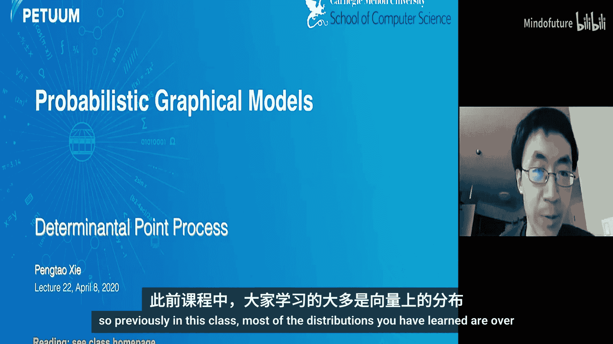
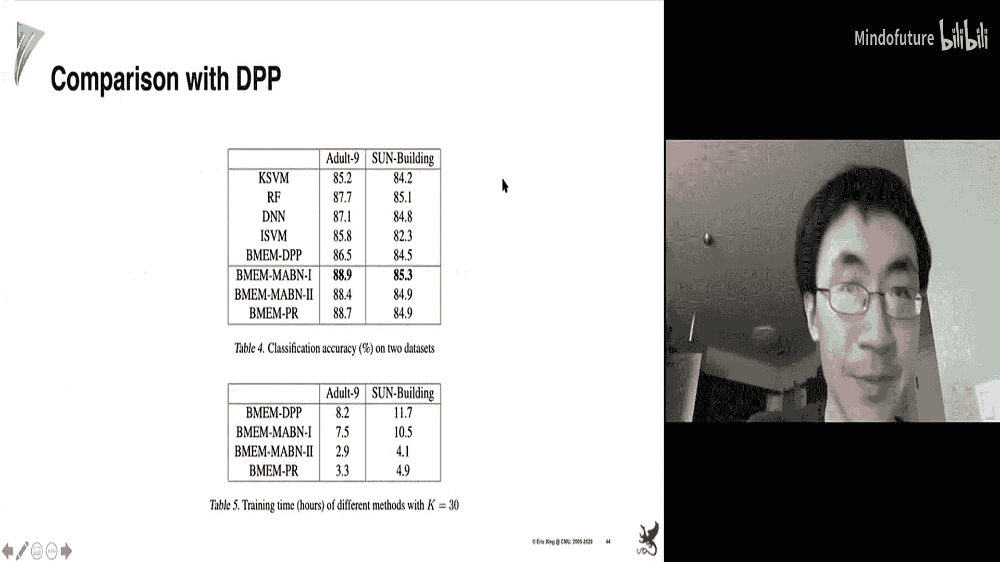

# 【卡耐基梅隆】概率图形模型 ｜ Probabilistic Graphical Models 2020 p22 P22_Lecture_22_行列式点过程 -BV1ebpGzhEA9_p22-

So today we are going to discuss the topic of modeling distributions。

Or designing graphic models on data in the form of sets， how to select multiple subsets。

 combinations of subsets of objects or entities， you know for predictions of recommendations。

Today I'm very happy to have one more guest lecturer， Dr。 Peng Taoxxie。

 who was a former student in my group。And he graduated last year。

 and then he's now a assistant professoror of computer science in University of California at San Diego。

So he graciously agreed to help delivery this lecture because he has been working on this topic for a long time and also had a lot of very successful applications。

 especially in healthcare domain， where you need to recommend。

Or report sets of findings or sets of treatment recommendations and so forth。So again， as usual。

 you know， you are supposed to expect to unmute yourself while listening。

 but you're welcome to post questions by raising your hands。

And either the Ts will be chatting with you or Pengtao himself will be taking your question directly and answer your questions online。

Otherwise， when you are listening， please do unmute yourself to avoid the interference of the noise。

 So with that， I want to hand it to。Professor Xie， who is going to kickstar his lecture。 Thank you，嗯。

Okay。呃，Hello， can you hear me。Yes， I can hear you。 Thank you。 Thanks， Eric， for the introduction。

 Hello， everyone， I'm very happy to give this guest lecture。😊，So previously in this class。

 most of the distributions you have learned about are over vectors in last lecture you learned a distribution over functions。

 which is a Gaussian process in this one we are going to talk about the distributions over a new type of objects。

 objects， which is sets。

In particular， we are going to discuss the deteral point process。

 which is a distribution over the sets。So in this lecture。

 we are going to cover the topic of subset selection and in particular for a determinal point process。

 we are going to talk about the basics of this distribution。

 how to draw samples from this distribution， how to find the mode of this distribution。

 and how to learn the weight parameters。Then we are going to extend to a conditional determinal point process and key DPP。

So one nice thing about DPP is that it has an inductive virus over diversity。

 So we are going to briefly introduce the diversity， promoting learning as well。O， let's get started。

Subset selection。 it is a problem that widely exists in machine learning applications。

The setting is given a set of key items。 We want to select a subset from them。

There are many applications。That are under this umbrella of subset selection， for instance。

 in the extractive document sumization。The goal is given a document containing key sentences。

 We want to select a subset of the sentences to summarize this document。And in feature selection。

 given a set of features， we want to select a subset of features to either speed up the computation or making the analysis of the model easier。

And in product recommendation， we are given a set of products。

 and our goal is to select a subset of them to recommend to the users。

When we are doing the subset selection， oftentimes we want to pursue diversity。

 that means we want to we want we prefer the selected items to be mutually dissimilar from each other。

 in other words， diverse。Again， in the aforementioned applications。

 we do have a need to to achieve diversity， For instance， in the extract document summarization。

 we want to select the sentences that are representative about this document and nonreundant right we don't we don't want to select the sentences that are talking about the similar things to summarize the document。

And also in feature selection， we want the selected features to be non redundant， right。

 it makes no sense to select two features that are highly similar to each other。

And for product recommendation， we want to recommend diverse products to user rather than recommend products that are from the same category to users。

So in this lecture we are going to really focus on determinal point process， it serves two purposes。

 one is it nicely defines our distribution over the subsets so we can build poweristic models for subset selection and also this。

DPP naturally favors diversity。So that means it will have larger probability mass over the subsets。

 Where items are more diverse。So DPP， it is a distribution over subsets。

 and it favors diverse subsets。given a set of key items。AI A 1，2 a K。

 where AI is the feature representation of the of the item I， for instance。

 in document summarization， AI could be embedding of the sentence in feature selection AI can be distribution of this feature over the data examples。

And in product recommendation， AI could be some embeddings or extract features of the products。

So how can we define our TPP over the subsets， The procedure is as follows。

 We first calculate are K by K grammar matrix L， where L I G is the inner product between item I and item G。

The inner product as you know， measures the correlation or similarity between two items right。

 so we calculate this similarity between every pair of items in this set and get this K by K matrix。

Then given a subset Y， that is， which is a subset of the catigraphic Y。How can we define this DPP。

 It is given in this equation。The probability over this subset is the ratio between these two quantities。

On the nominator， it's the determinant of a sub matrix of L。The sub matrix in the sub matrix。

 the rows and columns are indexed by the elements in this subset Y。

 I'm going to show you an example later on， and on the denominator。

 it's the determinant of the gram matrix L plus identity matrix。Let's see an example。

So in this full set， we have four items， one， two，3， four， we first calculate the gram matrix。

 which is a four by4 matrix that measures the similarity or inner product between every pair of items。

Now we want to define a distribution， define a probability over the subset Y。

 which contains two element 2 and3。What we do is we pick up the sub matrix of L。

 where the rows and columns are indexed by the elements in this subset。 So it includes L 2，2，2，3，3，2。

 and 3，3。Then we can calculate the determinant right over this sub matrix。

 which is on thenominator and on the denominator， it would be the determinant of the full matrix L plus R identity matrix。

Okay。Yeah， this would be the definition of the determinant point process， very simple and neat。

Now let's see why the determinedal point process has an inductive bias over diversity by diversityvers。

 it means that so the DPP will has will have higher probability mass on a subset where the items are more diverse。

Why DBB has this property， here is an illustration from the geometry perspective。

It turns out that the determinant of this sub matrix is actually the volume of the parallel pipe formed by vectors in the subset indexed by y。

 So suppose in this subset Y， we have two two elements。

And these two vectors are the feature representations of these two element。

Then the determinant of this sub matrix we show here。

Its actually a volume of this parallel pipe formed by these two vectors。

So now we can see that the volume depends on two things。 One is the magnitude of these two vectors。

 right， So if we enlarge this vector， the magnitude of these two vectors， the volume will increase。

The other thing is the more dissimilar the two vectors are the larger the larger the volume is。

 you can see a comparison here， right。In this case。

 the two vectors have the same magnitude in this parallel pipe。

 the two vectors are similar to eachor， they have a larger inner product and a smaller angle。

 and in this case the two vectors are more dissimilar to eachor。

 they have a larger angle and a smaller inner product。As you can see。

 when these two vectorctors are more dissimilar， the volume is larger， right？

And since the probability is proportional to volume， then we can conclude that。

The more dissimilar the vectors the items are， the larger the probability is。

 So D P P has this inductive bias over diverse sub diverse subsets of items。In graphic models。

 one important thing is partition function， right， which which ensures its probability integrates to one and ensure it is a proper probability。

嗯。And in in DPP， the partition function。It's basically this term， right。

 that ensures the integration of thenominator over all the subsets equal to this denominator。She。Um。

In most of the graphic， so if we want to define a graphic model。

 see a conditional random field over the subsets。Oftentimes。

 the difficulty is the partition function is going to be very complicated and difficult to compute。

 one nice thing about D P is the partition function has a closed form expression。

 And the closed form is very， very simple and neat， and you can do efficient computations over it。

In polynomal time， rather than exponential time。嗯。Now。

 let's proof why is determinant of L plus I is the partition function of the DPP distribution。

So by definition， partition function means this partition function equals to the summation over all the subsets。

That ensures this probability integrates to one。So to prove that。This is the petition function。

 Let's first prove theory。 So in this theorem， it says that given any subset a from this universal set calligraphic Y。

If we do a submission over the subset Y， which is a super set of a and a subset of the calligraphic Y。

The term where doing the summation over is the determinant of the sub matrix indexed by the elements in Y。

And this sum equals to the determinant of its matrix L， the full gra matrix plus this matrix I A bar。

The I A bar matrix is defined in the following wave。 First， it is a diagonal matrix。

Where on where on the diagonal， the one， the position of the ones correspond to the elements of the complementary set of a。

And this matrix have zeros elsewhere。 Let's see an example。 So we have a universal set Y。

And say this arbitrary set A is2 and 4。Then the complementary set of a A bar would be one and 3。

 right。And so in this matrix， I a bar。According to the definition。

 one and three on the diagonal will have once and all the other entries are0。Okay。

We prove this theor by in induction induction。 So for the base case。

 let's assume that a is the universal set calligraphic Y。 then the proof is trivial when a is the。

Is universal set right then。Then this why is basically。Universal set as well。

 and we only have one element here， which is the determinant of the full gram matrix。

And when a is universal set， a bar would be empty set and a and I A bar would be are0 matrix。

 So on both sides， we have the determinant of this gram matrix L。 So the so this theorem holds。

Now let's go to the induction step。So in the induction step， the assumption is that。

The theorem holds whenever a bar has card less than K。So based on this inductive assumption。

 we are going to prove the following case。Let's say we have a set a so that the card of the complementary set is K。

 So you can see that in the inductive assumption， we assume that it is less than K。

 Now we want to prove the case that the card of this a bar is K。We have an item I。

 which is an element of the universal set。 and this element I belongs to the complementary set of a。

Now， let's start proof。We first do a blockwise partition over the universal set。

 One partition is this single element。 I， and the other partition would be all the other elements。

And based on this petition， we can write this matrix L plus I A bar into this form。Let's first C L。

 right according to the petition， the first so we have four blocks right on the diagonal block corresponding to I would be would simply be LRI。

And on the rest of the diagonal would be simply L， Y， excluding I。

Then of diagonal the two blocks is simple as well。 so here I bar denotes basically is y minus I all elements in the universal set except I so naturally based on this position we can write L into this form There are four sub matrixrices。

Then let's take a look of this matrix。 I A bar。So according to the definition of I A bar。

 it is a diagon matrix where once in the diagonal positions corresponding to the elements of A bar。

Since I is an element of a bar。 So the crz funding diagonal entry would be one。Right。

 and the of the of theagon entries are all 0。And then for a rest of the diagonal entries。

 according to the definition， all the。All the elements in a bar would be one。 so right and。

I is an element in a bar， but we already put it here。 So the rest of the elements in this set。

 Y minus a minus I would be all be one。 right， This is from the definition of I A bar。

Then it some these two matric together and get get this wall。For the next step。

 we utilize the multi linearity of the determinant to get this equation。

multi linearity of determinant means the following。

 So we have the have a matrix Where the column vectors are R 1， R 2 up to R， I-1。 Then we have a。

A column vector here， which is a linear combination of two vectors。

So we first multiply this vector R， R I with a scar S， then plus 8 plus plus another vector。

 R I prime。Then we have the rest of the column vector， R I plus one up to R N。

So the multi linear team means， if you have a。Mattrix。

 where's the where one of the column vector is a linear combination of two vectors。

 We can write them apart。See for the scr multiply this vector， we can write it into Sr。

 multi multiply the determinant of the matrix formed by formed by this column vector RI。

 then plus the determinant of the matrix formed by another vector I prime you can clearly see that there is a linear structure here right so given this linear combination。

 you can write it down write it， break in it into a linear combination of the determinants。Yeah。

So based on this property， we can write this equation here as a linear combination of two determinant。

So here we will do the。呃， do the呃。Do the breaking over this lecture here。So it is L I I 0 plus10。

 right L I here is so this vector L I plus1 L I I bar can be written as L I， I 0 plus sorry。

 L I I L I， I bar plus 10， right。So this vector here can be written as the summation of these two vectors。

嗯。And for the other low vector here， we keep it。So according to the multi linearity。

 right we can write the determinant of this equation of this matrix as the sum of these two matrices。

Then for the next step， we are going to write each of these two determinants into this two form。Yeah。

So for this one， it is simple， right， You just do it over using the definition of determinant。

 So these two terms cancels， then we get determinant of this matrix。And for for this one。Okay。

So we know that L can， according to the petition y I universal set excluding I。

 we can write this matrix L。In this form， right， getting these block partitions。

And for this matrix here。I A union I bar， according to the definition of I A bar。

 we can write it into this form right for for this element。 I since it is。Part of the this matrix。

 AI。Then it cannot be in this in this set， right， So the corresponding element is 0。

And then for this set。Yhy excluding a， excluding I， since they all belong to this complementary set。

 then there are。 so the corresponding diagnosis would would all be one。

So we can put these two terms together right we exactly get this this matrix。

 so the determinant of this matrix can be written in this fall。Now starting from equation 2。10。

 we are going to utilize inductive hypothesis and get the following equations。

Let's recall the inductive hypothesis is that。So if。If a bar has cardity less than k。

 then this then this equation holds right。Now， let's check。The cardity of this。Of this。

A union I said。So the cardity of a bar， according to the inductionductive according to the induction assumption。

 it is K， right， then the cardity of a would be a capital K minus small K where capital K is the size is a cardity of the universal set。

Then we add one more element element I into this set。 recall that this element I。

Does not belong to a because I belongs to a bar。 Then the connectivity of this set would be capital K minus4 K plus 1。

Then the contiity of the complementary set is k-1， right。Then according to the inductive hypothesis。

 this set satisfy this condition has cardity less than k， so we can apply this equation here。

And then this term can be written as this term right you just replace a with a union I and then directly get this get this new quantity according to this equation。

And similarly for for this one。It naturally right， if you compare this this equation and this equation here。

 you can easily get a form like this。Now we have two cases that the subset Y either contains I or do not contain I。

 we can combine them together and get this quantity。Then may basically prove this induction a step。

 right？And the induction proof procedure completes。Now， given this proved serum 2。1， we can。

We can easily show that this partition function holds。

 right we can simply let this set a to be an empty set then we get this equation here。Yeah。Okay。

 alright。 So this is the proof of the partition function。

Now let's see up few extensions of the determinal point process。

 The first extension is to kernelize DPP in the original definition， we have this gram matrix。

 where elements and inner product。 when you see inner product。 naturally。

 you can connected to kernel。 kernel is basically We first transform these two vectors through some nonlinear transformation and get get two representations in the nonlinear space。

 Let me take the inner product in that nonlinear space。

And this inner product can be implicitly calculated by a kernel。

 so we replace this inner product in the gram matrix with a kernel function and get a kernelized DPP The definition is the same except that the gram matrix now is calculated as a kernel matrix instead of the original inner products。

Yeah。And we can also combine D P with deep learning。 It's also very simple to do。

 We just given these two vectors。 We just use a deep neural network to transform to embed them into a nonlinear space in then take the linear product over the neural network late space。

This is a special type of kernel， which is called deep kernel。

 And but now the difference is you have and this kernel is parameterized by the weight vector the weight vectors in the neural networks so you can do the learning of these neural networkcular weights。

And for the definition， it remains the same except that in the gram matrix。

 the inner products is calculated over the latent embeddings achieved by obtained by deep neural networks。

嗯。For the next step， let's talk about algorithmsome how to on how to draw samples from DPP DPP is a distribution right we should be able to draw samples which are subsets from this distribution the sampling procedure is as follows so given this matrix L which either can be a gram matrix or kernel matrix or deep kernel matrix we first do our een decomposition of this matrix and we get the eigenvalues and eenvectors。

So the sample sampling procedure has two parts。 in the first part， we first sample a subset of items。

And put them into this strategy。 So initially， it is empty then for each of the。Its in the set。

 Now we have a new notation N capital N， which denotes the card of the universal set。

 the number of other items。And for each item， we sample it with probability lambda n over lambda n plus one。

 where lambda n is the een value of the corresponding to the ns item。

 right uniformly draw a draw draw uniform random number and compare with this probability。

 And if it is larger than the probability smaller than this probability。

 we put this element into this strategy。And do this for other items。 And in the end。

 we get a subset of items， right， according to this probability。And this subset of items。嗯。Okay。

 now we get a subset。The next thing we do is we take the a vectors corresponding to the subsets。

 So for each element in this subset， we take the corresponding a vectorctor and put them into。

Put them into another set way， which contains a subset of avectors。呃Then in the next step。

We are going to。In the next part of the sampling algorithm。

 we are going to sample another set of items。The procedure is as follows。Wells the caity of this。

Of this set wave is greater than zero from this universal set。

 we select our item I according with this probability。So E I is basically。

autoonmal basis where ice element is one and all other elements are0。

We take the E I the takes the inner product between E I with with every a vector in wei。

And squares inner products， sum of them together and normalize with the cardity of weight。

Essentially， this is calculating。 let's first see this matrix way。 So here。

This matrix way contains all the a vectors that are indexed by these sets。

 So the number of column vectors is。cardinity of this set J。Give me a second。

 I thought there might be a question。Okay。Oh， there was a question。

 why eigenvalue are always not negative for any kernel。 Is this true。

So for remember that the this matrix L is gram matrix or kernel matrix。 So it is。It is。

Always semi semi positive positive semi deffinite， right。

 So that means the eenvalue will always be non0。And it is almost sure that this matrix is positive definite unless the items are linear correlated。

 And here for simplicity with we basically assume that these vectors are not linearly linearly correlated。

 And then the this matrix L would be。Positive definite。

 And all the eenvalues would be strictly positive。嗯。O， all right。Let's， let's see this matrix way。

 right， The number of three vectors column vectors is the card of G。

 and the dimension of each vector would be the number of elements。 Sorry。

 I should put an N here instead of K。So this equation here is basically calculates the squared atonome of a row vector corresponding to the element I。

And according to the property of a vectors， is column， the norm of each column vector is one。

 we have。So if you sum， if you sum all of them together， we the sum would be card of way。

 So that's why this probability is is a probability， right， it sums over to one。Okay， alright。 So we。

 according to this probability， we select an item I and put it into this set B set Y。

And after we select our item。We will do an operation to transform this e evectors matrix。

 We are going to find out the subspace of a， where the subspace is ortho to EI。

And after we get this subspace， we are going we are going to find out the autonal basis of this subspace and this autonal basis would be this matrix here。

 then we replace the matrix v with this new matrix。Zhuang was asking answering request。 yeah， I。

 I think， yeah， he the student acknowledged。 Yeah。 Yeah， okay， alright。

Then we repeat this procedure until there is no no elements in in wei。 and in the end。

 we select a subset of items。嗯。What is E， I， E， I is， So basically， say， let's say I is 3。

 Then E I would be a vector on the third position。 The element is one and in other positions。

 the element is a 0。嗯。Okay， and so if you want to check why this sampling algorithm ensure that the sample strong。

 according to this algorithm algorithms are from DPP。 So in the end of this lecture。

 there is a reference slide， and you can take a look due to the constraint of time。

 we are not going to prove this in the class。But intuitively。

 why this sampling method ensures diversity， the major intuition comes from this part。

So whenever we sample an item we are going to do to do to find out a subspace that is orthogonal to the sampled item orthogonal right induces very large diversity so basically make sure that the inner product of the rest of the items is different from the already sampled one that's where the diversity comes from。

Yeah。Now， given a distribution。In in addition to drawn samples from this distribution。

 Another thing we want to do is to find out the mode of this distribution。For instance。

 suppose we define in the extract summarization task。

 Suppose we define our probability over the sentences。

 We want to see which subset of sentences gives the largest probability。

 And we are going to use that that subset as summarization， right。So to achieve that goal。

 we need to find out the mode of the DPP。 a mode of a distribution is basically the。

Confiration is basically the the the subset that yields the largest DPP probability。

Here we don't need to care about the denominator and only care about thenominator and typically for the ease of computation。

 we put a log over the determinant of this sub matrix。

Andlog does not change the monoity of the distribution of the quantities。

So finding the mode essentially is to find out a subset of why that yields the largest。呃。

Coantity the log of the determinant of the sub matrix index by y。

F of the exact solution is NP hard right if you think about there how many choices we have for y。

 it is exponential right it's true to the power of the card of y。

So people have developed approximate algorithms to find out the mode here we introduce one particular method which is relatively easy to implement。

The idea is simple。 We first do a continuous relaxation of the item selection variables。

So in the hard selection， it's either one or0， right。

 One means item is selected and zero means it's not selected。So in the continuous relaxation。

 we relax this0，1 selection into basically a probability between 0 and1。

And the larger this probability is。嗯。It means that the more likely that this item is going to be selected。

After we do the continuous selection， we can。Do continuous relaxation of the item selection variables。

 We can do a continuous relaxation of this objective。 We want to maximize。

 and relaxation is given in this equation here。Here y is a vector。

 The length of y is the number of elements in the universal set。And for a particular element in Y。

 say Y I， it is a probability indicates how likely this item I is going to be selected。

 So y is a continuous vector。 and each element is in this interval 0 to 1。

So here this is the diagonal matrix， where elements on the diagonal are elements in Y L is this gram or kernel matrix。

 and I is identity matrix。This is the log of the determinant of this matrix。

 This is a continuous continuous function defined with respect to why right we can do the whatever method we want to use to do the optimization and find out the。

Y star that maximizes this function， FY。After we get y star。

 we can do a rounding over the elements in y star and get them back to 0 and1。

 See if an element in y is less than 05， we round it to 0， otherwise it it is round it to one。

After you get this rounded0 and one variables， we basically do a selection according to this these variables。

 right， If the variable is one， we select the corresponding item and do not select otherwise。

So we talk about how to draw samples and how to find out smooth。 assume that we are given a DPP。

Then the next question is in D PP， we have the weight parameters， right。

 How can we learn these weight parameters。For instance。

 if the DPP the L matrix is calculated using a kernel in the kernel。

 we have the hyperpar of the kernel right like in the RBF kernel。

 we have the scaling scaling factor in and in in metric Mahananobis matrix based kernel。

 we have this Mahananobis matrix those as parameters we want to learn。

And in the deep in the in the case of deep DPP， remember that the kernel is calculated using neural networks。

 right， in the neural neural networks， we have weights。 Those things are learnable。

How can we learn these weight parameters so we assume that to learn these parameters。

 we assume that the data we are given are universal set together with ground tools selected subsets。

For instance， in the training data of extractive sumization， we have for for each document。

 we have the all the sentences which are observed。And we also have the ground truth summarization。

 which is a subset of sentences that are labeled by the human annotators。呃。

Then given the universal set and the subset， right。

 we can define the probability over the subset using the DPP distribution。

 so we have N training examples， say n documents for each document。

 we have the all sentences in that document and the ground choose selected ones then we can plug in the feature vectors of the selected ones into the DPP distribution and get these DPP probability。

Then we right。 So here we definey a maximum log likelihood objective function。

 multiply out probability over different training examples together， Take a look。

 Then we get this objective function。Then we can do the gradient descent or other method to optimize this function with respect to the hyper parameters or weight parameters in the kernel or in the neural network。

So far， we talked about。DPP， which is given a universal set， we select a subset。

And the selection totally totally depends on the relationship between items in this universal set。

Specifically， we want to select diverse items。But in many other applications。

 the selection of subset not only depends on the relationships between the items in the universal set。

 but also depends on the relationship between items with some external information。For instance。

 in personalized product recommendation， we have a user and we have some information about this user。

And a set of products。When we are doing the selection of the products。

 we not only want to select diverse products， but also the products that are highly relevant to the interest of the user。

 right。For each product， we can measure its correlation or relevance to the information of this user and take that into account when we are doing the selection。

Okay。嗯。And if and in this scenario， if if we want to define a DP。

 that that would be called conditional DPP conditional conditional on the external information such as the profile of the user。

And how do we do that， it's simple。When we are calculating the kernel matrix。

 we basically calculate a conditional kernel instead of just a regular kernel。

 The conditional kernel means when we are calculating the similarity between two items。

 we not only considers similarity between those these two items。

 but also their relationship or relevance to this variable that is conditionalal。For example。

 in this product recommendation application， X would be a user， and we have two products， AI and AJ。

On the information of these two products， we can calculate a similarity score， and meanwhile。

 we can calculate the similarity between the information of a product and the profile information of the user and multiply them together。

Hereitatives are an example of this conditional kernel。

 so S is a kernel function that measures the similarity of two products。

And G is another function that measures the similarity between a product and and the user。

 and we multiply them together。 And it is easy to say that this is a value kernel， as well。

After we get this conditional kernel， we apply it to every pair of products and get this conditional kernel matrix。

And then we based on this conditional kernel matrix。And we can define this conditional D PP。

 The probability over subset condition on the external information X。

And here just a note that when you， when we are calculating the kernel matrix。

 always take this external information X into account through this conditional kernel。一。

So here we have a case study， which we utilize the deep determinant point process for multila classification。

嗯。And the DPP here is our commissional DPP multileual classification is a problem that we are given an input。

 for instance， image。😊，And we have a set of candidate labels。 For instance。

 the 1000 label class labels in imagenet。And in multi label classification。

 we want to select a subset of labels and annotate this image using this subset。 for example。

 given a picture that that is taken inside the house， we would have so far I have desks have lamps。

And in this image， because there are many different objects。

 so we are going to assign a subset of labels to this image。

 and this is called multi label classification。How can we use conditional DPP to build a distribution over the label subset。

As we just discussed， we should first define our deep conditional kernel。😊。

The kernel is defined in the following wave， let's see we are given two two labels。

 sky and ocean and are imagemates X， we can get some word embeddings of these two labels and use this network to get an embedding of these image。

Then we use another network， which takes the embedding of the label and the embedding of the image as input and calculate a score that measures the similarity or relevance between this label and this image。

Similarly， we do it for another label and the image。Then between these two labels。

 we want to calculate how correlated or similar they are。

 which is done by feeding their representations into another neural neural network and get a kernel function。

Then we multiply these three scores together and get this conditional kernel then。因为诶。

Based on this conditional kernel， we apply it to every pair of labels and get this conditional kernel matrix。

And then we define a distribution over a subset of levels S conditioned on the image X。

So this is the conditional DPP defined over level subset。And in the conditional kernel。

 we have these weight parameters of the neural networks。 We want to learn them。

So in the training data， we have the ground truth training pairs where X is are image S is a subset of labels that are annotated to this image。

And S and X are both observed。呃，人。They can。Put in put S and X into this probability， right。

 and multiplies probability all of all training examples together and do the maximum likelihood estimation to to learn with parameters。

Here I want to talk about something that exploits the property of DPP for incorporating external prior knowledge。

So when we are doing the label assignment， we oftentimes we have some prior knowledge regarding certain labels should be are very likely to be assigned to an image simultaneously。

 for instance， sky and cloud are very likely to be to be simultaneously assigned to an image， right。

And。And those binary relations are called must links。

 which means that if there is a must link between label I and label J。

 then it is likely that I and G are going to be simultaneously assigned to this image。

On the other hand， we have this cannot links。 let's say maybe a cloud and and a do is is not likely to be simultaneously assigned to image。

 Then according to this prior knowledge， we put a cannot link between them and in the model。

 we want to。If two labels have a mask link， we want to encourage them to be simultaneously assigned to the image。

 if they have a cannot link， we want to discourage them to be simultaneously assigned to the image。

And under the conditional D model， how can we manipulate the this DPP to to achieve this goal。

 basically how to incorporate this can and mass links into the model。Here is。

Let's get back to the geometry perspective。Remember that the DPP is proportional to the determinant of the sub sub matrix indexed by the elements in the subset。

And this determinant of this sum matrix is basically the volume of the parallel pipe of the。

Of the parallel pipe formed by the vectors in this subset。And also note that for two items。

 if they are similar to each other means which means that the inner product between them is utter。

Then the volume is going to decrease， and the DPP probability is going to decrease。On the other hand。

 if the two items are more different from each other means it means that they have a smaller inner product。

Then the volume of the parallel packet is going to increase。

 and the probability is to going to increase。This is a geometric。Property of DPP。

So this basically give us room regarding how to incorporate this cannot and master links。

 So if we want to。Discourage the co selection of two items。 C label I and energy。

We basically want to decrease this probability。Because the selection is carried by the probability。

 the larger。The probabil is， the more likely that the labels are going to be selected。

So if we want to discourageage selection， we want to reduce this probability and how to reduce that we make the similarity of these two items。

 two labels to be larger。And on the other hand， if we want to encourage the code selection of two labels。

 we basically want to encourage their probability to increase。And to achieve that。

 it makes these two vectors dissimilar。And based on this intuition。

 we can add the regularization terms over the original objective to incorporate knowledge。

To summarize if for two labels， if they have a cannot link。We increase their kernel value。

 their similarity。Yeah。To decrease the probability。 And on the other hand， if they have a mass link。

 we make them more dissimilar to encourage code selection。There was a question。

Aes in the volume of the parallel packet。 Oh， so。So in this case we have three levels each have a vector and the volume is determined by determined determined by all three vectors here for illustration I just fix one of the vector and considers the relationship between the other two vectors to illustrate the concept how DP encourage diversity。

 but the volume is determined by all the vectors here here I'm just doing a controlled illustration。

嗯。嗯，OK， this is conditional DPP。So far， recall that we have the distribution over subsets and the subsets can be any subset。

It can， It can has one element or1 element。 that doesn't matter。 but in many applications。

 we do want to fix the size of the subset。Like in documents like in feature selection， right。

 we we have a certain budget and we only want to select temperatures。Or in document summarization。

 we only want to select five sentences。So how can we define distribution over the subsets where the cardity is fixed to a particular number K。

And this is achieved by KDPP。 The difference between KD KDPP and the Manina DPP is that。

Here we basically fix the card over the subsets。And the distribution is very easy。

 but we just pick up all the subsets， which helps card of K and calculate this quantity determinant of these sub matrix for all these subsets。

And the normalizer now would be the sum over all these determinants， right， This is a very。

 very trivial definition of of KDPP。But in practice。

 we cannot use this definition to do the calculation because here we still have a huge amount of a huge number of subsets that all have cardity of K right if you calculate this condition function using this fruitte force manner that would be。

Hugely expensive。So in the actual operation， we we do not use this probability definition。

 but use some other methods。Now let's discuss one particular thing about KDPP。

 How can we draw samples from KDPP？The sampling procedure is similar to。

To the one designed for the regular D PP。Yeah。So we first do een decomposition of the kernel matrix or gram matrix and get all eigenvectors and eigenvalues。

U。Then after we get the egg values， we calculate a quantity given in this equation。

The quantity is defined in the following way。 We take all the subsets。Where card is K。And for。

 for each subset， we multily all the element， multiply the eigenvalues indexed by all the elements in this subset。

And with these product of eigenvalues over over all these subsets and get this definitionation of EK over all the eigenvalues。

And this quantity is going to be utilized during the sampling。

The sampling procedure is there are two parts in the first part we select a subset according to this selection rule。

So if's the uniform so for item N， we calculate this quantity here using this definition and aenvalue。

Then we draw a uniform scalr and if the uniform value is less than this quantity。

 then we select this element into this J and repeat this procedure and we get a subset of items then we move to the second part。

 which is is exactly the same as the。As a sampling method for for the regular DP。

The only difference is how do you select the first subset。And for the proof of this7 algorithm。

 you can refer to the tutorial given by Ben Tusker， which I put it as a reference。Yes。Let's say。

 we have。We have about 10 minutes。O。Yeah。So for this D P P。

 we are talking still talking about discrete the distributions over the discreteet sets， right。

 given given N items， we take a subset which has key items。

 then define a probability over the key items， which is discrete。In other applications。

 the items are actually continuous。For instance， let's say we have a topic model。

 say latent de allocation。For each topic， we have a topic vector， right。

 which is a continuous vector。And in the model， we set K of。Key topics。 So we have key vectors。

But each of these vectors have infinitely many different configurations。

So essentially this is still a keyDPP problem because Euclide from the universal space of the Euclidean space。

 we want to select key vectors to parameterize the key topics。The difference is for each vector。

 you have infinitely many different choices that are continuous。So that comes to the continuous DP。

 which defines a distribution over key vectors， and each of these vector has infinitely many continuous choices。

And how this distribution is defined， very similar to the discretequiet case。

Let's say we have a key vectors。 We still calculate the。

Gram matrix or kernel matrix between key vector that give us this L A matrix。

 We calculates the determinant。Then on on the denominator， we have this quantity here。

 EK is what we just defined in this equation and lambda1 from lambda1 to infinitefinity are the eigenvalues of the of the operators and in the space of continuous space。

 the eigenvector eigenvalues are an infinite and they are calculated over over something called an operator。

Yeah。So this is the distribution over the continuous DP and all you need to remember is that you have key continuous vectors in this matrix a。

And this is the probability over the key continuous vector。For this partition function in theory。

 it exists， so that ensures this probability still is valid。

 but you cannot calculate this quantity here explicitly。And based on this definition。

 we can still draw samples without utilizing this quantity。嗯。

And one major application is we want to encourage the key vectors to be diverse。For instance。

 in topic models， we want to learn diverse topics instead of redundant topics， right。

 and to achieve that， we basically want to put this prior over the key topic vectors to encourage them to be diverse。

I'm going to。Skip these things and talk about how DPP KBPP is utilized to promote diversity in the continuous case。

In the frequent learning paradigm， we can use DP continuous KDPP as a regularizer to encourage the topic vectors to be diverse in the LDA model。

 we have key vectors。 you just put this you calculate the gra matrix or kernel matrix between the key vectors。

 then put the determinant of this matrix as a regularization term over the LD objective function optimize them jointly to encourage diversity and in the baian learning paradigm。

 If you see I want to learn a distribution over the key topic vectors， In that case。

 we you want to put a prior that encourages diversity over this key vectors again。

 you can use the continuous DPP as a prior to。四？To， to encourage diversity。Okay。Yeah。对。

In the next five minutes， I'm going to very briefly talk about some some works that are relevant to T PP and how to address the limitations of T PP。

So if we want to use the continuous KDPP as a prior to encourage diversity in living space models。

 what would be the drawback the first the first the first thing is it's not amenable for variational inference variational inference as you learn is a major type of posterior inference method typically it is more efficient in terms of computation than the MCMC sampling let's say if you。

Use this， use this DPP prior to encourage diversity。

 You can see that there is a determinant over the matrix。

And when you are calculating the expectations in original inference with respect to this determinant。

 that would be really hard。 So DPP is not easy for version inference。

 but you can certainly do MCMC samplingling， the drawback case is going to be slower。

Another thing is it cannot be applied to the Beijing non parametric models。

So in non parametric models， I believe you are going to learn in in the next week。

 we have infinitely many weight vectors， like in topic models。

 we have infinitely many different topic vectors。And we still want to encourage these vectors to be diverse。

But we cannot use DPP to do that because here it is assumed that the cardity of this matrix is finite。

 you cannot calculate a matrix over infinitely many vector right otherwise this matrix would be infinite and how can we take determinant over an infinite matrix。

So this would be some drawbacks of K TP P。Yeah， I so several years ago。

 we did some work to address this two problem and define a mutual angular process that can。

Address these two drawbacks。 The proposed mut anglengular process is amenable for original inference and can be easily extended to the vision non Parametrics par If you are interested。

 I put a reference there and you can take a look。I guess that's it。 So in the next two minutes。

 do you have any questions you can we can we can discuss。Thanks。

