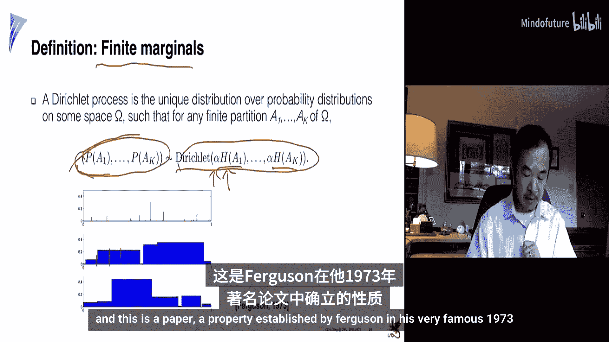
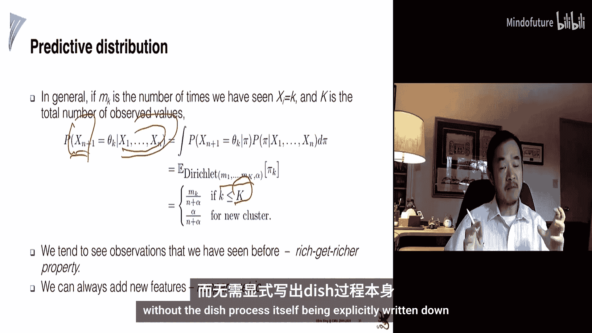
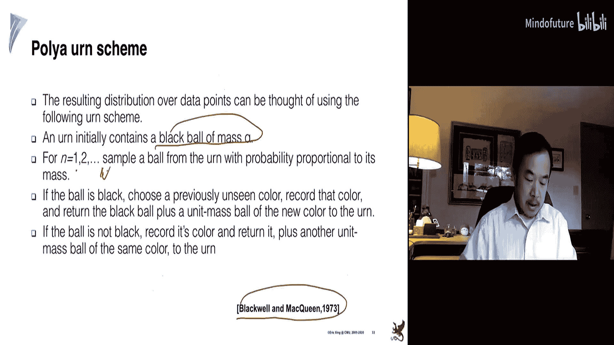
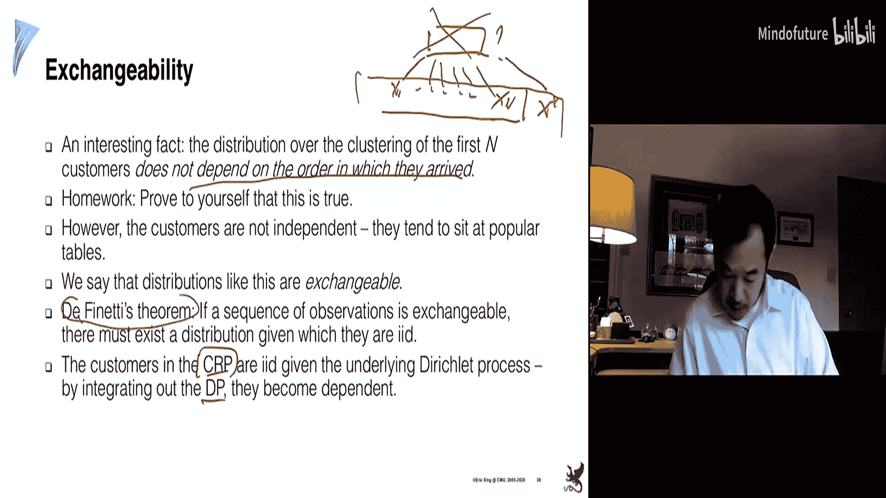
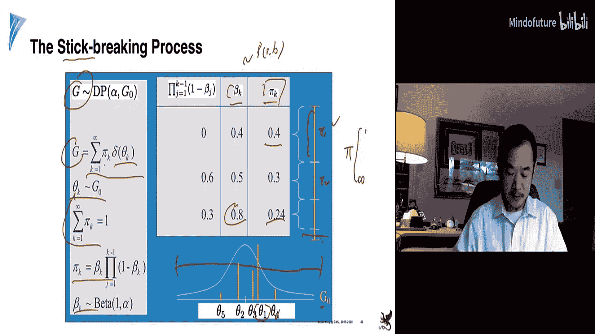
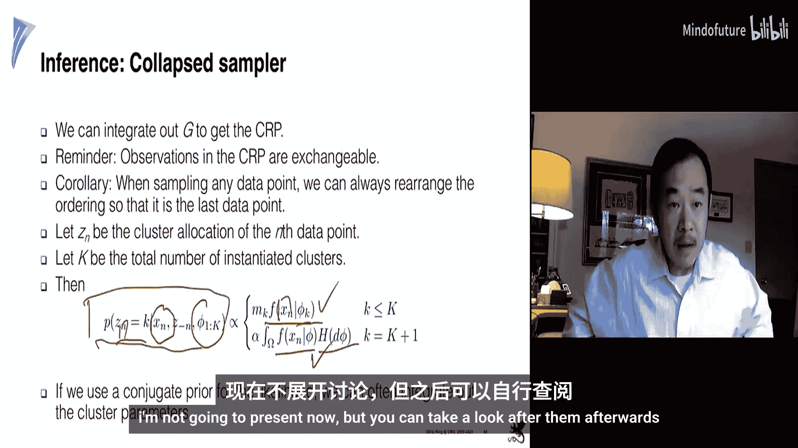
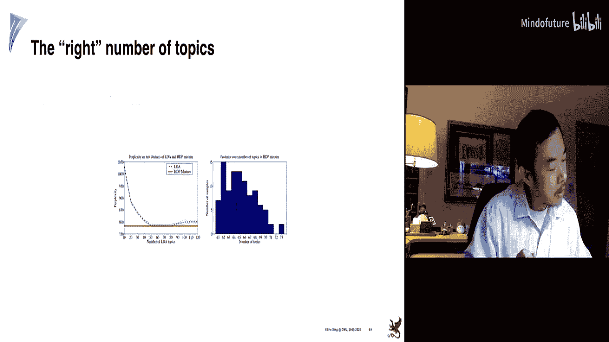
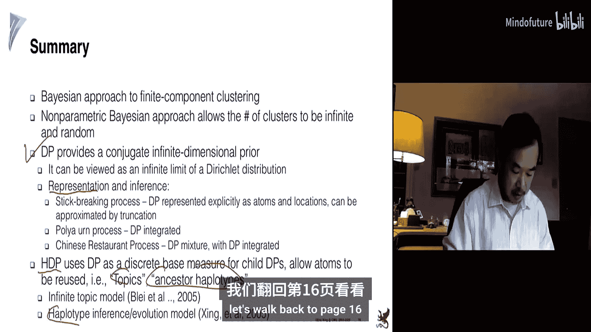
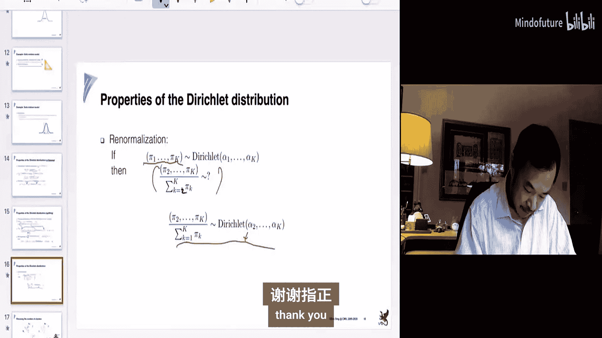
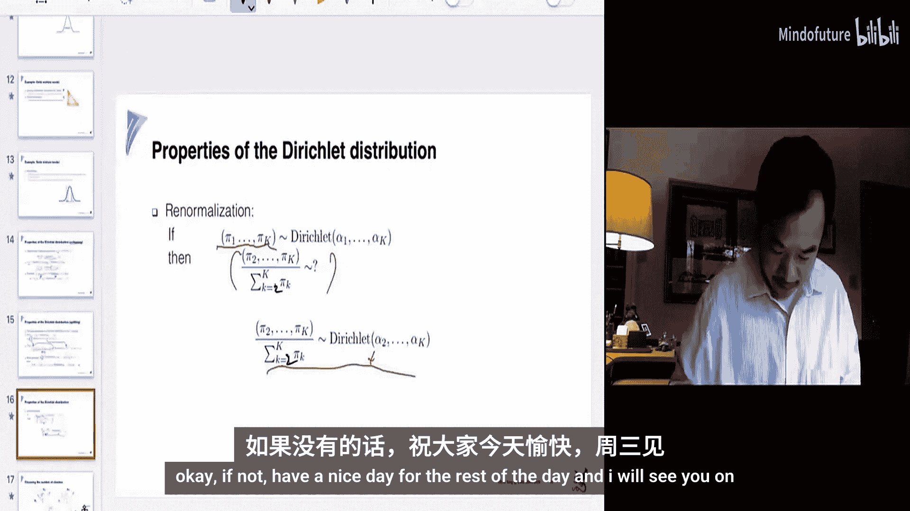

# 【卡耐基梅隆】概率图形模型 ｜ Probabilistic Graphical Models 2020 p23 P23_Lecture_23_狄利克雷过程 -BV1ebpGzhEA9_p23-

Okay， good morning， everyone。 So how are you guys doing， Still staying safe and and happy。

So I hope we are getting more use to this remote teaching mode and feeling comfortable at it。

So today we are going to continue to cover complex distributions， if you recall last two lectures。

 we covered the distribution over functions。Which is a gausing process。

And then we discussed a distribution over sets， which is the determinal point process。

And today and the next， we are going to discuss distributions。Over over distributions， in fact。

 and also distributions over distributions of features。 Okay。

 so these are very useful tools to further enhance the graphic model to do really fancy stuff。

 and sometimes in a very， very flexible computationally and also modeling wise fashion。

 and also these tools are really composable and inteable with existing methods such as deep neural networks and other tools。

 So you building them as a building block for the larger task。Alright， so。

Let's begin by a classical problem。To motivate this new technique。

So we all know the problem of cluster， so here I show you the data points spread in two dimensional space and wanted to cluster it。

All right， so what are the。You know， usual algorithms you will be using。

OrYou can type or you can shout out。Okay， without seeing it， I will just name it to you。

 I guess you will be thinking about a K means method maybe and maybe a mixture model mixture of Gausing with em right。

 things like that。And I remember， you know， whenever we give a lecture along these topics。

 people will ask how to set the K， you know， how many clusters you know to do， right？

So here it is very obvious because the data points are on you know two dimension data。

 you can kind of take a look。And then youll pick you know， three， something like that， yeah。

But what if the data are just too high dimensional you don't see it， right。

 So then how do we guess the right number of clusters。 That's actually a very interesting topic。

And also， what if for the data is a streaming data that is， you know， coming。

 keep coming and changing and both in。Voling and also you know in you know in distribution。

 for example here， you probably can see that the cluster numbers are changing from a three in here and maybe I don't know four to here and so forth。

 so how to let the number of cluster to be flexible so this is the typical question that has been bothered the machine learners modelers for a long time there are a number of heuristics right so one of the heuristic is what。

Someone want to shout out there is a heuristic for you to figure out maybe the best number of clusters。

You want to type or you want to shout out？ok 诶嗯。Pot K over a square distance。 B IC。 Yeah these are。

 yeah， these are nice ideas。 In a sense， you know， you either use a penalty function to let the model pay a cost of the complexity you know of the model with the increasing number of clusters versus the fitness or you kind of implicitly already what the K of school distances is a little weak。

 It's about it's on testing or training， right， That's another question。

 I guess one thing you can think about is cross validation。 You just you know， basically， yeah。

 try different case。And yeah you can in fact it's very similar to cross validation。

 you know plot basically， you know that kind of quality measure like a square distances。

 and then maybe you pick a k which gives you the best answer， something like that good， but again。

 you need to try many cases and you may try from one to infinity and and then you know you get one of。

 which is very expensive。So that's the problem that is motivating us to study the topic today， right？

So here I have a cluster of data。And how to model well。

 let's say we use our old friend mixture of Gausing and here is how do you catch write down the likelihood function of the mixture of Gausing。

 by the way here it should be n rather than infinity we have end points。

 you pick a capital K and then you write down a mixture of you know Gaussing components。

And it's a parametric model， basically assuming a finite number of parameters。

Right and you can also apply a Beijing approach。To define the prior distributions of the parameters like this。

 which is the weight of every cluster。And also like this and that。

 which are the centroids and the covariance of every dozen components。

RightAnd then you defined prior for each of that that gives you a parametric finite mixture model。

 Beijing mixture model and typically you know to make the computation more easy and in closed form。

 you can use concate priors and here you know you know in fact the graphic model make it very explicit。

 you know all these parameters pi the theta is basically a tuple of mu and sigma you know over k such you know tus。

And then you define here， you know， say， a durationlet prior， you know over the weights。

And here you use the aussian and inverse weightar to define the priors for both the Ming and also the covariance matrix。

And you know what is what does the conjugate prior mean and we're going to see the effect of numbers。

So I already said this prior it's better to be， you know a。

Diion process let's see why that's the case so this is how a durational distribution look like right it is parameterized by a k dimensional vector called an alpha one to k and there are some constraints on you know how the alpha should look like they should each be non negative right and they should have at least one90 component so that the sum will be bigger than zero and then here is basic expression of that distribution okay。

Which takes a form of exponential and the weight raised to the power defined by the alphas minus1。

And then， you know， you can somehow a vector from the distribution。

And these vectors have a nice property， which is that they each is a positive number。

And they all sum to one， therefore we call them to be living in a space called simplex。

 and this is actually how a three dimensional a two dimensional simplex look like okay with a different you know values of the alpha alpha are known as the hyperparmeters and also the expectation of those random vectors。

 you know are actually equivalent to， you know a number defined by the hyperparmeters alpha and see it's the the mean vector。

 the normalized vector of alpha So that's a very， very kind of explicit and simple expression of delet。

And the alpha actually has some interesting effect， as you will see in a second。

 you can already see with different values of alpha。You know you can see the the color。

 you know the heat map is changing， you know， from here to here。

 the heatm here is more kind of a uniform and the heat map in here are becoming more and more divergent Okay。

 where the mass basically I concentrated more more on corners。All right。And Dli defines a con prior。

 as I just claimed， and what does it mean？It means that once you observe the data， Id data。

Sampled from the parameters theta， which are sampled also from the duration prior。

 then you can define a posterior of the pi， which is， again。

 pi is the parameter used to parameterize the multinomal distribution now your posterior becomes look like this。

 can this part is you know the prior， which is the duration and this is the likelihood okay you know of in fact the orders like this part correspond to this and this part correspond to that you can see the likelihood you know look very similar。

 you know under multinmal look very similar to what the prior look like。

 especially on the way how you know the high parameters you know are are impacted and with some arrangements。

 you can actually write it more clean。Which is that now in the posterior。

 the pi is now raised to the power of alpha plus the number of counts belonging to the K cluster。

And minus1， in fact， the minus1 is originally in the duration prior。And therefore， this whole thing。

Is still a delet with a augmented parameter， you know the augments are contributed from the counts of the real data sample from this multiple distribution。

And that's why the posterior and the prioror are symbolically the same。

 they both you take the same parametric form， that's why it is called conjugate。听。诶。

So what's the actual kind of effect of having a di it right？

You can see that now digitallet defines a distribution of the theta。

 which are the weights you used for a mixture model。So the mixture model itself is a distribution。

And your delet is define a distribution over the theta。

 therefore it is a distribution over the distributions。

RightWhen you sample a weight vector from the dechlet？

You can use each of this weight factor to define a Gausic mixture model by accordingly draw samples of the mu and the sigma。

 you know， for each of the pi vector or the multi vector。

And then the distribution distribution is going to help you define you know another layer of distribution over all these mixtures okay。

 so therefore you have a distribution of the mixture model。

And this is basically our beginning concept of a distribution of distributions。

And let's say how this really look like。Let's assume that discussing Gausing mixtures are following a trigger covarience matrix identity just for the sake of a simple argument。

 but the min still is a random variable， then you can draw the min you know from you know thisag Gaussing distribution。

Right。And then you can draw the weights， so here we have the means and here we have the weights coming from aishlet。

And then the D prior basically allows you to， as I said。

 define a probability distribution over kilometers。Right and how they look like， it's like。

You are providing this random weight vector。Okay， and then you can have multiple different samples of this random vector。

And then each of them can correspond to a location。Inside， you know， this Gausing distribution。

 where the meal are draw from。 Okay， And in a second， I will tell you。

 sometimes the statistics are called the items and also， you know， the positions。Okay， so this is。

The weight of an atom and here almost you can see it's a position under you know you know a Gaussian distribution and the actual position is determined by you know the value you draw from the Gausian distribution and they together the position and atom defines you know a mixture model and the de prior defines the distribution over that。

Okay。So now like let's see a how look like。In fact。

 before I move on to extrapolate and extend the de distribution into a more flexible number match basin setting。

 let's see some nice properties of the de distribution， Okay， just very quickly go through that。

One property is called a collapsing property。It means that， you know， if。In fact。

 the mass goes like if you have a random value coming from Gmma。

Then you can basically you prove that a vector of such gamma distributed random variables actually follows a division distribution whose parameters are defined by the numbers。

Which were used to define every one dimension nogamma distribution。

And if you have two gammas gamma variables， then there are some actually also is a gamma distribution。

Follows e economicomic condition whose parameters are determined by the sum of the hyperprometers。

Okay， off the original distribution。so this is just edge break properties I can easily prove。

And the same spirit carries to the delet if you have a K dimensional delet vector。

Following a distribution， parameterized by the K dimensional alpha vector。

Then you can collapse you know this a K dimensional de vector or random variable into a k minus one dimensional by just maybe combining the first two dimensional together。

And they actually also follow a delet。Of which， you know。

 the first two hyperparmeters can be also collapsed to define now the。

First dimension of the new deer sheet So so it's it's called the collapsing property because you can see the easy correspondence between this and this and that and that Okay。

 you collapse the sum the random variable。And then that also correspond to a collapsing of the hyperparmeters in the prior distribution。

There is a reverse operation called splitting， okay， and that can be you know， approved。

 you know from how a beta distribution is evolved。Now is behaving， for example， if you have a。

 you know， a random variable that was draw from the beta， you know。

 problemized by a alpha one split by the B。 Okay， B， for example， is a a number between0 and one。

 You can imagine that they cut the a into。阿 b。Proportion and1 minus E proportion。 So basically。

 this is how we split the beta and define a distribution of alpha of theta。

 Then you can use the theta， which is a random variable to split a particular dimension inside the delet。

 say let's split the the pi1 using theta。起。By， you know。

 multiplying alpha for one or pi one with theta and pi one with one minus theta。 And then this new。

Randdom vector， which is one more which is one dimension more than the original you know k dimension it's not a K plus one dimensional vector。

 they actually follow a de distribution which is also K one dimensional and the first you know alpha parametermeter gets also split by B in the same way that the beta was split So you can see this a very interesting correspondence of the split of the random variable and also the split of the hyperparmeters there is one to one correspondence in here。

And likewise， if you can if you use not a binary split， but a multiway split。

 you have the same effect， for example， let's draw now as theta， not from beta， but from a de split。

 which is say n dimension okay。Then you can use this n dimensional theta to split one of the dimensions inside thelet into N。

By multiplying them always， you know， this theta， and then you basically can split the division distribution into again。

 K plus1 n minus1 dimension。 Okay， whoses a hyperparmeters are determined by the B splitter but is originally splitting the the division hyperparmeters。

So just remember this two trick collapsing and splitting can be done easily。So what does that mean。

 It actually give you a hint that when you are trying to， you know。

 add one dimension or remove one dimension from a。A prior distribution of the parameters。You know。

 you have a way to build connections between the pre integration or pre split versus the post integration and post integrate。

All right， there are some other properties which I'm going to just。Let go。For example here。

 you know if you have a random vector which follows a delet。

 then what is the distribution of the renormalized random vector with one less dimension Well they again follows the same delet with one of the dimension removed so these are all very intuitive you know edge brick properties。

Now let's go back to a choosing number of clusters again， right？Choosing a number of clusters。

 when it affects the hyperpometers。You know， correspond to changing dimensions of the pie。

The weights， right， So this one basically， you know， has the same dimension of the pi。

 If you change the K， then the pi dimension will changing。So how to actually achieve this changing。

 so now we see。You know， the overall bigger picture。

We just talk about the parametric model where you prese a key。And you can try many case， use。

 you know， you know， some loss driven， you know， evaluation B IC or some other laws。

Then there is also a numbermetric mass approach where you just avoid setting any number of k。

 you just left the number of parameters to grow with the data。If you remember。

 we have in classical statistics， you know a technique known as the know a kernel density estimator。

 where the probability， you of the distribution of a random variable。

Can be actually defined by a kernel function。Right by theta， maybe here we have I equals to n and。

So basically， you need to have N such kind of kernels each defined on you know a particular。

 you know training data points。To define， again， the probability of a new data point X star。Right。

 so this is almost like we have all this data and we set basically the Gausing bank on top of that and your sum all of that。

So this is called Lametric model the Beijing Laarmetric model is somewhere in between okay。

 it is not necessarily defined such a bump on each data point。

 it may be defining a distribution over some data points multiple could be one could be multiple。

But you still technically allow infinitely many such thing if you have infinite data。

 so we don't set the K a priori， okay， we allow infinite number of clusters or parameters a priori。

 but because your data are finite。Therefore， only a finite kind of number of parameters will be actually used and the rest of parameters we don't say they don't exist。

 they were marginalized out using you know a Asianian approach so this is basic the mentality or the spirit underlying the Beijing number matrix and let's see how actually a work。

停。So。So what could be the right prior here？To define what we know as the infinite dimensional。

 you know。In the weights right here again， we have a infinity。

 How does this duration prior look like the it。It's not the right prior for this purpose because it is finite dimension。

 but can we actually play some trick and make it behave like ink dimension。

 so here let's see how that can achieve can be achieved。Okay。

 so let's start from maybe a two dimensional derivative random vector。Okay。

 draw from a two dimensional divisionlet prior。点。And remember that we can split， you know。

 the the existing dish prior using a pivot。佢做饭没俾哒。Okay let's say we draw such a pivot。Okay。

 draw two of them okay， and then the first one will be pivoting the pi one。

 The second one will be pivoting the thega 2 or the the pi2。

 and then it leadss to a four dimensional pi。Okay， the four dimensional multinoal random variable following a delet。

 but is also four dimensional， so we knew how to do it already from the previous example。

And now let's imagine that we just do this on and on repeatedly， repeatedly。

Then you can imagine that we can have a K dimensional multinmal vector。

Whose you know a distribution can follow a delet， whose hyperparmeters are simply defined by alpha divided by this type K。

 and we can also set T into infinity。Then we basically can get a， you know， A。

A infinite dimensional vector actually conceptually， at least， okay？

So this is basically you know leading to a distribution。

 which is no longer called a deislet distribution， it is called a deislet process。

 it's the infinite limit。Okay， of a division distribution， which allows you to。

You know conceptualceptly draw infinite dimensional weight functions。ok。Okay。

 and then once you imagine， suppose you have this weight functions already， Okay， which is。

关 to infinity。Then， you know， each of this dimension needs to have its own， you know。You know。

 cluster centers and cluster covariance， which we call theta。

And they can be drawn from another distribution age。

Which what we call them base measure in the second。

And then you can imagine this whole thing jointly defines a distribution。请。

Which is infinite dimension， right， So basically， each one will be weighted by the theta at the Pi K and then you know。

This is a deelta function。The delta function will be be realized to one when you hit a real number that is equivalent to theta k and otherwise it is zero。

 therefore you are effectively selecting whether this a pi k is realized in the cluster problem or not。

Okay， so this is basically an infinite distribution over the space defined by H and we call this a de process that is jointly parameterized by the hyperparmeter alpha。

 which is also known as the concentration parameter。Because it is defining you know， the behavior。

 how spread and how concentrated this pi parameter can look like。

 and then the H is almost like a inventory okay of all these atom positions that you can draw the theta from。

So let's look at the meographical illustration of that with example。By the way， you know。

There is a huge differences。Between。Sampling， say， you know， you know， a draw example from a H。

Versus draw example from a distributionary process。 There is a huge differences。

 Okay H defines a continuous distribution over the theta。Like this a calcium distribution。

Okay you can basically draw any， you know， you know。You know， a position， you know。

 from this distribution， continuous distribution。But Dlet actually defines a discrete distribution over the same space of the。

Okay， because you basically。Once you draw it， it's going to be assigned with a weight。Okay。

 and and then it will be put into， you know， the support of the duration process。

 And next time you may be able to rejo it with90 probability。 As we was in a second。

 That's actually the very important， you know， properties， you know， of of。Of dish process versus H。

 say a gausian distribution。So here let's again look at other properties， so first of all。

 this process are discrete。ok。And how they look like， they look like this。It consists of you know。

 a pie， which is infinite dimensional， and these heights of the spikes are the value of each dimension inside the pie。

And there are infinite， many of them。Okay， potentially。And these are known as， you know。

 a atom because they each have a point mass defined by the value of the pie pi K。

And then they also have a position in here， which is a location。

 which is defined by you you the value that you draw from H H in here is known as a base measure。

So basically， you know， you're put in here， these are the mealss， basically。

milk for example cross to the排。So if you look at this a whole thing。Vus just a Gaussing distribution。

 You can see differences， right， this collection now。With both the position and also， you know， the。

 the point mass defines。You know， a discrete distribution over real numbers。But in here。

 Gaussing defines a continuous distribution over real numbers。Now。

 what's the key kind of consequence of these two things， D P versus H。Now， I ask。

 if you want to draw a new sample conditioning on all your existing examples of the samples。

 let's say， you know， I'm going to draw a new theta conditioning on all the theta I have so far。

When you draw it from H。What's the probability of having a new theta that is equal to the old ones。

Someone can answer me。Zero， great， thank you very much， John。Now。

 if I draw the theta from the dish process which is graphically illustrated in here， okay。

What's the probability of having repeating or rerawing a previously appeared Theta value？

Do you have a hunch。Remember， this is discretereet， not continuous。

Maybe I should make the equal question easier。 Do you think the probability of repeating a older example。

0 or 90。Not zero okay I've got two answers saying that great thank you very much and do you have kind of a rough guess about you know what that probability may correspond to。

Now you'll see the graph here。Right so there's a graph here。

 every atom has a point mass associated with that。All right， yeah， I be you probably have some sense。

 but maybe you don't know how to express it。 It is going to be proportional to the magnitude of the mass。

For example， an item here， which has a lot of mass， may have a greater chance of being reled。

Okay and I'm going to show you why that's the case you will see very very quickly that is actually the effect and of course there is possibility of drawing something also new from the girls in which you never see before there's also a number a kind of a magnitude correspond to that effect okay。

So let's first see how sampleform duration process look like as a function of the hyperparmeters。

 one of the hyperparmeters is known as the scale parameters or concentration parameters alpha。

And you can see alpha equals to 0。1 equals to 1 and equals to 10， give you very。

 very different look of the resultant pi vector。So this vector looks like just one dimensional but it's not in fact if you look at it carefully here。

 there are all these little tiny pies which are barely visible compared to this towering one pi k that is very。

 very close to one In fact， the whole thing sum to one because these are after all a multinmal variable right multinmal vector therefore a multi normalmal you know a parameter vector therefore they should sum to one they are all between0 and one right so one being very close to one that all others are very close to0 but they are not zero。

So it is sparse， it's concentrated on a few dimensions。When you get a bigger alpha。

 the mass gets spread across more dimensions。 when you have an even bigger alpha。

 the spread gets more。 So that's basically how you use the alpha to control down Ro you C。

 how do you like to see new clusters to be occupied。Apriary okay。

 so because remember this is a prior， therefore it defines a a priorary weight of every dimension or every cluster and here there is a huge concentration and here there is a good threat。

And there are some more properties you know of you know the Jewish process。

 what we are getting from the Jewish process is essentially a partition of some you know parameter space。

Okay， or maybe the real space， because now the original Gaussing， which is continuous。

 are reducing two items in discussing Gausing， and each item gets a weight。Right， therefore。

 you are essentially partitioning this real space into， you know， a chunks。Like in here， for example。

 this real space real line becomes a chunk like this。 and each of them is basically weighted。

 you know， by， you know， this。heightight of the de lit random variable Okay and again。

 you can have a different samples of the duration random variable。 Therefore。

 they give you different partitions。Right。And it turns out that。If you multiply， you know， you know。

 the mass。You know， of， you know， a particular atom。

Under the original base measure times the scale parameter。And then your basic form a vector。You know。

 offer all the items。In this way。企。And。You seem to define a distribution。And then it turns out that。

Your math associated with each of these apart。Is following a edition。

 it's a finite Jewish distribution parameterized by this。Okay。

 that's why that's how you see the scale parameter， the concentration parameter。

 and also the base measure。Impacts。You know， the partition， you know， of， you know。

 the random partition of the real space。Okay， so that's actually a， you know。

 it's known as the finite marginal because after all。

 you have the real you have a finite of examples。And these examples， you know。

 will be clustered into a finite number of clusters。

 and that's basically how the weights of the cluster will be distributedd， you know。

 under a diciary process。Okay。And it can be infinite because the D process itself is infinite good dimension you can keep adding cluster right。

 but once you you know finished taking care of all given data points。

 it still becomes finite and then this is how the math are distributed as a D process。

And this is a paper a property established by Forgusen in his very famous 1973 paper。

And this process like duration distribution is conjugate， it is very。

 very similar to a duration distribution， okay？You can show that if you know， you， know。

 use a process to define a prior。off for the pie。And then you draw one sample， you know， from a。

 you know， this distribution。And as a result， you know， attribute this sample to one of the。

 you know， say K clusters， let's say attribute to it here。

Then the posterorum of the distribution of the distribution or the distribution of the cluster。

Given this sample under a de process prior， it's still a division process。

Whose concentration parameters are changed by one one count。And also， whose base measure are red。

 Okay by alpha。You know， over alpha plus one。Okay， so it's a re skilled dish process in the posterior。

对。So this is basically how a duration process looks like。

 it allows you to really you know keep you know， splitting the space。Okay， into arbitrary K。

And then once you know， you have a real data。They then defines basically a finite dimensional measure that is defined following a differentialary distribution of finite dimensional whose parameters are defined by the concentration and the base measure。

And then。You know， if you see more data then you can have a posterior of the due process。

 that is also a due process。So what I've said so far is conceptually kind of you know。

 maybe convenient to describe concise， but operationally it may be a little bit difficult。

 for example， how can you write down the predictive distribution you know of a new sample Okay so the what you know。

嗯。Practically， it is a look like this。 You need to first have a pie。

Coming from a D P and a theta a pi and theta together coming from D P of alpha and H， right。

 So pi is basically you know， a infinite dimensional。And theta is a collection of， of， you know。

Data of a meal and a stigma。Right and maybe a part of that internationalal is not finite because okay。

 for example。They are occupied by data points and the rest are not occupied。

 therefore we don't explicitly write it down。And then when you are drawing a new example。

You basically need to first draw a Z star from the pie to determine which cluster。

Which cluster it is belong to。Maybe it is one of the， you know，1，2 k existing one。

 or maybe it is the one that hasn't a period in this infinite set。 Then depending on that。

 you will be drawing x either from a theta K。Or you draw a new theta from the base。

 and then you draw star from a new theta So this is rather cumbersome kind of process of drawing in a new sample the X。

So what we're going to continue is a more convenient way of doing that。

 because we are doing really Beijing， you know， approach where you know， the original， you know。

Theta， you know， X star from a theta。Where the theta is coming from a poster of theta given x。

 and then this is the X old x 12 N。 This is basically our Beijing approach， right。

We can actually change it by。Marin marginalnalize， integrating this out。And make this。

A function dependent on x 1 and N only， and also hyperparmeters and H。Okay。

This is actually a exercise we're going to do down the road， integrating out， you know the。

The the hypermeter the the prior distribution， this is the prior and this is the posterior。Okay。

 and then。Depearing the predipositionion of the new data point directly from all the data you have and also the prior distribution。

ok。😊，I on the same page， I see a question here。 Why are the things in the figure over a subset。

And not for a single atom。啊Okay， good point。诶。It could be over a single itemom， by the way。

If you remember every new item， you know， when they draw， you need to determine。

You know know what location it is， right？And it can， because we are drawing the item from a process。

 therefore， you know， the locations can be repeated or can be new。Okay， and for the repeated ones。

 we actually are collapsing them to look at their cumulative ways。But for the single ones。

 they still can have a single kind item。Okay， thanks， Okay， great。 Al right。

 let's look at this a predictive situation。Starting from one okay， so April， you know。

 we have nothing and therefore we are going to draw you know a two dimensional you know you weight vector y two dimensional because you need to pick one dimension and then you need to have another dimension for the rest of the unused clusters right and we are going to basically use this division prior。

And now you have it。We are going to draw the second one。

I said we're going to use a marginalized approach where the you know the posterior will be marginalized out okay。

 so this is the posterior。Given the first hit point already。

Okay and we can integrate out all the you parameters from the previous。

 you you from the determined by the previous example。Okay。

 and then after doing some edge break kind of manipulation， you actually will see that， you know。

 this predict distribution of the second example， given the first example and also the prior。

Happens to。Have this breakdown。Okay， it is going to choose the previous cluster。

With probability one over one plus alpha and otherwise for a new cluster with one and alpha。In fact。

 you can also now add another data point。Okay， after the first tool and the conditioning on the first and second。

It turns out that you could have three options。 Okay， for the choice of the， you know， item。

 you know， given the first two items Al， In fact， that answers your question about the why， you know。

 you know， sometimes the item can have more than one counts。 Well you can see the third item。

We have at least three options of picking their values。

They can choose the the location of the first item， they can choose the location of the second item。

 They can also choose a new location with all that。Okay。So just do this。

 you probably can see that at the end of the day， if you are having n data points already。

And they are， you know， picking locations with this。You know， accounts。Okay。

 in the existing data points， you know， basically thes Mk's location gets the M K counts。

 then your n plus one item will be picking the locations using this formula。

It is going to pick an existing location with probability proportional to the count already for that item。

Okay， in here。And also， with a probability proportional to alpha over n plus alpha for a new location。

Or new cluster cluster， basically is。Corresponding to a location determined by the mean， right。

So this has this a very nice property called rich catchature。

 you can imagine some locations or some clusters with more counts already will have a more property to be re。

But on the other hand， you still have the zero probability of being original。Okay。

 so these are known as the Lametric kind of approach， you have the potential to go infinity in here。

 but you are also having a tendency to reinforce the existing clusters。Okay。

 and in here we never directly preselect the number of k Okay。

 the K is an ongoing process we will add if necessary。

 but we don't prese it and also we don't set the K to be as many as the number of examples because this concentration effect will leads to collapsing okay of positions。

Okay， so this is basically， you know， a important equation。

 which is known as the predictive distribution， you know， of you know。

 the new samples under a de process， Okay， this is not a de distribution。

 it's called a de process distribution。And also in here。

 we are not explicitly defining the duration process for the alpha。

We integrate them out already okay， here D process is a posterior you know。

 depending on the prior and also example we integrate them out。

 we only now are defining a predictive description of the new data points given all the old data points and this is very important Okay that's a popular way in fact of describing a D process without the D process itself being explicitly written down。

This process was in fact， presented in a number of different metaphor， just for your knowledge。

 they may be helping you to remember how this mechanism is working。

One of the metaphor is known as the to ur process。And this is a cool picture showing you how the prior earn process look like。

 It's like you， you know， want to。It to the ur。You know。

 an infinite number of ball with a different colors。Okay， and at the end of day。

 you want to get a sense about after I you know put the inbo here。

 how the color distribution look like。嗯。And the D process prior is basically a prior distribution over the colors。

 Okay， the colors could correspond to locations under a Gausian base measure or， you know。

 cluster central， as you can imagine， it's just a way to distinct different at。Apriary。

Right and the joint。Of you know， all the field in earns after your sample N， you know board。

Is known as a due process。And then the point earn process is actually， you know。

 a kind of a procedure that defines you， you know， how to， know， you know， you know， draw color。

 you know， for every new form， given the previous one， given you know。The I minus this new one。

 and here is a written formula for that。诶。😊，In it's written here。

 but I'm not going to read from the slides it's kind of boring to read from here。

 let's go back to the previous one。 What do you do is that first of all， imagine the ur is empty。

Okay， it has nothing in here and then it's the black ball basically you know imagine that it's an imaginary black ball which you know。

 you will be drawing。ok。And this black ball has a mass of alpha。ok。

So in your in the draw and of number one to or the， you know big N， you repeat the following process。

 The black ball is where you begin with， which is already in the earn。 You draw a or from the earn。

Put your hand into the ur and pick out one The first one， of course。

 is has to be blackboard because you only have that one in there。And therefore。

 with the probability alpha。You know， you are going to now sample， you know， you know。

 a new color from this base prior from the base measure G。

And then you put this ball back to the earth。Okay， now the ur has a black ball and also a new color。

 right。And then for the second one， you begin by drawing a random ball from the urm。

 which now has black and also a new color。And you are going to now look at the color。

And if it is a new color， you draw the same， you draw another ball with the same color and put it back to the ur。

 if you see the black， then you draw a new color， Okay， not the same color。

 you know and with probability alpha over， you know， one plus alpha。

 basically the number of a total number balls in the ur。

 and then put a new ball with a new color back to the ur。

You can imagine that after you have enough balls in the urn， you pretty much will be following this。

 right？The probability of， you know， drawing a。Determining a color of the new ball to put back into the ur will be proportional to the number of balls of each color inside ur plus a innovation probability of you know。

 drawing a new color。 This one basically correspond to the black ball， which is always in the ur。

Right so this is known as the plan earn process， you can see again that kind of self reinforcing property that colors which are better represented are going to be more often used you know in collecting the new balls。

Okay， so that's the process we know to be very， very to be reported in this particular paper。

And that basically gives you a way of defining a distribution over potentially infinite number of colors。

And you can imagine you can use the color to start you know defining downstream applications like being the cluster centraled of all shaded colors and so forths。

 right？

ok。The other process， which is also reminiscent of the predict situation of a new sample。

 given the older ones underd process is a little bit funnier。

 it's called the Chinese restaurant process was also invented by statisticians who live in a Demography where they have a lot of Chinese restaurants。

So here is how it look like。Imagine that we have a Chinese restaurant with infinite number of round tables。

Okay， so the first customer came in。And he will pick a table， whatever it is。

 he says he has to sit in one of his table called this table one， okay。

And then the next customer comes in and he will do the following， He will pick you know。

 a table that is already occupied by some customers with the probability proportional to the number of customers already around the table。

Okay， for example， here， he will pick table first to sit with this existing guy。

 but he may also have a probability of picking a new table。Okay。

 so these are the two things which will happen Okay。

 either sit with a table that is already occupied with probability proportional to the popularity of that table or pick a new table。

ok。And at the end of day， you can see this as a way to partition all the customers。I run the tables。

And this partition actually has a very nice property， it is that at the end of day。

 if you have the N customers， they will be divided on tables and the way you divide them is actually independent or irrelevant to the order which customer come in and which customer come next。

You can redo the whole thing with a different ordering of the customers。

 They will still be divide the same thing。Okay， that's basically you a property known as the exchangeability。

Okay， it doesn't depend on the order in which data arrives。Yeah。And according to a different the。

You know， exchangeability， the presence of exchangeability， for example， X1 all the way to X N。

 if they are exchangeable and order independent。🎼That actually is an indicator of the existence of a prior distribution over all of that。

Which deseparates basically all the samples from each other。Okay， so what is this。Well in our case。

 this is our tuition process。But why in CRP， when you actually， you know are determining which table。

 you know a new customer will be going to conditioning on the previous one。

 it sounds like it is dependent right， and the reason is because this one once it is marginalized out。

 then this a new data point X I will be dependent on everything in here。

 if the common kind of prior distribution is integrated out。But to when idiot are given。

Then all these will be independent of each other， therefore， the way they are assigning label。

 you know， as a whole， when you look at the division of the of the you know grouping。

 they become exchangeable and the dependent independent of the ordering。Okay。

 so this is what exchangeability means and that's actually also important for the D process to be a proper prior you know for grouping data points。

Okay， I want to close by another close this part， not a whole lecture by yet another process that defines a Jewish process and I've already talk about the priorEm and a Chinese search process I'm going to end with a third one。

Which is known as the stick breaking process。This process actually goes back to closer to our original you know way of splitting you know a distributed random vectors and attributes positions to the items。

 so here is how it look like。Imagine I have a stick。Okay， this one of a unit lens  one。

And I have a base measure， which is a Gausing。It's like my inventory of samples， okay？

The sneak breaking process as the following。I'm going to use a beta random variable。Okay。

 to to define a pivot。ok。And this beta random variable draw comes from a beta distribution。Okay。

 if I come from a beta distribution。It's a one dimensional number。A scalar between0 and one。

 that's the property of a beta random variable。 I'm going to it to pivot into the unit kind of a stick。

And I'm going to basically， you know， define， use it to define you know a value for the type。

 which is our weight。Okay， so now my first be leads to such a pivot or such a split。

 and then I take the upper part okay into my pie。Now， I need to get a second。Split。

 I'm going to draw a bit again in here。Okay， and I'm going to use that to pick the remaining。Okay。

 off the stick in here， the remaining part is compute by this equation。Okay， which is now only 06。

 because the first 。4 was taken already，06 times 0。5 leads to 0。3。 This part will become my。

 So this is pi1。 This is not pi2。ok。And。And also I forgot， when I get pi1， I'm going to also use。

 you know， this base measure to sample a location of the pi 1。 Therefore。

 you have a combination of pi 1 and also theta 1， okay。And for P， you imagine， I'm going to。

 you know， use that basement again to sample another location， which is not fatal。

I'm going to then do the third。Wwhichch you know you know a break stick break the stick a third time using the search beta random variable this time I get eight。

 it's bigger than the previous two， but what's remain in the stick is smaller。

 therefore I may still get a small value。You can still be bigger than the previous one。

 that's possible if you get extremely large， you know you know say， a beta。

 but there's a tendency of getting smaller and smooth shares， okay。

And then you get a third at as so forth and forth。 So this day breaking is also defining a infinite dimensional pi vector。

But now it's ordered。😡，Okay， in a sense， from bigger to small。 And at the end。

 you can imagine that you will be getting smaller and smaller and smaller pies。

 right and that actually inspires， you know， some operation of a trunccating。And just you know。

 approximate the due process with a proper， you duration lit distribution。

It turns out that this process known as the S breaking process。Deines a distribution。

 which is now obviously equivalent to this one。 You know， pi， which is the mass of that stick。

And times， you know， the location of these samples， these items。

And one can prove that this whole thing。It's also a duration process。Okay。

 and all your pie was up to one， and these are where you get the pivots and also the locations。

So this is our third constructive way of defining the D process。

You can see it's very different from the the predict distribution from the file earn and CRRP。

 but they all leads to the same partition okay， of you know this sample space。And also。

 the same kind of distribution over all these items and locations。

Okay， so。Because of interest time， I'm going to go a little bit faster as you know questions in here。

 you can see， you know， now we are ended with， you know you know two very different ways of defining the same distribution。

 which is a process and even the graphical models for this tool can be a little bit different right so this is a power where you focus on the samples and there are n of them and they come from a distribution。

 a distribution process， this is a Dp。With a prior and with base measure and with the concentration。

And remember， DP is a discrete。Therefore， for this N theta。

 some of the theta will pick the same value。 Some are having， you know， you know， individual values。

 Okay， and their part is following a。Find that dimension not the issue it。

But they have potentials of accommodating infinite number of data points。The stick rating process。

 basically in here in the pile earn， the casting is。Kind of emerging， you know， and changing。

 you know， when you get more and more samples and there is itself eninforcing property that you can imagine and you can you can get。

In the sick bra process， it's more like a preset。You know， you actually are clustering data。

And each data actually have indicator Y， okay， so that they indicate which value they choose and this indicator follows a prior distribution pi。

Which actually。Is determined by the stick breaking process。

 you stick stick from the unit stick and then break them into weights that are between0 and one and then here my base measure is a micro or a database of all the date sample locations itemom locations。

So this one， this one actually are equivalent。Okay， they look different。

 but they are actually the the equivalent。 They define the same partition of the samples and the same distribution over the sample label in terms of the color。

 Sometimes this is more explicit in terms of。Drawing connections to the clustering approach we used before for cans and visual Gausing。

But this one is making it easier for you to draw samples from。嗯。Okay， so with that。

 let's see what I have。Inference， or I don't have time to talk about inference too much。

 but you can pretty much imagine that this is a key equation using the pileer and CRRP process to assign labels of every new sample point。

And you were because it's order independent， therefore you can you know， recraled sample。

 condition every sample on any other sample without hurting or influencing the eventual way of data being clustered。

 Therefore， you can repeat sample until the distribution converges。 That's the beauty of that。

 It's not like you do one pass of the data and you have to basically stick to that。

 you can do as many parts as possible of the same data set and converge to you know a eventual environment partition。

 And this is how your sample。 You are going to really just use a very simple formula depends on all the previous data points。

All the existing cluster centralroids。And then label the new data points that they are going to give them the label prompt。

 And there are， again， two options。 One is to attribute to existing。Data points。

 And this is a new data points。 This F function is like the mixture Gaus components。

 It is defining the likelihood function of the new data points， given， you know。

 the parameters of the previous data points。Of the existing clusters and this is you know a new cluster draw from the base measure again。

 typically people integrate them out and therefore you can again define a marginal probability of of the new data points。

Which we labeled in under the prior distribution and under the base measure。ok。

There are some difficulties in mixing and so forth， which is written on the slide。

 which I'm not going to present now， but you can take a look after afterwards。

With the time remaining， I'm going to quickly talk about an extrapolation of this technique。

Using a topic model as a motivating example and why this discreteness of the distribution can actually be very useful。

 you know to to somehow to model you know arbitrary type of data。

So this is a slide describing a recap as what is a topic model， I'm not going to read the slides。

 you should go back and review that。And this is a graphic model of topic models。

 as you can see there are you know topic specific beta。

 which is the topic vector that's a frequency of the words right under each topic this scores and politics。

And then there is another multinal audio in a random variable。

 which is the the breakdown of topic weights for every document。ok。And this is a very popular model。

 but unfortunately you need to set up the K so that you need to predetermine the number of topics。

And what if you don't know the number of topics and your number of documents keep coming？

So that you will want to allow new topics to be picked up well。With our duration process technique。

 you may imagine that there is a way to define an infinite topic model and let data to decide how many number of topics that you need to do。

So one thing， of course， is very easy， you can just take this whole thing and make it a dish process。

Which now make it infinite and this is infinite， this is infinite。八张。

The infant topic model in this way is becoming a little bit awkward。

Because when the next document comes in。It is very， very likely， you know to。

Depart from the previous topic used because it's infinite， Therefore。

 I always have a strong properties of， you know， a not using the old topic。

And keep somebody new topics。 so that's basically a problem that basically it doesn't get an encouragement of sharing the documents。

Okay， if we just directly replace the de division with the distributionary process。嗯。嗯。

And how to encourage stronger sharing among the topics。So here is a idea。Basically。

 you we are going to be having， let's say， in here， a pool of topics。And if you have a document。

Which come and directly， you know， pick， you know， say finite number topics。You know， from here。

And I have many， many the。2， D，3 and so forth。 And each of them is defined by a infinite topic model。

Then there is you know， a at least at least less tendency for these two documents， you know。

 to really pick up safe topics， it's very， very difficult， it's not impossible， it's very difficult。

What if we do the following， you know， we still say that each of them。It's following， you know。

 a duration process。Prior。Okay， imagine this at whole there process prior。

And if their items are just independently drawn， you can imagine that their overlap will be very small。

But what if on top of this？We again， have， you know， a set of。Topics， which are infinite。

From which this。Actually， I draw from。Okay， so that's basically the idea。 It's basically。

 you know another layer of inventories。Which is shared among all these secondary inventories of topics。

So if I want to do this， this is already a DP， then what this to look like， anybody can suggest。

So I have documents which is following a due process that is infinite topic。And now I want all this。

 you know。And different infinite topic。Distributions。To have some way to share their items。

Then where does these items should come from。Any suggestions？Originally。

 these items will come from some base measure， which is continuous。Let's say， you。

 just a Gausian vector。Of the topic frequency。Or maybe a duration vector of talking for the consensus offers。

And therefore， when I draw use in here and when I draw in here， you know。

 because we are drawing the topic items from a continuous， they don't have to overlap。

What if I wanted them to overlap， then where should they draw from？嗯。No answer， okay。

I will tell you that this one can also be a DP。Okay， so I'm going to define a prior。

Which contain items of topics。Which are discrete atoms。Therefore。

 when I start to draw topics in here， I'm not going to draw topics， you know。

 for every document from a continuous prior distribution。

 but also from a discrete prior distribution， which is a DP。Okay。

 and that allows the two DP in here and DP in here to have shared items。

Rather than were independent items。Okay。Okay， so this is a graph that looks like， right。

 So once I have a base measure， which is by itself discrete。Then samples from this base measure。

 which is， again， you know， an infinite dimensional dish process。Even that incon dimensionmenal。

 they still have a tendency of have shared items。And that's how a topic gets shared。O。

 even摆 two documents。So this distribution is known as the hierarchical duration process。Okay。

 and there is you know， a nice， you know， you know， a metaphor called Chinese restaurant franchise。

 you know， which basically you know， allows， you know， you know。

 a predict distribution of new customers， you know， working into different restaurants。

 to share the same plate， even if theyre in different restaurants。Okay。

 so the idea is like when you walk into a restaurant， okay。

 you need to now sit into the popular table and then you will be ordering your dishes accordingly right now the way your other dishes is to look at how popular that dish is in this restaurant。

And and your other。And you have the novelty parameter to order a new dish within this restaurant。

But how do you ensure that the other restaurant is potentially sharing their orders with you so that nobodyty is not going to create kind of a menu that is making the restaurant all totally different from each other。

🎼Okay， so the idea is that you are going to now， if you choose to order a inventory， a new dish。

 you go to the franchise level。Distribution of the dishes。

 And then look at how the dishes are popular over the entire franchise。And then you pick from there。

 you know， a new dish and then you add back you know the dish back to the menu。

 So once the dish is in the menu of the franchise， then other restaurants could reuse it when their clients or customers are ordering a new dish。

So that's the kind of idea， I'm not going to say it is very specific。

 but you can kind of see the description in here。To see how reusability across different restaurants can be implemented。

诶。Okay， so this basically you know again， I want to end with a graphic model illustration of that。

 so we this is the D process， original D process in tool illustration， stick breaking and pileer。

The hierarchical Ditch process is basically to add another layer of duration process on top of you know the cluster specific d process in here。

You know， all in here， right， to define a hyper hyper prior， Okay for the children this process。ok。

And。Then you know that idea can be now used to implement a proper infinite topic model where you can still use an infinite number of topics for the copper。

 but every document can share in this space of infinite topics。

 and reuse topics across different articles。And you can actually plot a posterior distribution reflected in the sample of the number of topics and even pick ideally in the end。

 the nice number the proper number of topics without trying all possible numbers that you need to guess a prior。

Okay， I'm all way over time already。 I want to wrap up。 sorry for the delay。 So here is a summary。

 you know which walk you through all the materials I cover today。

 especially I want you to read very carefully you know my you know take home message on what is the D process and their different form of representation。

 and also what is a HP in terms of their different metaphors。 In fact。

 originally there were two papers， you know codeveloping the hierarchical dish process。

 I used the topic model one， but there was another one in genetics which leads you to the same effect。

 they were actually appeared roughly at the same time。

 you know when this technique were just adopted in our machine learning community。

With that， I want to close here Are any questions from the class。On page 16。

 should the summation of in the denominator start at2， Let's walk back to page 16。 Let's see。

 give me a second。

Your question is start at 2。 Where is Oh， I see。 Let's see。嗯。哈哈。Nice pick。Thank you。

Yes， you're right。Any other questions？Okay， if not。

Have a nice day for the rest of the day， and I will see you on Wednesday， then。

