# 【卡耐基梅隆】概率图形模型 ｜ Probabilistic Graphical Models 2020 p24 P24_Lecture_24_印度自助餐过程 -BV1ebpGzhEA9_p24-

Alright， so let's continue the discussion。The Beijing La parametrics technique。So far， again。

 based numbermetric， you represents you a set of techniques that defines distribution over distributions and previously we also studied distribution over sets and distributions。

Over functions。Today's lecture is about another class of distributions。

 which are also on distributions， but it's on the features in that we use to describe data so again it has an interesting again you know culinary metaphor called the Indian buffet process and we're going to see how it look like。

Just to recap you know。Last time we covered the de process。

 but it can be used to provide a numbermetric beian version of the finite mixture mode where you can cluster this data colored in here without specifying prespecing the number of clusters and then there is a process allows you to initiate instantiate。

 you a new cluster when the data appears to be requiring a new cluster to be instanti。And。

More formally， the D process is can be derived from a infinite limit of dish distribution。

 If you remember， it basically can be， you know。Derivide from like this by alpha over K。

By taking this a finite dimensional K dimensional derivative distribution。电脑。Into infinity。

 and then it generates a distribution over the atoms and the weights。

 you know are infinite mentioned。Okay。And also so this is where we actually draw pi from。

 The pie is known as a de process distributed。And then we talked about a few other you know expression of the same partition of the space。

 you know identical to the process， but more in the form of a predictive distribution。

 which is more in the form of say X I， given X not I and we I hope you still remember what is a higher earn process and what is a Chinese rational process。

 it's all about how to determine the character of the sample at hand given all the previous samples。

Right。And this， in this case， you only rely on the distribution or the labeling of the previous examples。

 the color of the balls or sitting of the clients。But you don't actually use a display anymore。

 there isn't you know a explicit vector parameter that you define， you know， an assignment。

And that's because this pie is integrated out。 You have a marginal predict distribution of a new sample。

Right and from that， you actually see a new phenomenon。

 which is known as the the the rich gas richer。Predit distribution that larger clusters and larger aparthes are more likely to collected new samples。

 right， So that's， you know。The second property。And then， you know。

 there are other ways of describing you know the distribution as a process。

 which for India this is a stick breaking process， you can use a iterative procedure。You know。

 to generate some host。And in that， you actually have a ordering of the pies。From large or small。

 which gives you a diminishing tail of the pi W can tra so can see the same distribution can be described by multiple different seemingly different you know processes and that's you know the interesting kind of aspects of these type of distributions and they often can be used to inspire inference algorithms So this is the recap from last lecture Hope you still remember。

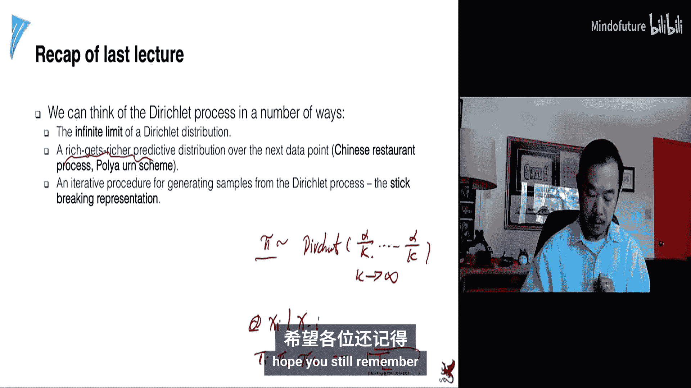

And the believe limitation， you know， of the mixture model， you know， which you know。

 go with the derivative process type of prior。First is that you know。

The clusters are not overlapping in the following sense。

 you can only assign basically a point to one cluster。

 at least in terms of the general process okay in inference you may get a you know a distribution of the label over all possible assignments。

 but that's a posterior， but April every sample belongs to one cluster。ok。And。Therefore。

 you know you really cannot use this model to share features， for example， share centroids。

 say a particular data point have multiple centroids right so this is not possible and prototypes you know one person you know collecting you know genetic aspects from multiple ancestors that is not possible you know in a cluster model。

はい。What we have and and these are typical。Applications where you may need to you know you know enable or you know you know facilitate such sharing of the clusters。

 which is not possible underpa process So here I have a few examples， for example。

 if you want to cluster images， what if the image has multiple objects it has a dog。

It has you know a car and maybe sky and so forth， how do you classify that right。

 so it's not a one video。Then you know the actors in a social network obviously has multiple social groups。

 they may not just become， you know join one group like myself。

 you know I joined the group of academia， but also you know I could be an entrepreneur and I could be a family guy and so forth so again you have multiple group assignments。

 movies you know may have different aspects of you know genres and so forth。

So that creates a need where the due process isn't。

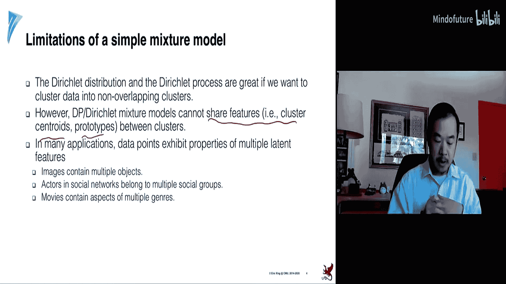

The best way to do it。But today we're going to talk about a new approach， which is， again。

 you know a latent verbal model which allow you to incorporate the so called multiple latent features that can be shared。

Most kind of classic and maybe a canonical example is known as factor analysis。

And this is the model of the factor analysis， which is very very straightforward。

 it basically says that you know every example， you know X。

It's just a linear combination of latent features。Okay， literally a linear combination。

 plus some noise。So linear edge B we can represent this in the matrix form right so say for example here's the a matrix which is just the collection of all latent features。

 so in here for example I have the a matrix。In here。And then。There is also a W matrix。

This double matrix is a data point specific。 This is a data point1。 This is data point2 and so forth。

 right， and it is， you know， K dimensional。And the， the。The entries in this row。

It's basically the weights。Of how you're combining the features。So for every example， X I。

 for example。It will basically correspond to this A W， I。And the WI will be used to combine。

 you know different features， each feature is actually a role in this a matrix。

You are going to make a linear combination of these roles and synthesize or generate a X plus some noise。

Well there are examples， you know WC before， which is say LDA， for example。

 is allowing you to combine different topics， but we didn't use this linear combination。

Of topics because that will create a X that is a continuous and remember in the LDA model we are modeling text documents that discrete it words so therefore we produce the hierarchical general process that allow you to pick a topic and calling pick a word and so forth for every document than for every word but in here we are talking in a much more general setting of generic feature combination and therefore this a feature is a factor analyzer is the canonical example we are going to keep using today。

So。So this model is finite。Right， we have a finite number of。Of latent features。And of course。

 the samples are also finite。

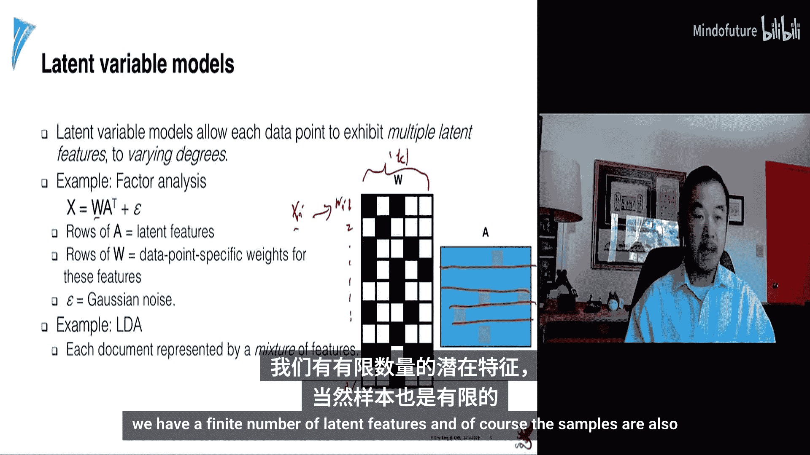

So can we you know imagine that we may have an infinite number of samples， I don't know。

 maybe many maybe infinite before you see everything， you can only assume that。

 but can we also assume that the number of features。In here。It's also a priori finite infinite。So。

 this is actually。You know， a question we ask because in the process， if you remember。

 we actually don't pre specify the number of clusters right， So here we ask a similar question。

 Can we avoid specifying April the number of features。Okay that's basically topic。

 you can obviously the value of that because it makes your modeling you know practice a lot more flexible。

 expression expressive。All right。So there is a solution。

 the idea is that maybe we should you know think about how to define a distribution over this matrix W。

 because if this matrix， you know， can keep growing this way。

 and growing you know which accommodate more and more samples and also growing that way， which。

You know， keep getting us more and more features。Then we actually could realize， you an in model。

And then， of course， as a result of that， this W matrix is actually infinitely dimension。

It has an infinite number of columns。And of course。

 the aim matrix will have an infinite number of roles。So the problem becomes different now。

 we are now worry about modeling a different infinite dimensional matrix。

 so that's a one jump of the task into a more explicit form。Okay。

 so how can we actually get a way to start first of all。

 we cannot really analytically express the infinite matrix。

 there' is no storage in the space allowed to store that right。In a sense。

 we only need to we can only you know。Basically assume the potential is infinite。

 but the actual data that you are going to work on and also the actual number feature that is used。

 you know， for those data are finite， but the potential is infinite。

 just like what we did in each process， So how to enable that。And also， by the way。

 there are some other biases put on this matrix。Nes to be reasonably stars。

 That's almost like the the the natural characteristics of any， you know you know。

 assignment or indicator or combination of synthesized function， because if in his third dance。

You fail to you know really make distinction on different data points and also make distinctions on different features。

 they basically are just doing the same thing， you know they all contribute or no contribute。

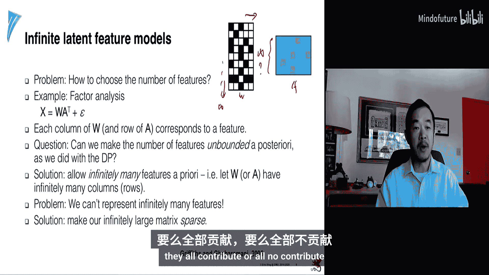

So these are some canonical or some conceptual preferences we may want to incorporate into our model that we want to invent。

So， record。D process， we spoke about a process known as the CRP。In fact。

 if you just think a bit more carefully， CRP actually does allow you to create a infinite dimensional matrix。

 but in this case the matrix is known as the indicator matrix right basically it means that say suppose every you know you know row correspond to a particular data point。

Only， you know， it's one hot vector， one of the entries is one is black。And all others is zero。

 and that basically a cluster effect that your data point， this client， for example。

 can only sit on one table。 He cannot simultaneously sit on multiple tables。

But it is a prior for a matrix， it's just a special matrix。

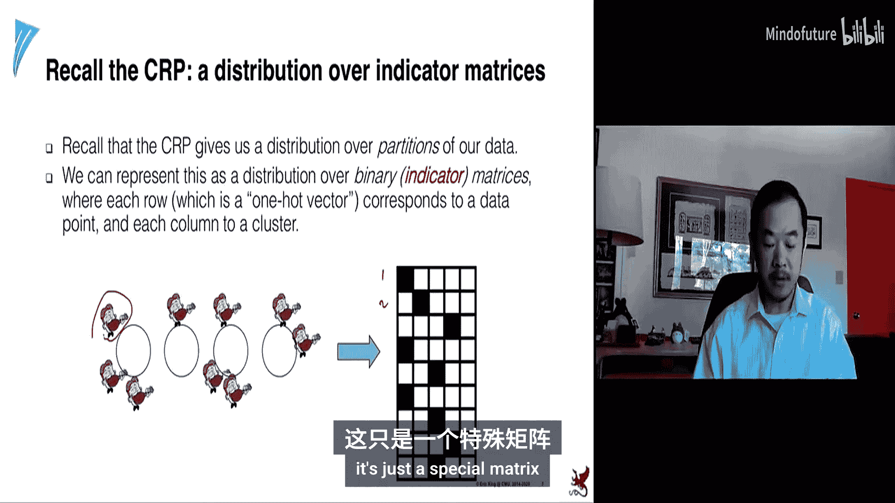

What we want is a more generic matrix where you know every row has multiple you know9 zero entries in fact。

 they should not only just be zero and one， they should be any continuous number that you can use to perform a weighted combination。

 you know to produce examples in the flatter larger setting。

So the thing we are going to do first is to first。You know， a decon wolf。Soorrry。😔，De convol is a。

 you know， a weight matrix into two components。 One is a Z matrix。

 which is a binary matrix that is starse。Which will tell you how to pick features， right。

 And then the other is a V matrix， which can be dense or it can be any real value。

 which is a repository for you to get the weights。You know。

 buy a dot product an element wise product with the Z indicator matrix。倾。So how to， you know。

 get a spae。I' define a prior for a sparse matrix Z。So here， you know。

 I introduced a prior known as the benoi beta prior， it goes like follows for every k。

 every column in here， I'm going to sample a rate high k。From a beta distribution。Okay。

 there are a sequence of pis。 So basically， there will be a pi 1。A pie 2， A pie 3。

 These are just a uniquei dimension。 It's a rate。 It's a， it's a scalar。 Okay。

 it is a number between 0 and 1。Any statements write that pi K。Is in number between around the one。

Okay。And then you use this tie to define a Bno distribution。A process where， you know。

 all the entries， you know， in every row of this。 Remember， this。

 you know column in the Z correspond to。Among all the samples。

 how this particular feature K is utilized。Okay， so it is utilized according to a benoi distribution。

 It will be on and off。Okay， so in that way， you know。

 I first go row I go column and then go every row， I got a matrix。Of you， indicators。

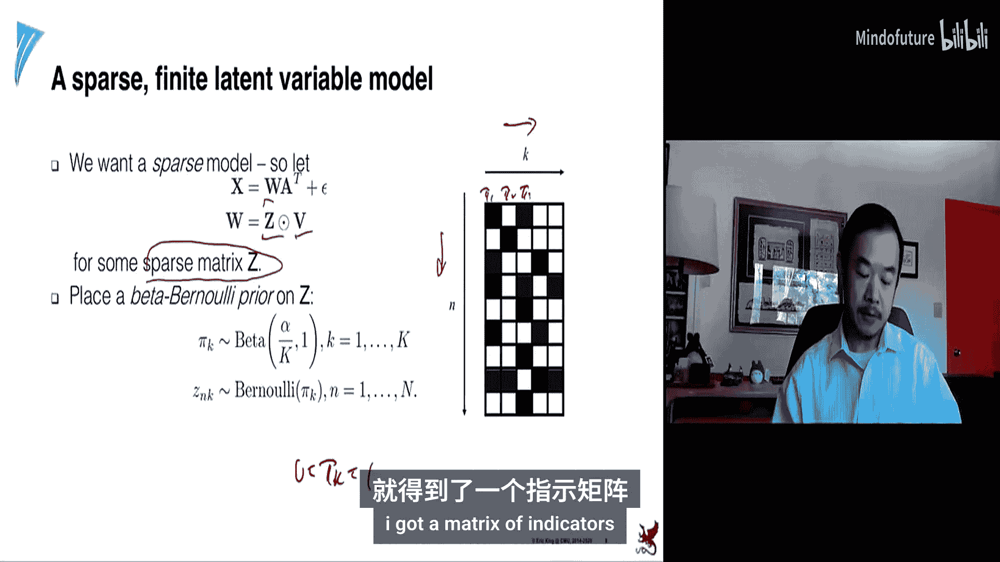

Is that sparse？And and also， how to define a distribution。 Well。

 let's write down the distribution first。 The distribution is actually quite easy。

Okay and here I wrote it down， you know， through just explicitly， you know， you know。

 bringing in all these you know you know pre specified tissue families that we have one is this one is a datata and this one is Aulli。

And they actually have analytical expressions which are， you know， after some。

 you know and then of course I need to integrate out those pies just to you know you know define a marginal distribution of only you know the Z matrix。

 given hyperchometers， hyperpometers are basically the rates。

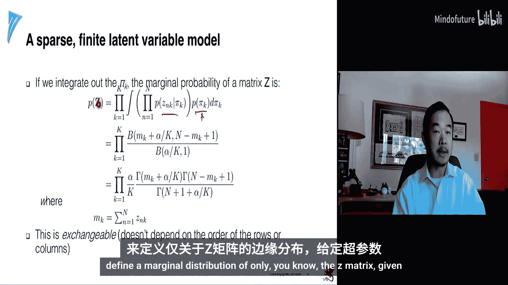

In here Okay and of course there is a K， which is the number of features In this case。

 let's first worry about a finite dimensional matrix with the n examples these are all finite。

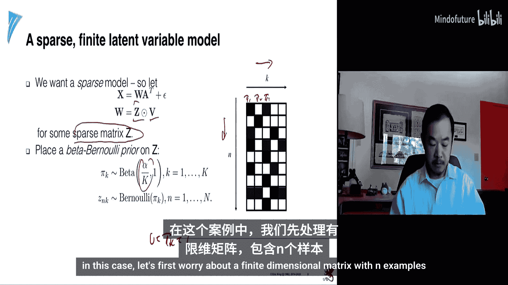

You can go home and work out， you know it takes some worldwide well known standard properties of the gamma function okay after the integration and you can write down a pretty clean expression like this okay。

And here I introduce some short pen for certain quantities。

MK is the number of occupants of feature K by N examples。And this distribution is exchangeable。Okay。

 it means that it doesn't depend on the rows and the columns。 And once you have this matrix。

 you can swap the row， you can swap the columns in the Z matrix。 You will have the same。You know。

 a probability。Because like wait。Rightrite explicitly here without regarding the order。

So now you can probably， you know， okay， by the way， are you always。Yet。Okay， no more question。

 maybe you should have one question because I already originally promised that we should have a sparse you know matrix in here。

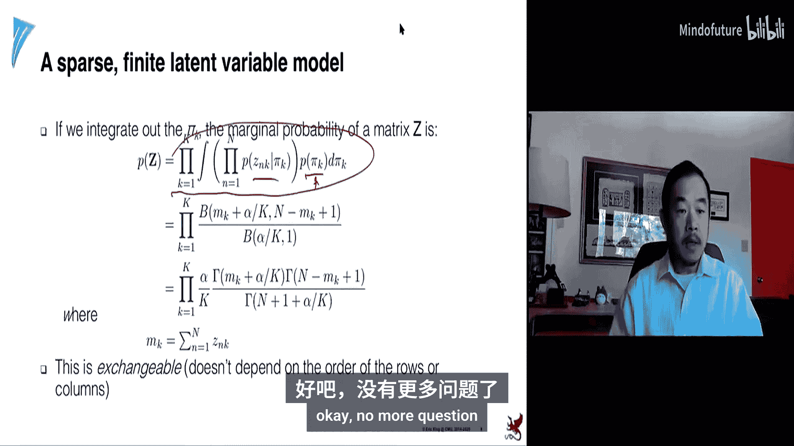

And how come this one is ours， I don't know yet。 Do we have a guarantee。

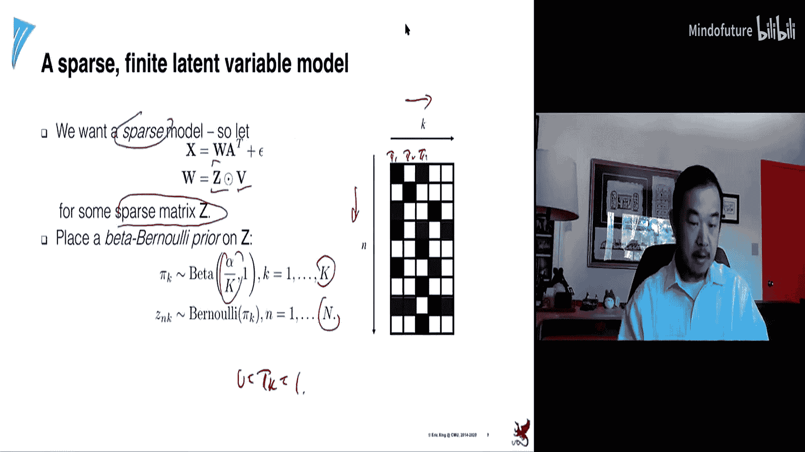

Or you actually could be a little bit more diligent and you know start writing down， you know。

 basically you know you know。Write down， write out these gamma expressions。

And just look at how this you know， whole equation look like。

And here I did a little bit for you okay。Gammma function， if you know if you recall。

 you can Google it from Wikipedia， it's just you know a basic sequence of multiplications of those numbers。

And after expanding this， this whole thing， P of Z actually equals to， you know， a product。

Of these numbers。ok， divided by them。Okay， and you can see that these all these numbers are smaller than one。

Okay， and also， once you have a more and more K and more and more N。

It tends to go smaller and smaller。Okay。And having， you know， a， you know。

 a less a more0 entry and and and more more counts。

In the matrix will make the probability even smaller。 Therefore。

 the higher probability configuration prefers， you know。

 asR matrix just by looking at this expression。

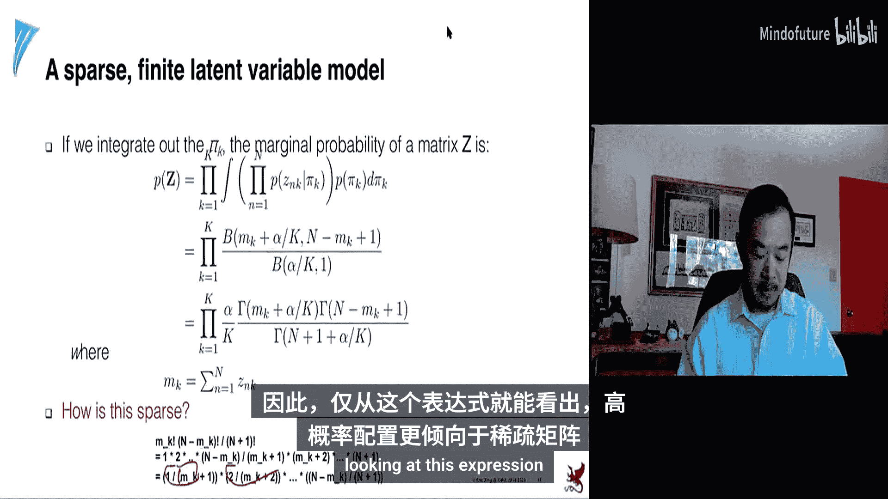

So are we good， you know， is this one， you know， really you know。

 a proper way of defining the distributions？

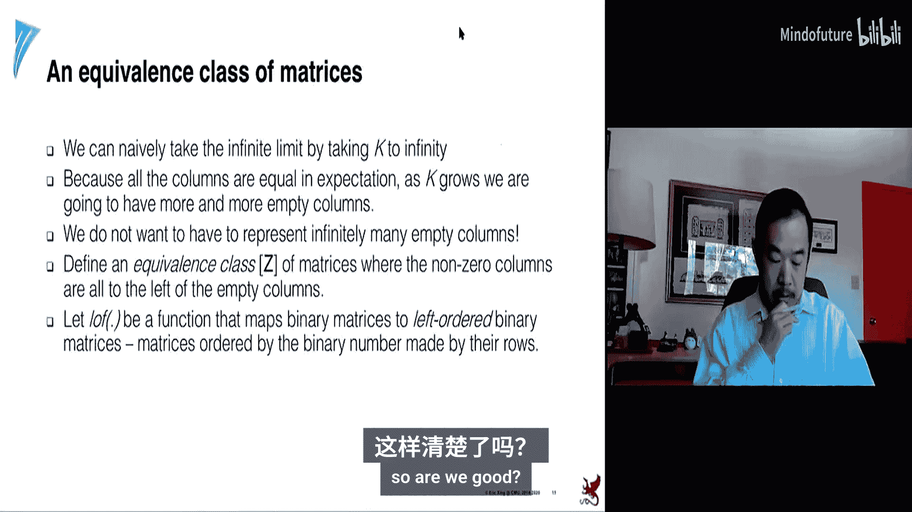

Well if we use this to draw， you know， to define， you know， a Z matrix。诶。First of all， you know。

 it's not really a。ItBa， you know have a lot of identifiability issue because you know it is exchangeable over rows。

 therefore you know the same matrix with the row swapped。We have the same probability。Therefore。

 you have ambiguities in there。And also there may be a lot of zero columns， you know。

 you can definitely have， you know， possibilities of having empty columns in the middle。

And that still needs to be modeled， under this。

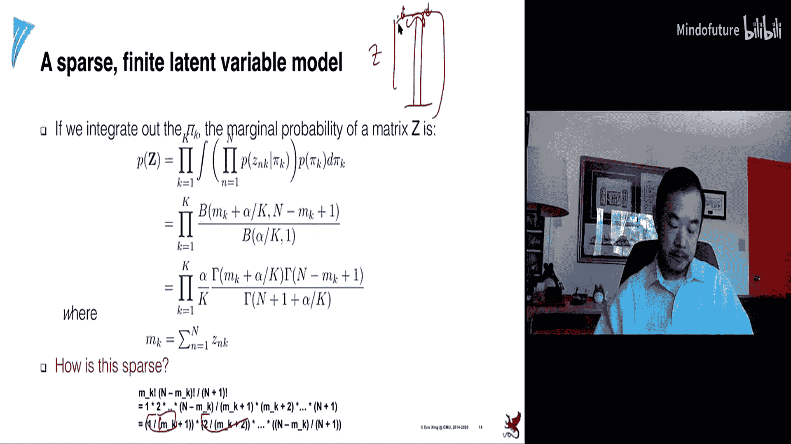

So what we are going to do is to do a little bit more clean up you know of the P because Z is just a too ambiguous。

 you know you know a matrix you know from an operational perspective okay there may be columns which are identical and there are empty columns and so forth。

 so we're going to focus more on another entity known as the equivalent class of C。

 which does a little bit clean up known as the left ordering， okay left order binary matrix。

 which basically says that actually look like this。

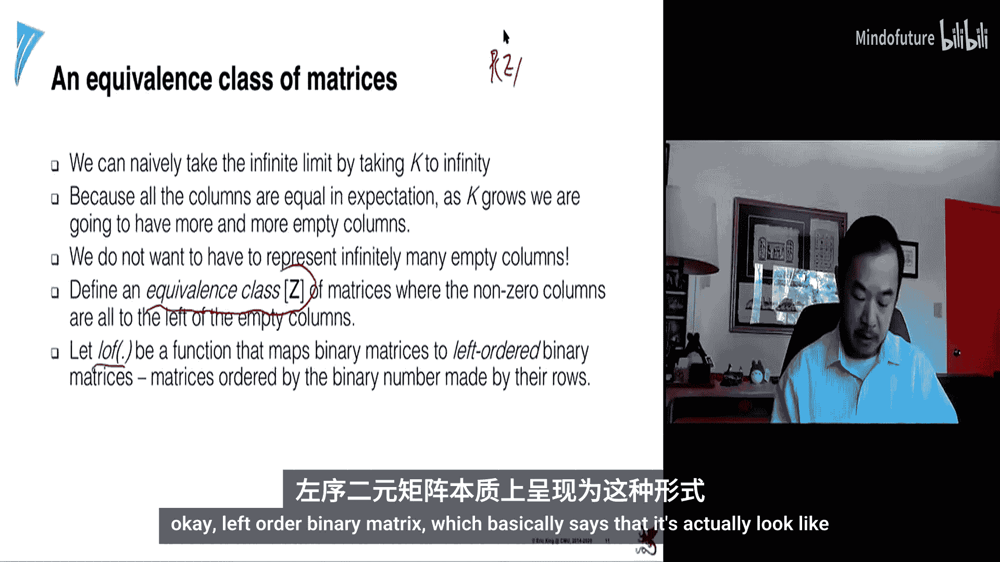

You know， you know， instead of working on this matrix， you do some column and the row arrangements。

So that you can make the， you know， the math or the 90 entries。

Focusing more on the upper left side of the matrix。停。

So that's basically just a reordering of the matrix。 It's the same matrix。

 and we're going to now and define basically multiple matrix。You know， in here。

 maybe I should say you know a M different matrix in here or get to one matrix in here。

 it basically can you know aggregate， you know， a lot of you know， indicator matrix in here。

 which are center the same thing into one expression and we define our probability on this。

 which is a more concise and compact distribution。

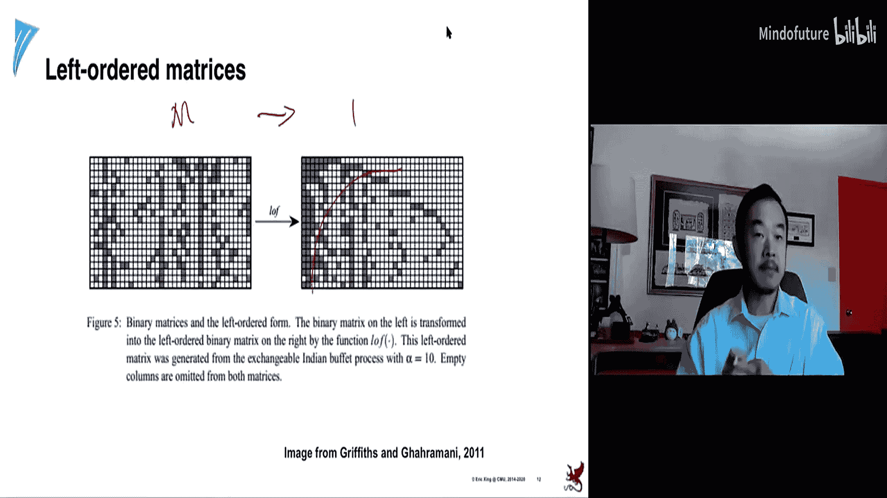

And this is usually not very， very difficult， you can introduce you know a few short handss。

 for example， we define you know a history。For every feature。 So for example， now you are at say。

 point N plus one。Okay， or maybe point n， I'd say。 And here we have all the way from n1 to n minus1。

 Then we look at a feature K。 and then this basically is your， you know， history vector。

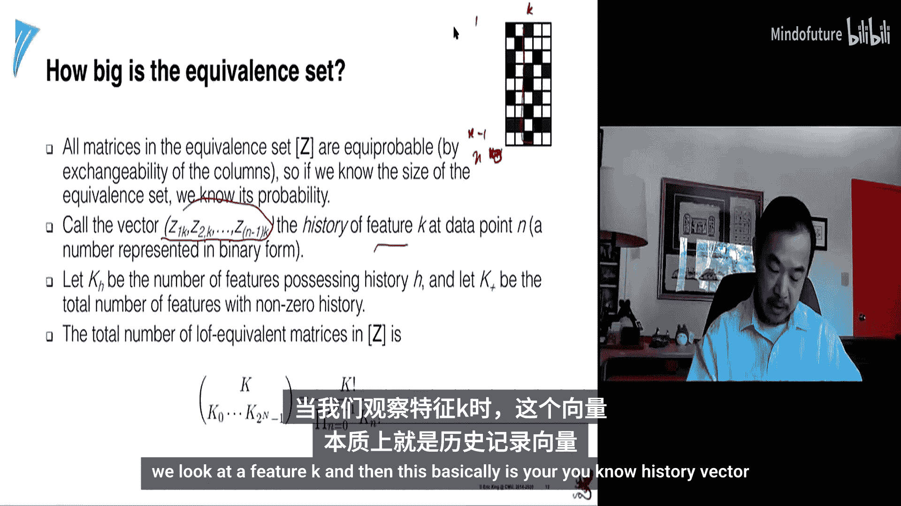

And with the history vector， you can define basically account。

 you know of that feature so that you can keep track about how often this feature has already been used。

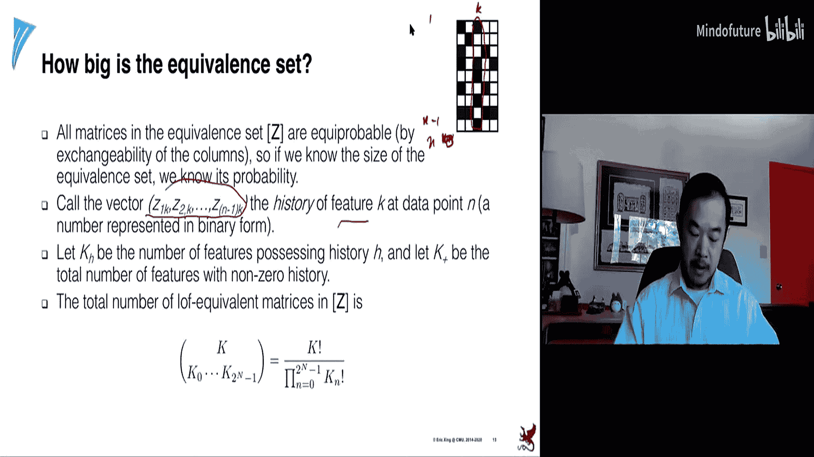

Okay，And these numbers are useful in defining the total number of configurations。You know。

 offer that equivalent couldn't class， okay。And。Or how many configurations a particular left ordered equi matrix can be represented when the order is disrupted？

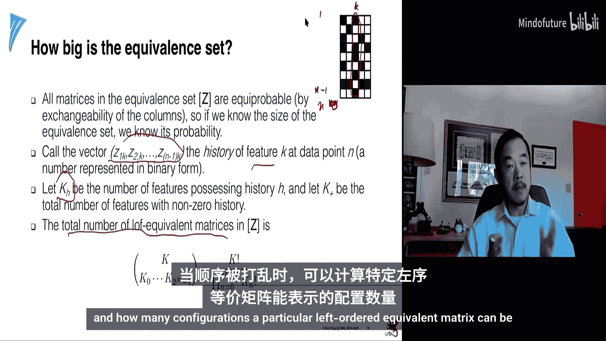

And that will help you to now define a property distribution over that equivalent class。Okay。

And it's actually quite simple because it is， you know we know the exchangeability already。

 all the configurations belonging to the same equivalent class are equally probable。

And we know the total number that already， right， so I're going to just multiply this number with the previous expression。

 which is the probability of one configurations in Z。Okay， so you are right at this expression。

So that's it looks very hairy， but that's the way it is。

 It's a distribution of the equivalent class of a beta beuli。Generate it。Bary matrix。

Now it's time to play the trick of how of pushing for infinity， remember that in our diciary process。

We have this。And then when k equal goes to infinity， we have a DP。喂。And here。

 we start from a finite dimensional beta annuli process。

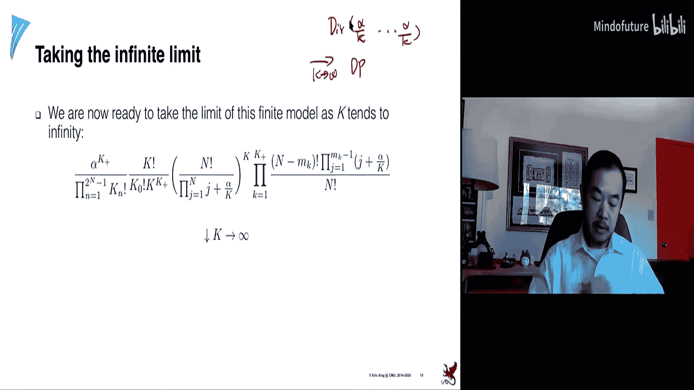

And now let's see when we take K to infinity， how things look like。Well。

 it's just some very standard AJ break manipulation， and we're going to get this expression。Okay。As。

The infinite limit of that。Left order equivalent matrix。Okay。

 and this particular term actually is interesting。 I're going to use it down the road because it actually implicates the total number of times the expected number of times a feature is used。

 but we're going to talk about later this number。H is a。I'm going to talk about later。

 it's basically you know sum a telescope big some of。I can yeah。

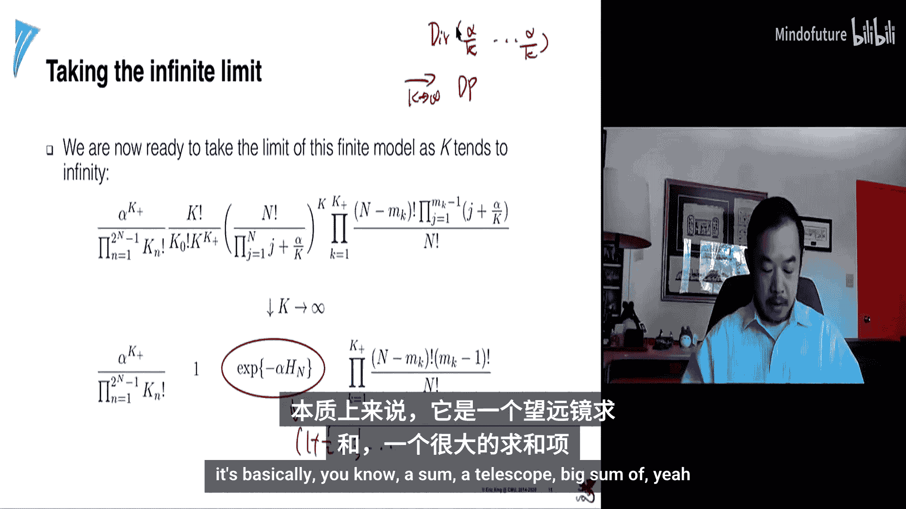

Okay。So。Any questions so far with our first exercise of defining a distribution over matrix over infinite dimensional matrix。

 we have now a distribution over infinite dimensional matrix already in this case。

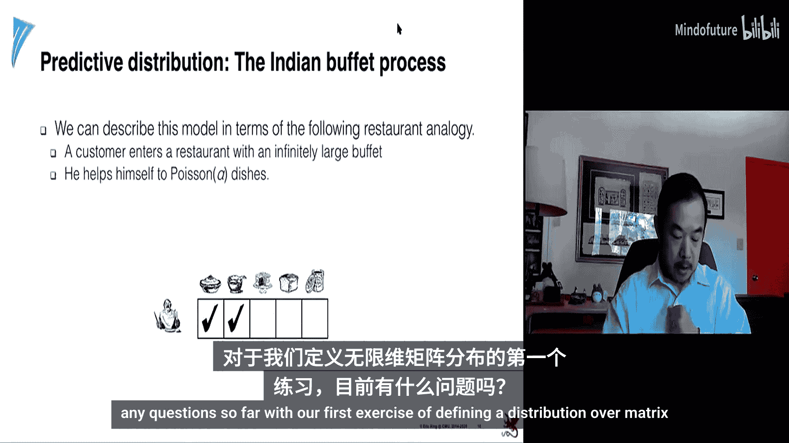

听。And there's another number here， K plus， which means that the number of features that is occupied so far okay。

And what is K M。I think it is written somewhere。

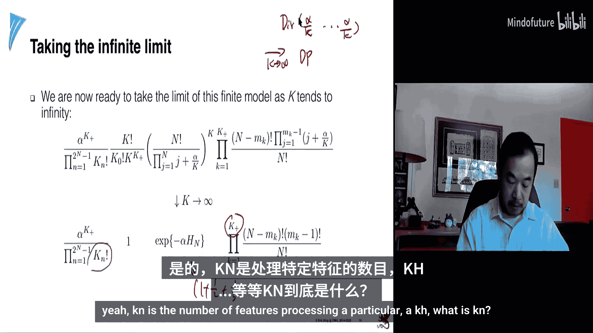

Yeah， KN is the number of features processing in a particular A K， H。 Now what is K N。

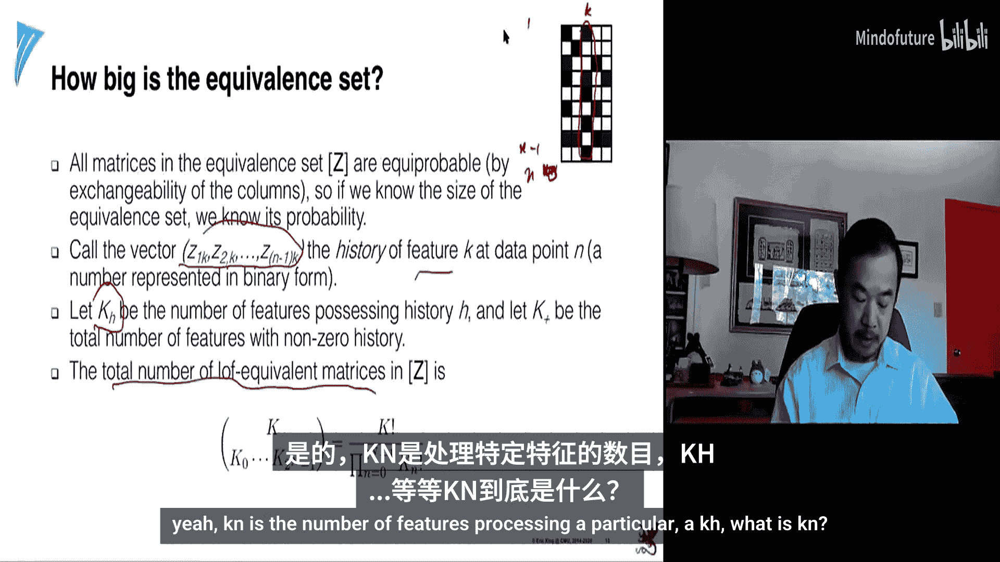

嗯。I need to check out it's probably written somewhere I forgot。

I think the KN is the number of features， you know， used by sample N。 therefore， you know。

 for every sample， you are going to have a K for that okay。

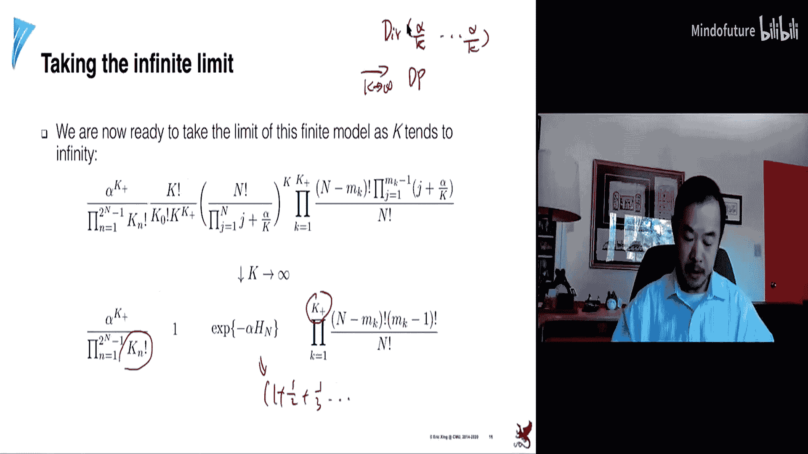

All right。Remember our routine before， we define very formally you know a division process using the infinite limit of a distribution distribution。

And here we did the same， we used the infinite limit of a agamma a beta pennoli to define a distribution over infinite matrix。

And then over there in DP， we marginalize out。Those rates for drawing examples and start to define a predictive distribution of the next sample。

 given the previous samples， using you know a Chinese stress process for example。

 using a culinary metaphor interesting enough here we can also use a culinary metaphor to define a a predictive distribution。

 which is how do we do X I with X minus。ok。So here is how know for every data point。

 this guy presented by a patron， how he selects the features。In this case。

 the game is not about picking a table， but actually take what to eat。And here's a story。

 imagine that there is a Indian restaurant， Indian caufffe restaurant with a potentially infinite number of dishes。

Okay。You know， if you guys go to Indian restaurant。

 you can see they are very different from the Chinese restaurant。

 it's not basically sitting you on the table first and bring you you know the menu and pick dishes。

 in many cases， you know it will lead you to you know a big long table with many。

 many delicious dishes out there。Appearing appearing to be infinite。

 and then you will be sample based on your appetite。

And maybe also based on how you look at the other people pick their dishes。

 and this is the case in here。The first customer， because there is no other customers before yet。

 he's going to draw， you know from a Poisson distribution with rate alphapha。You know， again。

 passson distribution defines， you know， a distribution over discrete numbers。

You may also Google the wki and find out what that correspond to。

 It tells you you know how many number of letters you' are going to receive every day。

 how many train stops and how many cars passing by a traffic light if you stay there for long enough and so forth。

 So these are the nature of this distribution it basically depends on it basically tells you the total counts of many independent events Okay。

 each of them happen with a rate。So this guy will decide you a number and then pick the dish accordingly okay。

Then the later customer comes in。And he will basically do the following。

He will first look at the other customer pick。And if you know you see a dish that is already pictured by other customers M times。

Then he's going to sample that dish with this rate。Okay。

 M is the number of times that dish is used and N is you know， his ID D。

 the the total number of customers currently in the in the buffet restaurant。And that's not enough。

 He want to try something new。 Therefore， there is a a a。New you know， process new action。

 which allows him to sample some new dishes using a passson with a diminishing rate， you know。

 alpha over n。N is the number of current customers。

 You can see that when the customer getting more and more。

 he is less and less likely to sample new dishes because there are already a lot many， you know。

 being already tried by other customers so that he can make opinion about。

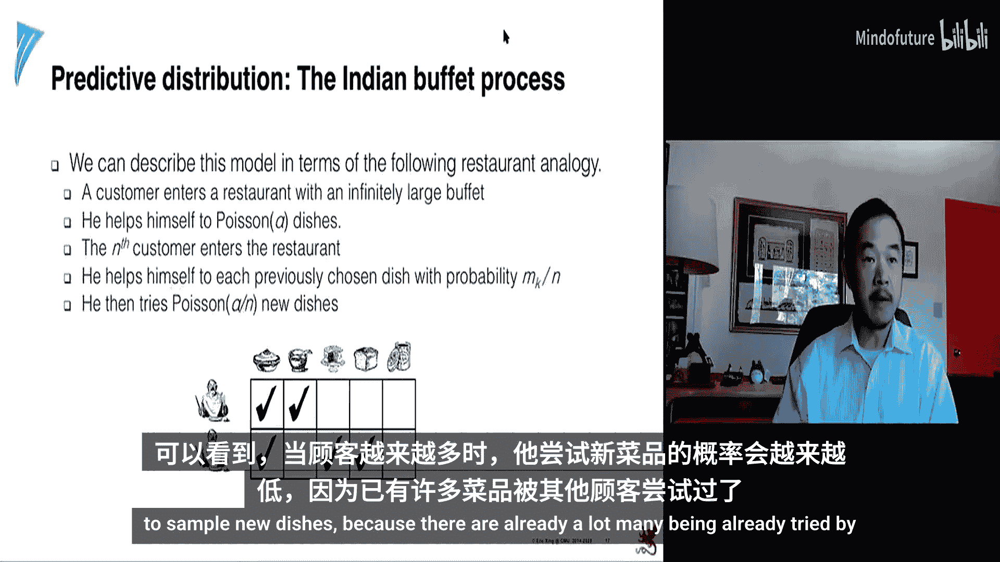

So that's basically how it goes， and you can see these will results in also a random matrix。

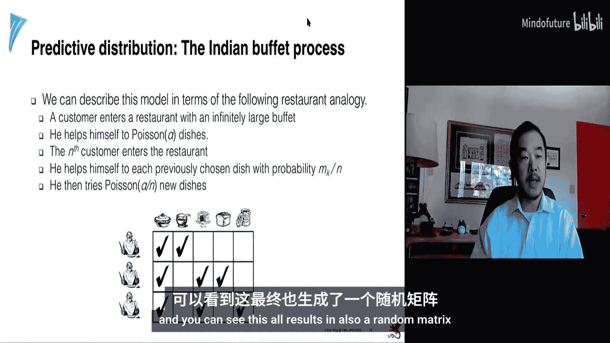

喂。And in fact， the randommakers look at this。You probably can see that there is also a left。

 you know， ordering each kind of a behavior in here because the first customer he would sample a few and put in his plate。

And the second one will use that one as a reference point and some more， therefore。

 you can see in more draws。Are kindin of taking place along this direction， but again。

 from time time， there are new examples， new features being used。

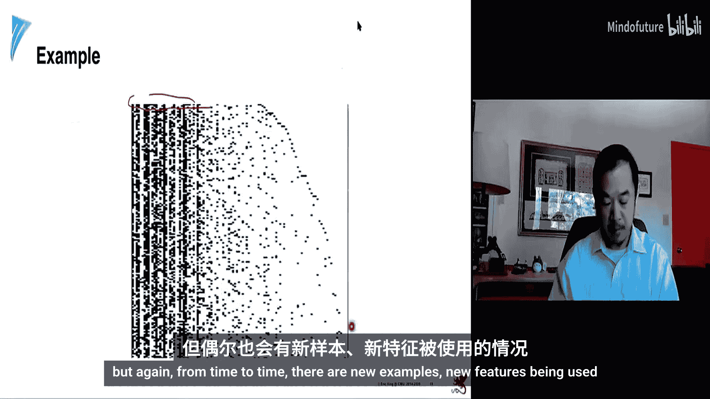

So you can also write down the probability of the Z。Produced using this manner。 Okay。

 and in this case， we don't have a say， a pie， you know， for every feature。

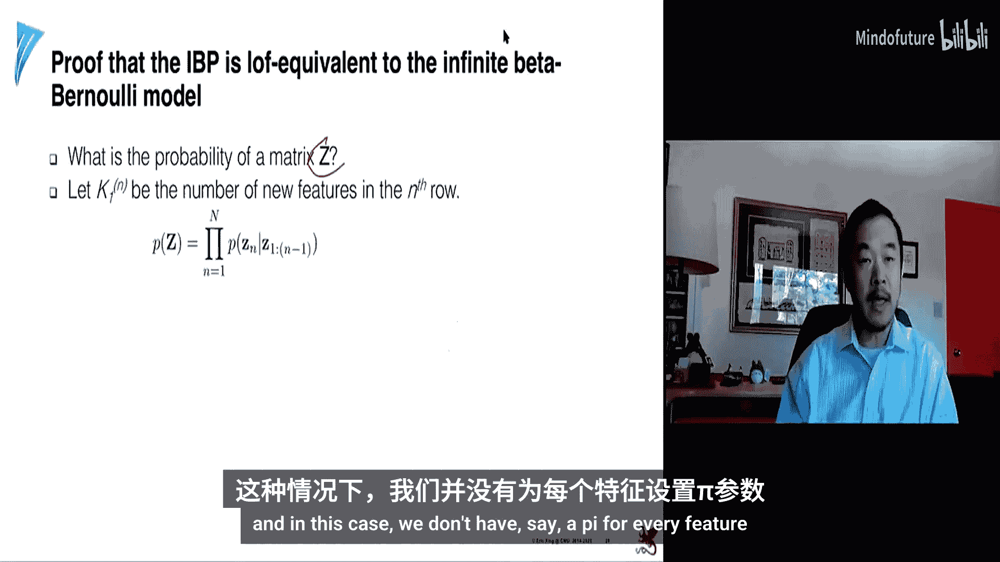

We don't have that。For the entire feature。And we also don't have， you know， what is that。You know。

Yeah， we don't have also， a prior for you to draw the pieython at this point。

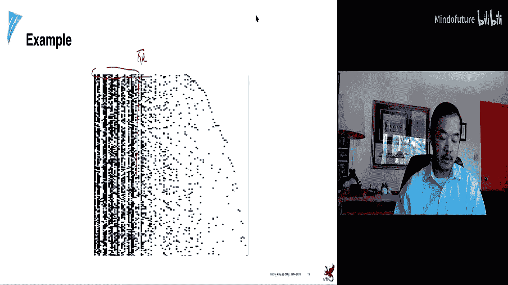

But what we have are these examples， you know， clients coming earlier and also a global alpha you know rate to define the personisson distribution for the number of dishes。

But still， you can write down， you know， you know， the。Probity of this entire distribution。

 just by following up the process。 This is。Basically。

 that person distribution fail to sample novel dishes， right。

 starting from the first one all the way down to， you know， the later ones。

And then these are basically， you know our you know reference process that I look at the other customer dishes and sample accordingly。

So if you just work out this equation line by line。At the end of day， you will arrive at this。

If you still remember， you know our earlier exercise of the infant limit。You know。

 of that beta benoli process， you know， of the equivalent class of the Z distribution。

You will identify that these two are identical。So that matrix can be sampled from a Indian profitet process。

Okay， and in the in process， we have a Z given z minus I， which is very， very similar to our CRP。

 where we have the clients given。All the other clients。And the rates are integrated out。Okay。ok。

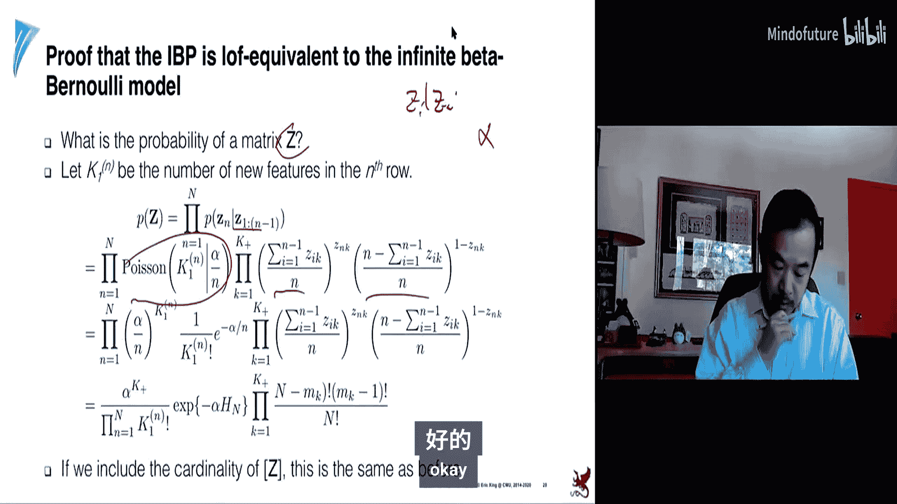

What is the property of the in process， what the property of the in process allows you hopefully just like in CRP you know to see from a more kind of a localist perspective about a user experience and also you know some of the nice you know aggregation of property for example。

 this rich gets richer property not become very obvious that the popular dishes。

Will be more likely to be picked in here。 The dishes correspond to a feature that a consumer can use。

 And also here， remember， the consumer can pick multiple features， multiple dishes。

 This is very different from the Chinese return process where once you sit at the table。

 you cannot sit on other the tables anymore， right。And also。

There are some important properties that you can shown you can prove using you know properties of the Poson。

ok。You know， for example， the number of nine zero entries in each row actually is a Poisson distributedd。

 you know a random number because of the exchangeability。

And also the number of 9 zero entries of the whole matrix。

Its also distributed with a person rate of n times alpha， because now you have n rows。

 not just one row， right and you also know that the person variables are edible and are additive and according to the rates。

 these are nice properties of the person distribution。

You actually can also show that the number of the total number of non empty columns。Okay。

 which is really the distribution of the number of features being used。

Can also be analytically expressed。Okay， S I AR pass some distribution。

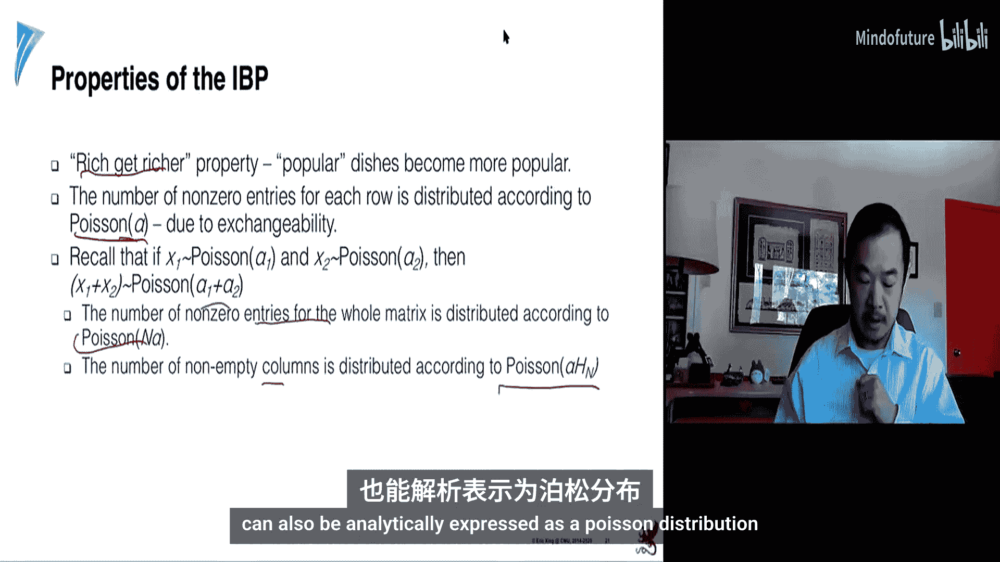

Okay， so now we have a Z matrix。Whose distribution is properly explicitly known and also can be realized through a sampling process and also it is infinite dimensional。

 How can we actually start to use them to model real data。

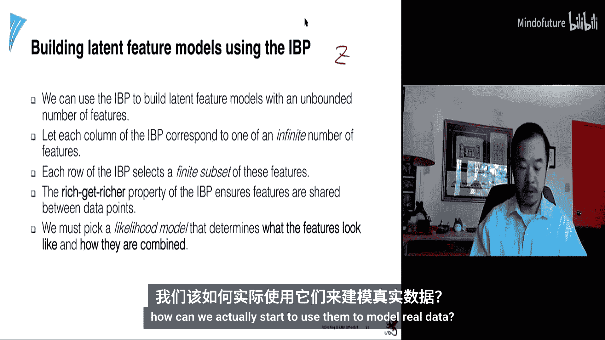

Remember in the Chinese restaurant process a process。

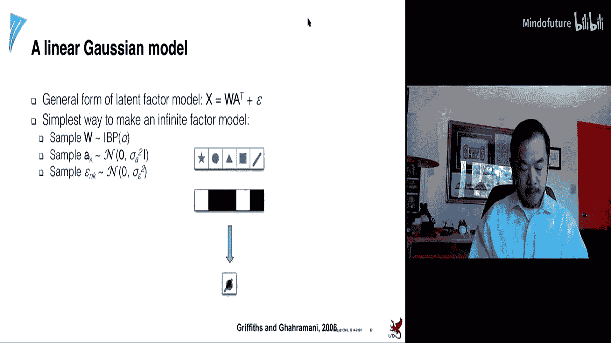

You know， we basically are really， you know。ding you know啊。

What and we're basically drawing a class label。For， you know， this particular example。

 let's say we call them ZI。Which sits you on the particular table。

And then you need to start defining a likelihood function for the data right。

 so which is to allow them to be clustered， for example， you know， at the end of day。

 this likelihood of the P of X I， you know， has to be defined by in the a of Z I。Equals to K。

So that it is assigned to class her K。 So K， basically， this meal is the parameters。

 almost like the dishes sitting on the on the table in the Chinese restaurant。

So that's why that's how a real data point can be associated you with a atom in a division process。

 which basically just defines you know the probability of a class scan。So in here。

 just having Z is not enough， it's just to indicate which feature to use。

 but it does not yet fully specify the likelihood of a real data which make use of the feature and also have noise on public features。

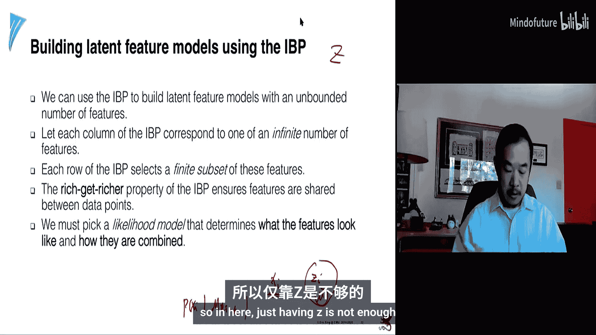

So for example， this model。这好 to没打 happen。The simplest。Approach is called a linear Gausian model。

 we I're going to now you know say draw entries of the a from a Gaussian distribution。Basically。

 we are saying the features， every feature K is a Gausing distributed director。Or a scr。

 And then we're going to you know use the Z。Or the the the W to make a linear combination。

 So if here we say W equals to z。Then the W is a binary matrix of black and white entries。喂。

And then you are going to get something like this。I you say these are four features with all different shapes。

And then for particular sample， I。You know， I have this particular row of third。

 second and third and fifth to be one others than zero， then I pretty much picked this one。

 this one and that's why。Oh， no， this one， this one。And then not this one。

And that's how does the whole thing look like， you know， it's a triangular， you know。

 superimposed on a circle and then superimposed by another bar like this and then you may add a little bit noise。

On大。There is the no trace of the square and the star and the star in here because they are set to be 0。

So that's a a a a。Property of the linear dousing model。 If you like it， you will be able to use it。

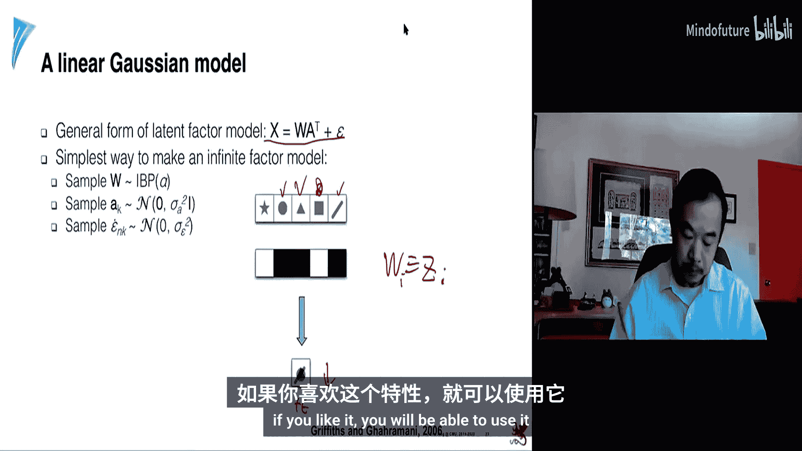

Well。People very often don't like it because this linear gausing model is really。

 you know a all or nothing model， you can only pick a feature， you know。

 as it is or you just kill it with a zero weight， right。And therefore。

 this is a binary loading matrix， which sometimes disallow， you know flexibility。

 sometimes you know the features may carry different weights。And this is disallowing here。So then。

 you know， we go go back to our original idea， you know。

 we want the Z or the W not to be just a indicate matrix， but a weight matrix， Okay。

 and we use the the IRB， the in bucket IBR to。To generate the Z indicator matrix。

 but then we use a element wise product operation to pick the real weights from a random real number matrix who produced a W。

Okay， so that basically is a three step。Generation process， you need to have the Z from IP。

 you have the random matrix V from you know a say a Gaussian distribution。

 and then you need to have the feature matrix also from a Gausian distribution。

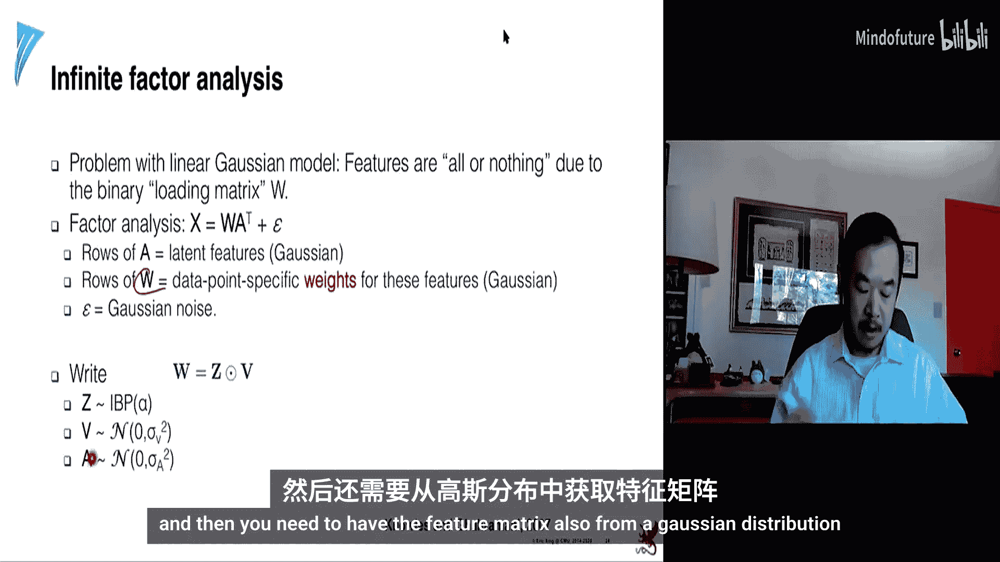

听。All right。These are just the principles， maybe we can work an example to see how people use it to model real data。

So here is an example came from Frank W， who is a professor in UK， Oxford。

And he was one of the early practitioners of and also an analyzer of the IBP。

So he used this model to come up with a patient diagnostic algorithm。And here is the problem。

 how it look like。Your data point will be patience。

And your observation from patients will be the symptoms， say having a fever， cough and so on。

 so forth， a number of them。And then your goal is to identify the biologically possible latent causes。

Which could be like a illness。 So， for example， common flu or coffee 19 or pneumonia or whatever。

And all these may generate some similar features and some different features now now you are so probably well educated about COV 19。

 you know that in COve 19 COVD 19 we have some symptoms which are cough and breathe difficulties and that。

 but not necessarily fever and running nose。And the common code also have cough may also have well maybe not so badly on chest operating breathing problems。

 but they have know you fever， random noses and so forth。

 so different diseases share some symptoms and have their different symptoms， so how to model that。

For an individual so the idea here is that we want to have a le latent features to be associated with a set of symptoms。

 just like what I just said right。H disease have multiple symptoms and then you know a patient。

 you know what display， you know you know some symptoms。And if he displays symptoms that are really。

 you know a。You know know， if these features， you know。

 multiple features is really associated with the patients。

 then the shared symptoms are likely to be discovered。

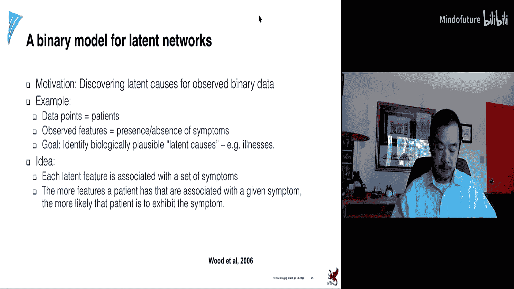

So here is the modeling process again， very， very mechanical down the road， you know。

 you can use this again， this is a graphical model， right。

 you have a the Z you have X and and you have also。

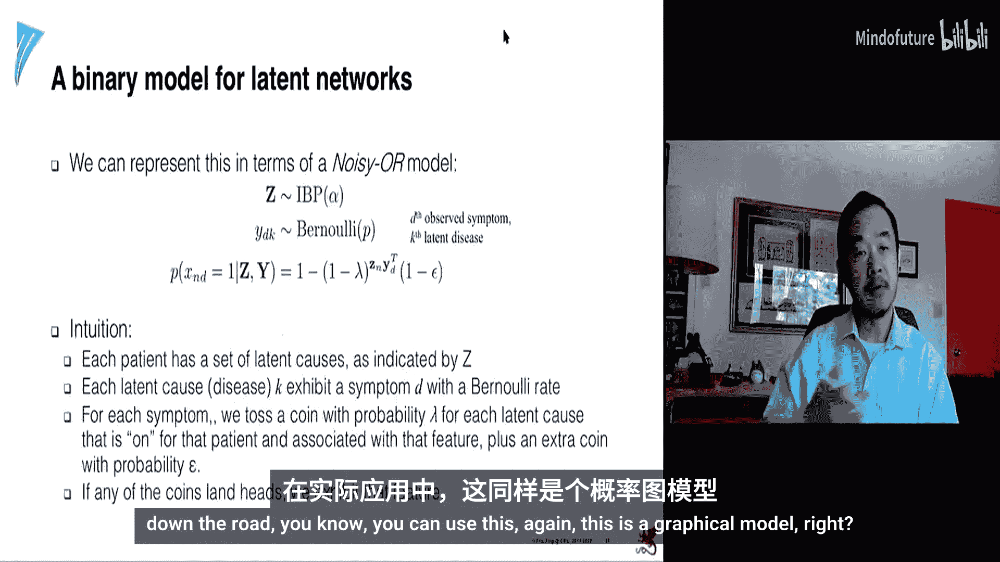

四度位。Which you help you to select， you some configuration and you have the Z and here is how they select。

You know， first of all， this is a Z matrix， which is a we make call it a。Patient and illness。

Matrix which is of course unknown， which is something already uncover right so it's basically saying that for every patient I have a you know a array of potential illness he may have。

And then this y vector， which is defined on every you know。Obsservve f for every latent disease。

It's basically， it's like a switcher or。You know， yeah， yeah， a switcher which you know。

 defines whether a particular disease K picks up symptom D。停。😊，And then for a patient。You know。

 a number N。for a星 d。You know， if this patient exhibit symptom D。Then the likelihood of that。

Is defined by this expression。Which basically you the。

 correspond to the following reasoning in the in the。

This patient has array of latent diseases indicated by Z。

 and then this why is translating the disease into symptoms。Okay， and this is， you know， again。

 a random variable， The sentence is， you know， is showing up or turning up and off， you know。

 depending on a van process。You know， depending also on the patients or the the on the disease。

And then whether does symptomston show up in a patient is also a coin causing。Okay。

 and to be on a not。 And then there are some noises as well。

 to see to further allowing uncertainties。So you can imagine that the multiple coins are tossed you know in different stages。

 you know here is a coin tossing， here is a coin tossing and here is one and then finally you get your symptoms unfortunately with all these randomness and then the whole point the whole problem goes back to do post inferences of the Z and maybe sometimes even why。

Okay。嗯。So that goes to the inference problem， how can we infer the Indian profit process？

And as we recall， you know， in the deion process。We have a number of approaches in fact I didn't discuss a lot you know in the lecture it's too technical and too tedious to go through all that。

 but the papers were posted on the website gives you a lot of details that you can go。

 you know it rangech all the way from you know Gi some you know based on the exchangeable model。

Which is the。The CRPs or you can direct sample from the underlying distribution distribution such as using the stick breaking process and so on。

 it could also be a version inference that you do transition and then set them into finite and you know their particle filters using important video sampling technique and so forth。

We can use similar ideas for construct。Anlogous samplers for IBP okay。

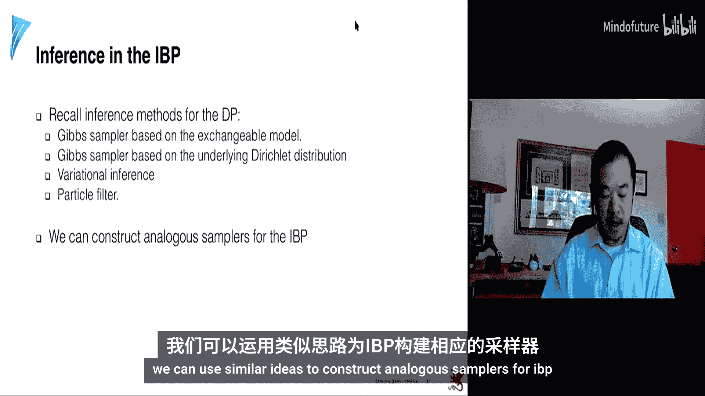

嗯。First of all， a very important property is this exchangeability。Meaning that。The rows。

 the ordering of the rows and the columns in the Z matrix isn't going to change， you know。

 the joint probability of the whole thing。OkayTherefore， you can， always， you know。

 treat anyone or column in that matrix as the last row and column in the matrix and setting everything else to be。

 you know， the predecessor。And that gives you， you know the context to apply the IBP， remember。

 the IBP basically describe the behavior of the last customer giving all the previous customers and that's exactly what we can use here。

But also here we're not going to be only sampling a matrix of indicators， we have real data。

 which is the X， meaning that I observe the incarnation of the features， on real world。

That means the noises are also integrated are also present in those examples。

 therefore from the feature that you've chosen to the actual observations。

 you know you actually observe on sample， there need to be a likelihood function。

 which is actually this a F function， you define the likelihood。Okay。Offfer the sample。

Given how the features are chosen using the Z， and also this。You know you know。

 a likelihood function parameters， such as a。Gausing model or some other models that you like。

If you have a novel kind of sample， a feature to be used。Which is not present in the history。

Then you need to， you know， basically use you know， another， you know， a formula。

 which gives you you， the likelihood of the sample under a new feature。And also。

 this is the rate to to the new features。So I'm not going to walk through the details。

 it's very very tedious， but the idea pretty much you know is analogous。

 maybe even in parallel to what we see in the duration process。

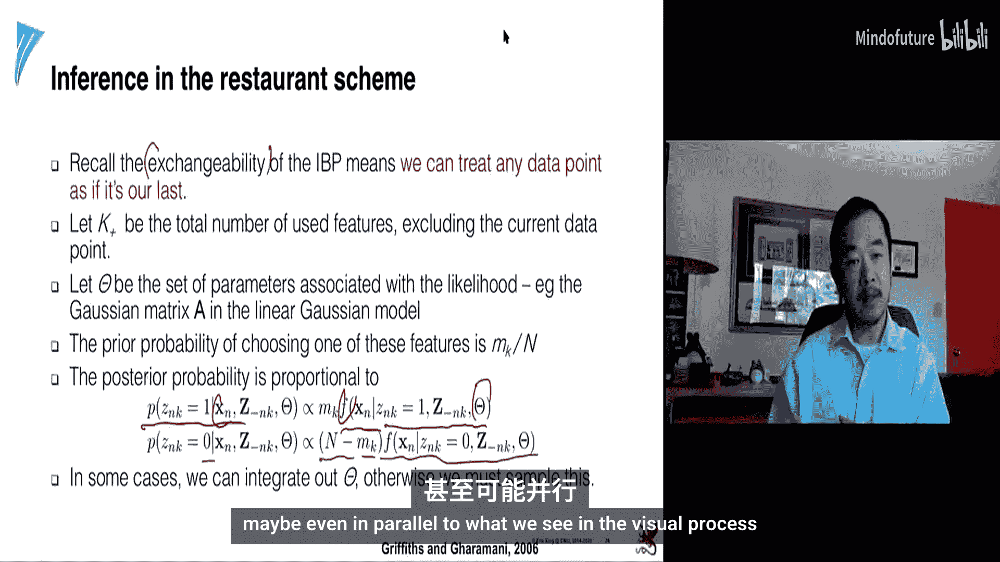

Oh yeah， actually。Here I'm not talking about new yet， it's just about using or not using a feature。

 but if you want to actually you know add new features into that。

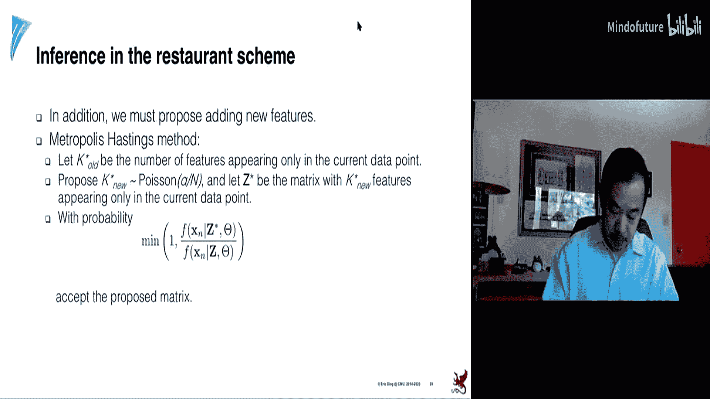

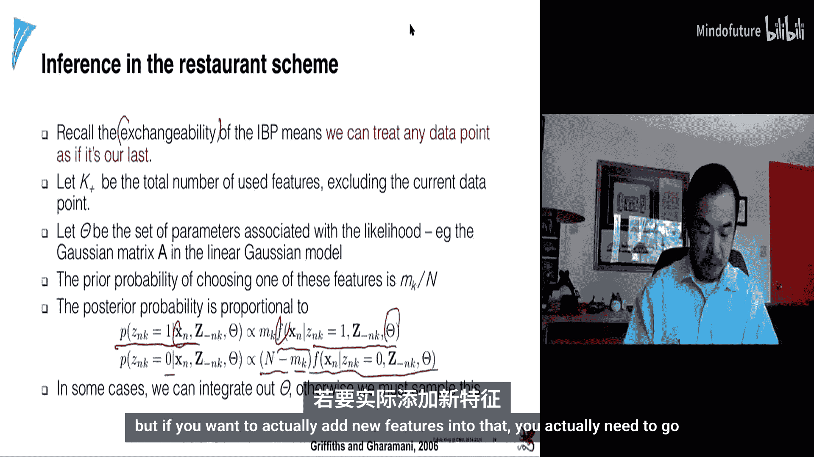

You actually need to go through yet another step。Which needs you to compute， you know， first of all。

 the probability of sampling the new features， which we know follows a diminishing you know Poson distribution and also the likelihood of the sample under these new features。

With their， you know， weights integrated out in a fully patient manner， therefore， you know。

 you have this。You know， a likelihood ratio to help you defining a metroizationing step， you know。

 together with the likelihood of function and also you know you know， the new person rate。

And then we can determine whether this a new step of instantiating new features should be accepted or not so all these are very mechanical。

 even though very complicated and very heavy， but it's mechanical。

 you can just plug in every steps and。

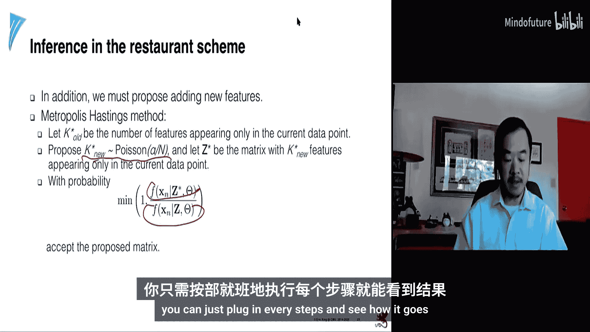

And see how it goes。Okay， any questions so far， I have another 20 minutes and I plan to use that to dive a little bit more into some of the theoretical aspects。

 you know， of the unique process to see what is the you know the kind of fundamental stories behind all these you know you know geneative processes but before I dive there。

 I want to。Take a few minutes to answer any questions from you。

You can either raise your hand ask or you can。 You can， you can type。

Somehow I couldn't see the chart with know where is it。Any questions？Oh yeah， I brought up the chat。

No， I didn't see it。Yeah， anyway， somehow I couldn't find the the chat box， you know。

 I on Zoom from my screen。 If you have a question， just， just either raise your hand or directly。

 I mute and shout out。Otherwise， I' can go and to move forward。Okay， let me just move forward then。呃。

So record， you know， in our。Presentation of the duration process and the Chinese process。You know。

 the DP is really defining a prior over the probability measures。Which we call atoms？Right。

 but the CRP is not actually， you know， a defined on those measures。 They are directly。

Generating a part and all these random measures， which is the probability of every cluster。

 is integrated out already。RightSo in a sense， this CRP and DP are the are the you know。

 the two sides of the coin， which exhibits or exposes different characteristics of the same distribution。

And you know， using the definitive theory， we know that if you know， a couple of。

 you know all these sequence of examples， the customers are exchangeable， you know。

 in terms of their influence on the final joint distribution of partitions。

 then there must exist in measure condition which。This are IAD， which is the due process。

 In this case， it is the DP that is integrated out。

 So you can see this IA D and this exchangeability， know， is not contradicting each other。

 Okay in here， it looks like the sequence of X are not II D， because they you know。

 are basically you know， dependent， you know， on one and the other， even though the order ist。

But if you have the D P introduced， then all these examples actually are ID。

 So remember that the if use a graphic model， if we have a D P and withdraw draw all these X I。

Then they are ID。 But if the DP is integrated out。Then in our elimination mechanism in graphic model。

 all these become interdependent of each other。even though they are exchangechanable。So that's very。

 very clear for duration process。 Now we ask。In IBP， which is the IBP is more like a CRRP， right。

 It is really defining。you know啊。you know a啊。Exchangeable。

Process and distribution in on sample directly。Is there an equivalent version of DP in the underlyingd IRB？

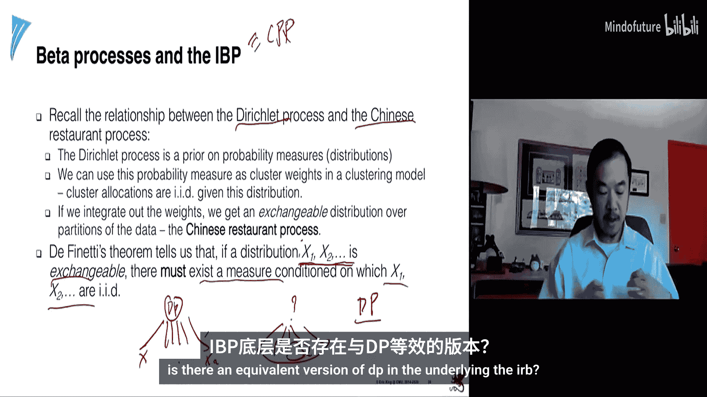

Okay， so that's basic a question。What， the choice that there is， okay？

Re that we have the beta beluli process， which we begin with。

 you know sample the Z matrix at that time it was set to be finite。what these are。

Beta parameters or beta variables。And then we use the beta variables to sample the example。

 the indicators。 So this process is known as a beta。

And the beta process are also generating atoms in here。Just like the du process also generates atoms。

 which is a。Vectctor of time right here the atoms， you know， are just you know。

 a a scalar with a mass between0 and1。 So that's basically a counterpart of DP in our IDP。

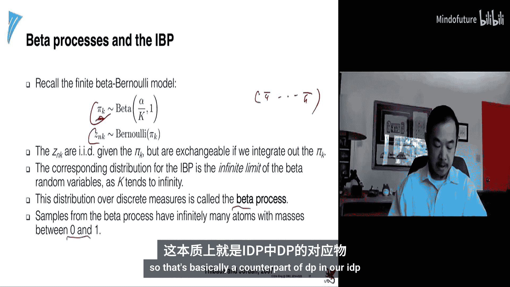

And then， you know， remember in the DP。阿尔法。And once we have plus some data sets。

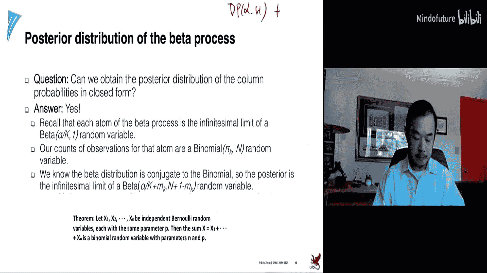

We can actually also write down a posterior。You know， of。The。碟片。Of of， of the， of the items。You know。

 of the pie。低温碟皮。And also， the example。S啊。Also， ADP with somehow rateweighted alphas。

 I forgot that the exact expression is rate weighted by the counts， right。

 That's basically making the distribution process a very nice prior distribution because it is conjugate your prior。

And your posterior。六得 same。So in our IBP， we know the prior is a beta process。

How about the posterior distribution？It turns out that the autoor distribution can also be derived in close form。

 okay。Remember that you know。In the beta process。You know。You know。

 we basically are really drawing atoms from a infinitefinitizable limit of a beta distribution of random variables。

喂。And the counts of the observation， which in this case， you know， observations are the Z， right？

And the counts of all these are equals to one。Actually can be written as a binomial distribution。

There's a steer actually showing you that is the case because the summation of a finite number of you know。

 benoi distributed random variables。Is known as a biom distribution。

 and here the beli rates are defined by the data distribution。So in a sense， if we look at accounts。

We are going to see a， you know， a benoli or a binomial distribution。对。And then。

It is well known after the binommial and beta， a pair of conjugate priors， conjugate distributions。

See。And now we can， you know， go back and you know。And the right on。

 basically a post theorem of the rates。几问。That count。Okay。And given the original beta prior。点。Okay。

 remember discounts。Is following a binomial。And this one is a beta。

And beta and binommial are just like derilet and multinomial。Okay， it's conjugate。 Therefore。

 the posterior is also a beta with a rescale parameters。 Okay， so this can be easily proven。

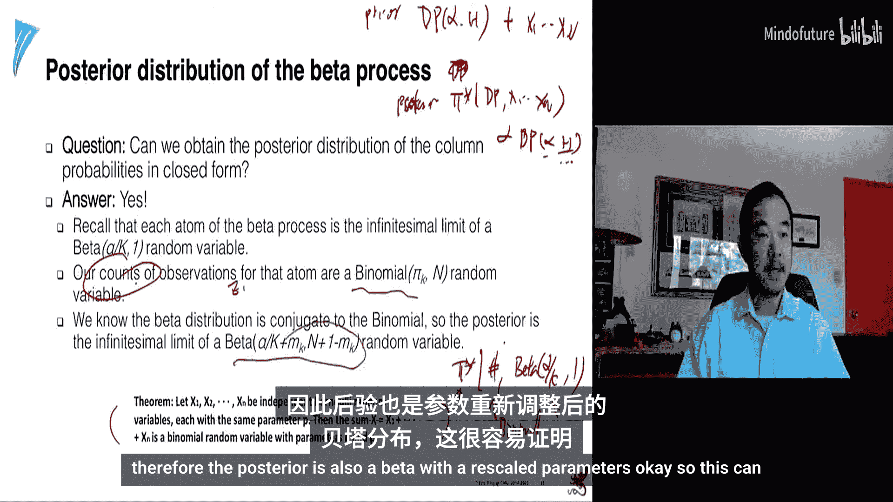

Okay if that answer is first question， you it is IBP is equivalent to a beta process and the beta process is a conjugate prior you know for random measures of the Z matrix sampling rate and the posterior is also a beta process with a different rates。

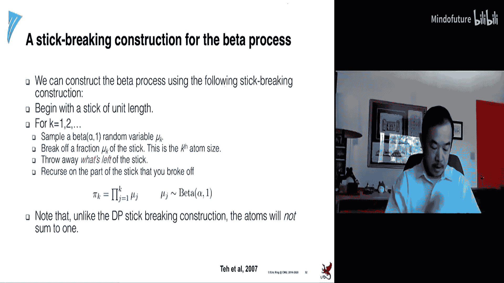

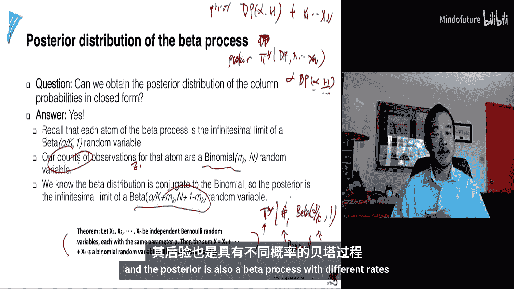

There's another equivalent that is also very interesting in the in process。

 we mentioned about a stick breaking process， okay， to allow you draw samples of the rates。

And then you know that defines the item and also the location， you know all other items。

And without going too much into the details for the interest of time here。

 we have also a dual process， a stake breaking construction for the beta process。

You can read the text， but what is the interesting contrast is that in the DP。

 we break the stick from here。And then here and then here。

 and we basically are breaking the remaining ones okay therefore the whole thing adds up to one so in the beta process。

We have a very strange while breaking the stick。 You start from a union stick， you're break in here。

And等。You break here again， you keep breaking， you know， the the the the the。

 you know you keep throwing away， you know。The the other part and keep breaking what is， you know。

 a state ratio and making it more and small。 Therefore。

 here we have this and over there we have a pi a multiplication of one minus mu。

 that's the difference。嗯。So all these tricks， you know。

 it's good to know because they will help you to design good sampling process for the inference。

 but if you just want to know the concept。You know， of the IBP， these one are less relevant。

We are going to steep the inference part。And maybe talk about a few more extensions。So when。When the。

IBP gets published， it generates a huge amount of interest in the community because it's a very。

 very nice tool to make flexible modeling of random matrix for combining features but also people start to exploit it you know stronger properties you know using the process without even more about too much of the statistical details So look this is the vanilla IBP。

Which rely on a single parameter alpha。请。This single problem controls everything。

 it controls the expected number of columns to be used， the expected occupants of the columns。

 you know for each one and for all。And having one hyperparmeter controlling all this sometimes make people feel a little bit inflexible。

 therefore， someone， in fact， this guy wrote a paper and introduced a new data you a two prime extension。

 which has beta and alpha and looked like this。The idea remain the same it's just the beta are differently parameterterized。

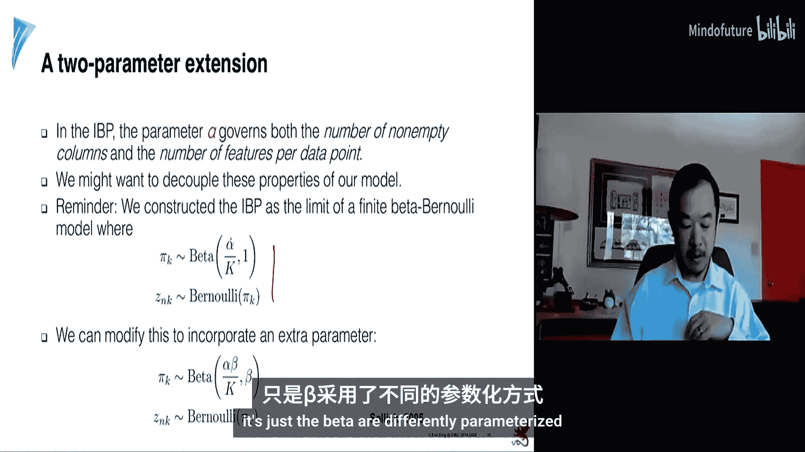

So as a result， this two prompt process allows some more flexible definitions。 Okay， for example。

 here in terms of a realization。The process defines the following co parameter Indian profit process。

The first guy walks in and still gets a Haan alpha number of dishes。Then the later customers。

 when they pick clients dishes instead of an M K over N。They use M over beta plus and minus1 Okay。

 the beta is helping to kind of damp or reduce the probability of a older dish impact okay they discourage basically reusing older features。

And then they increase you， the probability of trying new dishes or new features。

Originally I forgot it was alpha over n， something like that。

 but now it's like alpha times beta over this， which I believe is bigger than originally。

And with that， you can also compute you know what's the global statistic， for example here。

 it turns out that the number of features per data points are still marginally a person for every row in the Z matrix。

 but the number of non empty columns。which basically is the number of features being used not only just you our earlier numbers。

Okay， alpha times a telesco sum of some number here we have。A different summation。

 which is making the number bigger， okay。And if beta sets to one that recovers the person and the IBP passes。

So just to give you a kind of a sense about how the resultant matrix looks like。

 this is the two parameter IBP。 this is the one parameter original IBP。

 you can see that now more and more features are being utilized and the matrix becomes sparssome So this is just a human taste some people feel that I don't want to overuse most successful features。

 but I want to really make use of many， many more features。

 maybe their data are just too noisy and too diverse which necesitates this kind of practice。

So that's how we augment the IBP for more flexible capability。诶。There are some。Other， you know。

 ideas to further expand and the distribution of not just the。Randdom binary matrix。

 but just random matrix in general。 Okay， the matrix could be， you know， not just， you know。

 spae and 01， but could be dense and also could be real count。

 You want to use the number of features。 multiple times and so forth for the these are all these other needs。

And they can construct basically slightly more complicated distributions over that using still the。

TheAPP ideas。Well， let me just show you example for closing unless you have questions at this point。

Have five minutes left。 Yeah， so this is another interesting process known as the infinite gamma personson process。

Okay， originally， it's called the beta butnoi process。 now is the G some process。 Basically。

 what happens is that we are going to。Sample a real number from a gamma。

And use it to scale the dish process。 This is the analytical expression， But from a pragmatic letter。

 a manner you can see， you know， it creates something like this。

You can associate basically every atom。Okay， with the gamma process。你四期会生过嚟噶吗。

And for every column， you know， in that matrix。Remember in the previous IBP。诶。

We basically associate with a column with a data item。Whi basically defines a benoli。

 and you basically draw a one or zero from it。Now， with a gamma item。

You basically can use it to define a personson。And then。The entries， you know， inside this matrix。

I no longer， you know， a binary number， but a real number like this。Okay。

 so this is known as the infinite gamma Poson process。

And there are some good properties in this matrix， which is discussed in this paper。

 it basically allows you to have better inability and control over how the features are used on real data。

And so this is how it really looked like。At the end of the day。You basically， you know， could use。

 you know a again， a very， you know a intuitive sampling process like what we have in IDP， you know。

 to fueling this matrix。This is a。What we have here。

Is the equivalent of the beta and Bennoli that allow it to generate the whole matrix。

 but in trans to the IBP metaphor， how can we generate the left。

 a focused equivalent class using a conditional of every sample given the previous one？

Then the gamma personson process actually translates to this。Okay。

 they are going to use now a negative binomial。Okay， to a sample existing dishes。行。Like this。

 And then you are going to use another negative binomial。You know， to sample the new dishes。

Let's say， he equals to4。 And then these new dishes are actually distributed very interestingly。

 not put into。One of this slot， but into all this slot using something known as the CRP。Okay。

 which gives you， you know， a way of partitioning， you know， the features。Among， you know different。

 you know。You know， a client among different options that one client may have the story become more complicated。

 it's less intuitiveive now basically it means that this particular new example not only will be picking up new features。

 you know， in this way based on the early history， but also you were picking you know。

 altogether simultaneously multiple new features。Okay， not just one， but multiple。

 and then distribute them among the new entries using a CRRP metaphor where some you know features。

Use the more some future are use less。So I have no vertical knowledge about the intuitions behind why this is good。

 but this is mathematically possible using the infinite gamma process。So with that。

 I'm going to close the section of nonmetric baing models it。

Technically slightly more intricate and complex technique， as you can see， you know。

 in our graphic model class， but again， you can， you know， hopefully appreciate， you know。

 its capability in making the model more flexible。And also it's a building block in the bigger picture graphic model literature。

 you know for you know upgrading or extending existing models， you know。

 we actually see applications of， for example， DP together with the HMM to make the hidden mark model infinite dimensional you have infinite hidden states。

 even though you have a finite time series。We also see applications of IBP。

 you know in a latent classroom applications and so forth。

 so if you're interested you can look into some of these papers。

So with that I'm going to close today by the way， you will be receiving some new notifications from Piazza and from email hopefully you know on our final plan for the class projects and presentations we understand that there are some disruptions now during due to the online arrangement of this class we give you some more time to prep the final reports and the presentation and also make the whole experience hopefully simpler then what we originally hopeful in the poster session。

Any questions from the class？Before系。Officially close。Okay， no questions， Ben thank you very much。

 I will see you again next Monday。

