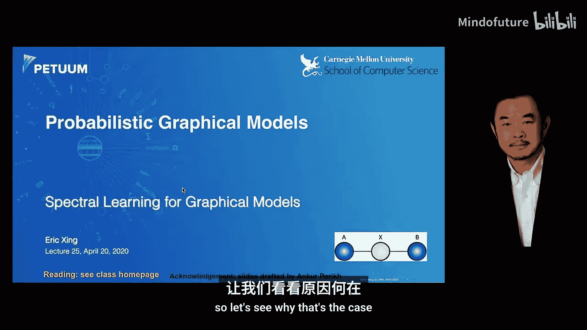
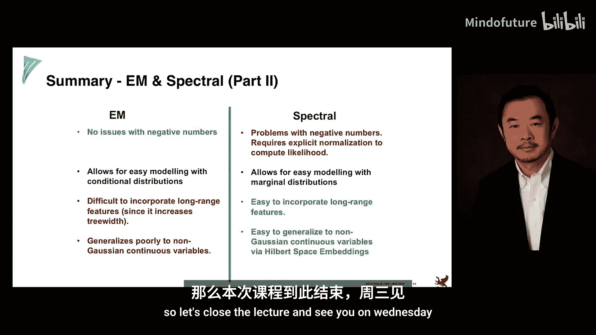

# 【卡耐基梅隆】概率图形模型 ｜ Probabilistic Graphical Models 2020 p25 P25_Lecture_25_图模型的谱学习 -BV1ebpGzhEA9_p25-

Okay， hi class， Good morning。 Yeah， let's get started。

So thank you for joining the poll I sent over the weekend。By a very narrow margin。

 maybe by three boats， people show their preference on Spec graphic models over machine learning and healthcare applications。

 so we're going to talk about the graphic models with a spectrum learning technique today。

If you' are still interested say in hearing about healthcare。

 that could be included as one of the optional topics， you for the next few days。

 but just let me know or express your opinion on Piazza。So， let's get started。

So special learning on graphic models， it is a very active topic about six or seven years ago。

And now， of course， with the swiping interest in deep learning， you know。

 many of these more kind of nuanced technology are not practiced as often。

 but I still feel it's a very nice idea that you can see。

 you know in you know maybe improving or in augmenting existing technique may also mo new designs down the road。

 so let's see why that's the case。

Just a recap， you know， so far we've gone through many latent variable models， right。

 so here are a few examples。 This is H。And the edges on top of that represents a long range interaction or dependencies so that you don't have to be first automatic my copy。

 but also higher automatic my copy。And this is a model used in sentence passing。 You give a sentence。

 You have a part of speech tagging。And then you need to come up with a latent tree to pass the sentence。

You know， for interpretation of sentence generation。

And this is a model which is very similar to the LDA topic model where it's applied to social networks。

 it's called mixed membership model， and you can see social actors can be projected into some latent space so that their clusters or dependencies can be visualized much better so these are basically you know a wide range of latent models。

And this is just a more explicit example about the proposition contact free gra。

And this is known as the latent variableable probabilistic context programme。And in this case。

 you know， the PCfG is a classical NLP model where you need to have a human labels of the internal structure like this part。

 and then you train a probabilistic CfG model this latent verbal model don't does not assume that this latent tree is given。

 you are only given the sentence。And also the part of this tagging。

And then you are going to infert laternt structure。 Therefore， it is， of course， way more difficult。

 but also， it's less reliant on high quality labels from users。So how to learn such model， right。

 So I guess now at this point， you should be very well aware about a very common technique known as the E algorithm you are going to basically iterate between a estimation step and a learning step in the estimation step。

 you are going to now come up with the。Imputation of the latent variables。

 and then you treat them as a fully observed model in the in the M phase and learn the estimation and then you iterate。

And we should by now also know that there are a number of difficulties or shortcomings of this technique。

 one is that the EM algorithm is very slow， you know， it really requires a iterative algorithm。

 which may or may not converge。And secondly， even if it is converging。

 the loss function contour of the latent burn models is always non comebacks。

 therefore you may run into a local minimum and the way to overcome a local minimum is to have a multiple random initialization。

 maybe 100 different initialization and a further adds up to the slowness it makes the algorithm more expensive。

So spectral learning is a very， very interesting and intriguing idea。

 which has nice theoretical properties， it is proably consistent。

It is also offer good insight into the identifiability。

 so these are nice thing about the spectrum learning algorithm and practically it is also free of local minima because there isn't latent variables involved。

And it is therefore very， very fast because it's not a very， very expensive iterative algorithm。

And also it is very flexible， it does not really need you to assume Gaussianianity。

 discrete random variables and so forth， it can be applied to all types of data with you know some tricks and ideas borrowed from kernel learning in fact there is another topic called reproducing Colonnal Huber space technique。

 which we could also make them as a E topic which is not covered here。

 but I'm going mention the ideas。In terms of how they can further boost stretch on learning。

 So these are all the advantage。It sounds like a very ideal technique。

 you know for learning all graphic models， but of course we' are going to see very， very shortly。

 there are also some difficulties in this technique。

The difficulty are mostly conceptual because it is algebraricically more less straightforward you know than a graphic model standard graphic model technique where you know all you need to know is to know a few distribution family know the factor rule and then you assembled in special learning it's more complicated so here I listed a few representative papers you can see that this whole thing started roughly a decade ago。

And there are some major new developments in the following few years。

And I haven't been tracing so closely in the immediate past few years about the new development。

 but my impression that it is not as active as before you know， for obvious reason。

 because it is less straightforward， it's not so easy you know to deploy and to develop。

 but still you know there are very， very strong properties of this technique which I encourage you to explore。

All right， so let's see， you know why we have you know an opportunity， you know。

 to invent a new method， which is the stretch learning for latent verbal models。

So let's first maybe ask a question。Why we even develop， you know， some， in some cases。

 at least a latent bird model。 say this H M M， okay。hy we develop HM。Well。

 you may say that I just want to know the latent states， I literally want to know that。

 say in our dishonest casino example， we want to know that who how the dealer is playing a trick and and what is his strategy and so forths。

 So these are all nice go but at the end of day， I want to basically challenge you， yeah。

 why do you know all this is that just because of curiosity or you want to just win your bet right。

I guess most people， you know， will say that well， I actually don't care about all these you know。

 latent facts。 I want to win a bet。 If you can help me to win a bet。

 I don't even want to know anything。 It just， you know， play for me with my money， right。

 So that could be somebody's attitude。Therefore were。You know。

 if you see a partial sequence like this， being able to make prediction on this one on this one。

Is the major goal and the latent the verbal are basically one of the vehicles to lead to this point。

 so that's basically you know area insight I want to bring forward because if that's the case。

 you know for our learning task。Then we may think a little bit differently about how to design a problem。

 Okay， especially in this dynamic system， let's say predict the future。

 given the past is our major goal。All right。So if we focus on prediction， then we ask。

 do we still need EMA to learn parameters？What。Yes， I know。

 right If your model is like an HMM like this， you of course need to know the little variable because that will give you the conditional probability of a P of a Y T given Y T minus1 and then you know X T given y。

T， therefore， you can build on the sequence to predict the future。But。In our Beijing technique。

 in fact， in the past a few lectures， when we talk about non per Beijing。

 Remember the Chinese restaurant process and the ending buffet process。

 What we do is to integrate out。Right those generative models that is generating。

 say the seat configuration or the feature configuration。Our technique there was to really predict。

 say， Z of N plus1。Which is the N plus ones customer。Or a impulse once object。

Given the entire sequence of12 m right and then there is a predictive function that you can achieve can obtain by integrating out you know。

 those hidden distributions of the class label allocation。

 you directly make a prediction of the new label right So that idea actually can be used in fact in any latent based models。

 So in here in graphic model in HMM， we could imagine this part gets integrated out。

So if that's the case。What's the consequence why why didn't we do that you know in many of the you know complex graphic models like HM？

Yeah， so here is why。Once we， you know， integrate out this。You， you know。

 you probably imagine based on our CRP example。These all obant variables will start to be dependent of all each other。

 right， So that's basically， you know， something that you should be able to convince yourself。

 And at the end of day， that leads to a model that is a click。

If every one of this random variable is dependent on any other random variable。

 then essentially the topology is a click。That kind of beats the very purpose of our， you know。

 a graphic model design， because a click really can be only described by you know a。你呀。

You know you know a contingency table you know of all configurations and then if you have many random variabless。

 it will be very， very big right so that's not necessarily a very good idea。It is fine。

 maybe if your goal is like doing simple classrooming things like this， but for many other。

 you know you know， more complex task。Using a click to model the whole thing is not a good idea。

 because here you're only contingent on the count of the previous。Patrons， but in here。

 you may actually need to look and not just count of every individual。Of all the individual。

 but the actual you know behavior of every node， then that modeling task will be very， very big。啊。

And you know， mathematically， why does's the case， because integrating all the hidden variables really means a summation over this factor distribution。

And because after the alter sum， the whole， you know， subject cannot be further factorized。

 Therefore， you get the click。嗯。so诶。Now， let's see， you know， obviously。

 a click is very different from H M M。But。What is exactly the differences， you know。

 if we going to be using a more actionable edge break description， Of course。

 the difference is that there is a graph and there is a click that that look different。

 but edge break or computationally， what is the difference。Other than just the representation。

 either by a team， a group of small conditional probabilities or a gigantic choosetable probability。

Maybe here is a way to look at it。So here I have a very simple graphic model of three observed random variables。

All connected to one hidden random verb。Okay。And obviously， the hidden random variable H。

Has a cardinality。 You can imagine that it has a number of states， basically。The carinity of H。

Let's let's assume that the coity of x all belongs to or equals to M。They have M states。嗯。

And this one。Also has a number， right， It could be equal to K。停。So now let me ask。

 what if a K equals to one。This is an edge brick statement that the cardinality or the number of states of the hidden random variable equals to one。

Does it actually have anything to do with the we withdraw a graph？That's the question。Okay， and。

Iuess from you guys about how the graph may look like if K equals to1， you want to shout out。嗯。

The nodes will be independent。They will be independent。

 Can you try to make an explanation why that's the case。嗯。You're right， actually。

 that's an excellent answer， but do you why， why， how did you get to that point？

Because that's what I'd said on the slides。It's in a size。 Okay， perfect answer， yeah。Thank you。

It's good that youll read a slides first， and that's always a good thing that you' prepped the material。

And the reason actually will be in the next slide。 But you're right。 You can imagine intuitively。

 if basically H equals to one。呃， that means是。It doesn't matter what value H take。You know， you know。

 H x1 and two and3 will just behave the same as if there is a no influence from H because it has only one by take that actually gives you a kind of intuitive guess that these three things will be independent of each other。

Because there is no hidden cause which can be used to impact the three random variabless in any way different they influence。

 but they will be influenced in the same way， therefore that influence can be neglected。OkayIn fact。

ly， we can also prove that in a second， but let's ask， what if H。

Has the many states say H equals to a K equals to M cube。Then actually， you probably could also。

 you know， convince yourself， in this case， you actually get。This， is a click。Okay。

 so you can see this a two。Graph。1 is this one， and the other is this one。You know。

 they are different graphs， but they correspond to just a different way of defining the carbonality of the hidden variable H and the reason it's becoming。

 you know a click is because here you know my H could assume a value which correspond to every possible configurations of the three observ variable。

 therefore all configurations of the three random variables is honored and and assigned a different kind of latent state。

RightSo that's why you know a click is exactly correspond to that， you know。

 you basically allow all dependencies to take place okay。Alright。

 so the question is that what if my K is between one and M3 M cube。对。

So that's a little bit harder to answer。Whether it's going to becoming a between， you know。

 three in notes versus a click。There are， of course， you can have two edges。

 but there are also a continuing of many you know， stronger or weaker dependencies， right？

So that's actually beyond what a graph can describe。And that basically leads to a alternative view。

 which is called the spectrum view of the answer。对。So before we go to the spectrum view。

 let's just mention briefly about some of the algebraic expressions we are going to use on the road。

And which correspond to， you know。I mean， the linear edge break rule will be correspond to our probabilistic and operations that we talked before。

 so one rule is called a sum rule which correspond to the marginalization of a joint distribution so here is how we write on a joint a conditional times a marginal and then this one gets you to P of x and y and then with sum over y and then we get X。

And edge break， linear edge break。嗯。We use the following matrix algebra to express that， okay。

This one is a table。 This one is a table， and this one is a vector。And。By doing this， you know。

Ma matrixtri algebra。 we get down to matrix times the vector leads to a vector。 Okay。

 so this is called a sum rule。听。By the way， here we all assume that random variables are continuous。

 we are discrete for continuous ones we're going to talk about later。

 there is a technique to cover that。The next one is called Chen Ru。Basically。

 this is how you get to the joint by multiplying conditionals。

And the equivalent matrix edge brake operation is this。Okay。

 it's now becoming a matrix multiplied by not a vector， but a diagonalized vector matrix here。

 because if you put you know y into a vector， it will get marginalized summed out and leads to you know a marginal over x。

 but if you put the y into the diagonal you know elements of a matrix。

 then you actually would not summed them out。Just like this。

 and then you still get a matrix which describe the joint probability of the two random variables so some rule and matrix rule。

Okay， now let's see the linear edge break view of a graphical models。So A and B each have M states。

 and therefore， you know the joint can be described by a table。So in general。

 we cannot really say anything about this table， right， because they can have arbitrary dependencies。

And therefore， all configurations。You know， it is possible。But。Let's imagine。This。You know， a graph。

Where A and B are independent of each other。Right， so if A and B are independent。

Then you can rewrite the joint。Into a product。Is it the key of a b。Equals to P of a times P of B。

Therefore， you know a column in a row in here correspond to a equals to one of the value and then B taking all other values。

喂。And。Therefore， you know。You know， all other rows will pretty much be this part times another。

 you know， you know， a P equals to another value， maybe A equals to M， for example。So， in this case。

The matrix actually has a very， very explicit property that their rank equals to one。

So this is the definition of a matrix rank，So there is now a direct correspondence between a matrix of the joint probability versus the graphical model of this pair random variable。

 rank one matrix correspond to you you a independent graphic model for the two random variables。ok。

And。What's the， And then if， you know，If the two random variables are actually connected in arbitrarybit in under all configurations are possible。

Then， you know， we still add have a matrix， which has a full rank。 Therefore， it is of M。

 This is the highest rank。You know， you know， in this matrix， because the A and B。Each can take。

You know， just the one value M values。So now let's see if I give you a matrix。

But it has a rank between1 and M。What graphic model do I have？Okay that's the interesting question。

 in fact， there isn't a explicit graphic model anymore。喂。

Because that's the only two ways two nodes can be connected。

 You kind of can imagine there's something in the middle， which is weaker， but you cannot just。

 you know， have a graphical expression of that。 So that's basically what's happening between for a K。

 that is。Between Y and M。听。So that means， you know， for， you know， a low rank。You know。

Join probability of the A And B。You need to， you know， introduce some arbitrary ingredients。

To augment the graphic model。In fact， that actually gives you an actual degree of expressivity。

 for example， here。I can introduce a latent variable。Okay， which。Can have a K number of states。

It turns out that a rank K。you know a table。Of the joint of A and B correspond to this graphic model where the latent variable can explicitly capture the rank of that matrix。

In fact， you can also prove to yourself that the strong probability。Mattrix of A And B， you know。

 their rank is going to be smaller or equal to K。 If the latent variable connected in this way has a rank K。

So how that is proven。It's very， very easy Basically。

 you can imagine the following matrix factorization。This is pretty generic。

 You can introduce a diagonal matrix expressing the states of X。

And then you can factorize the A and B， you know， conditioning on x in this way， and then if。

The rank of the x matrix is bounded by K。Then because of this matrix factorization。

We can conclude that the P of AB is also bound by K。对。

So what I'm trying to say is that the spectrum view of the graphic model actually is having a very very nice correspondence to the concept of hidden variables。

And it captures the carronty of the hidden verbal。And therefore。

 allow different degrees of dependencies between the observ random variables。

So what I did here is that I said about。A matrix with a lower rank than the full rank。

 And then they correspond to the hidden verb。But the other way you can go is that I would not care about the hidden variable variable because it's going to cause me to a more complex learning algorithm like EM algorithm。

 I'm going to only worry about A and B directly。点。But I can really use a low rank key of A B。

For this。You know， pair of observationserv variable。

 which effectively accommodates the presence of a hidden variable。

 So I'm going to go from here to here。Right， even though， you know， to understand in the low rank。

Okay， I need to introduce a hidden variable。 So these two concepts are equivalent。Okay。

 so this is the spectrum view of graphic models。And it is a very， very nice technique， which。

Enables to use many of the tools in linear algebra to exploit the structure， you know。

 you can can see where it is set about the concept of rank。And we also you know。

 know what is eigenvalue， and there are also， you know。

 various techniques such as SVD and techniques to deal with linear algebra count entities。

Which will make the learning procedure rather convenient and easier。Okay。

 so now let's look at a more interesting example。 We have now multiple hidden variables。

Each of which has a K state and observation are M states。And now let's look at a bigger table， Okay。

 let's imagine that this is our joint property table and on the row。

 the rows are indexed by the states of the first two random variable。

 the columns are indexed by the states of three and4 okay。And。Again， you know。

 with the proof we had before， because the latent variables， you know， has a rank K。

 we can show that this matrix also has a run K。Even though the size of this matrix can be very big。

 in fact， it is actually how big is this matrix？Anybody can answer me。

 I don't think this is on the slides。How big is this green matrix？嗯。Yeah。Anybody yeah2M by2M。Yes。

 I got two answers。 One is2 m times 2 M， The other is M square times M square。

I believe the next one is right m square by lamb square because here the index is on the joint configurations of the two random variables。

 therefore you get to m square Thank you。Great。😊，So M squared and M square is a very big matrix。

 but because of the latent variable rank， which is known。Okay。

 then it becomes a low rank and why is normal because it's by design， for example。

 I just want to have M hidden states。 You know， the dealer only has， say two choices， right。

 so then I makes two。And so。How to prove that or same thing。

 we can prove it by a matrix factorization。Let's just imagine a general kind of a matrix structureization。

 Suppose it is a N by N matrix。And then we can always factorize them。 You know。

 with A M by K and K by N K can be。Arbitrarily chosen。Right， so we have one。And。In fact。

 given this matrix。We can easily， you know， do that， you know， with you know。

 a factorization that correspond to exactly this idea。Okay。

 you can just condition the first one on the latent state and the next three next two also on the latent state and the latent state。

 of course， has a case state。Therefore。We have now a expression of this bigger matrix。With a。

Combination of the expression using smaller matrix。 This is actually， you know， again。

 going back to our factorization， you know， principle， right。

 we use a smaller conditional distribution to。Assemble a bigger one。

 And that's exactly what's happening here。 But again。

 this particular ferilization requires hidden variables to be introduced。Now。

If you play with a linear algebra， you know， often， you know that。Everybra matrix。

Does not have just one you ferization， in fact。There are arbitrarily many ways of factor writing a matrix。

 it is not unique， for example， given this one， you can always introduce a invertible transformer a transformation in the middle。

And then that gives you this and that。so that's another factorization。

The special learning algorithm has this magic that by choosing some appropriate S。

It can lead you to a factorization of the M using matrices that only includes the observer variables。

Therefore， no hidden bar boys needed it。That's basically， you know very interesting。

Property that let's take a deeper look。听。All right， so。Imagine that， you know， again。

 we begin with this a full matrix。And there are a couple of， you know， sub。

 observed matrices of subset random variables， which are smaller。 say three random variables。

 Let's look at these too okay。And。嗯。You can also express this， too。You know， using。

Further kind of factorization with even smaller matrix。And here are just two approaches， right， so。

The P of x 1，2，3 can be factorized， can be pivoted basically by H2 and factorized into this matrix and that matrix。

And likewise， you can use the hiddenberg H2 to pivot X 2，3 and 4 and get the following。You know。

 ferization。Okay，Now let's just look at these two lines together。Those matrices that you know。

 I underscored with a green bar， if you multiply them together。You get what？You get this。Right， so。

X 1 and2 given H2 times p of H 2 times x 3 and 4 given H 2 gives you the joint of x 1，2，3，4。

And the other three factors， which I underscore was a red bar。Can actually leads you to a joint。

Of X 2 and 3 only two random variables。So now if you multiply them together， this part。And this part。

On the right hand side， you will have this times this on the left hand side。

 you have this and that therefore you can prove to yourself that you will have a new factorization where P of x 1。

2，3，4 can be expressed with a product of P of x 1，2，3。

And P of x 2 and3 inverse and P of x 2 and 3 and 4。So this is very magical because in here。

 this ferization contains。No hidden random variables。ok。All matrices are observed。 Therefore。

 you can imagine in order to learn a model of the joint。

You only need to collect statistics for this part and this part and this part。

 there is no need to estimate the hidden random variable age， unlike what were doing H。听。

And of course， you have the nice reduction because now you know。

 information are stored in the three random variable matrices rather than four。停。

Are you still with me。There is a caveat in this， as I said here， that even though these two matrices。

Has this a nice property of being a joint of three hidden random variables or not absorb random variables。

 This one is a inverse， you know of a joint of two random variables。

 So inverse of a probabilistic table is getting you something that is。

Well they don't have to be even negative non negative it it's a matrix of numbers there isn't a explicit probabilistic meaning for that matrix but you can still obtain it and compute it it just like the interrbability part of this is not as explicit or straightforward as what a hidden variable would provide so this ferization is known as the observable factorization。

Okay， so graphically you can see， you know， this factorization correspond to you know a pivoting operation on graphic models。

 you know， we are going to introduce a pivot on H2。And that basically you know， allows， you know。

 the full matrix to be， you know， divided into a few pieces。

 each of which contains the only shared variable in this three， you know will be。

The x2 that they actually this pivot in a point to。 So， for example， this first matrix contain x2。

The last matrix also contain X 2。And this one also connects to。

OkayAnd that's why it is the right pivot。You can also use X3。

 as's also H3 to pay that's also fine will give you the same thing。

And you can also have an alternative expression， but。You know， like this， that's also equivalent。

 Therefore， it gives you the way of， you know， learning the same probabilistic matrix differently。

And that gives you， and if you want to combine them， that gives you more flexibility of you know。

 getting a better answer。停。All right， so。Well， this slide shows you just a glimpse of the relationship to the original factor edition。

 which is based on hidden random variables。Basically， the relationship is。It's just a。

Particular way of manipulating， you know， the the the the。The the matrix， the factorizer the matrix。

Once you make a particular choice of that。You basically。Are getting， you know。

 the originally latent factorization into a observed factorization。

 So this part is not as interesting。 We can just pass that。ok。So。To sum up。呃。You can use， you know。

 you know， a observed characterization now to break a big observation matrix into a product of small matrices。

 each of which。You know， only includes the observation randomberg。

And of course in here you don't see much advantage。

 it's just reducing variable the size of the matrix from four to three and two。

 but this trick can be applied recursively， for example here we have a five variable sequence of observations。

You can use the same observation vector addition to divide them into a three variable matrix。

 a two variable matrix， and a full variable matrix。And obviously。

 this a four verbal matrix can undergo， you， a subsequent ferilization。Into 3，2 and 3。

 so you can imagine that， you know， for。Any， you know， larger random variables。

 a larger sequence of random variables。You know， you can use a this trick to recursively divide them and eventually they can be expressed by a product of observation matrices of manageable size like two or three or maybe a little big。

And in training， what you do is to just you know collect sufficient statistics。

 you know from samples， okay of the variable of interest。In your building blocks。And then， you know。

 when you are doing the testing。You are going to you know introduce your tested configuration and you look at this a big table and then you basically multiply appropriate matrices that is consistent with your observation sequences and then get a number so you can see here the learning okay this is the learning part。

It's very different from a EM algorithm， which requires you to learn you know latent parameters。

 such as you know the probability of H T given Ht minus1 so this is basically the latent parameters right or the emission parameters like X given the H for every T。

So to do that， you have to have an EM algorithm。But in here。This is like the just trivialbute。

 maximumim learning with all of the variables， you just collect counts and then。

They will be used in this way to compute the probability of any future prediction sequences。咩。

And it is consistent because we can easily prove that MLE estimator of a probability measure is going to be consistent once you have a large enough data set。

听。Of course， it is not very statistically efficient。Okay， so。Let's see how we can apply that。

 so here is one possible applications。Remember our sentence passing applications I mentioned earlier。

RightIn the past， you know we rely on a supervised technique where the user has to label both the language sequence。

And also， the hidden trees of the passing。But in a un passing， you know， we are given only。

 you know the sequence and also the part of speech tag and your goal is to you know。

 estimate the hidden you know pass tree， hidden the sequence。

How can we do that with a spectrum approach， Well， you can see that you know。

 traditionally you write down a latent variable model like this。Right。

 and then you train it using an EM A， and then you plug in， you know。

 the observations and then compute the observation。

But in a special approach it's dramatically different from that。

 what you do is to come up with the right matrix factorization。

 you know this is a five variable matrix， a sixth matrix。

 you divide them into a product of all these blocks。

 which can be directly estimated from the observation。So in the training， you just。You know。

 compute this。And in the testing， you query the probability， you know， with， you know。

 any observation sequences。Okay，And that， of course。

 amounts to just very easily a sequence of a tensor multiplications。No hidden variable is needed。

 and this model is still consistent。So any questions so far。

Is that too good to be true that we are now free of hidden variables and。And。

Basically can bypass all the hidden verb design and directly learn arbitrary latent verb models just by counting matrices。

Any kind of doubts or reservations about this technique that you see so far， say， you know。

 this is illustrated in this example already， so。What's wrong with this equation or that good for us to go？

Any questions at this point， are you always me。Okay， I would post a few questions。First of all。

 you know， given this a whole sequence。Coming up with this ferization。Actually。

 require some technique， some some edge break insight。You know。

 I may not know the right way of describing or factorating them， you know。

 with this and this and that， especially when matrix are too many。

Where multiple fertizations are possible， maybe there are some better ones and some poor ones。

 I don't know whether you know I'm able to establish a ferization which has the equivalentence to my original sequence。

 so there's an edge Greek。Can of a knowledge needed。はい。

And the second thing that is even more pra is that。Here we have an inversion。

Whether this inversion exists or not actually is a question。 We don't actually know， for example。

 if a P of x and 2 and 3 is a rank deficient matrix， said rank 1。Can we inver it。Not necessarily。

 right。 The low rank deficiency made due to just the data is too poor。Or it just because， you know。

There is a preferred kind of additional dependencies that I want to independence。 I want to capture。

 which make。2 and three， you know， not arbitrly， you know， recombinable。

 So these are just some practical issues。ok。That's first word about you know the inversion issue because this is going to be confronted no matter how you factorize the matrix。

 which is of course very skill dependent， Imagine you have that skill。

When we can actually assume that this one。Iversionsions exist Well actually breakley is very。

 very easy to establish， right， as I said， it has to be full rank。And what if my。You know。

 actual size of the matrix。You know， its greater than， you know， the rank。ok。停。So， this part is。

裤衫铺衣服买。No let's see the matrix here has a lower rank。Now what do we do Well that part is easy。

 If a K is smaller than M。We can， you know， use you know a dimensionality reduction technique so that this higher rank matrix can multiply to you a loading matrix or a dimensional reduction matrix to project them into a lower rank lower dimensional space。

So that they become， you know， multiplicable， you know， with， a lower dimensional matrix。

So this one has a blank K。And I can literally use this trick to make them able to work with a higher rank and matrix in here。

Okay。And the U and the V matrix needs to be designed。So that， you know， they have a good， you know。

 a matching rank with both， you know， the left matrices and also the right matrices。How to。

 of course， design V and M and U。That's a trick。 In fact。

 it's almost like you bring back the latent variable problem， this matrix。Needs to be estimated。

 Okay， if you want to estimate it。Or you know， you could also just design it， you know， just put in。

 you know， A M by K matrix。The way you' want。But again。

 the results may not be so good if somehow the rotation they caused on the origin matrix confounded the factors or cause a loss of information。

 that's possible。 but at least the edge break is through。

What's more troublesome is that what if the key。The hidden states。

 we want a design where the hidden states has a higher carboninality than the observation。

It seems to be a bit odd， but that's a design choice we could have made。Okay。

Let me give you an example about the when that could happen。 Okay， say he， this one has a high K。

When this could happen。And if we want this to happen， how we can come up with， you know。四。You know。

 a matrix fertilization which honors a kind of property。So imagine say， this particular ju process。

Okay。I'm going to have the following operation。With the probability。05 and 0。5。

 I'm going to generate two symbols x and y， which you will observe。ok。But also， I'm going to allow。

 you know，A character， A。To be printed in times。You know， in observation。You know， just， you know。

Based on， you know， a， maybe say a random choice of N。倾。The choice of N， of course。

 is also a hidden state you don't know therefore， you know it could be anywhere from one to n。

At the end of day， you are seeing sequences like this。ok。So in these two sequences。

How many observations you have， Like， what is M。Yeah， the question is that I have a question。

 does this method only apply to discrete， Yes， so far。

 we discuss only discrete and toward the end of the lecture。

 we are going to talk about how to work on continuous。But that's a good question。Okay。

 so anyone has an answer to my question， you know， what's the M in the sequence you see。

M equal to one。Well。We already see X， Y， and A， already in here。3， yes。3 is the right answer。

 Liter it's here。 you saw three characters。Right。What is K。K equals to 2。都。Really。

 then how can you account for the number of as appeared。You know， in the observation。Right。So。

K is actually in here。To end。That's the answer。Because you need to not only remember what to produce for the symbol X and Y。

 but also to remember how many times a is produced。In a sense， you are going to remember。

 you know a whole sequence of an in， example， if you decided on n equals to 10。

Then you to you have to keep tracking on the number of A'。

 Am I going to see 10 A's already before I produce x and Y。

So therefore there is a tracking number that is of course， part of the hidden states。

 so in this case， this will be way bigger than。The M。

So that's a very nice practical property that sometimes my hidden verb model wants to have in this case you can see what' its essentially achieving is that it is no longer a hidden markov model of first order It is really capturing now longer term dependencies I'm going to now look at the history and check how many a I already have before I reach an and produce a X or1。

So long term dependencies。是。So long term dependencies basically requires you know。

 M O to be greater than。The M， the observations。So how does the spectrum framework does that？

Because it causes the matrix to be higher rank， therefore， it is not invertable。

Thenend the observations。So。Here is the technique okay。If we have a long term sequences。

Which causes the key。To be greater than M。Then， you know。

 we can use another technique where we are going to change the way this matrix is going to be defined。

 for example， recall our fertilization here， you know， once you're pivoting here。

 your matrix is always you know， very， very straightforwardly described by this kind of a short range。

Coverage of the next one or two random variables in the whole domain。

If you have a longer range features， like I do have in here。

You can now instead of writing down a table of say three matrices three random variables of M dimension。

You can actually introduce an arbitrary feature vector。

Which allows you to describe anything want to describe for the sequence of this lens。Okay。

 and this feature vector is up to design。Okay， you can basically write。The number of As I see。

 or for the past 1，2 K positions， I that a A or not。Something like this。

 so it's an arbitrary feature vector。And likewise， you can have a right feature vector。

You know you know， for this with respect to this pivot。And then。This matrix originally。

 is the choose table。Of in the configuration of X Y only now becomes a alter product。offer。

The two delta vector。It is originally in here is's the delta vector describing just the configurations of x and y and3 right I'm going to now replace them with the left and right feature matrices。

Of feature vectors。So this is a trick allowing you to really you know incorporate a far more number of you know features than M So here remember it could be only m because the delta of x2 can only take this many you know a configurations but this phi of L and R can take way more features number of features therefore you know what you have is this matrix instead。

 which now has a very big K cardinality and then they can again gets to you know a match to the left and right matrices。

听。Okay， so that's basically just a rough idea about the feature trick。

Which gives you appropriate ranked observation matrices。

The important thing that they are all observed， you can still just bring in the counts into this feature function or the original probilistic table and then without resorting to any hidden random variables。

so。Anchor， who is my former students， He actually worked quite， you know， in depth on this technique。

And you can see from this graph， you know， that technique can be applied to higher order micro copy model。

 factor micro copy model， tree models and so forths。And he actually did a lot of experiments。

 you know， on the quality and efficiency of learning these type of graphic models。

 special graphic models， and you can see some comparisons in here。First of all， the speed advantage。

Right， you can see that， you know， a E algorithm or an online E algorithm， which is you know a a。

It is E， but you know， every time it is taking the latest window of the data and do the online update rather than the batch update。

 You can see that the efficiency， you know， runtime of a magazine is really growing exponentially。

 So this is exponential scale。With the number of training examples， right。

 And if you see the second algorithm， it is going。You know， not quite exponentially or with a much。

 much smaller number in here， so it's more efficient， order is magnitude more efficient。

In terms of the quality。呃。Say the error on prediction。Here is a comparison at the beginning。You know。

 with a very， very small number of training examples。

You can imagine that EM because of the complexity of the EM and the hidden station or that。

 it usually requires more examples to get higher training quality。

 otherwise they will be you know stuck into some bird but local minimum therefore you know at the small sample size。

 the spectrum algorithm does better not only faster but also better。With one more examples。

 the EMA was then picked up。And start to do sometimes even better than spectrum or as good as spectrum。

Okay， that's basic where when EMC more examples。And gets a greater statistical efficiency。

 But interestingly， if you keep growing the example to very big， the EM algorithm does poorly again。

 why， because。The size of the。Complexity of the learning task actually grow with the number of examples in latent space models。

 because when you have more and more examples。You are going to estimate more and more hidden random variables。

For each of the observation。And you are having more chance to commit mistake because your problem become larger and larger。

 So basically， that part outweighs。The statistical strengths of the data to the estimator。 Therefore。

 it can become poor again， but for spectrum， there isn't such a property， such a phenomenon。

 It will keep going down once you have more and more data because the complexity of the problem。

 didn't in didn't increase。 You don't really have any growth on hidden variables to be estimated。

 You only have more sufficient statistics in your observation matrices。

 So that's the nice property of a spectrum technique。

And there are some empirical comparison done by Sheikh Cohen on the supervised passing。

V unsupervised par， in fact， the comparison was done by An， the reference point。

 the supervised par was by She Co， which is based on a probability context programme。

 and this latent one as I mentioned before， does not require a labels labeling of the passse tree。

 therefore it is easier to train。And you can see that the performance， you know。

 even though it requires much， much weaker and easier data， the performance are comparable。ok。And。

 but on the other hand， the speed is a way， you know。

More kind of efficient you can see it's usually an order， if not two orders or magnitude differences。

All right。Now we have 10 minutes left， we can see deal with a few other additional technical tricks。

So when ask， orll actually I have a question here， what does it mean training examples equal to 01 is the X axis log scale。

 Yes， I believe。Good point。Yeah， I believe it is log scale。ok。Yeah。Alright。Thanks， all right。

 So one of the question I just heard was about how about continuous randomberg。Yes。

 so all what I said just now， which is built on having a matrix of x and one and x 2。 he， of course。

 it's air making assumptions on discreteness。But。We still you know， you know。

 unfortunately it's not covered in this course， but there is a。

Family of technique known as the Revolutionproduct Colonel Huber Space embedding。

In the system we have embedding using reproducing kernels where you can really。

Pursue a transformation of， you know。Entities like a sample from a discrete or or a continuous distribution or even a distribution itself into another Hubert kernel space。

 a Hubert space。Which allow a vector to kind of expression， for example。

 if you represent a distribution in a hub space， they can be expressed by a mean parameter。

 a mean vector。Okay。And if you have a example。Okay， in the Huber space， they will be。Another。

 you know， you know， transmission vector， which allows the non nonlinear transmission of the original vector into here。

 In fact， it could also be a infinite dimensional matrix where this。

Coronality of Phi could be infinite， but using the kernel trick。

 we can always deal with just the do product of the feature vector。 Therefore。

 you don't have to even deal with the infinite feature vector， you know。

 even if you have you know a expression of the feature vector in a infinite space。

 So these are techniques we we it's well established in the in the Hbert space embedding technique。

 which is not going to be discussed in today's lecture list。 If you' interested。

 we could use also one of the electric vector to discuss that。

So now let's see how our you know matrix， spectrum graphic model technique connects to the Huber space emdding。

Remember？Originally， to obtain， you know， a。えのエア？Joint properties table。

We use the following operation， the joint copy table is literally just the expectation of the incident vector so these delta vectors are picking you know observations right if observation equals to some value。

 then the delta function correspond to value will be equal to one theyre picked up otherwise it is set to zero。

So this is just a edge break expression of picking observation values into the table。

And we also just mentioned that we could replace each of this the delta vector is literally just a vector of。

 you know，0，0，0，0，1 and so forth one is like。Case dimension， That means that。So basically， Delta。

 you know， K。Actually corresponds down to what corresponds down to x equals to k。系 picking just them。

But this vector can be more kind of general and replaced by a feature vector。ok。And therefore。

 the feature vector could be any numbers in here。And in the past。

 we say it can be used to capture long term dependencies happening before X2。All happening after x 3。

啊。And then， you know， the operator。Can be now alternatively， you know， you know。

 defined as a covariance operator。You are literally just compute covariance of this two ultraer product of this two feature matrix。

The feature of vectors。Now you can imagine that instead of just designing this feature vector。

 which captures the long term dependencies of hidden states， over a higher automaticmic fashion。

You can also imagine that this feature vector， this five vector is just an embedding of the original observations。

Into that the Huber space。And also。Do you actually need to know the embedding itself。 Well。

 since you are working with only the covariance operator， you could define just a kernel。Directly。

Okay， which could be a RBF or any other kernels。In that case， you know。

 you are not going to be working any longer with the original observation random variable directly。

 you're going to really work with a covariance a kernel matrix centered around this two。

 you know it could be imagine， you could imagine that it is just a you know some kind of a distance between x2 and x3。

 you know， compute using some functions， So in that case。Obviously。

 you don't have to assume that x1 and x2 and 3 are discrete anymore， they can be continuous。

 they can be anything。And therefore， you know， you have this seamless transformation from a discrete case to a continuous case using you know all these covariance operators。

对。So。Did I answer your question about the continuous versus discrete。Cool。Okay。

 so time is up so let's get a summary so I give you a very。

 very brief precursor and moving in introduction of the spectrum graphic model technique。

 you can see a side by side comparison So in here you really you know are you know working on you know you know again a MLEestimator which is statistically efficient every example is kind of contributing to the estimationim of the model parameters but you have a number of technical problems like certain guarantee is local minimum speed and so forth。

Another good thing that it is kind of easy to define to derive it straightforward the spectrum technique almost is a exact complement of that。

It is not trying to find a MLE for those hidden states。Okay， and also for the geneative processes。

It is directly。You know， about finding down， finding out the joint configuration of the observations。

 Okay， therefore， it does not have any local minimumma， Okay， it is consistent， it is very very fast。

But again， it is very challenging to derive， you know for new models how to factorize if I give you arbitrary tree。

 if I give you say a LDA model or some other network model finding the correct and efficient matrix factorization is a highly demanding and you need to have a good insight and and and you know some linear algebra brick skill。

 you know， to find the right factorization。And then， of course， there are technical issues， such as。

You know what if your matrices are illconed， have negative numbers。

 such thing doesn't exist you know in the EM algorithm。

 but it can exist in spectrum algorithm and therefore you know we luckily have a good additional technique such as feature design and kernel embedding technique you know to to accommodate that。

 these actually are the technique that does not playor well with the EM algorithm。

 it is very difficult to incorporate long range features and also to you know deal with continuous random variables。

So。Overall you know this is a very powerful technique when it was invented about a decade ago and for the next half decade。

 it was very actively practiced， there are spectrum version of all almost wellknow graphic models including HMM。

 tree， topic model， mixed membership model for networks and many others。

And the trend suddenly gets a little bit slowed down with the birth of the deep neural network。

I'm not convinced that this technique won't be useful for doing deep neural network。But you。

 but on the other hand， doing spectrum mechanic graphic model。

 learning and inference requires some patience in developing the technique。

 such as finding the right matrix specialization of that。

But Deep neural Network now has the Tensorflow and other auto differentiator tools。

 therefore people can freely draw any architecture and then throw into a highly composable and highly automated inference engine to take care of the rest and also people worry less about those interability issues inside that network。

 therefore I think special technique。Unfortunately become either neglected or receive less attention。

 so that's basically where we are right now in this technique。

 but it would be very interesting to see you know whether you know bring in special technique just like what people did discussinging process on deep neural network which results in you know some very nice you know performance improvement here。

 I'm also curious to see whether there are additional opportunities for combining these techniques。

So we start I'm going to finish today， you know again。

 you know today's lecture opened a few new topics such as Colonographic models and reproducing Colonel Huber Space embedding and others which used to be in the graphic model lecture you could actually go watch the older lecture videos to get a sense about what those are the slides were also available from the class website but if you strongly feel you know we want to do a lecture。

 we can also do that we can also do the machine learning for health in fact almost a half of you also voted for that you are just the three boat shot of this Spec graphic model lecture so that means it's also an interesting topic。

So that's basically what we're going to do for next week， we have two open slots for elected topics。

 let's reconfirm your interest on the poll on Piazza and then we're going to conclude this semester。

The Ts may make a I don't know if they then or not。

 we did some adjustment of the final project presentation and schedule and I'm not sure if it's not posted yet。

 I'm going to post the guidelines for that。In sum， you are going to get more time and you are going to we are not going to have a。

 of course， you know， a workshop symossing to you know， really go physically presenting the posters。

 but we will have some alternatives to make that happen。Okay， thank you very much。

'll See you on Wednesday。Any questions by， by， by the way。Okay， no more questions great。

 so it's a closed lecture and'll see you on Wednesday。

