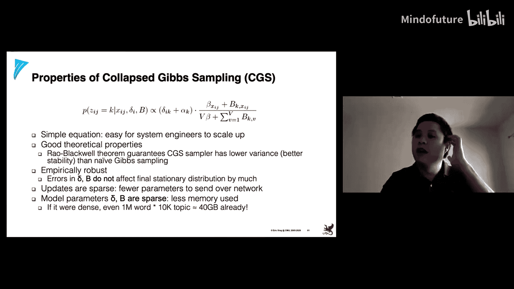
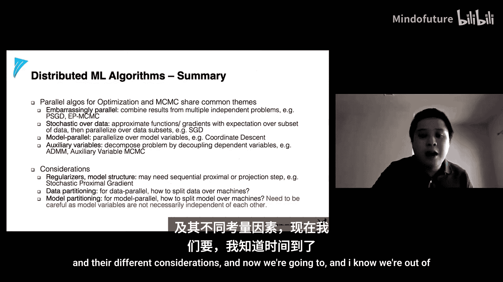
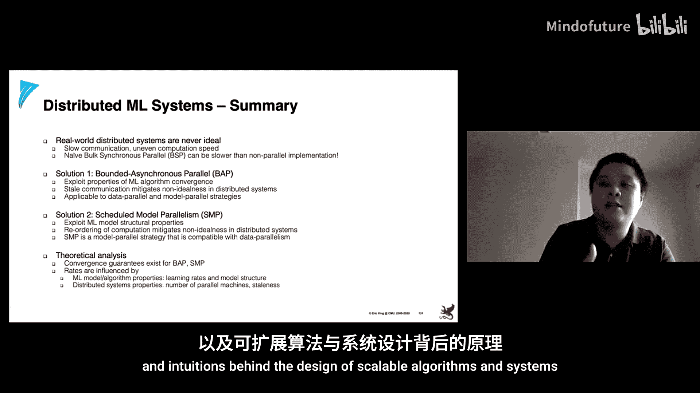

# 【卡耐基梅隆】概率图形模型 ｜ Probabilistic Graphical Models 2020 p26 P26_Lecture_26_大规模算法和系统 -BV1ebpGzhEA9_p26-

Let's begin lecture then so in this lecture we're going to talk about two topics one is the scalable algorithms for handling large data。

 big data and big models and as well as the software systems and the principles behind those systems that complement these algorithms in order to allow for example machine learning researchers and practitioners to scale their applications up to the kinds of data。

 large data but also large model skills that are demanded in demand today so I you just to set the stage。

 I think we're all familiar with the very large data skills that are being generated today driven primarily by the growth of the internet as well as sensor data or other types of data collection devices collective known as internet of things this slide。

Here is a little bit out of date， but you can see that even a couple of years ago。

 just to make biggest websites on Earth produced so much data that for the machine learning teams to be able to do analysis across the entire company's data would require computational resources。

 maybe far excess of what we're used to doing as student projects， for instance。

Simultaneously there's been a continuous growth in model sizes if we look at modern machine learning models。

 it's not atypical， it's pretty common in fact for models to be in excess of 100 billion parameters all the way up to billions of parameters for models that have dense parameters of models that are sparsely defined that number can even go up to the trillions actually。

So and already these are just some examples of models that were used in the past say five。

 five to eight years for different kinds of tasks and again it's pretty common for the number of parameters to be in excess of the billions。

 well what does this actually mean if you think about how much even storage or RA a machine or CPU or GPU has access to and's typically on the order of maybe 16 to 128 gigytes but if you think think about what a parameter is a parameter is basically a floating point number if that's four bytes then if we're talking about one to 10 billion we're talking about model parameter model images that are between you know to 40 gigabytes or even 400 gigabytes in size so different types of parallel or distributed scalable ML techniques are needed just to be able to even train the model because it may not fit into memory。

Now the other thing I want to talk about is there's something we call the scalability challenge in that when we all start doing parallel programming or distributed programming for the first time we often like to think that if I've got say eight computers then my task is going be eight times faster in reality just like when you're trying to coordinate a group of people to work for a project they are communication overheads。

 so you won't actually get linear scalability， your objective is really to try to get near linear scalability that's the blue line here you're always going to do slightly worse than this dotted line which represents if I've got eight machines at eight times faster However what tends to happen if one is not familiar with the mathematical details or systems details of scalable ML you end up with this red line here which is you may have created a working parallel or distributed program or even ML program。

But it doesn't actually scale with the number of machines as we thought it would at that point you have to go in deeper。

 you have to try to understand what went wrong。Okay， so。In order to address the topics of big data。

 big model and the scalability challenge， we need to do some say some preliminaries here so we're going to present say kind of a high level view of M models and tools from a mathematical perspective for one of the many families you see here on diagram and then this M model which is mathematical equation it's solved by M algorithm which there's only a few major types of them compared to the wider variety of models so marketree Montecollo optimization matrix and spectral algorithms of some of the major families we'll talk about today。

呃，So。我你。Aamp of the kinds of probaistic programs， which are solved， for example。

 via B chain multicolor methods or even some types of variational optimization or inference methods include wellknow graphical models such as say topical models。

 or the many types of Bayesian graphical models that exist out there。

 these are all have probabilistic definition on the other side。

 we have optimization programs which include classical programs like most regression or classification applications whether on classical statistical models or whether on。

For example， deep learning architecture such as convolutional recurringrent or transformer are typically formulated as an optimization program in reality。

 the line between these two categories is， as you might have learned during the course。

 fairly blurred in that most probabilistic programs these days in corporate elements of complex optimization functions and any optimization program can actually be kind of fairly easily converted into a probabilistic program by putting priors on certain parameters of functional variables for instance。

The next thing I want to talk about is that to think about both probabilistic and optimization programs in a unified way。

 we want to look at them as part of a single master equation。

 which is this iterative convergent view of ML algorithms， iterative convergent。

 meaning that it iterates towards a solution and， you know。

 we have theoretical guarantees or the algorithms that are used that it will converge to you know some type of fixed point of optimum。

So in this iterative convergent view， you know some notational notation here。

 let data be the represent all of the model parameters。

 let the superscript team represent the iteration index。

 so starting from P equals1 all the way to whatever it stops and let you know Delta FB basically an update function on the parameters data which takes it the data D so fairly simple definition they we'll see how this applies to different programs。

 different MLl programs and algorithm models and algorithm shortly。

Another principle I want to talk about is that in in the majority of computer science。

 most algorithms need what we call operational correctness take classic example like sorting if we're sorting numbers and we make a single error inside the algorithm。

 then the output is guaranteed to you know more or less persist and not be corrected so you can see over here if I do a merge sort incorrectly in swap two of the numbers here。

 that output error is gonna to persist all the way to the final output so a single error in in most computer science programs well or most computer programs will cause an error and final output but for machine learning programs they're able to selfheal in a sense because they are all algorithms that converge towards a local optimum so even if you the point is that even if you added some noise or error in。

The trajectory， the algorithm is essentially able to correct for that because it's kind of analogy kind of like you're climbing the mountain if you can see the peak all the time。

 even if you you know。made some， you know， passing error up the mountain。

 you're still as long as you're able to see the peak or know where in approximately is。

 you'll still make progress towards it。So this turns out to be a very important property that is actually the key behind many scalable ML techniques。

 how and you'll see in this lecture that the types of parallellyization techniques can be quite different from what you see in traditional computer science。

😊，Okay， given that iterative convergent view of you know。

 parameters equals you know an update on the previous value the parameters plus an update。

 I want to generalize that a little bit more to kind of set the mathematical framework so let's talk about ever programs in a general form where you're doing a maximization or minimization over parameters given loss function L over data which can be supervised。

 which can be unsupervised here I'm just showing a supervised version which has you know access I and labels Yi。

 the parameters data， and then this mega， which is a structure and using function I'll talk about a little bit。

And the iterative conversionverg algorithm was really a loop from iteration， you t equals one to T。

 where the core equation is an update again from theta T to theta t plus one based on the data。

 this is a more general form where the delta F， which could be a gradient。

 which could be a back chain multicolor sample is aggregated using function G。

 but for many algorithms， it actually simplifies to the form I showed in the previous slide。

 which is this equation here。Okay。Just to give you know self flavor here for an optimization program。

 let's take something as simple as say linear electricalal regression you often have in the big data setting a huge volume of data let's say you have 1 billion samples so your matrix y is going to be an n by one a1 billion by one matrix you have an x matrix which is let's say you have M dimensional data so it's an n by M matrix and then even the number of parameters here represented by beta is a very large number M equals one billion so this is basically an n by one matrix。

And then if we take a look at say a polyplistic setting。

 let's look at a classical example like topic bottling if I wanted to do topic bottling on say 1 billion documents。

 then you have placed these three matrices you need to maintain for a macro chain multicol implementation a one billion row matrix times the number of topic times the number of topics which in the largest applications could be up to a millions or even more and then another matrix which is say a million topics by a million different unique vocabulary words sometimes actually several million and the third matrix so these three matrices。

 the point is the largest ones of them can be have one of the dimensions be in the millions or even billions。

Having said that there are two general strategies we can take to parallellyze an ML program so they are roughly you can think of them as data parallel and model parallel and the decision is actually kind of intuitive although we'll see later some of the five grade details so in the data parallel case what you're doing is if I have say eight computing devices。

 eight machines to parallellyze the or even eight CPUs or eight GPUs on the single machine and'm going to assign each machine or CPUU or GPU a different subset of the data know represented here by D subub1 or the way to D subN and I'm going to have each of them compute the delta function the update function on your piece of data and an aggregate them somehow model parallel is is kind of the counterpart to it where instead of splitting the data across different computing devices。

to give the full data to each cop， and then I'm going to assign the responsibility for calculating different updates to different parts of theta。

 if theta is a matrix that I'm going to partition this matrix up and give the responsibility of computing deelta theta。

 sub all the way to sub K to different devices。Okay， so that was the first part。

 the very first introduction part of the lecture to set some background。

 I want to pause here and ask， are there any questions before I move on to the lecture proper？

Okay looks like everything is clear no further questions so just to give you an outline going to we're going to start by talking about optimization algorithms。

 stochastic gradient descent quarter descent and proxi gradient methods and how we parallelze and scale them up to handle the big data big model challenge and then we're going to talk about blockov chain marketing algorithms in the next part of the lecture and then after that we're going to move on to scalealable ML systems and the principles。

😊，Okay， so without further ado。We're going to use a running example throughout the optimization part of this lecture and we're going to use actually for samples fast little regression as a motivating example。

 so to do a little bit of a recap here as I'm sure you've learned earlier in the lecture in lecture series a program most optimization program consists of two parts。

 a part that you can intuitively think of as data fitting so you want to find the parameters here called be that fits into the data using some kind of loss function in this case here that's a basically a squared loss and then you also have a often a second part to the optimization program which is a regularization or structure using function I hope this is not blocking the lecture。

And its point is to introduce structure or assumptions onto the parameters beta。

 So the key is that this data part depends on data X， Y and beta， but the regularization part。

 typically on depends on the parameters beta。 We have different examples of Omega。

 which is the structure acing function， such as sparsity acing functions like the L1 pen。

 or you can even have complex structured penalties such as group penalties， three penalties。

 overlapping penalties， these allow you to， you know。

 encode pretty sophisticated prior assumptions on the parameters。

So the very first algorithm we're going to talk about is perhaps the simples one。

 stochastic gradient and descent。So if we can write an optimization program as a minim over an expectation and oftentimes this expectation simply takes the sum over one I equals1 to n of the training data then in the classical gradient descent setting what we do is we take we take the parameters here index by x and the data D。

 we compute the you know the first order derivative of these with respect to X and then we sum that over the loss function。

 the derivative to loss function from I equals 1 and N and just apply that as a gradient step to the parameters X so pretty simple in stochastic gradient descent the modification is rather than summing over I equals1 and N and then you know taking an expectation which requires us a divide by N。

 we're gonna pick a random sample these of I which is smaller than n and then we're going update the parameters。

 based on an expectation and empirical expectation。I'm just that example。

 so what that means is that I'm going to sum from I equals one to size of d sub B。

 and then I'm going to also divide the sum by one over a size of D。Okay so seastic gradient descent。

 some basic facts about it， it converges almost surely to a global optum for complex programs and then whereas traditional SGD in its actual very first formulation it computed gradients based on a single sample so you literally picked up one sample compute the gradient and you applied it in there。

 but what is common these days is you take a mini batch where I might have a mini batch of you know between maybe 10 to several thousand or tens of thousands of samples and then on average over them。

 the idea is that you know from a static intuition perspective having more samples when you compute the gradient reduces the variance inside how these gradients are distributed and reducing the variance as we'll see later in the theory part of this lecture leads to faster convergence。

 which means that it takes fewer its to converge the other reason is that when you have multiple samples。

In a single graded， you're able to pack that into a vector。

 And on those compute hardware with a CPU or GP， that vector computation is far more efficient than the same samples one at a time。

 which results in a what we call a throughput speed up。

 So throughput means that every iteration is computed faster than it would be without these vector operations。

😊，The very first parallel implementation of stochastic gradient descent was you know kind of described in a paper about 10 years ago where the idea was okay。

 this is a data parallel formulation but I'm going to partition the data to different workers if I've got the K workers I'm going to split the data Kways I'm going to have every worker compute the the do the stochastic gradient descent until convergence on each of these data sets so I' converge on say D sub1 all the way the D sub K and then I'm going to just aggregate all of the parameters together so what does that mean basically I'm going to run for say capital T make iterations on every worker and I'm going to sum all of the parameters together and average across that。

So pretty simple， this is an algorithm that only requires the workers to communicate at two times。

 one is when inspecting the input data， one is right at the end when all of them have converged and you aggregate and output the estimate。

Okay， so the problem with this grand decent as you can imagine is think about intuitively if we have a group of people that are working together a project and you only meet once at the start and once at the end the project。

 how likely is it that all of them are aligned and are coming to an estimate In fact。

 the problem that actually happens in prim SGD is that different workers may have converged to different local optim in the space of parameters data based on the data subset they got so when you aggregate them just because you average the positions of two or three or n optim together that's not guarantee that the average is itself an optim So that's actually a kind of a major flaw with this way of doing things。

😊，So in the next part， we're going to talk about two improvements to parallel SGD one。

 the first improvement I're going to talk about is an approach that kind of uses the sparsity that's present in many problems in order to give with high probability that even if I'm not synchronizing about not communicating between the workers in an ideal fashion。

 I'm still going to be able to converge to a good optimum so let's say that our optimization function has some type of structure where every every the main objective function F can actually be split into different objectives F sub E where every E touches only a small set of parameters and this actually happens when you use。

 for example， naturally sparse data inside a linear or logistic or even。

Regression because what happens is that if I take a random sample。

 say 1000 samples out of 1 million data samples， I will only find that instead of touching say the full set of parameters。

 they might touch only 10% of the parameters classic way this happens is in for example many in companies when they maintain their user profiles it's often as a pretty high dimensional vector of different say one hot encoding so maybe I have subscribed to a page about sports and health about someone else is subscribed to a page about finance and celebrities then you know my vector。

 my profile vector is farrs and is the other example as well。Okay。

 so just to just give you a flavor that beyond say simple regression。

 there's also different types of optimization optimization functions that also a sparse structure。

 SVMs tend to be pretty sparse， most matrix completion problem such as the famous Netflix challenge tend to be sparse。

 even the problem of producing a graph partitioning or cut is a sparse problem as well。So。

The Hobbot algorithm works like this。 Let's say you have again key different computing devices。

 I'm going to sample a subset of parameters E and random from the full set and then for every machine I'm going to just read the current parameter I'm going to evaluate the gradient of function on that parameter and then I'm going to sample uniformly I'm sorry。

 let me repeat that again。 I'm going to sample E data samples out of the full data no sorry that's correct。

 it's going to be E parameters out of the current parameters set I apologize for that。

 and then I'm going to sample out of these E parameters。

 let's says it's a million parameter problem and I' sample say 10 parameters and I'm going to sample a second time one of the parameter from this subset E so I've got got 10 parameter。

 say health finance sports and so on I'm going to sample exactly one of them and I'm going to perform。

gradientd descendscent on just that parameter with a very small constant step size。

 So what that happens is that if the data is fast and if the number of parallel workers is not too big that with high probability the subset E that each of them sample are unlikely to collide with each other So the advantage of this from an say a computer programming perspective or software engineering perspective is that since the coordinates picked by each each parallel worker do not collide with each other。

 there's no need to do say complex synchronization will talk a little bit about synchronization the latter part。

 but for example， you don't have to lock variables which is parallel programming technique。

It turns out that this does give nearly this speed up on various EMR programs as long as the data is sparse or the objective function has been structured to be sparse。

 but what's interesting is that this doesn't work that well in the distributed setting。

 so what is the distributed setting？The distributed setting is when instead of having multiple CPUs and GPUs in one machine。

 I now have multiple machines and I need the CPUs and GPs to communicate over the network So it turns out that communicating across the network and producing the type of atically correct updates which I won't go into too much detail here but in order to create theseomic updates it's a more complex programming exercise and then second thing that's really interesting is that when you have machines talking to each other over the network rather than talking to each other on the same machine it's kind of like say instead of doing a teleconference or Zoom video like we're doing now were trying to send say handwritten letters to each other the delay between machines is actually several orders of magnitude bigger and that turns out to be a problem Why is that。

So in this Ho algorithm， every parallel worker is allowed to proceed at full speed and it doesn't really have to communicate with other machines because again。

 they don't work on the same parameters but what happens when when we are tried to communicate say via the slowway via traditional mail so that that uses a lot of delay it turns out that there's a theorem that know Eric and this group developed in 2015 where given some type of objective function and the step size you can actually put a bound on how much the delay which is represented by these quantities epsilon。

 the mean and variance of the delay which is the time taken to send letters to each other affects the affects basically the expected loss function over here so the distance between and the intuition is that。

Every step you take in a stochastic brad algorithm the estimate between decreases the distance between the current estimate and some local optimum。

 and this is supposed to decrease exponentially in more iterations but because the formulas are credential a high variance and delay so this is EXP1 over epson increased an exponentially increasing penalty so and like I was saying。

 distributed systems turned out to be several orders of magnitude slower in communication than say say between CPU to memory or GP to memory。

Okay and then there's additional theorems that I won't go into too much detail about。

 but it also in addition to the convertence being slower， it's also more unstable。

 I'd encourage you to read this in the paper in your own time if you're interested but the basic intuition you need to have is that having more delay also increases the the variance of the parameters so what do I mean by variance if I took 10 different runs of this algorithm and compared what optim I go to you're gonna to see that with more and more delay the parameters become kind of more and more spread up that means there more variance that means you're less confident about the optimal you converge to。

Okay。All right， an alternative strategy which doesn't rely on the srscity of the objective function of the data is to use what we call a key value store or kind of also known as a parameter server which you can think of basically as a central memory back that every worker can talk to and that memory that memory back essentially does the hard work of making sure that everyone every worker has the same picture of the parameters and it's integrating all the different messages it's kind of like you know you have a project of people working in the team and one person is assigned to be like the person taking a making notes for instance。

There are several synchronization schemes that such a key value store para server can use about synchronous parallel。

 which is used in Hadoop and later successive systems such as Spar。

 and then there's fully asynchronous parallel communication and then there's kind of a middle ground that Eric in this group develop called scale synchronous parallel。

Okay， so still synchronous parallel is pretty interesting because the way it works is that it's a synchronization model that is kind of the best of both worlds of the about synchronous parallel model as well as the asynchronous parallel model so what it does is that it's going to say that I'm going to give you a window say three iterations。

😊，And then the fastest and slowest parallel workers cannot be more than three iterations apart。

 so for example， if I have a fast worker that's going all the way to iteration 7 and someone hasn't reached iteration4 yet that fast worker is going to be required to stop and the way it stop is that the key value store parameter server will not process any request from worker number one until worker number two has caught up so it's a pretty elegant solution that turns out to have a very simple programming models we'll see later。

So if I were to take， for example， the Laso in writing example and turn that into the key value store program。

 I'm going to basically put the parameters beta in the key value store and it's going to be shared across all workers。

 any worker can access it any time， it's just like calling to read or write an array or matrix when you program say in Pythonma C plus plus。

And then we just do a classic SGD we're going to draw a subset of samples。

 we don't have to do anything special about choosing different parameters coordinate it I'm just going to draw a sample a subset of samples normally and I'm going to compute the gradient and I'm going to just I'm just just update that because this is a Laso program with a fastly function we also have to account for that so the common way to do it nowadays is to apply a proximal operator and this can actually be done at the workers or it can be done at a keyvalue store itself so the key value store can also do some computation。

And what happens is that this doed asynronous scheme。

 where some workers allow to be a little faster and some are allowed to be a little slower。

 it allows all the workers to read and write to the parameters beta in a pretty timely fashion。

 even when the network is slow or unreliable。😊，Okay and it turns out that like I was suggesting bounded synchronous parallel is really kind of like the best of both solutions。

 So what happens is that if I take say bounded asynchronous parallel if I'm going to take say bulk synchronous parallel and see how that convergeence on a classic algorithm like a classic model like LD this is using market multicolor sampling。

 we're gonna to get a convergence curve that looks like this for bulk synchronous parallel that's the Hadoop or smart style communication if I do asynchronous parallel I'm usually able to get an improvement into convergence curve so I'm going to converge to the same objective value in less time。

 but this is not always guaranteed it turns out that sometimes the convergence curve or diveerge and then what still bounded asynchronous parallel allows you to achieve is you get even better performance than say asynchronous execution but you also have a certain safety guarantee that。

Pent present in bulk synchronous parallel， that is say you will not risk， say。

 a divergence or poor uncontrolled convergence of the algorithm。对。Okay。

 I'm going to pause a little bit here as I've kind of completed the stochastic gradient Descent section and I've introduced three algorithms naive parallel SGD as well as the homewe style sparse SGD and then this idea of using key value Store of parameter servers I want to pause here and ask are there any questions so far？

Okay。Sounds good。 Okay， then I'm going to move on to。😊，The next part of the optimization section。

 which is we're going to talk about coordinate descent algorithms。

 so coordinate descent algorithms are kind of naturally suited for model parallel scalable ML implementation because where stochastic rate descent divides the data set into different samples coordinate descent is actually dividing up the parameter space into a different subsets of parameters so that's very naturally a model parallel style of algorithm some advantages of coordinate descent you don't need to specify a learning rate or step size because what you're doing is you're just analytically computing the optimal parameter for each coordinate because each coordinate the optimization problem is usually a code problem。

And then if called it the set can be used for a model it tends to be often equivalent to the state of the art。

 however the problem is that because it is divided across parameters rather than data samples。

 if you have a very large number of data samples， the time for each iteration also increases and you might get very long iterations that measured in minutes or hours。

😊，Okay， so in the lastso case， instead of doing a gradient step across all taking the first derivative across all parameters。

 we're going to just basically analytically solve for this so the way we'll do it is via setting the sub gradient of the equation here to zero and then we can just derive directly update rule for each for one coordinate at a time which looks like this。

And then we can this is for a updating a single coordinate。

 it turns out that you can update a set of coordinates at the same time and so for that analytically by setting them to zero and then what we're going to do is that for every coordinate or every group of coordinates。

 we're just going to go with them one time around Robin fashion updating to the optim moving to the next group updating to the Opim and so forth。

Now let's talk a little bit about how to do this in parallel at scale。

 one of the first algorithms which was called parallel cordded descent。

 specifically the shotgun algorithm which was also developed CM is we're going to instead of picking all the parameters and sequence let's say1 billion parameters and I go from one to1 billion in order I'm going to have every parallel worker kind of like the hog wild fastrs stochastic grid descent algorithm earlier I'm going to choose a set of parameters to update a random I'm just going to update them in parallel and iterate until convergence So this is kind of like the hogwell equivalent for corded descent rather than SGD Now one of the guarantees for this algorithm when the features are nearly independent you'll find that shotgun corded descent actually is really good scaling it scales more minimally In fact the way the bound here is that you can compute the quantity called row which is the spectral radius of。

A transpo a A is actually the data matrix which is say every row is a sample every column is a feature feature value and then you can scale literally up to this formula here and because what happens is that when the data the features in each column of the data matrix if they are truly perfectly uncorrelated with each other row de to be one and if the features are exactly correlated。

 how do you get that let's say I have a data set with only one feature and I duplicate that1 million times then what you have is a data set where every feature is perfectly correlated and then row equals D and then you can see by plugging in row equals D to this formula that you actually get no parallelism D over 2 d is basically less than one so you cannot scale beyond one worker for this algorithm exactly correlated。

Okay， so so why does this happen， Why is correlation so important so this is one of the major takeaways for this lecture so this is something to focus on when the features are uncorrelated。

 what happens when you're taking coordinate ascent steps you can see that in uncorrelated case this is kind of like this balance circle here when I'm trying to converge an optimum I'm going to take a step in one coordinate like x sub or another step x sub and you can see that if I take these steps towards the optimum。

 I'm going to have pretty pretty stable convergence but if the features are correlated you have this ellipse over here and then what happens is that when they're correlated the steps in each axis or each coordinate become this can' kind of much larger and that's because of the correlation between the data when you end up taking larger steps what happens is like you have a tendency to overshoot the optimum or it's very difficult to converge precisely onto the optimum because remember that coordinate decent doesn't have。

Sizes to control the learning rate so when you overshoot it's very difficult and it's very unstable to converge to the optimum over here Okay so an improvement to the short algorithm which was developed below later it's called block 3 coordinate percent where where the trick here is rather than selecting the coordinates at random we're going to actually do a little bit of prepartitioning of the data matrix so for example。

 if I have a matrix of 1 million thats say 1 million samples by 1 million parameters I could maybe divide it into 10 blocks right I'm going to have 10 different blocks of parameters and each of the blocks of parameters is say 1 million samples times only 100000 parameters。

Then what happens is that when when we're doing the parallel quarter percent， we're going to select。

 say these 10 blocks I'm going to give them to 10 different workers and every worker just selects the coordinates within each block to optimize and this guarantees that the coordinates never combined So why is this important it turns out that when you are partitioning the parameters into。

And and in fact， this actually depends on what kind of partitioning algorithm you use so typically the partitioning algorithm tries to select parameters that are uncorrelated it's kind of like preprocessing the data to make sure Im divide it into blocks uncorrelated parameters and you have done this well then during the quarter of the set itself there is a low correlation between parameters being worked on each worker respect to each other and that improves the correlation according to this intuition described here。

Okay， and then a further extension， so the disadvantage of block really quarter descent as you can imagine is that it requires you to prepocess the data set。

 it turns out that if the data is very large， let's say we're talking a million samples times a million a parameters。

😊，Then what happens is that just try to figure out whether one parameter is correlated with another you know intuitively calculating the that intuitively boils down to calculating the covariance matrix of this1 million times1 million matrix which is itself a cubic operation so ironically the preprocessing for this algorithm can actually be more expensive than a quarter decent itself so that's actually not very practical for very large data sets So a way to improve upon that and this is the third quarter percent algorithm or present is' something called a it's a system called a structure where dynamic scheduler where rather than precomputing a partition of different parameters we're going to dynamically on the fly decide which parameters are going to be given to each worker so it's not going to be a random assignment is not going to be a pre-partition assignment we're going to do it dynamically on the fly and what happens Why is this advantage。

JustBecause I don't actually need to check the full covariance matrix of the one10 parameters。

 If I have only 10 workers， I just need to pick 10 coordinates and I need to just check are these 10 coordinates independent of each other and that's computing a covariance matrix on only 10 parameters。

 which is much smaller and it happens that some of them are correlated I can just sample a new batch you get so this is actually a more practical algorithm because it avoids thequbic complexity of figuring out if parameters are correlated or not and then you can also do other optimizations such as prioritybased updates where I want to even record down for every coordinate how much it's been contributing to the overall objective function and I want to prioritize those that decrease objective function faster So this is a system will talk a little bit about what we get to the systems part of the lecture but I just for now what you need to know is that there are。

Pretty interesting ways to improve upon code descent if you do some careful system design。Okay。

 I'm me skip over this slide because it's what I said earlier and then what's really cool about these priority based schedulers is that whereas a standard coordinate descent exhibits this dotted line convergence curve you can actually get a much more interestingly shaped and sharper convergence curve if you are using this dependency checking and priority based scheduling on the fly basically what I'm saying is that naive random coordinate descent is leaving a lot of potential convergence speed on the table and this is where the benefit of using a system such as str comes in。

Okay。All right， pauseusing here okay I just saw a question so Anna if you asked how do the updates to the actual parameters happen after some changes happen in each worker so the answer for quarter descent and stochastic during descent is that let's go back to the let's go back to the updated question。

So when you derive this update rule what will happen is that every worker will first update their local copy of the parameters on every machine and then after you've done a local update you now need to synchronize the updates of each other So it's like I did some work on my own and I now need to tell everyone what work I did so what I didn't mention is that these coded descent programs。

 you can synchronize the updates to the actual global parameter via a key value store or parameter server or it could be a peertopeer update everybody just tells everybody else when I've updated So these are the two ways in which you can update the parameters but basically this is generally a pretty simple step except where say more advanced consistency models such as the bounded asynchronous parallel scheme I just described are involved or say even the asynchronous scheme where parameters don't wait。

Workers don't wait for each other to update they just send updates to each other as and when they're completed so so yes the changes to each worker will depend on whether you're doing it in a about synynchronous parallel manner or asynchronous manner or a bounded asynchronous manner。

 which I'll kind of talk about in the last part lecture。Did that answer your question？

Perfect okay thank you okay so I'm in the interest of time this section on advanced optimization techniques I'm going to go in maybe a more highle overview here both because it's mathematically more complex but also to save enough time for the next part like these advanced optimization techniques kind of the question we want to ask is what we know for those of you that have taken the optimization course or work and optimization yourself you'll know that stochastic gradient descent and descent are basically some of the simplest algorithms you can use and then there's different algorithms have been developed with concepts such as momentum。

 smoothing proximal updates that can be used to dramatically improve the convergence rate that's to say how much progress towards the objective if you make every iteration and then the interesting question is。

How can I turn some of these algorithms into parallel or disscalable equivalents and what we'll see is that because these techniques are more advanced。

 it requires us to break down the different steps， different steps on a single machine implementation into different parallel or non-paral steps in a multi machineach or multicPU or multi GPPU implementation。

So I'm going to just briefly skip over this， but I want to introduce the proximal gradient algorithm。

 which can be applied to for example， the lastso regression problem or any type of regularized problem where you have a data function a notfunction f on the data and then some kind of regularizer usually non differentiable G the intuition behind proximal gradient is that it's an extension of the projected gradient algorithm。

 the projected gradient algorithm first covers up G， you don't look at G you just look at F。

 we take a gradient step and then G is in the projected gradient case basically encoding a constraint it's like say I can only be within this square between minus one to one on every axis and then I'm going to project the gradient step I took so that it's back inside the square and proximal gradient is simply an extension of that but the function G doesn't have to be encode a。

It can encode things like an L penalty or an L penalty， for instance。

So the proximal gradient algorithmum I won't go into detail of this slide basically relies on kind of like you know when we do matrix algebra。

 we have matrix cheat sheets that tell us okay how do I do take a differential of a particular matrix once it's on a secondary detection of a matrix similarly the way most people use proximal gradient is that people have develop basically the form of the projected function for the regularizer G and so you usually look up say one of these common forms just like when you're doing differentiation right and then you just all you have to do is to apply after you take a gradient step apply this function。

 this P to to the parameters and that will perform the proximal gradient and nice part is that if you have multiple regularization functions like G1 g2 then you only have to know how to do each of the proximal forms individually and then you can just apply that。

The sequence， in fact， the order doesn't even matter， they all have the same guarantee。Okay。

 so some of the very briefly some of the improvements that were made to the original proximal gradient and bored include adding a momentum term you can think of momentum as basically a way to kind of add like some stickiness to a trajectory this but this stickiness it turns out。

 can actually accelerate the convergence towards an optimum。😊。

And then now let's talk very briefly about how you would paraze such an algorithm。

 recall from the stochastic gradient step that if you look at the general strategy， step one。

 you see that it's basically computing sub gradient which is the red box on every worker。

 and then you're going to update all the gradients on the server， let's say using a key value store。

So thats part is equivalent to standard stochastic gradient descent then how do you do the proximal gradient part Well it's actually pretty simple you have to servers perform the proximal operator right so again workers compute the different gradient estimates they aggregated at the server and then the server performs the proximal operator the server can also perform the momentum operation and then you send the parameters back to workers and repeat So this is what I meant when I said that there are some operations that can be paralyzed such as the gradient computation but the aggregation and proximal the proximal operator momentum are done at the central server。

Okay， so obviously the pros and cons of this approach are that if you have a really large number of parameters let's say billionlls。

 the proximal operation and momentum operation could take a while to compute especially because not all proximal operators are linear computation times some of them may be more than linear so generally you would only apply such a technique if the number of parameters is fairly small。

 but the good news is that it doesn't matter how many data samples you have because the proximal operator momentum functions don't depend as you can see on the number of samples。

 they only depend on the size of parameters。Okay。Another improvement to proximal gradient was to add a smoothing function。

 which is useful for problems that are well they kind of like convex like lesssso regression。

 but because of because theyre not smooth sometimes the convergence rate is not is not ideal and so what happens is that if you add if you replace the function F with what we call this envelope function which is basically the original function F plus quadratic function around it this has the effect of smoothing out the kind of the sharp point of the function and it turns out that this improves a convergence rate and the interesting part about this smoothing is that instead of taking a grade it turns out that doing this optimating this envelope function is actually equivalent to applying the proximal map remember recall that we're going to look up a cheat sheet for each proximal function。

For F itself so if you look on the math hard enough youll understand why I won't go into details。

 but what this results in is a very interesting algorithm where you instead of doing a gradient step followed by say a number of proximal maps。

 you're just doing a number of proximal maps in sequence。Okay， so in fact。

 that's shown in this box here， this is basically the gradient update for this e function。

 which as I've mentioned， can be completely replaced with the proximal update on function F and then you apply the proximal update of function G is the regularisr。

So this is kind of interesting because how would you parallellyze this if there's no gradient step and it's just a bunch of proximal operations right well there's no easy answer for this as you can imagine right if there's a way to parallel compute the proximal function then which is going to depend on a case by case basis it really depends on what the form of piece sub that is then you should be able to split that work over different workers and then you aggregate on servers and perform the proximal function on the regularizer G which is usually difficult to parallelize。

So this is an area that I would say it's an open area of research。

 it's not clear whether you can do this for it really depends on whether the function F can be paralyzed。

 whether its's proximal map can be paralyzed or not。Okay。

 so that was just kind of a brief touch base on the different types of proximal and momentum algorithms that exist and showing that sometimes it's a good way to paralyze and sometimes it's an organ research area。

Okay moving on to the next part， I'm going to talk about optimization and MCMC algorithms which is the other major category of parallel algorithms。

 I'm sorry I'm going to talk about mark Mon chain Monte algorithms which is the other major category and then here we're going to talk about auxiliary variable methods and various parallel MCMC and parallel Gi sampling。

😊，Okay。So we call that earlier we introduced the topic model as one of the potential running examples to recall that there are two major matrices in this topic model model。

 which is a document topic matrix that we call delta and a topic word matrix which we call B。

 basically the document， the document topic matrix is going to be if there's usually a lot of roles。

 because we might have say a million to a billion documents。

 the number of topics is usually between like 100 to1 million。

 similarly the topic word matrix will have between 1000 to1 million roles and the number of words。

 if you recall from the topic model lecture earlier in the syllabus。

 the words here are basically just a different unique words that's found in the copper such as say finance。

 health science for example。One of the most efficient ways of doing learning the parameters or a topic model is to perform Markov chain multicollo inference where you basically do sample the variables of each part of the model and sequence once and then go between different parameters until you've done a full cycle and then you repeat that under convergence。

 the other way to do it is to turn it into an optimization problem using variation inference where you basically take a simpler distribution and try to fit it to the more complex and intractable distribution of the original topic model。

So。There are some techniques that that can be applied to speed up the microcha Monte Carlo algorithm without going to too much detail。

 you just need to know that one technique is called what we call an alias table which is rather than drawing from rather than trying to sample over a probability distribution which means have to generate a number between 0 and 1 and then say oh does it fall between 0 to 0。

50。5。75。75 to1 I'm actually just going to say I'm going to have all the potential samples values out there which is in this distribution it's two of value1 want a value to one of value 3 so you can see that this table here is actually representing the same probability distribution here I'm going to take this table and I'm just gonna pick a number integer between one to size and table at random This is kind of a computational trip because it turns out that computers are very good at generating random integers but it's actually harder for them。

To generate and then after you generate a random integer you just do a random access like if I generate index3。

 then I'm going to look up the third index of this table。

 which is very cheap whereas if I were to sample from a probability distribution that's at least log log m type and is the size of the distribution in the table so that's just a little trick that people use speed at MCmC the other trick that you can use is that you can actually break up the。

Complex distributions such as the posterior into a prior and the evidence part of the posterior。

 and then you don't actually have to sample this entire posterior at once you could make a sample for the prior and then use use metropolis Hastings to accept or reject that sample and then you can move on the next one and accept or reject so basically using the flexibility of metropolis Hastings is to be able to sample from very simple distributions like the prior evidence and then the cost that you pay is that you now have to do it accept reject step but it turns out that if you for topic models by breaking it up this way。

 the accept reject rates turn out to be pretty high and the computational cost of the evidence and prior is low so on balance it turns out to be more effective than sampling directly from the posterior。

 especially because it turns out it's very easy to sample the prior evidence given the earliestlias table technique。

Okay。So those are some of the preliminaries metrics tricks that people use in microchain Montecollo let's talk about the different MCMC methods so the most primitive MCmC method and the one that's existed for a very long time now is simply to just like naive parallel SGD I'm just going to run several workers independently let them produce their microchain multicollo samples and I'm just going to convert take an average of consensus between the different chains the only problem is that if the chains haven't converge or very slow to converge then you're not going to be able you could see that the chains will not overlap with each other they will not form a very well balancedance distribution so thats it's like intuitively the same floor as the parallel SGD if you only talk once to each other you're not going to get a very good consensus result。

OkayThe other method that's classically used is sequential importance sampling。

 which I'm not going to go deep into the mathematical details。

 but what you need to know is that it's basically taking a take an equation and you want to expand it as a telescoping sum and then you're just going to draw in this sort telescoping product and then for each element of the product。

 you're going to draw samples from it basically you're going to draw say let's say I have10 elements in this product I equals one to10。

 I'm going to draw the first element， then I'm going to draw a second element condition in the first the third element condition in first and second and so on and so forth。

 which is really basically metropolis Hastings algorithm and it turns out that this is a very classical method used to basically break up a complex probability distribution into simpler elements which are easier to sample from but there are some drawbacks to this method that the longer your telescope。

productduct， the more variance and more insability you get in the Albert so those are some of the classical solutions to Mark chain multicolor parallelization the modern solutions that have been developed say in the last 10 years or so one way is to rewrite the model by adding in new auxiliary variables So for example。

 if you were to look at topic models， the classic topic model sampler uses aly uses so what we call the compound differentially multinoial distribution right so they the compoundly multinomal distribution if you heard of it basically comes from two things a distribution and the multinomal distribution So in a similarr fashion it turns out that for Bayesian nonparmetric models at theary process it's possible to break up their the model which is the right side into a more kind of a more。

Part it's the same model， but it has more variables because it makes explicit more steps in the sampling process and why would you ever want to do this。

 Why would you ever want to make the model more complicated it turns out that it's the same intuition is actually the sequentially important sampling if you break up a complex probability distribution into multiple smaller probability distribution you may find that each one of them is actually easier to sample from than the full distribution right so it's really a way to kind of sacrifice some statistical efficiency in order to gain more computational efficiency。

 which is a recurring tradeoff that occurs in designing scalable ML algorithms right essentially this is this just some proof that is equivalent and the parallel algorithm turns out that if you look at this formulation instead of having one big derivative process we actually now have P capital P the processes and it turns out that we can assign each。

process to one of P workers and then you can just have all of them sample the reary processes and then there's a synchronization step where you need to you need to synchronize information for the sake of the overall diciary process and then basically you need to alternate between sampling on each of the prediciary processes versus the global process itself so the details I'm not going to go too deep into but suffice to say that by breaking it up this way。

 you've enabled parallellyization to occur， which allows you to trade off statistical efficiency for getting more parallel computationm。

Another way to handle this is a technique that's called embarrassingly parallel MCmC and just like the previous techniques it's all about designing a new set of distributions that if you sample a certain way will reproduce the original distribution and the idea behind embarrasingly parallel MCmCs that is a really sophisticated way of doing say sequential important sampling but without the drawback that you have this exponentially expd variant so once again we're going to basically。

We're going to basically define a full posterior distribution and we're going to define these sub posteriors which have this particular equation form that's related to the full posterior briefly a sub posterior is basically the posterior distribution on a subset of data but not exactly the same you can see there's actually a prior that's been down weighted by one of it。

Then the details of this algorithm are fairly mathematically intense so I won't go into it。

 but the high levell intuition is that now that you've constructed these special suboseriors。

 you can draw the samples independently in parallel and then there's a particular way to combine them via nonparmetric estimation which requires you to solve basically for example a kernel density estimate problem so although this is a mathematically complex step。

 the idea is that we are able to form each of the suboseriors of each machine。

 combine them all in a single maybe expensive step at the end and then just recover an estimate to full posterior and it turns out that compared to say some na baseline such as doing naive averaging of suboseriors instead of doing the kernelal density。

Estimate you tend to get better convergence so this is of course of interest of those to you who are looking to blockchain multicolor algorithms The last solution which is parallel gi sampling。

 this is actually kind of the simplest of the three and it's also the one that's been applied very successfully to topic models and other similarly structured latent variable models the idea is that if you are using the based on the idea called the compound di multinomal distribution。

 which fuses the di and multinomal distributions in the topic model together we can derive something that's called collapse Gi sampler I won't have time to go into the mathematical details but I believe that in this lecture series you must have covered this in an earlier lecture so what I'll do is instead I'll talk about the properties of collapse Gi sampling and what are challenges in trying to paralyze it so the good news is that this is a really simple equation It just requires you to look up some。

Delta and Reta and then do some calculations and it's very easy to implement this It also is great theoretical properties because due to the compound multinmal distribution we've basically route blackwell lies we've reduced the number of variablesables we need to sample by integrating out one of the variables so that guarantees that CgS has lower variant and better that naive give sampling and it's pretty robust the parameters is fast bits of spa。

It's one of actually the success stories the last 10 years。

How to parallelze the thing about staleness is that as we showed a little earlier with parallel SD and the convergency equations。

 you want to get the staleness as low as possible you want to be as up to date as possible and one way to do that is to enable asynchronous communication where in asynchronous communication instead of these broadcast and commit steps being kind of being done in well disciplined phases we're just going to have as a sampling happens we're going to broadcast every little change back so this is like the equivalent of when you're working with a version control system committing every line of code change you have every every literally every like minute So it kind of it kind of helps but it turns out there's a better solution which is to smartly partition up the do topic and word topic matrices in a way such they don't overlap so this is the same intuition as the homewd algorithm you want to。

The way to handle the matrices becoming still of sync with each other is just to make sure that the changes don't affect different workers so it turns out that you can partition the workers in such a way that different workers or different document partition only touch certain subsets of the word topic matrix and that's actually can be done as a graph partition in algorithmum so that in every step when you sample hey you don't have to you find that one worker can take a subset of the document atwards。

And then sample that safely without affecting the values that another worker depends on。

Okay so it's actually this is actually a data and model parallel strategy together and it turns out that you can use asynchronous communication safely because after they don't overlap same intuition as a whole block the drawback of course is that you need to convert the problem into a graph and you can get very uneven an unbalanced graph so it turns out that better ways to partition and in fact the smarter way to partition this model rather than doing a graph cut is these are matrices and it turns out that there's something called a non overlap big matrix partitions an idea that's produced for many years now where see these gray blocks over here if I have a square matrix and I take these three gray blocks。

 they don't overlap and then if I move on to this new set of gray blocks again they don't overlap by overlap I mean they don't overlap the rows of columns and then you can touch the next set of gray blocks which you again don't overlap and what you can see is that you touch all nine of these gray blocks you've covered the whole matrix so that's the part intuition behind light LD。

 which is something that。😊，Eric and I worked on a couple of years ago where if I schedule the updates on the and word topic matrix。

 according to these gray blocks， I'm always guaranteed to never collide on parameters。

 I'm always guaranteed to be able to sample each of the sample within each of these blocks safely。

So without going to too much detail you can kind of view this on your own time you basically do you read the documents of this。

 you put them to workers you know just the part of the pig matrix that you need that's the word topic matrix and then you do the sample you write back to this and keyvalue store and you just do that for every worker it's a more complex implementation but by being very smart about the partitioning。

 it has a great statistical properties and it converges very quickly and doesn't have the unbalanced graph partitioning problem that the graphla style problem way of doing it producers I'm not going go into details about the error that technically this model parallel LD like LD still isn't aic there's actually a small amount of error but it turns out that in practice it's very small that's a big takeaway okay so in summary we've talked about optimization and MCMC algorithms and。

Different considerations and now we're going to and I know we're out of time here。

 So I will just say this for the Ts and people who are recording your work up to stop whenever you need to Otherwise I will just keep going for as long as as I have does that sound good。

OkayAll right then as I said feel free to leave when the lecture is over but I will just keep continuing for the sake of completing the lecture so these distributed systems from ML and this will go quite a bit faster because we actually introduce many of the concepts such as sparsity such as scheduling such as prioritization such as dependencies in the first half of the lecture you'll see all of these concepts recur again in this second part when we're talking about how these systems are built。

The idea is that in these parallel M algorithms， we are exploiting algorithmic and mathematical properties of the training or the learning part or the inference part to make efficient distributed ML algorithms and the cool part is that when you need to do the inferential part。

 the prediction part， it turns out that that's usually emrassingly parallel once you have a trade model you can duplicate it across every machine and just let every machine answer queries as it comes in。

Now in this part lecture we're going talk about what are the systems properties of real world machines so so we've gone through the lecture so far assuming that machines are fast machines are perfect machines do exactly what we tell them to do it turns out that those assumptions are only partially true there are some elements of real world computing systems like for example have you ever tried to launch a big parallel Emal job on AWS you may have noticed that sometimes it goes faster and sometimes it goes slower and for reasons。

Can't understand why Well， the answer is that if you're using some of the cheaper AWS instances。

 what happens is AWS is actually putting multiple virtual machines onto a single machine。

 So depending on what the other users workloads which you cannot see are doing or what you're sending over a network。

 you may get more or less performance at a time。 So the fact is we all have to share computing resources we share our lab clusters we share AWS with the other AWS users and knowing about these properties is actually turns out to be essential for making really large scale implementations of。

All right so as I was hint at there's no ideal distributed system there's two problems one is that networks are actually really slow compared to CPU and GPU memory accesses CPU and GPU memory accessors are generally measured in the nanoseconds whereas access over a network tends to be measured in the microseconds if you're on a local internet network if you're doing this over the internet it's going to be measured in the millisecond。

So what was that saying， it's basically saying that networks are a thousand times or more slower than GP and GP memory access。

 so it's the difference between having a Zoom video and I don't know sending a letter that takes a year to arrive basically。

The other thing that I hinted to earlier is that identical machines rarely perform equally because there's always other operating system tasks running on the machine。

 background jobs， backup， virus scan， network firewall or worse there's actually other users and programs of the same machine like different virtual machines。

Okay， so how do we the fact is these aspects， as we will show。

 will greatly impact the effectiveness of different parallel amount implementations in different ways and the point is that what if you're using about synynchronous parallel style updates when you're waiting for all machines to talk to each other these two properties the slow communication and unequal performance mean that in practice you always end up waiting for the slowest machine what we call the curse of the slowest worker in say which is well known since the era of Hado when you have different machines performing at different speed。

 even if you partition the data perfectly balanced someone's going to be slow and that's going to slow down your whole program right it's like saying someone's going late for a meeting and the other thing is that even if an algorithm is completely sum from a theoretical perspective and it's attractive properties it may consume too much bandwidth for a local a network。

Remember that a deep learning model with 1 billion parameters。

 such as some of the recent language models， that's 4 billion Bte。

 that's  four gigabytes that you need to transfer over a network every time you see。

 turns out this is very expensive。And then there's also a la like how many milliseconds does it take to get the data across the network and then okay。

 if you partition the data and model you need to make sure it fits in the memory or local storage and know that's also going to affect what you said over the network and even the scheduling affects the convergence rate and again the amount of communication you have to do so there's actually all these aspects that are relevant because the machines are not perfect and we have to basically design around them。

So we call the intuition that ML iterative convergent algorithms。Generally。

 you take a pass pass over the data for every sample you perform an update and then you commit those updates to model parameters right One of the things I want to talk about is if you've ever used Hadoop is probably not really used by anyone anymore these days。

 but it serves as a good reference case to understand how people were thinking about the evolution of parallel M systems when Hadoop was designed it wasn't actually designed for M algorithms。

 it was designed for these big data processing tasks that were able to be completed in a single iteration of map and reduce so Hadoop was designed with this idea that I'm going to perform the map in memory。

 then I'm going to reduce and I'm going to write to reduce results back to the distributed file system So this is a very slow step and when people first tried to apply Hadoop to machine learning algorithms。

 they found out that shockingly the machine learning algorithms on Hadoop on say100 machines。Was。

Actually slower than running a well optimizeized implementation on a single machine so it was actually a classic problem that the systems community has known for a long time just because you paralyze an algorithm doesn't mean it's going to be faster you can actually get negative scalability two machines are slower than what if you're not careful and the reason for that in Hadoop this is the culprit here the bottleneck is that when you do ML and Hadoop you need to do this map reduce right to disk map reduce right to disk for every iteration。

Writing the disk， especially over a distributed file system， is extremely slow。

 especially we have a very large model， it can take minutes to write out the model of the disk。

 but it can only take seconds to do the map and reduce so if you're taking minutes to halt to the file system you've basically become 100 times slower than a single machine algorithm。

😊，So that emphasizes why good parallel strategy is important。

 you really want to reduce the time taken by the barrier as much as possible because there's basically the concept of compute time versus waiting time。

 waiting time is talking over the network， writing to this doing everything except the machine learning update function。

 which is you this parallel update over here。Data parallelism as a recap just graphically to show you。

 you divide data over every machine， you synchronize you compute updates and you synchronize to the global parameter store。

 model parallelism is kind of the counterpart to that。

 every machine takes a look at all the data but computes only different subsets of the model which don't even have to be the same structure like your graphraphL and we will see that good actually ML systems generally fall to one of these two categories data parallelism or model parallelism and it's also possible。

 in fact necessary for some of the largest problems to combine both in fact what you will see in many of the most sophisticated deep learning implementations today。

 or even in the topic model in example I gave earlier。

 is that you want to not only partition the data over different workers you want to partition say the different architectural components。

 different layers of the model onto different machines in order to design get around many of the systems limitation。

That real systems are kind of imposed， so that's kind of graphically illd like this。

So how difficult is it in general to do data and model parallelism。

 we saw a lot of examples in the first part of the lecture and it turns out that it really boils down to a couple of things data parallelism is okay when data is IID independent analytically distributed。

 this is basically the basic assumption for the vast majority of ML models。

 of course there are models where the data is not assumed to be searched but。Those啊。

A much betterer case that we will not discuss here。And the idea is that when you have IID data。

 you're able to take basically estimates like stochastic gradient descent estimates of the gradient or other algorithmic quantities that turn out to be very close to serial execution。

😊，The auto parallelism is very different， you can't naively do this。

 you can't just naively chop up the parameters and give them to different machines you have to because it is not equivalent it's not even close to the zero execution of the M algorithm you need to actually design a schedule around it to restore as much of the performance as possible we saw earlier that shotgu corded descent for instance if you don't do it carefully and you do it on data that's highly correlated。

 you won't get any parallels we So let's recap some of the intrinsic properties of M programs we talked about error tolerance right at the beginning of the lecture if I have some error in the M algorithm trajectory it's usually able to recover because it's always heading towards optimum there are structural dependencies which may also be static which can also be dynamic which are changing correlations between model parameters which are critical to parallellyization so basically。

What this is saying is that the schedule， how you split parameters to different workers and what order you do then the optimal schedule actually changes over time and third property is that there's actually no uniform convergence it turns out that parameters can converge in very different number of steps this is actually the principle behind say why。

Whyhy for example， part intership behind why techniques such as dropout in deep learning work。

 it's also part the reason why certain types of compression and techniques that are used in the deep learning community also are effective because since parameters can converge a different number of steps。

 you can actually drop all the parameters that have a low amount of change and just focused on the ones that change most。

 this is actually an intuition that's been well studied for many years even before its application in deep learning。

Okay now the challenges in data parallelism are that existing ways are either safe or slow or fast and what I call fast and risky so that's about synchronous parallel which is you have this it's like like Hadoop and Sp where you have every worker do some competition you wait for all them to complete you exchange results you do that the problem with that is that if you have a slow worker like say someone else is doing something on the machine the whole thing will slow down then you have asynchronous which is you're allowing every worker to go at its own speed but asynchronous doesn't make the slow worker problem go away so let's say you have one machine that has a problem and in fact this is a true story。

You can have a machine that all of a sudden for systems like Hadoop become very slow and it turns out the reason is that the hard drive is vibrating or the hard drive is overheated because in a data center。

 different parts of the data center are cool differently you you can't cool every machinely so depending on the heat conditions and vibration conditions like due to a fan spinning you may have a vibrating hard drive and that vibrating hard drive can actually greatly slow down the read the right performance from hard drive that in turn causes a machine to become very slow and when that happens。

 you get a situation where many workers are doing work but one worker is so far behind that all of the work it does is actually counterproductive because it's basically operating in a model version that is so old that anything data on is actually completely it's basically conflicting with everything else that's being done。

So the way to solve this is actually to introduce the idea of partial synchrony。

 which is you don't want to go through the extremes of BP and AsI。You do need to synchronize。

 you do need to have some discipline about when you synchronize。

 but you need to also give some flexibility to deal with the slower the problem and that's the strraular tolerance as well slow threats。

 you need to also give create a system such that the slow threads will naturally catch up the fast ones because otherwise you're always going to have a problem。

OkaySo。Earlier we talked about this idea of bounded asynchronous parallel so we're going to revisit it here and we're going to talk about some of its systems properties here So in this sales synchronous parallel bounded asynchronous parallel model recall that you're going to allow the different workers to be up to say X iterations apart here X is3 so you can go in your own space own speed on pace up until a limit there's basically a central machine or one of the machines is' watching all of the different workers and it's stopping the workers that are going really fast it's going to make them wait until the slower ones catch up So in addition to preserving a sort of like partial bound synchronous parallel guarantee that avoid some of the worstcase results from asynchronous execution there's an interesting also property that because updates are aggregated at the central server the slower workers when they finally get a chance to pull the up。

They are actually pullinging all the updates from all the other workers at one goal。

 so it's it's like kind of saying that hey， I received all my Amazon packages today rather than one every day then I only have to make one trip down to to my mailbox to pick it up。

Because of that aggregation， it actually reduces the communication load for the slow worker giving a chance to catch up so it actually has this nice selfbalcing of self healinging properties and in terms of convergence results we saw some results earlier and I think the big intuition here is that as you want to control the amount of staleness you have which is the gap between the fastest slowest worker if bioynchronous sorry still synchronous parallel imposes a upper limit on staleness。

 which is three。Active about pushing it as soon as that's available bandwidth。

 what you do is that you decrease not the maximum stillness， but the average stillness。

 the average gap between the fastest and slowest worker and then that in turn actually results in so instead of having a uniform distribution of a stillness you have this distribution that center it closer to zero and that actually in turn based on the theorems that I showed in the first call of the lecture。

By reducing the amount of staleness， you're reducing the amount of variance in the parameter estimate。

 you're also allowing the convergence to become exponentially faster。Okay。

 so these are just some graphs showing that still synchronous parallel is actually better than about synchronous parallel or asynchronous parallel being the best of both worlds kind of system。

 And now let's talk a little bit about some of the challenges in model parallelism we're gonna to switch topics here So I've talked a little bit about how different parameters are correlated in the first part of the lecture now I'm going to explain what that really means So when you do acord percent update in lessso it has this form here you're basically computing this basically some inner products。

 multiplying them by some basically you're computing the inner product of the of the data with the labels and then subtracting it with the sorry you're computing the。

Let me repeat that， right are。You're basically taking a residual right you're basically computing the difference between the true value and the predicted value and then what happens is that when you are updating across two different parameters。

 let's say you only have two parameters in this model the update for beta1 depends on beta2 directly and then you can see the form here is that you see this is x1 transpose times x2 well。

 this is basically just the kind of essentially it's the covariance between I'm sorry it's the inner it' the inner product it's the inner product between。

TheThe first parameter， which is this column X1 and the second parameter is column X2。

 So I apologize for the confusion， but let me repeat that again。

 This is a problem with two only two parameters。 So you only have two data columns X1 and x2 you take x1 transpose times x2。

 you're basically getting how if these two columns are perfectly correlated each other。

 you're going to get a very high number。 if these two columns are not correlated with each other。

 you're going get a very low number What does that mean if they're not correlated， this term is0。

 if theyre correlated， this term is none0， which means beta2 affects the to beta1。

 So that's the mathematical intuition why correlated data columns in lesser regression produce paralyzization error It's because it allows the value of other parameters to influence the update of the parameter you're optimizing over。

And as I talked about before， there's also this idea that different parameters actually converge at different rates it turns out that the power law observation is true if you have a large less problem 80% 20% 80% of the parameters will converge in 20% of the iterations the remaining 20% are long tail that take forever to converge so the overall time to converges actually determined by the number of iterations the slowest one takes to converge so how do you make them converge quicker。

The challenges basically are。That you need to be able to perform and model partitioning in order to get。

So of Mark in order to get noncorrelated subset of parameters and you also need to be able to do this dynamic load balancing in order to prioritize the parameters that are taking the longest time to converge and so these are just some of the considerations that happen in model parallelism just like data parallelism where we had a dichotomy between do synchronous parallel and synchronous parallel。

 there's also a dichotomy in model parallelism where we can do a very exact partition which is very expensive or we can do a random partition which is basically leaving it up to like shotgun cordesscent。

 which is leaving it up to luck to as to whether it's correlated or not。

The middle ground is this idea of a structure aware parallellyization which essentially is a system that at every step is' going to draw some parameters from the pool of all parameters to optimize so rather than having a precomputed graph or a random partition we're going to take things one step at a time we're going to be very adaptive to what the current situation model is right so we're going to basically instead of drawing parameters at random we're going to draw according to a priority。

 which is basically how fast has the parameters changed。

And it turns out that this very simple strategy is what produced the sharper convergence curve I showed earlier where you instead of this very slow convergence towards a optimum。

 you get this very steep convergence and especially once you've started getting estimates of what is the change per iteration in each of the parameters。

So that's kind of how to prioritize parameters the point is that it's a very good thing to do and then the other way is by using this matrix structured block idea kind of this matrix non overlapping matrix partition idea which we showed in the topic model gi sampling case you can actually also apply this to lesser regression because there's a data matrix I can basically have the different blocks create different sets of non overlapping blocks and apply the exact same technique we used in the LD case to do this and then because these parameters don't overlap it's not necessary to synchronize between them so whether they are faster or slower workers between them doesn't hurt as much in fact the way to deal with slower workers is that if they perform fewer iterations well that's okay I'll just continue on to the next parameter block because again these don't overlap so they don't hurt each other so unlike the case where were sharing all parameters in data paralleler where a single slower worker operate。

In the wrong parameter will cause a lot of damage to all the other programs here there's no damage。

 you can have faster workers， you can slower workers and that's totally okay So combining these ideas into a single system there's a bit of programming effort required but you can create a system that essentially first of all uses block scheduling to get the parameters with not overlap and then draws parameters within each block by a priority and then lets each worker proceed at its own time would pace and then synchronizes every now and then and basically what we've done here is to exploit the different structural properties and convergence properties of the M algorithm to make the system very balanced very even and to overcome many of the systems challenges I talked about earlier so these are just some of the convergence curves that are possible for lessso prioritize lessso regression you get this sharp drop here after the initial part is actually when the system doesn't have an estimate of which parameters are the classes or slower you need to complete one round of it。

Before you can start prioritizing and similarly， you can apply similar techniques to matrix representationization。

 LDA and show that it actually performs better than systems that use a different set of properties。

OkayLets skip over this okay so as a final note and I apologize that the lecture is' pretty long because there's a lot of material this in this lecture in fact in the past actually Eric and I when we taught this course it usually is two lectures but we kind of had to compress this into one guest lecture today。

I'm going to go very quickly over this topic just to give you the high levelve intuition behind the theory that's been developed about how these real world distributed ML systems。

 when are they correct， basically when you have guarantees on convergence under what conditions and more importantly if you do converge what is the impact on the convergence rate right knowing that there's these computational communication costs and knowing that you know in practice many of these methods work。

 but the question is why。Okay， so I'm going to skip over this slide here and just talk about。

Just talk about the intuition behind why still synchronous parallel works so I recall that here workers will basically be able the view of the parameters let's say let's pretend there's a global parameter that all of these threads are synchronizing to。

If there is a slow worker then you're missing up to S updates from this worker so you're missing some part of the full picture you're missing somebody's code comments you're missing somebody's email updates right and then what we say in sales synchronous parallel is that I'm going to be able to wait up to maybe three cycles three iterations before you can before I really have to wait and wait for the email or wait for the updates to come from this slow worker so。

😊，Go to。I pause here。There are basically three types of convergence guarantees that are present in these systems。

 so one is that regret or expectation bound。 This is the weakest type of bound It just says that the expected value of the parameter is you know approaching a particular number right but that's not good enough because if I say that the expected value is approaching a parameter that says I'm kind of converging but it doesn't say you know it doesn't say anything about the distribution of the parameter because remember when you take different runs of the parallel algorithm you get different results it's not helpful if the expectation converges but the spread of the different runs is so wide that none of the with high probability the runs are not anywhere close to an optimum So that's what inspires the next type of bound which is a probability state bound we're basically saying that the distribution。

 the shape of the distribution is bounded around the optimum which is a stronger kind of guarantee it says that yeah not only will this convergent expectation with high probability is going to be close to close to the true value。

And then the last type of bound is the variance， which is kind of related to the probabilistic bound in that it's a way to measure the stability of the convergence。

 lower variance basically means that lower variance in each of the dates means that it's going to be more stable around the optimum。

 which means it's easier to tell when you converge， there's less noise on the convergence curve。嘅。

I'm going to skip over this slide and I'm going to。

I'm going to talk about the first bound which is for bounded asynchronous parallel like sta synchronous parallel there's a fairly simple theorem we can derive that shows that in expectation the difference between the true opt versus the estimate return by the SSP system is bounded by this equation So what are the quantities here L is the lips constant that's basically how the gradient can be inside the objective function S is the staleness。

 which is basically how many iterations a apart and the workers be and P is the number of threads so you can see that FP and S all play a role inside the bound which is basically what I call interaction between the model and systems parameters。

 the convergence rate is affected by both the the model properties。

 which is the lips constant as well as the systems properties the number of parallel workers and the staleness so you can see that stillness is multiplicative the number of workers in。

The worst case so stronger guarantees on means and bars， it turns out can be proven。

 which I'll flash briefly in a couple of slides， but first I want to talk about the biggest takeaway from this section if you don't remember anything else。

 this is the one why does still synchronous parallel converge and intuition is actually that it approximates sequential execution So if you think about how a parallel Ml program translates sequential execution。

 if I have all these workers moving one step at a time。

 you can you can actually create a sequential execution from this by say going from the first block of work here to this block to this one to this one then up here in this exact pattern。

Now， what does this mean in still synchronous parallel， we have this stillless threshold。

 which means that you see these two green windows I call them error windows。

 It basically means that updates within these two windows could be missing or could be ahead of schedule so either the updates are behind schedule of schedule the intuition here is that the overlap between the union of these two windows is basically bounded by two times S minus1 and then times the number of work see So that's the maximum number of updates that be trajectory can be wrong by Why is this important So let's say we're not an iteration 5 but where iteration 5000 then what you'll see is that most of the updates are already in and the window is small relative to the total amount of work that has been done The idea is that this window of error is always kind of a constant size it's a constant window。

 but as more and more work is done， the impact of this window becomes small relative to the work that is done。

So it's basically what we call a partial but bounded loss of serializability in the execution which bounds the actual error。

 so this is the key intuition behind why this converges。

 it's also the reason why asynchronous is not guaranteed to converge because an asynchronous execution there is no limit on this window so when there's a very slow worker。

 the window actually grows with time causing causing the ML algorithm to possibly diverge。

Go skip over this slide this is just an example of a probability bound similar to the expectation bound。

 but now we're saying that with high now you see that instead of doing checking the expectation。

 we're going to say with high probability or rather the probability of the expectation the probability that the expected error is above a certain constant is going to be exponentially getting smaller and smaller and smaller what you need to know is that again the systems and ML quantities appear L es constant we now have a new new variable such as mu the expected amount of staleness and sigma the variance in the staleness so we're now actually characterizing how the distribution of staleness during the trajectory and execution that's basically what do the windows look like at each generation how that actually impacts the probability bound and again we see this occurs in the denominator of the right hand side which means that the higher these means。

variances get， the more exponentially worse your bounds get okay that's a big takeaway。

 we can also bound the variance of the estimate， which is another way of looking at the probability distribution basically。

Okay empirically and this is not just in theory in practice you can also show that if you have good stability bounds。

 if you keep them as small and as high as possible。

 it will help empirical performance in fact if you have extremely high stillleness so SP still synchronous parallel bounded asynchronous parallel use common sense。

 they're not going to work if you allow a very very high stillleness threshold because that's starting to get towards the worst case asynchronous kind of execution and so if you do not design the system to either keep the stillleness low an average or to bound the maximum stillness。

 you can actually have divergence inside the amount of order because it's the problem where different workers have different view of the model parameters and therefore the updates are actually going in very noncompmentary directions。

嗯。So there is some theory on how bound asynchronous parallel applies to model parallelism there's just a reference here。

 not going to go into the details， but the intuition is actually similar to hogwell model parallel sub problemsble become almost independent if you schedule properly of the problem as faste and those concepts can be used to prove convergence bound for bound asynronous parallel and model parallel finally the last part here I just want to show there's also theorem for the scheduled model parallel and systems where you do priority scheduling and blockbased scheduling it turns out that scheduled model parallelism convergeence to a bound that is actually similar to the shortgu bound is showed earlier but here instead of the this role。

 this spectral radius of the matrix which I talked about earlier being out of control。

What this does is that it's actually minimizing the impact of role so although in the worst case。

 fully correlated data you can't do anything by keeping it as small as possible by searching for these independent feature subset we're able to get closer to the optimum in the average case right so basically as long as we're not given adversarial data we can do much better than shutdown likewise we can also derive bound on how the ideal scheduling impacts the distance between the true parameters or rather sorry here we have an ideal single machine execution and here we have the dynamic schedule execution and we can show that although dynamic scheduling is really an approximation because it's not looking at the correlation between every single parameter at once。

 it turns out that it can be bounded by this quantity the right handight so under dynamic scheduling the progress is actually nearly as good as ideal model parallelism。

And the another convergence curve to show you that how this plays out and finally for this idea of scheduling independent blocks of each other and having each of the workers able to go as fast or slow as many or few iterations if you like in each of these we can actually derive about showing that this is a completely sound thing to do that the variance in parameter estimates is actually going to be negligible it's a for complicated analysis so I won't go do it but we're gonna to show that the parameter variance is decreasing every iteration these are these two terms and there's these kind of noise terms which are higher order but because it's a higher order like the power3。

4 five of a very small number turns out to be negligible in practice similarly。

These are just two different variance bounds for the parameter difference between and within blocks。

 kind of a detail herem to skip over it， but this is just to show you how deep the analysis can go and empirically these systems that schedule blocks in a very smart way。

 outperform GLb and outperform other ways of scheduling that are not lowbald or not or very computationally expensive。

Okay all right that is the end of the lecture for those of you who stayed until the end。

 thank you very much I understand there was a lot of content， it's a lot of very heavy content here。

 but I hope what I've given you is kind of a high level overview of the most important concepts and intuitions behind the design of scalable ML algorithms and systems。

 so thank you very much。

