# 【卡耐基梅隆】概率图形模型 ｜ Probabilistic Graphical Models 2020 p27 P27_Lecture_27_元学习 -BV1ebpGzhEA9_p27-

Today we're going to go through lots of topics related to meta learning and know in general I'm going to split this lecture into two parts。

 the first part is going to be broadly introduction to meta learning。

 I'm going to go through some motivation and a bunch of examples we're going to look at the general formulation of course foristic view to make it connected to PGM it's pretty connected and it's pretty related。

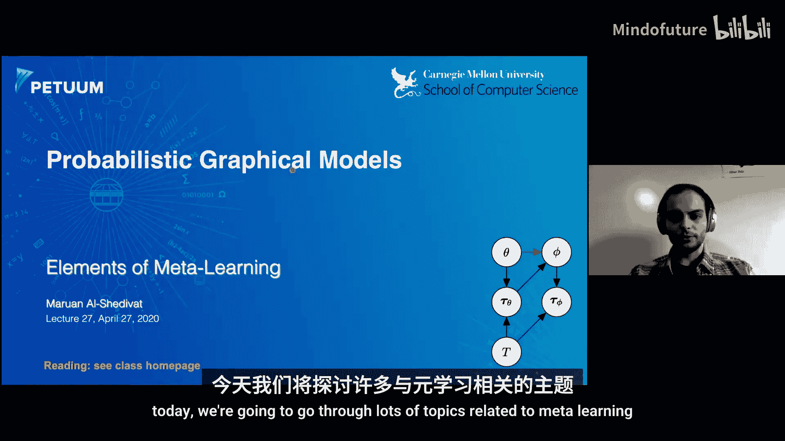

And two classes of methods basically gradient based metal learning and embedding or prototype based metal learning in the second part I'm going to focus on meta RL so that's going to be somehow connected to the lecture that are already given previously on reinforcement learning as inference。

What this lecture is not covering and you know metal learning is。

faastly growing field and there are different fields in some areas in this field。

 so one part that is not covered and it turns out to be too much of the material to cover in one lecture。

Is AutoML， which means automatic machine learning， which is also regarded as metal learning in some sense。

 but it's slightly different from what I'm going to be talking about today。

So if you already know middle learning or your research is about middle learning probably you will not learn that much。

 this is an introduction first of all， and maybe you will you will sort of learn some interesting points or implications that we're going to go through but generally our goal is to give you an introduction and give you a good starting point to start reading papers in this field okay。

All right， so let's get started then with the first part of intro tomental learning。

 so I'd like to start with this quote that you see on the slides from a paper by Rich Sutton and I Co and David Silver back from their paper 2007 where they say that much of machine learning can be characterized as a search for a solution that once found no longer needs to be changed。

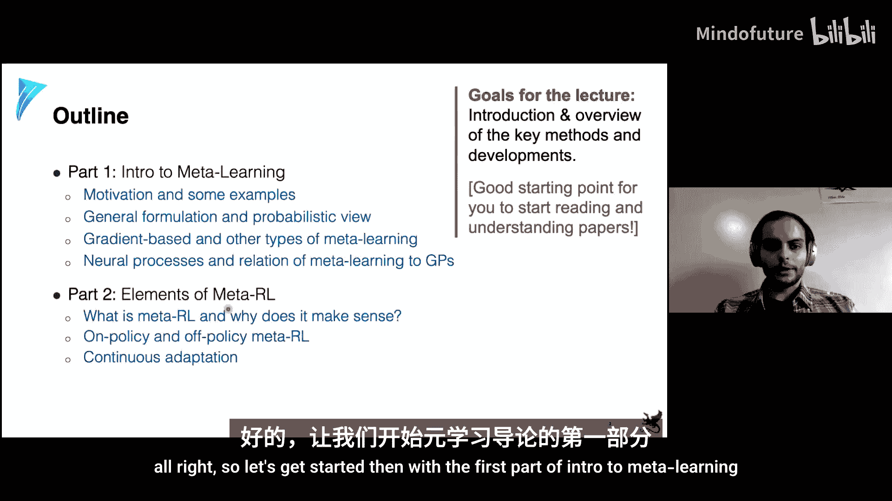

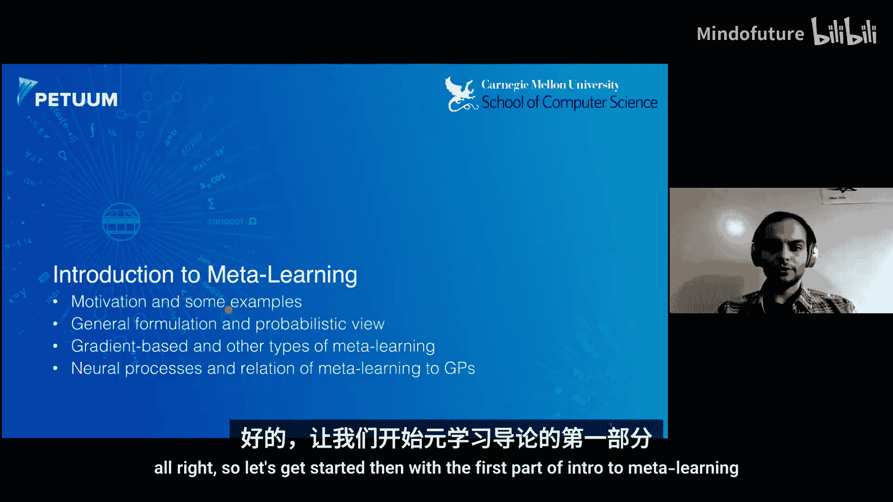

so what they're talking about is the standard setup in machine learning where we have a data set and we learn some algorithm that we extract the model and then we're sort of satisfied as long as the model models' performance on a test set is good enough right so then they say that machine learning has been more concerned with the results of learning or this model that we extract from the data then the ongoing process of learning right oftentimes this works and recently with deep learning approach machine learning approach has started working really well。

 but the question like to ask this is work always in which cases we actually need to be concerned about the process of learning rather than the model that we extract from a single data set so when a standard machine learning not enough。

We know that standard ML already had a lot of success stories。

 and I'm just showing here imageNes very large scale because it literally sort of kickstarted this revolution in computer vision。

And we see a lot of creative applications that all reuse architectures that were originally developed on Igenenet。

 as well as the success story of solving the game of Go。

Right and in both cases we have a pretty well defined task either defined by the data set or defined by the environment and in a sense it is stationary。

 so the images in the INe are not changing， the conditions are not changing so once we've got a model that is performing well on a subset of the data from INet we have a confidence that it will perform sort of well on you know on the test set。

啊。Similarly with the game of go， the game of Go stationary in a sense that the rules are not changing and once you master the game you can keep performing in playing the game at this super grand master level but how about a complex dynamic world in a complex dynamic world one of the applications that we can think of that involves complex dynamics is self-driving right so this problem I don't know if you remember in 2015 we all heard that some companies promise us to solve self-driving by 2020 and right now we know that it's a much more challenging problem than we originally thought it is and the challenge comes from this complexity that is out there in the dynamic world so that you can characterize is a very long scale distribution where certain situations are never encountered in the training setting you still want to be able to have some sort of guarantee that in the worst case you will not。

Do something crazy。Right or you can characterize it as you a world that is changing and maybe at a given instant of time you are in this kind of you know in one distribution and another instance of time you're going to be slightly different distribution etc。

 so this nonstationity comes into the picture right another application of interest could be heterogeneous data that we collect from people right a lot of this IET devices that collect a lot of data from us and the question that we can answer if we can ask here is how do we use this data to build applications that are ultimately personalized。

a recommender system that is specific to a given user or let's say a personal assistant that actually fulfills the needs of a given user and for different users。

 even though the inputs could be the same， the targets or the models that would like to serve these users often are different and finally how the interactive robotic systems we like to build robots that can sense their environments and accomplish a lot of tasks and ideally collaborate with people。

 all of this is kind of far reach goals and this is where the frontier of machine learning research right now is trying to push so metal learning is not trying to solve this task but I would say is a step towards trying to reason about them and approach some of kind of simplified versions of of these very complex tasks。

Okay， so what is metal learning so let's start a bit more formally and look at how can we define for standard learning and how can we define metal learning how to these two and it is really so in standard learning we can say that we have a distribution of examples。

And these could be input out repair pairs， it could be just you samples from a distribution。

 or it could be trajectories from an environment， right？

And our goal is to learn a function that minimizes a certain loss and expectation offers the distribution over least examples from this task。

Right so our goal is to learn a single function sometimes we learn posterior distribution over functions that we're concerned with a single entity now in learning to learn or metal learning we formulate the problem slightly differently okay kind of go one level up so instead of a single function now we have a distribution over functions and then each kind of distribution each sorry each task distribution over task and then each task is itself a distribution over examples。

Right and now we'd like to do we'd like to output an adaptation rule that test that can use the test time and apply to a new task and output as a function that is able to solve this new task so more formally again we can write it down as an optimization problem right in this case we have this distribution over tasks or data sense which is this outer distribution or compute the expectation of some loss and we would like to find optimal parameters for this G function okay。

Now the loss itself is an expectation， but now with respect to the within the task distribution over samples right and then this expectation is taken of the loss of some function with parameters finehi and the important part here is that instead of trying to learn for every task a separate function。

 which is impossible because if we have a distribution over tasks，You know， technically。

 we have infinite number of tasks， so we need to learn an infinite number of functions。

We would like to learn this G function that would output us。

The F function so basically the G function will generate the F function and would like to make sure that every time the G function generates the F function the loss is minimized and the loss is minimized across an expectation across all the tasks。

And I'm going to call just for the sake of this lecture this G function， the adaptation rule。

 it can have different forms， we're going to look at different forms and the argument of this G function is the task description in task description again it can be different forms in some approachess people look at a few samples as the task description which we're going to do next but sometimes it could be something more rich。

 so it could be a natural language description or something else。

So let's look at a toy example which is a few short classification problem so imagine that we're given a task where there are three classes let's say a ball align and piano right and we have a training set。

 a small training set and a small test set right now the case where we have a lot of tasks now well basically translate to having a lot of these small data sets right we have just a few examples let's say one example per class for each of the classes and well have a bunch of testing examples also coming from these classes and our goal in this case to be able to take as input this training examples and produce a function that actually works well on the test examples and we would like to have performance that is really good across all the tasks。

Let's say on average so again， our test distribution or data set distribution is this。

Green wine right so this is distribution over datas again the adaptation rule can have different forms the task description here is these few samples。

 few training samples that we're going to use in order to produce a function that works well on the test set。

And finally， within the task distribution is basically every row on this illustration。Okay。

So this is an annotation that we're going to use throughout the lecture yeah just are there any questions feel free to ask either on the chat or just raise your hand。

Okay， so。Let's move one， so there are a lot of papers that actually study in the setup。

 right the original paper that proposed the specific data set。was proposed around 20162017。

 but the actual setup this bilevel optimization setup was actually considered back or proposed back by Schmidt Huber in the late 90s and was considered by Sam Pggio in the 1990s。

Right so more recently， people started looking back and looking at all these methods and trying to adapt them in the context of deep learning where we have much richer and larger data sets and in this case metadata sets of tasks as well as much richer and larger models such as deep neural networks。

Okay， so let's look just few practical examples where does this few shot learning comes from right it seems like an arbitrary toy task where we have a bunch of examples in the chain set and then we want to learn to classify why does this why does this make sense well in some settings it actually maps nicely into the problem of interest so for instance in recommender systems there is so-called cold side problem where a new user comes in we have just a little bit of data for that user but would like to be able to make recommendations for this user on a pretty good level。

Stper from。You were just given the user history to try to learn a simple linear model that would be able to classify。

They relevant to the user， given just a few observations of what user already liked。

 I believe they applieded to the Twitter Twitter feed。The other。你。

Commendations that you serve to the user but that you don't want to pull all the data and sort of store it on the central server in the cloud instead you would like to be able to do all the learning and as well as serving on device so in this case you'd like to learn these models that can adapt to users on their devices pretty quickly and also the data that you have per user is pretty small so naturally essentially you in the few shot learning regime。

Okay， so just a couple more applications， one of them is low resource translation。

 you can pretty much transfer it into a similar setup instead of using transfer learning。

I guess to give you a little bit more background usually in translation you' need a lot of data in order to learn a good translation model so for instance。

 if you have English and Spanish languages you have a lot of parallel data that you can use to learn a pretty good translation model but for instance for English and Romanian or English and Latvian for these languages there aren't enough data so you need to do some sort of transfer learning or metal learning so the paper that I listed on the slide instead of using transfer learning methods such as left and the middle pictures they propose to learn a model use a metal learning method that I'm going to cover just in a bit called mammal in order to adapt translation from high resource languages to low resource languages Finally maybe one of the most impressive applications of future learning it so called future video to video translation where the task is to take an input video a pretty short clip and actually translate into target image so instead of having a video of。

A person speaking would like to have a video of Mona Lisaza speaking basically doing the same facial gestures in the way that they do it。

 again， they have a large data set， all these short clips for different people and different target images。

 and then they basically use a few shot they construct the few shot objective。

 they optimize it and they get this result。是。So just you one more example that the relevant to this lecture。

 eventually we're going to go into metaRL， but the step between supervised learning and RL would be imitation learning and actually you can try to solve imitation learning with with this few shots future short approach and meta learning so how imitation learning works technically have a data set usually you have a data set of demonstrations for a given task so let's say the task is pick a block in places somewhere else。

 usually have a lot of demonstrations， you need a lot of demonstrations in order to learn a good policy that would be able to sort of replicate the demonstrated skill。

Right， but it's very inefficient because for every new demonstration or for every new task that you'd like to teach your robot。

 you need to collect。A lot of demonstrations。So what this paper proposes is actually to restructure the problems such that instead of trying to learn a separate demonstration separate policy for each demonstrated task to try to learn a meta algorithm without output put you I pre initialialize policy and then given just one demonstration。

 you would be able to adapt the policy and sort of follow the demonstrations sort of replicate the skill to demonstrate the skill。

So all of these examples。Again using this same general framework or general formulation of meta learning maybe not necessarily this specific notation。

 but if you look at all of in the old map into this formulation okay so I just defined in this in this very simple few shots to example few shot classification example I've already defined what is the distribution over the data set what is the distribution within the data I did not define what is the adaptational so let's take a look at the first meta learning algorithm the first adaptation rule will try to。

Okay， so the first one is going to be mammal or model agnostic model learning。

 which became pretty popular in recent years。And was appeared at ICML 2017 Okay so the intuition is very simple right so let's say we have let's say I give you these end tasks and we the first thing you could try to do is to train a model for task one and then test it on the test set so get model let's say F1 and then to solve task two you'll start again from a random initialization you will apply SGd maybe on your model right and then you'll get sort of optimized model for task two etc you can do this for all end tasks but what if for every task we have only few data points so the proposal is to start。

And optimize each model from a common initialization that we're going to call theta， okay？Now。

 given a new task， when we start， we start from theta and then we just use the standard learning procedure or standard gradient descent。

 so we're going to go and define this G function or the adaptation rule。

Right as theta minus alpha gradient of the loss function of the task TI and the loss function is going to be computed these on these training samples right so we can do that and instead of theta we're going to get phi for every task we're going to get a separate fine okay。

Yeah。Now， how do we select an initialization that actually works for all these tasks right while we're going to compose all these tasks together。

 define the test laws。So we're going to define the loss or use the standard cross entropy。

 in this case， cross entropy loss on the test set。And we evaluate the function after we updated as parametersors。

Right so it's the function with be updated parameters evaluated on the test sets and then we just simply average over over the test sets that we have and then we're going to optimize this objective function with respect to the initialization why because these new parameters are a function of theta right so everything here under the minimization is a function of theta so we can simply apply gradient descent again so itll be gradient descent around gradient descent。

So this would require second order differentiation， et cetera。You know， intuitively。

 what happens is that let's say we start with some initialization。

 we compute all these gradients for different tasks。

 all these gradients are going to pull us towards the direction， intuitively， again。

 towards the direction from towards the point from which we can reach each of the tasks that we have in the training set。

 within just a few gradient sets。Okay， so that's the intuition panel。

 it's a pretty simple algorithm and。Does it work right that's the question that we can ask does it work well on a couple of benchmark dataset sets mini imageagenet is the dataset from which I just showed you the samples of this toy future classification problem and omniglot is in even simpler dataset set that' basically MNist like characters from 1600 different alphabets。

and then they have two different protocols of how to evaluate these methods。

 one is called five way or 20 way classification and then it could be one shot or five shot which basically means let's go back。

 way means is the number of classes and the problem， shots means the number of examples per class。

Okay， so on the omnigla， you can see that Mammo performs really well。

 I guess the comparison that we should be looking at is the standard fine tuning。

Because other methods are just other meta learning methods。

 but fine tuning is really kind of the most。Permitive baseline that you can come up with to you start you're pretraining a model on all the tasks you just try to fine tune this model and how good is this mammal learn initialization versus this fine tuning learn or pretraining learn initialization so it turns out it's pretty good and so you can see more than 20% improving one shot setting five way accuracy in something similar in terms of five way accuracy。

Right。Yes。Okay， so we can actually also look at mammal right and this nested optimization problem from a pbabilistic standpoint。

To do that， let's just introduce a little bit more notation。😊，Slightly redefined im notation。

 so let's say we have endpoints that are coming from our distribution。The Christmas wants to task TJ。

For simplicity we're going to ignore the labels for now let's say is just you know distribution modeling task and we have testing points。

 the following points that are also coming from the distribution chma task TJ right now the mammal loss that I just wrote to in a previous slide in this setting would look like would look like this right it's one over J which is the total number of tasks some over。

1 over M and then let's say we have M points per task。

RightAnd in this case m points are the M testing points right so we have m testing points and then we're going to compute this outer loss。

 which is the negative log likelihood of the testing points from the testing sample from the same distribution and then this is the inner loss so basically this is the adaptation rule so we compute conditional distribution。

Of these testing points from the testing set， given that the parameters Phi J that are basically the adapted parameters。

 which is the initialization plus the gradient step again on the same loss and on the gradient step is computed on the training points。

So again， we take the data set was split into parts， we first adapt parameters on the first part。

And this is basically the illustration。Right we have distribution over tasks that produces the distribution over data。

 the distribution over data， we sample from this distribution right then we get two samples。

 we separate them on one sample we can fit the loss and then adapt parameters of the model and then we get adapted parameters。

 we evaluate them and finally we get the final loss that is meta optimized with respect to data。

Right so this looks like you know a platementations we can further a little bit generalize this inner loop that is very specific to mammal and you know more generally think of it as just hierarch cult model right and in this case and outer the outer loop we have this random variable or basically parameters data。

That sort of imply or conditional on this data， we can sample Phi J and this conditional step in mammals case。

 specifically， basically this conditional distribution of probability of phi J given theta in mammal's case is a gradient step。

Right more generally and more broadly， it could be arbitrary conditional distribution。Okay。

So this is the reinterpretation and it appeared as an eyeC paper in 2018 so the authors further go and explore different ways to actually approximate this conditional distribution and they show that meta learning is basically empirical base on this hierarchical vision model and you can have different approximation mammal is one approximation they came up with slightly different preconditioning a slightly different approximation I'm not going into the details of this paper but you should look it up online。

Okay。So let's。But before I switch the gears to the other type of metalary methods。

 let me know if there are any questions。No questions。Okay。Okay。

 so that was gradient based metal learning pretty simple start with initialization compute the gradients on the subset and then optimize the whole thing on on on the average of all tasks Now is there another way we can solve this problem again let's say we have these three classes a bunch of instances and then would like to。

You know， do something with the training instances and then make predictions on the test instances。

I guess like the simplest thing that one could come up with right would be the nearest neighbor classifier。

 right so you can try to compare which instances are closer to each other and then make predictions based on the distance on the smallest distance。

And this is what another method， another class of methods I would say tries to do so instead of in order to compute the distance first of all。

 you need to define the representation on which you can compute the distance probably pixelel is not the best representation for computing distances so you know we probably would want to embed these images or these instances in some kind of embedding space and then once you embedded them right we can determine。

Sort of the class of the new instance。By just looking at the distances right and then trying to pick the class with a minimal distance for that testing instance。

 so more broadly if we have more points per class or more shots in the few shot learning notation。

Right， in this case， we can。Agggreggate these points and further construct the C1 C2ncC3。

 which we'll call prototypes of the classes。And once we have the prototypes of the classes that we constructed from the training small subset right。

 any test example can be classified using this distance to prototypes。

 you know more formally how exactly we're going to do that we can compute prototypes using arbitrary embedding function this could be let say neural net that takes in your images as inputs and outputs you just I don't know。

10 dimensional vectors。You just average them together for each class separately and then the predictive distribution is just the distribution given on this line so it's Baltzman distribution with the negative distance in the exponent negative distance between the corresponding class and the embedding of the testing point okay now how are you going to train this again you're going to have all the end tasks for each task you can compute this predictive distribution for the testing points then compute the loss and then average across all the tasks so the only thing that you are learning in this case is basically the parameters of this embedding function。

Okay， so it was an extremely simple method。And it turns out that it actually works pretty well。

And even though this work was very much concurrent with Mammal， so it appeared at Nups 2017。

 as printprints， they appeared almost in simultaneouslyimultaneous in an archive and surprisingly even though these matching networks and neural statistic methods。

 all of them use some sorts of adaptation rules that are sort of more complex Mammal use this gradient based adaptation rule。

totyp networks literally are used this inbeing function and fully non-parametric approach and they outperform and entirely all these previous methods and they're super competitive both with Mamal and on both of these benchmark datas en emission。

Right so these are two classes of methods and you know one of the questions that arises by looking at these numbers and looking across many other papers that try to combine the two methods and come up with you know sort of hybrids of kind of learning fancy embeddings and then putting on top of that some sort of gradient based adaptation of some of the parameters of the model。

 you realize that，They don't go too far， or at least on these data sets。

 they're pretty close to these methods。Right now these numbers are pretty outdated so the best methods and on these specific data sets get something around 80s or 90s% in one shot five shot five way accuracy。

 but you can ask this question whether actually how much of the adaptation matters or the adaptation rule matters you know versus how much of the representations or these embeddings that。

Eventually you learn from this multitask data of matter and this is the question that one of the papers from ICary 2020 is actually asking so the ask the question is it rapid learning actually where is the feature we use that Mammal specifically is is trying to do and their study was focused specifically on model agnostic metal this gradient invasive based approach。

Yes。So what exactly does it do？这。Just to illustrate the question a little bit。

 once again we have this mammal kind of structure where we have an initialization and then we have this adaptation to different tasks。

 so in case of rapid learning you know the diagram that they show tutorially right is that we find an initialization from which we can quickly but still you know quickly quickly adapt to a new task。

 but the difference between the initialization in the initial parameters and the task specific parameters is actually drastic。

in case of the feature we use， your adapted parameters are already sort of good enough or almost good enough to solve all these tasks and really the majority of the bulk of the performance improvement comes from the feature that you're able to learn in this multitask setting。

So this is the question to I try to ask to answer to this question。

 whether it's adaptation or whether it's good representation。

 they conducted a lot of experiments with mammal and a version of mammal so the version of mammal that they proposed is called anil or almost no inner loop right so it' was basically a mammal that was slightly slightly edited so in case of mammal typically you have for the function you have a multilayer neural network。

And in this case， let say you have three layer neural network where theta 1 theta2 and theta head correspond to the first two layers and then the third layer is that the head of the neural network that makes the prediction。

Is there a question？Okay， so the head of the neural network。

Makes the predictions so basically it goes from this latent representation into the number of classes that you specified for the problem。

In case of anil， what they proposed is to fix and basically fix the theta 1 and theta 2 and never adapt these parameters and only adapt the head parameters of the neural。

 so the hypothesis is that if adaptation of the lower layers of the neural network matters。

 then probably anele should not work at all or should not work well。You know， as it turns out。

 the two methods are almost identical。So what the authors discover is that there is literally no visible difference in performance between Mammal and anil。

 they also looked a little bit at a variation where you train everything with Mammal but then a test time sorry you don't adapt anything at all so you basically learn a single model for everything and maybe a test time you adapt a little bit the head which is they called the nil version of a nil without the a which performed a bit worse but still the performance was literally within the ballpark of the Mammal numbers。

So more details can be found in their paper。And you know the study goes。

 the syn normally looks at all these like final performance numbers。

 but they also actually try to compare the representations in terms of you know how well the representations correlate into different models across all the layers across different tasks between the two different different medicine they find that there is literally there is literally no correlation and even in mammal case at the end after the mammal is fully trained at the adaptation step after the adaptation step。

 the majority of the changes coming from the change in the head parameters because you basically need to figure out which classes to distinguish between while the theta 1 and theta 2 and all the lower level parameters are literally not changing at all。

All so partly answers the question， it's still unclear there are a lot of hybrid methods that sort of benefit from both gradient based and prototype based metal learning。

But this paper sort of shineds a little bit more lights on。Which can prove matter as more。Okay。Yeah。

Now we looked at these two approaches and previously our previous lectures in PGM。

 I believe you guys covered。Gussian processes so let's try to draw parallels from with you know Gaussian processes is non parametric models and this metal learning future learning setup are these similar if they if they are。

What are the similarities what are the differences so my argument is that what metal learning is trying to do is it tries to learn a distribution over function。

 which is some sort of a process and then we'll see what kind of process it as so in futureot learning let's consider this regression example just for the sake of example。

Our goal is to really by solving the task， we're trying to identify a function。

That basically generated the data whether it is conditional probability distribution of classes given the inputs or it could be just the target right y given the x in this one dimensional case and let's say we have these different functions so that the values of y are different for different x's so given just a few samples let's say from the blue curve what you want to do you want to figure out that actually the data is generated from the blue curve not from the red not from the。

You know， orange or green。And by looking at this image technically it is possible right so goal is the goal is the goal of adaptation right or this adaptation rule is to you know using this prior knowledge about the structure of this functional space that we believe is is true。

Right we would like to be able to identify these functions so if you remember Gaussian processes they are basically doing something very similar so imagine that you have a Gaussian process and then you have a few observed points here right given the observed points or a few x and Y pair you can compute the predictive mean and predicted variance as given on the slide right so basically you narrow down the distribution over all possible functions sort of under the Gaussian process prior to just a few functions that are kind of suitable with the observed the observed evidence right？

And you can infer this posterior predictive distribution given given the observations and as well as given our prior knowledge that we actually incorporated or encapsulated in this kernel function。

And in this case， the kernel function， so this Gaussian process on the right hand side will probably not fit the sinusoidal。

Functions on the left hand side because the kernel is squared exponential so it doesn't have the right assumptions about the periodicity of these functions。

 but if we use some sort of periodic kernel pretty much is' going to solve this problem this metal learning problem very well given a few samples from any of these functions my Gaussian process can nicely approximate the rest of the function。

Right so this observation was made by these authors， Garnell and others from DeepMd。

 and they proposed。You know to sort of imitate what Gastream processes do but in a more kind of flexible way so that we don't have to design kernels because designing kernels could be pretty challenging it requires you know sort of understanding the space of the functions and oftentimes it's a very ad hoc process so maybe instead of designing the kernel right we can somehow learn it from the data so on the left hand side you see that we have this our standard setup where we have some observations generated by different functions。

And let's say we have some training observations， we have some target observations for which we don't have output why。

 so in the standard supervised learning， again， we distill a single function and then we use the single function to predict all our outputs。

So in case of Gaussian process， it's not a single function。

 again Gaussian process a distribution over functions， so given arbitrary inputs。

 the predictive function will be different。Depending on whatever what are the inputs we're going to have。

 all right， so they propose this a conditional neural process architecture that sort of imitates what Gaussing process does。

 but is parametric and it doesn't have an explicit kernel。

So we have these observations that go through this H function are transformed into these representations our one hourography。

 then that they have some sort of attention module that attends an aggregates or basically aggregation function that aggregates these representations and we get this R。

Now， our G function or G part of the model will condition on this R and make predictions on the target points。

Right so if you think of this， this is basically how Gaussian process works。

 you condition on some variables， you infer the posterior predictive distribution in this case approximated by G and then you make these predictions from x4 x5 x6 to y4 or 5x6 So what they looked at they looked first of all。

 how well like does it work comparably well to a Gaussian process and on the right hand side you can see that they had some toy examples where you have five context points or 50 context points or these chain points。

Right and they compare Gaussian process in CNP and if you compare the two they reason we look pretty well。

 maybe CNP is a little bit less regular， which is also good。

 it means that the CNP model can capture can fine grain structure while Gaussian process is much smoother but again this is incorporated the assumptions of the kernel function but the cool example is on the left hand side where they actually applied it to images which are extremely high dimensional high dimensional。

Objects， right， and in this case， you know your x is actually a coordinate。Right。啊。

So coordinate along the axis so it have x1 and x2 along the you know the width of the image and the height of the image and as well as you will have x3 which will be along the channels of the image right and for each X you can try to predict y or the intensity over the pixel okay so it becomes a regression problem in a sense right and then you can try to solve it with this the CNP so with the Gaussian process or the standard Gaussian process it's really hard to design a kernel that would represent natural images it's virtually virtually impossible so you have to really really engineer this kernel function。

Um， with their method they show that after training CM。

 the andfil or the predictions that they're able to make， in this case。

 the conditional some of the pixels that try to predict all the rest of the pixels。It looks very。

 very realistic。Okay， so this is， this is just to show you the relationship between gas and processes and you know。

 meta learning setup and how the way the problem is actually set with this multiple tasks and two levels of optimization is nothing more than just a hierarchical。

Baesian model in kind of general general sense， right？Okay， so I'm going to give you a quick。

Notes on the software packages， if you are interested in using metal learning or you're already using meta learning。

 you know one way to start research or to do research is to look into the research code releases right and right now these are ubiquitous oftentimes a new paper up comes with a code from my own experience code is often code from code releases is often very fragile。

Sometimes it's broken。Sometimes it works， but even if it works。

 it's a lot of effort to take this code and adapt to your own problem。

 so the community has started coming up with some libraries and implementations and reference implementations for some of these methods。

Those three are probably my favorite ones， so it actually differs to our Pytorch libraries that use to basically implement mammal and mammal like methods as well as protypical networks。

And a bunch of kind of future classification problems so you can go and look them up。

 you can easily run them and test。And benchmark existing methods on these on existing benchmarks higher library actually came up a bit later after these two and it provides you lower level building blocks that you can reuse for gradient based metal learning so if you're building a metal learning pipeline for something that is not being know considered before say maybe for some medical application or something like this。

 you can use higher primitives within the Pyth which in order to build your pipeline。

And I guess like I would add a little plug that there is a new library that I've been working on which is based on TensorFlow。

 all these previous libraries are based on Pytororch。

 this one is based in TensorFlow and the focus of libraries actually to provide building blocks that are a bit higher level and higher right and a bit lower level than these pre kind of prebuilt cr files sort of prebuilt libraries。

For existing methods so they can reuse these building blocks and quickly assemble the learning methods that that you're interested in China right yeah so this library is currently under active development that's very fast and modular and this is the focus the focus is on modularity we'll plan to support a lot of things and I'll be running a tutorial actually next week so if forced some friends and collaborators at CMU so if you're interested in learning more you jump anyone。

Okay。All right， so this sort of concludes the first part of the lecture。

 let's just go through a few takeaways， I guess the first takeaways is that there are a lot of real world scenarios that need something more than just the standard machine learning paradigm with the training and test set on。

ID everywhere。And perhaps going beyond learning once。

I is a good approach and metal learning actually actually does that proposes to learn to learn an algorithm right so learning to learn or metal learning attempts to solve this problem and it defines this rich multitask setup。

And instead of learning a single function， we try to learn a generic kind of meta function that outputs functions for every single task。

And so there are two families of methods that we consider， of course these are not the only methods。

 there are so many of them and there are many hybrids， many extensions， many improvements。

Like literally every week， you can see maybe 10 to 15 new papers that actually cite mammal one。

This is a very fast growing subfield right now。Again is it about adaptation or representation as limited to one of the papers it looks like it's more about representation than adaptation but it's very data dependent so exactly the same study with Mammal versus An on some other data set or maybe even NRL setting would not work people haven't done that and it's still an open question。

And something that I did not cover， but I find very interesting that metal learning can be actually used as a tool or a mechanism for causal discovery。

 and there's a recent paper from 2019 by Ashha Benjo and others on how to actually use metal learning or this rapid adaptation of different learning rules in order to discover which mechanisms potential which variables are related to which in a causal way and which relationships are not supposed to be causal or not supposed to be present in the model。

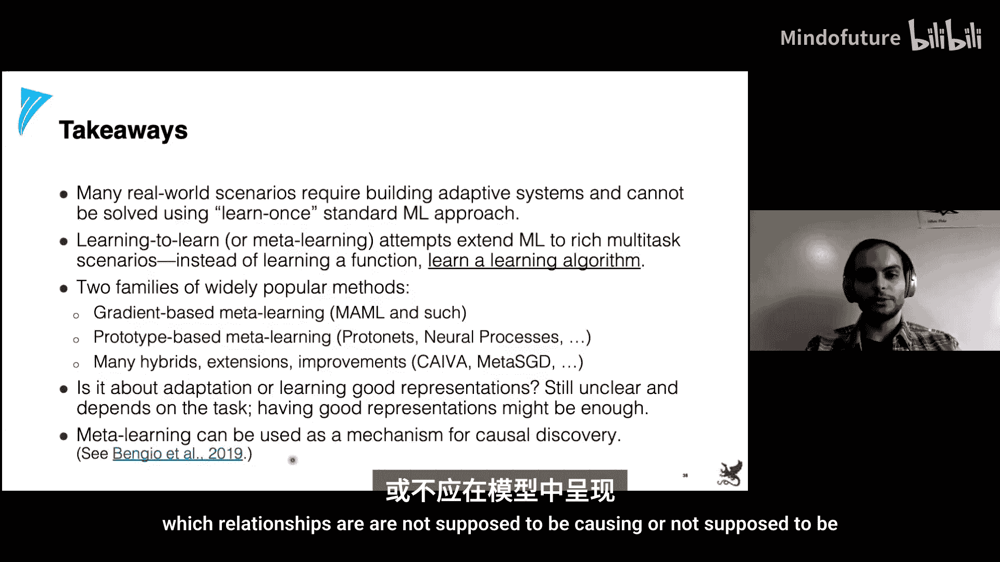

Okay， so any questions so far？😊。

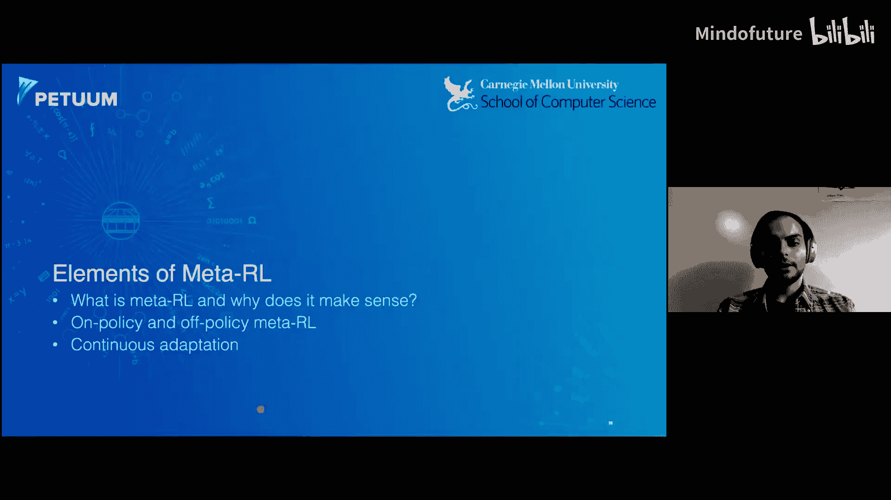

Before I go to meta Rro。

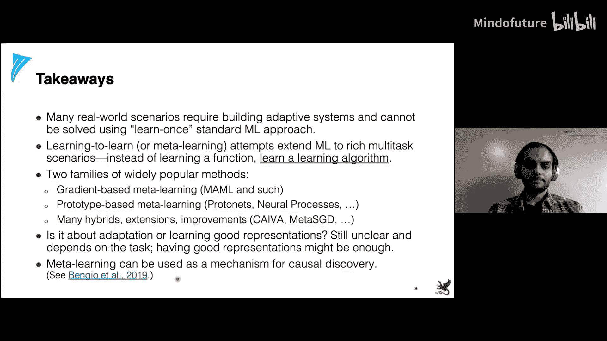

Okay， if there are no questions， let me go to the Me R part right now。Okay so far。You know。

 I talked about mostly supervised learning applications。

but it's it's it would be national as you will see to extend many of these methods to。

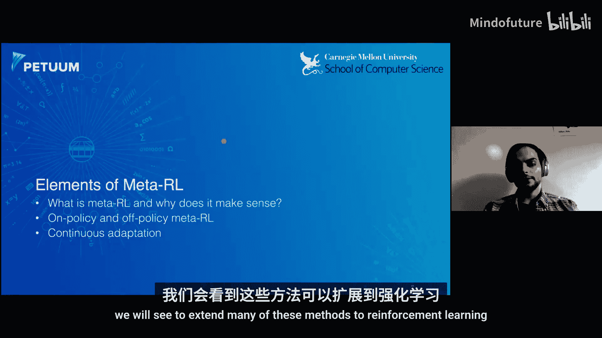

Reinforcement learning and so let's go back to our original chart right with the standard learning and learning to learn with our distributions over tasks and distributions over data and the adaptation rule so。

While in the。You know， and the standard and the standard。

 or I guess like on the supervised metal learning setup。

 right we have this tasks adaptation rule and task descriptions and Me RL we can further specify it and narrow it down where the distribution over tasks is going to be distribution over the environment that the agent gets to interact with。

You know， we train a policy update rule instead of just this you know arbitrary adaptation rule that can solve a new environments right given on the limited or no initial experiments in that environment and here's just a simple example。

 imagine you have a distribution over mas in which agent can go and try to find the goal where the goal is this blue square。

And。You know， the mazees would differ slightly in the topology and the mazees would differ in the position of the goal right so before adaptation。

 the agent would go and try to you know explore the maze and then eventually find it hit the goal。

And stop at the goal if you go and rero the agent in the same environment。

 which means that the same topology and the same goal position。

After the adaptation we would expect the agent to quickly go and directly go to the goal。

 so this is what happens and this is just an illustration from one of the papers that looked into this application。

But more broadly the setup is the following so imagineing how a distribution over environments and each single environment environments might differ from each other in the dynamics of the environment they might differ in the reward function they might differ they might be differ in both of these these aspects right and you have some sort of metaarL algorithm right that produces a fast ArL algorithm and why is it fast well because given a new environment so say environment X your fast Ar algorithm is able to quickly。

You know， interact with this environment。And after just one or a few trajectories。

 you all the consecutive or subsequent trajectories that that algorithm are going to achieve their high reward。

So this is the basic conceptual diagram that。They describe Me R。Right。

 but just to give you a quick recap before we go into specific methods such as mammal for RL。

Let me just quickly recap how do you learn in reinforcement learning right and this is a slide from one of my。

Previous lectures where we looked at policy gradient policy optimization and eventually we derived。

This algorithm that consists of three steps where you under initial policy， under some policy。

 you sample trajectories and you construct these objective function and you compute the gradient of this objective function and then you go on a parameters and then you resample trajectories again and then you repeat。

And then to compute view the gradient， we had to use this the log gradient trick。

And eventually we' got the subjective function that you see on this slide。

 this is not the most optimal objective， there are other objectives that are lower variances than this one。

But the point is that as long as you have objective。

 you can literally reduce your reinforcement learning into kind of data collection loop where you generate samples。

 and then you sort of roll out。The policy then you improve the policy and then come back and sort of close the loop some general samples。

 compute the objective， compute the gradient of and back to the policy， okay？

RightNow if want to do on policy meta RL well we can do Mamal again。

 because Mamal is pretty model agongnostic， it doesn't really care about what kind of loss you use and what kind of gradient where the gradients are coming from as long as you have loss and as long as you have the gradients and as long as you have two separate per data sets right you can do mamal so in this case you start with a common policy initialization across all your tasks you'm going to call the data。

And given a new task， you're going to go and roll out and get a bunch of experience or a bunch of trajectories under this initial policy from this task。

And then you're going to adapt by computing the gradient of this G function， right？😊。

Then you're going to add the parameters， maybe with one gradient step。

 maybe with a few gradient steps， but you will get this Phi I that is suitable for task keyI。

Now to train this whole construction rights you're going to do the same thing as we do for a mammal。

 we're going to compute this J test and another that J test is going to be computed on the trajectories that were rolled out using the adapted parameters so you'll have to do two rollouts first you rollout trajectories under the initial policy you compute the update and then you roll out again under the adapted parameters with adapted policy again then after that you can construct this objectivejective everything depends on theta it's fully differentiable so you can minimizes with respect with respect to theta again intuition is identical to the intuition we already had with mammal。

Yeah。What we can do further is try to look at it at adaptation as inference in this case so we can treat the policy parameters。

 the tasks that we have in the system and all trajectories as random variables and we'll see why this graphical model is important interesting right so in this graphical model again we start with initial parameters we have adapted parameters。

 adaptive parameters depend on the initially rolled out trajectories as well as the original parameters and then the final trajectories on which we compute the loss depend on adapt these adaptive parameters and of course the task basically the task here specifies the reward function if you will。

Right， so just to give you an illustration， well， so first of all， meta learning。

 this case is equal to learning a prior， as I already said in this hierarchical base model and adaptation is basically the inference。

 right。This is just to illustrate this on one one of the reinforcement learning tasks where the goal is to make this cheetah robot。

 which is actually a one dimensional robot to run in a specificified direction。

 either run backwards or run forwards。And after training mammal for a few steps on a lot of environments and in this case it's basically different velocities and different directions that specify different tasks right the initial this is the initial behavior that you get the initial trajectories and then after the adaptation you can get for the backward tasks behavior on the left and for the forward task behavior on the right。

Right。Yes。Okay， so was that was't happening。That was mammal so that was on policy R right converted into on policy meta Ar so the natural question can we do something similar in the off policy setting right and in there is well originally there wasn't but right now there is there are pretty good off policy meta RL algorithms。

That are actually extremely sample efficient as you would expect from the off policy of policy reinforce learning any algorithms so how do they work so I'm going to go through high level through a bunch of basics from this paper called Pro the proposed method called Pro。

That appeared at ICML 2019。So again， when you interact with the environment with the different tasks。

 you technically collect a lot of experience， so in case of Mammal we would interact on policy。

 we'll collect these experiences， adapt policy collective in experience， do the optimization step。

 then discard everything and then go and you interact with a new task。

Do these two steps and then discard everything so instead of discarding how bad we just run a policy。

 collect a bunch of experiences from different tasks and store them in the replay buffer right then after that from this replay buffer we can try to learn it's called task inference function in this case called Q phi where we try to infer the representation of the task explicitly so before we thought the task is represented basically by a bunch of trajectories that you roll out under the initial policy right in this case we will try to have an explicit representation computed by this Q function okay and then we can formulate this whole assume that we have a lot of data in the replay buffer we can formulate this as a version object code problema。

Okay， so byvari audio code you have observations which are coming from your replay buffer and you have some latent z's now you'd like to learn basically the conditional distribution of Qz given C or C is the context or it's coming of from the replay buffer。

And the objective function that you have here on the slide is basically the。😊。

Kind of generic variational autoenr objective we have this decal between the prior and this hysteria maybe weighted by some beta also the beta v and typically in the you would have here the evidence right log probability log log probability but generally you can have a different objective function a slightly different kind of loss function here and still be about V so they can have lesserstein loss maybe or something else so what these first of all。

 what these authors propose first of all， they propose a specific structure for the Q function they say that the Q function。

That computes the representation of Z given the trajectory is multiplicative right so you can dig into those trajectory into triplets of overlapping state action state triplets and their work and by looking at this triplet you can run them through the exactly the same kind of neural network that would compute some sort of representation and then you would put a Gaussian around this representation and then you will multiply all these Gaussians together so this is the assumption what these authors make so this makes it easier to compute this DL objective and it simplifyimplifies the math。

So the other cool observation that they make is that we can define this R task Z。

Function that defines actual loss or the reconstruction loss， basically for the VA。

We can swap it and define it through the Q function。Right now。

 the intuition is that if we have a Q function that also depends， that is conditional on the tasks。

 right？If the task representation was inferred correctly。

 if the z function was good right then the Q function。

 the conditions on this task should be also good right so the Q function also depends on the policy right？

Because usually you say Q theta or Q something Q pi corresponds to the respective policy。

 but you can have a Q that is not related to any policy。And in this case， you have policy pi theta。

 so this Q will be parameters by theta which corresponds also to the parameters of the policy P theta。

 so basically you connected your variational objective through this I critic with dysfunction function。

With with the objective that actually makes sense for the reinforce learning right so you'd like to find the Z such as that your Q function actually can distinguish well between the tasks and this Belelmon error or the TD error once that error that we covered in one of the previous lectures is actually minimized。

Similarly， you can define a loss or the actor loss for the policy and alternate between optimizing the policy right and optimizing the inference function。

And if you use the soft actor critic， right， soft a critic approach or the soft learning approach。

These two functions Q and pi will be actually coupled right so you can as I showed in one of the previous lectures they're basically mathematically related to each other so you will essentially be alterd between optimizing these two objective functions with respect to theta which parameters Q and pi right and phi which is parameters of the inference network the task inference inference so the key points that these authors make right is that first of all you can infer explicit latent representations of the trajecties you don't need to sort of hide everything on of mammals style。

Graient adaptationnot， right？Second of all， you can decouple parameters of the inference network。

One second a couple parameters of the inference network and the parameters of the policy and the Q function and alternate between the two which allows you to kind of train them and them but also allows you to use all policy data collected collecteds while training the whole the whole pipeline and finally all objective all objectives in this case you know involve both the inference network and policy network or the Q network so if you look at both of these objectives they all depend on theta parameters and the P parameters and your algorithm is going to be basically itly optimizing the two so we're going to alternate between optimizing these parameters after optimizing phis and optimizing thetas as well as collecting more and more experience as you see needed there was a question somewhere。

Right I had a question about what makes this of policy。

 so is it because the cure is a multiplicative posterior distribution is that the only reason that this can be made of policy。

Because the order of the transitions is not relevant here。That's right that's right yeah。

 so the multiplicivity actually makes it suitable for off policy so that the Q function actually does not depend on the entire trajectory。

 but on just a single sample， technically I see a way to extend it to multiple transitions like if you really want to use like truncated backag withcurren with acurrent neural net you can still apply it and instead of storing know triplets and your read buffer you can store entire trajectories so to fit the Q function right you will still use triplets because you have the TD error and you don't need anything more than just triplets。

But let say to fit the inference network， you would use the entire trajectory。

 how well that would work on the chart， but it seems to me that you still should be able to keep reusing your relay buffer。

Does that answer the question， yes， thanks。Okay。Yeah， so this one， this method。

 why it is so you know interesting is because the results turned out to be remarkably good right you can look at mammal that I just described there is this other RL squared method that we didn't go through in pro and P which is kind of sort of mammal plus plus if you will。

with a lot of corrections and improvements to how this like second order gradients are propagated through the objective and this is pear right so if you look at the curves。

 so literally pearl already outperforms the best methods somewhere you know after just the  one million steps。

On these simple environments well while the the mammal or other other adaptation these methods are starting to take off so similarly you know for the health cheat velocity it already solves the task literally ats almost let's say1 million steps again while mammal is going to take a few。

You knowHundreds of millions of steps get to get to that level so this is this is really interesting because it's much more sample efficient。

嗯。On the other hand， you can ask a question。And I guess the relationship between pearl。

And mammal for meta Arl and you know mammal and Pros for supervised learning is sort of similar right here you learn explicit representations of the tasks right as sort of embeddings and this latent space and with predictic networks could basically do the same like you learn the prototypes of representations of the classes。

And again， if you run prototypical networks and mammal on the supervised learning in the supervised learning setup head to head。

 you will see that prototypical networks literally achieve their ens saturate within maybe a few hundreds。

 maybe a thousand step while mammal takes a few thousand steps and so there is an order of magnitude difference in terms of efficiency and it turns out the explicitly learning representations could be more efficient。

 but also you can go step you know one more step and ask a question how much of this like entire construction that are sort of meta learning driven where you decompose your tasks into different tasks and you actually need to decompose tasks and different tasks have some initial experience of an optimize on the final experience on the test trajectories so basically sample from task training trajectorors optimize the whole system on the test trajectories and the answer is probably no there is a paper called MeQ learning that actually shows that if you take this。

St Q learning and just add the standard inference function。

 which is going to be a recurrent inference function and try to condition your Q function on the representations and by the inference function without all these fancy kind of combinations。

 you can still perform as well almost as well as per on many of these benchmark。Okay。All right。

 so I'm going to slightly shift the gears from here since we consider both on policy and off of policy Mattl。

 and I'm going to look into the problem of non stationary。

The problem of the non station environments。And you know the question that we can ask so this is great we have a lot of tasks now we have a distribution over all these tasks we assume that these tasks are coming to us IAD somewhere right given a new task we have we can observe a few samples from this task maybe try to interact with it and we're going to solve it okay。

Now， the adaptation of this case is literally as shown with arrows。

You know on the on the right hand side right we have to enter like tasks are are sort of independent and fully fully decoupled and the fact that you know we're able to meta learn something and then you know sort of。

Perform well on the new tasks。Is coming from the fact that these tasks are somehow related and this is captured by the shared representations that we learn。

Of the meta training set。But what if were in an stationary environment。

 so let's say we have a single environment and then task somehow drifts over time。

And then don' know we don't know exactly how it drifts maybe maybe it drifts consistently。

 it makes sense to assume that whatever is happening to the next task。

 let's say to task two and task one they could be related， task three and task two would be related。

 task core and test three are somehow related。But maybe not we don't know exactly how they're related。

 can we still use net learning to sort of approach the problem often station areas somehow？

I'll give you just a simple example of how what an aation or environment can look like and in this case it's an example from a competitive multiag game so let's say you have an agent and opponent and the goal is to adapt to a learning opponent so it means that the agent initially faces an opponent and maybe the opponent initially is easy the opponent's competence is not that high you know the opponent will improve over time right opponent is going to learn by interacting with the agent。

And in the round two， the opponents will actually be more competent。

Right and then the game can go on and on and round three for et。

 the opponent's competence can change and improve and therefore from the agent's perspective the environment that it gets to interact with and every single episode every single route is going to change and so ancient round can be seen as a new task and we can think of this nont from around round as a sequence of tasks。

Right。So how can we go and solve this problem also first of all from the modeling perspective right again all these tasks become dependent and what we would like to do we'd like to learn an adaptation rule。

Not just within the task， but the adaptation rule that can jump from one task to the other and then to actually design an algorithm that is able to solve this problem。

 you know we need to sort of meta learn to exploit these dependencies so how do we do that？Well。

 first of all， let's just start from the you know graphical model that just introduced and I said。

 it's going to be handy for us to use it later because you know the beauty of graphical models is that you can put all the variables kind of on the canvas or on the slide on the whiteboard and reason about what are the variables in the system in this case。

 we have a single task or you sort of independent task and a bunch of dependent variables such as trajectories and sort of the parameters of the policies or parameters of the Q function。

In case of this continuousum continuum of taskco or continuously changing tasks where we would like to continuously adapt and hub from one test to the other to the next to the next。

The new variables that we have in the system are going to be new tasks。

 so at every instant in time we are no longer interacting with the same task right theyre going to be interacting with new tasks and all these tasks are going to be sequentially dependent。

😊，Okay， so every time that we start， let's say we start with some initial parameters。

 we're going to interact with the first task， but then the parameters for the next task。

Right we'll have to produce trajectories that are actually in a slightly you know are coming from from let's say a different opponent or from a different situation that drifted from the original one and our goal right now is to learn from a graphical model perspective our goal is our original goal was to learn this adaptation function here right now our goal is simply to learn an adaptation function that hops from Phi1 from phi0 to P1 to52 etc。

And given a graphical model fully specified， we can technically write down hierarchical base model and generic inference function and then try to approximate it。

There was a question。我的是个是这。I was asking if you also considered catastrophic targetingting during the adaptation。

All right， so and this setup， yeah， so catastrophic forget getting just to define it is。

Actually relevant to the case where you'd like to learn as many tasks as possible and also retain knowledge about these tasks。

 right？嗯。In this case， in case of continuous adaptation。

 you technically so the setup is such that you don't really care about catastrophic forgetting because your tasks are going to be changing from T0 to t1 to T2。

 et cetera until infinity。 So it assume that there is some sort of orovan dynamics。 Yeah。

 so you will never just go and try to solve arbitrary tasks in the sequence you care about catastrophic forgetting where someone externally。

Once your agent are you know different tasks and want to solve them。

 and there is no way to control how you know this person or someone points you to these tasks。Okay。

 also do you see any kind of。Criculum learning in this or was it like random task one not level？Yeah。

 so in this case， so we're going to come to the applications but we did indeed we considered curriculum learning so we always started from simpler tasks so you can learn them quickly and the next task is going to be a bit more complex and the next task is going to be a bit more complex so if you look actually at this example that I just gave with robots right it's a sort of natural curriculum where your opponent is learning opponent is changing that the competence of the opponent keeps improving and you're trying to train your agent to face increasingly more competent opponent。

But yeah， I agree that curriculum is going to be basically something that really defines these transitions between the tasks。

And one research problem to consider is actually to try to design better curricula that would enable more efficient metalry。

Yeah，没见。Okay， so from， you know， from we can technically， as I said， like given this graphical model。

 we have the full information to go and design an algorithm and the simplest algorithm that we can come up with。

😊，Is based on mammal where we simply just change the objective function right so we alter the objective function that accounts for this pairwise dependence between tasks right and instead of trying to roll out the first trajectory from one task and then to adapt policy to another task that performs sorry to adapt the policies so that does well on the same task now you try to roll out trajectory on one task and then adapt it adapt the policies such that it's going to do well on the subsequent task so at training time you can do that and assuming that the smartovan dynamics between the tasks does not change from train to test。

Then technically， as long as you're able to adapt to the small stationity training time。

 the type of stationary is going to be similar at test time。So you should be able to back to as well。

Right， so just to give you a quick example in the last few minutes。

The environment that we designed for this was Robo S。

All right so it's a competitive multiian environments where the goal of the agents to compete against an opponent and the opponent's behavior is going to change over time。

 just exactly as I told you right so it's going to be multiple rounds and the game and the opponent's competence is going to be improving from game each round is in multiple episodes so your agent is going to interact with the opponents and then after it interacts with the opponent for a little bit it has to adapt knowing that the opponent is going to change as well。

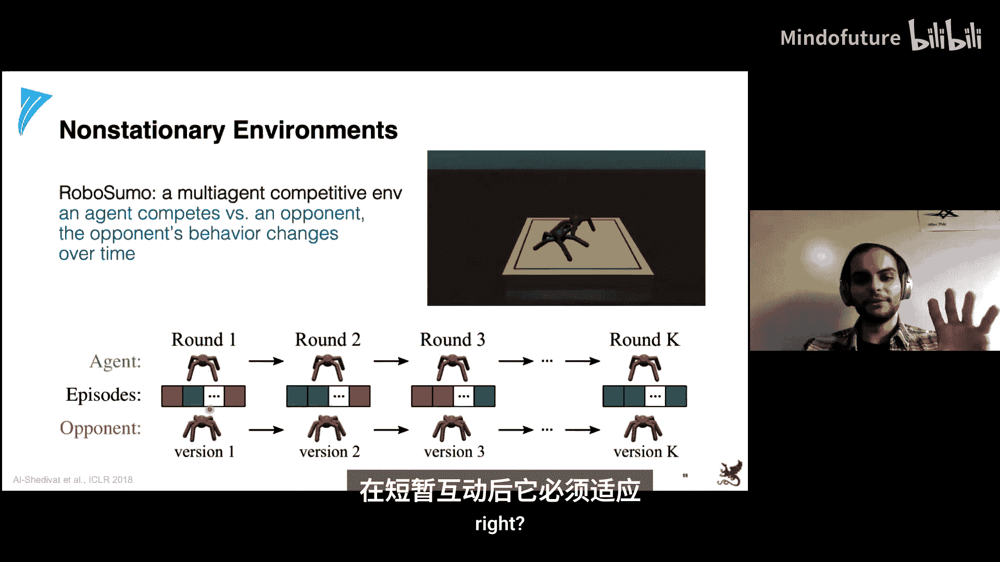

And this is probably the most kind of。Ining evaluation that we were conducted in the setting。

 so we had a large population of the agents of different anatomies using different policies and using different adaptation strategies and we try to test which of the agents will eventually outperform。

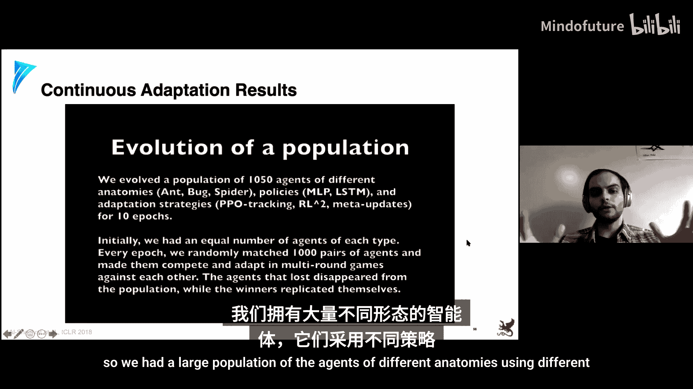

The other agents。So we started running a lot of games with sub samplele thousands pairs of agents from the population who were running a bunch of games。

And whoever wins from the game wins the sequences of rounds within a single game is going to get replicated and whoever loses gets removed from the population。

 so over time you know you can see how the metal learning methods certain policy plus metal or in this case LSDN policy plus meta outs tends to entirely outperform all of the agents and sort of overtake the entire population。

You can also see that the morphology of the agents or the anatomy of the agents。

 such as like three leg， six leg two leg。Agents also plays a role in this case。

 six like agents turned out to be one of the most。Is also competent in this scenario。All right。

 so we're at the end of this lecture and just a few takeaway for you。

For this part of the lecture right so the metal learning setup seems to be a very very suitable format for a reinforcement learning or in general for sequential in scenario whether it is imation learning or whether it is reinforcement learning formulation in either case collecting a lot of experiences is hard or interacting with different environments for long time is hard。

 you know that in reinforcement learning you need like millions of steps in order to master a task and it's sort of metal learning really tries to bridge this gap into sort of reduce this number of the requirement of the number either demonstrations or number of samples or interactions with the task。

Look at the on policy and off policy Mad algorithms。

We see that both on ball and off policy can be sort of upgraded to the meta Arl setup pretty easily。

We can do a couple tasks and inference and then there's still this question of about fast adaptation。

 whether it's whether it's about adaptation， whether it's about learning representation。

 what we did not discuss is exploration and and especially in reinforcement learning exploration is important。

Is an important question。😊，All the examples that I showed you use denser words。

 so exploration is technically sort of circumvented by reward design。

 but you can also see a discussion in me learning that I mentioned where they argue that actual representation matters more than adaptation。

And finally， probabilistic view of metal learning that we looked at in the first part of the lecture and this part of the lecture is kind of important because it allows you to use metal learning。

 extend metal learning ideas from the distribution of tasks to more you know beyond simple distribution of tasks maybe chains or other sort of scenarios where tasks are dependent with each other and by just getting this graphical model it can naturally derive the algorithm for solving and it's going to be a new algorithm for musical metal learning and adaptation and so it's a very active area of research so there are so many papers thats coming out literally every conference so it's very very。

 very exciting and it's also there hard to keep track。Okay， any questions so far。

 I think it's end of the time a little bit over time。Yeah。

 I had a question because Mam does calculated optimization。

 so how much adaptation do you think we can do in an updates？Is it even possible to adapt properly？

Right， right。This is a good question， so in simple environments。In my opinion。

 it is reasonable to adapt。There are I guess there are two aspects to it so one of them is how good these gradient are。

 like how informative they are and how informative they are。

Actually depends on how noisy the data is， right how much variance you get by。

Looking at a specific objective on a specific。Kind of batchachelor of trajectories。

So for instance with this continuous adaptation we had to use like enormous batches to get any signal out of metal The other question is like how far the parameters actually travel right how much you need to adapt and if you look at the annual new paper you actually don't need to adapt much you really need to adapt like some very small number of parameters a little bit to get a different behavior or like a different classifier so you observe the same thing you have to mattertrain the model for a long time adaptation problem of benchmark basically。

It's only possible with such simple benchmark and its own work but like some scenario where more difficult settings like food。

relatively different。Like data sets that we want to adapt on from the same training set。Sorry。

 so your question is whether Mammal works only on specific data sets and then it wouldn't work for some reason on other dataset sets。

Like why An is able to work is because are the benchmarks simple。

Like do we need to improve those or it's only able to work on these。Yeah。

 this is a really good question， so I don't have an answer。

 so they analyzed Anil and likely did this analysis of mammal and Anil only an omniglo and mini image that。

If you look at recent papers and meta learning on you future classification kind of branch of metal learning。

 you see that there are a lot of baselines that are coming out right now that literally don't use any meta learning so it basically train function on all these kind of tasks right and then do some post processing and then what I get like a good enough model that generalizes to test tasks。

So I think it is the problem with the benchmark。It is a problem with the benchmark。

A lot of researchers in the field actually argue for better benchmarks and more kind of diverse task distributions。

There are a few papers that look into that and meta Ar else specifically you know to go back to your question with like this multiple mammal steps。

Technically， you could do you know more kind of steps within the inner loop and there are papers that allow you to almost converge until the you go until the local optimalum。

诶。I haven't seen them applied to meta Unre。But I've seen them apply pretty successful to future classification。

好，好的。So yeah， I guess like meta and meta Arl， one of the downsides as a test bed for meta learning could be。

 so it's great for solving a task if you have a specific robotics task right but as a test bed it' a little bit hard to disentangle where the contributions and the problems are coming from。

 is it from you know noise of the problem or is it from the facts that there's something more with the gradients would't taken enough gradients or is it？

Where is the contribution coming from the representation or from the adaptation itself？So ideally。

 we want to have a really nice suite of benchmarks that we can say， oh。

 this benchmark actually tests representations and those benchmark tests adaptation and this one actually requires more than case steps of adaptation just by design。

So that would be fantastic， but we don't have it right now。Thank you。😊。

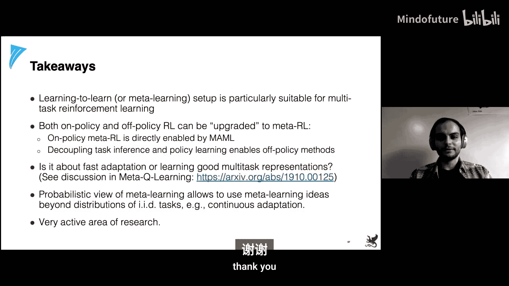

Any other questions？

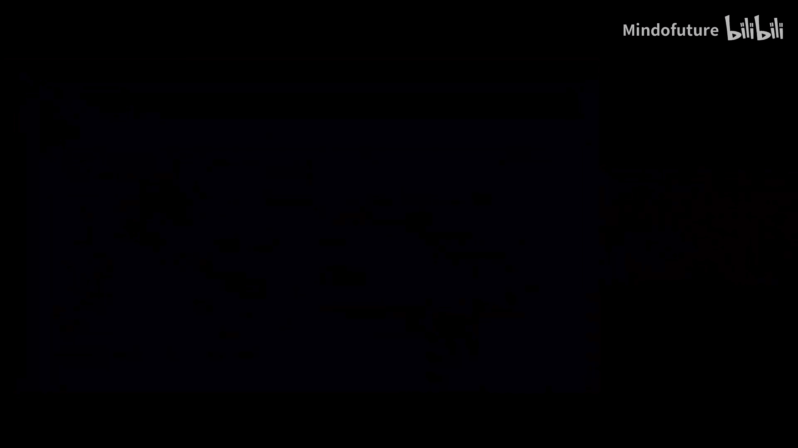