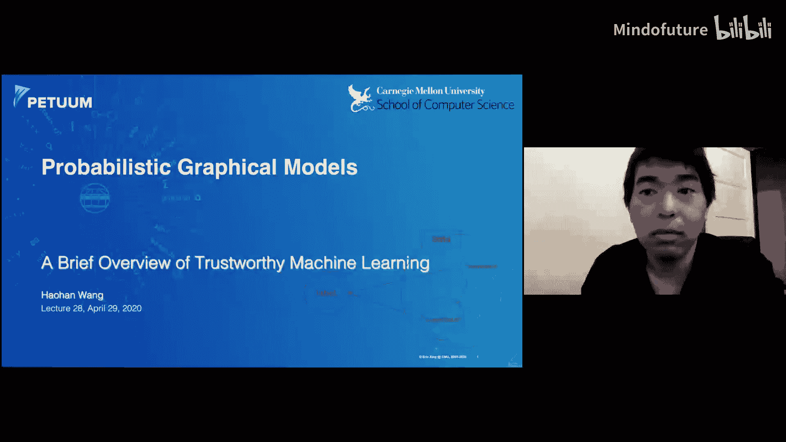
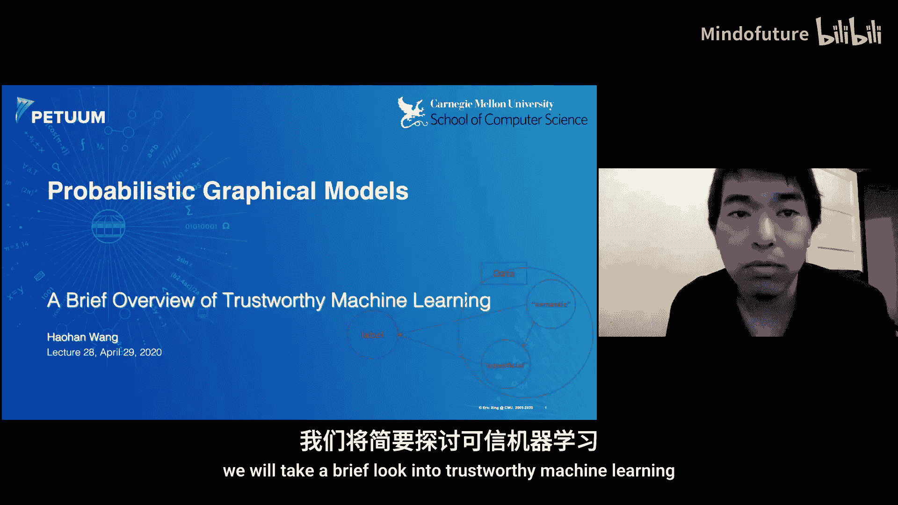
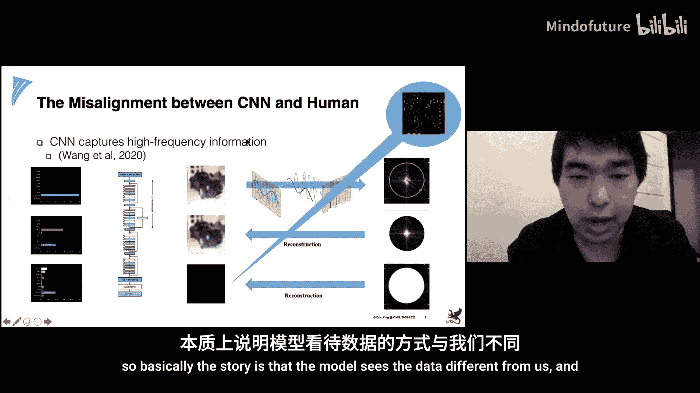
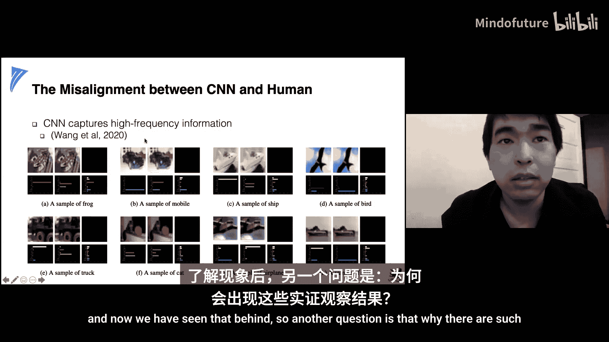
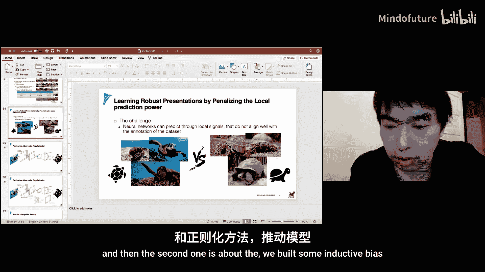
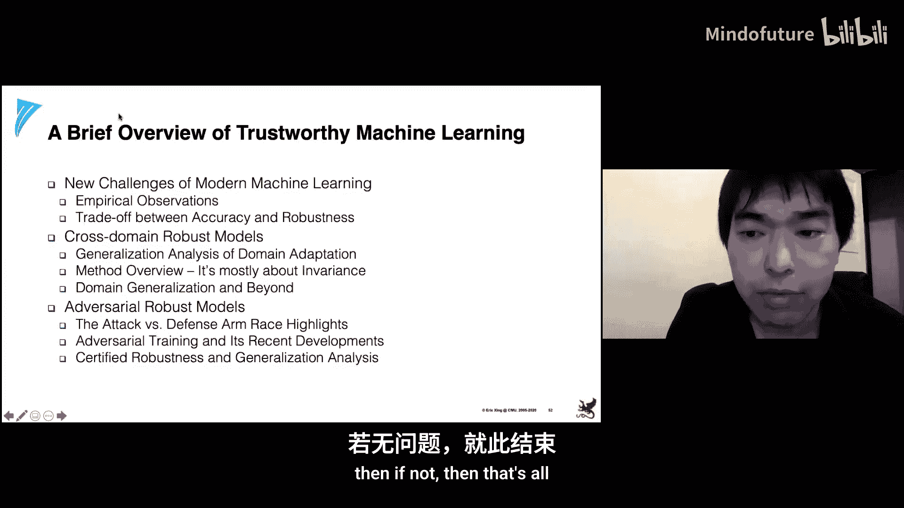

# 【卡耐基梅隆】概率图形模型 ｜ Probabilistic Graphical Models 2020 p28 P28_Lecture_28_可信机器学习 -BV1ebpGzhEA9_p28-

Okay， hi class， I'm seeing that people are still joining， but we can actually kick start。

呃。So again， as you can see that we took your inputs on the poll quite seriously。

 thank you again for casting your votes to the poll of lectures。

I think these are great topics I actually quite agree with your taste you know in picking the right directions to hear from so today is the last lecture of the 708 graphic model class whilere going to cover another new topic on trustworthy machine learning。

 you will be again hearing a just freshly out of the open preparation of the slides from one of my other students Hao Han who is working on this topic you know quite intensively all the past few years and has some very nice results。

So just per class announcement， he will be taking over and finished the class and then toward the end of the lecture。

 he will be also maybe other TAs were join to again clarify or maybe to explain what we are going to how we're going to carry out the the project report and review session。

 you will be hearing details from them and also ask detailed questions I will try to be there。

 but I may not be able to make it due to another appointment。

And also feel free to write to us if you have any inputs you know for the class so that we can do better for next year and also if you still have concerns and questions for the class project for the homeworks and so forth。

Feel free to let us know once again， you know I want to assure you that you don't need to worry about the score related issues。

 we will be very very careful and positive， you know， in evaluating your projects and your work。So。

 with that。I will hand it to Hao Han， who will be talking about the trustworthy machine learning。

 a very， very interesting new topic nowadays in the machine learning community。Okay， how your turn。

 Thank you very much。 Okay， thank you very much for the introduction。Okay， and good afternoon class。

 So today at the very last lecture of this semester。

 we will take a brief look into transversy machine learning。

So as the outline of this lecture first， I will try to convince you that trustworth machine learning is an important research topic and is arguably the one of the most important research topics nowadays and I will show you a collection of empirical observations and we will also briefly touch some related topics such as the tradeoff between accuracy and robustness。

And then we will dive into two separate topics that are related in trustworthy。

 but are studied in history as two separate topics。

W is the cross domain robust models usually studied under the name domain adaptation。

 and the other one is recently very popular， the adverse robust models。

 and as we will say that it will introduce some results that look quite magic to human。Okay。

And so let's start with the new challenges of modern machine learning。To begin with。

 let's say what if I told you that we can actually predict whether you use chopsticks or not from your genome。

While this research topic is not recommended for obvious reasons。

 if one actually investigates the data， they will probably find a gene called HLAA1 that is highly associated with whether one uses chopsticks or not。

However， the association between this gene and the chopstick usage behavior is only there because the gene is more frequently seen in people of East ancient origins。

And similarly， in another discussion， people show that if we do not account for the nature of data properly。

 we may also identify some genes that account for English speaking skills。Which again。

 does not sound like something correct。Okay， this issues。

May also be considered within the topics of trustworthy machine learning。

In the sense that we need to make sure that what is learned from the statistical models align well with the real world scenarios instead of some spirit signals that are only there because of the nature of data。

Okay， these issues of trust， trustworth machine learning may date back to even further。

 but here I only put the。Reference that I'm very familiar with。 And as you can see。

 even for the reference that I'm familiar with is already 20 years ago。

So although trustworthy machine learning is a very。

Hot topic nowadays is is not It has been studied for more than decades。And。Here。

 I also want to try to comment a little bit about this discrepancy。

 why trustworthy machine learning is valued。A lot these days。 Well。

 it is a topic that has been there for a decades。 So as we can see that it was previously discussed under these terms like a publish str and bus。

 which is using simple sta tools to identify the genes that are associated with the traits of。

For example， like the some properties of human， like the disease。And back then， like。2030 years ago。

 when the community realized that these simple models can actually help the real world biology research by identify the candidate genes that may actually accelerate biology studies so that we de into to the area there are new statistical models and soon figure out that a limitation of these models is that it may identify spirit signals。

 And so in my opinion， is the real world need of these method that drive us to investigate the。

Trust theworth of these models。But， but back then， while we also have trustworthy studies of machine learning。

 machine learning still mostly deal with hundreds of samples with extract features。

 So it's still pretty hard if you want to apply those machine learning models in a real world scenario to actually promote someone's life。

However， now deep learning has brought us into a very different era。

 where almost anyone with some tutorial can start to build a deep learning model。

 train it with a huge fraction of data and make a model and use the model to make some predictions and these predictions in very different application scenarios and making changes to our world。

So。It's once again， this real world need of these models drive us to investigate the trustworthness of these models。

 So that is， in my opinion， one of the reasons that make trustworthy is one of the most interesting research topic nowadays。

O。And then。That's probably all about the history for this lecture。 Now， let's dive into the。

Problems of this era。So deep learning has achieved a very impressive empirical results in terms of accuracy nowadays。

 but。We also see some limited some。Challenges of it。

 So one of the most prominent example is of models trustworthiness is probably this a example。

And I believe this figure is so popular。 So probably every introduction of the related topics need to use this figure as an example。

But just in case you are not sure of about the story behind it。

 this figure is basically tells that for new for a well trained neural network that can give us a reasonably high accuracy。

For example， it will predict this image as a panda with roughly 60% of confidence。

 If we add some noise that are barely perceptible to human to that image。

 we can significant we can change the prediction of the model。Quite dramatically。

 as now the for almost the same image to human model predicts it to be a to be something else。Okay。

 and here is another example。So。This example is relatively newer。

 So it basically tells the story that if we combine two elements of the images。

 say we generate image with the texture of an element and the shape of the cat。

 The prediction result is likely by the neuraler network will be biased towards the texture of the image while a human mostly judge the image。

 judge the images by its shape。ok。And here is。Here is one more piece of empirical results that from one of our very recent recent observations。

 lets say first train a re network and with the CR0 data set and then we grab an image。

 put it into the model and we generate this confidence distributions so this is from the test set。

And then we map this image into its frequency domain with further transform。And we choose the radius。

 cut the frequency domain into the high frequency part and the low frequency part。

 And then with these two frequency components， we reconstruct those images。 sorry。

 We reconstruct those images。And as we can see， the image reconstructed from the low frequency components still look similar to the original image to human。

 and the image reconstruct from the high frequency is basically。Noises。

And if we put these two images back to the model， here is what happens。

The model predicts the low frequency one as something different from the original label。

 but the model predicts this high frequency reconstruct one still with the same label as originally。

And if I are interested in seeing what's there， so here is a red version of the high frequency reconstructioncon images。

 so here we can see it's basically noises and but the model still able to recognize it。

So basically the story is that the model sees the data different from us and that is not just from one image out of the 10000 C510 testing images。

 we identify a couple hundred of them， So although it this this story won't happen for all of the test image。

 but I think a couple hundred is a significant number that should read some alarm。

And。Now， we have seen that behind。

So。😔，Another question is that are such a why there are these empirical observations。Okay。

 we argue that one of the central problem of this modern machine learning is the misalignment of how model and how human viewed the data。

 Let's consider the scenario of the machine learning where we clap some label and data to train a model where within the data。

 we have some signals that we call semantic and the remaining signals that we call superficial semantic signals are the one that。

Describes how human or how the nature understands the label， how defines the label and。It is the。

It is the signal that we hope the model learns。However， within the finite collection of the data。

 there is likely that it is likely that there are some distribution specific correlations between the semantic signals and the superficial signals。

This correlation leads to the fact that there are some correlations between the superficial signals and the label。

And then while a model is asked to optimize。To a when， when we trained model with some data。

 The model， basically。The model is asked to optimize the laws to pick up whatever signals it can take advantage of to reduce the training error。

And the model does not really differentiate these two sort of signals leading to the fact that it will take advantage of whatever it can and any signals that it takes from this superficial source will lead to the robustness issues that as we will see later。

Okay， so this is， we believe the central problem。 And this image will serve as a very fundamental。

Image of our lecture today， okay。So is there any questions so far。Okay。Okay， then with that image。

 let's say how we can understand the trade off between accuracy and robustness。 First of all。

 any discussion of the trade off between accuracy and robustness will depend on the。

Definition of robustness。 But roughly， we can understand it from this。Figure here， again。

 that the model will take advantage of whatever signals it can to reduce the training error and。

So the reported accuracy as as we can understand intuitively。

 is from the both of the signals that the model picks up。 However， the robust performance。

 although at this moment is undefined， it's mostly likely to depend on this semantic signal。

 For example， in most literature that talks about robustness。

 it basically talks about that the prediction of the model will not change given small variations of the data。

 and the variations are usually considered small， if those if the perturbbed data are still recognized by human。

 which means that it's usually considered robustness if the model aligns well with the human's recognition。

And then if this source of signal is。Robustness that leaves us to this source as the。Trade off。

 for example， in。In the defining regime， it's usually much easier to capture the superficial signal than robust signals。

 So therefore， if we want to clap the state of guard ladder， the。A straightforward。

 we will be try to exploit these signals as much as possible。

 That leads to the scenario that if we want to get a high accuracy。

 we may have to capture a lot of these signals。 And then this leads to the model is naturally not that robust。

Okay， and if I are interested in some formal discussions， I have crack some here。

 and they usually basically formalize the story we just talk about under some。

Definitions of robustness。Okay， now we say that there is a trade off between accuracy and robustness。

And then why do we have to value the robustness when we already have accuracy。

So here I want to basically try to convince you with the difference between acade and the industry。

 So what current acade is good at in terms of machine learning is that we usually out of the world with full of data of some tasks when we try to do some experiment we usually collect the data and make a part into train and test collections and then we build model on the training training data set and then test it it works well then it basically we can conclude that we have a model that does well。

However， what the real world needs is that out of the world， we collect a data collection。

 we train a model on it。 We show that it works well here。

 and we also need to show that it works well anywhere else for the same task so that we can actually safely deploy it to the real world。

是。O。And now to conclude the overview part， let's talk a very high level abstract。

conceptcept about the solutions。 So once again， since this is the central problem that we will deal with today。

 then the central solution should be inspired that as well as the main problem is the fact that models pick up superficial signals。

So then the main solution is that we need to cut that。Okay， and then。

As a very high level solution we need to summarize machine learning at a very high level。

 so machine learning is basically all about generalization and if you recall from the introduction to machine learning。

 this generalization， the expected risk of a hypothesis is usually bounded by the empirical risk of the hypothesis and some function of the hypothesis based the number of samples。

Okay， and usually to control the generalization。 On one hand， we need to control the empirical race。

 On the other hand， is's about the hypothesis space complexity and how many samples we use。

As we will see later in the two separate branches of these discussions。

 the cross mineral business is all about new hypothesis space or or in other terms。

 it's all about new industrial biass or what regularization you can take advantage of。

And field in the field of aness， although there are a variety of different solutions。

 the dominant solution， the one that works very well nowadays。

 is usually about increasing the number of samples。And within the lecture today。

 we will only talk about the solution that's following this trend。 but they are the best anyway。Okay。

 so that's the overall part。 do I have any questions。Any feedbacks if you guys want to。O。And now。

 let's dive into the first topic， the across domain business of these models where we will。

 where we will talk about domain adaptation， domain generalization and more。ok。Okay， first of all。

 let's talk about domain adaptation and it is usually introduced at this sentence that it studies the problem that model is trained on one distribution or domain but test on another one and usually this another distribution or domain is characterized by the term that is similar but different。

And the majority of the work is about the empirical studies。

 so we didn't really actually define this similar by different。

 but I hope it should be understand pretty intuitively。

And then within the umbrella of domain adaptation， we mainly have two different categories。

 once it supervised domain adaptation that it studies the problem that the labeled samples in the test distribution are also available during training。

And for example， if we want to build a dog versus cat classifiers。

 we form those photos and we try to adapt the model into this sketch results and try to make sure try to evaluate whether this model actually understand the concept of dog and cats。

 for example。And then the supervised domain adaptation usually follows the setup that we have these collections of photos from dogs and cats。

 and we also have some a small collection of these sketched dog and cats。

And then we have this probably very as a very natural follow up。

 this unsupervised domain adaptation where only are labeled samples in the test distribution are available during training。

 and this is actually I think when we talk about domain adaptation。

 this is more than often the scenario that we talk about so usually nowadays most domain adaptation works are talking about unsupervised domain adaptation。

 especially in the computer region。Okay。And since now we have a we have seen that the problem is added to some new regime where we have the discrepancies of distributions so。

The generalization behavior of these models may have changed。 So to start with。

 let's say that how is the generalization changed in this domain adaptation scenario。And first。

 since now， we have two distributions。 and， for example。For example， very intuitively。

 we can see that in the example at the previous slide。

 we can say that if we want to build a classifier on。Photos about stocks versus cash。

 and we want to generalize to sketches。 It's quite intuitive that the model。

 if it really learns the concept， it can do well， right， So in some sense。

 the distributions between photos and sketches are still near each other。

 but that may not always be true， for example， what if we want to。

Build a model on the dogs and cats on earth and then try to generalize to some alien world where maybe all those animals have six legs。

So。To begin with that we need to have a good measure of the。

Divergence of two distributions here we introduce this H divergence。

 It's a measure of two distributions given a hypothesis class。

 and it depends on we need to introduce this term IH first。

It's the set of those hypothesis that are characteristic functions for the domain。

 which means that for any sample that the hypothesis returns one if it the same comes from the domain of interest。

And then each divergence is mathematically defined as the following。

 where is the su hypothesis out of this hypothesis class。

 where we have the maximum differences of the samples under these characteristic functions。

So this may raise some confusion。But we can intuitively understand， as the。

The H divergence is the maximize differences that a hypothesis within the。

How about this space can identify。Or to help understand this term。

 let's say that if our hypothesis class is highly restrictive。

 that all the hypothesiss are returning some a constant。Given data， then this divergence will be a0。

 since they will always return the same thing。So with a very limited hypothesis we cannot really differentiate these two distributions。

Let's see if the hypothesis is highly expressive， then it should。

Do well in describing these two distributions。 Then this divergence term can be large。

 but even the hypothesis space is large。 The if these two distributions are， for example， identical。

Then we， then the result is small， still a， a small term。And。So。

So collecting those scenarios discussed above， we can say that this divergence is a property of both the hypothesis space as well as the source and target distributions。

Okay。And here is the description over description over these two distributions and then。

They also show that it can be estimate from finite samples with response bond。

Where this is the divergence of the correct samples of these two distributions。

 it found the divergence with some concentration terms。And。

Then this this divergence from finite samples can be estimate with a domain classifier。

 And I hope this looks familiar to most of us。Although this work is introduced in 2010 and but nowadays because of the popularity of G。

 this kind of thing should be quite familiar to us。

 so it's basically says that to estimate the dirgence of two distribution empirical Paraco。

 we can simply build a classifier and ask the classifier to classify those samples from two domains。

Okay。And then with these results。 And together with a little bit more technical terms。

 we can get this very popular generalization bond of domain adaptation。

So it's from this paper in 2010， it basically says for the equation here it basically says that the expected risk of the target distribution is bounded by the expected risk from the source distribution together with this divergence term of these two distributions and this lambda。

 where this lambda means that the error of the optimal hypothesis on both source and target distributions。

And women need to notice that this is also the expected risk。

 so different from most of the generalization bond that we see， but however。

 it should be fairly simple to rewrite this with the empirical risk together with another concentration terms。

Okay， so then basically， this terms tells us what we need to do if we want to get a small error on the target domains。

And here， this divergence talks about that we need to have a hypothesis space that is small enough so that the model does not differentiate the source and target distributions。

And then these two terms tell us that we need to have a hypothesis space that is large enough so that we can actually find the hypothesis that give us a small error。

ok。And with that background， let's look at the first method we will talk today。

 it's called domain Advver neural Network its probably one of the most popular domain adaptation methods in this deep learning era and。

To get a good understanding。 it Let's first put this equation here。 So it's all about the the。

It's all about that we need to find hypothesis that cannot differentiate these two distributions。

 while it have both small errors。 So the idea is built on the fact that we need to train a classifier that has small error on the source distribution。

 Well it is unable to differentiate the source and target distributions。 And then back back then。

 they introduce this idea called domain adverse neural network。 Its basically。

Standard neural network structure with this green 1 and blue1。

 together with a new component is this domain classifier。

Where we consider these blue ones as a which extractors or some component does to learn some embeddings。

And then this domain classifier is built upon these features or evidences that is used to classified whether those images are from a。

Soce distribution or target distribution。And meanwhile， this class label。

 these actual predictors or the actual classifiers is used to make the prediction based on these embeddings。

So back then， they introduce this。A gradient reversal there。 But nowadays， I think。Again。

 due to the probability of game， we can we can understand this as the a game。 So basically。

 the domain classifier is optimized to do as well as possible in terms of classifying this domain information。

 while this。Well， this classifier is optimize to do as well as possible in terms of making predictions。

 while this a。While this actual， well this feature extractors is optimized to help this classifier as much as possible。

 mean， to fool this domain classifier as much as possible。Therefore， as a result of this method。

 the model， the representations learned in these middle layers will be a very representative for a label classification and will be very uninative for the domain classifiers。

ok。Is there any questions so far？Are you guys still with me。啊。

Or did I want to fast or slow or something。Okay。Okay， I actually have hope you。Okay。

 why do we want the model to be unable to differentiate the two distributions。So啊。😔。

This is a direct result from our bond in the paper slide。I'm sorry。Where呃。

Where the generalization behavior from the， where the generalization error on the target distribution is bound by the。

呃 models。Ability to differentiate these two distributions。Our。

So what I think that is good is that this is from。mathematicalthe result。 On the other hand。

 we can also try to understand this intuitively。For example。

 if we can really learn a good classifier， for example， in the dog versus cat example。

 that the actual that the model that actually learns the concept of dog and cat should be applied to multiple distributions like the the photos。

 the sketches or whatever other image qualities， if so if they understand the if they actually if the model actually understand the。

呃。し。If they actually understand the concept of cat versus dog。

 then the model should be environment to the distribution。Okay。

 so I hope this intuitive intuitive answer helps。Does this bond also work for supervised domain adaptation。

 I believe so since supervised domain adaptation is a。呃。

Maybe it's a subset of the un supervised iss a subset of the supervised you all you need to do is just ignore the label right you can still get here。

 but probably with supervised the domain adaptation you can get a titleter box。是。Yes。ok。😔，Actually。

 hope that we have， we can have some questions here。 For example， as we see in the last slide。

 the bond actually depends on the a small error on both source distribution and the target distribution。

 And now despite that this method is probably the most popular method in the field about this topic。

 People argue that this is gives a。Some sort of a misleading message， for example， in this paper。

 they argue that the environment representation and small source error， small source risk。

Which are the stuff that the domain neural network promotes。

 These two elements are not sufficient for a good domain adaptation method。 For example。

 they show this example。Where they have these two different domains， and we can。For in this example。

 we can see that there exists of an optimal classifier。

 Let's see here that it can differentiate these two labels。 But if we push for the environment。

We will say that once the model cannot differentiate these two domains， we cannot find a。

Simple and good。 class bear animal。So again， following the original bond。

 it should be the small risk on both source and the target distribution。

 but it's probably too hard to optimize on the target distribution。And within this work。

 they argue that the labeling function also matters。So the bond should include this term。

 And to understand that intuitively， let's say that now with our classifier of dog versus cat。

 we try to adapt it to the alien world where all animals have six livess。

 And if we do not want to differentiate them。 then basically。

How we need to do is ignoring those lives of these animals。 Then the the model should also do well。

 but however， that a。Aliaens may not call their dog dog or cat cat cat cat。

 they can basically reverse it and then our class bear will face a very significant failure and so that's some intuitive translation of this work。

And despite this domain aver neural network is arguable in terms of this performance。

 it has been considered as one of the most popular methods for domain adaptation in this deep learning era and also it has inspired a tons of followup works and most of these works are following the。

Very high level concept of that。D N， N N， and is essentially about to design an inductive files that learn an an environment representation between source and target distribution。

So basically， if we want to design a new and powerful domain adaptive neural networks。

 the first question we need to consider is that how do we force the representations to be environment。

And。So I actually want to try this question to the class。Can anyone try to give some。

Measures that can help to force the im of representation。I think we should have seen。

Quite a few methods。For example， at least we say that we can use an aver classifier on the top of these representations and then。

very intuitively， we can design some distance metric and try to recognize the distance。Okay， and。

So there is a， first of all， there is probably a。Huge cap。 At the very beginning stage。

 there is a huge collection of this method that try to recognize this distance metric to force the environments。

 And then people try to design these adverse classifiers。To lead to the environment。

 And there are also some other trend， for example， they built the model to reconstruct those images from source and target distribution and hope that a successful reconstruction can lead to the goods learning of environment。

So basically， in my opinion， that domain adaptation is is mostly all about learning an insurancevari representation。

 So with for for how many methods we have to introduce environmentvariance。

 we probably have how many methods to for domain adaptation。

 And so here I only introduce three of them， but it should be good enough for you to understand the most works out there。

ok。And here other than that， I also want to discuss about one method that is quite new。

 as you can see， is from 2020。 they different from the previous trend that they didn't really take a significant advantage of the adaptive biasers。

 but they try to take advantage of the model of samples or in other words。

 they try to do the domain adaptation with the help of other enabled samples。

 So they introduce this idea as self training for gra domain adaptation。

 where the self training is about this concept that with a is a semiupvised learning。

TmSo first of all， with some labeled samples， we can train a classifier。

 And then with that classifier， we can use the classifier to predict those unlabeled samples。

 And then together with these unlabeled samples， we can update a new model。

So they demonstrate that with this data where we have these photos from early 20th century to late 20th century。

 where the actual appearance of this human probably change a lot。

So if we want to build a classifier on this very beginning stage and directly apply it or adapt it to the late stage。

 we may get some very sub we may get some。As unexpected expected result。

And then their method is about gradually use self training to update models with these intermediate distribution。

For example， this figure is from their。 It describes that the how this gradual self training mechanism can help。

 For example， we have these labels。 We have this。Samples that are labeled with green dots and red dots。

 And if our final distribution is here， directly adapt them。

 here will probably lead to some very bad result。 And then but we can assume that the distribution that near this original one is somehow some in some sense。

 similar to the original distribution。 So we can。Basically， perform this stop training gradually。

 And as you can see that the update。Makes more， intuitive sense。

And this is mostly a theoretical paper， self training is not invented by them。

 but they offer some good understanding about the behavior。And together。

 they also offer some practical insights to summarize that it there must be some incentive for the model to update itself。

 and for the incentive， they argue that regularization is necessary。

 and also this term called label sharp sharpening is necessary and label sharpening means that although this model makes a publicistic prediction。

 for example， this figure may be a good illustration that we have this light blue is like the model consider this thought to be blue but not with that high confidence。

 and if you have this， the model may not actually update itself。

 So it you have to actually turn this to be a fixed0 and1。Okay。

And that conclude the domain adaptation part， and。Okay， we may have to go a little bit faster。

So then we have this question that are models trained with domain adaptation good enough for general real world deployment？

So the answer is probably no， otherwise， I won't put this term here。 But why exactly。

 And I hope the this is also intuitive enough that because there might be other distributions that are not considered as the target distribution during training。

 And that is not what we want。 So to account for that problem。

 we introduce this there is this a field called domain generalization。

 where it basically talks about that we can train some we can train a model with samples from different domains and then test with a new distribution。

Therefore， a good test accuracy may indicate that the model actually learns that concept and can be applied to hopefully any other distributions that close enough。

And here is an illustration of the idea。 So now we have the different collections like the bottles。

 the cartoons， the paintings。 And then we the model and apply it to the sketches。Okay。

And oh by the way， recently， there is a paper that' somehow got a good popularity calledvariization Envari risk minimizes。

 and it essentially talks about this domain generalization idea that has been there for 15 years。

And then over the last 15 years or mostly probably only in the deep learning era that here are some highlights of those methods about domain generalization deep learning era。

 And since now we don't have any information on the target distribution。

 We need to take advantage of whatever we have， which are the domain identifications。

 and then the central assumption is that the model that can generalize similarly and well enough across different training distributions is likely to generally as well to an arbitrary target distribution。

Emirly啊。And for the method development part， the first is again forcing some sort of environment across different distributions and for any method we have seen in the domain adaptation as a regime。

 we can probably borrow it and apply it here and。Then here I click some pretty unique methods that cannot be applied to the domain adaptation field。

The first one is this we can build some example of classifiers one for each domain and another one。

 I think is a quite clever idea that we can apply the meta learning， for example。

 at during training phase， we can iteratively split those training domains into a virtual training and virtual testing one and then a build classifier upon。

Okay。And here is a。Brief introduction about domain generalization again， is mostly about imvi。

 so I hope that as long as you really understand the fact that this environmentvari can help in generalization and at least intuitively then in the future when you see these similar papers or in the future when you have the need to develop your own methods to publish a paper。

 for example， it should be very easy for you to catch up a majority of dispute field。O。

And then let's ask this question again， are models trained with domain generalization good enough for a general real world deployment？

Again， since I put this here， you probably expect no and then why not？

We argue that the partitions of domain may not always be available in the real world。For example。

 during the introduction of deep learning sorry introduction to machine learning courses or we probably have all asked and answered that question that when we say a classroom result。

 when we see a cluster method or when we see a data collection and we are asked to do some cluster work。

 then the first question is that what's the number of clusters we expect。

So I think that's a good example for the real world that to show that the difficulty to understand the partitions of domains in the real world。

 when we have a collection of data， we barely understand that how many distributions this data come from。

 let alone to answer the question that which sample comes from which distribution。So now this。

New problems studied studies the problem that we train the model with a collection of samples that may come from different domains。

 but we don't really know and then test with a brand new distribution。Here。

 the difference is that in the training， we do not have the clear part of these samples。

 and we argue that this is problem， this is probably a problem that is real enough。

And then how do you resolve it？So now we have， we don't have any extra information that we can borrow。

Then this leads to the very central problem that we have discussed today。

 So essentially it's about how do we control the model's ability in capturing the superficial signals。

And so it leads to the fact that it's the solution that we need to find a hypothesis space that pick less superficial signals。

And here since this is， this scenario is actually advocated by me here I introduce I plan to introduce like two of my previous results that as some case studies or add some examples to show that how we can get a better performance in terms of the cross domain generalization when we control this。

 but probably I will only have time to for one of them。So let's skip one。

 So the first one is about how do we build the inductive biass to make sure the model does not learn those texture of data。

And then the second one is about the。

We built some induct bias and regularization to make sure that the， to push the model。

 learn some a global representation of the。AM of the data。So here。

We want to say that the challenge is that the neural network can predict through some local signals that do not align well always the annotation of the data set。

 For example， if we want to build a classifier of turtle versus totos and we first collect data from a simple Google search of those images。

 then these are the results returned by Google， as we can see that all the background of those turtles are blue and the background of those tos are likely to be green。

 So when we build a classifier， the classifier probably have a very high performance and and it should be built quite easily since all it need to do is to look at the background find the blue。

Okay， but that's despite that it can have a high accuracy， that's not what we want， right。

 we want the model to actually understand the concept。So to do that。

 we introduce these patchwise a regularizations where we start with a simple neural network。

 a convolutional neural network where the first convolution layers， for example。

 has this C channels and then it has has this。I'm buying patches， and each of them summarize。

Area or a local patch of those images。 And we want to make sure that they do not summarize the representation。

That are pretty。So to do that。For each of the patch。

That have C channels that we consider we consider that there are these representation from these C channels are the are C features。

 and then we build a simple C by L classifier where L is the final labels in our case。

 L is2 as a C total versus totaltos and then we build this classifier to take advantage of these features and to make prediction since we have M by N patches。

 The final output will be M by N prediction。And then borrowing the idea of aver training or。

Basically the aver game， we can push these representation to be to be to make predictions。

 and so the top layers are forced to learn some global concept of the model and together with this work to help evaluate this cross domain generalization。

 we introduce probably the largest domain adaptation data so far。

 we introduce a new copy of imagenet test dataset set。

 where has 50 k images50 images for each of the100 imagenet classes and then the idea that we should if the model is really。

 if the model really learns the semantic concept of the data then。

It should understand the concept well and should generalize well directly to these sketches。

And here are some examples， and this third one is my favorite。

As we can see that with the regularization， our model can understand that this is a dog where the original model thinks this is a mop and the fur of this do actually looks like a mop to some extent。

And also keep in mind that this is 100 class classification， so all these competence are fairly high。

Okay啊。That's our discussions of cross domain robustness do I have any questions？And。If not， we。

Start the aver part。Which I guess is can accept your guess more。Okay。Okay。

 now let's start a new journey about a business。呃。So。

So first we need to answer the question that what are adverse examples and。呃。

We can recap very briefly with these very popular example。

 So a examples are basically samples with very carefully craft patterns that are added to the original sample。

 And then those new sample look identical to the original one to human。

 but it predict by the model significantly different from the original samples。Okay。

And this sounds actually quite magic， but probably not rigorous enough， so let's get it rigorous。

So with a sample X and model sit， the universal example X prime is a result of an optimization problem where we want to optimize the distance。

Between this new sample and the original sample， where we want to make sure that。

The prediction of this new sample is different from the original samples。

So I hope this does not sound too magic anymore， since it should be a well defined mathematical problem。

But again， how magic it looks to human depends on the choice of this distance metric。For example。

 in most of those popular examples， this D is an LP norm distance where human can hardly differentiate the differences。

 but if we consider this D as some rotation advers example it's probably not that popular。

 probably not that magic。Okay， and also to make this more rigorous。 This is a general formula。

 But in practice， we also need to add another constraint that we need to make sure this newly generated sample is。

Is a valid valid sample， for example， in the image area that these new samples must have the pixel values ranging from 0 to。

255 all from 0 to 1 depends on your income。 But the input back it。It must be an image。Okay。

And now we answer the question that what are adverse examples。

 then the other question is why there are adverse examples。And since we have discussion so far。

 I hope this is expected。So as also examples are direct outcomes of the fact that models are capturing superficial signals。

 this took a while for us to get there， but nowadays this should be quite very straightforward okay。

And why is adversar bias such a popular topic？Well， I think to begin with。

 we need to acknowledge the fact that varies might actually be that it appears magic。

And the other one is the thing that we have iteratively emphasized in this lecture that the alignment between human and model may play a significant role in the real world deployment of machinery。

Okay，And due to its popularity， tons of efforts made to defend a model against those a examples。

But unfortunately， even more efforts are made to generate a new aver examples。Fox哦。So， here。

 I collect。Set off attack versus defense methods that are that nowadays are still relevant。

And we have a huge corrections methods back then and probably many of them are was a detailed discussion。

 but here due to the time limit， I will only introduce two attack methods that and to defense methods。

The first one is this fast gradient same method FGSM is probably one of the earliest method and。

I think they are still relevant today due to its simplicity and before offering the actual mathematical definition。

 I want to introduce an intuitive understanding of the method。 So intuitively。

 I think this method is basically reverse way of training。During training for Epo。

 our goal is to update the parameters to decrease the loss according to the gradient。

 and then FG F is the reverse way is to update the data to increase the loss。

 according to the sign of the gradient。And to formalize it， it will looks like this。 So basically。

 this new sample will be a perturbation of the original sample。

 depend on the step size and the sign of the gradient with respect to the sample。And of course。

 to make it valid， we need a constraint that to make sure it's still a valid data point。

And this popular example is actually generated by FGSM。Okay， as you can see。

 the difference are barely perable to human。🤧。And then the other very popular method is this PGD。

 which stands for projected gradient design attack。And。A little bit fun fact。

 It's actually previously invented under the name B IM as also also as an universal attack method。

 but it was made very popular in this magic paper。And probably because they demonstrate that PJD is one of the most powerful attack methods。

And。The algorithm is also very simple， it's basically performing FGSM multiple times with smaller step size。

So to give more details， the algorithm is that we start with a random population within the LP number。

For example， here we consider this L to1， and this is the original samples。

 and then we start from a random prohibittuion， for example here。

And then we perform F JSM intuitively for every step。 We calculate the gradient。

 the sign of the gradient， then update the new sample a little bit。

And we repeat this for multiple iterations。 And whenever these two examples are pretty nice。

 But in reality， we may see that these examples sometimes are get out of this ball。

 Then we simply project it back to this function。ok。So。

Despite its simplicity is probably the most powerful attack method。 nowadays。

 if we are talking about LP norm distance。Okay。And then with these attack methods。

 we want to introduce two highlights about the defense methods and the first one is from our lab。

It takes advantage of the worst case example。 If you still remember from the overview slides that the domain domain adaptation works usually takes advantage of the hypothesis space。

 while these adverse defense methods usually take advantage of the samples。

The most successful methods usually take advantage of the samples。So。

Since we need to take advantage of the worst case sample， we need to first identify it。

 And with the collection of a type method， it should be fairly simple。

 And then this trace defense method is essentially about a regularization。

 we need to regularize the distance of embedding between this original sample and the new perturbbed samples。

 So in this paper， the actual implementation is the care divergence regularization over the soft mask。

 But since we have a。Talked about severalmer regularization， it should be。

It should be straightforward that there are other different formats of the same method。

And for example， if you regular the L2 distance of logics。

 then you lead to another method called an avers logic pair， which is also a popular method。

And here is a brief illustration of the effectiveness of this method。So。

Where these dots are the actual sample and these squares are the LP ball around these samples that the a examples are a allowed。

And this is Bina training。 And as we can see that the we don't really have the control of the decision bond。

 And this is the training with this trees idea and。

I think it should be very intuitive that we expect the。Bound to enclose this adverse。Okay。Yeah。And。

This method is。Enters the N 2018 competition and won the first place out of 2000 submissions。

 surpassing the runner up with more than 11%。Okay。So， just a。Bf summary of the performance。呃， then呃。

That method is already pretty good and here is an even more popular one is basically aver training as a defense and it also comes from this magic paper and to summarize the idea in one sentence is essentially about augmented the training data which generated adver examples during training so it is indeed as simple as it is。

 but it is very powerful it's probably the most popular defense method when it when it is integrated with PGD。

 which is the most most powerful attack method。And it also has very。

 impressive empirical performance。 And it's also fairly simple。

So we will say very soon about its impressive empirical performance and for the simplicity part。

 I don't have it within this deck of slides， but we are not happy with its simplicity and the community is trying to make it even easier。

 So， for example， faster method faster than PD way to generate these a examples will be very relevant and there are a couple of papers that if we are interested。

 you probably can take a look after the cast。Okay， now let's go back to look at the empirical performance。

So here is from this paper。 They talk about that when we can。

 when we train a model with a training and PD， the a examples are not that magic anymore。

 So the models is fairly robust at this moment。 for example， if we get a model that is a。For example。

 if we a train a model with a training and PGD， done with these three samples and we we perform a target attached。

To on these three samples。 And I think these attacks do not terminate when the images are good enough to deceive the original model。

But to try to maximize the likelihood。So here we can see that it can actually show the patterns that align。

At least better than the previous examples， align with human。Okay， and。

And another very interesting point， I think， is that the model can。

Automaically identify that which part of the image that is likely to turn into another label。

 For example， they find that it probably makes more sense to turn this part of the cr。

 or is this fish or something into a dog。And for different labels。

 they may choose to perturb different components。ok。And also within that figure。

 they show that the a training with P GD can work pretty well in multiple different tasks。

 For example， the same model may able to fulfill this tasks such as the generation generation in painting super resolution and these ones and the results the。

呃。Advertised results from this figure is very good。 But I think in their paper。

 they also acknowledge that if you look at this， if you pick a random image that they do not look this good。

But it's also reasonably good。 And also since this is。

About the idea that once the model can align well， reasonably well enough with human。

 then the model can。Automaically perform multiple tasks。

 I think the results is still a significant enough。 Also， but on the other hand。

 these results probably may not work as well as the single models that are specifically trained for one of these tasks。

Okay。So this is about the power of this aver training with PGD idea。And then。

With this impressive performance of as training with PGD coming concluded the development of these defense methods。

No。And it's simple， but probably not simple enough， as we have seen previously。

 and another more important reason is that。There might be other attack methods that simply not invented yet that can penetrate the defined model。

Okay， and so does this mean that this research area is endless。呃。Well， fortunately。

 the community moves to proable robust models nowadays。 So basically if nowadays。

 if you want to invent a defense method that actually shows that our model is robust to some attacks。

 the community probably will not value this method as much as it they did previously。 So nowadays。

 if you want to。Promote your own defense method。 You probably have to show that it mathematically。

 It will not be penetrated by any methods within the constraint of adverse attacks。Okay。

And just to show this a little bit example of pro defense method here。

 I I only include one example is's called this certifieder robustness through random night smoothing。

 and I choose it mainly because it its simple and intuitive and as a proable defense method。

 it probably involved least amount of math。And the idea is simple。

 It basically says that for a model for a model F X， we。

 we generate another model whose output is the prediction of majority prediction of X when it is pertuurbed with a collection of noise。

Probably this image is a good illustration that for X whose prediction is blue。

 that we want to generate this tree by perturb and sample all this perturb examples of X X around this centroid。

 and then the final prediction of this tree will be a voltage result of this prediction。And。

So I think this idea is not invented by them， but they are the first one to show that this method can offer certified robust businessness。

 which means that within their method within the L2 norm distance。

 the model cannot be penetrated with any other existing L2 distance attack method。Okay。

 and with that， that conclude adverse or robust discussion， which。It's a little bit hasty。

 but I hope it's fine。And so looking to the future， I think again。

 it's all about this figure that we need to control what the model picks up that once the model actually picks up the semantic information。

That we can safely say that the model is robust enough。K。So， it's。Roughly the。

Time that we need to conclude this lecture and。So here we talked about the new challenges of machine learning and we talked a little bit more about mineral mineral bus models because it has。

 I think， more than 20 years of history。And also for a new topic that is adverse robust best models since it only have like a history of maybe eight years。

6， five years。 So we， we spend a relatively shorter time on it。ok 啊。

Do we have any questions in general。If no， then maybe I can。

Conclude this lecture and also since this is the very last lecture we have in this semester I just on behalf of the PGM teaching teams。

嗯。Just want to thank you guys to be with us for this semester。

 and I hope you guys have a very good time and in learning these new technologies and。

I hope we have done a reasonably good job and also。

 thank you guys for being understanding why we made some mistakes and yeah， and also。嗯。B thanks。

 thanks John for supporting us in this Zoom technical in the technical issues of Zoom and also。Yeah。

 good luck in general。 And in the future， good luck to your。Homework and good luck to the projects。

 And in general， good luck to your academic performance。

 And if you are interested in this adverse in this trustworthy machine learning and you want to involve in the research or something。

 and feel free to contact me if you want。And also。Oh。Maybe stay healthy and stay at home。

 Let's Friday days Covid 19 together。So。That's probably it。 or the also if if you guys want。

 I think the information on Piazza already。 So the deadline of both homework for and the project and both the submissions in terms of report and final presentation will be May 6。

 I think is roughly that time。 Please double check on Piazza。

And also the submission of the final projects will be including a report as well as a 10 minute pre recorded videos and please make sure that your members of the team evenly split the time and also make sure that your face show up during the presentation。

Do I have other questions？Then if not， then that's all， thank you。

