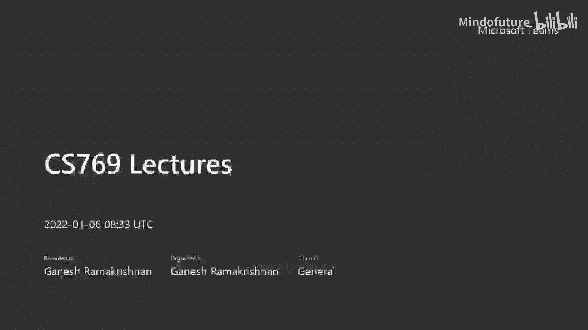
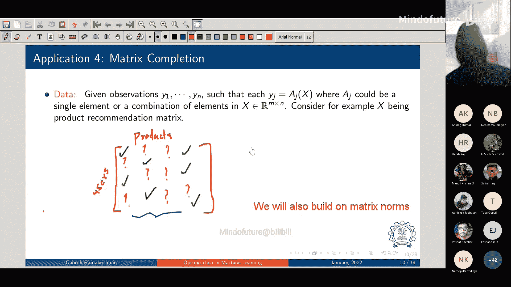

# 【印度理工学】机器学习优化 ｜ Cs 769 Optimization In Machine Learning p02 P02_第一讲_6-1_机器学习中的优化问题 -BV18cBSBJEH1_p2-

Yeah。Yeah。Okay， so this is。This is lecture one。We formally begin the topic of optimization and machine learning。

For today。We will focus on applications。We will begin with applications of continuous optimization and then we'll move on to discrete optimization I don't think well have time for discrete optimization。

Because well spend a little bit of time understanding the examples。Of course， we will not be able to。

Take them to their logical conclusion because we will need the tools of optimization to solve them。

 but let's get started。So， the first application is。Supervised learning。

Any standard machine learning course begins with problems such as classification or regressionggress。

And the idea in classification is that your labels are all plus minus1。

 whereas in regression you are dealing with。Labels， which are。

Continuous value sometimes you may also want them to be discrete。

So this is an example from classification。Where your labels could be plus or minus1。Okay。Yeah。

As against regression。This is in classification in regression， they're real valued。-1 plus 1。

Or plus minus x both are equivalent。Okay。Now there are several different models depending on the applications。

 for example， if youre you may have a problem such as emails， spam filtering。Where you're trying to。

Map the X andY axis。To features， the features could be words that occur in the text。

They could be phrases that have been manually identified。 They could be embeddings。

Or 010 digit recognition where you are trying to recognize。

A digit on its completion features are again images， label is a digit。So。

House price prediction where the features are house properties， such as square。Foo square feet。

 rather number of bedrooms， bathrooms location and the label is the cost。

 Now this the last example is that of。Continueuous。嗯。

Prediction problem where the label Y is continuous。So。How do you solve these problems typically。

 So here's how you would model them。I would like this to be interactive。 So please pause。

 please ask me questions。And at times， I will also be asking you questions。The slides， by the way。

 are all there I have。Uploaded slides from the last year。

 So you'll find many I mean the sequence is probably the same。

 but some topics I'm going to go over fast and so that we can cover discrete optimization better。

 So please go to Mole you'll find。😊，The previous year slides， which we are building upon。

 there is a lot more detailing I would have done in this years slides。 with that note。

What is the basic idea， we are trying to。Learn a transformation from my input X。With。

A potential weight set of weight， so x itself could be as a set of feature vector。

And you could use W transpose or theta transpose， we would use both of them interchangeably。Mapping。

What you would map to is why， but not necessarily directly what you would have。😮。

Between on this arrow is often a generalized linear function。So let me make some space。And。

These when we say generalized linear functions。You could also extend them to nonlinear functions。嗯。

Or typically， we just did。You take the and theyre not just by F okay。

So that even if y is probability value associated with。Cllas plus 1 and -1。

You generalized linear function is able to accommodate the translation。

So thiss why which are talking about could be。The probability of。A positive label， given。The example。

 X。Or y itself could be W transpose x so you could have。The F being an identity function。

Any question。It's also possible that you could have deep models as recursive functions。

 And this is being shown here。 So you don't have just one transformation。

 I've used theta instead of w。 So maybe to be consistent， let me use theta here as well。

So the theta is the set of weights associated with the features。嗯。

We could also have recursive applications。F1， which could be one kind of activation unit if you are familiar with deep learning。

 you could have L F2 could be sigmoid。F L could be， you know。Again， earlier。

 you could have the same thing repeating。So the loss function L。😮。

Tries to measure how far the final capital F。It is from the way。So。

They're trying to measure the distance between this F。T dikes I NY。And。How is the F obtained， So yes。

 this F is obtained exactly as shown in this figure， Let me。Big this capital left here。Be consistent。

 So this capital live。Okay， so what the loss is trying to do is measure the distance。Between。

This F and。嗯。It's possible that it' on some occasions。Some of these F1， F2。

 you might be able to absorb into the L。So what goes into the F and what goes into the L？

Can be a slightly subjective decision。 right So you could， you could apply a transformation on the。

F or the theta transpose x within L itself。But let's assume for the time being that we try to make the loss as simple as possible。

 we will not try and。Play hide and seek between the Fs will make them explicit。

 We not hide them in within the L。Okay。So with this。

Here' is the general loss plus regularizer framework。

 which is something that' will cover the entirety of most of neural networks。😊，And their variants。

 most of traditional classification models。It's this loss plus regularizer framework。

Where the loss is this this first component。And the regularizer is a second component。

 so I would like to hear from all of you。What is this regularizer doing here？

If you have an exposure to machine learning， obviously you youd be able to recall。

 but I'll be adding some more perspectives So when we train a particular data so after training we see underfitting or overfitting。

So to make to decrease the variance after testing we use to decrease the laws we use meaning the regularization。

You a bunch of。Tminology here you said。You are trying to reduce the variance。

Possibly by increasing the bias， may I say that increasing the bias of the model。

 you are trying to bias the model。Two what two simpler thes。Yesly。The extreme case。

 the thetas might just become zeros。So， we will take examples where the notion of simplicity would be measured in terms of say the magnitude in terms of the norm。

So。Increase the bias increasing the bias of the model， sorry。啊。Gild。😔，T does。That are simpler。

smaller knos。Thats what you are all familiar with this this is also associated with a prior right the putting up increasing bias is like adding a prior。

Is that correct？So I have some extra optional slides at the end。😡。

Let me give let me just run through them quickly。😊，This is after all。

 the applications I've just given some extra slides so that。They remain。 So this is a let's say Laso。

And youll see the kind of regularizers， this is an example of regularizer。

So these basically are telling you。You can forget the mu and the B for the time。

 but these are basically telling you where you would like。😊，Most of the thetas to lie Okay。

 so this is telling that okay， lot the red one is the the thetas should be increasingly at 0。

 That's the prior。Right， so。You could have a slightly mode be prior or your prior could be peaking somewhere else。

So， these are different。😔，Priors on。Ta。And what do they say？they op빠。

Of they give the opinion on where the。Maximum。Values。哦哦。You， the values must be concentrated， right。

Okay，And I'll come back to this this laplashian tortoise and Gaussian hair later on。Let's go back。

Okay， so。Yeah。So that's one purpose of regularizer。Adding that prior。

 where those points should peak does anyone else want to give another purpose of a regularizer。

Sometimes using a prayer will help in arriving at solution in much more simpler way。Okay。

 arriving at a solution in simpler actually that's one aspect of this course is。

The problem becomes better behaved， well behaved。😡，For example， algorithms can converge faster。

 so in this course specifically there is another purpose at the prior would。U。So。The prior， we see。

Basically makes the optimization problem well behaved。😡，Through。

Notions of strong convexity or related concepts。 So the strong convexity is like saying， okay。

 I have。A convicx function and。There is a kind of guaranteed gap。

That this convex function has from C coordinated。So optimization problem well behaved。5。A property。

 to properties。Onong convicity。And when you say strong convexity。

 strong it could be local or global convexity， so okay when we say convexity will generally mean its in that in a region。

So no matter how much you deal with non convex optimization， you can't escape convexity。

 convexity is there even in non convex problems。😊，Because of the res， right。

through properties such as strong global or global convexity。

 the optimization problem can become well behaved。And and what is the result resulting in。

Faster conversiongence rates。Or optimization algorithm， leaders us converge faster。Okay。Yeah。

 largely these are。三啊。Sufficiently broad enough。Reasonss to have the regularizer and let's take some examples。

😊，做。The simplest example of the loss function。That youd know with no a simple F theta X theta transpose X is the。

These were loss。 if， if wise， I say。啲。Real valued vectors。 So let's say y are in。

So n is the number of examples。 So let's say we use。Scalar to begin。

 let's just take them to be scalar。And say Y is are。And then， you would have L。As simply the norm。嗯。

Or just the square read。This is for the height component。

 so we will basically say theta transpose X minus Yi square that's an example。

But let's take a whole bunch of other examples， what we took is this least squared loss。

But there are a whole bunch of other examples depicted here in this figure。Take me zoom in。

I this clear enough， do I need to zoom in further？😊，嗯那 ok。

So maybe we can try and recap if you have done a basic course on。Machine learning。You。

 you' would be probably familiar with some of these loss functions。So。

The black one is basically the step loss。Its also called a01 loss。Now。

 what's the problem with the step loss？😮，Is a step loss。Which basically amounts to okay。

 so those step lossess。Yeah， here， there's one。Is it continuous， is it differentiable？

I did not defensable。Is it continuous even。Nothing。Okay。

 so step loss is neither continuous nor differentiable。Okay。

 so there are other surrogateates we come up with what is step loss。😊，嗯。Says， which is intuitivetu。

 is that。If my。Classification is wrong。Basically， if the predicted label does not agree with the true label。

 why is the true label effects is a predicted label for classification if they don't agree that the sign is negative。

😊，Then you have a loss of one。 Otherwise， you have a loss of  zero。嗯。So， to make it。

Continuous and also differentiable。 There are options。 So the first example is in green。

Which is basically a hinge loss。 Okay， so this， you see this hinge loss in green。This is。Continuous。

 but not differentiable everywhere。嗯。Where is it not differentiable， let's go back to the image here。

Where is it not differentiable？At one。Yeah， only at one。Its continuous everywhere。

But not differentiable。Cl one。Okay， still well behaved and we'll see that there are ways of dealing with。

😮，Functions which are not differentiable at some finite number of points as is the notion of sub gradientient。

At such points and you can have a notion of gradient。

hich is at all other points where the function is differentiable and you could think of you know sub and descent algorithms too。

 which also have some。😊，Convergence properties under certain assumptions。 Okay。

 so it's not that bad a surrogate right it's an upper bound it's it's actually an always an upper bound。

But let' us look at alternatives which probably will be more satisfying from the point of your differentiability。

😡，So then we see this exponential loss Ep minus of y into fx have you seen this anywhere？😡，1 in blue。

Of course， that has been transformed using a log transformation here。😡，Have you seen this？EOkay。

 you're going to have an EXb of minus y times。嗯。If you've done。Aada boost。Anyone has done a rabo。

Posting。So， in boosting。Such as abu， this loss used。😊，However。

 related loss is what we find in the form of。Likelihood in the form of。Cross entropy as well。

These just turn out to be related transformations。Okay， so。You can have the softm loss。嗯。

Which is basically associating an EP exponent with the theta transpose x。

But there' is a theta corresponding to every class C c equals 12 k。

Okay and you can see that that is continuous and differentiable everywhere。😊，嗯。Of course。

 now you can think of many other functions， but some others have been presented here。😡。

Absolute error。Which is looking at the mod of the difference between the。

Predicted and the true value。And you can see that that would again have the problem of differentiability at some finite number of points。

嗯。So this overall loous regularizer framework。 But the what about the regularizer itself。嗯。Yeah。

 I mean， logistic laws I assume all of you are okay with it because this is you can think of as a special case of the soft Maxax loss。

😊，好。Let's move into the regularizer unless you have more questions。O。嗯。But by the way。

 what laws does perceptron optimize？Let me ask some questions I want to make sure you're all tuned in so this is a angelos。

O。So percept optimizes the hinge loss。Can you think of any other model you have studied so far for classification？

😊，Causution discriminant。Analylysis。What would it try and maximize？

It's possible that the last we are talking about is not even listed here。😡，Anyone。

What does Gaussian discant analysis。Optimize。Likelihood loss。

So you havent listed that explicitly here， though， in several settings it will be related to。😊。

The logistic or soft mass loss so you could look at the probability of generation rather than the probability of discrimination that's what know Gasian disc analysis does。

 but if you look at the probability of discrimination thats also a likelihood which is what logistic loss corresponds to。

We are not again looking at you know multiple transformations like the live maximum likelihood estimate or。

😊，axMaximum conditional likelihood estimate for the logistic regression model is the logistic loss you are talking about here。

So there are many other losses possible you can feel free to list more。ok。Let's continue。

 So now what are examples of the regularizer。 Now， this is interesting。嗯。As I said。

 the re can play a critical role in conversionvergence。😊。

So L1 and L2 are very well known standard regularizers。The L1 regularizer。

Interestingly brings more sparsity than the L2 legizer。

And I'm going to demonstrate that through some simple。Collab notebook。

But before we complete that story， let me go to the extra。Optional slides at the end。So。

I'll be showing you this contrasting level curves。All the。L1 and the L2 norms。 Okay this coab link。

 I'll just post it here as well on the。On our chat， and I'm going to screen share that。Okay。

Hope you can see this。And let me know if you are able to open this collab notebook。

 this is something I show in my basic optimization core my machine learning course。

 but I'm just going to focus on this the L2 norms level curves。😊，As you can see。

 they are very basically。Concentric circles， but they could also be。嗯。Ellipsoids， if you look at。

Some transform space of the original vector， but they are largely you know concentrate circles or ellipsoids。

 whereas if you look at the L1 norm sorry。You look at the L1 norm。

This is exactly how they will look like they look like kites， concentric kites。嗯。

And addition in contrast， as I said， these concentric circles。Or eips。ok。嗯。Now。

 what is the implication of。One norm with respect to the other。

At least in the case of a simple linear regression versus the rich regression versus the Laso。

 lets look at them。😊，So， this Lada is the。Wtage associated with a regularizer。

And this is a case when you are。LReizer is the。L1 norm regularizer。

So as your weighttage to the regularizer increases， you' will find。😊。

That the model from being linear from being a non linear regression becomes increasingly linear in fact becomes dumb and flat for very large values of lambda。

😊，If you inspect the。The behavior of the weights themselves that's interesting。

For large values of lambda。You'll find that lots of the weight just actually go to 0。😡，As I said。

 I'll use Ws and thetas inter interchangeably。Lo of the ws go to 0 and if I just count the number of ws that go to 0。

😊，But higher values of lambda， I mean， pretty much all of them start going to zero except maybe for one or two right so。

😊，This is interesting。However， if I use an L2 norm instead。😮，Let's go to the chart above。

You will find that the lambda has become diminishingly small， these actually become very， very small。

 that sorry， the weights weights become very small。😊，It's a very， very small weight。However。

 the actual number of。Zal weights。Is never non trivial， It's always 0。There are always zero here。

 the weights become small， their norms become small。But the weights actually never go to  zero。

 Now why is this interesting is can be interesting if you want spa solutions if you want to store models。

Infer on models very effectively store models in a memory efficient manner。

And also if you want generalization。😊，You don't want some of the coefficients to be hanging around for no good reason。

😡，And that's what Lasso triesson insists that there must be some reason why weights are non0。

But here， all the weights are non zero， no matter how insignificantly small they are。😊，Okay， so。

Well why does this happen。Yeah， this is just showing the。But why does this happen。

 let's go back to if you have questions on this， let me know otherwise I'll move back to the slides。

You， you can， you can feel free to navigate the coab notebook as well。Excuse me， so， yes。

So what did you mean by sparsity And you said that L1 revizer has。I mean， promotes sparsity。 I。

 I did not understand。 So what L1 regularizer does， Let's look at it from the point of view of the。

Level curve， sorry。Okay， so what El regularizer does is it has a tendency to push some of the solutions to the corners。

😊，I mean， tendency to push solution to corners Now there could be corners which have。

More non0 ws than some other corners right so， but the corners are guaranteed to have at least some non0 some0 ws。

So。Then there's no such notion of a corner。In the L2 case。I mean。

 in a house you which is kind of spherical， you would really not find dust accumulating right physically physics also。

😊，嗯。Has a role to play here why would not why you would not have dust accumulating in there is not nothing like a corner here or does accumulate anywhere everywhere。

 but you know that are in a typical house the corners are where the dust the dust tends to congregate。

Similarly， solutions also tend to congregate towards corners。

I can give and algorithm my explanation little later。

 So what we are trying to say is El normm tends to give you。😊。

Solutions which have lots of zero components again， going back to the plot below。

If you count the number of zero components for large values of Lada。

 the lots of zero components means lots of。Weights， which are just being pushed to zero。

That is a spa solution。 So spa solution is these are very， very。SpaR solutions。Does that tip？

Those with lots of zero weights are sparse solutions。Yes， Sir。 I understand。Thank you。😊，Okay。

 so you more questions， welcome。Every question will be entertained with respect。Thirdir。😊，Yes。

 you want me to go back to this。Ro said I had a question so what if we use l1 and L2 together in equal proportions which will make dominate or something like that that's interesting so there are mixed norms。

Depends on the weight that depend on the rate of weight。Difficult to see how was very equally。

Suppose they are equally。Theose equal in proportion like the lambda is common to both the normbs。

 That's an interesting question。嗯。😊，Actually， it also depends a bit on the data set， Right， So if。

 if you find that the。The some of the features are indeed meaningless they are redundant。😊。

So if I have one feature and let's say another copy of the same feature or maybe a scaled version of that feature。

 I read a combination of the two features。Then when you take a mixture of the two， Laso will。

Kind of start dominating because there is there is actually redundant in the sense Gso will make a difference。

 but if there is no redundancy at all。😊，Then Laso doesn't have so much to。

 I mean it will almost be dominated by the L2 norm。

 so I would say it also depends a bit on the data set。

But if you are just talking about optimizing only a mixture of the two norms without a data set right so one is。

😊，Tie the the two Ws through the data set。but if you were to just say take a picture of W2 and W1 norm。

 I will be an interesting experiment to do。I would guess that they both have an equal role to play because there is no reason one should be preferred to the other。

Is that help。Yes。O。嗯。So the other thing that happens。I。I just want to show the algorithm Yeah。

 this's the algorithm sorry。Algothically we can understand what's happening so the last estimate this will come later on this iterative soft thresholding algorithm this is obtained。

😊，Using proximal gradient descent。This is a name。 But what the algorithm does basically。

 and it converges， it says that。If。My W estimate。For any I coordinate。If that is。

Between minus lambda and plus lambda then push it to zero。 this is the key。0ero otherwise， right。

 It's saying that if it's between minus。Lambda Eta。

It has a step size which is used in distant algorithms。

And lambda is the weight is given to the one normob， so in the case of Laso。What happens is。

That if your're。Wight turns out to be between。Minus lambda Eta and plus lambda Eta ill be killed basically it will be suppressed。

 it will be pushed to zero。Okay， so that's how it's capturing redundancy， so here some disturbance。

 someone's attempting to ask a question。Do yourself， if you are not。

So algorithmically understand why this propensity too has spa solutions because。

The proximal step and the steady state is lambdas that the ws will turn out to be tend to be between either greater than lambda Eta or less than minus lambda Eta。

Some scale version of Lambda。Will will lower bound and some scaled version of minus lambda with upper bound。

The negative negative lambs and。Ve versa the positive lambdas R。

Lower bounded by scale version of the lambdas。So this this accountability also we have we have an explanation later on why this happens。

But if。There are no questions。 I'll， I'll proceed with other examples。And what is relative growth。

Which light did you see that in？To the last， last slide， okay。

Or while relative drop in Ellaso basically while the drop in the Laso error， this is the laso error。

😊，Okay， so what we are saying is while the drop in the Laso error across its is significant。

 that means some。The the loss， let me write this expression for relative loss。Rio drop sorry。

So you look at。The Eliasso error。Erors drops is dropping。

 So you look at the error in the k step minus say the error in the。啊。K plus one step。

The whole divided by the。😮，that is what is where relative is coming in the whole divided by the error of Laso。

😊，At the kissed him。That does that help。Yes是 then。We assuming that there will be a drop。

 so we didn't put an absolute value， but ideally you should use an absolute value。Okay。

Any other question？IEx start drop。 Why is that it is significant compared to the last iteration。

I mean， if we go attrition bytion， then after some k attion many of my weights will be0。

 so in the K plus1 of attion my drop will not be same as what I had in the K attion right。Yeah。

 so we have not really defined what is significant and as you are saying this is not the only criteria there could be other criteria it is just one indicative criterion。

😊，Okay yeah， you could。 this， This can be improved upon。They could be others。Ok。Any other question？

Then algorithm will develop eventually。嗯。Yeah， so let's go back to， by the way， I mean。

 in case you're。You know what just kind of quickly compare we talked about you know laso corresponding to a prior and what what turns out is that。

Laso is trying to minimize the L1 Nor w and that's the same as using a Laplace prior on the weights。

This is more from machine learning we will not show the equience here。

 but the transformation is not very difficult。So this lapplace prior on the weights is what promotes parsity on the other hand。

😊，You know， if you look at the so this is a La Laplace prior。

You can see this La plus spiral yields a lot of sparssity， whereas the Gaussian。

Is a prior when you use an L2 norm so。The prior corresponding to L2 n is the Gaussian prior。

And all of you know what the Gaussian looks like right， I mean this is called the Gaussian。

Here it moves very fast。Right。But it converges to a non spa solution。

 whereas the laplashian is a tor toise smoothose flow， but it converges to a spa solution。

 it can be robust。😊，Can help generalization， as was pointed out earlier， right。

 So what does the Gaussian itself look like， I mean， just contrasting with the laplash and prior。

 the gauss。But this move， they basically not have this。Speaking here at 0 is I mean。

 this basically says you're yield a lots of zeros。It's speaking at there's lots of zero weights。

That's not true with cautionus。 I mean， of course it peaks here at  zero。😊。

But because it does because it kind of is。Conveyx in this region， sorry。

 because it's concave in this region。It's possible that points fall off very quickly。😊。

As is here it's sharp and peak， right， it's convex before and convex after the Lala。

 So the multiple ways we can understand the parrssity。I will have this poity。Happens。

All this is very interesting， of course。But let's move on to other applications。

 I put them in as optional because that's only for those who。Haven't really done it in an ML course。

So here are some concrete supervised learning instances。 This is a summary。

And all of them follow this loss plus regularizer。A question to all of you。😊。

Which of these has a close form solution。Each of these have closed form solutions。Yes。Sir。

 I'll do with Sir squ， Sir。So the six one， six ones no just six one because El did not have a plus one solution。

 right， right？So。The last one is the only one to have a。Oh。Thoseose form solution。the others。

 you have iterative algorithms。😊，So the rest will be solved using iterative algorithms that we develop at。

Sir， is this that a transpos a inversewana solution。Yes。嗯。Yes。You're right。Any other questions？Okay。

 so what what we're doing here is just putting together combinations of。嗯。

Los functions and regularizers。So you have logistic regression， which is a logistic loss。And that's。

Cobon in the first in the second。But in the case of SVM， you might have a hinge loss。

Could also have multiclass logistic regression。These  quests， that's common with。Rich and lessso。

 the second component that is changing that that corresponds to the regularizer。

So L1 regularizer here this is L2。And you can see that。嗰俾。

The D square has a solution because both the loss and the regularizer。😊，Are both amenable to。

Differentiation。And an exact solution Okay，'s it's it's by virtue of both parts。

 the regularizer and the。Last function。Otherwise， it doesn't happen。You'll see all the others。

 I mean， you have L to regularizer in a couple of other cases， but。

They they don't have close form solution because the loss part is not amenable to an exact solution。

😡，Okay。S small doubt Why is El1 regulator not there for SVM and multi logistic Oh So those are possible。

 absolutely。That's a very good point。These are。Only some combinations。moment you bring in L1。

 you will have to bring in some notion of proximal， So it will be a proximal algorithm for。😊。

The L1 variant。So is there a way from which we can know that it will have a research solution or it will not have a cross home solution？

Yeah typically you look at the gradient are you going to set the gradient to 0 and come up with a closed form solution that is how you determine。

😊，Okay。Hpe。And we'll see the reason why。Can we move to the second application。

Any questions on this first application？So second application is clustering。😊。

Now weve given this as an instance of continuous optimization。

But this will also be treated in discrete optimization。Okay， in fact。

 even some of the algorithms we discuss will have a discrete part inherently。😊。

This is an example of unsupervised。Learning， right， really imagine that you have。You have。

Given two things。 You're given。these points in gray with no colors and you are given K which is a number of clusters。

 How do you cluster them together？How do you identify these groups？😡，That's a problem in interest。

Now， what the shape of these clusters is is also。Interesting question。诶。

While many algorithms go for convex shapes。There are approaches by which you can also discover non convex shifts Mo you had a question。

So please mute yourself if you' are not speaking， I don't know how to mute everyone。

There seems to be some disturbance。So the。Continuous formulation of clustering。Often。

 yield convex clusters。See， unless you use a notion of kernels， right？😊。

Butas the discrete versions may not have convex ships and I hope you understand what is a convicyx。😡。

Cluster will define convex sets more formally later on， but the notion of convex convex set。Is that。

Any line segment joining two points in the set should lie in the same set Okay that is the notion of a convex set。

Onm， if only leave。Line segment every line segment。Joining any two points。In the set。Ice。

Within the set。U。It's not every the line segment。Okay。So。For the timing。

 we will kind of restrict our attention to continuous formulations which will typically yield you convex clusters。

It was a little darker。But you can。Be it。哦嗯。What do you do here， given。

An unsupervised or unlabeled data set。Where exercise are the future vectors。

You' are trying to find the determine the clusters。So let's look at examples。😮，嗯。Yeah。

We look look at examples with。The following notation， we are trying to find clusters even to C。

Says that each cluster consists of similar instances。 Now， there's a notion of similar， similar。

So how do you characterize similarity examples will correspond to for example。

 definitions of similarity。 So I would like to hear from you。 what is the notion of similarity here。

 What would you expect from。Measurements of similarity。So distance。Okay， there should be distances。

 okay。Get their o。Similarity。Would be。Masurd。As， you know， decreasing functions。Of distances。

What else would you expect some property to be there？Sir angle。

 I mean sign similarity between two points。Yeah， so you could look at cosine similarity so yeah。

 those are examples。You could look at cosine similarity。 You could look at。

Polynomial functions of cosine similarity。Okay， those correspond to what we call us。

Polynomial kernels。I mean， that's more of M。But what else do you expect。

 So can you expect something from the similarity or something from the distance？😡。

Are they just random measures of distances？Do they have should they satisfy some property？

Distances should preferably be what。To see your thinking， let me just show you an example。

What is this capturing it mean。What is this， There's a D is a distance。The Ukaddian distance。Well。

 Euclidean is only one notion。 what does his inequality tell you triangle inequality。😮。

Should preferably satisfy triangle inequality。And they are called metrics。

 They are metrics basically。If you are looking at similarities then you can think of them as kernels。

😊，And， you know， likewise， if。similarity。And directly。Using a kernel。Then。Preferably。It should。B。

Clonnel its called a positive semi definite kernel Okay again this is more from the ML perspective if you are done an ML course great otherwise you can go and read up what's a positive semi differentite kernel so let me just expand。

😊，PSDs， positive2。Seami defite kernel。So。Yeah， you can have examples of both so you can have civility examples。

😊，As。Cosine similarity， polynomial functions or cosine similarity， polynomial kernels， etc ceter。

 but you could also have directly I mean distances which influence the。😊，similarity。

 similarity as a decreasing function of the distance， which satis the。

Trangle inequality and let's look at examples of that。😊，Somebody mentioned Euclidean distance， right？

Yes， sir L1 distance。You can also look at L1 distance right so you can say L1 norm of d1 minus d2。😊。

You说 X1。us x2。Oh by the way， I mean， I'm assuming you know what is the you are all familiar with norms right。

 what is L1 norm， it is nothing but。😊，Some of the absolute values。Okay。

 so you'll be summing up all components。Of X1。I component of X1。Did me actually write the same font。

So you will have to basically take the absolute value of x1 Ih component。And x2s I component。喺度好彩你。

一个钟。Okay， so you'll take。Ith component of each of these。X1 and X2。嗯。And now when you look a string。

Youll find a partition of the points， what is your goal？

Either using distance or directly a similarity measure， right？😊，You can。You can find the clusters。

 but sets that what。We want to cluster as that。right， let's take the example from the previous slide。

so these two how on what basis are trying to cluster？

You seem to see some cohesion here between the points in this cluster。

 some cohesion between the points in this cluster。So how do you measure that cohesiveness？

So one of them would be that point is near to their。It's one cluster than the other cluster。Okay。

 so yeah。Poins。Within a cluster。Are closer to each other， right？

And points in another cluster right So that is like what we are saying optimization wise is minimize。

Intercster distances， correct。As rather， in trackluster。Okay。So lets this up so the two criteria。

 one is minimize interluster distance and the other is maximize interluization yeah。嘅。Okay。

 so let' us try and measure each of these or represent each of these so when we say minimize intracster distances。

 that' is exactly what we are trying to show through the cohesiveness of point within the cluster。😊。

So this is minimizing intraclu distances so you're trying to make these points close to each other at the same time you want to maximize the distance across clusters a point across clusters。

And that's where you are trying to say， okay， let the closest point from one cluster。

And another cluster， we actually further away then。The furthest point within a single cluster。

 you want this。To be larger。Dan。The furthest distance within a cluster。And this。Is that clear？

So take these two distances。So we would like the distance in red to be。A pink to be。largerger。嗯。Then。

 their distance。In blue。Within a cluster， larger distance within a single cluster。Is this clear。

AndThat's ideal。 Now we may we may have you know， approximation surrogate， et cetera。So。

 let's look at some。One particular optimization problem。

 the K means optimization problem is one example。😊，It is just one example。Actually speaking。嗯。

The optimization problem can be written slightly more elaborately。😊，We have。Compacted it。

And what are we trying to do， trying to say。Find the。有。

So what you're trying to say is this is one upon C。

 the points that belong to that cluster take the mean of all of them。Right。

The point x in that cluster。be朗英。To C should be close enough to the mean so cases the entire。

Part here is。The mean of the cluster。The mean of the cluster。On that minus part。

This part does it mean。You want x to be close to the mean in that cluster。

 and you want to find the clustering such that this is overall minimized this actually。😮。

I's a discretere optimization problem？So。At this level， it's a discrete optimization problem。

What you have done is the cluster。Is being implicitly。Represented。Using the mean。

Of points within that cluster。So actually speaking， this is。

Already making an assumption that the mean is a good representation of the cluster。😡。

So if you were to write down the original objective function， it will be a lot more elaborate。😡。

This is what this is basically a simplification of the following problem。

Let me write down the most elaborate problem， this is what min over not only c1 to C。

But also mean over mu1 to mu K。I'm sorry， Min is already there。Or the same expression。

 largely the same expressions except for the part in green I'm going to replace with a mu。😊。

So I equals 1 to k。Smation over。All the points in the eighth cluster。Of x minus U I。

two norms squared。Put a double norm here。Okay， so this turns out that， I mean。

 it turns out that this is exactly the same。Right， in fact。Only the part in the mu okay。

 let me just color this in blue red in only this part。😊，This part has been substituted。

 it turns out that this is actually。😊，得。Best representation in terms of L2 norm。

 the muI being represented as one upon C。Submission of all the Xj and C。

Is the best representation of the cluster as for this norm Okay so this is actually a mixed continuous and discrete optimization problem So I'll just make a note here so。

😊，In its original form。It is a。Mixed continuous。Plus， discet。嗯。Optimization problem。

And and what turns out is that the discrete component is the Cs。 the continuous is the new eyes。

 Okay， so let's just highlight them this。So the the new eyes。

 the determination of the mu eyes is the discrete component， as a continuous component。

Whereas the discrete part is a determination of the C ice。😊，The fact that you are trying to discover。

The sea ice。That's a discrete component。 What we have done is the continuous we have actually solved already。

 and that's why I'm calling it I mean I giving you an instance of the。😊。

Contin optimization problem as well。It turns out that the solution is to the mu eyes is exactly this。

😊，Okay， now this mix discrete continuous optimization problem cannot be solved in one shot it's iteratively solved you solve for the。

M ice and the sea ice and the mu ice and the sea ice right。嗯。

Because with this implicit representation the problem looks a lot more compact。

 but actually it's not as simple right you have to actually elaborate in terms of mu eyes and Cs and solve them up。

😊，Alternatively。So that's my concluding comment。 This can be viewed as。

Join discrete and continuous optimization problem。Any questions on this。

Let's look at the next example if you are all fine with this one。

The third is principle Comp analysis is an again an instance of unsupervised learning I'm going to give a simple description here again going to have some extra optional slides at the end if you don't have this primer already。

😊，What happens in principal component analysis？Is that you are given unlabeled data。Okay。

 let's let's let me give a bigger the picture here。So the idea here is that you already have。

The data in some space。Give some space X。I'm not trying to。Compact my eggs。Uing。

The principal components that we'll see us soon。Such that you can recover the original x as effectively as possible。

😊，Okay， so let's call this recovered X。Okay， and the loss is basically going to be let's call this recovered x。

 but let's give it a name x tilda。😊，So the loss is just going to be as follows。

 You're going to say how far。Is my。X。From my exder。And you want to minimize this loss。😡。

With respect to the principal component of transformation。

 so if you want to call this give some name。😡，Let's say this is a transformation U okay。

 so there's a transformation U that takes you。So you want to minimize a loss with respect to this U transformation。

In fact， yeah， I'll put the U right here in the。Atlech。So this is a basic idea。

So let's see how this can be elaborated upon。Given unlabeled data， X， the feature vectors。

 So think of。You know， representing images and we we in the extra slides at the end。

 I'll you an example of。Paces， like lots of face images。

And let's say I'm trying to compress the face images。In fact。

 let me just run through the very intuitive to example here so imagine that。You have lots of faces。

 and I'm trying to now identify。These principal component。

 these will look like the principal component faces such that。😡，If I。Take suitable scar。

Poefficients and scar combinations of these phases， I can recover back any phase。

One phase is basically showing the outline， another phase is。

basicallys showing the head a bit more right and this this last one is basically showing the facial features a bit more。

😊，So an image， face image could be recovered using this。😡，So let's go， let's go back to the say。

 those one anyways for you to brush up if you haven't done this。😊，Okay， let's look at。

 let's build this further。So given an unlabeled data where X are the features。😊。

And what you're trying to do is。滚。Identify。啊。Lower dimensional。 So the faces I showed you。

Aello dimension。But， they are meaningful。再 just the face。Features。Extra readinging。

But you want to do that。Such that。Think of the original data so that you capture what you want to capture that can be。

P down to the notion of variance。The max， the direction of maximum spread。你。

The directions it not necessarily one directions of maximum。Spread。Of the Xs， right， so。The excess。

 which are the high dimensional data。Trying to find a lower dimensional。

Meaningful representation of the higher dimensional data such that the。😊，Oh。

Dictionions of maximum spread are captured。😡，And this is basically like saving the variance like。

This amounts。Get to。R basically。Finding the variance。Direction， right。

 so when you say maximum spread， those are the directions of maximum variance。So let me use。

Spread as variance， okay we'll elaborate on this subsequently。But for the timing。

You can think of simple transformations okay， let me show you one transformation。😊。

which may not be the most satisfactory， but which is nevertheless something that would come to your mind right so let's say face let's take the face example。

😊，You have the original data set x11 x2 and R 2。And let's say I compress them into just x1 plus x 2 divided by 2 this is a simple compression I think of this as as as one instance of the u or the compressor。

 we will give it a formal name compressor。😊，Now， is this good， Well。

 it's good if if you have data of this form， right if the data is。Spread like this。 then in fact。

 the direction of maximum variance is x 1 plus 62 by 2 this direction。So， this makes sense。

But you want to pose optimization problems such that given such data。😡。

X 1 plus x 2 by 2 turns out to be the solution。How do you do that？Okay， so。Let's I mean。

 what is the notion of a compressor here， the compressor here is。That gives you x 1 plus x2 by 2。😡。

But now you can also decompress。😡，So let's look at the decompression。Yeah， so。

So the goal is to find the compressors and corresponding decompressors。Says that。

After you compress and then decompress， you get proximity。 So here we have given some specific names。

😊，几到。Compressors。Let's actually denote them in blue。And de compresspressors will be them in pink so。

And let's actually with respect to the same example， let me show the same example here。But， it me。

Compreise this image a bit。Okay。So on this example。What's happening， you're taking x1 plus x2 by 2。

 that's actually a compression problem that you are compressing already。😊。

But what would be a decompress anyone would like to suggest？How do you decompress？

I want to recover back the x1 and x2。Multiply by etranspose。Well my use itself x1 to x2 by 2。

 so I multiply by u transpose youre saying， but what is that going to correspond to in this simple example。

😡，It would be what what would x1 basically you want to recover by x1 x2 right what is x1 for this data for such data。

 what is x1。😡，It is nothing but。So if we try to track the linear combination of that the eigenvectors of x。

 can we do that x transpose x， maybe can we do like that？

So what you are trying to give is a general algorithm。

 I appreciate that very much right when you say you transpose， et cea。

 Im asking for the simple example， how would you decompress。😊。

Given the fact that X1 and X2 it perfectly linearly correlated。Your decompressor would be what。

Kind of identity， right？😊，I mean， identity didn't need the sense。😊。

It will be x1 plus x 2 by 2 and x1 plus x2 by 2 do you get it the whatever we have compressed。

So lets let's call this extilder， right？So x1 will be xta。X will B exder， do you get that。Yes。

In this case， the decompression is very simple。 Okay lets let's give it a name this is。Exteror。

So x1 is just x tilde。But。Yes， what you are alluding to。

what would how would you obtain such decompressor。嗯。

Turns out that we are making some more assumption here。

 it turns out that this compressor and decompressor must have this relation that we is u transpose okay。

😡，Why are we saying this and I'll tell you the reason。😊，Going back to this image。

 let's again this is to be going to be a canonical running example for us。

 so let's copy this here as well。Okay， so。This compressor was basically saying okay ctating x1 plus x2 by 2 now how that was arrived at needs to be seen。

 but the intusion was that they seem the points seem to be perfectly linearly correlated。Fect。

An assumption was made here。To arrive at this external time。Exilder。诶。

Makes sense under the assumption。Extll end the corresponding destructor。Assumes the following。

That is the compressor。I。Preserving magnitudes。What does it resume let's and's type it here。

The compressor。You preserves。Magnitudes。What do you mean by magnitude， I mean， we are saying that。

That for example， U itself doesn't have unbounded norms。😡，So if you are in some final。

 I mean you are you are in some bounded space， you remain in a bounded space。

 you don't just suddenly go blast all the way to infinity， right you're not。😡。

Looking at a big bang explosion here。So the transformation should preserve some magnitude Okay so so sanity。

 So for example， you can you can just say that for every you looking at the， I think the。

Columns of you， right， You're looking at something like。U x V x sign than U x。

 so you're looking at the the rows of the columns of u， let' us say the column of U U is Ui。

And the norm is one。There's a manifestation on that。

It has it preserves magnitude or has bounded magnitude that's that's good enough right has。

Mounund in magnitude。A second important assumption that still is very common sense but the second thing which might require a little bit more thinking is that if you are going to use u for transforming a point x1 now let me use slightly different notation instead of x1 x2 which correspond one to the coordinates here。

😊，Okay， lets， let's look at vectors v1 v2。 So when you apply you on a vector。Wewen。

And when you apply you on another vector， we want prime。😡，V and V prime C。

And if V and V prime are uncorrelated。😡，So each of these points， just think of this as one point。

Klled me。Let me actually use a map here， so let's say these points are V1， this is a V V2。

They  totally0 independent points。They so they are not deep independent points I'm sorry let's say this is V2 these are these are right so if two points are uncorrelated v1 and V2 are uncorrelated。

😊，Then。After transformation， also， they should remain uncorrelatedlate。Okay。

 so I'm not suggesting that this solution obtained is is the PC solution。

 but that that seems to be the intuition I mean obviously we have not solved it exactly here because the points are in some。

Two dimension space with certain finite precision。But the goal is that if we won。😮，And we， too。

 are uncorrelated。Then。You of V1。And U of v2 that the two vectors transform。also。R。Okay。

 so to look at this in the strictest sense， you will have to look at distributions。😡。

But let me know if you are， if you understand what I'm talking about， if you have any questions。

 this is again。嗯。Any questions。So we think of v1 and V2 from the point of view of random variables。

 these are random variables， okay。😡，I mean， moment we talk about un correlation coefficient。

 you need to。Pingkin bones of。嗯。Expectation of the covariance suitably normalized。

The code we is suitably normalized sir so have it out。So if we want to enforce the second point。

Wouldn't it be very expensive part like I have to check with all other and minus1。

That it is not similar to me。You don't have to so because in an， so this again in an expected sense。

 let me write on。In an expected sense。So you don't have to do this on all points and it turns out that。

😡，This can be solved using the notion of we will show how later on this can be。

P this constraint can be put using lagr multipliers。

And when you put this constrain using lagran multiplier， you will get basically。😊。

That does V equals U transpose。Decompressor。Should be such that it is U transpose。Is that fine。啊。So。

 when sold。Using。Constraint optimization， which we'll talk about later。

Well specifically talk about lagrange multipliers。It turns out that this is exactly yielding the。😊。

V equals u transpose okay so I not I am not really posed the optimization problem in details as I would like to。

 but obviously we don't have the all the whereal right now to do that。😊，So。With this assumption。

 So this， this is an assumption already im。 like in in the clustering case， I build the assumption。

that the solution to the problem will be where the means coincide with the the muse coincide with the means of the point。

Other the clusters。So likewise， this is an implicit。😊，啊 know。Bye product。Of certain constraint。

Under this， the PC optimization principle component analysis optimization problems exactly this you will have。

😊，X I。Minus U U transpose X， the whole norm squared。To be minimized。

Does U transpos you So slightly and know the slight difference here。Between you transpose U。

 which is basically。Please， you transpose。U transpose Ui。

 which basically says that each UI is has basically norm one right I talked about this bounded magnitude case。

Okay， so this is the green part。You guys want。U transpose use I and v is Ual transpose under plugging in that。

😊，Outcome of the constrain optimization。You basically get X minus U you transpose Xi norm squared should be minimized。

 This is a PC optimization problem。Now。Sorry， this has got repeated。In the in the。😊。

Exstruct slides I have at theb end， I talk about this damaged standard reduction。😊。

And I give two perspectives， one perspective is minimizing the reconstruction error exactly what we I showed and this is the perspective error reduction perspective。

You have x and RD， you're compressing and then trying to get x close enough to x。

And what I also brought out in the optimization。😡，I see the maximizing variance of projected data。

 So that's the intuition I gave in the byposing optimization problem。

 So the data points are centered， you can look at the variance of the data post projection。😊。

And you want to。Maximize， you want to find those directions， which maximize the variance。Okay， so。

So it's basically。PC finds a rotation of the original coordinate system in the form of the P and expresses x in that system P so that each new coordinate expresses as much of the variability in x can be expressed by linear combination of n。

 So we took one example of linear combination， which is just the average。

But here we are trying to discover that linear combination。

So in the yeah this is now now we are going slightly away from the perfectly linearly correlated correlated points right so you instead of you know what I was showing earlier。

😊，Of this one， right， So just let's con contrast。Back度。Let's contrast this example。

This is a very simplistic example。With what is being shown here。 So here。

The points are actually not lying on this x1 plus 62 by 2。

And then what you are trying to do is look at the variance。

 but it turns out that the direction of maximum variance is still this。

 it will still be x 1 to  x2 by 2， but you will get a second principal component。😊。

Which capture probably one of these directions， right。dependspens， I mean， when we solve it exactly。

 we would know， but I would。Being that will and。To be one of these directions towards。

 a high variance direction。Okay， so these aret just extra slides for you to get an idea you know I've also shown how I can find principle components one at a time。

😊，Okay。😊，Let's go back to。The third exam unless you have you want me to delve more into it。

 I'm just going to I don't want this to become a machine learning course。

 but Im trying to give you sufficient machine learning insight。😊。

So that you can deal with the optimization problem or at least appreciate the optimization problem。

Okay， so now let's go back to the。Next example， the the application number4。

Ms completion so we're done with principal component analysis。Let's look at matrix completion。

Or we have only three minutes left， maybe we do mathematics computation in the next class if you have any questions please ask me now。

😊，We continue with metrics completion in the next class。Any questions？Okay， so。

I'll just get started with the next topic won't delve into it too much right now。😮，All of us have。

watchedat movies， we have watched movies on Netflix， possibly on Amazon。And we see recommendations。

You see you know， family members。Possibly be watching similar movies。

 And maybe it's possible that within the same Netflix account。

 three different roles or three different Ids。arere watching different movies。

 some of the Is are watching similar movies。😊，How are these recommendations made one way you can make these recommendations by posing。

Matrix completion problem now what is the basic what is the matrix you are talking about matrix of users and movies like matrix of users and products。

And you want to complete it in such a way that。The previously suggested movies or the watched movies are consistent。

😮，With what is being suggested。So， let me just。Give another example， let's say we have。

Users and products。And。You have a whole bunch of question marks。

Certain users have used certain products。It's not clear whether certain products have being consumed maybe the data is missing maybe they have not yet even explored that product and maybe it's possible that they didn't want that product so we want to fill up those question marks it's not that all the question marks will be tick marks some of them may be negative because the user doesn't simply have preferences for certain products。

Okay， so this is the idea how like maybe you can think about how you would post this。

As an optimization problem。嗯。Could we process in terms of。You know。

 something like PC where youre looking at some orthogonal but matrix。

 but you you orthogonal matrix but。A decomposition of this。

Large use of product matrix into simpler matrices。Those simpler matrices possibly project the users and products into low dimensional space。

Okay give some thought to it what I also talked about in the next class is a notion of a matrix I mean norm we have a vector norm。

😊，Right， there's also a notion of a matrix norm， so。

I'll possibly also give you some of my extra optional notes from convex optimization where I talk a lot about matrixn。

So， we will also。Or build on matrix norms。Yeah this any conncluding question we'll take it。

 otherwise we'll stop for today。Sir， like what type of ML problems can be looked as optimization problems。

Like， can every MLl problem reform it as optimization problem。That's a good question。

 So there have been cases when。Be buildinging now， what is decision tree。Building optimizing。

For that matter， even。嗯。Boosting at a boost right the loss function looks a little contrived。

 so there are many cases where algorithms have been defined very intuitively like this century right。

😊，You can， you can actually pose an optimization problem for decision three building its just going to be totally comminator。

 I mean it is just going to be an effort to write down the optimization problem。😊。

So there are many ML algorithms which are intuitive for which。😊，I mean。

 there's an in implicit optimization problem driving the algorithm。

 which has not been yet articulated。 so I would say the optimization problems always are implicitly just that it might be difficult to write。

😊，Does that help。Yes， and in most such cases， you can show that the algorithm is subopmal where it's never going to give it optimal。

Hardly make large search。Thanks， thanks for question。Okay， thanks will meet on Monday， 2 pm。

Ill please again I'm requesting I'll just go back to the model please you know feel free to look at the model slides posted for the next。

😊，classas as the same as pre recorded lectures so I keep deleting the pre recorded lectures as and when I put in the new lecture so you could use the pre recorded material the speed at which we are moving is faster but we some of them we may even。

😊，Put them as optional reading。 But largely I'll put the the the next upcoming prerecorded lecture is the provides you enough material for you to read up in case you're interested。

 not mandatory， though， thanks。

