# 【印度理工学】机器学习优化 ｜ Cs 769 Optimization In Machine Learning p03 P03_第二讲_10-1_机器学习中的连续优化问题（结束） -BV18cBSBJEH1_p3-

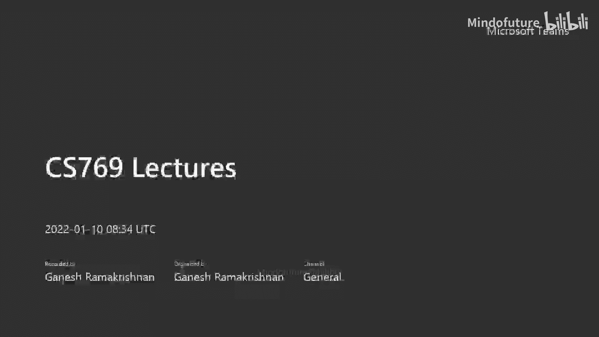

嗯。

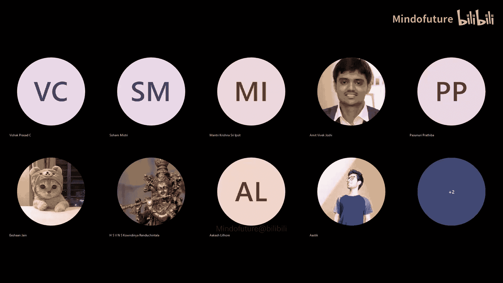

So good afternoon everyone， welcome to lecture2。😊，Introduction to。Optimization problems。

We have seen a couple of interesting optimization problems already。Hello。

maybe you can mute yourself unless you want to speak something or ask a question。

 so you are certainly welcome to ask questions but don't speak otherwise otherwise I mean don't mute unmute otherwise。

😊，It becomes distracting。Okay。So we're going to conclude the third application or illustration through principal component analysis。

😊，Without going into any further detail。Pncal component analysis is what well do is。嗯。

Present how it can be solved。 And thereafter， we look at。

Low rank and non negative matrix factor factorization contextual band。E cetera。

 so lower rank and non negative matrix factorization will turn out to be natural。You know。

 interesting follow ups okay， there's a problem in writing now do。Con that right。

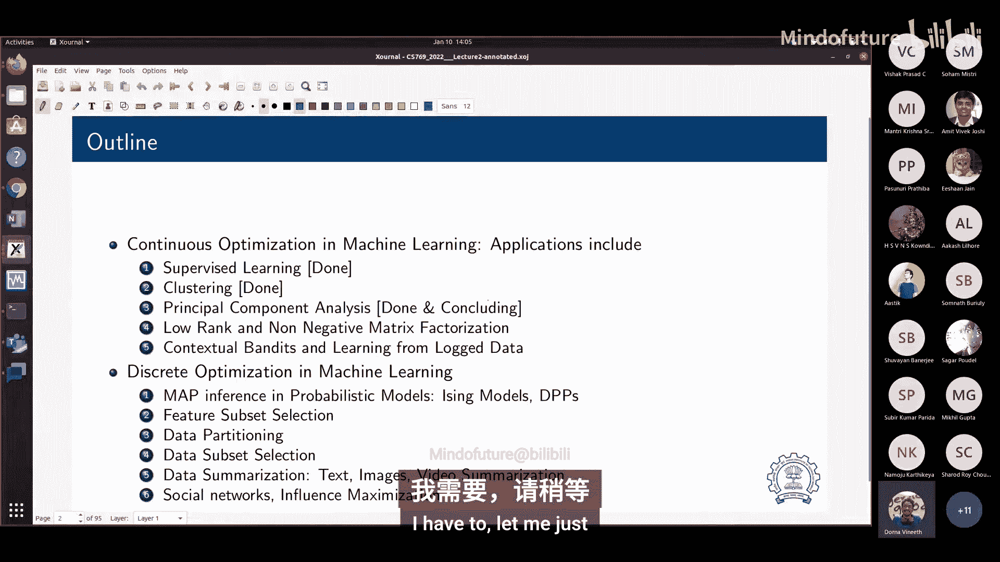

你 have多。Did me just。

Yeah。

Hopefully now I should be able to write so the screen is visible， right？😊。

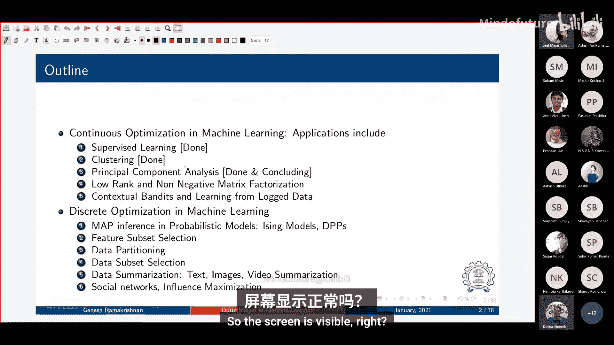

Okay， just continuing， I was explaining how the solution to principle。😊，To what follows。

 which is a low rank and non negative matrix factorization。

Well then look at contextual mandates and learning from log data and then move on to discrete optimization problems okay this is the plan for today let's see how much we can do so recap that we talked about the principal component analysis problem。

Where given unsupervised data。You have this x1 x to x n forming the columns of a matrix x x1。

Each of them is column column vector。Ex to an X sin。You are trying to compress it using U。🤧嗯。😊。

And you're trying to decompress it Okay so just be consistent we just call these M Xm。And。Yeah。

So you're trying to apply。The U transpose。To compress the X， X I。

So that we are able to get them into a smaller dimensional space。嗯。😊。

So the PC optimization problem we had shown to be the same as trying to minimize norm of X minus U transpose X norm square。

How do you solve this？Well， it turns out that the solution to this is fairly simple and it's based on the singular value decomposition。

All of you have seen the eigenvalue decomposition right so recap。😊，So， if you have a。Matrix a。Right。

 then you， you know that the。X lambda form an eigen vector eigen value pair if a equals lambda x right and that leads to the overall decomposition a equals。

Capital Lada x or x lambda depending on how you state it。Okay。🤧嗯。Okay。

 this lambda is a diagonal matrix。Of Ivalue。Now， imagine that this is when you have。예饼啊。

Square matrix。Right， for。A， which is basically。And say R P by AP P。哼。But imagine that a is not。

Square， its a rectangular。You could still have something called a singular validity composition。😊。

And the singular value composition is。Basically stated as follows so if you have a matrix。X。

 you could have。You just don't want to overload X here， let me use another。

 let's say have a matrix B， then you could have its singular value decomposition as say V sigma u transpose。

 you can use u sigma v transpose as well。😊，U。This sigma is， of course， not。

A square matrix if B is not a square matrix， so let's say。B is in。嗯。Mcross N matrix。

Then what would be the dimension of V？Anyone。It certainly has to be。M cross， something。TBM cross M。

Sigma will be what。An m cross n matrix and you will be an N cross n matrix new transfer story here you for that matter you。

Okay， so this sigma would have。Number of。Bas。Sing values。Which would correspond to。The rank of B。So。

 the sigma would look。Sigma 1。Sigma is a king。There will be 0。Okay is。

Would correspond to the rank of B。It could also turn out to be the min of M and N， but it in general。

 it' is always going to be less than the min of。Amin and。嗯。Okay。嗯。So given this。

What' is the relation between singular value decomposition。

 eigenvalue decomposition Well you could do the following at least for B you could consider。😊。

Eigenvalue decomposition for。B transpo B。And the eigenvalue decomposition for B transpose。

 But let's consider for a while the eigenvalue decomposition。Of P transpose B。

 So I'm going to just start a new page。And。Let's copy some of the stuff there。嗯。😊，ok。嗯。So。

Let's look at now the。Iigenvalue decomposition corresponding to B transpose B， so let's say。Yeah。

Yeah。B transpose B。 What is the expression for B transpose V。They'll basically get U sigma transpose。

 which is sigma。It's a symmetric diagonal matrix sigma is diagonal。So， you would basically get。You。

Sigma transpose Sigma will have basically sigma squared if you want。And then sorry。

 there will be yes u transpose so b transpose be will also entail。😊。

A product of the B transpose which you get which is you。With some elements in the others。

So therell be U sigma， there will also be。V transpose， and then there'll be a V。And then there'll be。

Yeah， just to be consistent with we V。And then there'll be you transpose this yo you transpose。😊。

Is such that and V we transpose are such that。They yield identity matrices。So as a result。

 this B B transpose B is nothing but。😊，U sigma square or Sigma trans Sigma。

 if you want to keep it that way。Times we transpose。Sorry， you transpose。Okay， so likewise。

 we can show that BB transpose。Has。The form resulting from。The original expression here。

Of V sigma transpo sigma。Off。F transpose。 so both of these have。Very natural。I again。

 value decompositions。The eigenvalues of B transpose V B are the square of the singular values。Of be。

In fact， that's true about B transpose as well okay。So， the somebody is。Againvalue a B transpose B。

And off。BB transpose。A squares。Of the singular values。Of， basically。

The matrix b original matrix b think of this b transpose B as a covariance matrix that is exactly what principal component analysis tries to maximize and find directions of maximum variance。

😊，Okay， so going back， how would you solve this so let me。I mean。

 the we have got the abstraction on the next page。 So I'm going to clear this space。

 I would like your。Suggestions on how you solve with this background。 How would you solve。Please see。

What would be the first principal component。

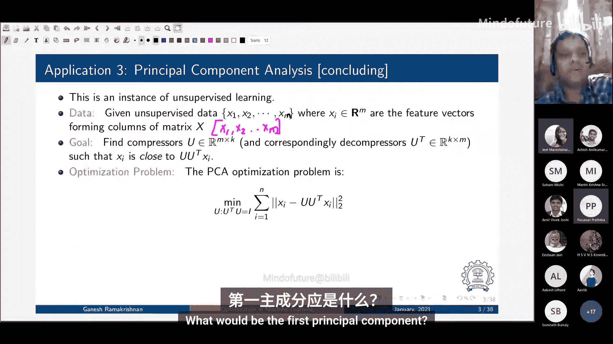

嗯。Do you think there would be a role played。

Bye。The singular validity composition of the matrix x。So。

 suppose I had the singular validity composition of the matrix x， what could you do with it？😊，Yes。

 I would like you to interact and contribute。So Ill try to express my data tax。

with the help of principle components of ex trans projects。Of x transpo x， Okay。

So X transpo x is exactly the direction of maximum variance， and I I had given that equience yes。😊。

So you'll try and do the。Use again， decomposition。 And what would be those principal components。

 That's my question。How with maximum singular values， top K or top something like that。

Like Im in the principal components， which has maximum singular values。Right。Yes， obviously。

 the name singular singularity is coming from maximum singular value。

 So the PCs of x would correspond to what could correspond to。😊，Yeah。

Or the I PC right correspond to the。Components， can I say components of U。Okay。

 so I deliberately uses you here。😊，This you。Yeah。Sort it。Byi。

So you are talking about the K principle component sorted by what and decreasing order of the square of the single values。

Right single value squares， which are there in sigma or rather sigma square。Okay。

So roughly that's how you solve right so EI is the eigenvector corresponding to the eighth largest eigenvector of x transpose x thats I showed you this right so if you go by this decomposition then you。

😊，UI， the largest eigen vectorctor of U would correspond to the same as。嗯哼。The height singular value。

 height principal component。And yeah the rest is something we have discussed already the eigenvalue is sigma trans sigma obtained other squares of the singular values in sigma okay so this is a very important decomposition。

 This actually leads us to the next topic as well。😊，O， if you have any questions， let me know。

We haven't tried to prove much。Use linear algebra to present some insight into the behavior of singular values for x which as the eigenvalue for x transpose x which captures the covari so that' is important to Ill just highlight that point。

So。So when single value squares is because。Udy Gap。That x transpose x。Captures coveians。Right， and。

Bcas。Concerned。Let maximize variance。a variance direction， direction of variance。Okay， thanks。

So let's move on to the next topic with this。Background。Okay， so the next topic is matrix completion。

😊，As I already mentioned up front now the idea here is that you could have。😊，A matrix。X。

such as a product recommendation metric， so let's say we have different people having purchased different products。

😊，You could have users。Yeah。其实诶。R rows are going to de denote。Users。

And the columns are going to not see products。And as I mentioned in the last class it's。😊。

Some information is known。Certain users have purchased certain products。

Whereas some of the information is not known。And that needs to be completed。

The completion is towards some goal。 the Ye， for example， is an end goal。😮，It could be， for example。

Clicking on a certain product may not be even concerned with buying them。😡。

So why is our observations。😊，Based on the underlying product recommendation matrix x。

also be just identity Aj could just be identity as well， that is also possible。😊，Okay。

 so our concern is largely about completing this matrix x。😊，Which could have several derivatives。😊。

So now how do you fill up this is a question。😊，And well， as I already hinted。

 there is some role that will be played by。😊，The kind of decompositions we discussed in the previous line。

So， goal。Yeah， you're trying to fill up the missing。Question mark entries。By doing what， So while。

You are trying to look at user behavior。And product behavior。Or you can think of these as features。

 user features and product features。When you say looking at you are trying to characterize。😊。

So it's not necessarily looking at。😊，嗯。Without an objective。

 so we are trying to characterize their behavior。😊。

But we want to characterize in a behavior in such a way that the matrix x is as simple as possible。😊。

So let me try you。😊，A way of articulating simplicity。Okay， so let's say。😊。

You are trying to characterize this using user behavior， let us call this U matrix。哦。

And product behavior。😊，See character using。8 Xp。Okay，So you would transpose P。

And let me give you a degenerate example a degenerate example is， let's say when you。😊。

You transpose rather。Is a single column。Just saying， well， these are the list of users。

There is nothing much we are talking about it。And a degenerate case of the products is when it's a single rule。

😊，Okay， so let's say this is a so you could be， for example。😊，N R K cross M。

And to have compatible dimensions， say P is an R。K cross N right。

 This matrix itself is X itself as in。Okay， Rm cross， and I haveve already written that。Okay。唔到。

Let' us look at an example of k equals 1。So when K equals1。You're basically going to have you。

As is newtranspoory。As a column vector。Being。Is a single row vector of dimension in。ok。No sorry。

 you put it this way。Okay。嗯。So。What would be the behavior of。U transpose P。 Anyone wants to。

Answer that。 how would U transpose B correspond to。Yes。So it should correspond to x。Well。

 if this is an approximation right， so you' are trying to approximate X。😊。

So it would be a rank on matrix when you transpose P。Is computed when U itself is the in dimension。

I mean， basically one dimension P is also in one dimension。 I mean， is is rank is one。

 It's an m dimensional vector， but it has。Rnk one， lady。The number of columns in u transposeesis one。

So what would happen is U transpose P would look like。

This element into this element this element into this element。

 so basically they will appear to be all scale versions of p okay so imagine that you want u2 are the right entries you will have just this to be u1 times p。

😊，U2 as a scalar times P， and U。M times P。So there rank one。Lnk1 matrix。Is it clear。

Of course we are looking at something more interesting than this。So。What we want is x to be somewhat。

Characterized by simple user behavior and simple product behavior we want there to be simplicity in the x that is what we are trying to capture。

😊，But this is overly simple， so can you think of a better simple simplification？😊，Yeah。

So we would like x to be simple。😮，And my hint to use is the simplicity can come through k so k being one is one extreme example。

 but what would be another a more practical example of simplicity。😊，So maybe n the M set M。嘅佢。Well。

 k equals m so smaller of m and n right yeah？😊，So simple simple x be could correspond to lower values of gain。

😊，I mean， not one， right。唔，意思。So it could just correspond to the lower of the two values M andN。

 but it could be even lower than that。😊，Okay， so let's take this discussion forward。

So the idea is to find the simplest matrix。😊，X， such that Aj X is Yj So since our focus is completely on x。

And as I said， the AJ could just become。An identity transformation。We'll continue this。

 how do you exactly characterize simplicity？😊，One way is let's look at something like singular validity composition。

 recap S3D。😊，Let me。youV sigma， you transpose， and I said that the sigma。😊。

Would have nonzero sigmas as many non0 sigmas as the rank of B。

 which should be less than equal to the min of M&n， right？So if you recap from this。Consider。

 you know， let's say。So consider the SD of x。Which is V sigma your transpose。With the。With let's say。

We know that there are k， let's say K。😊，9，0。Entries， actually， let me let me make it R not K。

Because I might be interested in K as an out， so R is the rank。😊，Now。

 if Im interested in simpler simplest matrix。😊，I would be interested in。Key value， which。

Equals R or I might even try and simplify it because I'm not necessarily trying。😊，To。

Recover the original matrix which gives me all the yjs， so I want the simplest matrix x。😊。

Now the rank of the matrix that you are trying to reconstruct。😊，I mean。

 for the if you want you just use case as R， doesn't really matter here。

 but in in general you might want。To keep them separate。 So let's say K。

 just go back going back to just be consistent with our previous notation。Okay。

 so now how does the plot of K itself look like？😮，嗯。😊，If I were。To say plot the rank of a matrix。

So rank of matrix would behave like this。Let's say with respect to increasing dimensions of the matrix。

Or the coordinates of the matrix rather。😊，So this is how the rank of the matrix would behave like。😊。

However。You know， for example。Minimizing the rank is a challenging issue。So， the rank is。

The issue with the rank of a matrix。Rnk eggs。Ive actually shown it to be continuous。

 but it's not even continuous。 Okay so ideally， I should just show it as some。😊，Punch of dots here。

So's just a bunch of dots here。These are interpolation， so rank。

Is not even continuous what to speak of convexity。Pllancakes。Is not continuous。

Or to speak of conveity。So what you can do instead is look at sigma。

 so I want to ask you how would you use sigma？😮，I told you that there are K entries。

 the rank entries。We turn non sigma。But sigma the entries in sigma themselves are continuous。😊。

What can I do with Sigma， Can I make use of sigma to kind of approximate the rank？Any suggestions。

What if I look at？😮，The sum of the say the squares of the singular values。

So let's say summation I mean， sigma 1 squared could this same。Sigma 1， Sigma 2。Sigma K。

 the rest are all zeros。Click a of them10s。So sigma 1 squared plus sigma 2 squared。Plus。

 sigma K squared。😔，How do you think this is going to behave with is the rank function itself。

 any thoughts？😊，In fact， this has a name。 This is， in fact， called。The spectral norm。

Of the matrix x is called x star。几 on。How do you think this will behave？If all the sigmas were one。

 what would happen？

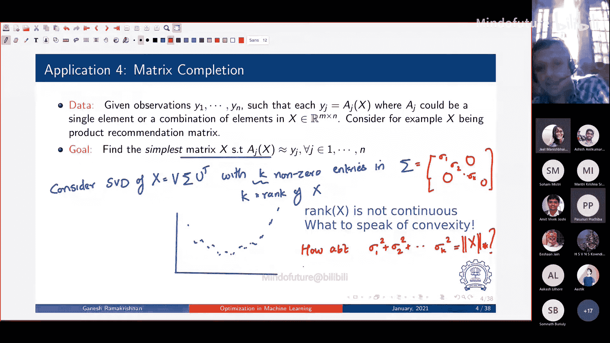

If you have a rank matrix， what would happen？😡。

啊，有没变。Oh， sorry， if sigma 1 square is sigma 2 squared。Equal sigma k squared。Equals1。

What would happen， I mean。The unlikely event of this happening。The spectral norm would be what。

Actually， there's a long squ。This will be exactly okay， right？😊。

So this is respect spectral norm squared， this is exactly B key。😊，So。

 it looks like this can be used to approximate the issues of course the sigmas could take large values。

 but they are all at least positive and sigma squares will not be negative。😊，So， it turns out that。

The if you were to use this， let me。Use the shaded color here。😔，It'll turn out to be。😔。

Something like this okay。If you plot the spec the socalled spectral norm。It'll be the tie tightest。

Envelop。Which is convex spectral norm x。Star。

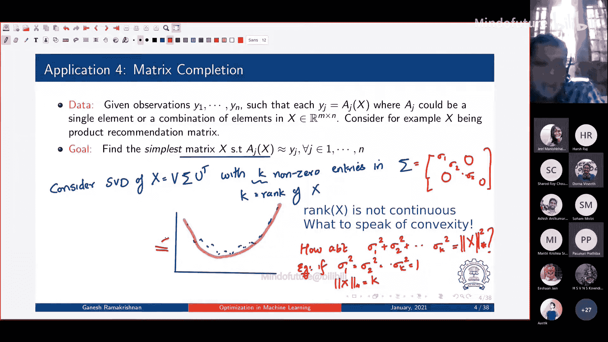

This is the tightest encloing。😊。

Convictx envelope around the rank function。Okay， now it's called the envelope basically yeah。😊。

What are we plotting it against？X， actually， the x think of the x as different values。 Okay。

 so across matrices， we are now basically looking at different matrices x so。😊，Andve up， is he？😊，嗯。

Tightest。In closing。Convicx envelope。For the rank。Yeah， you can actually do a K dimensional。

 three dimensional plot。And observe three dimension is certainly possible okay。

So this gives you some kind of。Control in the continuous space。

 continuous formulation around the matrix x。Okay， so we wanted to go rank。 And here's。

The matrix completion optimization problem。We are using the spectral norm。

So answer I made a mistake it's a nuclear norm I've been using the word spectral norm。

 the nuclear norm， okay go ahead yeah。😊，S rank of the matrix will be maximum of the dimension right So if I have a minimum of minimum not maximum I mean yes that only tensor this continuous function can exceed that right I mean。

 if I have four matrix then my rank can be a maximum 3。

 but this I mean this a non can be more than three。

Yeah yeah yeah so your your question is why should it be shown below right。

 you should probably show it I should shown it above。😊，So not that I was I was worried about that。

So to be in some range right， I mean there should be some constanttrain that that extra values should not in Korea I mean exceed the minimum of the deter of the matrix。

Yeah yeah so this the notion of envelope we are not I have not defined it thoroughly here I'm just trying to give you the intuition it is a very good convex approximation that is what we are intending to say。

😊，Now the if you try and minimize the。Nuclear norm， you would be trying and minimizing the。

Rnk that' is the basic intention right we are not trying to go beyond that into understanding the specific relation that speak so the relation is more of monotonity。

D of exact equality what you are talking about is should the nuclear norm not be made to constrain to not exceed the mean of Mn right that is what you are trying to say Im saying that is not required here because its anyway a surrogate。

Ex that clear so simple matrices I mean and it is not that rank is the only notion of simple matrix rank is one one notion of simplification for a matrix right we are saying well the nuclear norm is another notion of simplification it has a connection with the rank。

😊，You that。Dear， that make sense。Yes。Okay， so this is the this is it tries to ensure that the matrix X is low rank。

 but at the same time。😊，It is convictx。Is continuous？And so on。

So this can be solved now anyone can guess how you would solve this problem， any suggestions？😊，Again。

 intuitionions will be great here because you know as we are developing into solving optimization problems。

 you will find that some intuitionions we develop in these few applications will be formalized later on what would be an intuition？

😊，第二。Can it be inspired by the SVD？SPD of X。The issue is now x has to be solved， right， I mean。

 so you don't have the X to begin with。😊，保住牛度。So you can do an SD and then do what。Any suggestions？

其そ。There are no suggestions。The basic idea is something like an iterative。😊。

Prinncipple component and I mean is it rate a singular value projection or thresholding so what you would do is you would start with some x let's say x not。

So any iter method we start with the next node， okay， then you do it SVD。Let's say u sigma0。

We you whatever we signaligma。It'd be consistent。 V sigma 0。But this is also v0， v0， sigma 0。😊。

Fure transpose。Okay， now this view 0 would have lots of。嗯。Basically singular values。

Maybe maybe you start with the full rankings。😡，Full column rank or full rank x0。

And then you come up with this sigma zero and then you try and the whole idea simplification right now this x0 could have been obtained by solving this by this is this is。

😊，You know， awardly。So under determined set of equations， so you'll have lots of solutions。

But let's say you find the next that minimizes us very well。😡。

Say full rank is x0 without the simplicity constraint such that。😊。

X0 is the is an is an argument it minimizes so when we say argument。😊。

There could be multiple arguments I mean multiple x's that minimizes objective so argument basically is all those x's that minimize and we are saying we pick one of them。

😊，But without any regard to the nuclear norm。Okay。You do this。 And then the rest is。嗯。Based on S3D。

 you can threshold okay。So what would you do， you'd say， okay， I'll pick the instead of。

Picking all these sigmas。I'll pick only say the top。

You know k sigmas so there you can do iterative thresholding you can I long get the details of this。

 but lets say sort similar to PC right sort sigma0 I mean the sigma  square right sigma 1。😊。

Square greater than sigma 2 square greater than equal to rather。Sigma K squared。

In this case could be the mean of。Man of eminent。You may ask for a full rank or full possible rank。😊。

And then you basically now pick a few of the time， let's say you pick。The top。In fact， top。

N minus1 everything except the smallest。And check whether the x is far or sufficiently close enough to x not okay so this gives you。

😊，Each of these is giving you a different version of x。 Let's call this x t de。Right， so。So big啊。

Keep rather。Keep including。The are sigma I squares。Right， until let's say the。The X I tilde。

Is sufficiently。Close to ex not yet。You don't have to involve all of them。O， so from X。Xs not rather。

Okay， so this entire algorithm is called。😊，嗯ello。😔，Yeah， it is called iterative。😊。

Singler value thresholding algorithm。That's what we。Presented。

There are other ways of solving this as well。😊，You could also explicitly。

Model is using some decomposition x L into R。Where L and R are such that。

A m cross k and k cross n so that that by design will make x to be rank k or less and then you will try and optimize for LNR that's another way and that brings us to the next topic that' is also the related to the next topic。

Any questions。I would like this to be interactive， so please do ask questions。Okay。

 so let's look at application5 if there are no questions。

So applicationplication 5 is called low rank and non negative matrix factorization here。😊。

You are interested in。Factorization。But you want to make sure that your factorization is intuitiveitive and not wasteful Okay let me try and motivate this so lets say。

😊，You're trying to similar kind of problem， let's say this is x， right？So if x was。

 let's say L into r or L。Hat are hat。Such that Lha had negative entries。ok。Rannk has to be low。

 X should be low rank， but。If L had a negative intake。

 what' is really happening is let's say L had its feature weights。😊，Right。And are the say features。

So then what you're saying is， okay， let's say minus5。

Times r1 plus 3 times r2 minus2 times r3 and so on。Unfortunately， we are just spending some energy。

On these features R1 and R 3。There is wasting energies on these features R1 and R3。

The question is can we avoid them， maybe it's possible to reduce the 3 r2 to 2 r2 by making the weights of r1 and r3 to be 0？

😡，So that is the whole intention here， can we avoid such negative entries？😊。

Because especially because it might make sense in some places where you know you want。

 you really have negative sentiments negative。😊，featurese。

But there are often settings where you want to choose and not discard， right？😊。

So often you're interested in。😊，Pos positive factor weights。Let me write that， don't you。

So settings in which lets say you want to include keywords associated with ads， right？😊，So。

 you would like the。This basically this。嗯。Set。Of L and Rs。Such that。There are。No negative。

Weights in L。Or even in hour。So how do you do that。Okay。

 that can also be posed as an optimization problem。😊，That becomes。get him。嗯。Matrix factorization。

You can， as I said， you can put this additional constraint on。😊，The LNR are that they are positive。

Right so this is the matrix factorization optimization problem。

 So lower rank and non negative lower rank is by design because I I'm actually using。K here。

 so let me again highlight how low rank is there。So， rank。Of the matrix。LR。

What will that be it will be greater than equal to。😮，I'm sorry， will be。Less than equal to。K。

 you cannot exceed K。嗯。So， that low rank is already by design and you may additionally have。😊。

The non negativity。How do you put the non negativity。Yes。What can you do for non negativity。Anyone。

So suppose if I take a matrix Ls where the a value can be negative。

 but the relation between n then L and LS will be that each element of L will with the squared of the the element in the Ls and we can use that to minimize this expression。

Okay， so some of the squares of the elements in LDash。

No sir I was saying that that each element in L will be the corresponding element in the L S。

 but the squared of that。Or the I see you are saying that solve it by having L itself as decomposing L itself into product of two matrices right No it will be the I will be replacingpling L with the L S where each element will be squared when I get it I get it。

 So that's what when you say each element is squared。

 then that's itself decompos into product of two。Identical matrices。

 I mean saying x is equal to y square is like saying x should be decomposed into y into y。😊。

Which is fine that's a very so then that's an interesting solution so。😊，Solution 1。

itself is say L dash or you know。L tilde transpose into say L tilde， right？

Something like this and r itself is say r tilde transpose into r tilde。

Can we think of another solution。Something along the lines of what we did just now。

 right we talked about this iterative singular value thresholding。😊。

And another very intuitive approach in optimization is often called projection you project。😡。

You start with whatever values you get， but some of them you threshold project them to  zero。😡。

And again on。Okay， so。And in fact， Ill give you this very simple recipe。😊，嗯。ok。

So let let we and let's， let's。Next slide we willll elaborate on that， I mean it's not there。

 but I'll write it down for you。Okay。So this is the idea you want to solve this。

L greater than equal so r greater than equal is 0 so one way you can solve this as was pointed out do a reparization the first suggestion is basically called a re parameterization approach。

😊，And the second method， which I'm talking about now is a projection approach。😊。

And what is the projection I want things to be greater than equal to 0。😊，Okay， so again。

 I'm just going to provide the intuitive expression like Ive done so far。😊，So， let's say。

 I start with some。Right I start basically with some values L not or not。And L Ar not。

 as you pointed out， might not actually have。This constraint， unconstrained a not。Might violate say。

L not greater than equal to0 r。N equal to 0 so what we try and do is through a projection try and bring them down。

 but you don't want to bring them down by arbitrary thresholding right so multiple ways you can do it。

😊，So the idea is iteratively。😊，Project。Project to space。To the space of L greater than equal to 0。

All get to then equal to 0。So one such algorithm turns out to be as follows。😊，Again。

 I will not get into details right now， but it would be something like this you will say。😊。

If the so you'll basically now look at。😊，What the ideal decomposition。Yes， right， well。

As against so there is there are a metrics you are trying to reconstruct L not are not say unconstrained version。

😊，And now you are trying to see your projected version， how is it with respect to LO or not？😊。

So you can say L I。Okay， is something like， okay， you'll have to do this for AllI and R both Let me just。

So， this。See LNR basically will also have some autogonality property， that is what we will assume。😊。

So with that assumption。其， I'm。I don't think I'll have all the dimension just help me make sure I match the dimensions properly so L not r not would I be next but。

😊，Let me try and get the。I'll try and get this L。Are you -1 transpose。😔，A I -1。

Transpose something like this。And at the numerator。So I don't think I have the exact expression here。

 but this is a spirit。😊，So the idea is if see these are threshold values from the previous iteration LIRI。

😊，So if they are devitating significantly from the denominator you are trying to push it up so that is the idea I probably write down the expression more carefully after the class but this is the idea you trying the expressions are such that you are trying to pull them to L or not here at the same time maintain positivity so。

😊，Something similar we have in Ha。 I'm not going to write down the entire expression， but this。😊。

Yeah this this is the basic idea of iterative projection algorithm and we will see projection algorithms a whole few of them。

😊，But I think for the timing being this is sufficient。

 sometimes you could also have that y which you are trying to interpo it in terms of A and Lr。😊。

That could be fully absorbed。Absorbed right so in that case。Yeah。

 you could just have this y as an entire matrix y minus L。😊，Okay。Are there any questions。

 otherwise we'll continue to the next topic？😊，Yeah， I don't want to。

Get into algorithms too much just want to give you a flavor of the approach。😊。

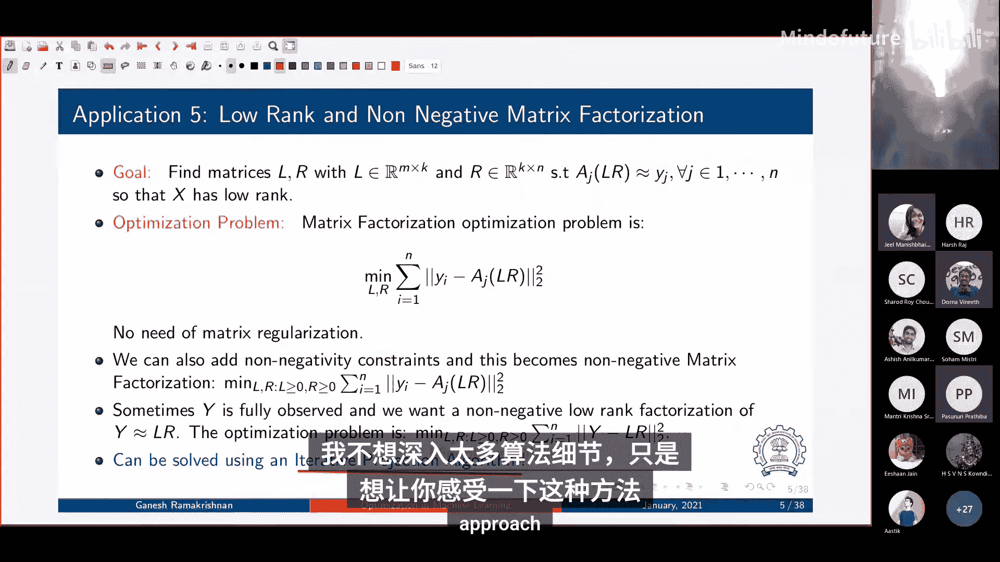

Okay。

So it was it was element wise division， right？Yeah， yeah， it was yes， itll be element twice。

 you're right， element wise。Very good point。 Element noise division。Okay。

 so the next application is contextual bandit。😊，So let's say I'm going to switch to a demo。

 I think there's an interesting demo I found。😊，So this is the demo of bandits。

 propensity weighting and Simpsons paradox and R， Ill send you the link。嗯。

So let's say you have a website which says sport and movie related articles。So嗯。Now。

 it turns out that men may。Prefer certain you know kinds of articles。

 women may prefer certain kinds of articles。Okay， so。😊，Let me go back to this definition。

So let's say we we show ads or articles in this case articles could be ads。

 users could be women or women。😊，And each article or add， okay。

 so I'm just going to say this add slash article okay。😊，Okay。

 so you are going to show these ads or articles to users with each article consisting of features what would be those features？

😊，It could be the title， the text， right the query and so on。

And then what you have is an online policy。So that policy is still is recommending or showing articles to men and women。

The system then comes back and logs the feedback。Whether a man or a woman pick that article。

 read that article or not。Okay， so let me just go back to this and just place this link here。

And now what you're going to pick from this particular link。Is。another interesting aspect。😊，So。

 the user。Basically， when the person a user or a man or woman。Pickix an article。Basically。

 there is a reward that the user is associating with an article or ad。😊。

That's how the feedback is being locked。 Okay， so let's look at the。I user use case。Ith user。

 as I said， could be。Based on more detailed demographic information for the time being adjusted。

Man or woman。Okay， so you have an X I Z user characterized using a bunch of features， X I 1。Ex I do。

To exciting okay。And then。What is the for the I user what's happeningtic？😊。

Some action is being taken。The policy is taking some action， showing some article okay。So this。

 it has。Shown an article， AI。Based on。Add slash。Article policy。And this is an online policy。

 which is evolving。That's what we have let me highlight this part。

So the online policy with certain randomization picks ads that's exactly what's happening here。

Now the policy itself， we can give it a name， we'll call it， let's say。😊。

Pi Theta for an user exc based on the features of that person。Man， woman， whatever。

 it has speak certain。Article。The user， on the other hand， has assigned a reward。😊，So use aDD。

Ad itself has been picked based on the feturization。😊，ok。However， the user will now give a reward。😊。

Right， and。You would excite。Is sending a reward already？

So let' us look at this here both male and female visitors actually prefer sports articles over movie articles。

😊，So there are some rewards嗯。Meal。It's assigning some reward to sport， some reward reward to movie。

Right， but in general。You find that the scale of the female is larger the reward that females assigned to movies are larger than the rewards that the male assign to sport so that is an important。

😊，These are actual preferences， they are not normalized preferences。😊，Okay。

 so let's actually look at， let's capture this。😊，So。

So we are giving given this kind of banded log data in the form of x 1， A 1 r 1， p 1。So what is x1？

The features we saw A1 is the action that was taken。By the online policy。

 R1 is the reward that was assigned by the user。P1， on the other hand。

 so what is missing in this entire。嗯。Discussion， what is P1。Doess it。😊，Bs here。

Theres a bias associated， this P1。So let's look at the。

Okay so we have not and we have not written the exact form of P1。

 but say just pasting from here mail。😊，For the sports。As against the movie arm。

And contrast that with the female。Rewards。For the sports as against the movie， so 04 0。3。😊。

As against0 。8。7。So there's a bias in this course。And we need to do something to basically estimate。

😊，A model such that the bias of the this is a bias， the preferences。They are removed。

So how do we design an objective function？To handle this。I's a question。Sa it here。

So given this banded log data。I need again。Referring to this。This particular example。ok。

So here's how you can define right you can you can do the following even though there is 04 and 03。

You can look at more information here， so there is some information given here。😊，嗯。

Now suggest the site editor just knows that men like sports and women like movies related articles。😊。

So， the editor has some business logic implemented。

 assigning movie related articles on an average to 75% of female visitors so what what has the editor done？

😊，哼。So movie articles are given to 75% of female visitors and sports article to 75% of male visitors。

 so that is the bias that has been brought in by the。😊，The the D。Logic， the right。Just a second。

These are the scores I just want to bring out the other aspects， so this is these are scores。

 these are reward sorry。😊，But what I'm going to now bring out is the written。Is。The bias。

So there's a bias。In the system policy。And what's the bias in system policy？

This is exactly the policy， the editor has some business logic that assigns movie related articles on average to 75% of female visitors and sports articles to 75% of male visitors。

😊，Okay， so let's make a note of that。This font is too big。Okay。

Now we want to kind of normalize for this。😡，Or adjust for this。How do we do that。

So if we just use this right so 75% ads are shown to males， we look at 0。75 into 0。4。😡。

So if you look at sports itself， you will have a very high weighttage 0。4。2。7 5 plus 0。0 into 0。25。😊。

Just because women。嗯。Stend to。Give higher scores， even though。

They seem to have preference for sports。 movievie seems to have overall higher weighttage because。😊。

75% of。The movies are shown。😊，2 females and not two males。So overall， the CTR。

For the movie arm is higher。That is a problem okay。

So putting these together that there is a bias in the system policy。😊，So you'll have overall。

The higher score for movies as against。For sports thats what we see here。

 So how do you now adjust for this bias as well is a question。😊，Okay， so let's also develop on this。

 let's assume that we can take some number of actions for example that in this case right in the in the example。

😊，We had k equals 2。And now there are feature vectors which are used by the policy。😊。

The backend policy， which we dennoted by pi theax site。That pi theta exc。😡，Is。Using these features。

To come up with an action。AI is action chosen by the current online policy。

 which is the Pyth3ax side。Now PI is a probability of the lo action this is is also called the propensity score PI is called because of its propensity as I said this is propensity I mean again I' will give the same example。

😊，So this exactly the statement， right？😊，I a propensity。

So we need to adjust for this propensity score， that is the next step。😊。

Now how do you characterize his propensity well you can say PI？The propensity for say movies。

beinging shown to。Females。Here is 0。7 phi is high so can we characterize that in our expression yes we will we will do that next and finally we need to account for the reward。

😊，And that was shown。As this particular table， this are reward matrix。Okay， so given all of this。

 what is our final goal， well we have this。😊，P theta， we need to also have a form for pii theta。😡。

Which uses a feature X。X1 week K。So we want the policy。😊，Of course。

 should be taking that action which maximizes f theta xj where f theta is aling function。

 simple example of f theta is identity link function， f theta is say just theta transpose x。😊。

No transformation is just a linear simple function。Okay。

 so here's our first effort towards the contextual mandate problem。😊。

What you are doing is so these are division R divided by PI。ItsR by EPA。

So because the propensity is to be discounted。😮，What we have done is done an inverse propensity estimation。

So one up on B。Rri is to be directly taken， so R into。😊，The cases were the suggested action。

Coincid with what the person picked。AI is what the person picked and pyth theta Xi is what the model suggested so you want the model suggestion to agree。

😊，With the suggested action。Okay，So this is the very obvious inverse propensity estimate。😊，Re right。

 based on the reward。Directly proportional to reward inverse proportional to the propensity。

And looking at the indicator function， however， this。😊，Is a。

Discd optimization problem in the sense that you have a very large search space so you can do a softm relaxation。

😊，Instead of。Having this discontinuous function， you'll have a continuous function。😊，嗯。

What is this continuous is simply a soft match relaxation。So instead looking at this indicator。

I am looking at。As softmax on the link function F theta。

So the form of F theta itself could be a deep neural network。嗯。So yeah。

 that's it for this last application in case you have some。嗯。Rein question， please let me know。😊。

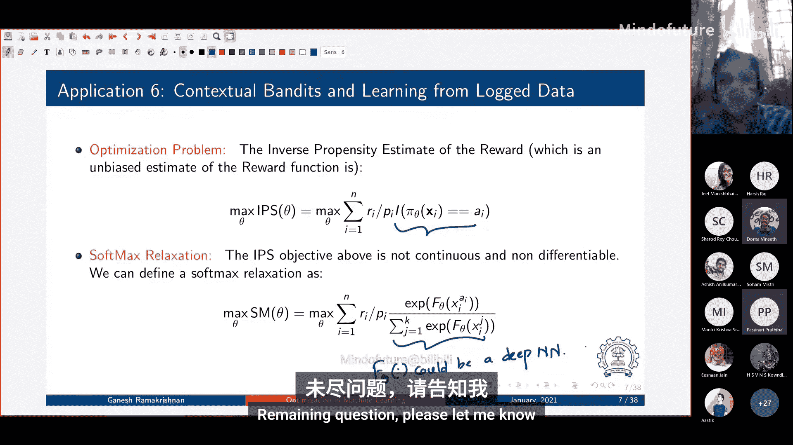

So， why do we have this h space very large here？

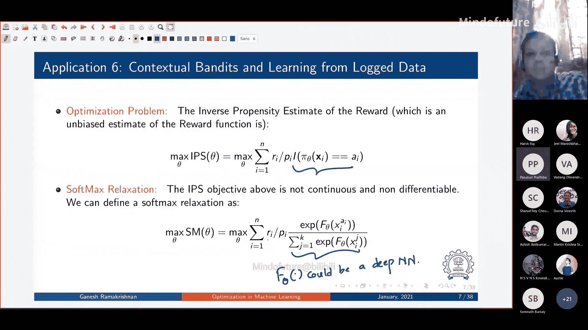

Why does we have do we have a large search space sir？where does that come from， Because， I mean。

 we will have the finite number of AI right。

Yeah， finite number of A is but the theta is a very large search space right So it's theta is continuous。

 It's not a discrete optimization problem， but this is a。😊，This is the search space of all possible。

Phi theta Xi is being equal to AI is very large。It's combinatorial。

Anwer one more thing that do we know that a P is always given I mean。

Is there any case where we may not know P？That's a good point。

 I mean we may not be given P in which case you could just take it to be uniform。

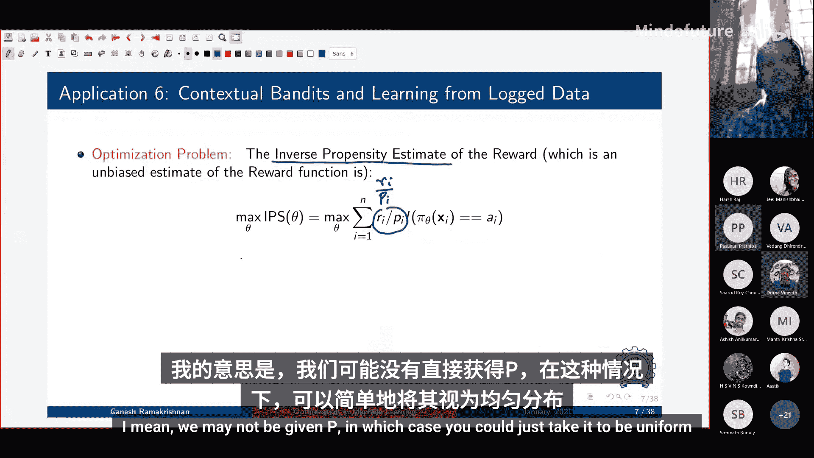

But the kind of， sorry， the kind of metrics we showed see， this is in the interest of the。

The ad agency or the right， basically the the book。Agency， the library or whatever。

So there is better for them to acknowledge their own propensities， their own priors。😊。

So and the model will start with some prior the model will start with some some kind of assignment which we want which it wants to revise over time。

😊，Is this clear？So default is just all uniform， but if there is a propensity。

 it is good to account for that in the。😊，Lost function or in this case the gain function。

 the reward function this is an overall reward function。

 so its a maximization problem not minimization。😊。

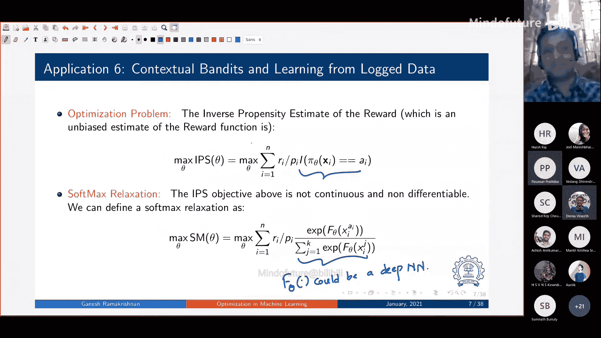

Is that clear？唔该。Okay， so can we move on to the next set of applications？

We have some 10 minutes left。😊，嗯。The discrete optimization problems。😊，Are often very related to。

Grauff。Graphal models sometimes related to feature selection and the third large classes data subject selection so。

😊，The first is the map inference and probabilistic model。😊，If you're trying to find a sequence of。

Parts of speech tags for a sequence of words in a sentence， let's say。B sentences。U。Today is Monday。

10th January。2022。Okay， so。If you're looking at part of speech tags。😊，So Monday is a day of the week。

 but it's also a proper noun。😊，Can call it a PM。This is a date， the whole thing is a date。😊。

Well Monday would also be considered a8， so let's in fact take the simpler case， right？😊，DD。

This is this whole thing is Dt， but you could also say， well， this is Dt。This is DT and so on。

 Now we can get more specific you can say this is day of the week。Big day。This is number。

Nummeric value。This is a month。This is a yearurt， right？Depends on the graularity you want。Now。

 if I'm trying to make inference on a sequence。Let's say for the time being we consider the one at the bottom。

 just more fine green。I would be interested in the structure determining the sequence of。😮。

The part of speech taxs。So the fact that a week has come up would probably mean that a number is following soon or a month is following soon or a year is following soon and likewise now there are maybe five or six different formats instead of saying todays。

😊，10th of January 2022 and a Monday that could be another form you could have a third form which is today is Monday you know January 10。

 2022 that could be a third form a fourth form but overall there may be a finite number of such configurations and what we are trying to determine here is given the sequence determine the most probable。

Tax sequence it may you may even be interested in extracting the data from this。Sentence。So。

 the overall problem。Is basically assignment of labels here you have。A large possible say。

Set of candidates。So。You want to basically select from the set。The most appropriate one。嗯。U。

Key here is to associate energy。 Okay， so you'll have， let's say， energy associated。With。

This configuration and lets say this is exactly the configuration that turns out to be okay let's say the year correspond to this entry。

😊，The last entry month corresponded to the second entry。

Num corresponded to the third entry and in Wk correspond to the first entry Wk here。Big。😔，Okay。

 so you want the energy connecting these dots together to be。😊，Maximized。

As against some other energy configuration。😡，So。So far effective。Date extraction。OrAllnotation。下。

We would like。Configuration。Sa highlighted in yellow to have。Higher energy than any other。

Configuration。Okay， there could be other configurations。😊，Let's see。

I'll put a gray configuration here。So maybe this is another configuration。

And maybe a very dull configuration saying that。😊，That Monday is a verb10th is a verb。

 let's say this is a very dull configuration and deliberate Im just giving a very stupid one。

 So lets say this is saying that this is a verb。😊，Whereas the first one said is a week。Likewise。

 in the second case， again， no， this is a nu。Whereas my dull configuration said this was again a verb。

The third one， it was a month。Mal configuration said it is verb and here the fourth case it said it is a weak。

 but it is a stupid idea because。😊，Mel configuration itself said is a weak。😊。

Whereas the smart configuration。That I should pick shared say here。So I want this to be picked up。

The smart configuration to be picked up。嗯。Okay， so。This is any other configuration in gray。

 there could be other configurations as well。😊，So this is the map inference problem。😊。

Example of the map inference problem。No。How does it turn out to be？😮，呃。

A discrete optimization problem， well that' is obvious。😊，Right， because I have。From this grid。

 I want to select that configuration which maximizes the energy。

 the energy is associated with these pink arrows。😊。

There are also features associated with those pink arrows。😊，Currently， I'm not interested in。

Determining the theta， which maximize the energy。 That's another。

Problem right you could have two problems。 So formally what I would define how I would define the map problem。

😊，Is that。I want a configuration of these let let's call these Ys。

Y 1 white let me not con confuse it with labels， so lets just call it L1 L2。L3 L4 L5， right？😊，诶。

So I want a configuration of these。😊，L。They just。The one that maximizes over all possible L tilde。

Now， each configuration Ltda leads to some energy。😊。

So this is an energy Z associated to this Z associated with a parameters theta。😊。

It is a potential function Z associated with these parameters theta。😊。

Which is a function of the label sequences L1。Tilda， L to tilda and so on。So。

 this is a discrete optimization problem now it turns out that such discrete optimization problem under certain structure。

😊，Can we solve efficiently。Otherwise this is a very large search space。

 so for those of you have done a basic ML problem you' have probably seen hidden maco models。😊，Right。

 but there are hidden mark models are basically chain models。 Well， there could be three models。

If you do an advanced course on machine learning， you probably talk about you come across。

3 structured models where you can use some product algorithms efficiently to solve this exactly this problem Okay dynamic programming so for the the key here is。

Again， algorithms comes to rescue here for chain and tree。Structures。

 this is a chain I can what we have taught de with today， the tax equal L1 l to l3l4 is a chain。😊。

So this is an example of chain。But， in general。Also， three structures。😊，嗯。

The optimization problem can be solved efficiently using dynamic programming。😊，However。

 even if they are not trained they are not change structure or tree structure if they have some other interesting properties and you can create something called factor graphs。

😊，I have posted my very detailed notes on graphical models where I give some examples。

 but you can come up with you know alternative representations。😊，Under certain assumptions， okay。

 there are certain assumptions you need。😊，For example。

 one important assumption is submodularity under submodularity also you could solve them efficiently。

😊，If you're looking at， mini maximizing。Actually， I should say lower energy。😊，I mean， lower energy。

 higher potential。😊，Okay， let me just qualify when I spend energy actually I meant。😊。

Potential or likelihood is the best one， you typically will interested in maximizing likelihood。😊。

So youre typically interested in basically higher likelihood or lower energy。😊，This Zi， for example。

 could be likelihood。😊，So this turns out to have some nice properties when you when you have some properties as submodularity。

 so I'll discuss a bit more on this in the next class。And then we'll take other concrete examples。

 we'll stop for today unless there are some questions。Yeah。Sir。

 I have a question related to course logistic。 can I ask Yes， yes， please So first of all。

 the contact detail I wasn't able to find out contact detail of T。

So I wasn't able to figure I'll put her ID on the website， I'll do that。Yeah。

 and I was wondering about the team size for the projector。So team sizes could be。

 as I said ideally too， I'm okay with three。😊，But my typical observation is that one of the members has becomes dormant。

 but up to side team size of three is fine。😊，Not larger。I would advise two， but three is okay。

 acceptable。😊，And those assignments， course assignments， which you said there will be two。

 so those assignments are also expected to be done in groups or those are in assignments are in。Okay。

 okay， thank you， sir。 that's it。 Thank you。Okay， any other question on the class wise we stop for today？

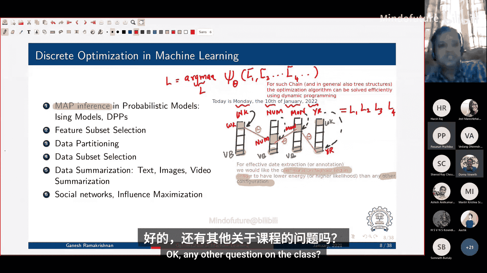

Tangen。

