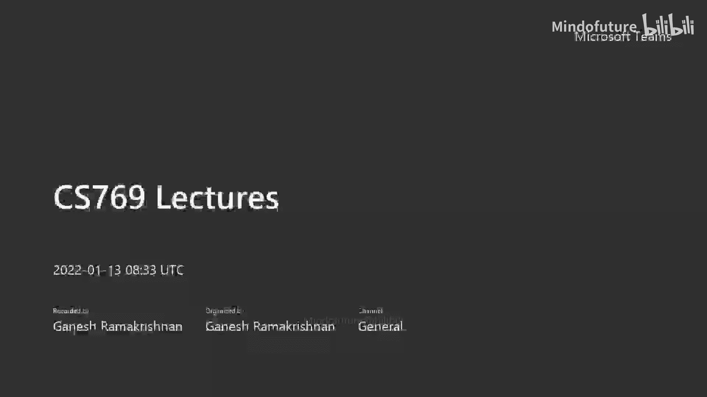
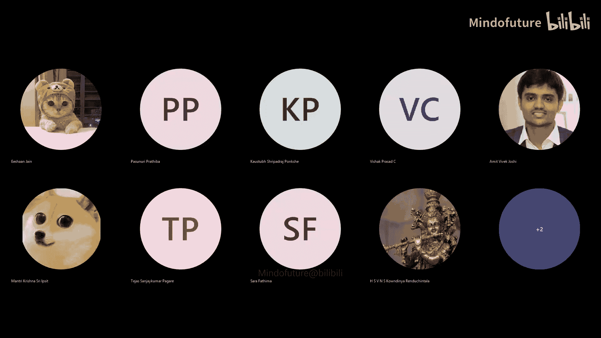
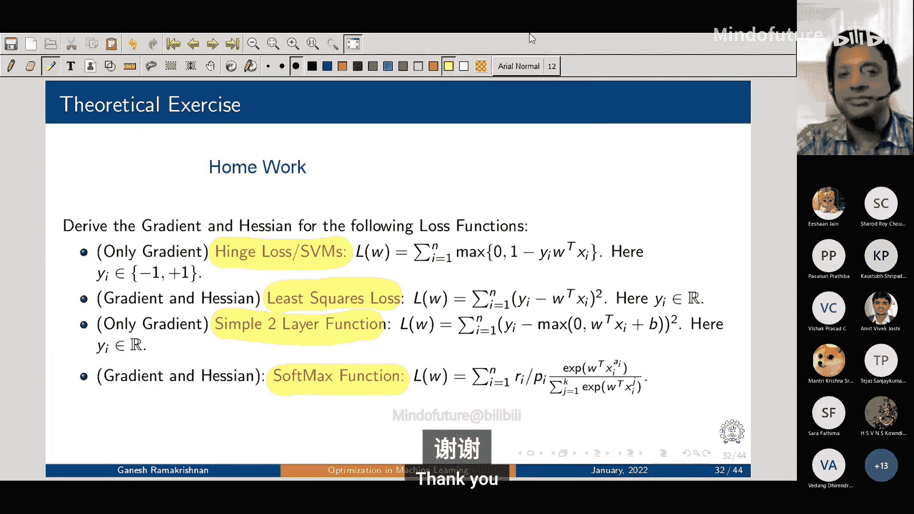

# 【印度理工学】机器学习优化 ｜ Cs 769 Optimization In Machine Learning p04 P04_第三讲_13-1_机器学习中的离散优化问题基础 -BV18cBSBJEH1_p4-

Yeah。

Okay。Good afternoon。 Welcome to the lecture 3。😊，We will conclude our discussion on examples of。

Optimization formulations we have already seen several discrete versions。

 several continuous versions we see some more discrete versions and then move on to basics of continuous optimization and convexity a lot of it I'm going to give it as reading for you for homework。

😊，So recap from the last class we talked about map inference and probabilistic models。

 I gave you the example of part of speech tagging， but let me very quickly also present the case in the use case of you know icing models so the idea behind icing models。

😊，Is that you' are often trying to。Identify。A low energy configuration。

 Let's say you have a bunch of。Electrons and there's spins， right？

And you want to find the configuration is that the energy is minimized。

So should be whether this should be positive or negative。

 whether this should be positive or negative， well。

 it depends on the energy between these adjacent nodes。😊。

And also depends on the energy associated with the particular spin of a particular node。

So we are find trying to find that x such that this energy configuration is minimized now you can give a lot of probabilistic semantics to it where you are looking at attractive potentials。

 you could also have semantics associated with repulsive potentials。😊。

 so that's where DppP is come where youre looking at not cooperative。

 but right youre looking at somewhat repulsive if one is positive， the other should be negative。

Whereas the icing model is more about。Attractive potential I'm sorry rising models which looks at positive and negative and RB might look at diversity Okay so there are different probabilistic models and semantics associated and accordingly the the low energy configuration could change。

😊，But let's look at some other examples I'll run through some of these in the following slides。

 as I said， you could also have natural language processing。😊。

Where youre looking at the part of speech tax sequences associated with a bunch of words。

And there youre trying to detect say phrases， you're trying to detect ngrams。Semantic structures。

And the overallal idea there is that you are trying to maximize again， find an sequence。😊。

I'll see an R max。Of the power structure。You just call it pars。Offf the。Probability of the powers。

Given word sequence。That's the most generic。Population。Okay。

 so I gave you an example last time if you have a sequence of words。

 this is say 13th of January 2022。So that could be the word sequence。

And what you're trying to find as part of the pars。

Could be the ph structure associated the fact that 13 January 2022。Is a date structure。

 but it's most specifically a no phrase。This is。A pronun， and so on。Could also have a par tree。

Where you looking at。A tree structure association。嗯。In computer vision。

 Ill give examples of image segmentation and image correspondence that those are examples coming up。

😊，Okay， with this， let's move on。Again， as always， please feel free to ask questions。

So the first is of image segmentation。😊，And then there' is related problem of image correspondence。

 But let's begin with the second problem here。 this minimum cut problem， which I mentioned here。

So what are we trying to do in imagemate segmentation。So you have。😊。

An aeroplane flying in the sky and you want to identify the boundary of the aeroplane。

How would you like to do that Well imagine that you had lots of nodes here。😮，Okay。

 so this is a node U。This is a Nor of ye。嗯。😊，那你。You and we， you believe， should belong。

To one region of the image。And。E associated。With having both of them。As a background。It says0。

On the other hand。The aeroplane itself。Would have。Or pixels in the aeroplane itself would have again。

 zero energy association。What you would like is as you go from the aeroplane。

 a pixel in the aeroplane to a pixel outside。 let's say this is。B， And this is Q。

The energy associated with PQ。You would like that to be。Hi。

 which means that you would not like them to。😊，Belong to the same region， CQ。It is， let's say。

 very high。Hundred or whatever I mean I'm not really normalized these。

So what you would be interested in as part of this。Optimization problem。Is something like min。

You want to again minimize the energy， like I've said in the previous slides。

Now you want to segment this into two parts， which is what you are trying to determine say the part s which corresponds to the aeroplane and of course the part which doesn't belong to the aeroplan so let's。

嗯。Call this S， and then there is S complement。I have a Min S of all the pixels you。That belong to S。

All the pixels， we。That belong to as complement。Of the cause associated with U and V of the edge connecting U to V。

So obviously， you know， UN and V。Even we range over all the possible edges。Okay。

 so this is how over all the edges。So all you can add that here， U V。The set of edges。 Okay。

 the whole thing is。For the index for the sum。Okay， so this is a minimum cut problem。😊，嗯。

The segmentation problem。Now， it turns out that if you have some interesting properties associated with the C。

We often they are referred to as you know， again submodularity constraints。

You can actually solve this problem。The problem of finding this S。In polynomial time。

It's a minimum cut problem。On the other hand， you also have bipartite matching which you can view as a maximum flow problem what is the bipartite matching problem here。

😊，You have these two images and you're trying to do a correspondence you're trying to determine which pixel。

In the image on the left corresponds to which pixel on the image on the right。

 so the pixel set of pixels of the image on the left you can call them u and these are v and that is what you are shown in the image on the left here。

😊，Now， how do you frame this problem so all of you have some of you have taken algorithms course。

 you know have heard of the full focuss and algorithm。😮。

And you know that there there is an entire area of formulaly of problems called maximum flow So you can you could。

Do the following。 You can formulate this matching problem where you're trying to find the correspondence of pixels in U be as a。

Max flow problem， Any suggestions how you do that， I've given you an example of the cut。

Could you suggest how you do。How do you formulate the bipartite matching as a flow problem。

 max flow problem？Anyone。Yes。As mentioned earlier， this meant to be interactive。

And it's okay to make mistakes。So can you please repeat the question。

So you understood how the segmentation problem， right you segmentation problem。

Has been formulated as a cut cut problem， right？Mulated。Themate segmentation problem。

As a minimum problem。I would like you to formulate。啲。

Correspondence problem as a maximum flow problem。 image correspondence problem at the top。

Soir in this case， what would be our source and what would be the sink because a max problem has a source and a sink。

Any suggestions？We can on。We can add hypothetical sources and sing。Where would you add them。

The source can connect to all the vertices in view and all the vertices in we can end up in the sink。

Okay， great。 So here you have S。And your team。Right， and your suggestion was。We can correct。

These are hypothetical edges， correcting。As to every vertex and view， likewise。

 I can connect every vertex and V。To my hypotheical。😔，Next， what do I do？So make it a directed graph。

Okay， directed three to a directed graph， what can I put some capacity on these edges？😊，Yes。

What would be the capacity？Capacity of one not in。Capacity。Equals one on each on each gesture here。

Ok。And what else would I do？That is this simple。If I just try and maximize the flow。

 I have a matching。What wouldHow would I uncover the matching based on the flow？Yeah， just whichcha。

Saaturated their capacities， right， which are basically one。T us should have 0。Correct， so I mean。

 the way you would formally write down this problem。Yes。Max again。

 now you need to identify the variable on which you want to maximize。Night。

What do you want to maximize？Basically， you want to maximize the flow。F。From S to U， right。

 this is for。All the edges in。B SU。It is an E。Okay， so this shared this。

This is what you want to maximize。Such that， but there will be a constraint， what is the constraint。

😊，For E D node。B。I just use P hypothetical node， right？

What should be the incoming flow to that node versus outgoing flow？😡，How watch with the sum。Of Q， R。

In the Ed set E。Of the floor。From Q to R。I'm sorry， this is Q to P。Q to P。

What would the expression between this and say。P to R。In the exit E。Of FPR。The expression。

Equ equal pet correct。's what the。Okay， so what you're basically saying is that， okay。

 well let me just give it a different。Okay， so we are saying that these basically correspond to。😊。

Any set of。You。That。Get connected to a vertex P。I think coming。I just and then P outgoing。To see。

R the speed could be any any node in V in the set U， it could be any node in the set V。Okay。😊。

Any questions Oh yeah， we'll further also have these constraints that。😊，If。一。And the oh yeah。

 any FPQP should be。Le than equals 0 and less than equal to 1。

So you probably know the augmentation algorithm youll keep augmenting a path if you don't know then that's taught in a basic you know course algorithms。

 but for us the interesting thing is that we can formulate all of these as optimization problems and then we will look at some interesting characteristics of these。

😊，Okay， any questions？So we I mean， just to understand this graph as well。

 what you are trying to do here is understand the foreground S。The aeroplane from the background T。

 which is in black here and then you're doing that using this S this cost。Associated with edges。

 you would like edges within the within the foreground。Or within the background to have low cost。

And they just goinging across them to have higher costs。The next application is feature selection。

So if you have a machine learning model， you want to identify a subset。😊，Of the features。

Based on some measures such as mutual information。 So what is mutual information。

Mutual information by default is always associated with entropy。but let's define this。

If you have H entropy， the mutual information between random variables。😊，X1。And x2 is。

The mutual information， the entropy of x1。Plus the entropy of x2。Minus the entropy of。X， x 1。And x2。

 the joint entropy of x1 and x2。So this is like saying。How correlated are the two random variables。

 right？😮，So can I make use of this？Identify。Good features。 So there are x1 x to our random variables。

 and I'm giving you mutual information。 Can you suggest how I could make use of this to determine。😊。

The light set of features。It is often also called the process of feature selection。So as a hint。

 I must tell you that should you should not just consider x1 x2， but also you should consider。😊。

The class variables。Okay， let's consider also the。Class variables， why just type it out。

It' it's just a class variable， right？So you could also compute D。😮，Mutual information between。X。

 and y。Lakeways， take the same exp。Between any random variable X。

And the random variable y whichotes the class。😊，So with this hint。

 would you like to suggest what would the optimization problem？😮。

When that mutual information denotes。Information。The kind of a notion of correlation。Entropy。

 I'm assuming of all of you know。Right。Entropy of a discrete random variable x。

Is negative of summation where all values that x can take of x log。E of X。

And it basically captures the。Average amount of。Information of bits that I need。

To encode about the variable， given a deep distribution， the uncertainty。So very， if the。

 if the X is extremely。H entropy right and you you'd know that its its very uncertain right for example。

 uniform random variable。In the case of。uniformniformly distributed random variable in the case of a discrete random variable has very high entropy。

😊，So what would you like to do。You with respect to mutual information， any suggestions。Anyone。

What would be the goal。I'll probably help you through one more slide。Okay so。What is the goal。

A goal is to select a subset of features， so that set of subset of features are as good as the original set。

😊，So what。Is my yardstick of goodness of each。 It should help me predict the class。Right。

So based on this， can I consider。Maximizing the mutual information between the set of features and the label Y。

So I want a set of features。P。I want a set of features。A subset of features a。

From this entire collection X1 weeks in， such that the mutual information between X A and y is maximized。

😊，Okay， so now it turns out that this， this is set function now this。Inently is in terms of entropy。

M's edge is denoting entropy。Entropy。What we can do is also replace that edge entropy with some other。

😮，嗯。Function， in fact， entropy turns out to be a submodular function。Okay， and as we've shown。

And it can be replaced。By any。Several other。LikeSeveral。Other submodular functions。

I have not defined some modelular functions precisely。

 but Im just going to give you an idea right now。To get different。Notions of mutual information。

 different。Measures of mutual information。Okay， but the key idea here is that。You can now。

Templateize and create lots of other functions。For example， and what is。

 what is a submodular function， It's basically。A function which has diminishing returns。

So modelular function would for a discrete optimization problem。Would be like。

 what should behave like this？So if I pick one element， x1。And then I try and add another element X2。

Then the。G， I get is so much， but then I going I add in third element x3。😊。

The returns are diminishing。Another element X4。Further diminish， it may not decrease。

 it may be still monoally increasing。😊，If you to you can interpolate across these， right？😊。

But this is a， this is。A discrete function and therefore it might be a little dangerous to do the the interpolation。

😊，But what we sees is a， is a。Discrete。Function。Finishing returns。

That's what a submodular function is。And it， it behaves very much like。

Convex functions convex function sorry con cave functions。So， these functions。

Beha like concave functions。 So what are concave functions。Well你。

They are cup in shift in you have done a basic。SoCalculus scores you would certainly come across convex and concave functions。

 but the concave functions are also cup shaped。😊，We also exhibit。Dvanishing returns。Okay。

 so in that sense， they behave like。The discrete functions， which are submodular functions。

They behave。Very much like con functions。Okay， and because of that。😊。

Maximizing some modelular functions。Like concave function right if you want to want maximize a concave function。

😊，Your。😔，Look at this point。At the peak。From maximization perspective， their behavior is， I mean。

 they do inherit some good properties from concare functions。😊。

It's another thing that some model of functions also behave like convex functions when it comes to minimization。

 but we will talk about that later。😊，What is relevant here is that understanding concivity convicity helps also appreciate。

Discreet optimization problems。Through the lens of these special class of functions。

 called model functions。嗯。And it turns out that there are some very efficient greedy algorithms。😊。

Now here we are not only looking at some modelr of maximization， we are also trying to。😊。

Put a constraint。 So not not is a constraint， a constraint。Somemod or maximization problem okay。ok。

Any questions？Why is this interesting？Well， you may say， I let me explore the space of all possible。

😊，Subsjects of。Random variables what is that a space of subset of random variable。

 how many xs are possible。Anyone。多个人， yeah。So。Be。This is a challenge and that's why we are talking about efficient algorithms。

😡，The space is。TheSp of a to to explore， right， is large。

So if we have a efficient way of exploring the space for the class of functions which have some properties like diminishing returns certainly we can get you know effective solutions to machine learning problems。

 especially in the case of in the case that the variable themselves these random variable themselves have to be fed into a machine learning model。

😊，So we will see in the second part of this course this preparation of mutual information to larger class of some modularity。

 in fact if you can look at you do look at our reply sorry it is a 2022 paper。😊，嗯。

I put the link here。Priism。Very。Expand the notion of mutual information based on entropy to several other submodular functions。

another application， please do ask me questions at any point of time。哦。Yeah， this prism generalizes。

A mutual information。Beyond ening。Okay， the next class of problems is trading data subset selection。

😊，So you are given a large training data set。😊，And you are given a budget。

 You don't want to make use of the entire trading data set so。The budget K is on the size。 so I want。

From this。D， I want a subset。Be prime。Such that。The size of D prime is K。But not only that， I want。

The de prime to be such that。It is as good as。Today， how do you measure the goodness？😡。

Of the D prime， which is a subset of D。Okay。So let's look at that in the next slide。So。

I want a subset of data points in this case。which are such that the model train on the subset is as good as an entire data set okay so I just let me add it is not just d subset of so d prime subset of d。

😊，But we want to optimize。We want to make sure that the model。Trained using the deep prime。

I mean I'm calling it a， so if you want， you can think of this deep this D prime。😊。

Is index by a okay， model trained on the Dpris be given by the a。On say on validation set。

So I want to measure the performance of this model on validation set。Or some heldout set。

And make sure that that is compatible or is approximately the same。

 if not exactly as the performance of the model traineded on the entire data set and validate and evaluated on the validation set。

😊，Okay， so this is what we are talking about here。See saying the model trained on the subset of data is as good as the entire data set。

Is a little challenging。 I mean， you see， note that we have to actually train the model and in retrospect。

 find out， can we do it in a more principal manner。Well， again， note the challenge。😡。

the challenge is that there are this a itself， there are two power two raised2。😊，And possibilities。

For a， how do I search such a large search space。And so this this makes more sense when the labels are say missing on some of the data points right so you may you may not even have。

😡，The why is available on all the data points， some of them may be missing。 That's what we mean here。

😡，That that is even more interesting where you want to now identify a subset and also label that subset。

😡，In such a setting。We might even want to identify。The subset。Which is worth labeling， right？Okay。

 so we are making the problem even more complex。So overall this could be an optimization problem right if D is say distance some measure of distance between two data sets。

😊，It could be through the。Distributions on the data sets， it could be through gradients。

All of these are possibilities， though they are specific instances so overall optimization problem is。

😊，I want to。I'm sorry this this distance would be minimized here I can put a negative。

So I'm trying to minimize a distance that is maximize。The similarity。So。

This is an optimization problem， which is again， comminatorial。😊。

And again this is benefiting a lot from some modularity we have several papers last year which leverage this data subject selection。

😊，And again， some of students here on the group are actually also working on extensions of the paradigm。

Specifically， I like to point out one very， very powerful paradigm that weve developed in。😊。

Grad match， specifically。Where we did gradient matching。Okay， we said the。

What if you try and identify？The X A。Such that。The gradient。The gradient on the loss sorry。

The gradient of the loss function。On the。Subset。Identified by a。Is。

As close as possible to the gradient。Of the loss function on the entire set V。嘅。

With the measure distance measured， say， through an L2 norm。

So this could be another optimization possibility and that is what we we showed some very interesting properties of such a formulation in gra match we will certainly do this the in the second part of the course。

😊，Yeah， but to make sense of， you know。Even such formulation， you need to understand gradients。😡。

We need to understand convexity。😊，Because。Condexity comes to rescue。

 especially when we want to show convergence。Now， you may not deal with。

Convergence of loss functions with respect to an entire deep neural network。😡，Gd match， what we do。

 for example， is。Look at the last layer gradient， last layer of a neural network。😡。

The gradients of the last layer of a neural network now if you start measuringing then the last layer of a neural network actually behaves like a logistic function。

😊，With the logistic laws we are actually dealing with a convex optimization problem so the next part of the course will really understand convexity because convexity any kind of convergence you want to prove even the discrete optimization problems for machine learning。

😊，Either you are interested in convex regions of a function or convexity with respect to certain。

Parts of the network architecture， when when you're dealing with。

Complex network architectures yielding themselves to non convexs loss functions Okay so to sum it up。

Showing convergence of say gra match。Certainly， requires。Conveyx requires convexyalculus。嗯。嗯。

Especially right when and many of these are。With respect to the last layer of neural networks。Okay。

 so this is just to give you。A strong motivation for what is going to come next which is a very quick brush up of convexity and a calculus of convex functions。

 calculus of gradients， calculus of subgras， all of these are relevant。嗯。Okay。

Any other any any suggestions， any thoughts， any questions at this point。Yes， yes， please。

So what if we try to minimize the variance in the A and the actual the whole corpus？

Minimize the variance。So if we， I mean， if we able to do that， might we can。啊。

And we can actually predict that。The provided distribution of from they come from， maybe。

So youre saying this instead of this D， you look at the variance I mean。

 minimize the xa transse xa minus X X trans x very good point。

 So that's another another loss function。 very good point。

 See another loss function is that diversity。嗯。I mean。

 I won't say it's the loss function negative of the diversity， so negative。

Negative or a you know decreasing function of the diversity could be another function you want to minimize or you may be interested in maximizing the diversity directly。

 right？😊，So diversity within Xa， that's what you're saying。Kind of that yes。Yeah。In fact。

 this is we consider in several works。 that diversity or in access should be equal to diversity in X v so that we can actually able to equiate those at at at the distribution。

Very good point。 So diversity within X A。Possibly。With respect to X V， right。

 That's what you're saying。Relative to x kind of。Exactly。

 this is exactly what we do in our submodular mutual information functions I mentioned in the previous page as you generalize mutual information beyond entropy。

 we do that， but even in this setting even in this setting you can directly try and look at diversity of the subset data subset。

😊，I could possibly do it with respect to X we so all this is covered in the papers that I'm referring to yes it very good session and I think there's a lot that can be done encourage you to read our papers and also take up some of these follow ups as projects。

😊，嗯。Good point。So， like in the previous per problem so we can maximize the mutual information in order to。

Look at the idea。Great。So you want high mutual information with respect to Xv。

 but you want Xa itself to be diverse。So sometimes we need combinations。 There one function may not。

Fit your bill。 We need a combination of those who serve your purpose。But very， very relevant points。

 thanks。Anything else can we proceed。O。好。A fourth application。I cameidoid clustering。

Now this is probably， I would say the easiest of the lot。So， let's say you have。Two sets of points。

Two clusters， so to speak。Okay， and。You could now try a k means clustering。

 right the k means problem is a little unfortunate because it。It might land up giving you。

The means in no man's land， So this might be a mean and this might be a mean just because there are some outlier points or maybe it turns out to be here。

So the K means that the means might be no man's land。When I say no man's land might not coincide。😊。

Any data point。佢。嗯。Some of them might， but most likely they won't they are dealing you are dealing with a。

Given that you're dealing with a continuous such space。On the other hand。

 what Cam Uoid problem says is that no I want。😮，The cluster centers to。Correspond。Two actual points。

 so that's what we refer to them as mes。In IR， you often talk about facility location so you have。😊。

These blue points which correspond to。Cities。Or resource areas。And you want to identify facilities。😊。

That cater to those cities now the facilities you would not like them to be in a completely no man's land right you would like them to coincide with the existing cities which have infrastructure。

😊，So， very close， so。Closely related to the what we call facility location problem。

Is almost the same mod of some simple transformation。结 so。So given a set of data points。

 you are given a similarity function。And a budget key。 So there's a similarity S IJ。

Between any pair of points， I and G。So， these。T pair of point will have as similarity S Ij。

And what you want to do is identify。A bunch of。Data points。Which can act as a kmioids。

 so we want to identify these meoids。It means， yeah。

OkayAnd I've already pointed out the difference that the means are a part of the original set of points and game you do it。

Now， what optimization problem do you want to take a shot at it。

 how would you formulate optimization problem？😊，We're given a similarity function。

What would you like within a cluster。A a similarity。Within a cluster， right within good team。

So each point should be assigned。To the cluster。Rather to the meatoid。To which it's more similar。我的。

The goal is to find。😮，The is， okay so。This is how you could pop。was the optimization problem？

What is this doing is saying that a point。In I， every point I。

Is assigned to the point J or the mid J。😡，It is more similar。that's what this。嗯。Expression。

In yellow is alluding to。And then what you want is to find the such bunch of meoids。

Now as you can see this is again， communal optimization problem， very large search space。

 how big is a search space here？😊，let's look at this right。How large is this search space？

So N Zk square。And squared。So note that every kind of partitioning you do of the end。

you're looking at two clusters， is it。Any partitioning you do of the end。

You have lots of possible beoids to be also id。Let's say this is a partition。 Now。

 within each partition， you could have as many meoids。Ass a number of points in that question。So。

Can I assume that given a cluster， I can find the midoid uniquely？

So these are points for you to think So instead of instead of trying to identify the cluster what I'm trying to do is just identify the set of points if I get the set of points and obviously I will get the。

😊，Clustering automatically。So。Based on this， how many is again？Two race to end。

So if you look at it from the point of view of identifying the subset a， it's actually。😊。

The power sector。嘅。Now the similarity itself could come from multiple sources。

 it could come from some metric spaces， I mean you could have a metric right for example where。😊。

The triangle inequality is satisfied。Could use distance metrics and the negative or reciprocal。

 but you could also use kernels So if you have done a course or machine learning you come across positive semi definite kernels。

So the similarity itself。😊，The SIjs themselves。Can be chosen。Very richly。

One interesting choice of similarity， which we bring out in our submod library。😡，嗯。

Is based on gradients。Okay， so you may if let's say I'm using K clustering as part of data subset selection。

So you could look at the gradient of the loss function。

Between at two different points right to look at the similarity。Okay。

 so I won't get into the details here， but since I have given a link to us our remote live library。😊。

We allow for all of that， as well。Okay so do yeah， do have a look at。I love library。Okay， any。

Other suggestions， any other thoughts？So again， this comes back to convex optimize concave maximization if you're trying to。

Same maximize。A function of this sort。If you have diminishing returns and in fact。

 there are diminishing returns。 So it turns out that this function has diminishing returns。

The function actually looks concave。This function is connected to some modularity again。

And it has this diminishing returns property。Connected to the concept of some modularity。 And again。

Some of the several other papers we have worked with make use of such optimization formulations this in particular is called the facility location。

😊，Forulation。O。Big picture we have given several examples of continuous optimization problems。😊。

Today I gave you several examples of discrete optimization problems。

 but I must tell you that continuous optimization problems are more fundamental when it comes to machine learning。

 even if you want to solve the discrete optimization problems。😊。

They would have a continuous optimization wrapper。So most problems that we deal with in machine learning are mixed。

😡，I give you examples， so most ML problems。That actually， mixed。In this bucket。

And the the core is actually continuous。😊，continuoust itself has lots of。嗯。

Subtypes this is convicx con optimization which within which you have linear and quadratic。

But conveity becomes very interesting also because it it gives。As a way of。

Talking of convergence of algorithms and optimization problems。

It gives us multiple things it also gives us。Way of handling。Submodular optimization problems。

So convexity is critical even continuous optimization problems have regions convex regions。😊。

And these convict regions become。Of paramount importance when it comes to optimization。So。

 convexity is very critical， super critical no matter how much we are moved away from non convex from convex non convex。

 even for addressing non convex problems convexity is very important。😊，But， I will not be。

Treating convicxity in too much detail。嗯。You can refer to I'll be referring you to some of my previous years' lectures if required as and required。

But I'll give you all the intuitionions required for this course。Do you see examples of you know。

 convex problems such as support vector machines where hinge loss。

 logistic loss in logistic regression least squares we all seen。😊，Some model optimization。

 we saw some examples， fe location， set cover graph cut and entropy mutual information。😊，Okay。So。

What we have will now move on to is notations and basics for continuous optimization。

I'm going to make it up。Very quick recap of vectors， metrices， gradients， hessians， etcter。

This is going to be important and you know I would insist everyone does this is I'm going to leave some homework problems。

😡，You can always look up the internet to get the answers， but please solve them yourselfss。So。

 I'm going to insist。They must be soldd Eos。Okay， and we will see these four several specific loss functions from machine learning。

😊，And the first assignment will also deal with gradients in Python。

Now to compute gradients and Python， etc cetera。So。

 the road ahead will now build a lot on optimization we have already seen how statistics plays a key role。

😊，And we'll again make a lot of use of matrix algebra。As we wade through optimization。Okay。

 so we've seen optimization is everywhere in machine learning。😊。

And now you will need to develop the expertise to look into these the algorithms used to solve and develop new algorithms yourself。

😡，This is very key。You will come up with new optimization problems。

Just because there deep learning doesn't mean things have been solved because data doesn't come cheaply。

 annotated data doesn't come cheaply and all the work we have been doing is about efficient optimization many of the IBM research projects have worked on in the past when I was at IBM in India research labs and subsequently we have always performed new optimization problems。

😊，都嗯。Ex part will deal with cr optimization problems， convexity gradient decent as I said。

 and that will lead us。😊，Two several interesting algorithms accelerated grid and descent。

 Newton and quasi Newton and so on， but very importantly we will see how lot of stochastic grid and descent optimization problems can also be analyzed using the tools we are going to develop。

😊，And then we will move on to discrete optimization we look at a linear cost。

 but more importantly we will focus on submodular minimization and maximization。😊。

More of maximization than minimization。I have notes on optimal transport， lets see if we get time。

 but this is going to be a critical part there is a modularality。😊。

I just want to remind you that well have assignment so first assignment we we are finalizing we will release it soon。

😊，There will be 20% as I said， some could be theoretical， some could be practical。

 each assignment will have a mixture of the two。😊，And please be， you know。

On the lookout for interesting projects， time and again。

 as I talk about optimization problems in machine learning， I've been giving hints。😊，嗯。And yeah。

 we could also have a hands on on De。org at some point of time。

 but please go and explore yourself there's a lot of tutorials weve already put out there。嗯。😊。

Okay and please be all we look out for reading and paper presentation that's the reason we spent some significant amount of time initially on ML problems and the optimization。

😊，Formulations therein。嗯。And we saw some of these like logistic regression， re squares， etc ceter。

 but you can look for more， you could look for hybrid of supervised and unsupervised， for example。

 that would be so interesting。😊，Unsupervised always bring lot of non convexity can also bring in lot of。

Discrete flavor。So for projects。do explore。Problems at the intersection。Of several。

Of these horizontals。If I may call them so。Okay， so if you have any doubts also on basics of conx continuous optimization。

 please do let me know。😊，嗯。As we proceed， but I'm going to go over that a little bit of fast at higher speeds。

 This is like basics of continuous optimization。 What I meant is no if you're looking at one dimensional optimization。

One dimensional optimization is basically from calculus。You know。

 the gradient sorry sorry the derivative vanishes at the point of minimum。😊。

Would you like to recap some of these so what all do you know from basics of con continuous optimization？

Let's just list them down。I said， for example， derivative vanishes。At the point of minimum。

And maximum。Differentiable。Function。You all know this。So， if you have a。

Function increasing and decreasing。The derivative is supposed to vanish at these points。Yes。

 somebody was trying to say something。Yes， the first and second derivative test， you mean。Yes。

 what are the second derivative test， what would that be？At point of minimum。

What happens to have double dash？You this。😊，You would expect this to be。Yeah。

 so now you're saying we're doing this very loosely， right？嗯。What is the necessary condition。

 What is a sufficient condition。If it's doubly differentiable。

 the necessary condition is that it should be。😊，Greatder than equal to 0。

And sufficient might be that。Have doublelashes strictly greater than0。😊，Okay。

 so these nuances are very important。😊，Anything else anyone else would like to point out？

So we want to be able to extend all of these to multiple。Variables right not not a function。

 which is an argument of a single variable， but multiple variable。

And we want to be able to talk about the region in which we are able to optimize them。

 So we will talk about not only these regions， which are like。😡，Conveyx regions。

These are convexed regions。I the conx functions， but we also talk about this。

Range in which we are talking about convexity。 that's a notion of a。Convict it。

And we look at properties and examples of convex functions related them back to again。

 machine learning at every point of time。There is an entire calculus like we talk about a calculus basic calculus you have studied。

 but there is an entire calculus of subgras。😊，Okay， we look at that calculus quickly。

 I not do all the proofs in class but。😊，Some of it。Will be given。

For understanding glimpses will be provided。Well be of course。

 having detailed recordings from last year if required。

So what follows is material for brushing up by the student and I'm going to basically。😊。

runun through this。And the next class on Monday， I would assume you would have brushed up okay。说。

Vects and matrices。Well typically use n as a number of training instruments and M as a number of features。

So if X is an m dimensional vector of features， the J element of Xi would be denoted by Xj。And。

What we will use is why for the labels most of the times。

We can have inner product between two vectors， W and x。L one normm。

Will be denoted by1W1 and the squared L2 norm， for example， by norm 2 and so on。Okay。

These expansions are obvious， please ask me questions if you have otherwise we are just going to rush through this。

😊，Now， you can also have matrix vector products。All of you are familiar and the way matrix products with vectors are obtained is by taking one row。

At a time from the matrix。And then， multiplying them。With the entire vector column。

that gives you just one element here， A11 x1。So these are examples again。

 all this as youre supposed to know， you could also have matrix matrix products。😊。

And the way to view matrix matrix products as a stagged matrix vector product， right？By viewing。

 let's say。B， when you're trying to multily a post multiply with B。

 you you be as a sector of P vectors。Each。Of dimension n cross  one， which is stackgged up。 right。

 So that's what you've shown here。Okay with this， you can actually view matrix matrix products more easily you can think of now as AB as AB1。

😊，A B to A B P， where these these B1 B to Bp are basically the。Proollumns of me。Okay。

And this is a illustration。Of how you would actually do it。Go about demo multiplication。ok。

So here's an example of PC。嗯。Now， as a homework， you can also look at basic rules of derivation。😊。

Finding derivatives。😊，So for constant the derivative  zero。

 you can multiply by a constant and then that constant just comes out。For y equals a x to a。

 the derivative is a times x to a minus-1， all these will become very handy。😊。

When you start looking at derivatives of composite loss functions。

And especially look at the chain rule where composition plays a critical role。😊，If y is f of G of x。

 then dy by dx is Df。Dg Gx with respect to Gx， and then Dgx with respect to x。

And then this is a homework problem for you what happens if you have fx by Gx。

 so obviously you can think of division as multiplication by the universeverse of Gx。😊，So， yeah。Yeah。

If you familiar are great， I don't want to spend further time。

And here are examples of for the examples of derivatives why if it's log x and d by dx is 1 upon x now one important point I will only spend time where I think you have you wouldn't have probably addressed it。

😊，In your basic calculus scores， which is。Say the max of x n0， y is max of x n 0。

 So what is dy by dx？Well， we know that if x is greater than equal 0， its 1 and 0 otherwise， right？😊。

But， I'm sorry， this。This should have mean a strict inequality。X greater than0 only。

X equal to 0 is a point of non differentiability。So what do you do at x equal to 0？

The function is it continuous。😊，Is this function y equals max of x comma 0 continuous anyone。Yes。

 and， yes。It is continuous。哦诶。There there a way we can leverage。The continuity to still find。

Some equivalent of derivative。And we are looking at derivative unlock of derivative at0 other points we don't have a problem。

😊，So any suggestions？So if you look at the form of the function， what does it look like？

What is the form of the function？It looks like a hinge。N几哎呀。说。Now， what you could do is。

At this point， this hinge。You could define。The normal al I will will see that motivation later on but。

You could define this region the normal to both that is the cone between the two normals to the green regions。

This can help you determine something called sub gradientient， okay。😊，So。You have convex function。

I mean， this is convex， by the way， this I mean， this is cup shaped。

 we will define convexity more formally later on， but this is convex。😊，And there are some function。

 some points where there is non differentiability。😊，嘅。So。This region in blue。

It what is what kind of is reminiscent of something called。Subgraient。Okay， so。That me。

So the answer is yes。So what would be the angle of the k？Yeah， let's not get into the。

And the aspect here， Yeah， I mean， you can compute it， right。😊，Gemetrically。

 but the goal goal here is that there is this is a non trivial space it is not just one point or one value at all other the points gradient is one value right but here you are saying well there is there is a cone and there are multiple possible value。

😡，Vals。I want that's what I wanted to say in fact that I amably infinite number of uncounttably infinite number of values。

This is when。Cases。For convex functions， this has to be for convex functions only。But。

They have countable for example this is me exactly one point where it was not differentiable， right？

😊，So countable number of points of non differentiability。So that's what subgraients give you。别就是。嗯。

Yeah， so。We will deal with more with subgradient calculus。 This is actually。The notion of subgraient。

Calculus。You can also have you sign in cause， et cetera， and mostly derivatives。😊。

Can we obtain with the basic derivative rules that we have already listed about with the right choices of product division addition。

 chain rooms， etc？It is also a basic principle of autograd。Now， you can also have。

Partial derivatives when you are stacking up derivatives。off。

A function with respect to individual components of a large random vector， right？So。嗯。😊，For example。

 if you are dealing with。You know， gradient of a function。You need partial derivatives。So。

 if you have。Rent of f。With。With respect to a bunch of variables X bar。

The way you would handle it is。Rent of f at x。With respect to X1。And again， stack them up up to Xn。

This is a gradient。And you can now do the same thing for all the rules that we talked about。

 you could apply here to each partial derivative。😮，So， if。For example。If F itself is a fun。

Of F2 of x。I put a bar here。Then you could have a similar invocation of chain rule。

 but for every component So then you have。The partial derivative of f with respect to x1。

Is a partial derivative is the basically now the derivative of。A fun with respect to。F 2。

And then the partial derivative of F2 with respect to x2。So。We have done this here， for example。

 if you have 3 x1 square x2， then it's a combination composition so I've applied。😊。

The partial derivative for each component by using the basic。Rules of derivative。Okay。

So this takes us to the next topic of gradient。嗯。You have vector w equals w1 to WM。

So the loss gradient。At W is defined as the partial derivative with respect to the first component of the weight。

And so on stacked up to the last partial derivative with respect to the last component of the weight。

So we can write this ideally we write all of this as column vectors。

 these are all actually column vectors if you put a transpose。

 but sometimes for simplicity of notation we drop the transpose， right？😊，So but。By default。All vis。

Our column vectors。But sometimes we。Drop the transpose。On the row vector。

 even while denoting the default column okay， so this is just a convenience。

For sometimes for simplicity of notation。So especially when it comes to chain rule on vectors。

 chain rules on composition， you can remember that column vectors are what we use by default。So。

 for example， if you have Lw1 comm w2 is w1 squared divided by w2。😊。

You can compute the gradient as follows to w1 divided by W2 that is the gradient with respect to partial data with respect to w1。

And the second component is the partial derivative with respect to W 2 minus w1 square by W2 square。

Okay， so likewise， you can also compute the Hasian。Again， I request you to ask me questions。

If you have at any point of time。I assume we are doing well otherwise。

You also computer has enough function。Now， hisssian。Is basically。Set of all these。

Double derivatives and mixed partial derivatives。 So here you see。An example。其。Yeah， this is。

Say a mixed partial derivative。Partssial derivative of the partial derivative of F with respect to W2 with respect to W N。

He refer to these as mixed partial derivatives。And there are some other the diagonal entries are all about double derivatives。

😊，If have questions， please ask。Now， when， when do you think。these is this Hasian metric symmetric？😊。

Anyone？Let me ask this question when is this。Matris。Symmetry。Anyone。😊。

So when the order of the differentiation doesn't matter。Yeah， but when does it matter。

In convex functions。Not necessarily。O。The answer is when， yeah， when the order。Of derivatives。

Differentfferation rather。Don matter and when it doesn't matter is basically when when these mixed partial derivatives are continuous。

😊，Okay， so continuity is good enough a condition。Is that clear。

There is a continuous linear done basically。😊，Find any。Questions， please let me know for example。

 if you want to compute the hesian of the function。😊，W1 squared by W2， right so。It's simple， I mean。

 makes partial derivatives come here， so derate the respect to w1。Gives you2 w1 divided by W2。

 and then you take a。Divative of that with respect to W2。😊，I hope this is clear to everyone。

And you can see that this is。This is actually symmetric， right。

These two entries are exactly the same and that's because they happen to be continuous。

The order of W1 and W2 is not mattering sorry。Then write it very clearly。Sa that function。

So if the value dollar to equal to 0， then it will not be continuous， right， So it should be。Right。

 right， right。 So this is exactly。 this is not even defined if w2 is0 is not even defined， right。😊。

But all the places the function is continuous right and therefore the metric the ACN matrix is issymmetric。

😊，Okay。Let's now look at regularized logistic laws。So the labels are just say plus 1 and -1。

The objective function。Is this lambda by 2 normm w square plus summation over all the data points of the log of 1 plus Exp minus Y w transposexii。

So yeah， I would like you to verify that this is indeed the gradient of the loss。Okay。

So the gradient will basically consist of a。Vectctor， so theres a w is a vector here。

Excise of vector here， so keep all that in mind。Make sure the dimensionalities match。

That is indeed the case， so if the raish entry is don't match then there is something fundamentally wrong with the expression itself。

😊， so how exactly would you compute this， So the expression is given here。

 How would you arrive at this。You have the log offer。1 plus E XP， right。Exmation is outside。

So what would you apply。So there' will be a chain rule， I guess exactly chain rule。

 right that's as simple as that。From log to D XP， right so。Now EXP itself is EXP of minus YI。

W transposexii is basically a summation， this is itself a summation。😊。

So we may want to note that down。Think and think of this as WJ。X， I J submission were all the Gs。

And when we are talking about gradient， we are really talking about。😊，Be。

Oial derivative of L with respect to。WG。So compact notation helps， but can also be。A deceptive。

So when now you want to find the derivative of this summation with respect to the Jde component。

 all others will disappear。The summation， however， will persist when you now look at。😊。

The derivative of the EP， so you will have derivative of Ep coming out， but this x。

 you see why this X comes out。😊，the X come out for two reasons sorry sorry。

 one is X is because of the sum ori and then only the J component of x is going to matter here。😊。

For the J vector， so that's how the Xs come out。So please let me know if you need help in this kind of derivation。

😊，Otherwise， I'm going to progress。Anyone。So just for the sake of understanding。

 could you show the steps that you were talking about， for example。

 the compact representation to the submission。看到。Okay。So嗯。Good point。What we will do is， maybe。

This part is clear， right？This W transpose X summation over J Wj X。So let let's go。

 let's go chain just apply the chain rule one by one。When you have EP of minus of this entire factor。

 the derivative of that partial derivative of that with respect to WJ will just remain。😊。

Negative of the EXP， right？So， I'm going to。Use the fact that I have an excj component from here。

 so let me。It is down here。I let me I didn't hear。Okay， so here you have。Jaith component。

So the log of 1 plus EXP。That's another composition。And that will be basically one upon1 plus EXP。

Ced me。It is a spot。It will be a little challenging doing it on the small space。

 but I' am going to give you the spirit of the derivation。Okay，So's the log of 1 plus EXp。Oh， sorry。

 there's a summation as well， there's a summation overall light。😊，In sum mentioned already right。

 one of log of EP。And I'm not going to expand this。And then the EXP 1 plus EP， right the chain rule。

 and I'm just applying chain rule。That is only have the EXP part the derivative of this one will basically disappear right and there will be a negative sitting out here because I have a minus of y。

😊，So， I'm going do。Write this down。I'll have this minus Yi coming out here。And。EXP of W transpose Xi。

So why is why I coming out， why is coming out because of big so actually I should write it here。😊。

This is not just WjYj。WJ X I， J， This is WJ。X I J Y i okay so that Y I has come out here because of that I put the negative as well。

😊，And you'll have only the。Xxi J component coming out here because the Wj would have disappeared。

By virtue of the partial derivative。Into the EXP term， as usual。

So let me just highlight this green part is as it is， there is nothing going on here。😊，The the log。

That has led to。The division。Right the law has led to this division。By 1 plus E Xp。

The fact that I was trying to find a derivative with respect to。

EXp of minus as that that has led to this EXP of the system has come out as it is again。😡。

Its come out。It's just a copy。This EP top。Has come out， as it is。So。

 the only term that has come out here sitting out in pink is because the of the derivative of this summation。

 so let me write on this the partial derivative， I need to string this。😊，给说。The partial derivative。

Of this entire summation。With respect to W J。Is exactly this。M- Y8。Exciting。

The part here inside in pink。Okay， and that exactly， so。

That is a part we have written out here this partial derivative。Different colour。

This part has what has LED to。What remains here。Is this clear， no。And when I just unroll this vector。

 this is this is a vector， right？😊，飞。If I take the， I can take the。Jth component on the Jth。

Row of this column vector。So when I。Stack them up all these extra。

 Everything else will actually come out， okay。So you guys saying something？😊，No， sir。

 I understood the last part that you were trying to explain， I got it。

you right so everything else comes out except for this Xj XIj stays back and that's where you get a stack of XI Js in the form of this X vector。

😊，So everything boils onto this X vector。Okay。Yeah， but unless you use pen and paper， you know。

 there's only so much you can。Be right。So like we did the gradient， you can also derive the hessian。

😊，Of you know， mixed partial derivatives。Okay， so I'm going to leave this really as homework。😊。

Make sure know each and every one of you gets this form。Y。

Okay and then thereafter Im going to give you leave the leave you with this homework as well。

 you please try and now not only derive for the aistic loss， but I given a combination here。

 a bunch of combinations here。😊，For example， we looked at hinge loss SVms。U。

Here is at least square loss。Two layer functions。RightWe have a hinge loss followed by this difference from Yi squares。

And。Finally， the soft mass function。 So try and derive the。

Graadian and hassian for these functions as well。 Okay， thanks， we， we have。Rach the time limit。

We can have more questions in the next class。Please brush up this part。Thank you。

Thank you sir。