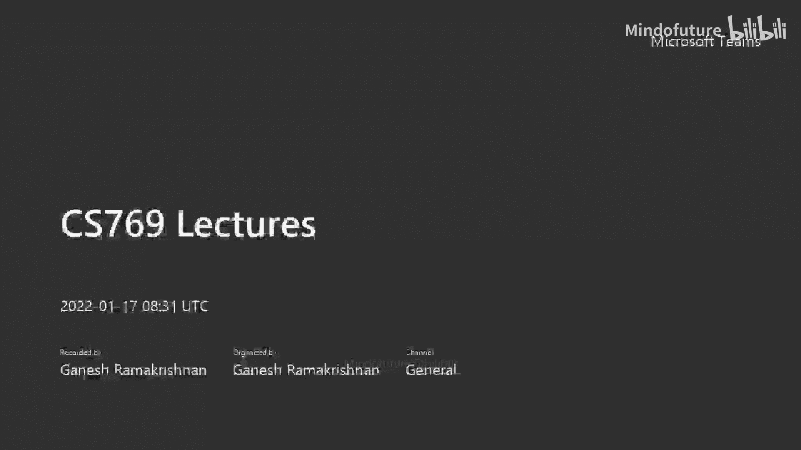
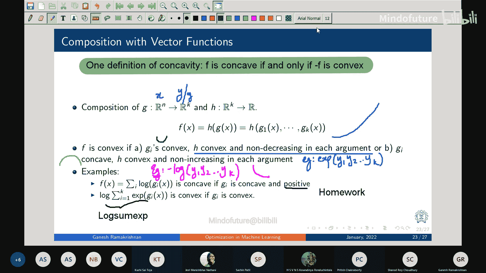

# 【印度理工学】机器学习优化 ｜ Cs 769 Optimization In Machine Learning p05 P05_第四讲_17-1_优化与机器学习_凸性-集合__函数__性质及其与机器学习的关系 -BV18cBSBJEH1_p5-

Okay good afternoon everyone， welcomele to lecture 4。

Having introduced a whole bunch of optimization problems， varieties。Have been also formulated。

We also gave a basic introduction to gradient， et cetera。 What we'll do today is discuss some。

Homework exercises， which had to do with gradients。And Hassanians。 And then move on to。

Convex sets and convex functions， which are very critical。😊。

Building blocks for continuous optimization。So it is it's with basically continuous optimization in mind that we talk about convexity。

 but they also have。A role to play in discrete optimization problem， even say submodular。

A minimization， right can be addressed。Using convex reforms。So for several reasons。

 it makes sense to understand convexity and in fact， lot more reasons。As I'll point out。

 even for non convicts。Functions that I already。Important regions of convicxity and those often hold the key to solving those problems effectively。

So let's do the homework exercises very quickly understand if you have any problems。

So derive the gradient and hassian for the following loss functions。 anyone has any thoughts。

Hingnge loss for SVms and least square loss should be easy。 simple tool layer functions。

Which also have this element of hiingngeoss here Y I minus max of0 comma。W transpose X plus B。

 so you'll find the same。Element in both places。This max kind of component。

What do you do in such cases and then the softm？So， any。Any questions， any thoughts？

Anyone has attempted。And face problems。See if theyre not if there are no questions that I'll probably move on。

 I don't want to spend too much time。😡，But in all these cases， what you have to keep in mind is。

Basically the chain rule allowed to make use of chain rule extensively in all these cases。嗯。

Se for the last one， softmax function。Here we have expansion of the water Transs A of XI that has label AI。

 right？Yeah， yeah， and in the below we have some over all the labels。

Some over all the label is correct So here the W will have multiple dimensions like it will be a2ing matrix instead of one。

Right， so there will be actually ideal I should put a W AI transpo size for every class there could be a separate w。

 but yes， otherwise we could think of this w as a big matrix。😊，Index index to the respective columns。

 Yeah， so I will find gradient。 But what about Haians。 How will that be。

 It will also way to20 metrics or go to 3 metrics。 That's a good question。One， yeah。

 you could actually come up with 3D very sensors。You could also think of serializing all the vectors。

The entire flatten flattening could do both ways。Very good question， so。嗯。Here W is ideally a matrix。

So he computing as a matrix。By no， vectorizing。第。Critics。O its。O。Anything else？

Any such observations would be very welcome。 What do you do in this in this case of。His hinge loss。

We have a max。 I've talked about it in the past， but。Is there a point of non defliiability。

 a point where we can't come up with a。Graadient and what do you do in such a case。Any thoughts。Yes。

😊，So where is a gradient undefined here？The gradient is undefined where this max takes up。0ero value。

 right。Whenver the max becomes 0。So， at that point you will have to think of something beyond gradient and will as we develop later on。

 there is a notion of sub gradientient。Okay， and I think I gave you an idea。

But the point where you have the non differentiability。Right， so let's say。

Your function is like this。Suppose。Actually， ideally， you should make it conx。 Okay。

 so let's say the function is。Like this。So at all these points， even this function is convex。嗯。

There are these points where the kings or what you can do at these points of kings。Is you can。

They find these cones。Pos of all possible perpendiculars。 So these give you sub gradients Okay。

 so these are。For convex functions， there exist sub gradients at these points of non differentiability。

I'm sorry I showed you a concave function， let me just flip this。😊。

I should have shown a gone key function。It's true for con con concave also。

 but you have something called a super gradientian there。Okay， so is same idea here。嗯。You have this。

So， these are。It is not just one sub gradientdient， but they are call a sub differential。You so。

So quite some non differentiability， you have sub sub differentials。Okay。

 these are also other reasons why we are interested in convexity and I kind of develop it very soon if you didn't have convexity then you couldn't really talk about although look conxity in some region。

 you couldn' really talk about points of non differentiability what do you do there。😊。

Conveplexities always would be important for some of these these many the other reasons as I keep developing Okay。

 other than that you it's very easy to derive the。😊，Gradient for this function。

 but we will develop sub gradients little later Any other question otherwise let's move on I mean。

 I did this for the regularized logistic regression you can recall。😊，That， I mean。

 from we basically applied the chain rule here， right？I'm just reproducing from the last class。哦。😮。

We said that for this， this part， we had a。建筑。Summation。

 then there is a log and then add kind of color code and explain where that log basically goes in the entire derivation process。

So youve done this and you were asked to kind of make sure this these devations hold。

 These were samples。 So let's go back to convexity and motivation。 I mean。

 why is convexity important。Every first reason is that every function has convex regions。😊。

Even if a function is non convicts。Yes， question。Yes。

es I have a doubt on the hissian part of the last regular yeah。

So the differentiation of sigma sigoid function is sigma into1 minus sigma of the function so how do we get this up this X into X transpose？

So what is exc X transpose， first of all？😊，The features。That is a matrix。YeahIt's a matrix， right。

 so it's a。😊，讲啦。Xi is always a column， right。By default and Xite transposes this row vector。

 so this is basically going to be a rank1 matrix。😊，嗯。And the entries of this would be of the form。

What would be the。If we take X， I， X， I transpose。Lets say PQ， what is a P Q the entry of this。Exite。

 exc IP，Exegerate。So it's just product of those two terms。 and you take the Hessian。

With and look at the I Q term。 right， So if you look at the P Q term here。The Hassians。

B youthth Tom is nothing but。So the double derivative。Of the loss， with respect to。WP。W Q， okay。So。

 if you just try and。Get these two together。 Okay， so this。Me put it here。

So you try and match these two expressions from double derivative。

 go back to the gradient slide right we showed this the J component or P component here。

You'll have minus Y I， X， I， J， EXP， and so on。So now this XIj or XI。

 if you pick the BPP component and now if you do another derivative， what will happen。

 you look at the expression sitting here you will have one more X IQ coming out right？😊。

The part in blue here will have an X Iq because when you are taking derivative with respect to。😡，W。Q。

😡，After taking having taken first derivative respect to WP again that other time will also come out so by the same argument we have on the gradient you will have X IP into XIq。

😊，Po the pe Q。Pix derivative， is that helpful。😊，That's in。Right so。

 how does the YI component vanishes in the session。So there will be actually a Y I square。

 see this Ie is not an index， not index。😊，That's one point。Good， I mean， teacher ask such questions。

 So okay， this is one， and then the other is in addition to this。

 we will have y I square equal to one These two extra explain。I get this expression。

Any other question。Okay， so these are the two reasons why this holds。At least two reasons。🤧Ok。Oh。

 let's continue with unless there are more questions， every function。

will end up having convex regions anyways。 that's one。But I've already given hint several times。But。

 you know， these are all。The convex regions we are talking about for this function。In fact。

 these are entire regions。This is one convex region， this is another convex region。

And many deep learning models exhibit such losses。Okay。

 you have to remember deep learning models are typically compositions。😊，Of a multiple。

Layers with activation units， which are often like sigmoid， right。Or was itig mightd like？就嗯。So。

 compositions。Of activation。Units， such as Sigmite。Because of that they exhibit such losses。

Or for that practical matter， most will exhibit such losses。So， therefore。Algorithms。

 when we look at their convergence， let's say an algorithm starts here。😊，Or here， right。

 when we study it convergence， we are really looking at。Its convergence to some local。

Region in the or minimum。In the convex region。So we are talking about this convergence in convex regions of the function。

And that's the reason why we get interested。But， there are more reasons。

I gave you one reason already let me recap right we already saw this。😊。

That for convex functions at points of non differentiability you have。

Such sub differentials or sub gradients。That's already a reason we have discussed。😡。

So instead of saying convex functions for convex regions of functions， I can now extrapolate it。

So it could it could be that this function again becomes non convex in some places。

 but at least for these regions I will be talking about I could talk about sub gradients。

Please ask me questions otherwise I'll keep moving on。😡。

The domain constraints of optimization functions well see will also be typically convex sets。😊。

So that， you know， algorithmic updates are guaranteed to lie within the set。

So well see how conx sets play a very critical role you are making this is like a too dimensional view or the。

Space of the。Parameterters in the parameters spacelet says this way。Now， in this space。

 when I make updates to the function。I want to make sure that I I continue lying within the space。

Sometimes the space results from constraints。Okay， so my update has gone， let's see。

From here to here， how do I guarantee that my updates are。Within the set。That helps。嗯。

Or that is possible when the set is conves。So set， this is there's a second point。

Is about convex sets or convex domains。This is a convex set。Now this becomes very important。

 especially for algorithms， even in the case of you know。

 non convicx functions when you' are looking at。😊，Algothms within constraints， you need。

Algothms such as projection algorithms。We will see Frank Wolf and there many other variants of that。

In point methods。Especially important for。Projection algorithms。Fralannkl。Interior point。Basically。

 La， La multipliers base methods。So since that could be a question。

 I'm just providing a motivation of。嗯。😊，So what we'll do is we。Yes， there was a question， I think。

We'll begin with con sense and then move on quickly to con。Yes。

I said what is conve sex So what is difference between the。I'll be defining。 I'll be defining。

 But largely speaking， I'm saying。Convets， let you remain within the set。

 the updates remain within the set， the space of interest。Well let's define convex sets。

This is just a motivation。Okay。Any other question。Okay， so。If there' are none， let's move on。

So a set C is convex if the line segment between any two points lies within the same set。😊，No。

Basically， we are saying that if you have two points。X and y in the set。

Then you want to make sure that for any lambda。Which is between 0。And won the line segment。

Interpolation。Will lie within the sec。 Now， for this should should be true for。Any two points。

 X and y。There's any2 x and y， so the x and y can keep changing， I can just translate it， rotate it。

 it should just hold everywhere I can scale it。It should still hold。That's the point number one。

So you can see here that。There exists a set of wine section y the set on the right hand side。

For which the line segment doesn't lie。😡，Within the set。Okay。

The many use this is certainly not conx one on the right is not convex。😡，Okay。

 where is the one on the left？Isconvics。But there are many other。Convet sets。In fact， the。

Entire vector space can be thought of as a convex set。How about this。 So let me define。

 let me give you a small exercise。 Okay， so here I have this。Ray。Okay， which begins at x。

And it has any point why here。And the way I'm defining。Is。That， for all。Imda1 x。Plus lambda2 y。

Such that lambda 1， comma Lada 2 that is both are greater than equal to 0。No。What about this set。

 Is this convictx。Any question， any answers？老son。Why ist it convex。

 Im saying for all x lambda 1 lambda2 greater than equals 0。😡，Not just for Lambda 1 plus Lambda 2。😡。

It's sum up to one right so let's understand three settings okay。This。This is my definition。Now。

 the what I've shown here is a special case。This is when。Lambda 1。

And Lada 2 above greater than equal to 0 in fact， sorry， that's what I have shown here。😊。

So that's exactly the right here。But I can show you another I can give you other combinations of lambda 1。

 but let's say I look at a specific case。😡，This is。Let me just highlight this in。Do。

What a specific case of this would be。When I have。Ex year。Y here same X and y， in fact。

 let me just copy it。I'm taking the same X and Y。And I'm dreaming of this part。Okay。

 so with this special case is what。Lambda1。Lambda 2 are more greater than equals 0。But additionally。

 what do I have。That both of them are。It is sum to one。

So I put an additional constraint to create a line segment if I don' not have the constraint。

 this is how it would look like array。😡，Aray now is ray a convex set， line segment is a convex set。

With any two points you take within this line segment， you interpolate them。

 you will get a new convex I mean you get a new line segment which lies within the set。

Is Ray up onvic it？Yes， that that thing。Lambda 1 x plus lambda to y where both are non negative that represents a triangle I mean an infinitely long triangle。

 basically0 to x I mean origin to x origin to y and the triangle between them going off to infinity。

Your code actually in this case， I've shown them in this is where x and Y R and say。😊，Good point。

 this is an X and Y R。Just one dimension。But what you are talking about is。

Another case where X and Y， R。S2 dimension， right then it look like a cone。对呀。Right。

 so it's going to one big six。第四。In both oney and do。In one D and 2， it's always convics。

This is yeah， this is an example in  D， but in 2D， also you。

What we have done is we have just removed that。We are sing for all values of lambda1 and lambda 2 greater than equals 0。

 So we have removed the lambda1 plus lambda2 equals one constraint。😊，So this， this is a convicx set。

Okay， this is。Okay， this is exactly called。A convicx con。So I'm saying。If this is in the set C。

For all。X and y in the set C such as that lambda because lambda 2 is greater than equal 0。😊，such。

A seat。Caed a convex con。And is a convicxant。Ok。So there are many special cases of convicx sex。

And what you saw here， for example， is a ray the con is a。

This is a ring and ray is also a convex set。So lots of convic set linear sets， fine sets。

So for example， let me give you one final example。Again。

 I have my detailed class on convexity elaborates on all these special cases， but I'm just trying to。

😊，Understand you know get your horizon right right so another use another example。Is， you know。

Sa lambda 1 x plus lambda 2 y。For all。Lambda1。So now what I'm doing is I'm putting I'm dropping the grid is。

😊，Lambda1 and lambda 2 are greater than equal to0 constraint and all I am saying is lambda 1 plus lambda 2。

Equals1。ge。Is this a conx it？The answer answer should be yes。

 All I have done is drop the positivity constraint。😡，Okay。嗯。So if you take any X， Y， C。If this isn't。

We are saying if this part is in C。For all such combinations。Then we call the C。An a fine set。

 and it's a convex set。So there are lots of special cases of convexs you can get by relaxing。

Raxing the Lada， so here we have relaxed the Lada positivity here we have relaxed the。嗯。

And in the case of a convex score， we have relaxed。😊，Sumation to one。

so it's just interesting to know the difference。啱。Okay， any questions as we move on？ok。

So all these are examples。There are some interesting properties of convicx sets。

 intersections of convicx sets are convex。This is easy to prove。Okay。

 I am not going to do all these proofs， but。I mean， what you want to really prove here is that。If X。

Is in C1 intersection C2 intersection Ck。RightAnd y isn't C1 intersection C2 intersection Ck。

 then you had to prove that。😊，The union of the two。Sorry， the intersection of the two。

Would contain all those points。For which both the constraints are satisfieding。嘅。

Is what you do to prove。That lambda x plus1 minus lambda lambda x1 plus 1 minus lambda to x2 is an intersection。

🤧嗯。Use that this lambda x 1 plus 1 minus lambda 2 x x2 lambda x2 is in both C1 and C2 and C3 and CK。

Okay。真不来的。Now is the union of convicts， that's convicx？😡，So I give you theyre not， right。那。I didn't。

 I don't have to even give you example。Why would you say it's not convevictx？Like like geoally。

 like even if you have that Xagon and other Xagon， which is。Like even if it is disjoined， then。Okay。

 so the unions， they they may be disjoined。 In fact， the union would be even。Disconned， right。

Exactly you said this John。 They could actually be disconnected。 So how can they be convic。Yes。Y。

I mean， it's easy to， you can just prove by contradiction。How do you prove by contradiction。

 here's a simple example， you just take set and then。True that this is not convicts。

Projections are convicts that's very important as I said， that's one of the motivations。😊。

For constrain optimization， right？He said。Algothmic updates are guarantee to live within the site so sometimes you are required to project with respect to constraints。

😡，And projections onto convex sets are unique okay let me try and illustrate this with a simple example。

😊，Let's say you have this case， right？What do you see here。A。A set。See， this is red。You have a point。

X， which is an R3。Now imagine that this point R3 was obtained。😡。

Using some update rule somehow this point was obtained is x。😡。

What you're trying to find is a point Y in the sea。As highlighted here。Apoint Y NC says that。

According to some norm， some norm distance。B is。Cls to x or y， Y is the point in C closest to x。

The Z is basically the Z axis。这停。😔，Okay， so。Now， it turns out that if the set sees convex and the projection is unique and often efficient to compute。

But let's take an example where the set C is not Nle convictx or S is not convicts。😊。

How would it look like。Let's here。 let's see an example here。If the set s is not convex。

 the projection of x onto s need not be unique， you see this here。So it's not even unique。😡。

This x here， when you try and project find the closest point in the set s。😡。

You don't find one closest point this is also closest， I mean the two points are seem to be closest。

That's largely because the set was not conx， but now if you would extrapolate this S。😡。

Right to contain， let's say a larger region which also makes it convex， let's say extrapolate。

 then you will find that。Therell be a unique projection。Well， I'll not put that here。

So hopefully this is clear。Any questions。So a conity makes a lot of sense because again。

 because projections become efficient to compute， they are unique and so on。

Some more examples I'm giving here。And。For example， if you have。Nble。So， you have a norm。

And you want all x is that norm of x is less than equal to K。 that's called a norm ball。

For any valid norm。So this do ball happens to be a convicx set。Okay， so let me give it a name here。

 it's called the normal。Other example of convex set is the。Hyperplane or actually half space。

All the points that lies say below。😡，Okay， in terms of the dot product with。A fixed W。

So these give you something called a half space。we will see a little bit more on that。

 the subsequent slide， at least the nonball。Now， a very third。

 very interesting example is that of a sublevel set。😡，So this is called a sublevel set。Third one。

Again， it turns out that that is also convicxcent。Now I'm going to leave all these proofs， homeworks。

For you so you will you can try and prove them at as homework， some of them I try and provide。So。十点。

But the intuition is going to be the same。 The same intuition is going to hold everywhere， which is。

I want to somehow show that。A point that belongs。都。The two points that belong to the set。

 their convex combination will always lie within the set。

In the case of intersection I had to show that two points belong to each set。

 then the convex combination will to each set。For example。

 so I have to follow the same logic everywhere。 the exact inequality that comes to SQ could be different。

😊，嘅。嗯。But Nomball， why we say it's a noball it's not， I mean。

 don't just go by geometry or geoal intuition， right Nomball is its。😡，Based on a norm。

 but it doesn't necessarily look like a ball always if if for example you using griduclidean norm。

 and then it becomes like a real ball。😡，Otherwise， you could have。Nomballs。

 which are of tight shaped and that is when you be， for example。Uel norm。Okay， so this is a number。

So let me show thenball here。Okay， so this is a。An ball under the Ln。Any questions。So this。

 basically。Saying that No one norm of x is less than equal to say。Okay。

Some value of fixed value of K。Misss。Okay， if they are known， let's look at more examples。

You can actually。Create convex sets around any functions using the notion of a convex Hu。

 So convex combination。😊，Of K points if you take， that's call a called Vx con， right？😡。

If you take all such convex combinations of all points in a set s。😊，Then you get the convexhu。

 So what you see here， the ones in black the black points is s and what you are shown in gray here is the。

Conveyx hull of S， likewise here， the part in gray。Is the entire。Is the convicx hull of。Yes。

So one question I have is， is this guaranteed to be convicx always anyone wants to attempt？

Always want to be convex。Yes。So think is。So you're seeing that。

Convexity of con the convex hull is always current。Is that what you're see。Yeses。

What about the convexity of S does S need to be convex？And no that it exactly right In fact。

 it's very obvious here。These cases， you find the whole bunch of。Point light sick things， joining。

Point not to like。 So if you take any two points here。

The line is not that all the points on the line segment lie within the S in fact is only consister of these finite set of points likewise here if I take this point and say this point or any other point this point。

Then the line segment joining these two。It did not lie in S， it lied in convicts Hull of S。

 that's another point altogether。😡，Okay。So answer， you're right。

 the answer to those language mes use。A different color the answer is indeed no okay。For the reason。

 we have just no site。So convex hull is a way of recovering convex。😊，6。From nonconvict sex。In fact。

 most convex sets you could think of convex hell of the as convex held up certain set of points。

 right？So I mean， in retrospect， you could think of all the points along the boundary here。

And the convex hell of those points in the boundary basically give you the convexhu。😊。

So any convicts said。B。Thought of as。A convicts。系。Of all the points and now we think they are canonical points。

 like representative points。😊，嘅啊。Lying on its boundary now the notion of boundary has to be defined a little carefully again I have a very detailed previous years lectures where I on convex optimization where I define formally notion of a topology a boundary and so on。

😊，But I think for purposes of a course， boundary can be understood very intuitively。Okay。

 let's move on。Convexity of column S is always guaranteed， it's always convex。Let's look at。

Euclidean balls and noballs， we willll start with Euclidean balls。So。The Euclidean ball is a。

Convicts said。This is all very obvious to us when we discussed right。

 I mean a special case of a normalball。😊，Ellipoid is also an interesting special case of a novelble。

😊，It's defined in terms of。This important expression。

X that x minus X C transpose p inverse x minus xc as't equal to one。

 And what is this P inverse doing here。The speedverse is basically a positive semi deffinite matrix。

😊，But dramaticallyally， we can understand this。To be inducing。Both scale transformation。😮。

And rotation， right， it's doing two things。It's a P versus inducing the rotation and scaling of。😡。

The points within a Euclidean ball。Yi。And it's in worse。Inds。Cation and scaling。Apoints within。

A Uraideian。😔，In fact。There are also well known statistical distances between points which are inspired by this kind of this peverse。

 for example， you may have。This to be the covariance matrix。

NP some covariance metrics this turns out to be the so called manous distance。So。

 this distance is called。So what distance am I talking what this x minus xc transpo speed versus x minus xc？

I might have got the spelling wrong， but yeah。More or less， correct。

And I'm really talking about this expression out here。😊。

Which I'm going to highlight in yellow this expression。It's called the man of his distance。嗯。

There are also other representations， X C plus Au。Such that you two norm of U is less than equal to one。

So you can show again， this comes from lots of metrics。Equences。This one here。Okay。

 so this representation。You can get。By transforming a transforming P into a。Again。

 I will leave this as a homework problem for you so homework figure out what is the transformation。

Okay， any questions？Let's move on then。Tom balls。A the generalization of the Euclidean and the。

Ellipsoidal ball， which is on the previous slide。You can actually show。

That this also corresponds to a norm， this kind of distance。And what is that generalization。

 the generalization is just any norm。Very central to a norm is a triangle inequality and actually lot of it is based many proofs follow from。

😡，The triangle inequality。Okay， so what's a triangle inequality if you have？🤧。B norm of B plus Q。

Then is less than equal to。那么逼。The normal of Q。The。And this is sufficient。

 this is a very important step to help you prove that norm that these norm balls are convexs。😡。

So if the question is， why is it a convict sec？Well， it's by the triangle inequality。Okay。

 how would you do that？ It's not very difficult。 I'm just it would。

Would anyone like to suggest how this can be proved？What would you do。Let's say， for any。X 1。

X 2 in the number。 Let's just call this B。So what you do for two any2 x。X 1， X 2 and B。You look at。

This distance， right， The distance x minus Xc。Now you'll have to do that for。The convex combination。

 So let's say for these two points， you consider lambda x 1 plus。1 minus lambda x2。Ill take minus Xc。

Okay for this arbitrary pin， maybe I can't， I don't want to do square and expansion because I don't know the right。

😡，Value of P， I mean， it's for a normal ball P。😡，But what I can do these are reported tricks what we will do is we will expand this you will see is this Ladas one。

😊，And plus。Now， I'm going to。Use this lambda x plus 1 minus is lambda x2。

 but I'm going to expand this Xc part minus xc。- 1 minus lambda x。So。

Lambda plus 1 minus lambda as1 and I'm just using this。Be know。And then。If I further rearrange。

 what I'll do is I'll bring these terms。😊，Together， so I'll， for example， bring these terms together。

And the other two terms together， lamb Ladax1 and lambda c I'll bring them together。🤧嗯。😊。

Theres still an equality。So I'll have lambda x1 minus xc。Plus one where is lambda。X2 minus xc。B。Okay。

 so after this， I'll just use my trial inequality。😊，Okay， so I'll just make use of this fact。

That I could go ahead， and。Distribute this。 I'll just use， let me just do some color marking。

I'll use P in place of Lada x 1 minus Xc。That will get me P all through。And for the other part。

 I'll just use Q。😊，1 minus Ms 2 minus6 I hope the rest is clear。So when you now do this expansion。

You will get lambda time inequality， lambda time x 1 minus xc plus 1 minus lambda x 2 minus xc。

You know that each of them is less than equal to R， they both belong to the ball。😡。

So it will be less than equal to okay， if you want a right lambda norm of。Xon minus xing。Plus。

 one minute is Lambda。X 2 minus x C。Which are less than equal to lambda R。Plus 1 minus Lada R。

Phiicals are。Okay， so。The proof is otherwise largely going to follow this most of the times。Okay。

 let's proceed。So there are special case， ellipoid， basically we are using a P。

 So we going to now we are going to very soon see norms。😊。

That met is induced on vectors norms that vectors induce on met somehow we have to give up this mental block you know where you see vectors met and vectors very differently。

😊，Right this question came up I mean or an important comment came up early today right the you logistic regression your multiple multiple classes just think of unrolling the weights of the weights w of the logistic model and you get。

😊，Along。Vctor or its equivalent matrix representation。So。A special case， basically。Is this。So。

 you have a。Matrix induced。Vctor normm。But we can also have。Vectctor induced matrix knobs， okay。

But we will look at that later on and it will come up very soon。And， we also have Victor。

Induced matrix norm。Okay。Yeah， so these are all special cases。If you have questions， please ask。

Otherwise we'll move on to the next just conx function so all this gives you ways of defining the domain on which a function is defined and as I said convexity is important for sets so that projections lie within the same set but we we are going to see more of convexity of sets as we look at convexity of functions in fact a traditional course on convex optimization we have a dual view of sets and functions。

😊，you know。Conventional。Goes on convex optimization。Theres a dual view。Involving sets and functions。

so while Vc sets and functions so differently， especially when it comes to convexity there are some very interesting dual views that hold。

😊，we will see that a little bit more maybe through the course as we proceed。

So let's move on to convex functions。So convex functions require the set to be convex upfront that has been。

😊，Declared here。That function f is convex， first of all， if the domain f is convexted。

You really can't talk about。A convex function on an non convex set。Because as youll see。

 you are basically ensuring that all convex combinations of the function。😊。

Should be such that the function is defined there。 Okay， so this is。The convicx nomination。

Of points in the domain。Secondly， what we require。Is that。

The function at the convex combination of two points is a lower bound to the convex combination of the function values。

So this is a the interesting new twist to the story。Okay， so we are saying that the function at the。

Convex combination plain words。This must be less than equal to。😮，Convex combination of the function。

Of the function values more to be more specific。Okay， so。I hope this is okay。And you can see it here。

 So the function。Is。Shaped downwards to show that the function value。

Add the convex combination is actually less。Then。D。Combin convex formulation of the function values。

 That is this part。We use a different color than this part。

And another intuitive explanation is the like basically line segment between x and fx。😊。

And Y and F lies above the graph。 This is the graph。 When we say graph of。F， we basically mean。

The parting green here。So I got muted。嗯。Any questions on this？ I to ask the questions。

There are lots of variants， so like we have convex functions。

 we have something called strictly convex functions。😊。

And all that is required is that the point lies。The convex combinations lie strictly above。😮。

The graph。 So everything we have said about。Including inequalities just become strict inequalities。

One important point is。We don't consider。Lambdas， which are 0 or 1 because those will coincide with。

D x or the y respectively， So we will only look at lambda strictly between 0 and 1。That's true far。

Helping generalize。Okay so what is strict conity doing is just saying that there is a。😊。

Insisting on a gap， right？Ins。On the gap。And。The gap is basically between the。Dera of the function。

So yeah， between the the the graph is really between the gap of the。定安床。😔，Here， this is graph。

 Now the graph， you should understand this， this gap is measured along the。

Why axis the function axis Okay you can't take a perpendicular to the。Line segment itself。

Now you have an additional notion of strongly convicx functions which is a special case。

 all these are special case， strict and strong convexity are special cases of convexity。😊。

The difference is that strict conity talked about non zero gap。😊，Whereas strong convexity。

Is talking about。A functional。So he's talking about a function based gap。Both are。

Are special cases of convex functions。Okay， so what is a functional gap here？Well， it is basically。嗯。

Is it this function based gap here？Is this mu by2 into Noromic square？

This mu is called a strong con parameter。 I must tell you that this is just one form of gap。

 one form of functional gap。 There are also other functional gaps possible。For example。

And there is a notion of a pregnant divergence。Which looks at。

Some other kind oftro they could be entroic gap， right。So， there are other。Function and。

 function based gaps。Also， possible。Okay， there are several other algorithms which also make use of these gaps。

 but lets use this quadratic function as a canonical example。😊，As I pointed out。

 these are special cases。😊，Which would mean。That strong conity， and， in fact， for that matter， even。

Strict cony imp convexity， but。Strong convexity actually implies strict convexity。So。

 this particular function。Nomic squared。It's it becomes 0 only when x is 0。So， therefore。

 its strict poivity implies that strong conity implies strict conveity。

But it doesn' not mean that strong convexity makes a function differentiable Can you give an example of a strongly convex function which may not be differentiable。

😊，Anyone。Dobody think that's just because I'm adding a Mbi to Norm square。😡，I'm getting。

Differentiability， new by to X may be differentiable。Would anyone like to give an example。In fact。

 the example is very much there in our discussion。 We have already discussed such an example。

An right right If F is H right。If。Is。Add this B by2 Noromic square。I'd rather you know。Yeah。

 if you add this mubitomic squared to a hinge loss， you would get strong convexity。

But it's not differentiable。A plus Doomic squared。Though F plus normal x square is convicts。

That's not the problem。Remains convex。In fact， it's not just convictx。

 sorry it's it's strongly convicts。They strongly economics。So。That's an important point。

 any questions？Okay， let's continue。So if F is strongly convex and G is conves。

 but not necessarily strongly convexs and f plus G is also strongly convex I mean one example we gave is。

😊，Just Noromic square， L Noromic x square。It well norm of X square is a canonical example of a strongly coned function。

啊。How do you， I mean， what， what basically will this mean？😡，Right so you'll basically。

Use the inequality， very well known。Inequality for convex functions。

But you have to slap on that the mu by2 part。😡，So， I'm going to give。Some of this can be proved。

You try and prove this， okay。There's lots of inequalities youre deal with。

so here are examples of convex functions， linear functions is the simplest example it transpose x。😊。

嗯。I find functions。 you can easily show that They are also convex。And that's again by definition。

 so all many of these just follow from definitions。😡，So by definition。

 you can just take two points x1 x2 show that the fine combination of those two points is less than equal to。

Aine combination of the convex combination of those a transformation the convex combination of those two points is less than equal to the convex combination of the a transformations of the other individual points so it is very simple。

😊，嗯。So you'll have to just say that a transpose times you the x 1。Plus 1 minus3 types 2。

Its less than equal to。Tta theta times。A transpose。X1。Okay， now you have to take the B as well。数字简大厅。

Plus，1 minus theta。Into a transpose x2 plus b。😔，this is， this looks simple。

 this is just because the right hand side now turns out to be。A transs you take the theta inside。

T types 1 plus。1 minus theta。X2 plus b， so you have 1 minus theta b plus theta b。

 which would big just become b。Which is the same as the left hand side。

 so we don't have a problem here at all。This is the same expression。

But now you have you can do this for exponential functions as well。

How would you prove that well you are to do the same thing right I mean whatever I applied here。

 we are to do the same thing here。😊，Ex XP of。so now you have to take this alpha of the。

E convex combination， alpha thehita x 1。Plus 1 minus t types 2。In order to prove that this is。

Less than equal to。Theta times。E XP of。Al5 X 1。That's 1 minus theta。off。E XP of Al2。

 So how do you prove this。Anyone？So， it turns out that there are。三。

Associated properties we can make use of。So EP is involved alpha x alpha is a linear transformation。

But somewhere you'll prove that EP is convicx。It plot it， of course。The plot does look convex。20。

It does look convicts。嗯。In fact， every norm is convicx， every norm as a function is convicx。😊。

Some of these we can prove by first principles。 Okay。

 so the fact that every norm convicys can be proved by first principles。And you know。

 you can recall proof of convexity of normalball， right？It was very straightforward。

So the same idea will actually hold here。But for EXP。😊，I do a little bit more work， okay。We will use。

 we will。Do like。Other equivalentant。Pas for convexity。

It the first order or derivative base and you have done it in your calculus course right the fact that first it second order so increasing。

😊，Divative。Or you know， instead of saying increasing derivative， you can say。Positive。

 second derivative。But then when we talk about。General functions of multiple arguments you can't just talk about derivatives。

 you talk about Hasian and Hasian needs to be something called positive definite or positive semidefinite。

😡，Okay， so but this part， I would really leave it to you homework。😊。

The fact that every enormous convicts。I leave this as a homework problem you should really try that because we have done this already so you should not require any further effort。

😊，Any questions？Any questions at this point， please do ask if you have。

I leave it as homework problem。Okay。Further so yeah。

 every enormous convetx you can prove I've given the hint here but triangle inequality and homogeneity of norm。

So you can basically use the same idea。 is， as I said， this is going to be a homework problem。

Let's move on。Other properties of。Convicx functions。So， non negative weighted sum。

If alpha is greater than equals 0。😊，Alpha I are already the equal sorry。Then， some of。

F is alpha F is where fs are each convex is also convex again， the proof is should be very simple。😊。

嗯。Basically， from first principles。Another very simple statement is that composition with a fine function f of ax plus v is convex f F is convex。

😊，So， for example， if。You know that minus of log is convex okay minus of log again will show that it's convex through some additional properties。

But for the timing， it suffice us to visualize， right？So it basically is like this。

There's minus of log X。Fundix。So he is not looking very conve， yeah， hope this helps。😔，嗯。Now。

 if you take minus of log off and a fine transformation B minus AI transpose x then that turns out to be convex and if you sum across all values。

😊，Then I mean， some this across multiple AIbi inices。

Then that turns out to be again convex thats a use of non negative weighted sum along with composition with the fine functions。

Okay， likewise， you can take the norm of an a function， norm of ax plus B， that's also convex。😊。

A simple example of this is what we have discussed， the ellipsoid。😊，Is an example。

It showed that the ellipol was obtained as。阿。And a find transformation。Off。The Euclidean。Fction。

 right。So I find transformations of Euclidean balls。

So instead of saying this can also be used to show this is related to。So yeah。

 you can hopefully start seeing corrections between what we have discussed for。No。

Seets and how they generalize two functions。other interesting properties now we are really getting into calculus。

 this is all really what we call as calculus of convex functions。😊。

And we will look likewise calculus of gradients also later on。So this am o amount to。Calculus。

Of convex functions。Now， what is this composition saying saying that Fx。

 if it's defined at that of geox？😊，Under strict conditions on H and G。You basically get。Convexity。

There are two possible conditions and lets start with the first one。

So if Gs convex h convex are non decreasing， that's the case number one。

Let me just show this one at a time， so G is convicx。And H is convex and non decreasing。都。

It just need not be only。 I mean， it cannot be rather。Not increasing。What does that mean so。

edge cannot have the shape。😡，H can be， for example， an exponential function EXP。

 this could be a shape。😡，So under this condition。😊。

Or there is another set of possible complementary conditions。😊，G is gone Kim。

Edges convetx are non increasing。😡，It should be again convicts。

But not increasing and that typical example for us is the minus of logs。

 which we saw on the previous slide。So。It just convicts。A。It's like this。

So under these two conditions， its not increasing and convicts。

H and G is concave or G is convex and convex and non decreasing like EXP。

Then the composition F can be shown to be convex。Right mean in some cases， if you are。

 if your functions are differentiable， you can go back to。

First order are second order conditions we have not yet proved them。

 but no we we can assume that at least in the one dimension case we all know。😊，The double derivative。

Being non negative is a。Kind of condition for convexity。

 but necessary sufficiency will come too soon。Okay， but that could be a proof idea。

And here you see fx equals EXP， I give you that example already convexs and none。嗯。

In non decreasing that example。If Fs convex is always holds or one upon Gx is convex of G is con now how would you prove this can you。

What is is a special case。 So the first 1 I can think of it is a special case of a。Right。This is。

Special case of me。What about the second one one about Gx is convex of Gs con。

 How would you prove that。So， G is conca。How would it。

What what condition you see G is concave is the second one， but its convicx and non increasing。

So it's oneon。X， convex and non increasing。Like to hear from you。What is the function。

 EXPSide is an example of a convex non decreasing function。How you prove the second one。

the second one following from B。I would like interaction， please。If G takes values。

 only positive values then。It is a case of the second。Okay。

 so it's important that G only takes positive values so then let's highlight that part here。

That has not been stated anywhere explicitly。But we seem to be assuming that， okay so。So， one upon x。

I。Conveyx。And non increasing。For all x， which are greater than 0。 That's what you're trying to say。

 right， So now if you have。So I mean， you could think of the shape similar to log。

 obviously it's not really like log。😊，Zax extends to 0。 You become min。Infinity， and then。

 as extends to。Infinity it becomes  zero， so it's like this。And therefore， if G is concave。

And put point here， which has been missed out， which is important。Is is that。

G should be non- negativegative。Now， if G is negative， then what happens？Willill is not hold。

just put positive。So if G can turn out to be negative， will this not hold。Yes。😊，So homework。What if。

T is。Rather， you know。C is allowed。be negative。Okay。Nothing think about it。Okay， any questions。

 So so far we have talked about convex functions。Requiring， you know， the domain to be a convex set。

And we have special case of convicx set as a strict convex function。Sorry。

 special case of convex functions is strict convex functions。

We could also have strongly convex functions。8ight。And。Heres an important statement I made here。

With respect to。Strong convexity。So if a function is strongly convex for all x1 is student domain。

And theta if0 less than theta less than 1 for all of these values。We have this condition。

 so I didn't so far and explicitly give the definition。I defined in terms of convexity， I said that。

嗯。F is strongly convicxs if that exists a mu such that the function G is convicx。

But it turns out it's the same as saying the following， you can instead of saying this。😊。

Being calm is you can say that if itself must satisfy。😊。

This condition all I have done is I've added this quadratic component towards the end。

So this is that automatic gap。So we are saying that if f is strongly convex。

 then even if you remove that quadratic gap， you still have。Convexity。对。So。

 you can either add that quadratic gap to a convex function to make it strongly convex that is a summary right or you can remove that quadratic gap from a strongly convex function to get convexity。

😊，So you can add the。Readready gap to a。嗯。On Vx function to make it strongly convex。哦。

You can remove that gap。And now I'm just saying quadratic gap。

 but you could change it to some other gap for other notions of strong convexity， right？😡。

The typical notion of strong conity requires a quadratic function。Can remove this from。

A strongly convex function。To make it conves。不理。😔，Okay， so。So far， so good。Right， and we also seen。

 you know， how。Every norm is a convex function。WeLeft that as homework。 But let's now move to。

More complex。 So I've seen shown how composition with。U。Scalar functions。Gives you con。

But you can do the same thing with vector functions。Okay， so what。

Is happening here is we saying that。If。Is obtained。By。Applying edge to a vector of arguments。

Where each argument can be subject to certain transformation。

 So exactly what I had described earlier。 Now I'm going to do this。 so let me。Show you this。

 So Gis are again， convex。 E GI can be。 That's case number one。

And now I'm bringing a slightly different notion of。A non decreasing。

 it's non decreasing in each argument。😡，It's just convex and not not decreasing in。

Each argument and what that means is well。It could be something like EXP。😡。

But it has to be EXP of say， let's say a product。😡，You could have an EXP of product。

Of multiple terms。So can we think of， say instead's of EXP of x， I now think of。E XP of X1。Okay。

Into x2 into x K。So that could be my EP， you know I'm applying EP to say Gf G1 x and G2x and GKX。😡。

Here are the x to which g is applied as an R Okay so let me not use x， let me use actually different。

😡，So as to avoid confusion， let me use this。Why here。So what we have done is x is an Rn。

 it has taken us to some， say y。I can use Y， or I can use G here。So EXP of y1。Into Y2。Into Yk。

So this is the case number one。Or like before， I could have again， G S conca。😮，Again。

 I go back to the previous depiction。GI could be concave。But in this case。

 I would like H to be non increasing each argument at convex again。 So again。

 I could look at that minus log thing， but now I have to be a little careful。

 Can I just do a minus of log of。😊，Smation。Let's think about it， I'd like you to intervene here。😡，So。

 let's take this example of。Edge being convicts。 I want your I want your help。 Can I now just take。

Hdge to be， say， minus of log。Of。I use why。😮，喂弯。Into y2。Into Yki。Minus of log of the product。

Which is basically minus of the。A summation of the miners of the logs。Is this a good example of？

Edge convicts and non increasing each argument。Or would you like a slightly different function？😡。

From you。Am I audible。I've given some examples here， as well。In factact， I've taken log of。

AGIX some do all I。Okay， but you could think of this summation of logs as log of the product。

Given this example here。But of course， now a change there' is no negative sign here。

So if we are talking about its concavity， it is related to what we are seeing here。😊。

But is this a right example minus a log of y1 y2 yk product of these is this convex function non increasing in each argument。

 would you agree with me。Yes or no。 Could you like to。Chat and give you a vote。Good Tson， whatever。

A thumbs down if you don't agree。Your participation is vital here。

Or if you think there's another function we should be considering as an example of convicxs and non increasing ya in each argument。

 please do share。😊，Okay， so I'm not hearing any positive or negative comments。

I'll assume this is fine。Okay， so based on this， you can now prove。Certain allied results。

 So these results I'm going to leave them as homework for you。😊，So we please try and prove this。

As homework， Ive given enough hints already in the class。😊。

Fx is summation over I have log of G X is concave。 If G is concave and positive。 Okay， so positivity。

 I've explicitly stated here。 That's important here。Log of the summation of EP， log sum X。

 it's also called log sum which is very commonplace。😡，In graphical models。In you know， use of。啊。

Basically， logistic laws in complex models。This turns out to be convex if Gs are convex。Okay。

 so please attend these to us homework。Well begin the class at this point next time。

Any last questions or comments。So the log function is concaved right。

Yes so the negative of a con is is is it convex？Good question， yes， negative of conca is convicts。

 we didn't state that explicitly。Okay， so in fact， we didn't even formally define concave functions since Im I don't want to get overly lost in convexity。

 but negative of in one way of defining one definition of concavivity is that the negative is convex。

All the inequalities get flipped。😡，对。So this we are we we are hinging on this definition。

 thanks for bringing the bringing this out。Any other comment question or comment？O。

If they are none please to attempt the homework we will be very soon releasing assignment one but your solving these homeworks will really get you good momentum in solving the assignment and it is important that we are giving enough chance for discussing these homework problems so please do spend some time on those。

😊，Thanks again。 Thanks， See you on Thursday， bye。

