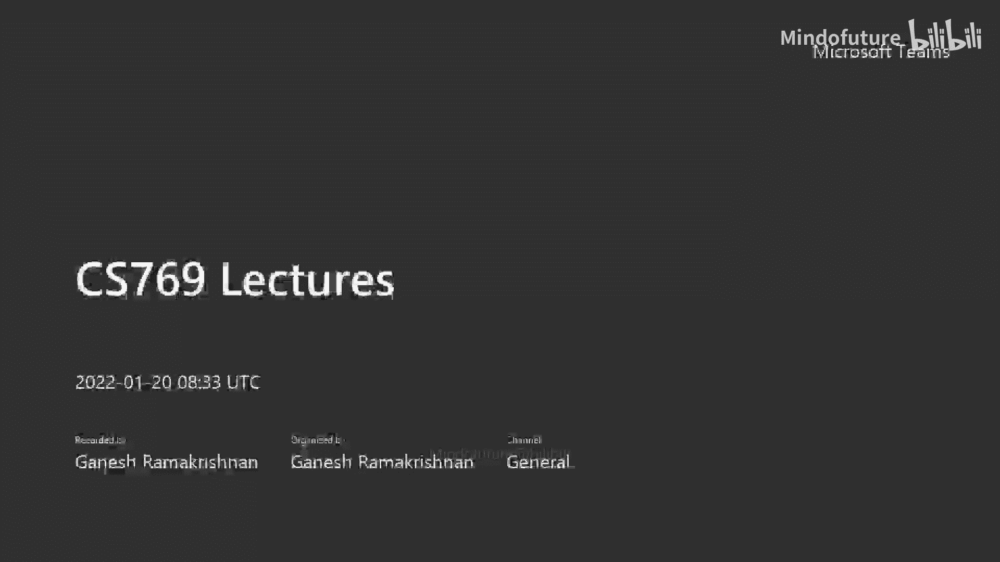
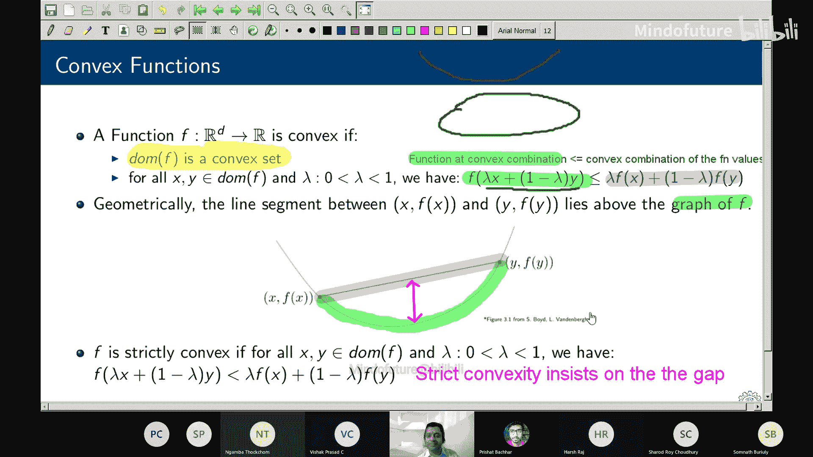

# 【印度理工学】机器学习优化 ｜ Cs 769 Optimization In Machine Learning p06 P06_第五讲_20-1_优化与机器学习_凸性进一步性质机器学习中的凸函数 -BV18cBSBJEH1_p6-

So this is lecture 5。I will discuss further。Some convexity。Properties illustrated through。Examples。

 largely convex functions in machine learning， and then we will move towards algorithms。

But to begin let's talk about the homework exercises I'll not discuss all the homework problems in details。

 but some of them yes。😊，Then we'll talk about remaining properties and examples of convex functions and move towards。

Subgradeian calculus and understanding the conveity of machine learning loss functions。嗯。Finally。

 we'll discuss more complexve optimization problems。 So not all everything we covered today。

 but this is the。Trajectory were taking。 So let's begin with some homework problems， every norm。

Is a convex function y。Okay， so anyone had any questions on。3 thoughts。

Why is every normal convictx function， We discussed this。In the case of in a setting of convict sets。

But can we just extend that proof to convex functions？Yes。

So it's exactly like in the case of noballs right So recap what we discussed for nonballs。

 I'm just pulling up。The discussion from our slides。Change the zoom a bit。结数。

Let's just pull out what had discussed in the context of。Now， boss。

 I don't want to write that all over again。Okay， so the the。There'll be some slight changes。

We we proved。That no balls are convicx sets。And the idea for any two points x1 and x2 in the norm ball。

You want to show that their convex combination also lies in the normal。

For which for which we did this。Simple algebraic。Anipulation。

Where we said lambda x1 plus 1 minus lambda x 2 minus。X see， I kind of rearranged it。

By using Lambda X C plus1 minus Lada X C to express exceed itself。

Reorganized into lambda x1 minus xc plus 1 minus lambda x 2 minus xc。

 and then I use this triangle inequality。So would we use the same idea here？All you need to show is。

This conity， this is equality。 So in fact， the the problem is even simpler here， right。

How would you do this？😮，So I think we can use the fact that the domain of function is the convex set。

 so if we apply this standard inequality on the domain， so we remain in the domain。

And if we remain in the domain then and if the Fx convexs， then that inability holds。Okay。

 so not exactly right， I mean， the domain is always supposed to be convex。

 So when we moment we talk about。😊，The norm， you' are actually applying it on a connect set。

The assumption。Is that all these。So called convex functions right these functions which you are trying to prove their convex are applied。

On cont to me。 So it's a good attempt， but。The convexity。

Of the domain doesnt necessarily imply that the function is convex， but yes。

 the inequality flavor is going to be similar。😊，So what will we do we'll say norm of。

How to show that。Theta X， when all let's use Lambda here。 Actually， let me use theta。

 Make it different from。Theta x 1。It plus 1 minus3 times x2。 I want to show that this is。

The function at the conveex combination is less than equal to the corveex combinations。

A comic combination of the function values。So this is even simpler right all you need to do is apply the。

Trial inequality。So the proof idea is similar just that you have to do this explicitly。Do you。So。

 it doesn't。Follow just because their domain is convicx。So， who has suggested is I didn't note。

Could you I sir I。Did that make sense？啊，也是。Okay。Let's move on to the other problem unless you have some questions。

So。It's important that， you know， you。Spend some time on the Hoover problem so that you are able to tune into the class quickly。

Even if you don't get them exactly and then we had this other problem right ellipide is a convicx set with two equivalent forms and we。

😊，Where are。Hinting at two equivalent forms， one which involve a pinverse x minus x transpose pin was x minus xc so the scaling and rotation happening through this inverse of a positive semi different matrix。

So is it strictly positive different matrix？And。We could also say that it's X plus Au where norm of U is less than equal to1。

You're basically shifting from X C。 This is an。Is the。Exceed。And what you're saying here is。

Using this matrix A， I have scaled and kind of rotated。The deviation of points from exceeding。

Since that， the deviation is。Upper bounded in norm sense by one。So the relation。

 it turns out it's basically a equals B。😊，R to half like we can do this。 you can verify this。

So by substituting， let's say x。Equals。X C plus。Be half you， you sub this in the。Experition。The top。

What do you get。You can all verify。What do you get as the expression if you substitute？

I did get by specifically。😊，X minus x transpose will be P2。Will you give me basically。X。

So said x minus x transpose， which is nothing but P U transpose。There be。Half U transpose。

Be in words。Whats said next it be P half you again。

If you on expansion you will get u transpose P half now this P half b is to half rather because p is strictly positive definite。

It's symmetric so P half transpose periods to half transpose the same as P transpose。

Rise is to half is the same as speed transfer。 So you' get basically。

P is to half P inverse P is to half so。The P is the Pverse will get cancelled out with the P square roots of P。

 basically。And you get U transpose you。which is basically is going to be less than I know。

 which is less than equal to one。Okay so。But approving this will require a little bit more work。

 however， by substitution。😊，You can easily verify， so that's what we did now。

 verified by substitution。嘅。So so here we can start by replacing X with X plus Au and then put the same in the condition and then we'll come to say that。

A 걸 do 루 bit。Exactly， that's what we did。 So we substituted for。😊，X equals x as X E plus Au。

 that's exactly what we did here。They okay。I substituted here in this expression。

 that's how I got this。😊，写了在这天。Yes， and， and and the idea is that。

The square is getting when you unwrap the square of the norm， we get like。

Exmen exit transport being with expenses。The fact that is suggested in the staff exchange Yes， yes。

Exactly。不这个。Let's move on。There was another question Id asked if you could show how。嗯。

If you have a function。To be strongly convex defined as。

This function minus mu by  two Noromic squared to be convex and the same as saying。

Data is strongly convex if。Along with this inequality。

Where the function of the convex o is less than equal to the convex o of the function values。

 you saying it is less than it by sub margin， this is a margin。

So what you get are two ways of looking at it， one is a margin based view。

And the other view is an operational view。The operational view you are saying okay。

 Ill just subtract the U by 2 Noromic squared。Right。

And the claim is that both both are the same and this becomes very handy。

 Now some there was a question on。😊，On。Themes， a very important question。Why is this relevant。

I'll come to that very soon。But， let's first try and。

Show that these two are equivalent Anyone has attempted to do this How would you show that the two are equivalent。

Okay， the idea is very simple。If you have some solution， let me know。Okay。

 the idea is that you will have to basically write down this expression。😊，pick up。So next day。

 you have。You want to basically show。That this expression is this convexity leads to this notion of strong convexity。

Okay， so let's say that Gx is indeed convicts。8ight。So then what would I do。I let。

 let me write on this expression。If Gx need convics。Then f of t。X 1 plus。1 minus theta x2。

By which you have the convicxity of G。I expanded in terms of F， what would I get？

Is less than equal to now I have some expressions， additional expressions。This。Plus。

 expressions involving Noromic square， I mean。New by two norm max query。What would that be yield。

- mu by2。Norm off。On the left hand side， Tt1。Plus 1 minus t times 2。

This this expression I have on the left hand side plus this one。

So I'm just I'm just applying this statement okay。Assuming this is true。 What do I get。

This is less than equal to。Unusual。Tta of x1。Plus 1 minus theta f of x2。

 But now on the right hand side， I allow to also look at the。Conex combination of the function value。

 which is the norm value will give you basically minus。调百度。知道。Nomicix1 squared。- view by 2。

1 minus theta。N x1 squared or3 x。不子鬼。Well just highlight these terms in some different color。

Then I can expand upon them。It be nice if you write down。So this part is。

 let's say I'm just denoting them in different colors so that can expand upon them。回录。

So let's try and expand the part in green。Or rearrange them。How do you rearrange them， You can。

But what you could do is not just rearrange， but also bring some of the components from the right hand side to the left hand side Okay。

 so let's try and do the。保轮。I'm also going to bring the。Part in the。let me use a different color。

 I I'll use green only for this as well。 So I'm just going to put them together， okay。😊。

I'm just going to put these together。So， combining。The highlighted。Expers。On the Lhs， left hand side。

What do I get。So I'm going to write that down somewhere else， maybe below。

So I'll have this mu by2 theta nomix1 squared。And from here， I'll have a， you buy two。P ask me by2。

He does滚。Norm x1 square so you had to expand this right So still expand as theta square nom x1 square plus one minus theta square no x2 square plus 2 theta into 21 minus the1 minus theta x1 transfer x2 so I'm assuming I don't have to expand everything from from scratch。

So so the first step you let to do is expand。Okay， so what is that yield to but you will see there is a theta square from here and there is a theta from here there minus mu by 2 when it comes to the left hand side it will have a plus mu by 2 so overall。

😊，Sorry， will this be a minus or a plus。I think they just be a。It be a plus， right？Yeah， plus。

So you'll have basically minus mu by 2。Tta here。So， theta squared。Lets明 way too。Ted out。

A whole thing into Noromic square。X1 squared。Likewise you do you rearrange the terms involving one theta square into x2 square。

 which will have a negative term with minus。view by 2 and then you will have plus u by 21 minus theta2 noomics 2 square so I' am just clubbing them together I just use a different color to underline them。

So I'm combining these two terms。Or rather the expansion after the quadratic after squaring。

In the first term。Likewise， I'm going to。Arrange the second term。Be minus。要百度。1 minus theta squared。

Plus， you buy2。1 minus theta。Tomics 2 square。Okay， so let's again。

Highlight this in a different color。These two terms are brought them together。

Only the squared part of the lefthand side。And then I have a term which comes up by virtue of the expansion of the one additional term from the expansion of the square。

Just nothing but minus。By2 I be there be a2 theta。1 minus theta。Absjectolute value of X1 transse。X2。

😔，Okay。So this is the additional term from this。Remaining to。Bd expansion。When all this now。

 what do I do next， I'll simplify these expressions。So this expression。

What happens when I simplify it。So Ill basically have this to be mu by 2。我热亚面的。It amounts to minus。

Shely just knew by2。Do you buy2。Tll be a theta into1 minus theta。N x1 square， that's how itll be。

The second term will be again， likewise。Itll， illll ill'll have one minus theta， minus1 minus。P-1。

 sorry。Do my this tee。So， overall，Yeah， I think this should they should amount to。

Just correct me if I got a sign wrong， but this sure again me mu by theta mu by 2。Tta 21 minus theta。

Norm x2 square。Is a sc。Okay。嗯。So with this， basically， you know。I have。Another quantity expansion。

 So this is basically u by 2 theta to1 minus theta which will come out common right if you lets this get the third。

The， also in the。TheCorr scalealrs mean simplified scalealrs。Will basically get new into。

Or you can keep it as u by two as it is U by 22 theta 1 minus theta right so the whole thing。

It is copy， as it is。So this whole expression will just become。What。

You just have you'll have mu by 2 coming out theta into1 minus theta coming out。Now I'm off。X1。

X 1 minus x 2。滚了。😔，It is interesting。 so you you've significantly simplified。

But this is exactly what I get。On the right hand side here right all this has on was on the left hand side。

 Now if you bring bring it back to the right hand side， you have exactly this margin term。So。

 so let me actually。Get the， yeah。 So this part。So this part， which is that in pink。

 is exactly the margin term。Yeah。This is a margin term。

I' have just brought it to the right hand side。 so hope you got the idea now we have shown that。😊。

The formal definition definition of strong convexity has an operational view you can also show correspond to an operational view you can also show the other way right that you can get the operational view from the formal definition of strong convexity。

😊，What is important is how it manifests in applications。

 so strong convexity becomes very handy improving fast rates of conversionence。😊，嗯。

The fast range of convergence is often obtained by。Just by adding this。

 which is just as a regularizer， right so the。I the operational view， which you see here。

Is basically。Addition of a regularizer。Like， and。It speeds up， it helps generalize。

 which is the job of a regularizer。And also， speed up convergence significantly。Okay okay。

 so let's get get to the final homework， which is pretty much you know leading to what the discussion in the class if there are any questions on these homeworks let me know others will move on。

😊，So third homework we I left for you was composition with vector functions， a particular use case。

So， let me remind you that。We had dealt with the initial scalar version。Of these。

 we looked at Ep of Fx as an example。And we had looked at。One by Gx being convex if G is con K。

 those are the two examples we took。So we had already seen that Eps monotone non decreasing and convex and minus of log is non increasing。

And convicts。Okay， so but now you are slightly different forms。

 let' us understand how we could prove these forms。If anyone has thought about it。

 please let me know。Hello。This is an interesting for。Interesting。

Expression that comes up in several machine learning optimization problems。

So it's okay if you we spend a little bit time here。Okay， so we have we have already seen。

The one dimensional case of these， right， we have seen that if。F is F is convex。

 if a particular single G is convex h is convex and no decreasing。

And now we have expanded this to multiple Gs。So I think there's a problem with the sharing of the screen。

 So like I'm only able to see a small window instead。But you can't see anything。Okay， so we。

 we got to see that think， yes now it's。You were able to see so far on。Yes， so I mean。

 the issue was that the screen somehow got minimized。 so it was。You know， it's fine， yes， it's fine。

It's so。So you saw this previous derivation， right， previous in derivation。

Was that visible to everyone。啊，Yeses yes。Okay， so。Let's do the first one if anyone has already addressed。

this is all amounting the calculus this is a calculus of convex function。😊，Okay。

 so we saw this in the last class。That if you have。嗯。It is if if。Exs convicts。

And we are basically looking at x in a complexvex domain。This is how it look like。

So what we should immediately relate to is that。The minus Fx。Will be a concave function。

And x continues remaining in a context context domain。Right， so the the。Momentum add a negative sign。

 the function might。Flip from convexity to concivity， but the。Doomain is not going to remain。😊。

Convicite。With that， we should be able to seamlessly operate between convexity and concavivity。

So coming back here， we say this。Concave Fx is concave if G is concave and positive。

Why we make this claim。 How is this correct by which of these properties as a hold。啊生。Property B。

Property B。Okay。😊，So property B， Gi is are concave。Right， edges。Conveys。The composition。

And non increasing in each argument。So let's verify this happens or not and what what was those corresponding choices。

 So this GI。😡，We're talking about here。The GI is conre。GI is a concave。

And we are saying they are positive。The non increase in each argument is required for the convex function。

😡，So what is the convex function we are talking about here？If we take minus f of x。

 then it will be known increasing each argument and it will be convex。

And since minus f of x is convex， then F of x will be con case right， this is where we are to。

Bring together the。Basic background I set at the top right so the edges convex。Right， and that。

Here would correspond to minus log being convex and non increasing。M log。X is convicx。

And non increasing。There's only， yeah。One argument it has。But now you have log of GISX。

 multiple Gs on which it's being applied。So， as a result。If you consider a minus log of GIEX。

 then you have。Overall。H being minus log of x is con convex non increasing in each argument。

And the G is a concaved so the overall if you put a negative。

 you would have got convexity or without the negative you have concivity， that's all。😡，So。

That should be simple。Let me know if you have questions here， as we'll proceed。

Lets let's proceed to the second one。 The first one is very simple straightforward unless you need some more help Im going to leave it at that。

😊，Okay， for the second one， we need a little bit more work to be done。

And I'm spending time on these because these are very realistic。 So the first one， for example， is。

What you would see in likelihood functions So likelihood functions you would like them to be concave and the max max likelihood estimate would then therefore know。

Result in a unique solution if your function is O concave everywhere or it give you。😊，Locally。

 maximum， locally optimal solution。If your function is con in a particular region and that the So。嗯。

Machine learning。use case， for instance， is of likelihood。Like function， which we often train。

O maximize。Let's look at this second example。Loock some exp。

I'd given it a name and it's convicts if GI is convicts， that's what we are saying here。So。

Which case would you use here？Well， we have exhausted B。So， so we can use a。 So G I X is convex。

And exponent of something is also convex。 So H is convex。

 And then we can use the weighted sum rule to say that the submission of all of these is also convex。

And log is also a convex function itself。And by using again， the law is convics。Law is law convicts。

😮，No it's con case we just said that minus log x is conx and log so the previous case we actually made use of this right that minus log x convex。

So I good that you attempted， but you seeing there is a small problem here right the way you have applied it。

😊，Yes， yes， very good point I mean it's good actually we should attempt we will fail。

 you'll make mistakes， but those mistakes are very important stepping stones to learning。😊。

So please attempt， I'm very happy that you made this observation。😊。

So there's a kind of a problem here。 if you apply it that way。

But theres what we are going to do is we go to define。😊，A function itself Hx， okay。

 I'm going to define my function。A checkx itself。To be log some exp。

This is my what you can define to be h and what is G it's in your hands， So Im saying this function。

😡，I'm claiming this is convex。And non decreasing。In each argument， Okay， now how do you prove this。

Proof of this， best done using。First principles。At least the。Calculus。

 some of the you know compositionality we have learned so far in Calalculus might not be immediately helpful。

😡，So what well do is if if if G is if Gs are if EGI is convicxs， the expression is convex。

And we already said that EGI。X is convex。And。That's it。 We don't need anything more， right。

 if we need anything more。Yes as a convict。 That's it。We don't need not increasing。

Because an non increasing nature。You're not decreasing nature， sorry。

Has been delegated to the E part。Okay， so let's now prove this etx to be convicx。

To prove that it check convicts， I've given a hint， I've said that。A function R。

 So I'm going to use R as H。😡，Function2。I convex if and only if r of x1 projects 2 by 2 is less than equal to。

 which must be less than equal to。嗯。1 half r x 1 plus1 half rx 2。

 So what we are saying is well a special case。Of convexity。Is good enough。To show the general case。

Special cases with alpha equals half。We generally been using any arbitrary alpha between 0 and 1。

 but you think， oh no one alpha half is good enough。😊。

Its like almost bit iss called midpoint convexity。 This has a informal name called midpoint convexity。

 The midpoint convexity is a function informally。 What we are saying is。

A function is convex if and only if it is midpoint conveyx。Okay。

 the more general general course on con optimization we would go around proving all of this is not at all difficult。

 I mean， these are intuitive。 So you saying we don't need all those alphas。

 we just need one alpha which corresponds to that midpoint。😊，ok。Okay。

 now how do you prove that a check is？😡，Convets using midpoint convexity。Let's do that。

Log some x now I'm going to spend a little time on this because。😡。

Lo sum experiments very ubiquitous in machine learning okay， so let's do that。😊，So， using midpoint。

Convexity。Let us prove that。 log some。X， I'll expand it further。Is conveyx。 Okay。

 that trick of log being。Concave doesn't help you directly right so well have to do a little bit more work。

But we'll prove it by the first principle。 Okay， how do we prove that。I mean。

 we'll also prove that this is not only convicts。It's also non increasing that that's easier。

 non increasing。That it is non increasing。Zer。We will not really spend time on that。

 let's focus on the convicx city。On increasing each argument here， okay。So let's try doing that。

So we， as I said， we will use a midpoint result here I not use all the values。

So let's light down the expression H check。In。Okay so。What is that corresponding to log？Of some。No。

You're going to use。I as an index over the excise。So it's actually if you want to call it a vector。

 a check bar。😊，嗯。So we are going to write down the left left hand side and right hand side okay so what we want to show。

As I said。I。Okay， so we are going to have the following we we let's use a superscript for exc here because there are multiple excs and I need to use。

X 1， x2 further。Conveyx I mean， the combination midpoint convexity result。

So what we want to show is that。log嗯。都说。😔，Okay， so I'll show that log of I'll have a half here。

 right？Half of。This expression。So， in the。Innermost is x innermost expression we are dealing with this x or x1 x2 is1。

So。Actually， let me just keep this simple and let's write x edge first， and then we'll expand。

What we want is。X1 by 2。Plus。X2 by 2。Is less than equal to。1 half h X 1。Plus，1 half it takes 2。

Now I'm going to expand the Les。Likewise， I'm going to expand the rs。Yes， so。ItsRight on the Lhs。

Now I'm going to actually write down the longer expression you have log。You have a。

Some over indices I。Okay， but now you have is synice is I for x1 as x2。 Okay。

 I have taken the liberty of。Taking the summation insight。I mean。

 the the x1 and x2 inside and theres indices。Smation over I will remain outside。Youll have EXP。offff。

X 1， Ie。U， I'm sorry， x1， I by2。Plus x 2， I by 2。Okay， so。This can be expressed as what now you have。

E XP of。X 1， I by 2。What would that be expressed as？Smission or right up。A square root of EXP， X1。

Or you can call it EP。Of X 1， I。Hold is to half。And then you can multiply with the other component。

E XP of。X to I。The whole is to have。Is it clear so far？

Yes listen so I'm going to substitute for some of these EXPI is becoming quite complex one eye2 I。

 etcter。Okay， so。I'm going to basically say that x1 I by 2。 let's say I just call it。alpha i。

Right and x2 I I'll call it。Beta x2 I by 2 Al beta。 So let me do some simplification here。Further。

 okay。So， later。😔，EXP of x1 I by 2。We basically， you know， let's call it alpha I。E p of x2 i by 2。

I give it a name。Be die， okay。So with that。What will this be， It will be nothing but log of。

Submission or I of。Yeah， I mean， whether we call it x1 i by 2 of Ep of that or E X1 I is to have the same thing basically。

 it will just be summation I of alpha be okay。😊，Let's expandp the RHS similarly。So now。

 what would you have？Blow and half。log。😡，Amazian I。Of you know EXP X1。

 I I'm very soon we'll get back to Al and be here。W， very simple in this case。Plus， one half log。

Of now， what do you do with the second term well it the same thing？Commissioner Rara。

Of E X P of x2 I。Okay， so the sum of the XP， can I do any simplification？Well， what。Any suggestions。

 what can I do with the half， Is there a way I can bring the half inside the log。Half of log。

 what does it mean？😡，square。Lox Square。😮，I don know half of a log。Is log of the expression。Yeah。

 root of the expression log of the square root of the expression or like the expression is to half。

 so I can take the half inside。😊，Let's take the half inside。Do get log off。

So but it's a summation race to the。Ha right， it's not ETXP。The summation raised to half。

Likewise that I have the other sum also is to have now。Can I just multiply the two log of。😡。

So sum of logs is log of the。Product， right。So I can I've kind of did done that as well。

 I'm now having。E XP of。X2 i summed overall I the whole race to half Okay。

 so just in plain words what we have done。Are using。Log off。A log。Exgg。Is。Dog off。These to x。

And log of a。Or a log of x。Thats a log of why。高off。Xway。Okay， these two results we just made use of。

Okay， let's continue。Now， what can I do， I mean， I have。Well。

 I can actually take the half again outside if you want。 I mean， there so many ways we can handle it。

😊，I want to basically put it in be back the alpha is and beta is， right？Yes， so we can do E XP X 1。

 I as alpha squared。And same as， as same as be， beta ice cream。Right。

So what will this expand to log of？That's a substitute。 It's Al square。So this expression， here。

 you see。Okay， so this expression。E XP。Is basic EXP X 1 I is Al square。

 That's what you saying Al is square yes。Right and this expression is be be tie green and then the 22 cuts off and then it is submission of alpha I don't know22 will it cut off let let it be a little careful。

😊，You should write carefully。Okay， let's write this down so you'll have a log of。

Summation were I of alpha I， the whole cr to half。Sumation or I of beta I。The whole raised to half。

Soir Al squared sorry， sorry， Al squared。Which I squared the whole list half。

Then we can use cost assurance。Yes， so at this point we are saying log of summation alpha beta。

Is it less than equal to log of the？Summation of the alpha squares is to have summation of y beta squares is to have yes。

 this is actually true by quasii sword， so I mean we have to somewhere make use of well known inequality。

😊，So this indeed is the case。Let me just put together。Despite spot。And this。Okay。

 now I'm going to just。Lzily。Say this inequality holds。By the Ca charge inequality。Well， I mean。

 do you need the lock on inequality？😊，IsDo you need a log for the inequality， its in without the log。

 right？😊，唔也识。So let us remove the logs here。So。This inequality holds because of Ca short inequality。

 this are Ca short inequality。that's what we use in norms， right vector norms norm of a。

Into B is less than equal to norm of a n to norm of b。Okay。

 so we have proved this lo sum explicit convex function。😊。

Under the using the midpoint convexity result。The cost is short inequality， the one below。

And the fact that。A log。Is monotonic， monotonically increasing。For positive values。

 positive arguments。Which is the case here。 We are only dealing with positive arguments。Sorry。

 this should have come later on。Ok。Any questions or comments always we'll move on。

So is log sum makes strongly convicx。That is a good question we have just barely managed to show convexity now if you add these quadratic terms do you think you have strong convexity？

😊，I mean， we need that quadratic gap， right？😡，Yes， cautious was inequality。 When is it equal， I mean。

 when when does inequality were be giving an equality。Many alphas and the beta are。The same， right。

alpha yeah， so now if you have alphas and beta same。

 then basically saying like x1 and x2 are the same。😊，Then you have an equality。Is that a deterrent？😊。

Well， strong conxity requires them to be different， right？😊，So it looks like it's strictly convex。😡。

Because equality is only when the the two are the same right that is what Kausius Schwar says。😊。

So strict convexity seems to be holding。Because equality is only when they coincide。

 but iss a strongly con which you require a quadratic expression。😊。

Very intuitively doesn't look like strongly convicts because that gap quad gap may be difficult。😡。

Right。Okay， sure Yeah， so some kind of intuition will help。嗯。

So I think very good discussions we had today， so let me also write this point down。嗯。

I'll just make a note。From the derivation above or the proof above below。App appearsear。

That log some。Ex。Should be strictly convexed。Eity holes。Eco。Ods。We live in。The X 1 and X 2。

Are the same。But strong con。Which requires a quad gap。Looks unlikely。Okay， can me more？呃，行。Yes。

 please。啊，是啊是。So I had a doubt。 I mean， so it is kind of observation error don correct or not。

 So this convex function So actually， I meanen inequality looks like a generalization of convetx now function formulation。

Right。is that true？Yes， I mean， sometimes people use Jenen's inequality analogously or synonymously as convexity。

 convex inequality。😊，一直整个过。I think you could think of convex convexity as a inequality in convexity as a special case。

😊，Okay。Let's move on if there are more questions please do ask otherwise I will move on。

This is very interesting the next one which is point wise maximum and supreium so we will be going a little slow at this stage please let me know if you want to speed up I don't want to rush through some of these important proofs。

😊，And it will speed up again where we think we are going away。

 these are very they are very critical machine learning。😊。

Instances of these specific properties that we show。 Okay， so nextus point wise maximums and sus。

A simplest example of this is X infinity norm right so if you have。😊，Inferity norm。

The infinity norm basically gives you the max value。If I vector x 1 to x n。

And this will correspond to the max of x12。Exent。Okay。

 so is this conveyx well because norm is a convex function you should hold。

 but then there are many other。1 to by maximum examples So in general if you front to Fmr convics。

Lar being a special case in the case of x1 to xn but if they are convicx in general。

 then the match of these is also convex。😊，Okay， so。Special cases。

 let's say that sum of our largest components of x。😊，How do you prove this as convicts？

The sum of our largest components of x， can we write this as a max。Of multiple convex functions。

X1 is the I largest component of x。So Xi is the I largest component of x rate asxii。😊。

X1 is the largest component of x。So how do you prove that this is convictx？Well。

 you have to write this as。Let's write this expression。Fx is what Max of。Macks of what。

So imagine that I had。诶。A vector。Or with。Ad once， right。

And I consider all permutations of that vector。 So let's say lets call this。Acs over。

So v is a vector which belongs to the space of permutations。Of a one。Or vector of。Are ones。

The first album， or let me show it properly right this is one， this is one， blah blah， blah。

The first R are one， and then rest are all zeros。Is that odd ones？Okay， so if you have V。

 which is a perutation of these ones。😡，And I take a max over。What。😮，Max over a dot product。

Between the x and the V。You see these are there are finite number of permutations of E。😊。

So maybe be the case permutation。Correspons to Fk。We just X transpose V or whatever， right？So， this。

Here is basically what the sum of our largest components x。And therefore， it's convicts。

Because it's a。Winineways max off。A finite number。Of linear functions， X transpo V。

Is a linear function。Its the first convicts， the unit functions we know are convicts。😊，ok。

There's another example and this will trace。Spin into another discussion on on the following slide。

 The second is a point by supre。So if Fx， you a different color。 Yeah， F Fx。

 y is convex and x for every minus。SoWe pick a point Y ins and then fx becomes a convex function。

The G exists。A convex function Gx defined does a supremo or all the y and s of fx y and I'll be giving one example。

Here， but in the following slides a more elaborate example。

 so this is a function that returns a maximum eigenvalue of a symmetric matrix。Lambdaax x。

So what would you say is this convicyx？Is a is a function of the。Cymmetric， symmetric matrix x。

This is convictx。Can you write this？Aza。Point twice supreme。What is supreme。

 Supremepreme is basically dealing with。An upper bound。I mean， think of it as max。

 but many times the max is not attainable， so it's like a tight upper bond。😊，But here。

Let's just restrict our attention to this example。So are we are trying to see if。F x y。

 this is a function of x and y now only differences x as a matrix and for every y you are basically picking a different x。

😊，So for everybody。Supreme or x every x1 by combination， this function is defined。

And now you're saying over all the ys for a fixed x。😊。

What is a su upper bound think of this as upper bound。Please， step upon。Okay， so。So this。

 if you just go by the point by Supreme definition。

this is point by supreum and by the fact that fx is convex if if fxy is convex then Gx is convex。

 you just need to verify that。😊，X， y divided by no x Y for a fixed value of Y is conx。This is convic。

 because。This expression， right， norm。X， y。Divide this is true now。2 norm divided by。Nmwei。

For a fixed。A father father given。喂。Is convicts。To the entire expression。This is convicts。

And this corresponds to your Fx。O。Is this fine then we'll move on to a more generalized statement about point by supre？

Which will also get us the spectral norm， the nuclear norm。

 a whole bunch of other norms will come up。 Yeah， so is y eigenvector or any vector。Why is a vector。

Why use any vi。このケ。So red part means that we can cast the problem of picking top K maximum K values in an area as a optimization problem。

This part at the top。Yeah， finding that yes。To the function。

Which correspond corresponds to the top max or some of the top k values。

 not just the yeah some of the top K or R values。That happens to be a convex function so if you yeah if you are trying to learn some parameters for example there are ranking losses right if you have done learning to rank learning to learning parameters so that the website that you get in response to a query which you click on gets always ranked above other websites right。

😊，So that learning to rank can be cast as a convex optimization problem， very good point， yes。

 does that help。Yes， yes。 Okay， Let me。Yeah and before deep learning set in conx optimization was totally the holy grail and now even now it becomes it's very important as well see its it is never going to be less relevant for reasons we have already been alluding to but youll see more because if you're dealing with even learning to rank with a deep network and you want to do anything with the final layer you are actually dealing with the convex optimization problem but if you're dealing with a deep network you are dealing with regions of the convex。

😊，Origins of convexity of the optimization problem。This is very helpful discussion。 Let's move on。

I'll now delve a little bit more into the point by Suprememe case。😊。

So how is it that Lambda max is in fact the。The supreme over y is of the two norm of x Y divided by y。

 right。I mean， how does it turn out to be？Okay， any guesses， how does it turn out to be the highest。

The largest eigenvalue。So a real symmetric matrixes are diagonalzable， so。We just aize it。

 And in that new basis。This x Y2 the two norm of x y2 just becomes square root of the sum of components。

Right。So it' is diagonzable and what happens in diagonization。呃。In the new business Sir。

Esing I Victor， right， You're talking about I Iig vector decomposition。

with the assumption that you have sorted the eigenvalue in decreasing order。

 you could do that as well， right。😊，And now， if you want to in that di diagonalized form。

 if you want the y， that is the。😡，That that y， which maximizes the。Rio， right basically。

 you saying the relative gain you get。With respect to why。

 because you want to discount for unnecessary inflation in the magnitude of y So relative gains you get by trading off within the y。

Don want to maximize。So this is basically， you know， if you take the two norm。I mean。

 the other way is to like I look at the two norm right So sorry two norm square。

 So let's say I look at this。 Just look at this。Com squared， you'll basically get what Y transpose。

 x transpose X， Y。Coect。😊，Now this x transpose x is the covariance matrix we have talked about。

 so remember in PCA we what happened was。😊，Yeah， we。

TheThe maximization of the of a particular you know reconstruction， a minimization of reconstruction。

Right， our laws。Was when you got tea。Alignment of the solution with respect to the direction of maximum covariance。

So， recall from PC so the what we are doing here is the lambda corresponding to the direction of maximum covariance。

😊，When we say covariance， we are talking about the covariance matrix direction maximum variance。😊，啊。

Upate to the quadratic。Already expansion。The right on the right hand side。Okay。Any。

 any questions before I move on to the next slide。Okay， so this， this part。

What are you talking about here。This is a quantity expansion。Okay， let's now look at more generally。

😮，Yeah， this is what I said， it's a convex function of symmetry matrix。Let's look at。

More general matrix norms， okay。In fact， you can have vector induced matrix norms。

So you have a vector。X。A norm on the vector Nnex。And。A norm of the Ax for a fixed value of a。

This are vector norm。 So all these are vector norms， right。Reading with vectoromes all through here。

So。This is vector norm is a vector norm application and a norm vector norm application。

But the supreme for non0 values of the denominator are the non0 values of x。😊，isam。

Matx norm now it's a norm， I mean， by definition norm should be。Bve norm functions， but。

Let's get some insight into this so we can， you know， spend time on the proof。

 but that's not the intention right now， let's get an insight。 And through that。

 we may also get an intuition of the proof。 So why is it convex always。

 Are there some interesting special cases。Well， first of all。

 it is convex because by the calculus of convex functions， it is a supre is a point by supreme。

 right？😊，Over the function NA x， which is a function of a as well as x。 Okay。

 think of this NA x divided by an x as this function on the last slide which we talked about as F A comma X。

 and we are doing a supre over x。Okay， so that。By that result it should hold。 But what is intuition。

 for example。If you take。And to be。 if the argument is identity， if you are looking identity matrix。

 the norm is always going to be one why。😊，Well， n of X is always n of x。

 n of x divided by n of x is always1。😊，So， this should be dear。Is irrespective of Nk。Well。

 let's look at nontrivival cases。The two norm， which is exactly what we kind of dealt with in the previous slide two norm。

M and A is landdaax a transpose a， the spectral norm。The dominant eigenvalue of a transpose a。Okay。嗯。

Actually made a slight slight mistake it iss not the maximum eig value， but we are talking about the。

😊，Maximum singular value。So yeah， the a transpose is eigenvalue。

I' just make the correction on the previous slide， this is the correct statement。嗯。

So this proof this intuition we already got from PCA intuition is based on PCA。

PC or you can look at it you know we saw the correction between PC singular value decomposition。

 I get value decomposition。😊，I will not go over that again that we did in the second lecture itself。

😊，But let's go on to other use cases。嗯。So the next one we are saying is when we have one norm or when we have。

Infinity norm， what happens Okay， that's interesting。 So let's。Look at。The one on the left。

One norm and and I'll explain in simple plain English what must be happening here。

So when you have one norm， the first thing we need to understand is what is this NAx doing。

 Okay let me also give that more generic statement。😡，I wish I should have done earlier。 So any X。

 what is it doing。E， Ex itself。Is a linear combination of columns of a based on x。So， anyx。General。

Is the norm of。And on as per end of linear。Combinations。Of the columns。Right， and that is based on。

Thanks。丢。😔，For a fixed value of x， you are basically doing doing this computation。No。If， if the x。

We are kind of restricted by one norm when we divide by Nx we are just saying okay I want it to be normalized by the corresponding norm So if you have one norm what is one what is the behavior of one norm。

Well， one norm is basically sum of absolute values right for a simple vector vector x。😊。

What is it doing it's if if， if I want a vector。With just。if， if。

X must be restricted to have one norm。Right。Then， and。I want I would like the linear combination。

 right the norm， the one norm。Linear combination。Of the columns。A， what would I do。Well。

 I would like to take that。eggs。Which peaks at the most important of the max entry。😡。

Which has one only at the most。Important or max。Entry and 0。At other places， because。嗯。

It's a sum of absolute values。 one norm is a sum of absolute values。匿面。

Let me just put this one number here。Is some of absolute values。Unlike you know， do norm。

 which is the sum of the。It's a square root of the sum of the squares， right？So where。

 where should that peak be， So we are saying well that peak should be。😮，In。That。高了。😡。

Whose one norm is a hasist， so。Because you are dealing with the linear combination of columns。😡。

go back to this like linear combination of columns。Hence， makes sense。For the peak。一。

Where the one norm is the。One nom。哦的。A is the highest。No of the a of of is。Columns， he。Okay。

 because we're digging a column sum， so。So what what this corresponds to is exactly this max over j of some so this j is indexed into the columns。

And you're saying I want across all of those。Gollums。That column， which has the maximum norm。

So pictorially， what you're saying is。I'm going to scan my a left to right。 column Y。 is this my a。

And I'll pick that column。We have just a maximum。温南。And pick only that as the。One norm of the matrix。

This should probably give you an insight into how exactly these are operating。

Let's now look at the other case。 If you have questions， please ask。The way we leaders just proceed。

So I was small out。 Yeah， please。So in the expression， in the last line， MNF a equal to max over J。

And then summ of I equal to 12， it should be M right， just a small out。Submission output to1 to M。

Okay， okay， so M cross and matrix。 Yeah， yeah， thanks， thanks for that。 Yeah just。

 just that it is model。 Thanks， yeah。Good point。 I'll put it as I here。Any other。

 let me just have that in black。Any other question， very good point。

I'm happy you're making these careful observations。

Let's look at the right hand side can you rationalize similarly。😊。

What's happening there I write handsight。Yeah going就么。In个 smaller。

What's happening on the right hand side？What is infinity norm again， where does。You know。

Where would the。In a one。value留。Where would I like it to be distributed in if the infinity norm of a vector should be one well infinity norm corresponds to the max value。

😊，No。😮，By design。All the values could be max value and still I'll get the infinitefinity norm of11 right so just note that。

😡，Or infinitynob。Of x。1。We could have all entries。X， all is of x to B。The same value。Sa max value。

That is an that is what hinges here。 This is hinged upon。 We are saying， O。

I'm now dealing with again。Pnior combinations are the columns of a based on x。But， I will now take。

That linear combination。Basically， pigs。From the uniformly largest value in each entry in a row。😡。

So now instead stop becoming a column now we are looking at a rule。😡。

just by virtue of the fact that whatever infinitefinity enormous。😡，So here I'll have。

a depiction is like this。 I'm going to。Since I am now dealing with linear combinations of columns of a。

 I will say， well， I will like I would really like that。😊，X， I pick that x。

 where which which speaks for the right value， or the highest value in the。Corresponding to the。R。

Whether row one norm is highest， basically one norm of row is highest there I would put my all my energy。

 and in fact I'll make the。Vectctor of x is all one。one in a sense， all those values will be one。

But what did where would it correspond to， it will correspond to where exactly the。😮，Roonm。rather。

 the one norm of a row is highest， that particular index。Okay， so let me just。

Make this more intuitive。Thus。Infinity norm。Matrix。Ebe。

Benefits this this particular definition of infinity now so。嗯。Vectctor induce。

 will we have to be careful。Vectctor induced infrity numbermetric has defined above and be very careful here。

As definedable because you can have an infinitefinity norm on the entire metric entries without vector。

😊，Definition， right。We are saying this benefits。嗯。From the uniformly possible。😮，Largest entry。

In the in。Sorry， largest value。Poible value。Eentary。

Of course we are not restricted to have the denominator to be one it could be some some non non trivial value we are saying well might as well take that largest value which corresponds to。

😊，The row with the highest one now that' is what it here so max over i of j equals 12 oh I think I have changed this should be n right。

This should have been in。J equals 1 to n of AI J。Okay， is this clear， I mean。

 these are interesting definitions。😊，嗯。What I would like if you' are clear about this。

 I'd like to leave you with。😡，W home works。One， I'm going to now define。😡，And generalralization of。

The spectral norm， okay。Call the shaton now。The shaon is a generalization。So。

 you can look at spectral norm from the point of your have vector use matrix norm。

 but there is another generalization。😊，Another generalization。Of spectral knob。

Which also gives you nuclear en norm， et cetera， which we have dealt with if you remember。

 we talked about matrix completion。😊，And that generalization is called a Chaern norm。😊。

What is this doing is basically taking the a P norm， some P norm on the。😮，Vectctor ofs。

Singular values。Singular values of a。Its are basically the。

Square roots of the eigenvalues of a transpose。Okay。

 so this is a generalization and it turns out that this has special cases again。😊。

The first special case is P equals1。Which means you're taking a some of the。

Absolute values of the singular values thats exactly the nuclear normal trace norm。

 you might remember。They were from lecture， too。Nuclear norm is a tightest convex slower bound of ranking we we we had some intuition by behind using the nuclear norm。

 but it turns out that that is a special case or shatter norm。😊，And this is also convicts。

 all these are convicts。😡，嗯。Okay， so just you can recap。So I would like you to maybe。

Understand what happens， for example。If p is infinity， p equals 1 is clear is exactly this。

But if P equals infiity。You get what you get exactly the spectral norm。This the the maximum。

Tingular value。 That's exactly what we have shown here。ok。Be straightforward for you to associate。

 So give some thought to this。 This is， as I said， another generalization of spectral norm。

 But the real homework for you is basically， you have to inspect these。Loss functions， okay。

And you know， given all the background have said so far。

 please try and understand which of these are convexs， which of them are concave。😡。

Why are they convicts。Okayep。Homework。Arationalize。Convexity or concavivity。Or none， I mean。

 or neither。Why neither， right？For each of these ML loss functions。

 remember all these loss functions we have sufficiently motivated in our first two lectures。

But we want to know their convicxity。And I'll tell you most of them。

 we have the answers already in terms of what we have discussed。😡，Okay， any other questions？

Otherwise I'll leave you with this homework。Do you have any other questions of I hope this format is helping where you I give some homework and we discuss。

😊，At least some of these critical ones in detail in the class。😊。

So it's also giving an exercise of how to work things out。Okay。

 if the normal more questions and no comments on the modality will stop here and please attempt the homework。

 we'll meet on Monday right after this， I'm going to release the assignment In fact your assignment is very closely related to this kind of homework。

So the more time you spend on such homework will be the more you will benefit it。

I'll release the assignment one sometime， maybe next week here。Thanks。S from the previous class。

 can you open the I mean。PPT from the previous class。Okay， the PT from the previous class。 Okay。

 if possible。Yeah， I can do that。 I'll just have to stop。 just open。Yeah， let me see。This what。

This one。😊，Ha so so in the slide of introduction to con functions。Right， it's a comic set as of know。

啊。So the in that slide of the inclusion to Congress。Great， so so of back I mean。

 I think a of slides back。嗯。😊，2天。I mean， there is where we introduced cognitive functions。Sir。

 well we had defined the slide only sir in the third line shouldn't be there equality in the lander to hold the equality in the in the bound also I mean for yes yes well I mean。

 you don't need it because you're fine if。You because see for0 and 1， you always have equality。

majorjo concern is when you are outside  zero or one right so I mean if we don't have the equality over here then then how will we have the equality in the in the functions over the I mean f of lambda x plus1 minus lambda but they will hold right I mean even if you don't have the zero equality here for lambda equals0 anyways we know they will be equality here。

Okay， for holds some combination of that is yes， it holds by by kind of trivial trivial it holes。

Go it， Yeah。 thank you。Please ask questions。 anyone else or should we stop。

Thanks， everyone。