# 【印度理工学】机器学习优化 ｜ Cs 769 Optimization In Machine Learning p07 P07_边界和联合学习教程-SPEAR Python 库-DECILE -BV18cBSBJEH1_p7-

Hi in this tutorial I will be going over the C joint learning and the subject selection modules in Spear library a brief intro of myself I am Abbi I just completed my third year of undergraduate study in computer science and engineering at IT Bombay and I am one of the core contributors to the Spear library Spear Library can be found in Github at DeL team slash Spear。

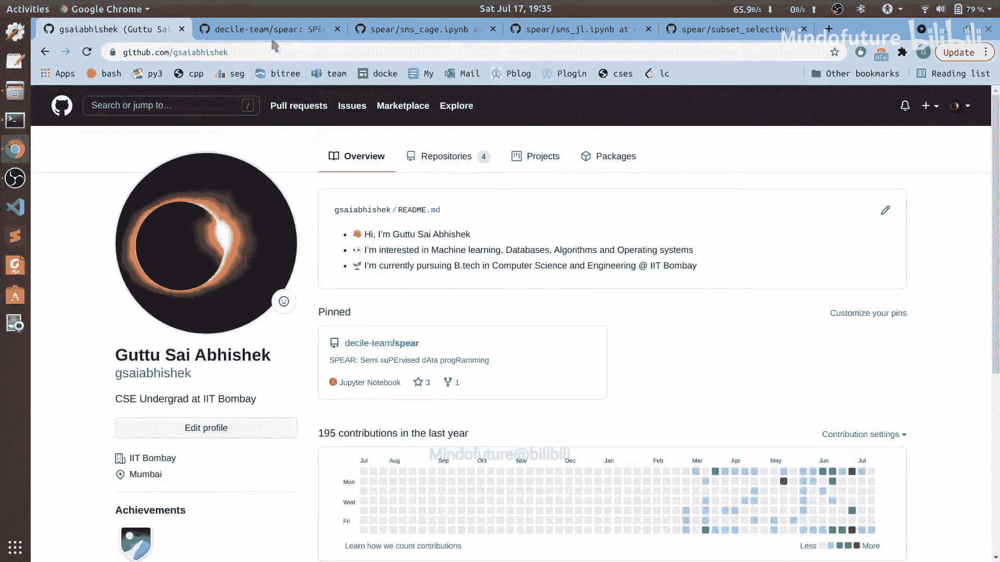

Let me give a brief intro to the Sper library Sper is a library for data programming with semi supervision。

The package implements several recent data programming approaches including the facility to programmatically label and build training data Spear has a simple pipeline consisting of three stages first we create labeling functions。

These are the functions which take raw data as input and returns a label to it based on some heuristics。

In the second stage， we generate a pick file。Containing the labels associated by the labeling functions to the raw data and in the large stage we pass the Spkel file to the label aggregators to get the final labels。

Although there are multiple label aggregators in this tutorial I will be going only over the Cajun joint learning if tutorial assumes that you have gone through the tutorial on labeling functions。

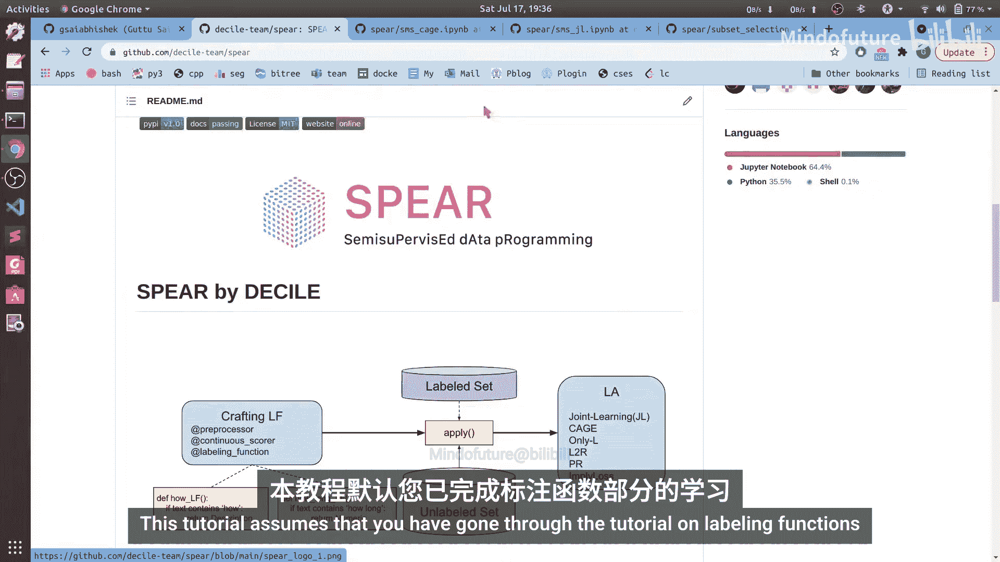

G。This is the notebook explaining the end to end use case of gauge module in Sp Library。

The links to paper documentation and collaborative notebooks can be found here。

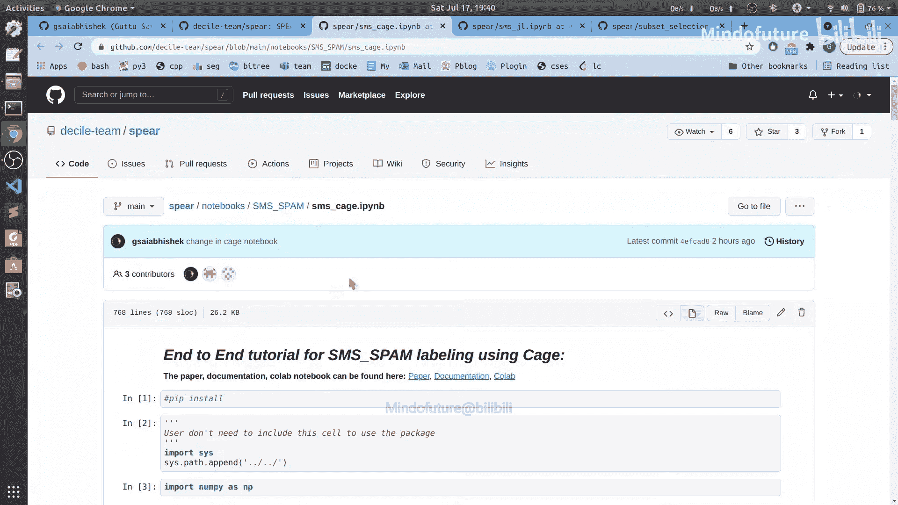

I am skipping the part where we construct the labeling functions。

Loading the data here we load the raw unlabel data and raw test data and two label of the test data if available。

This function， get test underscore you underscore data is not part of the library。

User can use any method to lower his data。Buts。These are the paths that are used to save JSO file。

 pick file， log file， and parameter file， etc。Pre labels class here we declare objects of pre labels class on test and unlabel data note that the true or goal labels。

Are passed in test data， but not in the unlabeled data。Also。

 here we call the functions to generate pick files containing the labels given by the labeling functions。

Note that we generate Json file only once since it contains the label information from the EnM class。

 which would be the same no matter how many times we generate it。Accessing the data。

 we provide get data and get Class function to extract the data from Pli and J files respectively。

For more about the written values of these functions。

 please check out the data loader section under the case and Du section。

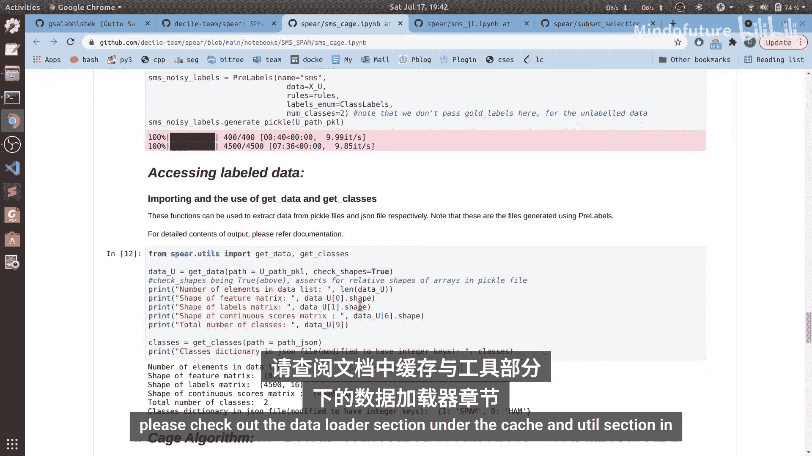

In documentation。

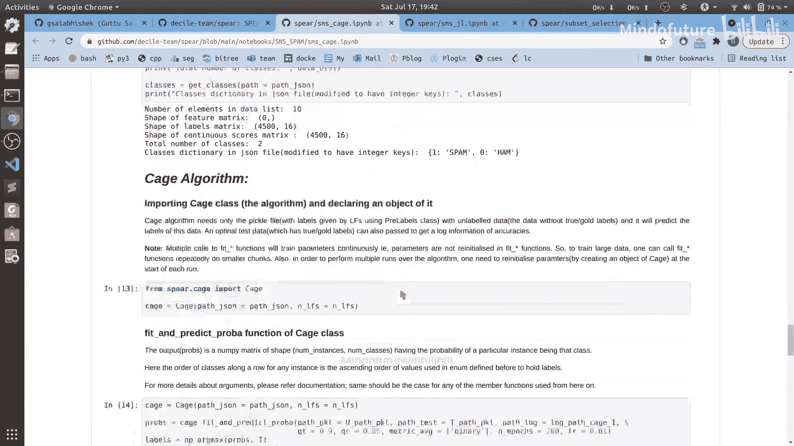

Cage now that we have generated the pickle and JSson files。

 let us use them in the cage class to find the final labels。We can declare the case class。Like this。

Here， and lift。Is the total number of labeling functions？

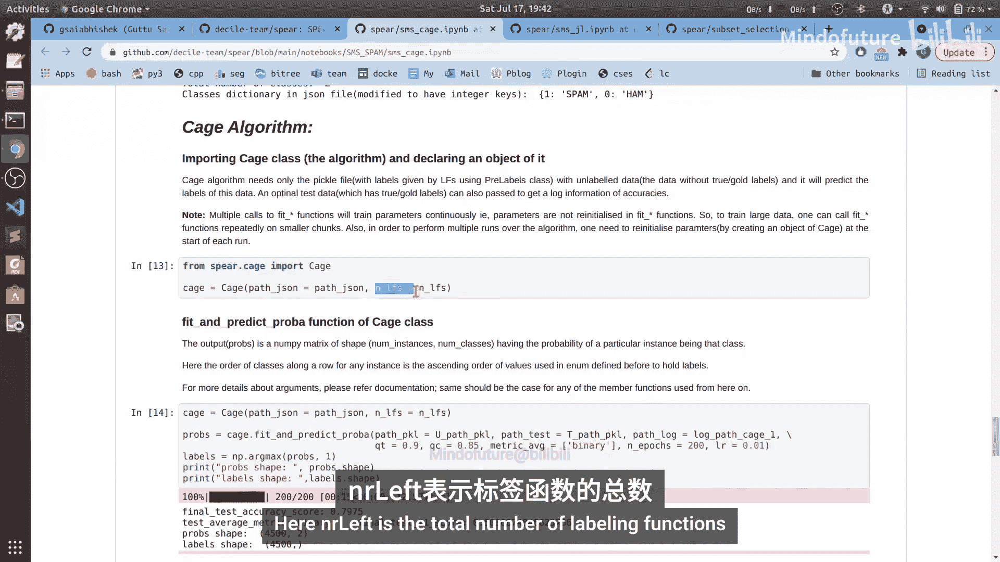

We can predict proper function this function aggregates。

And returns the probabilities of instances belonging to each level；

 the written value is a nu array of shape number of instances cross number of labels。

He the order of classes。Along your row for any instance is the ascending order of the values used in enum defined before to hold the labels。

We can create function。This function associates each instance with one final level based on the maximum probabilities written by the f rate pro function。

The written number array contains integers associated with the labels in the in class。

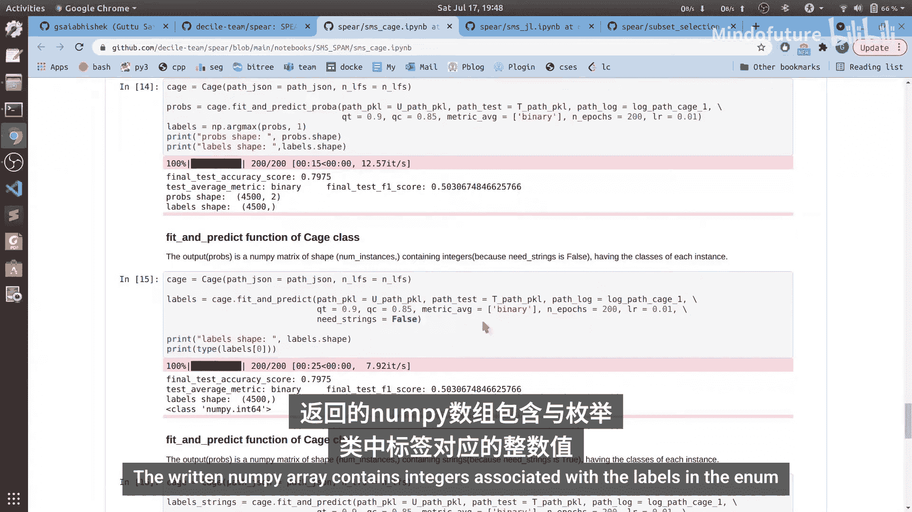

We can create function。This is the another use case of the same function where we get a nu array of strings instead of integers as per the labels defined in the in class before。

Save parameters， we can save parameters。Like this in the cage class。

Note that the director of the pickle file passed here should exist and also any of the existing contents of the pickle file will be overwritten。

Also， we can lower parameters。Into the cage class like this。

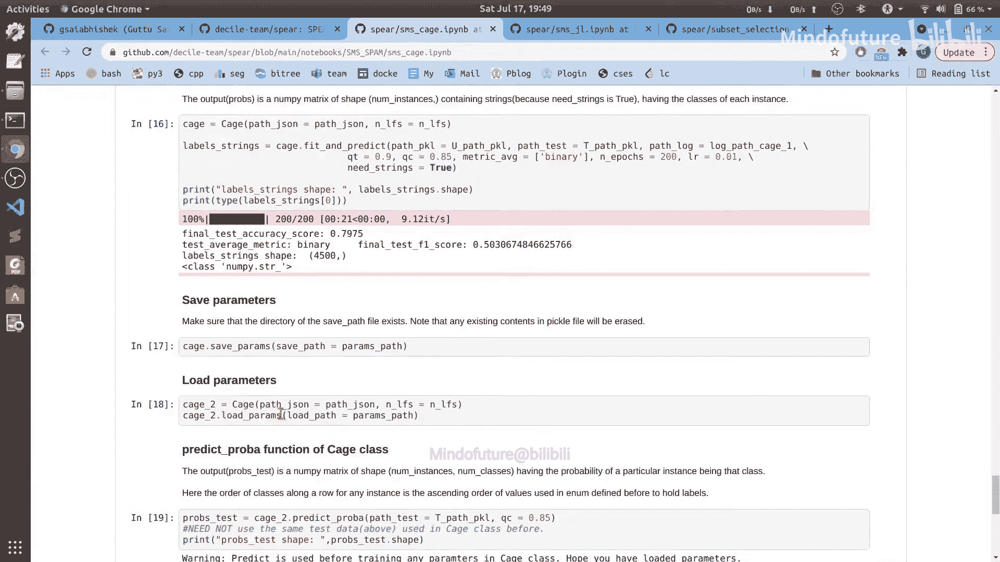

Rreict pro function this function predicts the probabilities of labels for all instances based on the already trained parameters。

Note that。This function doesn not train the model with the data pass to it。

Pret function this function associates a final label to every instance based on the maximum probabilities。

Also， this function doesn not do the training on the data pass to it too。

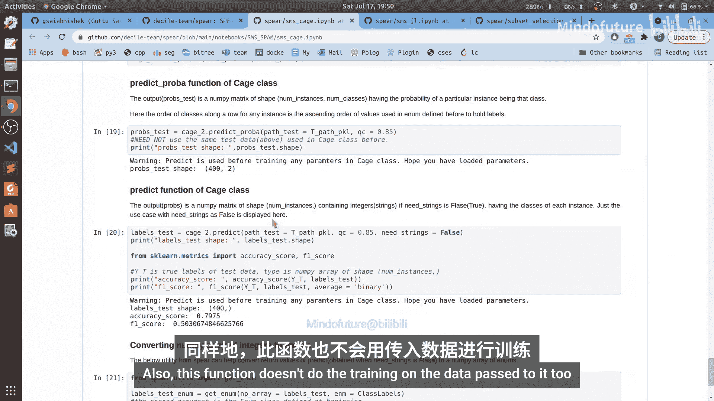

Get genomeum function。This function that we provide can be used to convert the number area of integers to the number area of enums using the enum class defined before。

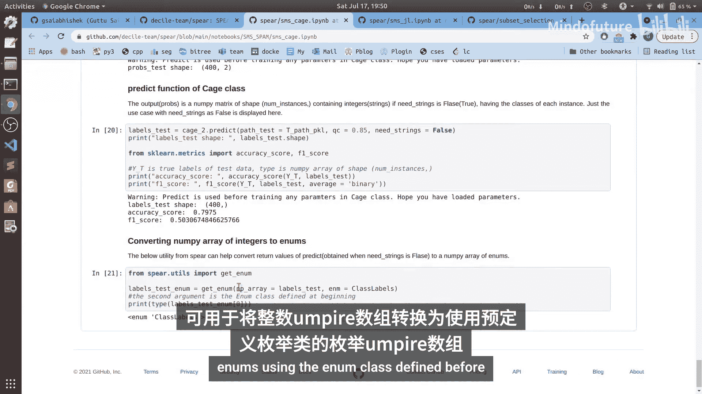

。John k。This is the notebook explaining the unwin end use case of joint learning module in spare library。

 the links to paper， documentation and color notebooks can be found here。

Since the oral structure of this module is very close to that of the case module。

 I will be going over the code differences here。

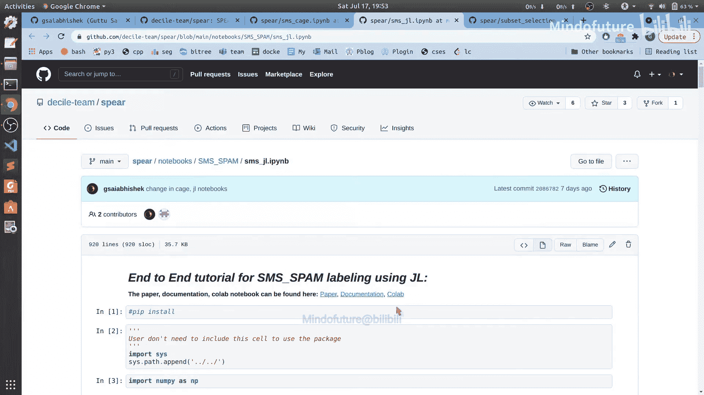

I am skipping the labeling function part。Loading the data here we also need to load feature metrics。

 violation data and label data in addition to the unlabeled and test data users are expected to provide the feature matrix。

Label data is the small amount of data labeled by subject matter experts， which aids in training。

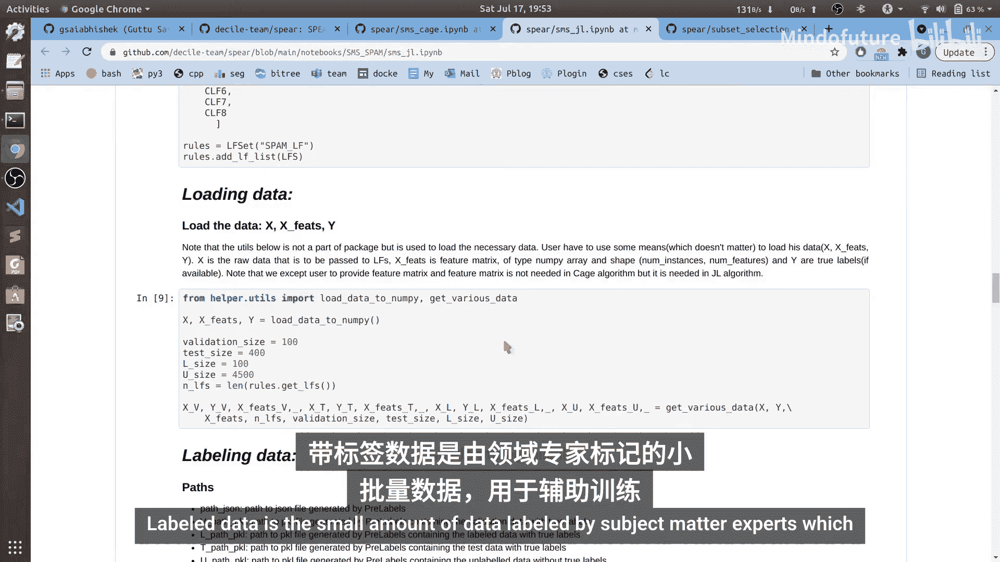

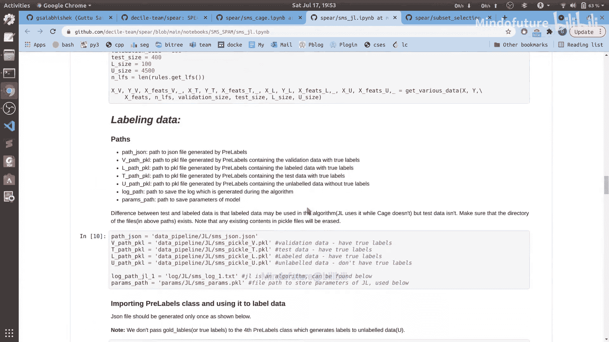

He leave his class。Note that we don't pass。Proe our goal levels。To this pre label class。

Wch generates the pickle file of the unlabeled data。Joint learning。Joint learning trains， two models。

 one with features and another is a graphical model similar to the one used in case module。

We can create a object to the Jo learning class。

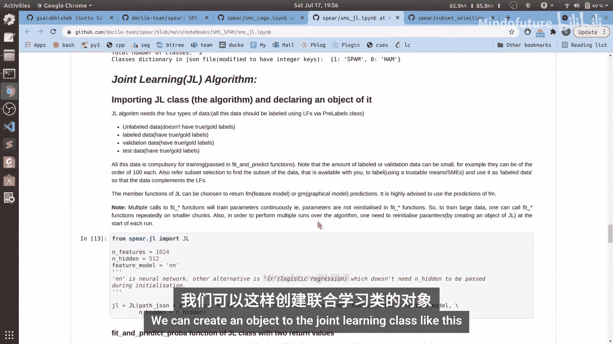

Like this。Here， the feature model argument。can take values nn or Lr。

 which mean neural network or logistic regression that is used to train the feature model。

We can create pro function。Here the loss function mass represents which of the seven loss functions in the model should be used while training or more on the seven loss functions we please refer the paper above。

And since we have two models strain here when the return GMm is set to true。Here。Yeah。

We get two written values， which are the probabilities created by feature model and the graphical model。

We suggest to use the probabilitybabilities printed by the feature model。Also。

 training meshtop early， as you can see over here。

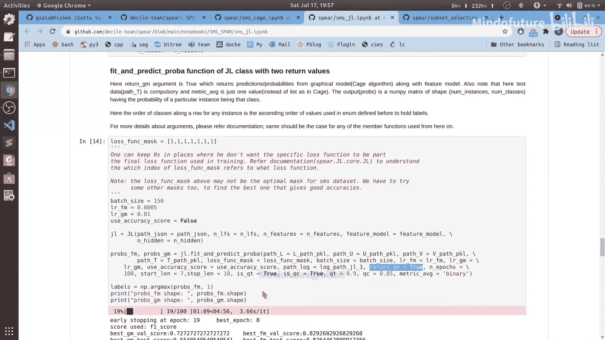

Due to the stopping conditions on violation data。Another use case of written pro function where the written GMm is set to false。

And hence we get only one return value， which is the probability predicted by the feature model。

Victim trait function。This function also have a parameter called written Gm。

So this can return two final label arrays or 1 depending on the value of return gm。

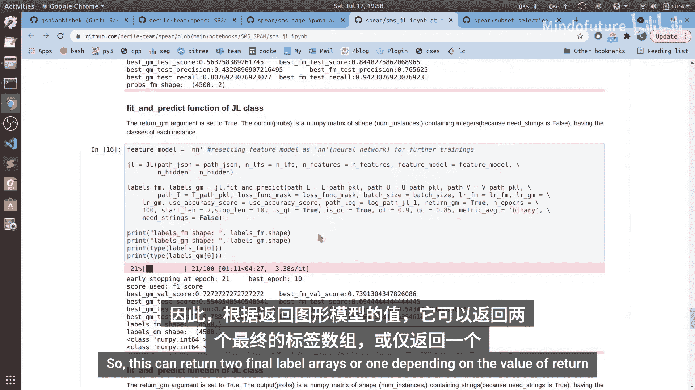

The save and load parameters function， as we have seen earlier。

 are also available to the joint learning class。Predict FM Pro and create GM Pro functions。

The former predicts the probabilities based on the trained parameters of feature model。

 while the latter predicts the probabilities based on the parameters of graphical model。

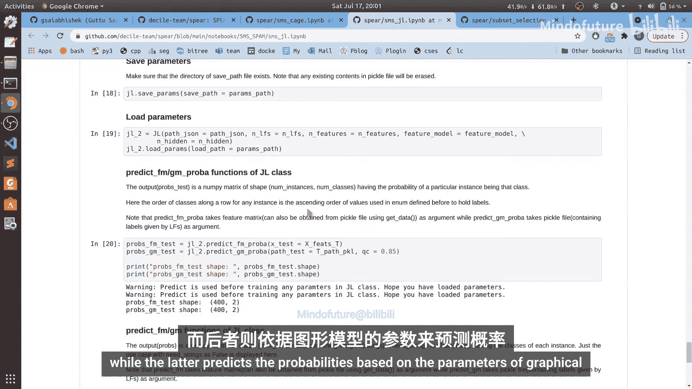

Redict FM predict gM functions similar to the about two functions。

 but here we predict the final labels instead of the probabilities。And the get inum function。

 as you have seen earlier。

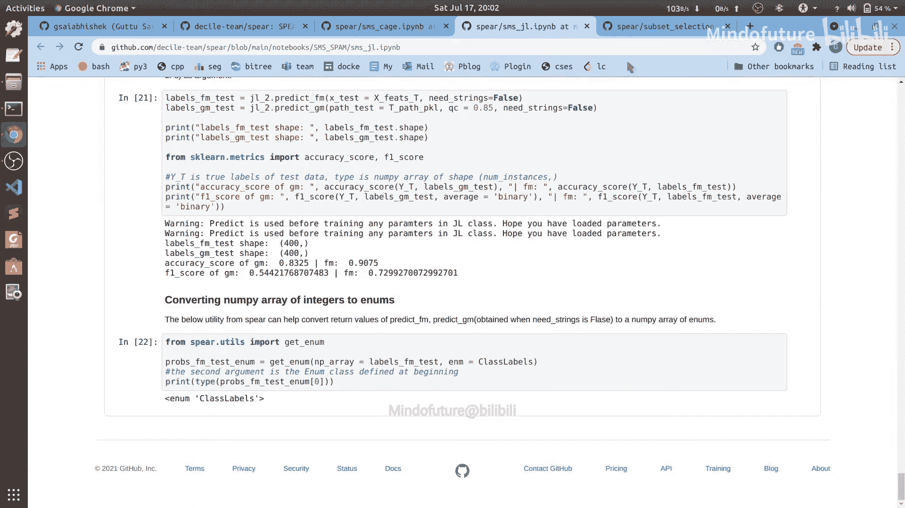

Subject selection。For the label set in the joint learning algorithm。

 instead of labeling a random set by subject matter experts。

 one can use the subset selection functions to select a subset from the unlabeled set so that when this subset is labeled it complements the labeling functions。

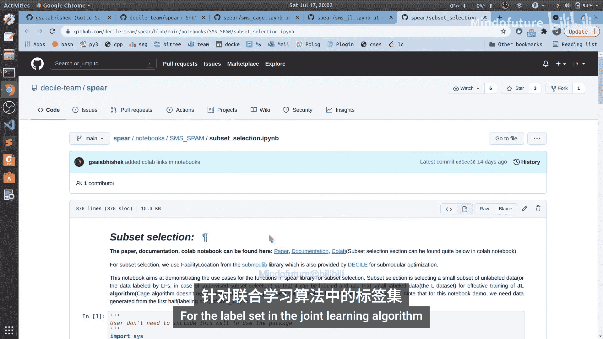

More about this and the process used here can be found in the paper over here。

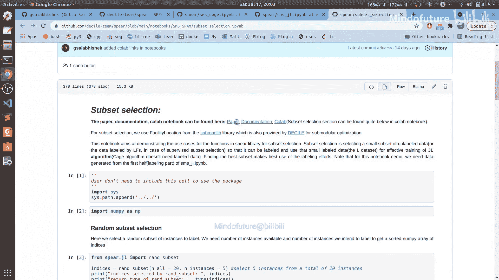

Random subset selection， we can select a random subset。Using this RA subset function。

 we get a written value of list of indices that are to be labeled。Unsso Pro subset selection。

 we can select the unsop Pro subset。Using this unsuit subset function。

This function needs feature matrix。And for more on this uns Pro subset selection。

 please visit the paper linked to which can be found at the top of this notebook。

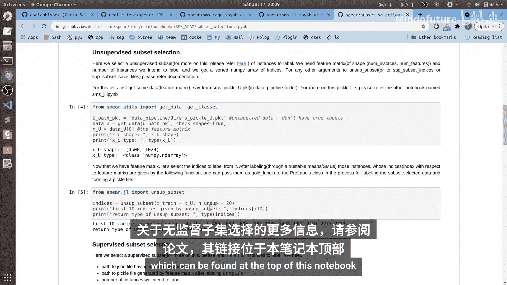

Supervise subset selection。This function。Soup subset inices。

Can be used to select a supervised subset。And it needs the data to be labeled by the labeling functions。

This returns the indices among the unlabeled data that are to be labeled。

S subset save files function this function is similar to the above one。

 but in addition to returning the inds。It also divides the unlabeled data into two separate pick files。

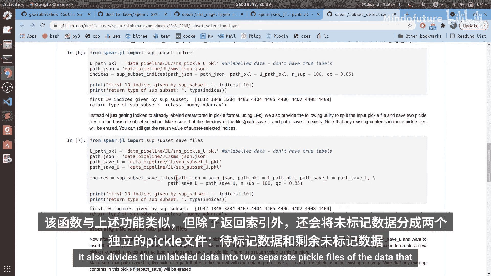

Of the data that are to be labeled and the remaining unlabeled data。

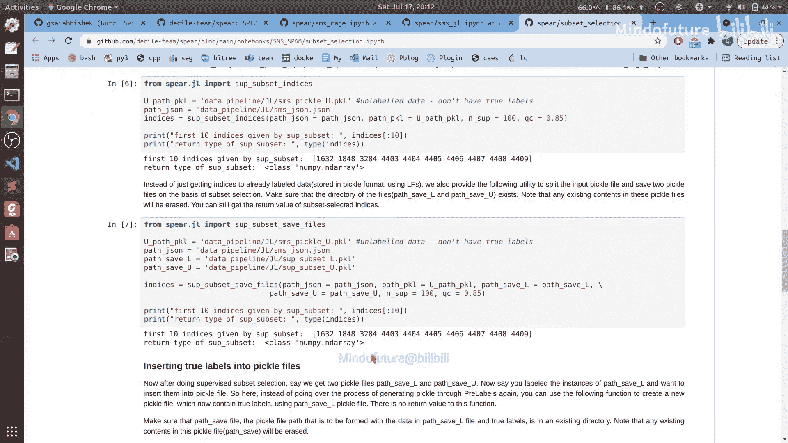

Insert rulela function。When the data selected from So subset save files。

I is labeled by the subject matter experts， and we want the two labels to be inserted into pick files。

One can use this function to insert the true levels into the pickle file。Replacing pickle function。

 this function can be used to replace any of the arrays in the pickle file。And finally。

 this is a use case demonstrating the subset selection in joint learning class。With this。

 we have reached the end of this tutorial， we have covered cage module。

 jail module and subjecttract selection。

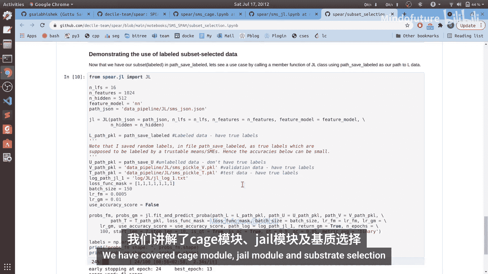

Thank you。