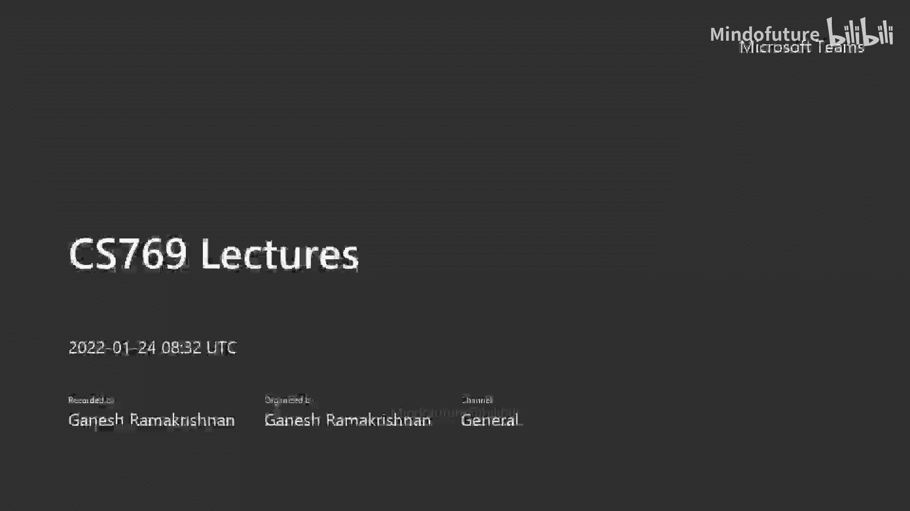
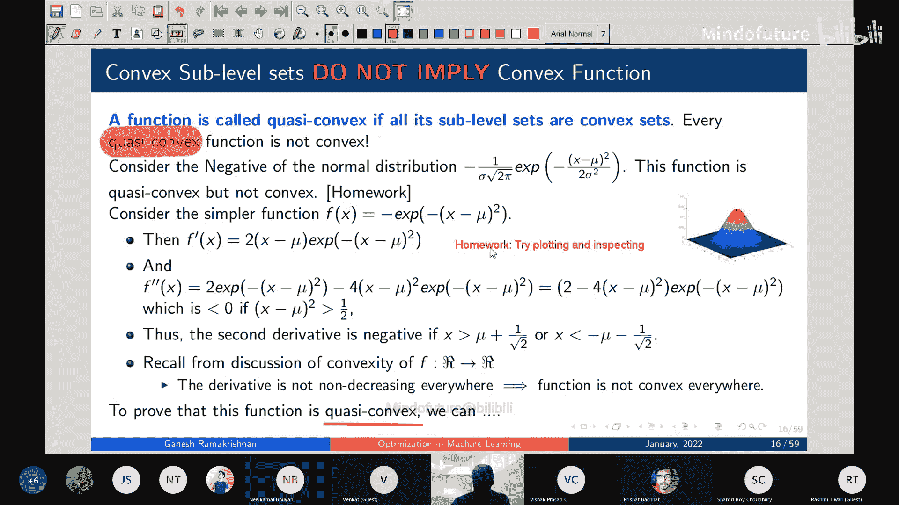

# 【印度理工学】机器学习优化 ｜ Cs 769 Optimization In Machine Learning p09 P09_第六讲_24-1_优化与机器学习_机器学习中的凸函数__拟凸性质和方向导数 -BV18cBSBJEH1_p9-

Good afternoon， everyone lecture6 of optimization and machine learning。

We will conclude our discussion on Corx functions in machine learning and then move on to。😊。

A very important notion of direction， which vector which will take us to。First。

 order notions of convexity。你说。The direction vector vector knows discussion direction vector。

Will help us transition into。First。D and second order rather later on second order。Our definitions。

And properties of convex functions。So we'll begin with our homework problem。

Well do the homework exercise discussion as we do every week， every class。

 and then conclude with remaining properties or examples of convex functions。😊。

Then we'll move on to the notion of as said direction vector gradient， subgra。

 this is basically the entire area of sub gradientdient calculus。嗯。Okay。

So we have discussed some of these problems。嗯。Yeah， let's discuss。Its important。Aspect。

 which is which of the following loss functions are convicts。

Anyone has any thought on the first problem。L1 L to regularize logistic regression。Is it convicts？

And by virtue of， which property is convex， okay？Why is it convicts？

So so I used the log some X property。To show that the first term inside the summ is convex and then。

The summation of convex functions is convex。And the regularizer term is a non function。

 so that is also convetx。Again， then the entire function is a sum of convex functions。

 so it's a convex function。Excellent。When you say log sum X begin with your first point。Log some exp。

你要。It's lo some X X with what arguments。So G1 x is 0。Okay， that's a good point， so。

You have some zeros， as well。Date， so this expression。This expression。I is corresponding to G1。

 right？So， it's E Xp。Of minus of Y transpose。The zero vector。So iss bi into0 vector transpose。Exi。

 is this what you meant。hello。I meant that G1 x is a constant function0。

 like if it takes zero transpose， then that we're assuming that the argument passed to。I mean， yeah。

 I mean， G1 X， it's E XP of G1 X， right， E XP of Okay， G1 X， So which is0 Okay。

 but it's the same as what you've written， right， fine， I got， I got what you're saying。

 This is equal to what I've written。Yes， it's E volunteer。Right， so。Yeah。

 so the idea is that proof is a。I mean。So what you are doing is generalization。Of the。

Log some X proof。So the G is， as you rightly pointed out。

Are either what either  zero or what are the other functions。All linear functions。Yes。

 the other function is limited。Okay。Right， now you could also prove this from first principles。 Okay。

 this can be well。Complex， but it's going to be the same。 And let me just。Let me just， you know。

 paste what I've written down。For a more detailed exposition。

But I I don't think youll need really need to spend time doing that。 It's going to be basically。

A kind of generalization of the alpha beta expression we wrote last time。

Is a proof from first principles in case you' are interested？So， here。As I pointed out。

 the Gs could be0 or linear functions。And the lambda greater is than equal to 0 and we know that the norm theta is a convex function。

To prove the convexity of GiI Theta again， go back to what we did last week。

 we we expressed LHs andRHs both in terms of these。Alphas and betas。

 but now we have alpha I Theta and beta I Theta and so on。

But the the inequality eventually boils down to the cautious charge inequality。😊，So。Yeah， I mean。

 the the the finally of the inequality will basically get。😊，The same inequality as lasting。嗯。

Let me just put that in here。Ive just added more indices。

 your log some theta theta of alpha theta beta theta less than equal to log some theta of alpha theta square race to half beta theta raised to square is to half。

😊，And that's basically by cautious sword inequality， or you could also expand。 Okay。

 case of proof this holds。Because of what she。Saws inequ。So you can also square。Lets and Rs。

 in this case。And you show that the RHs will have some additional positive terms or non negative terms。

Ps will all have all the L terms。It has some additional non negative termss。Okay。

 you can prove proof this on first principles， but we will we want to keep doing that every time right we just want to act smart。

😊，And you might also recall we talked about this midpoint convexity。Coect。😊。

What was the notion of midpoint complexity。Like we can just check convexity for lambda equal to half。

 we don't need to check it for entire range0 to one。Bate。Exactly， so implicitly， we have a。Invoked。

That convexity。A a function。Is convex， if and only if it is midpoint convex。

哎 so there a question here。So so if we say that the F two points are midpoint convex。

 but it may be possible that two points are not a function is midpoint conveyx you say the function is midpoint convex if given two points。

Explore and x2。Given any 2。61 and x2。The function value at the midpoint is less than equal to the。

Average of the function values are those two points。Okay， so okay， let me。So呃啊 so我我。In geometrically。

 it can happen that like midpoint is in convex， but。呃。

this is dramaticallyally it can happen and it is not you know that would happen see we are not talking about the arbitrary point midpoint is critical because it is actually exactly between the two points。

😊，Right， so that won't happen。So here， here you'll see， right a function if it's a convex if leap。

For all mu in01 and for all x1 x2 in D you have this property right now what we have done in the case of midpoint convexity。

as is convicxity or half is facing saying that that there are two fors， right you are doing two fors。

😊，You have a for all。The first for all is basically。What all you。

And then you are saying there's a for all extras too。

We are saying maybe there is no need for two fors。 You can just do one for all。😊，Okay。

 so what we have done instead is for all。X1 x2 and D， and we are doing away with the first for all。

For all mu， you say no for one mu， which is exactly equal to half。

So this this relax or this tightens the second first for all。Exact clear yes。

 so I think like you can say that any point in the function can be defined as a midpoint of any any other two point。

 So that way it is yeah exactly exactly， exactly。So I mean this can hold even for you can use this definition to also define connect sets was a good point of showing all saying that all points should lie may be the mid point。

 but for all pair points。😊，And for all pair of points will already involve you know other points which are interpolated from。

😊，Right。Initially given two set of points。Yes是。Okay so this， I mean。

 the proof sketch is basically if you want to prove this that mu x 1 plus 1 minus mux2s basically can be written as。

😊，X 1 tilde by 2 plus x 2 tlde by 2 where x 1 tlde x 2 tlde ball can be defined in terms of x 1 and x2。

😊，Yes。and the intuition is very simple。 I mean， you have two points here if any point can be。

 as you said， defined as a midpoint of two points in the same set。😊。

So this that does the bit points of 2 some2 points is x1 tilde and x2 tilde。It so。

Can we move on to the second so again， I'm summarizing。What we have done so far。I we assured。

That regularized logistic regression loss is convex。And why is it convicts？

Because of log sum app X under certain substitutions。You can also prove。😮，It's a very long roof。

Dong proof from first principles。And what have we done here？😮，Based on。Proof of last。

Last basically Thursday。Right， but we have just added new。Po indices。

We only alpha and Bta now we have alpha theta and B at beta theta。

So that' is the main idea and then that is implicitly made use of this midpoint convexity。😊，Okay。

 so we are done with the first part again， will not。Be spending all our time。Breing each of them。

In detail。 But let's look at the second one。Is this convicts？

L1 L to regular multiclo logistic okay this is SVM I want to SVM。

We can do the multiclass logistic regression after this。SVMs is that。Yes， sir con。

By what argument are you saying is convicx？Point wise maximum is convex and then summation of convex functions Okay point wise maximum good。

Which was discussed in the last class。Pointwise， maximum。For finite or infinite。

And I say max of0 comma 1 minus by theta X。How many pointss is a max lit？

How many functions it is the maximum？2， one one is。Yeah。呸。😔，So that's also fairly straightforward。

 Any questions here。Okay， so what have we done， It's a simple max。Or。放销松。Con and linear cons。

 a linear function。And therefore， it's convics。The second one， of course， is convicts。

By by previous argument， norms are convets。Yeah。God case。 So yeah。

 anyone has questions on the second one。Pegalize Sms。I mean。

 I didn't depict what that max would look like， but I'm assuming all of you understand right you can actually we can show in general graphically understand or appreciate why the。

😊，Max of convicts functions as convicts。 So I didn't show this last time。 Let me do it anyways。

 So if I have。This is a convex function。This is a convex function。This is a convex function， right。

 So what would the max look like？Yes。D it slightly in a way that you can make sense of okay。

 so maybe I should show them overlapping。Different colors。O， so these are。

So what would the max look like？😮，ItBa。You'll have the。

Wherever one of the functions dominates in a continuous range。You just have that function， right。

 but wherever。At whatever points， you have multiple functions being the max。

You would probably have inflection。A point of nondiiability。

And now you've seen that it has changed tracks， the max has become another function。And again。

 it does changed to track another point where there are multiple functions which are the same maximum may same value as a maximum。

😊，Okay， so this looks convex， right， I mean， I you get probe from first principles very easily。

This is a graphical intuition。Hello， sir。 Yes， the next the next second term that is you are saying that it's linear。

 but I mean， it's fine so。Do we need to say that it' is because the fine functions are con。😔，Yes。

 yes。So this， this when linear， I find it functions are conves。This is complexs。

And convex is also convex sorry constant is also convex right。啊。Yeah。

 but I must tell you algebraic proof is much easier。

We have done enough proofs so I will not be doing this。If you have a question， please let me know。

Okay， so this the second one holds by virtue of again properties you discussed the third one。

 what happens here。Any thoughts。Is it convex first of all？Regularize multiclass logistic regression。

Convic。Convicts and why is it convicts。你ard let love生 much落 one。ok you some much。

So it it's linear plus log sum x so it's again， log sum X but its just more indices。

 even more indices than earlier， right？啊要。Yeah， one thing you should learn now in this course is not be intidated by lots of indices。

 lots of thetas， IeJK。😊，嗯。Go back to the basic case， right， many others are just sums， right？Okay。

 so this is called yes。 The answer is yes。 And you could think of this as generalization of the previous case。

 I mean， generalization of the。I logistic lost case。Can we want any questions here？Next。

L1 L to regularize lease quest。On lastso， for example， which has。L1 norm， is this convicx。Yes啊。

For what reason is a convicts？ForThe first term we use first principles to show that it's convex。

And then then we can use the submission property。Okay。

 so this can be proved to be convex of first principles。Can I use show this as a composition。😮。

I try to be lazy here， right， It's， isn't it a composition use FOA X B。Okay。

Or can I think of this as a composition of。Exquire。With a linear function with an defined function。个。

Yes， yes。Okay， so the a function is a square sorry the quadraating function is a square here。😊，哦点我。

He squ。And the function is where you have。Big was。Tta or T I， whatever the T I squared。

Tta transpose X， I。Beta为A。Okay， so we'll try it to be lazy wherever possible。So answer is yes。

 this is convictx。What the reason。Anyone has any questions on this？Okay。If none。By the way。

 those are missed the second and first lectures we went。😊，Into great details， you know。

 defining these objectives。For machine learning problems。

 we I think we spent almost two lectures motivating all of these。

So go back to lectures1 and two for that。啱。What about this function。

 matrix completion is this convicx？Yes， it's conx。Why is it convic？So so AIX will be。Okay。

 I let someone else go ahead。A third first term can be do as a composition itself。

 like a and then a norm。不见。Yeah， only thing is now we are gone from vectors to matrices。

 which we should again not intubrate you， right？😡，But you're right。So this is just a fine function。

A fine function。Composed with。No。😔，I。eldono。Okay so that should be fine。

 that should be a convex function。What about the second term。It's just spectral now。Okay。

 and what did we understand about it in the last class？Convicts。So it's a norm。

 What does it correspond to。Is it somewhat。Singular values， yeah。Sigular values。

So with sum of singular values， which we discuss。What was the more generic？🤢。

Now I'm associated with it。We give it a name also， right。Stturn norm or something。Right。Basically。

 it' is a norm associated with the vector of singular values。😊，And those were always con。

 now we didn't prove again but。We showed that this particular norm also has a connection with the other norm。

 which is it， so it generalizes two norms。Oh sorry， not general， special case of two norms。

 which are the two norms。😊，What is the shaton norm。Like shatter norm， which is a。An normmandy。

Pctor of singular values。What was the other relation it had？It's also special case of。哦，不得啦。So的。

Do you remember， it's a special case of the。佢分놈。Yeah， it's a called spectral genome。

 whichs a special case of vector induced。😊，Mater stop， right。

And we saw that it corresponds to yeah from shatter norm perspective， it is a2 norm。Obbby。😊，I mean。

 a shaton norm with the 2 of on the sigma x vector。

 but the other thing is is a special case of vector induced matrix norm。😊。

so you can think of this as。诉嗯。Overs x。Not equal to 0。Of what。

The two norm right instead of generally talking about a norm， youll say I I'll use。

Or I should use a different， let me use V here。B not equals 0。So I'll have X v。Toom。Divided by。

The two norm of me。This is basically a su。Remember a point I supreme。😡。

Over multiple convex functions。Each of which is convex in one of the arguments。

 which is a convex in the x for fx to y。AndAnd this is also this is vector induced induced matrix knob。

This was。Given as a example of point by supreme。What we saw in the case of。Hingnge loss。 SVM is。

Is basically point2 is maximum。Right point by supre of。Convex functions。

Because the Supremepre is because you mean。Not attain that bound， but your upper bounded， right。嗯。

Whereas just again， to make sure we get the point。What we dealt with here。So a point ways。Maximum。

Okay， okay， so matrix completion， therefore， is also convex problem。😊，关 back function。

So let's move on if there are more any questions， let me know。So one question。

 the point why is maximum can work for infinite functions also right if we take maximum over in finite functions。

this is。I think it's going to be finite。I don't think Mela will hold for infinitefin， I lot to check。

 but I don't think so。Those are finite。Under some special cases， it might also vote for infinite。😊。

See a series of functions， but I don't think it holds in general， I need to check。😊，If you remind me。

 I'll try and check and come back。But from my memory it is only it holds always for phyroid functions。

 whether it also holds for infinite， there may be some additional condition。😊，For example。

 I'm sure there must be some， I mean you have you need the the series to conver right if I give you a。

😡，In finite number of functions we may need some like the gap between those functions becoming diminishly small like you know you know what is quahy series right？

😊，You need some kind of quasius conversion。But I'll have to go and check。Okay， is that okay。Yes。

 very good question we can have that we should have that codating gap。

Qudratic gap thats for strong convexity that may not be required here。You mean quasihi。

 you want to talk about quasihi and versions。😡，And no at the strong con。

You don't need strong convexity here。 This is， this only we are only talking about convexity， E con。

With that quad gap。That is I'm talking about a convert that no no so your your point is about conversionvergence of an algorithm okay Im talking about a question related to maximum point lies maximum of an infinite number of functions。

😊，Understand。That is different we are not talking about algorithm conversiongence of an algorithm talking about conversiongs of a series of functions。

😊，Does that help， Cheryl， Yes， Yeah， let's not confuse。But anyways。

 I don't want to distract the class。😊，By night， we can always assume。Let just make it clear。

Point by maximum of。If finite in this sketch is2。P of functions likewise。

 I would say point a supre of finite number。 lets just make that clear。ok。

Any other question I should we move on？Lets understand the other last homework problem。

 soft maxax contextual badits。Any thoughts on this？Convicts again。

Why do you say its comic by the way， what may be interested in maximizing it may be good to recap。😊。

So what were we interested in maximizing or minimizing？😊，Was it a reward or a penalty？😊。

It's an inverse propensity estimate of the reward， remember。嗯，对。So it was an inverse。Proensity。

Of the estimate of the reward function。啱。So what was our goal here， remember we had this R。😊，By P。

Into one， which is if action AI is taken by policy。

That coincides with the best policy as per the theta， the parameters。

But then we approximated that indicator function。Without。Softmax。

 right the EXP of theta transpo X I AI。So。What we we doing interested in we are trying to maximize it。

So， I mean moment we talk about maximization convexity actually becomes a problem。

 do we want convexity here。😊，Function to be maximized。 And if you have complex function。

 then minimum maximum。I mean。There may be no maxs at all。It will be unbounded above。

On the other hand， we may be interested in whether its concave， right？😊，Is that making sense？Yes。

 sir。Any thoughts on this， is it conk？Okay， so it turns out that in terms of theta。

 this is neither convex nor conkey。😮，So it's not concave， but like PCA。😊。

This has efficient solutions。I mean， I won't say exactly like PCcaA。No， I'm。In fact， BA object。

Active。Is also neither。A con， nor convicts。But both have， I mean， efficient solvers， though。

And for PC， you can find the solution。Exactly。Okay， so this is not con。哦嗯。This， however。

 will have some regions of concavity and convexity。😊，The issue， as you can see。

 is becoming because of the denominator here。The denominator also involves a theta。Okay。

 you we give me more one。Now theres a one slide I put on the relevance of strong convexity。😡。

Ive mentioned this before， but I'm going to repeat this。A function is strongly convex if。😮。

From that function， you can subtract the。Qudratic function and you still get a convex function。

 right？So this mu is called the strong convexity parameter is going to play an important role in several convergence flows。

😊，It basically saying that there a lower bound on the growth of the function。

And it implies strict convicxity。Its strict inequality in convexity。

However strong conviction doest imply that the function is differentiable。😡，Okay， that。

 that's another interesting thing。 You may think how strong conity would mean there's a quadratic term added。

 Does it become differentiable， not。Right， anyone can give an example。😊，Our strong is VM regular。

Exactly， good point。Right so the hinge loss。Hingji loss with。呃。That's L regularization， right？

That will be。Strongly convics。But by virtue of the hnge laws being not being differentiable everywhere。

😊，What all objectives not different。Okay。And that exactly the reason I' have given below。

 but in an abstract manner。😊，So if F is strongly convex like the hnge loss and G is sorry F is strongly convex like electroreilizer and。

😊，G is hinge loss。 Then F plus G is strongly conveyxs。However。

 Noromic squared itself is strongly conomics。😊，Okay。

 and I mentioned last time that strong convexity results in faster convergence using certain decent algorithms。

I mean， certainly it gives you proofs for conversionvergence。

 but also leads to actual faster conversionvergence。😊，Any questions？

So now we move on to the next set of topics。We talk about the direction vector directional derivative now I am detailing the topics in the order we will then talk about quasi convexity okay now quasi the interesting thing is quasi convexity generalizes convexity。

😊，There are functions which are quasi convex， but which are not convex。

All convex functions are quasiiconvex。😡，So， quasi convexity。Now generalizes convexity。大说好。

And then we look at。The relation between convex functions and sets that is the next thing as I said there is a kind of continuum between sets and functions and thats you know they can be best understood through a notion of epigraphs。

😊，Now， only thing is a typical co on。😊，Convex optimization would actually spend a lot more time on this this convex function epigraphs separating hyperplan theorem supporting hyperplan theorem whole bunch of theorems actually in fact Far lema anywhere you talked about constraints you know feasible strictly feasible solutions you have to understand your dealing with sets so any mention in literature。

You should be on the lookout， basically。For strict feasibility。

You are really talking about being strictlyly lying inside a fe region or feasibility or the mention of forecast lemma。

😊，Or you know， you may have you know， strong duality， actually even duality。

And so on would be actually referring to。😊，This kind of continuum between convex functionss and epigraphs。

Okay， so。Yeah this just is important to know， which will help us move on to first order conxity conditions and subgrad and subgraing calculus and convexity and often when we deal with this we are really talking about。

😊，Conves regions of functions。 Okay， so I just should point out that subgradient subgradient calculus is applied extensively。

Even in。Convex regions of non convicx functions。All deep learning， right。

I mean what does what does this mean even the we have published lots of papers last year and we have papers in the pipeline very and top conference like I see when we talk about convergence proofs。

 but what we do for example， when we say。😊，Convex regions of non convex functions。

 Let me give you an example of how you get such a region right you'd get such a region by。

Let's say I have a deep deep network。佢。And it would be nice if you ask questions， I'm now。

 for example， anticipating some question and saying some things。😊。

So let's say we have some deep network。And this is my last layer， okay？The last layer。Now。

 what happens of often is that you freeze。Weights in all layers except the last layer。😡。

Let's say you freeze the weights。In this part of the network。Okay。

 you have a deep network and this corresponds to。Frozen wastes。Pros and parameters。

You could think of this convex region of non convex functions。Corresponding to the that region。

 which has。Frozen parameters。Right。That is， when the。Pre final al in with all the pre。

Final layer parameters。😔，Frozen。呃 we。Are often dealing。It啊。On Vex regions。Of non convicts。

Lss functions associated。😔，Deep network。Okay， so for example。

 sub gradientients are used all the time。😊，But then the conversion analysis will often require some properties associated with the pre final layers。

 or you may talk about local conversions。😊，And so on。So this is one example。

I'm not saying this only only use case of。It is a very important use case that's why Im highlighting it。

😊，I is one use case。So one question。If a CNN or a neural network。

 let's say it just uses relus and maxes instead of any other activation function。

So it uses re and max then then that entire output itself will be convex rate that we get from the neural network like the neural network will be a convex function。

That's a very good point yes， if you're using a relun max you would get a convey you should I mean see you have relun and max。

 but after that what is the loss function you apply is also going to be important right？😊。

So what would be the last question yes exactly？Yeah。

 but if if that loss function is also just going to you know gel well with the max， I mean。

 basically one of the conveity preserving operations is there in the loss function。

 you should be fine。😊，Good point， yeah。Yeah， but the use this use case I'm saying doesn't even make assumption on the kind of activation functions。

 I mean， other than the last layer。😊，Yeah， anything else Very nice to hear such questions and comments。

😊，Okay， let's move on then we look at the most basic notion of something called that direction vector。

😊，嗯。Now， all of us have experience dealing with。Indom。Devatives， we use derivatives extensively。

 right？The whole idea of direction vector is to look at derivatives。

 but when we deal with the function of multiple arguments， then we can't talk of you know。

 derivative only of。😊，诶。One kind。😡，So every direction that you move in for that function。😊。

You're going to。Basically have to look at derivative in that direction。😊。

We will now start really looking at the problem of minimizing， let's say I want to minimize。

By function， ethics。Okay， so all of us know that you know。If you have effects of a single variable。

 if n equals one。😊，Then f dash x must equals 0， right？That。That necessary condition。

For a differentiable function。Having been。At x is that F dash x is。

0 now how do you generalize this to a function of multiple variables n equals5 what does that mean？😊。

Okay， so let's try and。Look at this from a slightly different space。😊，嗯。

So we will look at two examples too I'll actually contrast。😊，那 우리面모这个。Let's look at this figure。

As against。ASlight related， but different。Figure here。 So let's contrast these two。

Are these visible sufficiently。Yes， yes， okay， thanks。So what do you see in these figures is。

The two dimensional function。 Now， we can't think of the function in just one dimension as as the input space in one dimension。

So you have these level curves fx1 fx1 co x2 equals c1 is1 level curve then1 in pink fx1 co x2 equals C2 is another level curve in pink and now you start thinking about okay what happens if c1 is greater than equal to c2 right that means the pink corresponds to value is greater than。

The black。This is when。Those regions start looking convex， but you could also have that the regions。

 those regions level curves don't look like the boundaries of convex sets。

So this is another use case1 equal x2 equals c2 is this1 in black。

 which is has a non convex boundary。😊，Okay。So I mean。

 one thing is we would expect the interiors of level curves to be convex sets in the case of convex functions I'll talk about the interior is a little more detail that lead us to co convexity。

😊，But for the timing being， I mean， there should be。😡，A useful。No understanding。 Now。

 what we are going to do is we go to look at this instead of。Basically。

Of derivative will now say okay， if I am moving in this blue direction right from a level curve c2 to c1 as a direction。

😊，What should happen？If I'm moving within the level curve。What should happens。

 so let's take the example if I'm moving within the level curve， what would I expect？😊。

Hepping levelco。When moving。Within up。Pink level curve。What would F be the derivative？😡，Fd。Xb。

Is is a function changing at all？😊，农。0。Yeah。Like， music。Likewise。

 you know if I just copy the statement。I can have， you know， in of pink， I'll say， okay。

 why when I'm moving。Moving within the black level code。So the same thing just changed。

You would expect it to be 0 again， right， F dashix。But now， when I'm moving from pink to black。

 that's what I showed in the。The blue region there。Okay， when moving。From pink。

From the pink level curve。The black level code。We expect have dash x to be 0。No。Yeah。

 we do not expect。So what would you expect it to be？

If I told you that c1 is greater than equal to c2， what would you expect that to be？😡，大说不。So0。😊，挂不对。

Positive。You wing from a higher value negative negative。Yeah， since C1 is greater than。

Let's say a greater than equal to C2， but。Yeah， I mean， I I can just put a。Less than equals 0。Yeah。

 so it might turn out to be 0。 That's one thing。 So now you see the direction matters。

 the direction whether it the same thing holds for call non convets。😊，Shapes， not only thing is。

Here you can see that no。Slide change in the direction is going to change things significantly。

 right， So when you move from this point， I hope you can see this clearly。😊。

Yeah at this point in then the blink of the second case， when I move。😊。

Let's say I decide to move along this。This direction。

I see very different behavior from say in this direction sorry。

 I see very similar behavior in the sense Im I'm kind of seeing symmetry here。

 but if I move in the middle somewhere my behavior I would expect very different behavior。

 So suddenly there is we of sensitivity Okay so when we the the direction vector will。😊。

will be a lot more kind of unstable or not as continuous as you would expect in the convex case。😊。

But I would still expect in local regions there to be some behavior。😊。

Not only on the condition between increasing values and decreasing values of functions。😊。

But also between the curvature。And the increasing or decreasing nature of the derivative is okay。

 so what I see what I wanted to show is here， let me write down this point clearly。😊，嗯。Fact。

The increasing。Or decreasing。Nature of the derivative。In a region。Is also closely connected。

To the convics。Or non convicys。Shehip。Of the function。 I mean， instead of growing a shape。

 I'll say curvature。Okay， so so we are not so direction derivative is important。

 but also it leads to direct derivatives the double derivative is what the curvature is talking about。

😊，It。And we want to see be able to handle all this in。Now，In dimensional space。

Is this clear the motivation behind this。Ination。So。

So let let's summarize the motivations and I'll copy this to the previous slide。So， motivations。

Behind。Understanding。And developing on it's not just understanding， but developing。

On directional derivatives。1。Is， you know， design。Of algorithms， as you can see。For non con reasons。

 I may want to look at slightly more than。ADional derivative I want to look at， as I said。

 the curvature。So we want design of algorithms and why？Certain algos。

Work well for convex functions and certain others don't。And the second is。We want alternative。

Definitions of convexity。 So we are， I mean， as I said， right the。

The level curve don' not start looking convex boundaries or boundaries of convex regions where the functions are not convex we are trying to look at alternate definition of convexity。

In terms of first order and say， second order。😔，Conditions。Okay， so any questions？Okay， if not。

 then let me go back。 Okay， so。For every point， as I showed， right， we showed this。Different。Thankss。

So。In this figure， you saw this directions you U dash and so on， U1 U2 and so on。

 so we have different directions so。We represent a vector by x and the K component of x by say xk。

So let's say UK be a unit vector pointing in the K coordinate axis。😡。

So that means the if you are pointing the if UK is pointing the k a axis only then UKk is 1。

 only the K component is 1 and all others are 0。😊，So so that's what I was trying to show in this figure here。

U1 is in the first dimension u to is the second and so on。So。😔，This is an image you're talking about。

所以啊。😔，Okay， so an arbitrary direction vector。😊，Is a vector with some unit norm so we we don't want to deal with the scale component we only want to deal with direction right so unit norm is so that we can focus on the。

Direction alone。Let me make that comment here。Okay， so with this background。

Let's try and understand a little bit more。So， we define the notion of a directional derivative and in fact。

 I would like your help in defining how would you define the directional derivative？😊。

You need a point x and you need a unit vector， as I said， we will do not deal a scale component。😊。

So what would it be well， you could go to the first principles。Direction of derivative。

 how would you do it？You need something some limit tending to 0。The bit of what tend to 0。Sub。Right。

That2 to 0。放心嘅机。Yeah， you can call it h， whatever subscalear indexix0。Correct。Of x plus。啊 g。

Scalar times v， right。O fix。Divided by。F of them。And what if by the scalar itself。

So that you can give it a name， the scalr could be given it a name。

But this idea is that you are going from x here。In the direction of V。But you want to see how much。

Is a rate。Okay， so this is called the Dv along the rate of change along the vector v of the function f。

Okay， so this is the overall。 I mean， I used small sorry， I used。Small D here。 I should use capital。

 Let me just be consistent。ToThe next slide。O。W is the directional derivative？😊。

The only thing is you you are assuming the limit exists。😊，Okay。

So what is the relation between the direction derivative of the gradient？😊，Any thoughts？

SoDal derivative is a scalar。😊，Great is a vector。Any thoughts。

So if we take the directional derivative along the different unit vectors， U1 u2 shown the UK。

 and then those will be the components of that gradient vector。ok， very good。Good。

So directional derivative。Along each unit direction component。Union， unit direction。Will give。

The different components。Of the gradient。That's one。this direction derivative can be defined as a。

The inner product between gradient and the unit director。 Oh， that's interesting。 So you're saying。

You can obtain。The directional derivative。Along as。Add x at at a point x， right？As dot product。

Between gradient。At X， and。With we。What product between we and okay。

 let me just see the order between we。And the gradiented x。Okay， that's interesting。Any other fact。

The second factor is， DFV。Is the gradient of。😔，Or the V transpose。Any other point？A third point。

I mean， I think by now， you have enough intuition。By。

What is the direction along which the direction and derivative is a maximum。

 Maybe you can look at the previous step2。😊，The direction along which the directional derivative will be the max would be what？

多年。It's a gradient is the direction。😔，Bit maximum。Drectionional derivative。Okay。

 that's basically the basic motivation behind gradient descent。不要。But we'll see how why。

 why why we need to depart。But we need departures from gradient descent if this motivation is there and is there an issue we will see that soon。

😊，Okay， but。These seem to be fair motivations， very good。Okay， so in fact。

 next slide we'll develop on this。In a special case。

 the directional derivative reduces to the partial derivative of F with respect to Xv。

So partial derivative， by the way， is just a。😊，Scalar。Right， it'll give a scalar value。

So if you take the unit directions， that's exactly what our point number two was earlier。sorryrry。

 a point number1 was directional derivative along each unit direction。And that's exactly。

What you are seen here， So like we are just giving it a name UK。Uni direction， UK。Q superscript king。

The partial derivative。Okay， good。嗯。So that's us point number one。If Fx is differentiable。

 then F has a directional derivative in the direction of any unit vector V then。😊。

We come to the third point。Also'll sorry the second point。😊。

Which is that the directional derivative can be obtained as dot product of the gradient and the vector。

😊，Okay， so you seem to be going in the same order。Yeah， well it's now fully defined。

And the third point， which I mentioned， yeah， will also be built upon soon。😮。

The third point is easy to get from the second point， right？😊，Pot3 follows from point to y。😮。

W it's the result。Tt product is less than L to norm。是鬼。不要。

And equality less than equal to and equality holds only when the。Two are in the same direction。

 right？Yes， yes。 Can I say it holds from Cahi shorts。Yes。Okay， so what is cost short equality？😊。

Of that， you know。If you have。You transpose we。The absolute value。

Is less than equal to norm of L to norm of U。Into the L to norm of V。

With and equality holds if only view equal we write。😊。

And admit me that one is a scale version of the other。Okay， so now just replace。

Our U with the gradient vector so we are saying equality holds only the gradient is a scalar multiple of v or v is scalar multiple of the gradient between。

😊，The direction。there the maximum the upper bound， the right hand side is obtained exactly when UN and we are the same direction。

😊，Okay， so。Okay， any questions？So if you have no none， then we'll move on to the next topic。

We will be I mean we will do more about this once we talk about sublevel sets。

 so just keep this picture in mind we will revisit it。😊。

But let's understand what was going on inside these sets， okay。😊。

I kept saying the boundaries of these sets， the boundaries of these sets。

 but boundaries of what sets？😡，Okay those bound those we are talking about boundaries of something called sub levelve sets。

 so what set6 inside here is the sub levelve set。😊，And that's what we' will talk about。Okay。

 so let's give it a name here。This set is a sublient set。

I'll kind of give you an idea why it's called sub levelvel。😊，It may not be always the case。

 but here we are I mean here we are understanding that c1 is greater than equal C2 so as you keep on I mean with the assumption that as you keep shrinking C2 you will go further within the set。

😊，Right。This set is call level set， so let me write that in English， plain English。Ping that as。

E1 is as C reduces。To below。思文。The level goes。Only1 to keep。You know， being being contained inside。

say。Or。The sub set。What is ofcent？I'll define sub little sets more。General。Is this clear。

 So this part is a。Is related we now delve a little bit more on。Subdiviss。Okay。

 so I'm just going to draw all this picture again here。

And I made this point earlier when you have convex functions。

 interiors of level causes are expected to be convex。😊，Okay。

 so this is now we kind of formally being dealt with here。So L alpha f is all the x。

In the domain says that fx is less than equal to alpha right So you had the C1 here as fx keeps going less than C1。

You should get this set inside this is called an alpha sublevel set。😊，All in this case。

 it's called a C 1 sublevel set。嗯。C1 subve instead of just saying alpha I say， C1 subvel set。😊，Okay。

 so what do we expect if a function F is convex？What do you expect。I made this point here， right。

It I mean we made this point earlier the interiors of convexs sets are expected to be convex。

 so what would we expect from the sub levelvel set alpha sub levelvel set？😊，It should be cons。

So then we expect。The sub level the。As alpha to B。Convets now L alpha to be convex for what。

 what what values alpha？😊，At alpha F。Expected。To be convex。Fine for what values of alpha。Anyone。

For those values such that this set is actually an interior of a level curve。Youang。Yes， but。

You have to specify something in terms of scale so youre kind of making it cycling right for all those will be interior。

😊，But if it's conts， shouldn't that happen？That for any value of Al。

The points will that those all those level curve will lie inside。If that is the case。

 then what should I say for what values of alpha？😡，For all。That is greater than minimum of us。

Right kind I just for all alpha。那呀。Let's say for're all alpha。And I'm instead of saying expected to。

 can I make a claim？It it will be convets。It will be necessarily convex。

 so we are not giving it a choice。Anyone， does it make sense？That's， I mean， how do you prove this。

So you can do it this way， I guess I mean。F of x1 I mean， if x1 and x2 belong to L alpha。

 f x1 will be less than alpha and fx2 will be less than alpha。You can take a。

 can take like F of Lada x 1 plus1 minus lambda x 2。And since since F is convics。

 that will be less than lambda fx1 plus 1 minus lambda f x2 and both of which are less than alpha。

Okay， good point。 So the proof is what you're giving me。You said， if I have。Use theta x1， right。

 F of theta x plus1 minus theta。X2。Right is lets say is the equal to。I mean。

 this is the definition of convexity。Fx1。Pluss1 minus。T difiix2。Ex see if。

Let me use a different color。So let's say if。X 1， comma， x 2。A in L alpha f。Right， then what happens。

The first term， you know is。Less than equal to theta。Alpha。

The second term I know is less than equal to1 minus theta。Alpha， right？

So this whole thing basically implies。Is what。That he do。What happened？

So we want to show that this convex combination is also less than equal to alpha so this whole thing is therefore less than equal to alpha right the theta alpha plus 1 minus theta alpha is less than equal to is the same as alpha。

😊，Right， so this will mean that theta 1。Plus1 minus theta。Ex2。He is also in L。Yeah。

Does it make sense。This expression。Because this alpha is also going be less than equal to I mean。

 if you want， you can make this explicit It。😊，Write it down。 Let me just write it， if you want。

You see， this is。Therefore， as an equal alpha。Which implies that。By the pink。

 by virtue of this pink part， if x1 x to alpha is the same as saying fx1 is less than equal t to alpha less than equal to alpha and x2 is less than equal to alpha5。

 x2 is in L5。😊，So is this clear？Any questions？We kind of anticipated the proof and now we have proved something。

 but let's go to the actual proof。Well let's go to the actual statement。Okay。

So if a function if is convex is alpha sub set is also is a convex set。😊，Okay。

 this is a proof what I show is a proof basically。Well。

 let's try and understand this pictorially also。What's really happy， I've given you some example。

 but lets let me take an example。😊，嗯。So， let's consider the。Following image。So you have this image。

X2 x1， other two coordinates， you have fx f of x1 comm x2。And you're showing this function。 Now。

 this is a conx function。Now what we are trying to show here below。Are these。Subleve sets。

They align the x1 x to plane。And as you can see。For example， the pink one is L alpha F。

The one in blue would reward what。Would be an L alpha 1， let's say。

What is the relation between Al 1 and alpha。Any thoughts。

Would you expect alphapha 1 to be less than equal to alpha？Yes， yes， yes。Yeah。

 so the as you go down inside then the alpha1 alpha keeps shrinking。

 So not alpha2 alpha Yeah Al is less equal to alpha。😊，Okay， so these are shrinking sublevel sets。😊。

And basically what you're saying is okay， I can just show the same thing in a slightly different。😊。

I didn't show the graph of the function I just showed。The shaded region。

 but you know you can understand this to be the graph of the function。

Because as you as you are decreasing the value alpha you're really looking at。😊，Ling。The， Y axis。

Shrinking alpha means lowering the via axis。Not by axis。 I mean。

 the function axis allward movement in the along the。Function access。

Let me just use different colors， here。What I'm saying。😔，This shrinking this alpha one。Okay。

 are there any questions so this should help and help you appreciate。The behavior of。Sub levelve 6。

Question is， what about the other way， Can I say that if。The subal sets are all convicts。Then。

 the function is convicx。诶no sir。Okay， so let's I'll put a good point so you're saying it's no。

 but I would like to know why okay， so question is。Give。Or some， I don't know。 I， I mean， if all。

Sublevel sets。Of a function， aregon rigs。嗯。Is it implied？😔，That the function itself。Must be convex。

And you' are saying the answer is no。Anyone feels if the answer is yes。I mean。

 look at this picture right， it seems to be hinting that okay there's strong connection。😮。

But its this between convexity of the sublevel sets and the functions convexity right functions convexity is like it's cup shaped。

😊，But is it at？😡，Okay， so。How do you prove。Whether's yes or no， if it's or no。

 how would you prove what what would be an attempt to prove。Counter example。So by graphically。

 we can see。Okay you can try graphically show a counter example。

 I mean graphically in the sense it would be to give you give you the lead。

 but ultimately youll need a counter example， right？😊，嗯，Yes。

And also you can say that so if if we have a non convex function。

 so within it we can have sub regionsgions which are convex like there can be regions where there are two points and all convex combinations lie within a region。

And so。Okay， simple counter example would be a log of mods。Log of Mords， okay。Let's try item that。

How would you prove it， What is the shape， first of all。呃嗯。Like。Dog acts on both sides of the axis。

So log of Mos， you are saying it's not convicx like log is anyways not con convicx， it's con。

But you are not trying to prove that log of modxs has all。Convex levels， convex sub levelve sets。

What would take a respond to， Let's write down So log of。The absolute value of x。

Less than equal to say， alpha 1。Would mean what is equal to saying the what？

And the R we need equalence is the same as mod x less than or equal to E power alpha。And then。

This set convex for all alpha。So this is basically like but it's an absolute value of x。😊，Yeah。

 its nine second。Here， the line segment in one dimension is a convicx set。Correct。

 so it's basically a line segment between minus alpha find plus L minus。It is to。

Alalpha 1 n plus u to alpha 1， right？Okay， so this region is convex。

Whereas the function doesn't look conx right， that that should be again easy to see for everyone。😊。

Okay， good example。In fact， you' will find lots of examples of the sort so this is I think a canonical style。

😊，So you can see that inequality is just sometimes you know。😊。

Simplifying the set of constraints that convexity had。

 which was we wanted the function to lie below line segment joining to point now that function that that is going away by collapsing to saying okay all the points。

😊，With value function value less than some threshold。So that could still be convex as you saw here。😊。

嗯。Can you think of anything else， any other function？Continue here。 I mean。

 there are there are more functions。 and here's one example。Actually， lots of functions， right。😊，啱。

Fx equals x2 divided by one plus 2 x1 squared。So now it iss not that this function has all sublevels that to be。

😊，Conveyx but say the zero sublevel set of this function is。Convets。So yeah。

 so you can have some or more number of subal sets as convicts。But in some cases。

 all of them are convicts。Yet the function may not be convex，saw on the previous slide。

Even if all the。Sublevel。S of F convicts。In not being。逛嚟就行了。ok。嗯。

So it turns out that the touch functions have a name。A function switch。

Have all sublevel sets to be convicx sets。However every such function is not convictx。

 such functions are called quasi convetx。😊，Functions。

But we have to remember that that doesn' not imply convexity， so this is called quasi convexity。

And as homework， I would like you to think about this。 Okay， this is homework for you。

Might be an interesting plotting exercise， try plotting， try inspecting。好。

The negative of the normal distribution。Okay， so I mean。

 all of you have seen the normal distribution multiated normal distribution。😊，嗯。Just draw a small。

Here， this is how the normal。Distribution looks like right it doesn't look convex if you I mean or invert it。

 it doesn't look convex you takes the negative of this。

But it turns out that all sub levelve sets are convex Okay。

 so try inspecting and plotting some sub level sets。Itterize it a bit。

So how do you prove that dysfunction， for example， is quasi conx？And why is it not even convicts？

What can you do。So we'll probably leave it at that， any other questions or comments。

So we reached a threshold short of time。There are no more。Points for discussion。

 questions or comments。We will conclude now。Yeah， so this is the only homeworko problem for next week。

That's for Thursday， thanks everyone， bye。

I would like to appreciate the class participation， this is very good class participation。😊。

