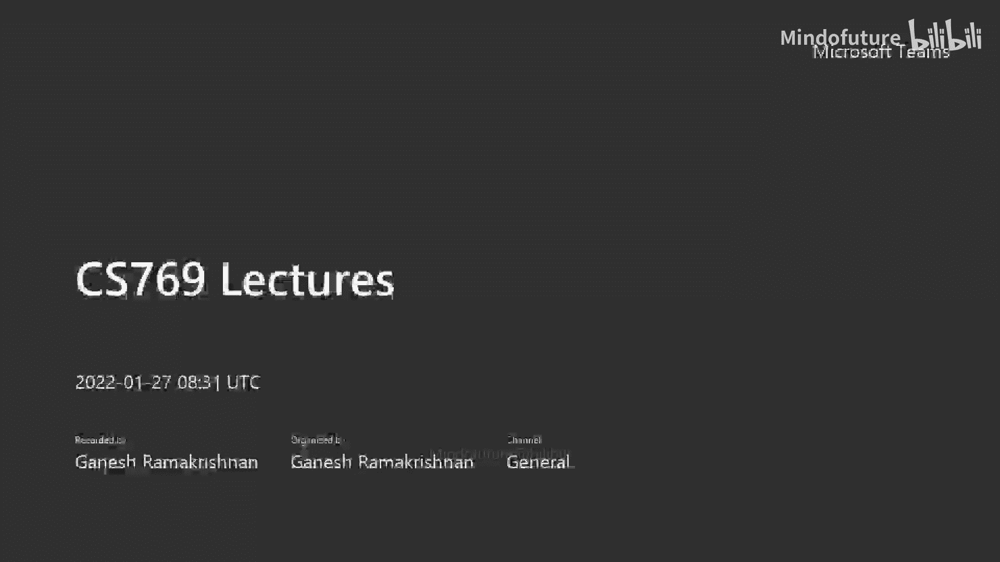
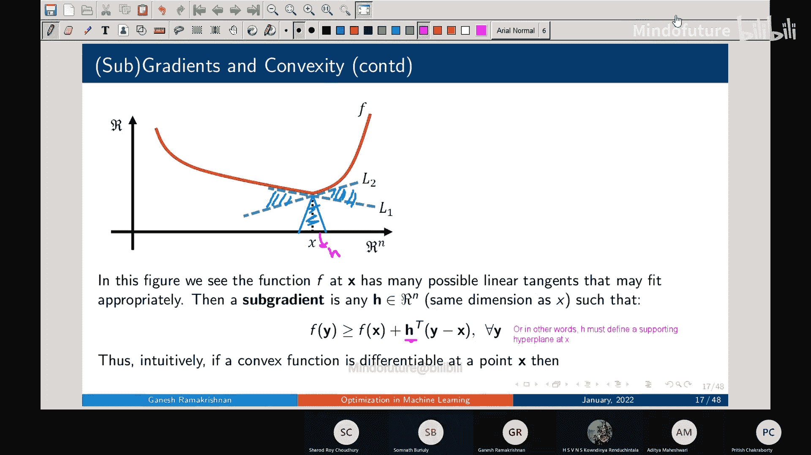
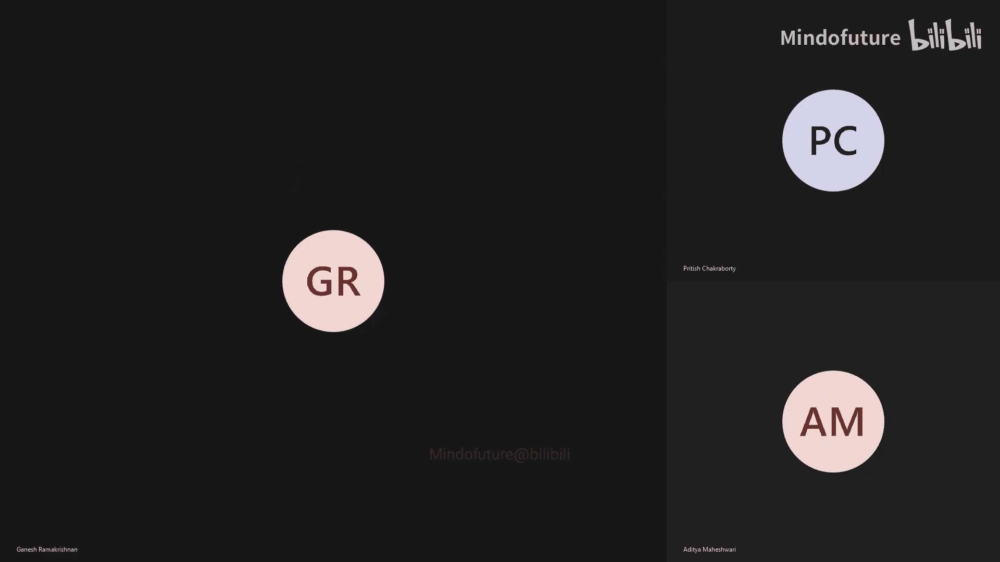

# 【印度理工学】机器学习优化 ｜ Cs 769 Optimization In Machine Learning p10 P10_第七讲_27-1_优化与机器学习_凸性和一阶性质 -BV18cBSBJEH1_p10-

Okay， very good afternoon to everyone。嗯。We are dealing with convexity and first order properties in this lecture。

嗯。Let's recap where we are so far。 We understood the convicxtory of machine learning loss function so far。

I discuss them in some details and then I had left a homework exercise。

 which I will start with today， which was about quasi convexity of the negative the Gaussian function。

Then we'll move on to subgraient calculus， notion of subgras and so on。

Jnalizing from direction vector。So let's just do this recap。

Scap the notion of sublevel sets of convicx functions。嗯。So function F is conx。

All these sub levelvel sets which correspond to the sets。O。

X says that the function value is upper bounded by an alpha。

These are all convex sets this is this was our first exposure last week。As we transitioned。Between。

Seets and functions and functions and sets。Now， the proof of that we dealt with in the last class。

Here is the proof that L alpha f is a convicx set for any alpha in f if is convex。Okay。

 I hope there's no doubt here as such。We proceed。嗯。😊，This was very simple proof。 However。

 where I left your homework with is that convex sublevel sets do not imply convex functions。

And this brings in the notion of co convexity。So function is called quasi convex if all its sublevel sets are convex sets。

 however。Every quasi convex function。Is not convex。I tried to give you an example in the last。Gass。

 the negative。Of the。Normal distribution。And I claim that the function is quasi convexs。

 but not convicx。 so I had to do two things。 I had to prove that it is not convex。

And I have to prove that it is co convex。Okay， I provided some hint here。

And what Ive tried to do is take it a simpler function so this is one thing you have to start looking at okay look at the form of the function we have an x minus mu norm squared divided by two sigma squared now two sigma square is a constant division。

😊，Can we just start with simple Xius mu non square negativeative should be remain。

And I can also remove the scalar。So to begin with， I'll try and do it with this the scalar multiplication and the scalar division within the exponent。

😊，Okay， so this ist。Simimpr function。We'll deal with the。We will begin with the。Special case。

So for the special case， are the two prove simple。Okay， so the special case is dealing with。嗯。

EXP of a quadra， negative of a quadratic。So one thing we can do is go go to scalar calculus in the case of。

X being a。Skillar value， X N R， not vector。So anyone？Anyone has tried doing this。

what we are doing here is。Special case。Is yeah， we have ignored one upon。

Under root2 pii and set sigma square to 1。And what have we done we have we have applied here that。

A property from basic calculus。大地。Function is conve， if。Second delivery2。Not negative。

So were just looking at。F dash。F double x。Being less than 0。So there non negative。

looking at it being strictlyly positive or greater than equal to0。Okay。

 so is it well you will expand it right you see to show that it is not convex。😊。

You don't have to look at the vector right you can show for single dimensional case if it is not。😊。

Then it's it's true。 I mean， you don't expect convexity in the end dimension case。

The function is not convex。In a single dimensional case。We do not expect。It。😔，Convicts。In the。

Multidimensional case， as well。Okay， so so there's a rational behind simplification。

 Just want to make sure you understand this。嗯。Is this okay， Any questions？In视 position的 here。Okay。

 so if there are no questions， let's just proceed with this proof。

K a special case can be for multiple reasons， this is a very valid reason here。😊，Okay。

 so now F doublelashx， we have this expansion。Its basically you know EXp of minus2 x new square that is all fine。

 but what we have。Now， outside， the EP is to whatever is， I mean， is going to be always positive。

But what is going to bail us out？Is this expression sitting here。X minus。Sorry。

 minus of 4 minus-6 S minimumome squared。Right so。😊，This is less than 0。 if x minus mu norm squared。

Ex minus mu square。 So use this single dimension。 If this is greater than half。 So the problem。

 this is the problem case。The problem case is when it becomes less than 0。

The second derivative is negative is x x is basically greater than mu plus 1 by square root 2 or x is less than minus mu minus 1 by square root 2。

😊，So the derivative is basically non decreasing everywhere or rather the second derivative is。😊。

Not positive everywhere。 It's negative in several places。Okay， so it's， it's negative for， in fact。

Very large range。 It's positive only with x when x between， I know， mu plus square root by 2 and new。

My movement is。Pnapon square루。Okay， so this is not convicts。

But now we want to prove the second part which that is quasi convicts。

 Anyone has made any effort on that。So I had a parallel question here。 Yeah， please So here。

So that the function is not convex everywhere， but it is cause conx that wast issue。

 but like I even thought like log acting or that not convex anywhere and still thats quasi convex。我。

我。嗯个。Is there？Lox logx that is quasi conitx， but it is a con function。

Lo log X is a quasiic convex function， right。There is no relation between major between college con and conduct。

你个已降机会放先啲嗰啲咁听嘅。Right， right， right， right。The relation comes。 We'll actually talk about it。

 maybe a little later。嗯。So for certain special classes， if you start putting certain bounds on。

The gradients， right well talk about say lift continuity and smoothness。 So under certain conditions。

 the relations start emerging more strongly。But in general， all I can say is that。

Every convex function is quasi convex， that is the only statement we can make okay。好，O。Yeah。So yeah。

 all I can say at the top is。Every convex function。Is cozy convicx。It's a general class。Okay。

 your question is， how general is that class？How many functions does it have which are not convex well。

 it has has many functions which are not convex。😊，But under certain conditions they may start behaving like convex function that's all I can say it it by the way it it's also an area for research and quasi conxity has been helpful you know in certain constrained optimization technique algorithm so。

😊，Hopefully we get some time to talk about it in the end。Okay。Okay。

But what certainly interesting is quality convex functions do have。😊，Several regions of convicxy。

 that I think， is an interesting point。😊，Okay， also， most quasi convets， as you can see here。

 the are the。Cousic conx functions。Willll have。Regions of convicxity。Several regions of con。

That' is the other thing we can say so general， but because of the sub levelvel sets being convex。

The the function will also start by connections at least some regions that we see in this example。

 right？Hope this helps。Okay， now let's try and prove that。Function itself is。Poy convicts。 Okay。

 so what I'm will do is let me。Rob。好。Paste a painting I made。 I mean， a picture I made。

 just takes too long to do it in the class。Okay， so here's a painting。面。This takes too long to。

Make it perfectly， here。ok。So what do you see here？Is this inverse Gaussian。When with。

Sigma square 1 is a special case。And this you can see is a classic case of a function with infinitely many sublevel sets thattera con。

😊，Ass a non convex function。So you obviously you can't go around proving this for one or two chosen values of alpha。

You need a more generic approach than。Showing this for some values， chosen values of alpha。

How do you prove this anyone has attempted this？So these are all different values of alpha。

You think of this as。Alpha equals y of。And alphapha 1。Alpha 2， and so on。

Its your approved for all values alpha。So the proof you need to make is that。

The function is coji convex， so we are just going to inspect the L alpha file sublevel sets of this particular function。

 you can see the expression here。Now， does this make sense， does this look convex。I mean。

 Id like to remind you what we did in the case of the zero subal set of particular function， right？

I mean， you can think of the zero sublial set of this function as。This is what we had shown。

This was a zero subleveal set。X 1， x2 says that x2。Is less than equal to 0。

 This is the one shaded in pink。Okay， so we are just trying to do something similar。

So please let me know if you have made some observations。

And we are trying to do something similar here。So the sublevel set was all convext now we want to do do the same thing here。

Any want。As what this is too。TheOtherwise， it's。It's pretty obvious in the slide here。嗯。

See we note that Ep minus x minus mu square is monotonically increasing for x less than mu。Okay， so。

This expression is monoically increasing for x less than u。And it is monotonically decreasing。😔。

4 x greater than you。So what is this set。RightSo there's something about mu， right。

 less than mu and greater than mu。It's basically it's a conitiguous interval around mu。😊。

So you want this to be less than equal to minus alpha。嗯。

So sorry less than equal to alpha minus of Exp minus of x minus mu square whole thing should be less than equal to alpha。

It is the same as EXp minus of exponential R square greater than equal to minus alpha。😊，So this set。

 what do we expect the set to be behaving like。Can can anyone plot this function？

Have you tried plotting this function。So would it behave like this？So。You have some alpha prime here。

An alpha。Double prime here。And here is centrally situated when somewhere situated here is a mu。

So it's monotonically increasing for x less than new。Right， this expression。

Is monotically increasing for。X less than mu， which means you'll keep on increasing。

 So do you expect a bound to be there at alpha double prime， a lower bound。

Id like to you to express your thoughts， findings。What are you trying to get。

 You are trying to get your x。For a fixed value of alpha， right。

What will be the relation I mean where would alpha play a role here。😊。

So would you expect this alpha double prime to be a function of alpha and obviously maybe mu？

I do are two things here mu and alpha the two things fixed here。Okay。

 so I would like you to think a bit more and see how you could drive alpha double prime and alpha prime in terms of alpha。

😊，But the important thing is it's， it's contiguous。 Okay， I would like you to think more unclosed。

I mean， is alpha double prime minus infinity or is it。I mean， is it some finite value？U。

That you need to think about， But it is contiguous。And therefore， a convicx said。

And we did this for any alpha。 So we are good to say that fx is a quasius convex function。😊，Okay。

You can similarly prove that the negative of the multivariate normal densities is all for single。😊。

Dimmenional case， right， you can but you are to generally prove that negative ofly。

Multivariate normal density function is。Is also query convics。 I mean。

 the simplest for thing for you to do will be to plot。RightAnd I would encourage you all to plot。But。

 let me。I've done this plotting。 So let me just。Do this for you here。 You here are。

Multipivated novel plots。Okay， so for different values。

M is minus0 I mean sorry mu is 00 sigma is 1 11 diagonal minus0。

8 along the of diagonal entries so is a two dimensional case。😊， so you'll see these are the。

Subleve sets， all of them。Look convicts。However， the function itself is non convex。

So the function is a non convex function。Because it is bell shaped， I mean it it is like this。

 but then it it it concave rather here， but it is kind of tending to be convex in these regions。So。

 not conves everyone。Whereas， yeah， as you。Would have made a note by now。

All sublevel sets appear cons。O。嗯。We'll move on to the next topic。

Yeah unless you have some questions， comments。Okay， so convex functions。哦。

I would say a special case of quasiic convex functions。

And the notion of quasi convicxity is through notion of the subleve sets， which lies in。

And are in space。Okay， so you have the function F。Wing from。Od。To O。Ss。Then N dimensions。As Ar。

 basically。However， there is notion of epigraph。Only one epigraph。They pick off。Is a set in。

N plus1 dimensions。A level sets。Are infinite。are multiple sets in n dimensions。

 whereas epigraph is just one set。Now， the notion of epigraph will become very important when we look at。

😊，Uualality。Po。And we look at， you know。Quality， when we look at， for example。Strong dual conditions。

Zero dual gap and so on。But the interesting thing is epigraphs are equivalent convex epigraphs are equivalent to convex functions。

It saying our functions epigraph is convex is the same as saying that the。Function is convex。Okay。

 so that's why they become interesting。😡，Certainly more interesting than。

Sublial sets from the point of view of convexity。Okay， so let's。Get the definition。说。

Epigraph is a set of points lying above the graph of the function F。And again。

 I'm going to resort to some。Drawing。Ill left I。For to save time drawing。

That may do this in the next slide， and then。L了。Borrow some of， okay。So， let's see this。Diagram here。

Okay， so this part in green。Is epigraph What you' are seeing here is the graph of the function in gray。

And the part in green is the epigraph。As as again， I'm repeating from the definition。

 it's a set of all points lying。About the graph of F。So if the function is convex。

Then the function itself is。Cup shaped。RightThe graph of the function is cup shaped。

And what we are saying is the epigraph then it looks like a convex set。Theres very intuitiveitive。

 when you look at this。Tub shape notion。It's intuitive， especially in two dive， I mean。

Two dimensions， the input spaces in R2。It's even more intuitive when we look at a functions right So a fine functions of vectors a transpose x plus B and what is this epi graph。

Its epigraph is this。Xt says that a transpose x plus b is less than equal to T。

 which is a half space a convex it。So again， that's you know easy to see。

 let me just draw it for you。Cursty。Half space example。 So what do you see in green is again， the。

SoHere you have the green in the graph of the function， the Eine function。

And the part in red is basically the epigraph。That's a pig graph。Okay。

 how do you prove that its a convex set when the function is convex？😊，I would say the proof is。

 again， very simple。And I just want to give you this big picture。

Big picture is that the sub levelvel sets may prove to be convex only one way。

 one directional right function as convex and in the sub levelve sets are convex。

 but we didn't we were not able to go back obviously we show showed a counter example。

 but in the pickup you can reconstruct back you can say if the。😊。

Epigraph is convex a single one epigraph， then the function must be convex。Okay， so did be。

Specifically showing you the big， big picture in the next slide which。Putting together。

So the epigraphph is a set of points right it's a set of points in R in n plus one dimensions。

As you saw here， right， it's an Rn plus1。The subset of。I plus one。

sublial sets are also sets of points， but they are in R。You see。

 the alpha being the plus one and the dimension。Exactly。So let me。

 let me show this in the next slide again once more。 So here you have。嘅。In fact， like me。Sureing。😔。

Did't part。 She didn't participate。Okay， so this green shaded part， as you pointed out。

 is the epigraph。And let me put together all of them in perspective。 This the。

Epigraph of function of the function F。There notion of Hygraph is just all the points lying below for conre functions。

 Hygraph becomes more interesting。😊，And as I said， this is a subset of Rn plus1。嗯。And this point。

 this is this curve in gray。Its called the。Graph of function F。And what I want to point out is that。

嗯。If you have these points， X1。X2。X n comm Z Z is a function value。 this Z axis as you can see here。

So if this function， if let's say this is convicts。ItBaically。If you want to say okay。

I is a representation。3十。A point。嗯。The epigraph of F。Me canonical point in the epigraph of L。

And our claim is that the。Function F is convex。 If and only which the speaker of is convex。Okay。

 now let's look at it， look at a sublevel set view， which is on the right hand side。😊。

What you see here is L L 5 F。And is L for f。Good this。Is basically in R。And we are saying that。好， if。

All before all， alpha。In art。L alpha f。Remains convicts。Then F is quasi convicts。

Of which special cases convex functions。😊，Then F is。Called cozygonvics。 That's our definition。

But we proved that every。Convex function is co convex。Its not even only。结实。Every convex function。

Is co convicx。Now， what we want to prove is that every。Not not only is。

Every convex function not only is a subliveal set correspond not only epigraph for a convex function。

Conveyx。But。If the epigraph is convex， then the function must be convex。

Additional claim we are making。So is this picture clear？The epigraphs are all about rn plus1。

 the sub levelvel sets are all in this Rn space。Its concentric circles， as we are seeing。

And we saw in the case of Gaussian。Right that's a nonconvex function， which is co convicx。Okay。

So with this， there is， as I said， there is a one to one correspondence between the convexity of function。

And of the set， a Pf。So it is saying that if D in Rn is a convex a non empty convex set and f is going from the domain D to R。

D。What are we claiming exactly what we said in the previous slide？That F is convicx， if I no leave。

Its epigraph is convex。And I'll just use lowercase E for consistency。How do you prove this， anyone。

I mean must tell you the proofs are very simple。First we will try and prove that of if is convex function。

 epigraph， if is convex set， and I must tell you the proof is very， very similar。😊。

To that for sublevel sets。I mean， you just need to prove that。If the。放呃 if。

You have a convex combination。off。You know。The upper bounds， right， So epigraph F is what is all。

Xcommer Z， right it's all xcommer Z。So a function is convictx。

Then you want to prove that epigraph f is convics that means for every two convicts。

A combination so x1 x to x and z and say x1 prime x2 prime x n prime z prime。

What we want to show is that let' copies and then。What we have to prove as follows。If this is true。

And this is also true。Add the function of his conx， obviously。

So I'll put a prime x2 prime is x and prime Z and prime is a point。

Both of these are points in epigraph f。Then。A claim is that。Tita off the first one。X1， x 2。

 So this is a convex combination。Exhened。Plus 1 minus theta times。X1， prime， x 2 prime。

X and prime at prime。Is a point in is also a point in F。Yeah。喺。F。Okay。

 so that is the proof idea and as I said this just is very in this last step it is very similar to that for subliveal sets。

😊，Okay， so。We've done exactly that。So I've used Al 1 instead of Z 1， so let me just be consistent。

Instead of Z， Z prime， I can use alpha alpha prime。Yeah。

 you should just get robust to change of notation。So here I have alpha， Al and Al prime。Okay， so。

For alpha 1 and alpha2 whatever。Okay， so you want to do this for any。

 you want to show this for any theta in0 comma 1 open interval。And this is very simple。 I mean。

 if of the convex combination is less than equal to the convex combination of the functions。

 which is less than equal to the。😊，Conex dos of the alpha 1s and alpha 2s are alpha and alpha prime。

Why， because we know。That is， this function value if。Um。You know， that this function。

Fx1 is less than equal to alpha 1。And we know that Fx2 is less than equal to alpha 2。This is simple。

 this is the S part。Sufficiency。More put the other way。That is the epigraph is。Convicts， then。

The function is convex。That's also very simple。So since epigraph F is convicx。

 we know this combination， right？So which which means that f of theta x 1 plus 1 minus theta x tool。

Is less than equal to theta of x 1 plus1 minus theta f of x 2。喂。Well， I mean， X1。

 X X1 f of x1 is an epigraph。 X 2 F of x 2 and is an epigraph。Right， and we have shown that。

And we know that epigraph F is convex。 The this convex combination also lies in epigraph。Therefore。

 it must be that。The f the f of the convex combinations。

 which is less than equal to the convex combination of the fs must be less than equal to the convex combination of the alpha alpha 1 and alpha 2。

😊，So any questions？ok。Please let me know your questions。Okay， we you proceed。

So now we will move on to first order properties。Now， I will。

 I will try and explain these first order properties in terms of epigraphs。 Okay。

 the epigraphs are going to be very handy in understanding these first order properties。

 And let me give you a hint。The idea is that these epigraphs are going to be lower bounded or supported using。

Hyper play is defined by the gradients。So let me just copy this canonical image to be used time and again。

Let me copy this here。Okay， so let me yeah， hopefully this is clear now。😔，So what we are saying is。

convex function is the same as a convex epigraph， right？

So let's try and give that interpretation from the word go。比上。Their convex function。Is equivalent。

Convicts。Epigraph。Of that function。And now what we want to do is use that property to show。First。

 order。Definitions of convexity。And the way we do that is that。😊。

The convex epigraph is an R n plus 1。The gradient。Will be used to construct the hyperplane in rn plus 1。

😡，Which will lower bound epigraph。The great， we will show。Agraient。Of a convex function。Any point。

Use to construct。嘅。A hyperplane at that point。And this is an rn plus 1。Ithi will lower。Abound。

Or you know actually more than lower lower bound， we can say or support。

It's basically lower one the function。Or equivalent。Support the。Epigraph。Of the function， which。

Obviously， is lying in R n plus one。 Okay， so both。Both are our imp。Typer play this in R n plus 1。

And so is the epigraph of the function。 That's also an RN plus1。

And that's exactly what we are showing this high lower bounding thing， let me。

 I'll draw a better picture soon。😊，嗯。But， hopefully。This should let me actually drop a picture。哼。

So we want to show that。Function， O。picture啊。And what we'll try and do is that we'll try and understand how。

Convexity is becoming very important for us to be able to draw such。A lower bound。 Okay。

 if it a function is not。Conveyx epigraph is not conveyx。

 you may not be able to draw such a lower bound。Okay， so let's let me just show this example。

 and yeah this hopefully is clear now。So here is the lower bound。Exrangerange this to blue。Okay。

 so here you see this lower bound function x。At this point， x， this region in blue。

 this is being defined。Exactly by。Our。Hyperplane， we actually drawn this hyperplane。

Fx plus the gradient Fx transpose y minus x dot product。This is this。Part in shaded blue。

And if you have strict convexity， this inequality will be strict， which means that。😊。

Hyperplane will lie strictly below。The epigraph。Okay， I guess remind you， this is the epigraph。

And this is a very important dramatic understanding。

 because this will also lead us to the notion of subgrads。 somebody may wonder what if the。

Function is not differentiable。 You can still have this notion of lower bounding。Using a hyperplane。

Okay， but not using the gradient vector， hyperplane defined in terms of something also gradient。😊。

So is a very powerful understanding and please ask if you have questions。Okay。

 so I've just shown this example right， I mean， this is supporting set。😊，Here。😔。

See what happens if you don't have a convicx set。And if you have a con sorry。

 the function is on contx。Now， let's look at a point here。They are a supporting hyperplane。

To the set at this point X this is so this these are not examples of。Epigraphs。

 I'm just saying these are examples of convicx sets。This convicx said。

 does it have supporting hyperplane at the pointex？Yes。This is nonconvicts。Said。a。

Supportting hyperplane。At X， would you like to answer。No， it will cut across the convex。Yeah。

 it's not only supporting right it's going to somewhere or the other its just cut as you pointed out if I try and do this I mean I'll try and do this its its cutting。

😊，I mean， there's no way， basically。And it has to be supporting at x。

 which means is like almost touching x。😊，I mean， you can't just draw a hyper plane like this and say it's supporting。

 That's not supporting。Right。So。SoThis is ill interesting。I mean。

 there's another way of understanding。😡，All of us know what is this dot product right What is this dot product between the gradient and y minus x。

Please。Answer this question。What is this do product。You have seen this before。

Does it have a notion that Does it have a dame in terms of derivative。Yeah。

 I'm going to write some sentences， you can help can related to the direction vector that we did in the previous class direction derivative。

Perfect。So saying that functional wise is lower bounded by。Function at x， right。Plus。

 a directional derivative。At x along。Y -6。Isn't that correct？So this is the， yeah， this is the。

Intuitive。Understanding that。Looking at the directional derivative attacks going along Y。

But you are saying， no， I expect the upper votinging。 right So you are saying that this function Y。

Is above the graph is above the function at x plus the directional derivative。

 that is the lower bound right thats also acting as a。😊，A lowerer bound approximation。

And there is also used very often even for non convex functions， this property is used okay。

People often resort to this first start approximation。This gives a。

 this gives a first order approximation。Is the first。Order， lower bound。Approximation。It is， is not。

 It is gives basically。ok。Anything else？So not only do we have a notion of supporting hyper play this the part in。

Blue is notion of supporting Hyplan let me also just point it out。Now。

 in the case of strict convexity， as I said， there is a strict inequality。

 but in the case of strong convexity。😊，You have a gap。And what is that gap？

That gap is basically a quadratic function between y and x like directional derivative was a function of y minus x。

😊，Now we are looking at a quantity function of y minus x。In addition to the directional derivative。

Ok， so。YeahI mean， I can just take the same sentence the same sentence。I'm not going to put it here。

Here what is happening is。The function is lower mounted by function attacks。

 but directional derivative。Along by minus x plus。A quadratic。This is quadtly increasing。😊。

Shan off of the normal volume is6。Okay there's a little bit more gap。Actually。

 this is the kind of gap that helps， you know， prove。Several results on conversions of algorithms。

 I already mentioned that， but we will use this this this property is used very extensively。😊，K。😔。

Convergence of algorithms， especially because this is directly involving。😊，Theyt， right。B。don。

Gradian descent of stochastic。Great and decentcent。O。

Anying else you want to ask on the slide we always move on。Okay， so the proof of this。

 how do you prove this？Actually， the proof of sufficiency is very similar for all the three statements。

😡，so we'll just prove it for one， which is for this novel convexity case。We want to prove that。

Suppose one holds basically that the。Supporting Hyplane exists or there is a lower bound for a convex function then we want to show that the original definition of convexity holds right so suppose one holds。

😊，And your x1 x2 and D and any theta between 0 and 1。So we have these two equalities。

 how do you use them to prove anything？Okay， so I'll， I'll bring back this。Image that might help you。

 So we are saying we have。Oh， I'm sorry， this is x1 x2 S2 different points。I shouldn't use this。

 I shouldn't confuse you。 let me just not use this Yeah x1 and x2 or two different points not coordinate here。

So呃。What's the next tip。Well， this should become， you know。Obviously to you。

 the manipulations are too many right so what you can do is you can multiply the first one by some scalar。

Let's say， I mean， we have to see how things get canceled out， right？😊，So。F of x 1。

And you have f of x 2 here。And x 2 minus- x and x 1 minus- x。嗯。

So typically you would have theta for the first one， right？Theta times， for example。

 x1 and one was theta time x x2。That's what x is， right， So I would just take theta times the first。

1 minus theta times the second。And add them。Then what will happen。

you add11 seatta times the second to the seat times the first， what do we get？😊，So you'll find that。

K， let me just。Cops and then quickly well not be able to see what gets cancelled out。You' right。

So what gets canceled out is you'll have Teta。😮，X1 minus see the gradient is with respect to x in both places。

 Okay， that's good for us。 So theta x1 plus 1 minus theta x 2。

We'll expect some cancellation with the X that's happening，😊。

So we will get cancellation of the gradient term， basically。

the normal inequality will get very easily。😊，To theta of x 1。Gd is equal to sorry。Plus，1 minus theta。

F of fix2。Get it greater than equal to theta f of x plus1 minus theta of f x， which is f of x。😊。

But that F of x is nothing but the to x1。Yeah。T takes 1。Plus 1 minus theta。Extroso is very simple。

Lets straightforward forward now。So this prove that fx is a convex function。😊，Now。

 the case of strict convicxity。I mean， we'll have just a little bit more work to do。

What is that additional work？Well just need to show that this inequality is is strict。

 it is not a problem right the case of strict con the inequality will all inequalities。😊。

Theyma strict。That is it。I think， more。Okay so that holds and follows through Now a Cauc of strong convexity。

 we need to do a little bit more manipulation。Okay so all we have to do is theta f of x1 minus okay so this part I'm going to leave you as homework I I don't think I'll spend the time doing it unless you have a question okay。

😊，So this bit of manipulation here to do that tta f of x1 minus c by 2 normmomic square plus1 minus t type f x2 c by 2 normmix2 square is greater than equal f of x minus c by 2 normomic x squared。

😊，Okay， so this part is homework， but I I will discuss。Only if you ask， ask me。

Otherwise it it's a simple manipulation by the way。

 I forgot to mention these derivations are all there in my retail convex optimization notes。😊。

I've been putting references for every class， so you can also feel free to refer to them。😊，Okay， so。

This should be simple。Necessity。See， necessity is the trickier part。And I'll tell you why。

 Because now， we want to go from。The plain case to a derivative case。

 so that's why we have to invoke the definition of derivatives。😡。

And it would be nice to also show what's really happening。 right Again， I want to。😊。

Stick this image here， this might help。 well though I don't want to use this X1 x2。So， yeah， just。

Don't use the notion of x1 x2 here。Because these X1 x2 are coordinate site。

 so if you want I'll just rename these。So something is。Okay， so we'll call them。L say X。对呀。Just use。

X1， goma。X 2， these are actually indices。错。😔，And just use this simpler rotation。嗯。

With this understanding， I mean， let's。Go back to what this dot product was this dot product was。

The external derivative， we did that in the previous line。😊。

So this is nothing but the directional derivative。 and then you can write down the expansion of directional derivative。

What is it。Is basically in terms of limit。Lit as something tends to 0， right？Okay。

 and that's what we see this here。 So this is correctional derivative is， is basically about limit。

As。As you go from X1。 So before I move to the next slide， think of the following。 So you have。

This point， X here。And let's say I go from this point x。To appoint。Don't want to worry to use why。

Pro why， okay， let me use Y。 That's okay。 little this。 Oh yeah， this is why， let's say。I lose why。

 That's fine。So you have white here。And I want to go from x to y。So x 2 minus x1。

Can be also thought of as X。Sorry， this this derivative gradient x1 could could be thought as。😊。

The difference between the function values at x。Plus a theta times x 2 minus x1 or theta times y minus x so what we are looking at is this this direction。

Ting at。F of x。Plus。Theta times y minus x replace x with x1 and y with x 2。Minus F fix。

This whole thing divided by theta。S。This line is representing in the direction of。Y minus-6。嘅啊。

This hyperplan。Ens。The value， so this is a magnitude rather magnitude。This particular expression。

Where along。At directionion， y minus x。Okay， so this， this is what we need to get。 Okay。

 this is with。U。Theta tending to 0。So I can put a limit as the into 0 here。Okay。

 so that is what I should expand it as。😊，Liabit as theta ends to 0。 Now， in this case。

 we have x1 plus theta x2 minus x1。 So I just used。X 1 in place of x and x 2 in place of y。

So this is clear。 Now， what about this。嗯。This is， okay， all。Again， the same algebra trick。

 you'll use rearrange terms。Look at this expression and this expression。

You can try and derive one from the other， right， So this。嗯。What is this less than equal to anyone。

So， you take F of。X 1。A sorry F of。theta x 2 plus 1 minus theta x 1， which is the same。

 this is exactly the same。As his expression。We are just seeing this expression differently。

 I you saying x1。Plus theta2 my well plus theta times  x2 minus 61 the same。Li度。

These are the same expressions。And we are trying to get f of x1 on the left hand side minus f of x1 so I will basically get a term corresponding to。

This one f of x 1。 I'll bring it to the。Left hand side。So what remains on the right hand side is。

Tar times。F of x 2。Y f of x1， right。But then limit as theta tends to 0。

 so I had to put this or I will do all of that。So I have to say this divided my theta。 Let me just。

This is limit。As theta tends to 0 of this entire expression。And what is that？

This theta is not zero standing to zero， so you can cancel cancel our theta from numerator denominator。

And basically， get f of x 2 minus F of x 1。A of x2 minus a of x， well， that's it。

And this expression is exactly what we cared for。 I mean。

 just put together the extreme left hand side and the extreme right hand side and the inequality。😊，嗯。

We are done。Right， this sps are。Sorry， this proves our expression。

The first order definition of convicy。So necessityity proofs for2 and3 are very similar。😊。

TheSt inequality is not preserved when we take limits。Okay。

 so the strict inequality is not preserved when we take use this is very important now。😊。

We had to work a little hard for this。The tricky cases is not strong convexity， but strict convexity。

Okay。Let me just highlight this。对。Take limit。 So when we take the limits here the previous slide when I said okay。

 limit 1 it to0， I just boldly put this left less than equal to。😊。

Right because it was a less than equal to， but if the original in inequality was strict。😊。

Then after taking limits， you won't have strict inequality。😊，So let me note note that。

Inequality does not remain strict。When we take limits。

That' is a bit of a problem this proof technique， but then we will try and fix it。

So that's exactly we were discussed。So， we address strict inequality。Through a counter example。So。

 basically。Conuntra argument， right， We are saying that， well， let's say there was。

EquThat was equality。 Okay instead of saying oh restricted inequ since limits late needs to。

Unless they're equal to we say let's， okay， let's assume that there was a strict E。Equality。

 then what happens。F of x2 is equal f of x1 plus this dot product between。

Greient f at x1 and x2 minus x1 for some x2 not equal to x1。

And we show that this actually leads to a。Contradiction。嘅。The next step would be。5。That this。

Les to a contradiction。 Whats the contradiction Anyone wants to guess。Yeah， please do participate。

 It will be helpful。So it's a little tricky。 I mean， the proof is a little verbo。😮，嘅。😔。

So if f is strictly convex， we can actually write this in equality theta f theta x1 plus 1 is theta x 2 of f。

😊，Is less than theta f of x1 one theta f of x2 this is from stick inality。Okay， and then。

If you have equality at x2 so x2 is not equal to x1。 Okay， it is very important to note。 I mean。

 if they were the same， then there' is nothing to do。😡，Cha is closed。X2 is not equal to X1。

And this is where we are we are saying that this along with x not equal to x1。

Is going to lead to a contradiction。For a con， for a strictly convex function。ok。So， so then we say。

 yeah， I'll basically take this con combination of it。X 1， and X 2。And so this equality。

Yeah and little bit of manipulation。 So we basically use what we had proved。

When we say previous two expressions， we are also。Using the first order definition of convexity。

 not strict convexity。So the first order definition， which we already proved right of convexity。

Or is it ordinary。Convexity to distinguish it from state convexity。So。

 we are going to just use that and that leads to a contradiction that f of x 2 plus theta。😊。

Transpose Fx2 x by x2 is less than the same expression。😊。

So the two are basically going to contradict each other。

So we are saying that the same expression is less than the same expression。

Which cannot hold for anyx1 not equal to x2。Okay， so this yeah， I mean， for strong convexity again。

 you can show that Gx is f minus e by 2 x is convicx。

And then we' will just apply the first definition to G。Okay。

 so that basically the no ordinary convexity to G。Okay， so I think we are done with these。

 I'm not going to dial unless you ask。😊，Okay， so this is a complete statement。At any point。

 the linear approximation based on a local derivative is going to give you。

A lower estimate of the function。That is the convex function always lies above the supporting hyperplan at that point。

And again， I want to go back to this this image， which is the more generic two dimensional case in case you struggle with。

The one dimensional how it generalizes here a two dimensional case。He just。Yeah。We should be helpful。

 as well。So if you are clear， then we'll move on to the second order definitions。

Any questions at this point， I' just take a pause。If there are none。

 then we will move to the second order definition So we recall the hessN of a continuous function。😊。

Now， we are already familiar with something indeed。One dimensional case。

 We have we already used that， in fact。For talking about convexity of， of the you know。

Or nonconvicxity。Of the。Negative of the。Univrated Gasian。But let's take an example。

We will take some more examples going beyond those。If I take the log some X， how do you prove that？

It is convict。 Well， we did it by first principles。 Can we use a Hasian to prove that lock some。

Convetx。Yeah。And the answer is yes。Okay。It requires， of course， a little bit more work。😮，And。

 in fact。You'll find， you know， some， I think probably probably boil。😡，G boy的。

Bod's Con optimization book。Users。The fact。That， you know， the Hasian。好 up。The function must be non。

Or are positive ever definite。Or has been been positive to。Definite。

This is a necessary and sufficient condition。So what we did， I mean， we had a slightly。

Different way right we used at the mid midpoint convexity and then use squash as inequality we found it found that none of the basic properties the composition were helpful so we had to go back to some first principles and some other tricks。

😊，But you could also use a hesian。And that's exactly what is being highlighted here。😊。

So you can show that this post semidefiniteness， which is。

You noted by this greater than equal to to 0 on the hen part。

That's a necessaryary and sufficient condition。 It's if and only if。Now。

 writing the Hassian is going to be not very easy always。😊。

Now we all know what the hessian for so since we are talking about log sum X。

 let's start with the simplest example at EXP。😡，For E XP of X， what does he。Double derivative。

 everyone。This is。Yes。Someone was trying to say。It's the same EP F。Okay。

 so now suppose I give you so I'm trying to go slowly， right， So suppose I give you now some of。

EXpss。So instead of going to lock some let's look at some in some exp。To咪 shall内。E X P of X， I。

Then what is the double derivative of some sum x。Or I mean what do I talk about I cant talk about double obviously there are multiple exc I can talk about the Hasian what is a Hassian going to look like。

😊，Yes。Are there any mixed partial derivatives？Passionness all of them are zero， right， zero。

So what would it look like？A diagonal matrix。It excite， right。And everything else is 0。Okay。

 so this is how you can right now what about。A log some exp。So some exp is fine， but lock some exp。

What would happen。Anyone。How would expression look like for the Hassian， Yes， try and work it out。

It's okay if you're taking some time。Okay， so。U。I mean， one possibility is you draw the Hessian。

 right？😊，But let me give you a simpler exam， a simpler proof。 you can actually write on the HM。

 That's possible。But。Instead of writing down the HN， let me give you a different proof methodology。

Ultimatelytity here to show that the hessianous positive semiite。

 what is the definition of positive semiiteness？😊，What does this expand to？There is if only if。Yes。😊。

Like the eigenvalues are all non negative。Again， whether you're on non negativeative or is another equivalent definition。

The x transpose matrix x is has to be greater than equal Let me use v transpose because x is the argument here right Yeah right for all V。

You'll have V transpose。Here see an attop fixed point x。We transportse or we transport。야 글0。So。

 my question is。Can we now look at this expression directly。

we want to show this is positive for all values of we can can I not do that？😡，For the case of。

Block some。I mean， by the way， this has a name。 What is this， what is this deoting。

Can it is this you what。This is basically curvature。

So this entire expression is a curvature expression。

And we are saying that along any direction V that you take。😊，The curvature should be。Positive。

So that's that's an important point， right？And so。Let me。Yin。Drawing it is going to take some time。

Okay， so what we are going to do is。We look at a slice of the function。

This is a little tricky drawing it is going to be tricky。But let me try anyway， anyways。This is my。

Pongction。And we are saying that there is a slice here， any slice I I take。That slice is basically。

The the slice of the function。Based on direction V must be curved upwards， that's what we are saying。

So direction V here。But take a slice of the function based on the direction V this V you see here must be curved upwards。

Any direction， it's not one specific direction， any direction we。Must be called upwards。

Which makes sense。Because that helps us relate to the one dimensional case again。Okay。

 so that's it for the for this interpretation。 But in terms of actual proof methodology。

 how can I how can I use it。so the deionist。For first order condition。

 we require that the directional derivative is not decreasing in every direction， right？😊。

Here we are saying that the。Their curavvature is positive in every direction。😊，Okay。

 so that that point is fine。But now I want to use it。

 I would like you to suggest how to use this for showing that log sum X is。Okay。

 so I'm going to leave this yeah， why don't you suggest。I've given you more hint。

To show that log sum X is。Onve。Again。The blue。At the quadating expression。Is always。Dont negative。

You got the quadratic expression on the right。And the intuition is。Again。

 I I'm recalling the intuition。Do have I you workout？Anyone。So able to work out。 Let me know。

It even manage to write this exhibition。六。Somebody wants。Okay。

 so I'm going to leave it as homework if you are not able to solve it now。😊。

I think the hints have been already provided， its a very simple straightforward idea。

All we have to do， so I'm just going to start it off and then leave it this should be certainly done by you。

😊，嗯。So I want you to， I would like you to just write down this expression for one。

Just write down the V transpose。Okay， but。IInstead of writing down the Hasian。

 I'm just going to immediatelyly expand it。 Okay， this expression。Or if you want to be more specific。

The Hassian。Of the log。三。Ex right， whose's。Whose complexity we proved in a different manner earlier。

 I am able to use a different expression。Okay， so you will find that it has a very interesting pattern。

And we'll move on to the next topic。Okay， so this brings us to the next topic。 Oh， by the way。

I have in the complex optimization nodes I provide。You know。

 derivation or expressions for other types of functions lock some is there。😊。

But I also provide expression for， say， negative geometric mean。For quadratic over linear。

 for general quadratic expression。说。Yeah啊。The on pager。67 of the convex optimization。Whats。

A table of his sin。 You can actually look at that， right， So that might give you an idea。As seen。

 for some convicts。Optimization problems。Can find them， dude。Yeah， I think。

Can just put this link here。Somehow， okay， not showing up。嗯。But I can。

 I can give you the this idea right away。This is how it looks like。So， thes an example of。

Different quadratic functions。So log some x has this you will find this expression his here but what's more interesting is what that quality expression turns out to be thats that you will probably resonate well with what we have discussed so far even with cautious Schwartzs inequality。

So just do that you kind of help close the loop。Yeah， so I would like you to just focus on this one。

The others you can see for quadratic， it's like you know。嗯。😊，And quadratic over linear。

 these are very simple expressions。嗯。不 sorry， this is a。It is a mistake here， a。Though， yeah。

 I'm trying to draw your attention to this expression。Okay， let's move on if there are questions。

 please let me know。😊，So this moves， I mean， helps us move to the next topic。

 which is sub gradientdient。To say that。Function is differentiable is basically to say that there is a supporting hyperplane or a linear tangent that estimates a function。

Right， but if the function is。Convicts， but not differentiable。 Can we have a similar notion。

And it turns out that the answer is yes。嗯。So again， let me show this example。 This is。

What we' have been showing so far， right， this the gradient F minus1。

 that's that's a that's exactly that the。Hyperplane at this point。

 but imagine that the point was the function was not differential at this point。 It had some kink。

 You can see this point as a the function as a kink。Can we still have supporting Hyplan？

Okay so answer turns out to be yes。That you can have。

Even at non different points of non differentiability supporting hyperplanes and that is a notion of subgrad I'm just going to show this for the hinge loss。

😊，Or you any any basically any loss， right， which is convictx， okay？But not differentiable。

 But let's look at this case。This function as convictx。Okay， but at this point， what do I do。Well。

 my suggestion is， think of。A good。Consisting of the perpendicular to both of these。

All of these will help you define。Hyperplanes， the hyper planes corresponding。

 Hy planees are going to be。1 is this。And the other is so everything in between these two。

All of these， basically these hyperpoints。These are the normals I've shown here。

 these are the hyperplans。😊，So intuitive idea is that all of these hyperplanes are supporting。

 So at this。Point， let's call it。我嗯。T of non differentiability。

Of this convex function is a convex function。There。Seem to exist。Several supporting hypoplans。

And they are corresponding normals。It's each supporting happy can be。Defined in terms of。Okay， and。

 and so this point， I've given it a name。 sorry I。I didn't mention it here， but let me do that。

This is my pointee。So we are saying that well， we can why not use this notion。

To define the so called sub gradientient。So this is this notion of subgrading。

There my multiple linear tangents， I have now shown this for arbitrary convex。

 but for convex function， which is not differentiate everywhere。I've said that well。

 there could be this edge， this edge which could belong to this large space。

 lots of and specifically again here， I'll just draw edge would actually be responding to all these normals。

结束。All of these， the space。There could be a whole bunch of edge sitting here。

Which give you a corresponding notion of。Hyperplanes， these all these hyper plates。

These are all sub gradients。 is then a sub gradient is any edge。Such that。If a fight。

Is greater than equal of expression transpose y minus x or in other words。😊。

H comma minus-1 h defines a supporting hyperplane at x。Any questions。Okay。

 so the fact that for any convex set， theres a supporting hyperplane。😊。

I'm not getting to those that that's the entire course on convex optimization where a lot of very involved proofs are there so any convex set has supporting I plan at any point on its boundary。

We， we have no。going more by the intuition so that we can move fast to algorithms so probably in lecturer also we will be doing algorithms。

And their conversiongence， okay。Any questions or we will conclude for now。

So like instead of a single tangent， we are saying that there is a possibility of set of infinite tangents right。

There are infinite tangents。Unless the function is differentiable at that point in which case。😊。

as you can guess， that single tangent is will correspond to the one coming from the gradient。Yeses。

Okay， presentation。ok。Probably end the call now， thanks。

