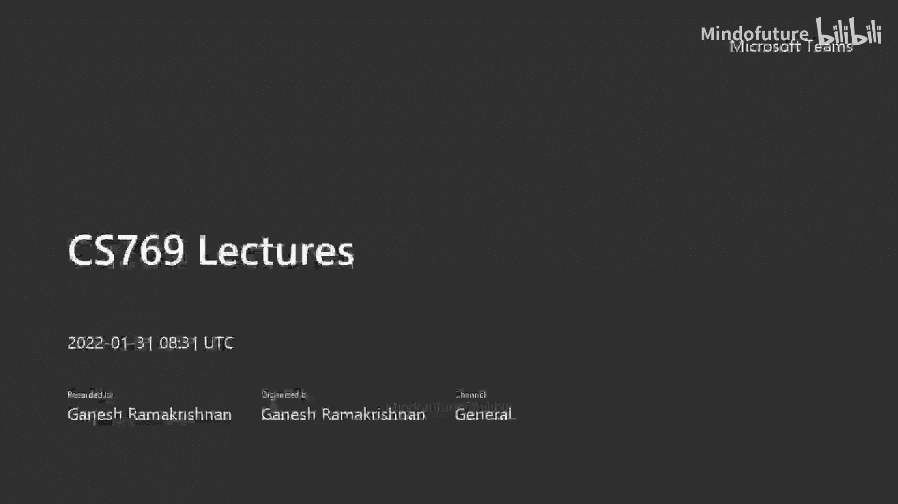
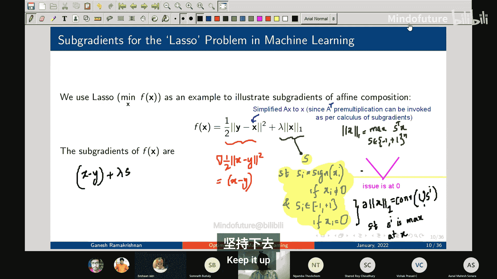
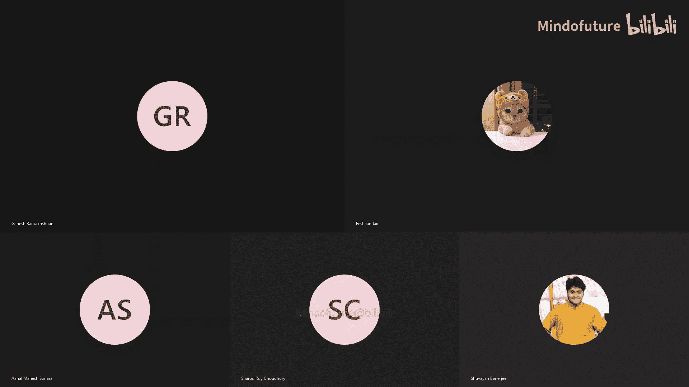

# 【印度理工学】机器学习优化 ｜ Cs 769 Optimization In Machine Learning p11 P11_第八讲_31-1_优化与机器学习_次梯度计算 -BV18cBSBJEH1_p11-

Okay， very good afternoon， everyone。 Like， welcome to lecturec 8。😊。

We continue on convexity and first order properties， and。

We already started discussing second order properties。So this is the outline。

After understanding convicity of certain machine learning loss functions。

We plunged into first order properties through an notion of directional vector and directional derivative。

The connection here is very important。We really started talking about。The the。

Diectctionional derivative。From the point of view of。

Increasing values of the gradient for convicxity。Or you could also think in terms of the second order properties as increasing curvature along any direction。

 but in both cases we have a notion of any direction。😊。

And therefore we there is a notion of a direction vector。It's very critical。😊，嗯。

So directional vector， as I said。Order。Tterectional derivative。And curvature。Are hinged。

Upon directional vector。Okay， in terms of， in terms of the convexity when we talk of cup shaped。

 right， that cup shaped。Property could also be realized。Using。A lower bound。

The lower bound are the supporting hyperplane。At any point。

Its existence is guaranteed by what you have convexity。 Now the supporting hyper planee is2。

A set week。Defined to be the epigraph。 So this is the epigraph of the function。What we have here is。

Supporting。Aleplan。ど理。related question we had was what if the function is not differentiable right and that's where we started talking。

About。The fact that by supporting hyperplan theorem。

There is a supporting hyperplane to the epigraph at every point。

 even if if is not convex because if is sorry， even if it' is not differentiable。

 I'm sorry I should just change it even if if con if a convex X is not differentiable。

So convex x for F would imply that the epigraph is。Convics。

It may not be differentiable yet by supporting hyperplanet theorem。

 which I am not going to prove there is a supporting hyperplanet at every point。😊，Can。

 so that means there is， there is an equivalent of the gradient。That is an analog。Generalization。

 I would say， generalization。Of the gradient。Call the sub gradientient。Okay， so that's what。

We kind of have here sub gradients。Subgrading calculus and conveity。

But let's continue on this to know complete our homework problem。Okay。

 so we also defined this HesN and then we showed that f is complex if and only if。hisianus。

Posure is a be defite， at every point。It's like saying that D。Alerntic expansion。

 which corresponds to the curvature are along any direction we。Already sliced we。It。

 it must be positive that curve is the function is curved upwards in along any direction。Now。

 for the specific example of。Log some X。 I had requested you to attempt this homeworkr problem。

Instead short of， you know， you can certainly derive the Hassian， but I said， well。

 how does the quantity expansion look like the curvature along any direction？😊。

Did anyone attempt this， Did anyone try deriving this。I国。Okay， great。You you drive the Hess。

 and you're saying， is it？Yes。Okay， and what does it look like？

I got the same that you showed in the next place。Of your note I got same you got this result。屋企日。

This one upon one transpo Z square in denominator。 You know， then there's one。

One transpose Z is basically some of all elements and Z times diagons of Z。M is Z Z transpose。

 where Z is nothing but E。The vector of。Es to the different components of x。Okay， this is log some。

You know， I mean， this X itself would be w Trans something else right we have simplified it here。😊。

I mean， Xk itself could be a。Linear function。So we have simplified to that extent。ok。嗯。Fine。

But what about the quantity expansion， Did anyone try that。Did anyone try the qua expansion？Okay。

 let me just present the quadtic expansion。Okay， so。As at us， as homework， what we will try and do。

AsEx as this。And how will we express this， We will basically express this as。嗯。🤧嗯。Be transpose。

Hessianvi。AndBecause to show that this is positive similar definition， you have the ACN。

But to show that process something different is going to be a little。Difficult， whereas this。

 we will show that this is greater than equal to 0。for all okay。Okay。

 so let's try doing that on the next slide Ill doing that。I mean。

 what you'll do is basically take the。Take this Haitian expression。Pre multily by。A V。

Okay now that when you pre multiply by V you know your your V can actually go inside some of these are scals。

 so know that some of the components here are scalar like one transpose z is a scalar so lets just mark all the ones which are scalrs。

😊，This is a scalar。Back this component is both as scalealrs。And what else is a scalr。

 So you can basically push。The V。Into the scales， correct。And you'll give。

 you'll push basically V as far as this component here。So your V will basically reflect and die。Here。

Dig it。You worked it out。 That's great。Z Z transpo Z Z transpose is a matrix diagonal Z is a matrix。

 everything else is a scalar。K so is making my observation。The V can be pushed。Do the。

Into multiplication with。边路。Highlighted。Itrices。Are killerers。That is a good bit of a relief to me。

So what would the expression look like？Any。Suggestions， let's， in case anyone has written。

 please let me know otherwise。We have to use the next page to write this down。

let me see if I can write it here， to be better。This all is here。等。Okay。

 let me try and write it here itself。Okay， so。Let's write down this expression。

So you will have denominator is one transpose z。Square。Okay。

 there is one transpose z inside we also stay back but I am going to write it slightly differently I am going to write it as summation z I。

😊，佢。😔，I equals 1，2 n。And there's going to be a， this is。A smaller component。

I'll just use some color coding here。 So this part。I'll highlight it in orange。😔。

And then we'll have the next component。Okay。Let use a slightly different color for these two。

And I expand the。Diaagonal said。Okay， so I will have diagonal that we we I mean。

 V transpose V so both need to be factored。And that should amount to summation over I equals 1 to n。

off。V coming from the the V on the left and then V sorry V I coming from the V on the left and V I coming from the V on the right that will lead to V square。

Zid I， because it's a diagonal matrix。 like， I mean， basically。

V transpose diagonal that V is just going to give you those squared terms in theagonal。

You can verify that。Okay， so that part is a part in pink。And then， the next component。Minus。

The Z Z trans。 What will that correspond to。So that's a transposer rank matrix。They basically have。

 So if you want， you can write this。V transpose Z。let me write here itself。We transpose Z。

Into Z transpose V。We transpose that to the scalar。 Z transpose3 is a scalar。So what youll get is us。

Scalalar squared， basically。The same as we transpose Z scalar square。

There's nothing but summation or right。I want to end。O V I is at I Square。Suddenly。

 things start simplifying so much。When do you have。到。

The quadratic expression to this entire thing is。This part but of course。

 you know that that transpose into V pre multiplied by v transpose post multiplied by v。😊，Okay。

 so much for this and then what is this basically？😊，So， if you take。

Let's say I just set pi into root of square roots at I。Okay。If I said。嗯。2 x。

Yeah I into square root said I。And said， why， sorry， this should I be the X I。It was exciting。

Similarimlyly why。Heres a squl today。Is some substitution， basically。So what does that yield。Okay。

 again， let me use some different colour for these。 So let's say。I shade this in gray。

And I share this in blue。Okay now merge a substitute。Let's see what happens。咁め。合的。그럼 we can directly。

You can do Q short directly or you can just do this additional step。Yeah。

 this basically is not going do exactly what we did earlier。Right， first principles。

 But now you see the same thing manifesting in the ACN。So x transpose x。

 this will just become x transpose x。Right， so the this part in pink。And what else will happen。

This part。TheActually， I should write down this。This is y transpose y。Right， and。This part minus。Is。

Ex trans。喂。Squaeen。So we have all everything in place。U。Okay， so yes， as somebody pointed out。

 you may not need to go so far if you could easily see through。

 but this is basically greater than equal to 0 by cautious short inequality。

Can let me just move this。要亮。Okay， so we are back to what we had。

 so I hope you got the homework problem。😊，Anyone else wants to comment。Yeah。

 thanks for identifying that you know， this is very obvious。 So this very reassuring for us as well。

 I mean we found two different ways of proving the same thing。

 Lo sum convicx lo some X very important for us for machine learning。😊。

And we see that the both approved methodologies are very similar at some point of time。However。

 they made use of two different results。Okay， so that's。Okay， is it just con or something more？

Is it strictly convicts。Can I say strictly convicts。Because equality will hold only。

Why ins are the same。Yes， can someone help， can I say strictly convicts？Okay。

 so I'm going to leave a question mark unless this one of you stands by your defense strict convexly I'm going to leave it at this。

嗯。Okay， so we solve the homework problem。And then we recap that we said that a function。

If it's differentiable， then we say that does a。Supporting Hyplane。

 but that supporting hyperplane or the supporting linear tangent。

 the underestimates the function will be unique。When the function is differentiable。Otherwise。

 at all other points like this， we saw this example last time。It may not be unique。Okay， now。

 of course， I've shown the function on the left hand side here。 is this really a subd？😊，I mean。So we。

 we generalized the notion。Upgrading to sub gradientient。

 but the example on the left hand side is it really an example of us。

That generalization of sub gradientient。Yes， anyone。不是。L that haveve shown here。Yes。Of course。

 L will not be a sub gradientient， but is L based on a sub gradientient。讲。In the case of。

 only would the or man be the same。W the perpendicular， too。

The perpenegre that we're drawing won't it be the same。 So it's a single line that。Yeah。

 but do you is everyone convicx？Is it possible that if I extrapolate the L this line here。

Willll intersect there。LG be a lower bound， right to the entire function。Yes， it will cut F。right。

So F is not convex， right？Hello， am I audible。Yes， sir it is not convicted。Yeah。

 if it's not convicts。And hence， L。does not is not a subdient。I mean， it's a it， it's a。

I complain that is locally supporting right but it' is not a sub gradientient。😊，A to the function。

Globally and we can think of it a locally local sub gradientient right but doesn' I mean we will this is from talking about that right or given that I've shown the entire function。

😊，So given the lap， the entire function is really not a sub。Or a gradient for that matter。

 So just because it differentiable doesn't make mean that you got supporting hyperplan。😊。

And just because the function is not differentiable it doesn't mean that it doesnt have a supporting eye complain right so lets I think that is important to。

😊，As a function。Being differentiable。Not。Imply that it has a。十布点。Iper plane， at all points。Okay， so。

I hope this point has come out clearly。Okay， so。let us proceed if there are no questions。

So that means every F will have a gradient， but not earlier sub gradient。Exactly， exactly。

 every F will have。I mean， every differentiable F might have a gradient。

But I it is not and every context person will have subvariient。

That that that gradient may not yield a sub supporting hyperplan on the other hand the notion of sub gradientient is based on supporting hyperplane and we are seeing every convex function even if it is not different we have a sub gradient at every point is that okay。

😊，He sir。Okay， so that's what we are coming to the next。On the other hand。Every convex function。

Willll have a some have。At least， a sub gradient。At every point。Since subgras。Gene generaleneralize。

😊，Of supportinging。hiperplan。That gradient provided。For the convex functions。Okay。

 provide only for our convex functions supporting hyperpl。

But four boundx functions we are able to generalize。Okay， so this are every convicts。A， even if。

Even non differentiable。Okay， so this hopefully I have tried to re reinforce the same point in multiple words now。

 and what we moved to a to in the last lecture was this generalization of this gradient。

 So we are saying this is no longer。A binding cost for us。 Were just going to replace this。

With an edge。Okay， so we'll just call it。An edge。Okay。

 so let's have that so that's exactly what I showed。Here， this is not even a differentiable function。

Okay， so this has。I mean， this turns out to be max Okay so we all have familiar with Max and we know Max is convex。

 but let's nevertheless， you know。😊，Identify that， you know， this。A a function。A fun。

On the other hand， this part。As a function F 2。RightOn the other hand， at this point。

 which turned out to a max。In fact， the function itself is a max point is where。

The two maxes coincide everywhere else。 there seems to be a unique max。 Okay So this F is。Ski max。

哦结分过吗。不懂。And we are what you are claiming here is that。This。I mean， this has regions of unique sub。

 this， is a region。Of no。B sub gradientient。Its there's another region it has of unique sub gradientient。

 that is this one。But the part here in Lu is where the two sub gradientients coincide。

The functions coincide。系ello。This point。Has。The都。😔，Function values。换西脸。Hence。Subgraient。

It's not unique。Okay， I。S is L1 and L2 seen as an extension of the F1 and F2 functions？No， no。

 they are alone to are both supporting type of players。😊，Okay。喂。Fact， the。Supporting hyperplane。

sorry， subgras。啊。Form a set。 It's called a sub differential the sub differential。

Which is the convex combination， convex hull， rather。Of the。嗯。Gradients。2 F 1， and F2。At that point。

 so in fact， that's what we are seeing here。 we saw that there is this shaded region， right。

And the shaded region， basically。Is a convicx hull， iss basically all possible convict combinations。

This meeting go mixed。so I'm just going to repeat。去。And say that。 this is it。

So it has a name its a space of all the subdients is denoted by partial M。😊，Okay。

 so the there are lots of catch， lots of subs which belong to this。发现。F， I mean， still is a set。

There are lots of et in this。But on the other hand， if the。

If a convex function is differentiable at a point X， then what do you know？Bendy。Yes。Yes。Unique。

 right。And what does it correspond to。Very it at that point。a gradient at that point。

That is what we found unique region of unique sub gradient as the green in the。Big lesions。Okay， so。

Yeah， and， and the proof for this。I had pointed you to my conve optimization notes。

 I'm not going to go over it。Right， so there is a claim that for a convicx said。

 there exists supporting hyper plan reach point。😊，And the the supporting hyper player is unique when the boundaries continuous。

 So when we say。😊，That when the function is differentiable。

 then we are basically saying that the boundaries continues， its the same。

Function being different and boundary being continuous。 this boundary。

So it' is all very interesting when you especially you know do a mapping to the geometry。

This otherwise， we proceed。Okay， so the proof I have given in the in my notes， I'm not going over it。

How differentiable conves function as unique sub gradient。 It's really advanced and optional。啊。是。

This epsilon delta， which we have used always right for showing or dering limits， etc。

 Thats what we are。Thank here。结实。😔，Let's move on。Unless you have some questions。Okay。

 so now just a small detour， which is very related to convexity and continuity。

 So we said that the boundary， you know in some sense， we said。😊，Right， that boundary is continuous。

 Bound continuous and function being convext。 What's a connection。What's the connection between。

 you know。Comomamain being open。And F is convicts， when it turns out if the domain is open and F is convicxs and F is continuous。

😊，And then how wild can differentiable convex functions be？

So it looks like conx functions in general are very well behaved okay。😮。

That's an interesting side thought。A convex function is differentiable， almost everywhere。I mean。

 with the set of points where f is non differentiable is very small。 I measure 0， like， you you know。

 probabilitybil。Instance of measure。 So it is like giving you cardinality in some sense functions。

So this is very， very small。However， we cannot ignore non differentiability because the global minima could be a point of non differentiability right and that specifically when。

😊，We are dealing with， say， constrain optimization。And you're dealing with you know。

 very activation functions， which are。Not。😡，Continuous。C networks。When the activation。

Functions are not continuous。You are never， anyway is not talking about global。Convexity everywhere。

 youre still talking about local convexity， but even with local convexity， you may have to deal with。

😊，The non differentiability。In lots of conventional optimization。

 I would say even recent optimization， conventional machine learning and recent machine learning。😊。

And we are dealing with constraint optimization。I mean， activation functions not being continuous。

 You know， value is one example。Many others are the。 value is very effective。Okay， so， so hence。

 for these reasons， we cannot simply。Ignore the round defiability。O。So now coming back。

 So that therefore， sub dealing with non nondefiability is important。 We go by going back to。

Subgradients。Sub differential is a close is a set of all subients。 and it happens to be。

Close and complex。So close will mean basically mean that it。

We contain its boundary So very simple we are going to know look at very intuitive understanding。😊。

So close will mean that contains boundary。Love， you know。喺度。Zero commanda 9 is open。And as you know嗯。

This square bracket 0， command 9 is closed。So's a closed。Set， and it's a convex set。 So as I said。

You can think of the sub ritual as a hull of multiple gradients， convex hull。

So it's always a convexite。The concept differential is a convex set and it's closed。

Yeah and very related to what I was saying earlier。

 every convex function has a sub differential basically this set is guaranteed to be non empty。😊。

Itll have at least one element。Whenne is convicts。Okay， now it is not that if if it's not convex。

 then。The set will be empty。 No， I mean， we saw an example。Here。

This is an example of a non convex function， it did have a subgrade in here。

 but it has a subd in other places。😊，So， let me， in fact。So here's take that example。

Let me just copy this example。Okay， so。let's go back to this。This example。So， this function。

Does't necessarily have empty sub gradientient sub differential everywhere。Okay so。

 but it certainly has。An empty subdifferent here。And in several other points places， right？😊。

Have a one。The subdient is not empty in say here。This is region for， I mean， in fact。

 for a large part， almost until this point。This function。Does not have an empty sub differential。

So you can think of this region as a convex region， right， So in this region of convexity of the。光程。

O。It is not that the function if it not if it is not conve。

 it will always have an empty sub differentialent as you can see in this example。Okay。

So let's take some examples。 I already started this。Of in one sense， I took that。

Motivating example for a sub subgradient， but let's take a more specific example。

So pointway is maximum。So if fx is max of multiple functions。

 then the sub differential is actually the convex hs。😊，Is a convex hull of the individual functions。

Sub differentials now if the Fis are themselves convex and this basically boils down to what。😊，Yes。

 anyone wants to write to answer。So ifs sorry， are not convexs。Are convicts。Which they will be。

 let's say， that's already assumed， right。Am。😔，And differentiable。Then what happens here？

Then what will be the。Some differential of F。At the pointex， So convicts hell off。Agrients。Gradients。

 now， one small point here is a it's only of those gradients here。Which。Give you the max value。

 So good point。 It gradients。But qualified， okay。I should just tilt it too much。

It's a union over index indices Ie。Where FX。Equals ethic。The placesla where it takes a max。

Of the gradient。Other thanks。Only those， not all are contributing。It is just pay some attention to。

The index set here。Other than that， you're right。I hope the intuition is clear， right。

These are the active functions，The places where the。

The functions which take that max value are said to be active。I'll just make this point here。嗯。If。

Fx equals。F I X equals F J X。If I。N Fj。Are said to be。2 addicts。Okay。

 so this should make intuitive sense to everyone here。Now， when I see convex  Hull。

 then we are also making one more assumption here。😡，If。If you take two subgradients。

Of two distinct sub gradients。At a pointex， then is there convex combination sub gradientient。Yes。嗯。

Related question is the。Convex combination。Of two subgras。At a given point。X。

 also a sub gradientient。Anyone。What do you think， always， I mean， this is always。

 not just in the case of convexel。So what do you think， yes。Yes， it is。 So that's， that's true。

 And that can be proved from first principles。 Okay， so think about it。 I'm not， I。

 I may leave it as a homework， but you should prove it。Answer， yes。Proable from。Definition。

 What is the definition we are talking about， The definition is that。H is a sub。 Let's， let's say。

 two subs。Let's give them name， right。哦。So let's give them name h one。S2 okay。

 so we know from the definition that we are talking about h as a sub gradient if f of x。

Is lower bounded by you f of x dash。Plus， H1。So this。However， rather I should put it the other way。

I put over a very sta。Do for fix。Plus， a Xx。 So or H1 x for each of these。Ar x transpose。Ex dash -6。

This holds for h1， this holds for h2 okay now it is easy to show show that if you take a conve combination of the two。

 then you are you are doing well right？😊，Let me。Okay。

 so imagine I did a convex combination of the two。I did the same thing。 Now I just replace。

H you on with H2。 And then you're done。 So， yes， that should hold trivial。

So you'll have to just do theta1 times。The first one， theta two times the second one。

 and then still the sorry，1 minus theta 1。Com used Ti。Theta times this， and。

R minus the times a second。 And then you are still in shape。Okay， so that holds。

 So overall the picture we are talking about。😊，I as follows if you're dealing with， say。

activec functions。嗯。Andm the convictxs hu， like me just。Okay， so this， this basically。Correspond to。

那个。Yes you have a。there's a notion of tangent cones here。You that large it。

This is what you're saying。 So you have。These two active functions at a point here。

You're taking the convex combination and that's what gives you this shaded region。

The boundaries will correspond to。This one， the pink one， for example， is giving。Is given from the。

Graadient of F2 and the the blue one here is coming from the gradient of F 1。

This is the overall picture。嗯。Any questions， otherwise， you want。You're done。Now， in general。

 a point is maximum。Over potentially infinite set s right of indices。That is also。

Well to give you you always have a sub gradientient。Or sub differential， as I said。

But you need some regularity conditions which I am not going to talk about。

 I mean some very simple conditions that you need on S。

And it turns out its the same the only difference， the only difference is that you had just a convex hull。

😮，Here you are seeing the closure of the conflict。 So remember。The sub differential， we said。

 was a closed convex set， closed coming out here。So if it is not close， you learn to close it。

 that's all they are saying。😡，Because if it's an infinite set。Then it might happen that。

It's not closed。8。By by design， but then the subdi must be close， you have to close the convex。🤧Yeah。

Any questions。 And we' have seen examples of this in the past， for example， if you， you take， well。

 if you take a max of。Sing values， then it's okay but you could have a very very large dimensional space of vectors。

😊，On which you' are seeking a max。 for example， we saw the some of our largest components。

 That's fine， right。😊，嗯。But there are cases like this vector case right if I have。

 I mean you saw the example of。Matx norm。There， you really had a。Infinarite number。for you嗯。

Fector reduce matrix norm。Okay， so what's the example of electro matrix norm？We saw some examples。

 right。The spec spectral norm， the。Youan。So， we had。嗯。E right。M， N A。Hos su。Or V not equal to 0。

Of and of a。The N of E。 Okay this' is an example。 The max over。infinitefinite indices here。

So in this case， you have to explicitly do a closure。Of course， in this case， I mean。

If you want to compute the sub gradientient， many of these norms might be。Differentiable。

 but for example， L1 norm is not differentiable everywhere。Okay if n happens to be N L1 norm。

Since it is not differentiable everywhere。Yeah， as result。can咪系啲。Okay。Okay。

 so let's take some example now we are going to specific examples。😊，So's see。One norm itself， right？

So if x in Rn， then one norm is what is there another way of writing one norm？

We have done this before。For example， sum of our largest components we wrote it differently can I write the one normm differently and and then therefore therefore computes subdient anyone。

Yeah， please help me。Can I write this one norm。As a max over。Potentially。I mean， not infinite。

 particularly infinite， but also very large number of functions。Is anyone。mask and。

Because we have to sum the absolute value。 So max over some V transferpos where the elements of V can be1 or minus。

Excellent。Re transpose x。Where we。Is say -1。Just one these twin， okay。不。Does everyone get that。嗯。So。

 you have to know that。This one norm is nothing but。No， max， over all possible。Signed combinations。

 right。A max of。X 1 plus x 2， blah， blah， blah， blah。X1 minus x2。

 we don't know depending on the sign， right I mean。So or or it could be minus。inus x1 plus x2， blah。

 blah， blah。just in the case of just two values， right， all it could be minus x1 minus x2。Now this。

 all of max over all of these is exactly the absolute sum of absolute values。😊，Absolute value of x1。

Plus absolute value of x2。啊，不了不了。Okay， so that's the reason we have a。Come。

We have written this very compactly。So basically， it's max over this。 Have you used S for V。

 It's a point to I is maximum of two raised to end functions。Okay， so I mean。

 if you want to expand this。Expand it further。Yeah， but it's just free time consuming。

But let me just try and quickly depict it right what how will it look like when you expand it？

I still have to raise to end functions here sitting here。Each of them will look like-1， minus-1。

 blah， blah， blah in2。So's say I have vector -5， -6，-7， minus-10。

So two is to end such configurations。And。At。Different points， a max could be different， right？So。

 at this point。The max correspond to subtle configuration of S。At this point。

 there is a different configuration that we gave you the max values so each of these configurations corresponds to one of these different points。

And these two raised to1 functions is basically the same as thing。Or our configurations。The function。

 basically， of S。Is this clear。 So given this。I've just taken this example。So if there's question。

 let me know。I'm just giving an example。 you right。 if you have something like。x equals minus-1，0。

5 S equals minus-11，1。S，-1， -11。Okay， so now in this case， what happens is。

Both of these configurations give you 6。So there could be multiple functions。😮。

That give you the maximum value。At any point。This implies。At a。Point x。They could be。

Multiple function indices or as as indices。Which。I that maximum。Gear to everyone。

Let me know if you have questions。Let just keep trying to give a motivating example here。Okay。

 so given this， let me actually move this to the next slide， right。Where it， So I'm basically saying。

This is a star。Is a set of such indices。These all these indices where the。

The all those Ss in a star give you that maximum value。This is called a star。

You can actually index it by x is says star x at a given point x， all of these Q。

Set of S such that for each instance a start， the value of x transpose。S is the same max value。

 So ideally should be written as a function of x。Or just too cumbersome。 We have dropped it。

I this let me know if you have question here。So， if this is clear。Will proceed。

The star A is all those。Which give you that peak， the max value。You can write your own functions。

So what we did earlier， therefore， is we said， well， for all these guys。

 well need to come up with her。😊，关 mix。ThatThat is pi sub calculus of subdis。

 this is exactly called calculus of sub differentials。😊，By in working。SoLs of sub gradientients。

 sub depends on。不再任性。Set of sub gradientients， sub differentials。Oh。What did it look like？😮。

Might recall that this is well， in the case of two。

There's the two lines here corresponding to two as。these two point at this point。

 these two both of them are maximum and now we are talking about the convex cell。So。

A expression is economics。And those two indices， basically a star here corresponds to these two curves。

 So you could have about a third curve which may not peak here。third index。So at this point。

 this is the。Ettics， Okay， so。Are we talked about， that's exactly these two。啱。This one and this。O。

So now let's look at some more。Subgradian Calcus。We saw additionition。Is always going to give you。

S I mean， ideation of。猪。Subgradience is going to give you a sub gradient if the addition is with respect to positive terms。

You can't have。The difference of two subds to be a subds so is positive all complex combinations what is。

😊，It's earlier， so this is generalization。 Okay So the second one is generalization。😊。

For earlier statement。😔，That。Conveyx combinations。Of subs。Acon mix。If we say any positive。

Pdia combination。Of subgras is also a subient。😔，At a given point。G we can't just change the point。

X has been assumed implicitly here。In fact， all the statements are about a given point。😡。

And it's easy to see。 scaling is also。basically。Now I'm going to give you a sub gradient。

It is a simple case where you have only one function or two functions。Think of scaling us。You。

 a special case of the second point I have talked about。So again， this is very simple。

Unless you go to ask， not I'm just going to leave it。Straight forward from definition。

You can apply it。A fine composition and norms， right？These might require。😮，ALittle bit more work。

Easy to see these small gradients。In fact， many properties for gradients hold for sub sub gradients。

 So if Gx is a F of a x plus B then the gradient of Gx is the。😊。

You can take the a outside a transpose grade of。Right。说的嗯。Ex B。

the subdi of f with respect to x plus B。A transfer us to come out。I mean， I can give an example here。

Example will be easy to illustrate or understand。So， let's say， I looking at the。

Sub differential of AW。Plus B， but let's say one norm。Yeah。This is not。Different people。

So in2 norm also if you had this you would have put an a transpose that will hold for one norm as well。

 but only thing is now I will be looking at the sub differential of。The one norm of W。Okay。

And you get all of these examples we can see。I can I can now make it more complex and I say， well。

 if I had to look at the sub gradientient。AsFor the addition part， right。

I can say if I had to look at the sub differential。Of the one norm square or sorry2 norm。W square。

Plus， a1 norm of W。This， by addition， is just have two times w。Plus。I will have the。Subdi of。

What the one norm of W。Okay so they are very handy。

 I mean if you want to do anything in ML you will you will be actually implicitly or explicitly applying these conditions。

😊，嗯。Another important special case is fx is the P norm of x， the last one。I say peace。啊。2。

 what happens， You know， I mean， you can derive it， right， too。🤧嗯。😊，That we are familiar with。

 but P is one norm we know it we we all we already dealt with the case。

Pce 1 we deal with the case of the convexs hull。嗯。But for。P between， say one and infinity。

 What happens。Anyone。😊，for p say one噶嘛哦。Right。😔，So X A P is between。What can I say about a gradient。

Does gradient exist。For all of these。That is the gradient so I have I have used open interval 1 so at  one I know it doesnt exist。

 but the gradient。😊，Should exist for P greater than one。It does exist， okay。However。Well。

 a very interesting way of writing the pen norm。I mean， we saw in the case of P equals one。recall。

I a different pen。So you can recall that。For the case of p equals1， what I did was。

He said the one norm of P。So， one norm of x。Is Max。Or else in。-1。Next one。Please to add。S transpos。

Now， in general， can I say something like this？Is that a statement I I can make an analog statement？

Anyone。Can I say that the。B norm of Q is similar max， but I cannot put a constraint like this。

 I mean， I may have to generalize that constraint。Maxo or something。Okay， so it turns out that yes。

 you can instead of using SL use as Z。Or S is also fine。 And you say S。 but this is。

Good to have some connection with the queue。Can I， and explain what is Q。

Mackax of Q norm of S less than equal to 1。Of S transpose x。Where Q is such that。Wna upon plea。

Plus 1 upon Q equals 1。Okay， so this is very interesting。Exposure to duality。

 It is actually a dual relation between。B norm and  Q norm，So Q the Q norm。Scalll that you。帮冇边。

And let's take some example。 Okay So there's some very interesting connection going on here。嗯。

So now I would like you to comment what happens if P1。Well what is Q。呃，嗯工。

All right so thats so we have found another way of writing Max the way of writing Max is not unique。

😊，It is one way of writing Max。Okay， so if P and P Q1。

 then Q is infinity and vice vera right they are duals of each other， sorry。Right。So， if。鼻管酸。

Gs infinity。 If P equals 2， what happens。You will be what。啊，这问题。Dong。

So the the two norm is a du of itself。I mean these come up a lot in dual analysis， etc ceter。😊。

And you can basically verify right I mean if this this is a this inequality this sorry this equality is a kind of generalization of quasi short right do you see that？

😊，Why is the generalization of quo anyone wants to commit。Yes。

How do how do I claim it's a generalization Causi Schwartz？Yeah， it'd be nice if you guys comment。

The totalduct of s and x is always less than equal to the p norm of x times the Q norm of s where P and here are2s。

Right， right， right。Right in that sense it is a generalization so it turns out that know quasii short is when p equals2 right and q equals 2 that is when we are that is what we use all the time。

😊，嗯。😊，So， yeah， shorts， basically。So recall Ca shorts。So what is that。嗯。

Is basically absolute value of x transpose Z。Rather than equal to。Oh， sorry， cell less than equal to。

Tome of x times the two norm of Z。Right。Equality。努 leave。X equals 0。Okay。

 so that's the coefficient of inequality。 And now we are saying well。😊，Equality holds us like max。

 So it's like saying that if。I can write it differently as。The max value is at it。For the two norm。

Right。Bax。Overall， the z。With norm less than equal to one because this is less than if norm set is less than equal to  one。

 then this whole thing is less than equal to。😊，Norm2 norm of x this is the same as saying max over norms2 norm Z is less than equal to 1。

Of x transpose that， if you want， you can put an absolute value。 It doesn't matter。 the same thing。

Because， you know， that x transpose Z。Itse is just less than equal to x， the absolute value of x。

Okay， so this you're just generalizing。From duon toon。So now we have X speedome。Is Max。

Over Z Q less than equal to1。😔，Of ex transposed it。 so that's exactly what we wrote here。嗯。Okay。Okay。

 so the this is what， what you are trying to say。 So this， this。Leads to a very interesting。

Expansion for the。Subdi of。If。What would that be。So this is require a little bit little bit more work。

So all this is fine this we are motivated。For such a cue， then somehow。We can write down the。

Sub differential of。B normal x。And it involves a Q norm。😡，Okay。

 and it basically its let me give you a hint right like in the case of the two one norm。😊。

I'm going to write in plain texture。A like。Yinda。😔，Is of the onenob。 So in one normob。

 what we had was。We are a kind of convex hull。A set of examples。Based on。Those points。

Which gave you the maximum value， right Does a support set， right so。This also。Can be expressed。

In terms of the。Supports it。Okay， so I mean， it is just the Q norm y is that the Q norm of y is less than equal to 1。

And this y is the one that。Gives you the maximum index。 So it's the same idea。

And now this it itself turns out to be a close convex set。 So if you want。

 you can put a closure and a convex cell， but this is exactly the set。😊，The closed。

You don't have to write the closure explicitly。Turns out to be。Next set。Which every。Subdiial。生命。😔。

Okay， can we derive the sub differential of the one norm of x？😊，We have done that it's already done。

 so we we won't do it again。But it's going to be the same。But if you use the above。

 it will be in terms of infinity norm。😊，So the infinity norm and that will turn out to be exactly the infinity norm。

😡，对以。If you write this down， you'll find exactly what you had earlier coming up。So okay。

 so let's just for your。Like understanding， let's try doing this。 Let me just。So， different color。

So if I start putting this constraint。Data。The infinity norm of y is less than equal to one。Right。

 what would you get， I mean， infinitefinity norm is looking at the max value。Right， you， youd get y。

 which is。An element， if you want to maximize the one norm， which is an element of minus1。

Plus1 raised to n。Because anyway looking at the max value， we should be less than equal to one。😊。

If you want， especially if you say equal to one now less than equal to 1。

 I would just push the frontiers and get it equal to one， but if you say equal to one。

 then this must be y。😊，So this hint should be good enough So you see this as a generalization。Okay。

Turns out。😔，To be the same as what we。Deived earlier。O。So this is our first exposure to duality。😡。

And the whole idea of duality is interesting this this what I talked about in the previous slide。😊。

Right， the。I mean， just two kind of k。Close this， this generalization。Is called holders inequality。

It's called。So the idea is hold hold us inequality is that you have Z transpose x。

Which is absolute value less than equal to。😊，Yeah。Q norm of Z times the。Bome of x。Where。

For all P for all one upon P。Plus1 upon Q equals 1。其说我就。Because the generalization is spread big。

I just。This is an in。It's called the holders inequality。Okay。

 so the whole notion of duality is very interesting。😊，嗯。If I want to make a sculpture， right。

 there are two ways I can make a sculpture。I惊。Car about the sculpture。闭。Moldding， right， make a mold。

 make a rigid frame。So that's one way of defining my。Bean on my be on。 Okay， so let me。

Use the same slide。This actually is very interesting。嗯。So let's just look at this for a while。

Pold us inequ。So， there are two。Let's look at duality from this。So what is our exposure dual here？

There are two perspectives。Of the P norm。 Okay so I can derive my p norm in two ways。 One is。

 let's say。Two ways of making us culture。1 is is's called the primal way。And。In this case。

 we illustrate。应个农。So two ways are defining the norm。One is the primal way。

 which which is what we are all familiar with， this like casting。Right。Casting。

 you fill up something， right， Fi up a mold。And that we are all familiar with in terms of norm。

 we can write it as。😊，The pen norm of eggs， we all know。Is basically。Smation I equals1 to n。No offer。

The absolute value of X is to P， the whole is to1 upon P。 as we know。嘅。

But now we are going to look at another way of the sculpture。What's the other。That's a dual way。

What's the other way you create a sculpture， a muhi？😮，Anyone。What is you。Fill up a mold， right。

 Whats the other way you feel you create a culture sculpture。啊，搞。Yes， carve it out， chisel it out。

 right？The other is chiseling。I not get the spelling properly， Yeah chiseling， maybe chiseling。

 yeah chiseling。😊，Caring， carving。Out。😔，Unwantted stuff， right。Undessirable stuff。Material。From the。

Aortia， right。The from the material。你。B。😔，Object。Now， how do you get the same thing out here。

 So this is， this is by discarding basically you know。And plain words is discarding。

How do you how are you doing achieving the same thing in this holders inequality is there another way I can define my P norm？

😊，What is my pen norm？In terms of genome norm， I mean， in some sense， I did that here。This one。

 right。So instead of defining p norm directly， I defined it in terms of max over。

The Qe in max over Z transpose cu of whether。Z， the Q norm of Z is limited by  one。

 Thats exactly the definition。Okay， so。嗯。Any questions。Okay。Ifs there are none。

 we could probably move on。So now we are going to the Laso problem in machine learning and we are going to now use all the。

Properties we discussed so far。And try and derive the。Subgradient， I'm going to make a small。

 slight simplification。I， I mean， typically we would have， you know， here。一。Ax， right， y minus ax。So。

 we've simplified。Y A X2 just 6。We are doing this because we know we can always use a transpose pre multiplication。

 right？😊，A transport duplication。We walked。As per calculus of。Subgraings。Okay， so therefore。

 sometimes the simplification you can do。If you want to understand what is a dash。

 I'll justpoliticize a trans。Okay。So now what are the sub gradientients of Fx？Yeah。

 just help me complete this quickly。Simple like exercise。First part， what are the subs。

What is the gradient of the first part？It it is differentiable， right。Pnt of why。For1 half。

Y minus x2 norm squared， it's a 2 norm squared by default。This is nothing but。

So this is a respect to x okay， so you may want to I mean write it differently as x minus y norm square okay。

 so the same。😊，But just bring x to the front。It is， just x minus。 So that's done。And the second part。

 we all know。😊，As derived just some time back， what is this？This is S。Next。

 so now I I have to compute the sub gradientient of。X1 norm。

 which is the same as max over s so we wrote read all that。So it is the same as S such that Si。

Is a sign of excite。If Xi is not equal to 0。X is not equal to the sine of Xxi。其 so。

Oh hope that's clear， right， because this is。Was one norm of x。Is because of itsing max。Whatas in。-1。

1。这 one。Of this Trans6。Is it going to be。This S when you take derivative， but。

It's a when X is not equal to 0。But if x is equal to 0。Then what will it be。Therell be a site in。

It's a convex combination of。The signss it says conx combinationmination will be again。

 be between minus1 and con convex combinationmination of values between minus1 and plus one will again again lie within minus1 and plus 1。

That part is it。Xi is equal to 0。Its important to understand。This is clear。You start looking like。

 okay so。The subs will start looking like。X minus y。Plus。Amra types。S。

 well lambda times s will depend on what the value of x is at that point。ok。I mean。

 this just to clarify this second part。Is exactly giving the convex combination。

I think is's convict from called convictshu。But the second part is largely because of the convex That's why we but as I said。

All convex combinations of 1 and plus 1 values between them will always give you between minus1 and plus one so just written it as。

P-1 to plus one range， close interval。 This is the convex cell。Of union or I of。A basically。

 the indexdices assigned。At。S I is Max。O。Okay， so I mean。

 we always know that the issue is always at 0， right， So this。The reason we have。Special case。

Is because we know that the issue is at  zero。Okay， so。Given this。

 so weve written this down x minus yma plus lambda S。😊，Well， given this。嗯。We have an expression。 now。

 we' are going to use it for optimization soon。What I want to do as homework is think of these next steps with composition with functions。

Where you have fx is P of Qx。😡，And we know that f is convex of Q is convex， piece。

 convex and non increase in each argument。Q I is concave。

 piece convex and non increasinging our each argument。 We know this。

 And this what gave us the lock sum X right we this how we showed。lock somems。We one way， we should。

To be complex。But imagine now we want to derive the sub differential of log sum x。

Sometimes it could involve also non differentiable functions which are arguments to X。

How do I now derive？The sub differential。I mean， here are some examples， right。

EXPqX is convex of Qs convex and so on。 we have seen these examples。

I'm going to leave it as homework。 think of how you derive the sub differentialential and my hint is go to the basic definition of subdiential。

Book。Try deriving。 I mean， you can Google and you can find。But try driving， get the intuition。

And a hint use basic definition。Of there sub differential。Okay。

 which is basically in terms of fx greater than equal to a p plus S transpose x minus y。😊。

It's transpos to x minus y so I'm going to leave you with this homework and we'll meet again。😊，诶。

On Thursday， so please also pay attention to the assignment that was updated。And we。

 we have a new deadline for that is。March sorry， February 27th。Any questions？If Londonly。

Close for today yes yes we always talk about sub at that point， right so。不好诉。

So in the previous slide， when you wrote。嗯。跟你我都在玩你到垃圾。Yes。No， a个 deal多。So， here a new road。

But the okay， so you were bottom when you were only were having it at the agenda。

actually in terms of。if X is not equal to 0，s sine of X， right？Yeah。

 so now the one you wrote in the black， that is only with is at origin。HaYeah， yeah， correct。Yes。

Right。But in， in general， you can write it as if a size。Backax， I takelate。So this is more complete。

 Is that okay。Yes。Thanks Z。Any other questions I'll be close for today。Thanks。

 I think this level of interaction is helpful now you being more interactive。

 so please continue this keep it up。😊。

听叫水。Thanks。

