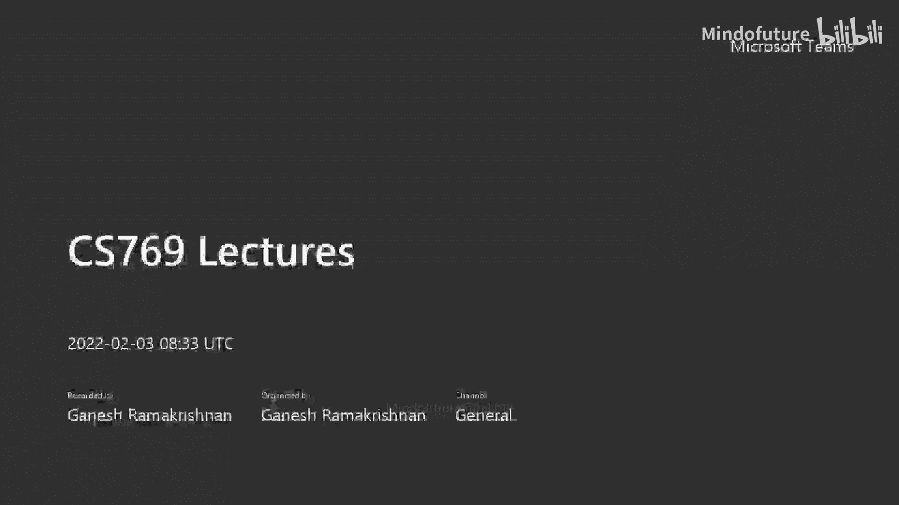
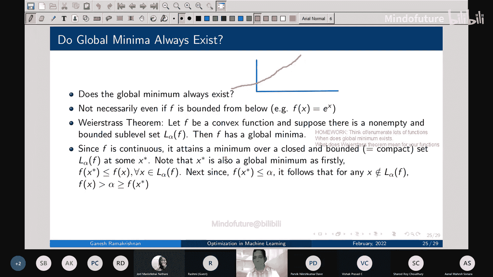
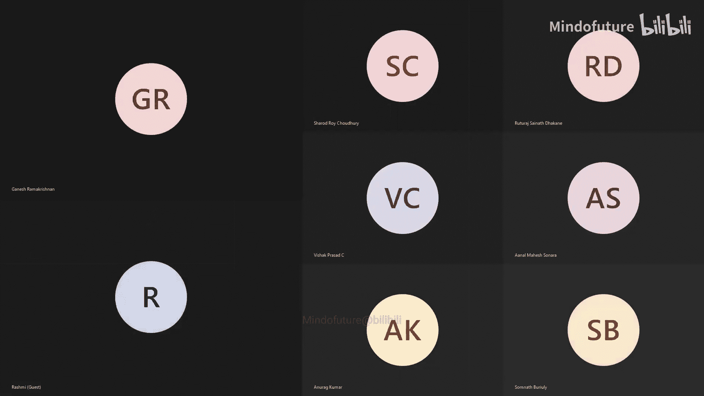

# 【印度理工学】机器学习优化 ｜ Cs 769 Optimization In Machine Learning p12 P12_第九讲_3-2_优化与机器学习_次梯度计算结束__凸性与局部和全局最小值 -BV18cBSBJEH1_p12-

1。Welcome to lecture 9， we will conclude our discussion on calculus of subgras。

And building on the homework discussion， go on to local and global minimum。 actually。

 the optimization problem。 Look at sufficient condition。For global minimum connection with subs。

Then want to go。want to convexity。And global minimum， and so on。Something's wrong yet。Okay。U。

Then we look at move on to algorithms for optimization first orderer and directorafter。Okay。

 so did anyone attempt this homework problem？嗯Yeah。Yes， yes for the question。the first one。

 So what is the idea How did you try attempting it。So Q of x is a vector Q1 to Q k of X bar。

 So we can let， let's say each of these Q I have a sub in G belonging to a sub。And then we can write。

 we can use a basic definition that Fy is greater than equal to f plus h transfer y minus。😊。

And follow up with that it's basically I got a kind of a dot product between the the sub of P and e sub of Q。

That's how you can get a sub sub differential of f， right？😊，Okay， so let's。Do that。

 So this these are parallels。1 based on。必要。😔，P being convexs a non decreasing。

While QI is convex and other QI is concve， P convex and non increasing output present the results。

But exactly the spirit of what was explained just now。You'll have the result for the second case。

 as well。And yeah， we had listed some examples of this property， but now we are interested in。

Diving the upgraded。 So let's look at this。So second one is homework in the sense that I'll give you the solution。

 you can try and understand it as homework。Okay， so exactly as was told I suggested by one few。嗯。

The first case。So。The goal here is， I want。I want to find the Hf。So F is function。

 composition function。Sos that P of Q of x just Fx。嗯。Plus。H chef。Transpose。

Which is what we want to find out。X at x into y minus x is a lower bound for F。Okay。

 so just remember that。This expition is。Nothing but I know。B ofq of慰 one。嗯。嗯。我喂。叫企啊费。

With that understanding， how do you get your H？嗯。So the first thing to realize is that。Each。

QI plus Qi X。Right， plus。H Q I transpose y minus x。Is also scanner。

So we can go through that intermediate step。So first step we will do is identify that。 Okay。

 we would like， we would know expect each of these。QI is to be also convex Q I。喂。

Which is greater than equal to。😊，By x。Plus， I know that。Q I is convex in the first case。

 So H Q I transpose。Y minus x thats upgraded will exist。 So since。Each Qite。Is convicts。

So we just expanded this one of them or in one of those arbitrarily。嘿。And then， what we'll do is。

Look at the fact that P is not decreasing each argument。Yeah。So second this is step number one。

Step number two is。The P we want each， there's only one p。B is。Non decreasing in each argument。

So what will this imply。And the fact that peace also convets。That's the third point we make use of。

So this would imply that gradient of pay with respect to collapse is positive。8。

Rent of P with a respect to。Qx。假缩。一。Is convictx。And。It also has its subgras。So based on this。

right know the expression。So you'll expect that P of r plus w。Is greater than equal to。B of all。Plus。

 H P at that point。Transfers。At R。The whole is a function of W。Oh， this is clear， right？做。

What we are doing here， basically， now。It's a。reading。

So I'm going to expand this so what we have basically is P。Applied to this vector。Q1。X。QK X。Okay。

 this is basically my arm。When I talk of an R， this is my R。And then。Plus。Ad。This Hp transpose are Q。

 right So that that basically。That's the W part， basically， there L be。H。You want transse。Y minus x。

S Q K transport。I minus X。And this is I W。So。It is use。Shading here。 So this。part。

Is the R we are talking about here。Get他 out here。And W part is。The entire component here。O。

rest is straightforward。He applied this。Basically， you need to compose this each considering that each QI。

Plus， HQI transpose y minus x is a scalar。This entire expression。Is a scaler。

OkaySo basically applying both of these together。You're done。So， this。What you get here， F I。

F at y is greater than equal to P of all this So now you have this argument sitting inside。

And then when you basically expand that by monotonity。That is， because peace。

Non decrease in each argument。Do that inequality will continue。And now， you'll have。

This new composition， as a。Sub gradientdient， this is this is going to give you the composition。

 sub gradientient。我 this game。 so the sub gradientient is basically this Hpi。

 if you take the I component here， I component from here。Multiply that by the I component HQI。

This is a subd of the composite functional text。Of course， now you have to sum over all the indices。

Okay， remember that HQIX itself is a？😮，Vectctor， so we are summing multiple vectors scaled by。

B wheres H。Getty questions。So we can be rest assured that this is， this is。In autumn。

The original space in which。X was s。So if P or any of the queues are not differentiable。

 do we also need to like take the convexhu of this set because this would be a set in that case right each possible sub gradientient of。

What are the functions？So first note that we are， this is just a sub gradientient。 Okay， it's not。

So so for every possible HQ IHp。You will basically have to consider this。嗯。十。

That will basically give you a convex cell， so there is going to be a close convex set。

This is only a sub gradientient。Let me complete that story its a good point you made。嗯。宝ever。

All such。Hps， right？I HQs。Basically， when we enumerate right enumerate rather than like me say enumerating。

All such Hps。And HQ。Because they are they themselves maybe multiple Theres a sub differential for a P。

 there a sub differential for Q。Gives us。The closed convex subdient。过点。Does that help。Yeah。

 like this， this would prove that this。Clsose convex set is a subset of the set of all possible sub gradientds。

 But how can we prove that every sub gradientdient is accessible in this format。

We haven't proven it other way around Yeah its good point， good point。

 So this is just giving you one way of deriving a subgrad here every night。😊。

There could be multiple other subs here right that was your point Yeah like this set need not be the complete set of。

Subcrients， at least we haven't do that yet。Yes。Yes。Good point。 But nevertheless。

 this gives us a close convex sub differential that you I mean， it are or subset of the subdi。

 maybe to be more precise， right， convex。嗯。Let me be even more precise gives us the subset。

Gives us a subset。Very good observation， yeah。Because it is just one way of deriving subating。

In fact， lot of sub gradientient decentcent algorithms just hnge on dering one sub gradientient。

 they could be multiple。Thanks。Any other any other point？Okay， so essentially。

 this is not the complete set of sub or can we prove otherwise that this。

So this is effectively all the subd sort to prove the tight tightness。We can show that。

There are no other subients， I mean I I don't recall of the top of my mind how you prove that。

But from what I remember， this is the exhaust set of sub gradients。But。

The proof we have is only for existence， not inubbitration， is that okay？哦。没知道。Okay。People proceed。

Okay， so you can do the other way as well as homework I want you to understand the other part this is a little trickierier iss just because now you are dealing with concave QI rather than conves。

 right。😊，So you have to use the reverse inequality。😊，So you have to use this。

QY Y is less than equal to  QY x plus H Q transpose y minus x because  QY is conre。

Arr rest remains the same。And。I mean， you still find the same it just boild onto the same expression。

So only thing is the HQI is not called a sub gradient， it iss called a super gradient。😊，Okay。

 it's giving you an upper bound。This is a super gradient。Icon came。方向。Useer。你。有了。帮忙。😔，Okay。

 any other question on this？How does they proceed。Okay。

 so let's move on to that next which is proximal operators。These are again， very interesting。

 very useful when when it comes to analysis of。Constrained optimization。So if c x， Y is convex in x。

 y and C is convex set， then。The distance of a point x from。The set C。Right。

 I can show it Let me illustrate it。In this distance。So， this is a。convicx sectors D here。

Is his distance。So let me draw the D。Is a convex set。 So a conveyx function。So now for this。

 how do you compute D？Subdi or sub gradientient。Any thoughts？

So is this distance like minimum distance。This is a minimum distance in Fum。

 So it's possible that this set。See。Is not closed。 It may be an open convicx set。Okay。

 so then therefore we look at infium。 So let me show an example a good question。 why infim， right。

 So let's say this mindset see was like this。It's my set toy。 and my point。X is on the same plane。

 there' is an open circle。one mixing。Open got mixed。So， this X。The distance of x from the C。I mean。

 unless you do infi， there is no minimum minimum is not defined。 So infium makes sense。😊。

Is that making， Is that okay。那好意思。So minimum is not defined。

SoEspecially when the point X is in the same plane as C。Hyperplan see。Okay。Very good point here。

 So this justifies a user in phma。So this D is a convex function。 And now what do you do with the。

Sub differential or sub gradientient。其实嗯。This the you can write it differently。

 minimum over a of this function。X and C can be written in terms of an indicative function。

Can write this as。柠蒙。Of some functions。听要识得。boxox。E。Such that。X and C。C is convics。s。

This can be written is the same is the same as saying。Vin overex。Of X。Plus。

 an indicator function over see of x。Where this。IC X。Is0。If x is in that set C。

And let's say is infinity otherwise， I mean， you will really not pick such a point right because I see is going to infinity。

You are violating。The constraint。 And you'd rather not go to such a point。So this is how。

We kind of totally dead。Violation of the constraint。

This is how each translate index and see so that she's going to mix it。嗯。This is， is when。

 for example。And this approximation function， special cases when。You basically take。

The indicator function。 So this pros。Can be thought of as a。

Sarogate for approximation to the indicator function。Spox。SoInstead of saying indicator， I'm saying。

 okay one。If P plus1 half explains y。Approxiation。The indicator。Okay。So this， this。

 this a special case。 special cases is when。We have a P indicator function。

So you want to eliminate constraints of an optimization problem。So it's such a case。

So in such a case， we resort。嗯。To this normal cone。

 So theres something called a normal cone which gives you the set of sub gradientients。

It transpose y as that。So it says that as transpo Vi grayn e trans was Z for all z and C。

This is a normal conness。喂我美馆。Okay， so I mean， we will will use in work something like this when we talk about the proximal gradient decent algorithm。

But we'll bring it up later on。It is also part of subgrad in calculus。Again。

 I'm going to leave some of this as advanced and optional like perspective functions so I mean the sky is limited and we talk to talk about you know calculus。

😊，Subgradience。 But let's say， you know， I have。I have this perspective function。

 which which is dealing with。You know， when I。Let's say have some text like this。

Good morning is written here and I'm seeing it from the side。

Okay now many is when I see it from the side obviously all the good morning pixels are basically collapsed into one that is a perspective transformation。

😊，An example of。但说明信。Propecttive transformation。Turns out。

Be this function that does this transformation。Is an example of her。Perspective function。

 which is a convex function。How does it look like？😮，Pospectitive of function a。Is this function G？

Now what G has done is its added one more coordinate to which two project now I have shown a side view you could have taken maybe a top view or a slant view right so this t is giving you the kind of view。

Vi based on which you are ingesting the text。 So the T is like the view。The extra dimension here。

And what it's doing is， it's just。Pre multiplying。Party。And dividing the argument by T。

So this is that perspective transformation so example is if you have fx extrapose x。

Its perspective is ispo X Y T and its convex。Okay， so likewise。

 a perspective of negative logarithm is called the relative entropy function。And。

T log t minus t log x is also convex。嗯有。Is related to what we also know as cross entropy。

You can view across entropy as a perspective transformation。Okay。

 so what about the subdientials here？so think about this。 I mean again， it's going to be optional。

I will not。Insist on this。Well， let's move to the next topic unless there are questions here。

 So this is giving you some glimpses into some。Ladian calculus。

But there's another interesting aspect about sub Koreanient kind of functions。Dock off。A notion of。

Mootton vectors， monoton function。Which are vector functions。Let's draw an analogy。

So if we talk of convexity， one way of understanding convexity is that f dash x。Was we increasing。

 strictly increasing。So a slope keeps on increasing， that's convex。应该 just度。

Now ist an analog for going from R to R。Anyone， any thoughts。So， is。De。嗯。And analog so。

And we talk about strictly increasing sub gradientient。As as a strawman， right。It's a vi。

 Can you talk of that。Every component of the function should keep increasing。Anyone。

That will be a bit limiting， right，s it's like saying， okay， I have a dash。X。Minus of dash right。我顶。

2 y sorry X minus y。This should be greater than strictlyly greater than 0 or greater than equals0。

But this， I mean， you can say for。All x， which are oh yeah， This basically means that。

This is basically saying that Ft x is greater than Ft y or for every component。😡。

When every component of x is greater than every component of why。😊，It's a bit limiting。

And doesn't make sense。Okay， what could you do as an alternative。So I'm going to strike this off。

 this doesn't make sense。What could you do as an alternative？Can we talk of something else。

And we talk about monotone vector。And it turns out we can。其そ。

You can view is upgraded as an instance of a general function edge going from D to rn directly least a subset of rn。

I write， and then we can talk of monotonity of edge。As follows。 So instead of saying， okay。

The product right for is is greater than equal 0 which doesn't make sense for every component right I mean this this was a component is inequality。

😊，So。What we had written。With component。Pice product。系呢过嚟啲。😔。

Liiting but what we are doing instead now is saying okay instead of component wise product technical quality。

How about I taking。A dot product of。The sub gradientient of F。Atex the sub gradientient of effort y。

And explain why that's exactly what we are doing here。

So saying the dot product so instead of component wise， we have dot dot product。

And looking at the sub here instead of M dash right instead saying dash every component。

 Ill say okay the entire vector itself。😊，Thiss called a monotone。I mean。

 you can have a strictly monoton variant。So what you're doing strictly monoone is。It changes， to。嗯。

Rather than you get strict full tone。Okay， so with this。You can also define a notion of。

Uniformly are strongly monotone， like we did before， we had a strong convexity。

 we can talk of strong monotonity。Basically， you're saying that this vector will always make a。😊。

Acute angle， not an obuse angle。 Okay， so lets。The thing in terms of angles。This is like saying。

Angle is always。Accutute fact will never be 0。 No， never be 90 degrees。

The angle is always acute whereass。Here。We are saying that。 The angle。Will be。

Lower bounded by automatictic function。 I mean， it's not really angle， but dot product。

 right angle be lower bounded。喂。Some quadratic。Punction in the numerator denominator again。

 youll have to have the norms， etc ceter。Spirit。P simple， plain English。Based on this。

 now you can come up with。Someub gradient notion of convexity in terms of monotonity F is convex if and only if gradient is monoton。

You can talk of subdings also。Yeah， but strict monoity becomes a tricky thing。嗯。Its subs。

So they also hold in general for subients as more。Well quickly show them only for gradients。 I mean。

 we can。Good for upgraded， but as I said， tricky。Hp is called a proximal gradient of f if and only for all y domain of f fx f is gradient than they called fx plus。

😊，You know， this dot product Hp y minus x square minus lambda by2 norm of y minus x squared。

So there' is a notion of proximal gradient as well。Let's not get into that。

So all that I markedpped in red is advanced， but the part in glue is fairly intuitive。I mean。

 as I said， the intuition is from one dimension。Of a strictly increasing。Graient。Or derivative。嗯。

It doesn't make sense to talk of every component so we are talking in terms of that product。

 which is the same you can you can show that a special case is in one dimension。😊，Okay。

In one dimensions is easy to see。也是。Pos to。Increasing。mean， sickly could be in bracket trade。

A strictly increasing diameter。Okay， yeah， that's what I've tried to shown。开灯死了。Okay。

So I mean I'm not going to go over all of these proofs。

 but as a homework you know you can look at these I also provided them in the。😊，Modal nodes。

So for necessity， I'm going to run through it very quickly。

So necessity what you do is just write down if it strongly conx。

 we start with the strongly conx case write down and I just add these inequalities。😊。

So what would happen when you add these inequalities？Yes。Things will get canceled out。

These parts will get canceled out。Wite。Fx， So it's very simple， right。And you'll have this。

Difference of the。2 gradient， if you add them， you get the difference of the two gradient because of the flip in the sign here be minus y plus x。

Okay， so。Then then you'll get C by。 You'll basically get。嗯。C by 2。Yeah， this this isn。

C and half C even become the C。So this is very simple so basically that the fact that dot product is lower bounded by some angle in the numerator sorry is is lower bounded by some quadratic function for the angle in the numerator。

😊，So to prove efficiencyuffiency， a little bit harder work has to be done。

 but we can apply the mean value theorem and very interesting part here。

 I think I want to just highlight。😊，The interesting learning here。Which is that no。

 you can project everything to one dimension。 That's interesting。 So you deal not with。F。

 but you' are dealing with this function，5hi。Okay， which is operating in one dimension。嗯。

Now it's basically showing my mean value theorem that f phi0 is fx phi1 is fhi。Does phi0 is F。

Phi1 is f。And 51 minus50 is 5 dash1， right？😊，But by mean aus theem that will exist such a。F a team。

Okay， which will just turn out to be。The dot product。WithThat door product， basically。

That' is why this result itself was there。Because this dot product， what was corresponding to the。

The5 D in the mean value term。Okay where I this all in here， I will not spend more time。Okay， so。

You can basically use this result to show that。F is convicts。

AndSufficiency is basically we use monotonity of gradient in relation to the。Meanwhile。

 you hear them。It basically made use of the fact that there is monoity of。哦诶诶。Sorry， F。I good。

The case of strong convexity， theres a little bit more work you have to do。

So not only youre looking at the mean valued theorem。

 but you have to also know to get some quadratic expansion。And then， do some integration。你说。

Across all values of T so that you get this quadratic lower bond which is independent of T。

So what we have done。Is to move from Ct y minus x norm square you basically integrated from 0 to1。

Of city。So now this is in terms of Ty and x are fixed。This this expression。

1 half C Y normal vitamin expression。So that's the only additional。And of work we need to do。

So any questions so this kind of brings us to some more analysis of gradient subgras， monoonicity。

 their relationship and a definition of monoity， sorry convexity in terms of monoonicity of gradients or sub gradients and so on。

Think of。Now， move on to。Optimization， so any questions。Okay。Okay。

 so now let's look at optimization real carefully。 Now， this is a plot of a function 3 x 1 minus。

X1 square minus x1 Q minus2 x2 squared plus x2 is to 4。

And you can see this function of several local mini and maximum。So let's try and plot those maxa。

Here。😔，So。Can find。one。Pome here。你暗。I mean， some of them are hidden here， you can't see。

 but they could be more as the function grows further。But it also has lots of minima。

More of the minimas are seen here。There's one。 Then there's one here。Local maximum minimum。So。

We all know from our basic calculus notion of absolute maximum and minimum。

 but now you can talk about。Fun of you know， multiple variables。And extend the same definition。

So you have a notion of absolute maximum。With respect to a set D， right。

 So domain has to be very clearly defined。You can also have。An absolute minimum。At c。

 if fx greater than equal f of c for all x and D C is called the point of absolute minimum。

 you can also have local maximum， but that requires you to have a ball。😊，And not just a ball。

 an open ball。It contains a C。 So let's say I have this function。

I let's look at the maximum case first。So this is the Fc， right， maximum value it has。多。

You need an open ball B， for example， in this case。InThe one dimension case。

 you can easily understand this。 Zx says that， you know。Normal of x minus C。

But you' are not looking at。Les than equal to just listally less than epsilon small ball around。

And what would that amount to hear it basically mean？A small region around this。

In non trivial reason， it cannot be0， non trivial reason。So。Now， why we talking about open ball well。

 well， iss local， it's possible that as you。I mean， as。

You move further away you either violate a constraint or you move outside the domain。对。嗯。

A local mini maximum is in terms of， again， an open ball， but the inequality is flipped。It can。

 you can dip down somewhere else。What does my F。我可以给你吗？You can also have an extreme value。

It is either a local maximum or local minimum。Now， how， what is the relation of subgras。I know。

Global and local minima。So， we will quickly look at sub gradientient based sufficient condition we are not looking at gradients alone。

 we are looking at sub gradient the larger class。😊，So we are kind of generalizing。

We are starting with a more general statement。Convex functions， specifically。嗯。

We have that a point of local minimum is also point of global minimum。For a strictly convex function。

 there is also unique point of global minimum。Okay。嗯。Goods。Understand this a little bit carefully。

Okay， so well going back to our old figure， right， we we find that the function has many possible linear tangents。

That may form a lower bound。So that that's how we define the sub gradientient。

The linear tangent lower bound。So question is what is its connection right it's a minimum of the function or minima of the function。

I mean， the the relation is a little obvious in this inequality。

 I like YouTube suggest this is would be open for discussion， yeah。Yes， anyone。This is very。

You should get it。Okay， if the set of sub gradients has the horizontal sub gradientient as well。

Then it is a point of minimumma。喂。嗯。If there exists。A horizontal now， when you say horizontal。

 it is a this function view， right？Yeah， like as an in the graph right now。T alert to the access。

W to lower Mount parallel。The input。Space。All right。at the point of。APoint of minimum。

Then you're saying x was B。A point of。Look个啦 Logan。视频呃。No。

 because unless you are assured the function is convex， we can't。Okay， but just make a note。

 that we are talking about for all why。F p is greater than equal 2。Fx plus。H transpose y minus x。

For all why。If if you want put a X subscribe here， can that X。So do you want to revise。

 is it local or global global？Okay， so some points are important moment we have we will show this more formally。

😊，But moment we have a for all， we can take a little bit more liberty。Okay。

 and then what basically is saying is that。There is a horizontal lower bound。

 horizontal lower bound basically saying that there is no rate of change， right。

It saying no changes to the function value on small movement around x。

What would that amount to again， I mean。Just equal in ways of saying thing。Right。

Can I say that this would amount to。A zero sub gradientient。Our sub Wednesday sub gradientient。

Victor。It just zero。The zero vector。I'm kind of also alluding to the discussion below。

This this horizontal lower bound parallel to the input space。

 right This is in the function space So note that this is all in the function space。ok。

So let's actually show this。Forally， so if for a convex function， F moment is a convex function。

 it has a sub gradientient， so。Mo minute I say convex， I think the liberty of writing down my。

Subgraient。Baase inequality。 And I'll say， for all。Why in the domain。Of F。

 it should happen that F of y。Is greater than equalta of x。Plus aX。Transpose y minus6。So， down。If。6。

Are there。Exist， okay now that's a formal statement I'm making。That exists 0。

Which is an element of the。Sub differential of F attacks。Great。That is。X x equals 0。

Is a valid sub gradientient。Then。What can I say。F of y， again I'd be very conscious。

 I'll just copy this whole thing。Everything is the same except that F of y is greater than equal equal do。

😊，F of X。For all Y in the domain of this is the key。

So then that that basically is now showing that x is a。😮，Local minimum。

So I's just saying the same thing here again。Fx star is min of F。Then。Right up。If if sorry。

 if 0 belongs to a subdiential of effect x star， then fx star must be the min of fx。😊。

That hs0 being a sub gradientient。For all way。Exactly what we wrote in the previous slide would mean that。

F of y is greater than equal to。If of X star。Plus，0 transpose。Why my star。So they have a mixture。

If a fixed star must be a pointum。 A X star must be a point a minimum。Okay。

 that's exactly what we wrote。So we have a special case of this， which we all are aware about。

The gear off。Differentiable。If。In which case a sub differentialential is exactly one point or one vector gradientnt of Fx。

😡，So if the gradient exists， its function is differentiable。😊，Then you just set it to 0。

 youll get 1 point x in fact， you could get multiple points even a solution to this。Gens。

Is there a necessary condition。For a differentiable function having a local or global minimum attacks。

Right， this is a sufficient condition。 So let's just。Let me just change this color too。

All this is basically a sufficient condition。This is only a sufficient condition， not necessary。Okay。

 but what if。I wanted a necessary condition。So little later we will talk about we will deal with it。

 we need some more equipment， so let's start a sufficient condition which itself is a good thing for us。

😊，And now we'll apply it okay。😊，Let' us apply it to Laso again。

 and we will in fact very soon get an algorithm。😡，So there's a Laso problem。Wehich is again。

 I've simplified。😊，Ax to just x okay， the same old problem which we have a simplified problem the plus class。

And we had written down the subds of Fx h is x minus y plus lambda S。Where S I is a sign of。

X if X is not equal to 0， and si is between minus-1 and1， exactly the same。

Convexhu right This is basically a convex。H。For sub differential。Okay， so this is so far so good。Now。

 I would really like you to work on this。 I mean， is all of you， if you have notebooks。

 write this down， this will be very helpful。I'd like to draw your attention to some corporate some parts of this。

Here。Okay， so this， you might recall that。This Lada X1 is what gave you this Lada so keep that in mind。

And this what we are going to do is look at。This expression。Look at cases。

 we have different cases corresponding toxi not equal to 0 andxii。Equal to 0。

And we are going to basically now make cus of。What we have derived with the previous line， which is。

Unsuff condition。So this is based on when I say solution to this problem， it's basically。Based on。

The sufficient condition of the previous line。But we want to apply it and get hold of a kind of solution what what exactly is happening。

Okay。So， let's write down。I'm going to。Highlight this as case 1。Case1 is S is sine X。

 he says let's call this case1。entire expression。Okay。

 and we likewise write down something for case2。So what is the expression for case 1。Yes， I like。

Participation at this point。So I want to basically set this this entire thing to0， right？

How do I set it to 0？Based on these cases。Now Xi， now we are talking about X star。

 a point of solution right which satisfies a sufficient condition。What would you expect in that。

At such a point。So this is case 2。Okay， anyone。So let's write down what happens if H is 0。

What happens if H is one。Yep， I mean， or non zero， right？And what I is non，0。所以。

But let's start with the chi 0 that should give us pretty much everything we need。

If a charge is 0 and then now look at。The cases， if X is not equal to 0。

That itself can have two cases。 I'm going to now expand on this a bit more。Okays， help use。

The pinle itself。So， Ill have a。Two cases within case 1。If a is equal to 0。

And let's say exc is greater than 0。You can help me if H is equal to0 and。Xi is less than zero。

 so can you can feel free to more create more cases。Okay， so can me come up with some。嗯。

Cases for each of these is。I need your help。To complete this。租。Can I say that a chi？

If its equal to 0 and x is greater than 0。Which means that S must be。Plus，1。

S as per the case1 is side of X。Which must be plus one。So this is the same as saying what。hi I。

hich is X I minus y I， so I'm talking about I index okay X minus yi plus lambda S。Sure。

Lambda S is going to be。Just lambda。Okay， so this implies that。The first case。

W is which is equal to 0。Is X minus Yi。Plus， lambda。Which is equal to 0。

This is if and only if is bidirectional， if and only if。Now。

 we are trying to come up with a solution if and only have X equals。Why are you minus lambda。Again。

 so I'm， I'm putting the。Now the onus earlier was that chi equals 0 and X equals0 X greater than 0。😡。

I'll now put the owners。On维。So X equals y i minus lambda if it has to be greater than0。😊。

It's like saying that。X I equals Y。Minus Lada。And。Why I greater than Lada。Okay， just know this。

 Now how we have gone from。 I'm just going to。Inotate this。 Okay， so just note this here。

We had X greater than 0。HI equal to0 got used。 So I that' is consistent everywhere。

But here I have flipped I have gone from X I greater than 0 to Yig greater than lambda because that' is what we know。

😡，So诶。Let me just change this to if。这ive。That's where where we began。Kaw。

So this should be easy to see。Call it Xi star if you want X star is star minus Y I minus Lambda if Y I is greater than Lada。

😊，Now， I can complete the other part very similarly。 So I'll say。This has H equals。Xxi minus Y。

Mineus lambda just because sine is going to be negative if X is less than 0。😊，So。So not this right。

 So if it's the same thing。If。Or El。And there is a similar。 Okay。

 so now I'm going to similar distance。嗯。Signs will get。So then you'll have X equals Y I。Plus， Lambda。

 side associated Lambdas got flipped。Now this has to be less than  zero。Okay， even only live。Excise。

Y I plus Lada。If now that if has become。喂喂。Is less than minus Lada。So， this。Is explain the case 1。

 What about the case2。If X equals 0。What happens in case2？Anyone。It's all case one。Yes， two is。

Xi equals 0。Xi equals 0 means S is between -1 and 1。Great case to。

I want to know what is that x where the solution is well be point is。😡，Not an issue at all。 If X， I。

 I mean， youre perfectly fine。 if x is 0 and h is 0。 case 2 is what。Nothing but。

H is0 you want that's sufficient condition you stand by it。And。X I equals 0。Now。

 when will this happen right So you just need to write those down to。At Ja。So， now。嗯。

What do you write for。S here is tricky。 So let's just finish that minus La minus y， okay， minus y I。

Plus， lambda aside。Equals 0。 I think Im I've been missing the zero some places。Equals 0， let meius。

Shring this in。This was meant to be equal to 0。The previous line， as well。Okay， going back here。

 So this is。All this turned out to be。You'll just get。I try it to be 0。Yes。

 somebody wants to say something。这 the声音。If somebody wanted to say something。

And no I was just going to say the next step。 Yeah， please go ahead。 please prompt it。

So we'll get y Y is between minus Lada and Lada for。Right。So this is like saying X is 0。 And this。

 if I is between -1 and plus 1。And if and if this sum has to be0。

Then it's the same as saying if y is between minus lambda plus lambda。And if xa is equal to0， right？

😊，不。Okay， so now just let me just move these parts together。 So these are， this is basically。

What we want。Let me just smooth this here。This entire thing on the right hand side is our solution。嗯。

Okay so I'm just going to box this spot。And read the solution。

 We are basically are saying the solution based on this。

Subdiential is that if I is greater than lambda x is y minus lambda y is less than minus lambda x y plus lambda what are these two saying well if I is too positive。

 then shrink it if Y is too negative。Then grow it by lambda。

But if it is not neither too positive nor too negative。

 it's between minus lambda and lambda let X become 0。

 thats a parrssity Okay so this last statement is giving you parrssity。😡，Sparsity in this in， in。

 in this closed interval。And the cases one and two are basically saying shrink。

Shrink beyond the close interval。 So in plain English right。Gase。1。Srink。😔，I mean。

 positively or negative shrink。Beyond。Clsose interval。嗯m。Hope you are able to follow this discussion。

嗯。A simple application of our。On all our calculus so far。

So this solution is the motivation for IT algorithm。 Yeah， this is exactly。 So there's I try to。

Soft shielding。Which is for Laso is a motivation behind that。 Yes， let me make a note of that here。

Any， anyone else with a good point。However， I must tell you that we have not yet evolved an algorithm this is right right Philiplip I think you made a good observation。

 this main motivation behind the iterative soft thresholding algorithm。😊，But this， this。

 we still don't have an algorithm。Actually， write this as an algorithm。

 we need something called proximal gradient step。😡，Thiss a。I would say this。Plus。Proximal。Graient。

Pcent algorithm。Together， give you this iterative soft shing algorithm for。Laso O。

You probably come across in your machine learning class。Okay。

So this is in this the name Al soft thresholding is also embedded here。

 this is called the soft thresholding operator。😊，This whatever we derived on the previous slide。

 Ive now written it in the form of。A very specific。嗯。Operator。So what what is it saying。

 It's just saying that well。嗯。I mean， threshold， basically threshold the value。Of y。

 And then assign it to x。So now that you apply this iteratively in this proximal gradient in descent algorithm。

😡，Any questions。Or comments， any other comments？Okay， so I mean， obviously。

 we want to know if this converges。 Why will it converge。I mean， it is just some random you know。

 fixed point， basically you're trying to get to this fixed point， right？😡，Well， I mean。

 it is motivated by this fixed point， but there is a principled convergence analysis also。😊，嗯。

If questions， Let me know。 otherwise we'll move on。O。NowNow what we do is look。

 this is all sufficiency。 All it did did it was sufficient condition test。

 but I mean that is necessary you this is the way to get the answer， right。How do you prove that？

So now we'll move on to the next whiches。Any point of local minimum is also point of global minimum and for a local minimum our necessary condition is that gradients must vanish。

😊，So， overall for convexity， this is also giving you a necessity condition。

 necessary condition and in fact， for convex regions。😊，How do you prove that this is， okay， so。

This is for non convex and convex， both these applyly because we are talking about convex regions。

Okay， so let's now prove the next statement。Sp my pen。Notless。So， let's say。

X is a point of local minimum。And y is a point of global minimum。 And what we want to show is that。

This point of local minimum solution is actually also point of global minimum solution。

So I will pivot on。An image。 Let me。哎呀，算了算了。Want of time。 We basically will save some time by。

Using an image I've drawn beforehand。Okay， so this is the image I would like you to bank upon。

And how are we going to prove。So the idea behind the proof。

So idea behind the proof is that you'll say， well， if your。

Point of global minimum is different from your point of local minimum。

 you can actually find another point which is a point of。😡，嗯。Global minimum。

So you are constructing what is the idea behind the proof。Construct a point。Hypothetical point said。

You can show it by treat it as approved by contradiction。

 but I mean I' am making it simple here right so you are constructing a point z。😡，And。

That this is within。The open ball。To open wall that use I've seen here。

And what we are trying to show。Is。Function at the point Z。

Will actually evaluate to be less than that at x。It x is a point where we have a local minimum within the ball itself。

 we have a local minimum， another new local minimum y because you are claiming there is a y which is different from x。

 which is a global minimum。😊，so this is just because。I claimed。That f of y is less than say f of x。

Okay， so this is the idea behind the proof。So you are saying there' is an F5。

 which is less than F of x y is outside the ball， somewhere else， it' is not local minimum fine。

 but I'm giving you a Z。😊，Which is within the ball。 And I'm contradicting your original point that。

X was a point of local minimum。All of us know that local minimum means there is a ball of radius epsilon around x right。

😊，So this can be treated as approved by contradiction。😡，So， I would like you to。Help complete this。

 How would you complete this。I mean， here I'm saying well bring convexity。

Le of the proof requires convicxity。How do I show this by convexity？Yes。Soci。For that。

 we have some lambmbda is that that is lambmbda express one mass Lambda by。嗯。Great。三。

Great lambda5 plus1 minus lambda f x and since Fy is less or equal to fx。

We plug that in and get that Fz is less every quarter of us。Good point， yes。

You could also do this by mid midpoint convexity Yeah I mean the midpoint， etc cetera。

 but yeah this basically I just want to find。😊，That Z。

 which just now marginally pulls me inside x and then use the convexity。 Okay， so here's the。

So I'm just reproducing the say same image here。So that you can。So。Yeah， so there's an Excel。

Ball around x local minimum。Such that for all the all Z within that ball， Z minus x。😡。

Which is less than equal F cell。 And F of Z must be greater than equal F of x。

 That is a contradiction。But now I'm， I'm now going to construct a particular point set。

And what does that point said？A conx combination theta y plus 1 minus theta x。

 but the key here is this this value。没有。This tee。Is mine。Point in the counter argument。

 I have a theta。 It is epsilon divided by 2 y minus normal y minus x。Okay。

 and I can show that this theta will get me my Z to be within the ball。So。

 since x is a point of local minimum and since F of5 is less than F ofx because we said there was a different point of global minimum。

😊，So it must be that you know， normal y minus x is greater than Epsilon。

So now if I take theta to be less than half。😡，Then I will find that z minus x norm is equal to exactly equal to xil n by 2 so I basically basically I found a point that within the ball。

For this choice， I have a point within the bond。And that what is that point。

 a point found a point which is a convex combination。Of x。Why within the ball。

 now the only step remaining。Is to show that such for such a point。By convexity。Of f。

Can we show that。F of Z is。Les than F of x。That's the next step。And it turns out， that's very simple。

SoI'm just again， it's important to keep this in mind。 So since f is a convex function。

 what can I say。F of Z is less than equal f of theta。Could't wait my pen minute。别如。😔，So I like to。

 I just， can't find my pen anymore。Miplaced it。So F is a con function。 I know that F of。

Z is less than equal to a theta times of of x right plus 1 minus theta times。😊，F of why。

But you also know that f of y is less than f of x。select let just continue this。So。

 I'm just going to。Give you the context again here。

 So f of x is that is less than equal to theta times of of x plus1 minus theta times f a y f of y is also less than f of x。

 Now the rest is simple。 What would you do。😊，Just apply the two together。Right。Com mining the two。

If a y is less than if of x， just sub it here。It basically get F of Z is less than F of。X。

 that's it substitute a lesson， right。And。Because less than stick less than is because of this。

 this being less than。Okay， that's it。嗯。Two equations imply that f of Z is。😊，Less than F of x。

So then how is x a point of local minimum， which is different from a point of global minimum。

 it's not possible。So， that is what we have written here F cannot have a point of local minimum which does not coincide with the point y of global minimum。

This is a key， any questions？Okay， now let's apply this。 We have pretty much。Lady。Before we apply。

 we are going to just look at one special case， which is strict convexity。Now。

 if a function is strictly convex， then it looks like the point of global minimum is unique。

 you cannot have multiple points of global minimum。And in fact。

 you cannot have multiple points of local minima。I mean， either by the， by going by the same count。

So what would you prove next， What's your next step， What to be。The point x plus y by 2。

Right now this is a point I'm going to show that if the two points of global minimum。

 I actually end up getting a third point which is。😮。

at which the function will evaluate to a smaller value than the previous two value right the logic is。

We have constructed。We show that。By strict complexity。That we have constructed a new point。

Ithi is x plus Y Y 2。Which， which has。Function value， lower。Than the previous。The2 claimed。Points。

Global minimum。 So we are not talking about local minimum anymore。😊，Now， this is a contradiction。So。

You should be able to show this very easily。This is my strict convexity f of x plus y by 2 by midpoint convexity is exactly the point of mid point convexity。

Or mid point strict con。Okay， so now now that we have you know set up the context。

 I mean the do global mini always exist。😮，Right。Well。

 it's not even necessary if F is bounded from below Ease  to x is a classic case。Now E is2 eggs。

It the function of course now tends to infinity on the right。But as x goes to infinity。

 it's actually tending to。Okay， Soier。I want to do it using my mouse， but it's going to be like this。

It's not even mounted。Is bounded from below， but it doesn't achieve that lower bound。

So when is that global minimum achieved？If f is a convex function and there is a non empty and bounded sublevel set that f is a global minimum。

Okay， so we are going to discuss a little bit more on this。😊，In the next class。

But what I'm going to do review us homework。Is to show that if F is convicx undientiable。Then。

 the gradient is a。Gives you a point of loop the gradient。Banishing at a point。

Means that's the point of global minimum。So you can use the first start property of convexity to see this。

And thereafter， we will now move on to characterizing optimization problems。

 constrained optimization problems and more generally convex optimization problems。😊，Okay。

 I'm going to stop here any questions or comments before we conclude and we have one minute left。

So my homework problem for you is de a little bit more。 don't you don't have to try and prove。So。

 homework。Think of no or enumerate， think of slash enumerate。

I know lots of convex functions of functions lots of functions， convexs and non convex。And you know。

 deliberate on when you can realize a global minimum。😮。

And then also try and realize the vicerust theorem， right？

What does it mean to have for a conx function there what does it mean to have a non empty bounded sublevel set？

ge on。If there are no more questions， I'll leave it at this point。

Thanks， everyone。はい。

