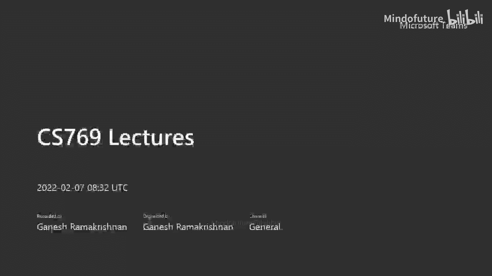
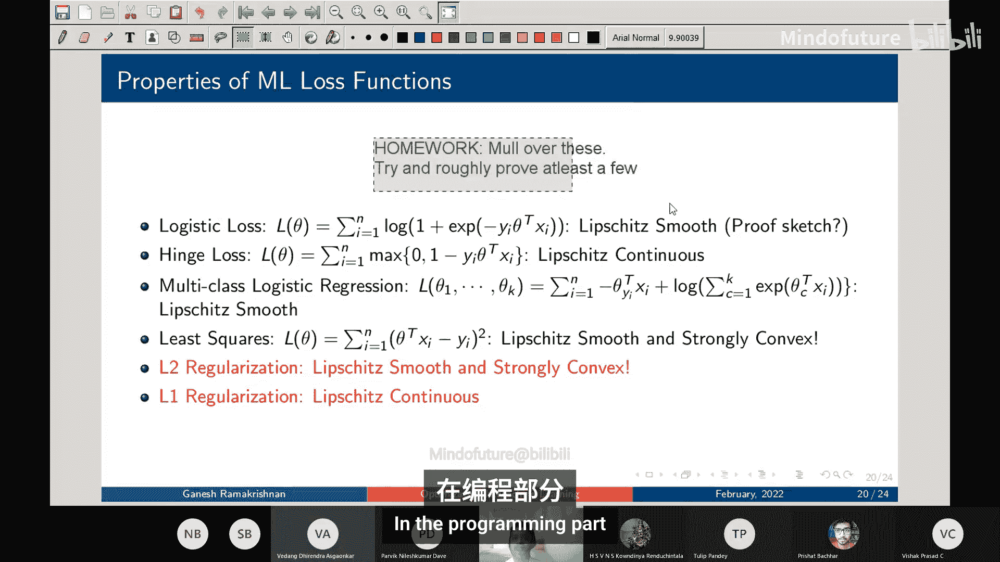

# 【印度理工学】机器学习优化 ｜ Cs 769 Optimization In Machine Learning p13 P13_第十讲_7-2_优化与机器学习_凸性与最小值以及利普希茨连续性对算法的作用 -BV18cBSBJEH1_p13-

2 lecture 10。去来。Pen again。Yeah。So we will now move towards algorithms for optimization we do a bit more on convex t mini and lips continuity we' be spending actually some time on lips continuity。

 which is very critical to。😊，Get intuitive understanding on why algorithms would converge and also formally prove their convergence okay so we spend some time on lipstds notion of lipst's contiity well I say lipsts contiity well lipss continuity and smoothness I must add here。

😊，They are related concepts。Before we move on to。Yeah。Algorithms。So these are topics done so far。

 We talked about some。Local and global minimum conditions and largely we talked of sufficiency conditions here。

😊，We'll also look at some necessary conditions， but necessaryary conditions。

Are things that directly follow from your basic discussion on calculus。Sufficiency is what， you know。

Also， characterizes convexity。 So it's important。Sufficiency。B by convexity。So we did that and。😊。

W we did talked about strict con in you know， unique minimum。

I'd left you a homework problem to understand， you know， I had already proved it in the class。

 but there a maybe final understanding of why convexity leads to。😊。

Global minimum strict conity later so you need global minimum I give a very broad overview of you know constrained convex problems and we maybe delvet into it later on and then really move into algorithms towards algorithms we need to understand lipssheds continuity and lipsshed smoothness。

😊，All in conjunction with strong con， which we have already done。Okay， so yeah。

So we already discussed how subdates are related to miniEma。

0 sub gradientdient is a sufficient condition for。Global minimum， right for our convex function。

For a convex function。Zero sub gradientient。Is sufficient。R global minimum。It it does。嗯。

We did this as a sufficiency condition。嗯。😊，I also suggested that you look at a little bit more beyond。

😮，You know what you have discussed， or how do you really。You know。

 characterized the existence of global minima right as global minimum always existed we had presented this。

Where trust theorem convex function is there and it is non empty and bounded has bounded subleve set。

A alpha， then F has a global minimum， but。Yeah， I'd given that as a homework problem。

But let' us try and develop a little bit more understanding if we read this that critical points of convex functions are global minimum is a sufficient condition okay。

😊，And that's what we used。To also show。The， the conditions for。

Global minimum of this function right we derive the global minimum for the lastso kind of problem and motivated again the iteratives of thresholdling algorithm。

😊，Okay， but then we will try and understand this notion of saddle points， okay， saddle points。😊。

A interesting when you especially talk start talking about global minimum， local minimum。

And their connection。So one way of looking at saddle points is that the gradient vanishes。

But x that point at where it vanishes is neither a minimum nor a local maximum nor a local minimum。😊。

You have all seen a horse saddle， right in the next slide I'll be showing you a horse saddle。

Which is very characteristic。 One side you move， you basically get。Increasing values of the function。

 or gradient rather。😊，Curvature upwards Another side， you move， you start seeing。

Curvature downwards that is a that is a basic notion of a saddle point。嗯。

Let's move on and understand the notion。Of a subtle point in the single dimensional case。

Here is the non convex function。3 xs to 5 minus-5 x Q。Okay， and this。

Has the derivative of dash x 15 x squared x plus1 in x minus1 can factorize it。So critical points。

 if you look at this。The critical points correspond to， you know。嗯。The spot。X plus  one， set it to 0。

 You'll get -1。You set x minus1 to0。You'll get one。😔，And finally， if you said。X squared to 0。

 you'll get 0 of the three the sine of F dash x。Changes Act11 n minus-1。

With that lay a local minimum and maximum respectively。

 so let's try and understand with respect to this image。嗯嗯。😊，Okay， so at this point in red here。

You have。嗯。This is one right here the s of m dashash x。Changes。Let's highlight this in blue。

At this point。Again， the sign of Abdas。Jesus。This is the point minus1。

when you say sign of E dashash exchange is basically you're saying that it's in one case it's curved upwards。

 E dashash is increasing。😊，ItConvex other case if dash is decreasing is conca。

MDash is decreasing in this case， whereas in this case， MDash is increasing。Sine， of course。

 doesn't change at 0。All shaded in yellow。So this is neither a local maximum nor a local minimum。

this function is not convex everywhere。嗯。These functions won't have such subtle points。

ItOr complex regions of functions won't have such saddle points。

But we see that for non convex regions， you can have sub points。Can non convicts are non。

When I say non convicx， I mean non con either。Okay， with this note， yeah if you have questions。

 please do ask。The function is not convex。嗯。Let's look at， you know。Fun， actually。

You can think of a simpler function as well x1 minus x2 square。This is slightly more complex。

X1 squared minus x2 squared。You'll find similar behavior。What happens in this case is that。This is。

 of course。You know。Certainly more complex， it seems to have some points。

Which appear like a point of sitting in a horset。 So if you look at。嗯。If you look at this curve。

So consider this curve。This is heart selling here。And what do you observe here？Local max along this。

 this is a local max along this curve。On the other hand。At the same point。I'm sorry。

 I should have shown not this one。I at this point， yeah。So this is a saddle。

 that's not a settle yeah。So if you see here。By the point at the corner sitting here。

Or you can also consider。A point here， right， That's also what we our。 Let's， yeah。

 I can consider this point， let's say。This point。So it's a local max along this curve， whereas。

At this point。But along this curve， you have。Local men。Yes。So this along this curve。

 you have a local min。So again， this is an example of a saddle point。Lot of analysis。

In the deep manual network right arena is offered about saddle point analysis and saddle points cannot be dismisseded because as you know in convex regions saddle points will talk about a local minimum in concave regions is a local maximum right so these I mean what what are these these points of zero gradient。

Sidal points in general are those where they can be you know along one direction。

 a local minimum another direction， a local maximum。😊，H。😊，Any questions， Let me know。So yeah。

 I'll just make a note here。That。Lors of analysis in the。Deep neural network。jiim。😔。

Is about saddle point。Optimization。All I'm trying to say is they are not necessarily sleep bad。K。

So then the global minimum doesn't always exist。 That's where I had left off our discussion in the last class。

I said， then know， itd be nice for you guys to think a little bit more on。On this front。嗯。I mean。

 I give this example of E2 x right。Now， E is to access。

Is convex and it's actually bounded from below。But the bound is never achieved， right？The bound is 0。

Well， it's never achieved。It does dis you。嗯。So whilst stress theem comes to my rescue then says that。

If there is a non empty and bounded subleve set now there L alpha such a non empty and bounded subleve set exist here。

😊，Well no， right it it's unbounded below for any value alpha if you take the subble set is unbounded below it。

😊， it has no boundary。This keeps extending and extending。哦。In this case， my whitetra serum。

ItDoesn't look like there needs to be a global minimum and in fact that it doesn't have a global minimum point of global minimum。

Okay， so。Since F is continuous it today is a minimum more closed and bounded that is compact set at some point in。

So X is also a global minimum。because FF x star is less than equal F of x for all x and L alpha。😊。

And since f of x star is less than equal to alpha it follows that for x which is not in a alpha。

 it must be that f of x is greater than alpha which is greater than equal f of x star。😊，B。你说这是。啊嗯。

If it attains a minimum， that is the bounded part which you talk about here bounded。Add some X。

 then X。It'll be a global minimum。嗯。嗯。And general， I can just I'll just and。嗯。我的手啊。😔，Yes so。This。

 this is a case we are talking about that there is some boundary。This is a set of。The points X。Okay。

And what we are saying to say is that this。There will be some kind of X star。

Where the minimum is attained because it's a boundary。😊。

Corresponds to boundary closed bounded ceter will have this boundary right that that boundary will be defined by extra。

Any other thoughts you have as homework contemplation， do let me know。😊，As they still proceed。So。

 yeah。So am I audible。 Yes， yes， you are audible。 So thinking。

 does existence of minima imply Boness of sub level set。That's a good question。

 so this doesn't imply the other way。Just because F has a global minimum doesn't necessarily mean that。

嗯。It must have a bounded sublevel set。So in most cases。

 youll find it happens the global minimum gives you that bound something level。

 but it is not any final condition。Good question。 Do you have a counter example。😊，In mind。No。

 I couldn't think of any。 That's why I was asking。😔，Right even I'm not able to think of one easily。

 I don't think there are any easy functions。 There be some contrived problem。

But it doesn't hold because they exist one。Yeah， even I'm not able to recall offhand the exact form of such。

嗯。Anyone else？ for if the global minimum strict and the function is different。 you can prove that。

哦 you section will be。on怕。If it's a strict global minimum。

 you saying if it' is strict and the function is differentiable。😊，Okay late， let make that claim。嗯。

I mean function is differentiable in addition to it being convex， et cetera。😊，这个。😔，这个是。Okay。

 so I would like you to。Think about it and I mean if you have a proof。

 why don't you post it on the group right？嗯。Any other thoughts。Okay， let's move on otherwise。

So this is a general con optimization problem。😊，minimizeinimize F x subject to x and some x。

 where the x is are。Convict set。The calligraph X is the convicx sector。

Of course qua alligraphy x entire domain it becomes an unconstrained optimization problem now the function f need not be conx everywhere that is the other point we have been making you could have saddle points。

😊，Okay。😔，Relaxations。What you generally don't want to relax is the constant set。

But relaxations are typically on the function F。Need not be convicxed everywhere。

 but as you much I figure out convexity even locally is important。都。It might be convicyx。

In some regions， Okay， now the entire deep learning is also in on convexity。 I'm claiming that why。

 for example， if you have a deep network， right multiple layer。 So this is one layer。

 this is another layer。😊，And this is our final layer。And imagine that I was， I mean。

 I was talking about fully connected， but you could also think of， you know。嗯。You could think of。CNN。

 spa， connections and so on， right？If if now I flowze all the weights except the last layer weights。

 this is let's say these are the last layer weights。😮。

So the function viewed only as a function of the last layer weights in most settings will be conviced。

So thats what the region that's the notion of a region we are talking about some regions。😡。

Is an example of the regions。Jhen could be defined。As that where。啊 you know。

Which all weights or rather defined as the region。😔，Of last layer。B for a deep N N。

That is with all other weight， layer weights frozen。that's a classic example of her。呃，上不提醒。

Let me know if you have questions here。So you will relax。

 but typically you will not relax the set itself。😊，So these are fine。Tpically。

 you don't relax the site。Any other a question。When we say convexity of the set。

 we also mean convexity。Of the constraints set。Is typically not relaxed because then you can't move comfortably within the search space。

Okay， a special case。 I mean， this is what I was alluding to a special case。😊，Is when here。😔。

You have G X less than equal to 0。Where G is are convex function。

 So these are like sub levelve sets at sub levelvel know alpha value 0。😊。

HI is being convey a fine functions。 Again， that's an example of convex。

So these are typically conveys。Okay， any question？And in the case of， how do you。

Deal with optimization， right？For example。If you are in the interior of the x。

 then0 belonging to the sub differentialent is sufficient。If if。

Say x is in the interior of this calligraphy x or X star。Right。

Then we would expect that 0 belonging to the sub differential of f。At X star。Is sufficient。

But the issue is what happens。When you're dealing with。Something on the boundary， right。

 So let's try and visualize this when we say typicallyconvecent， what does it look like。

When I say something is greater than less than equal to  zero。

 so you could actually visualize this whole thing as intersection of half spaces so like even a simple example here。

😊，Okay， so each of these is like saying less than equal to 0， less than equal to 0。 So each。

Of these is basically like this black curve。Giving you。Green region。 Okay， so。

Giving you a green region。Please。😔，嗯。Actually this is giving you a green region。

 likewise each of them will give you some green region。I mean。

 in the interior basically entire thing， but then mounted by another。

Are there such hyperplane or are there such inequality？

This is how it looks like Laino gaps a whole sphere， of course。嗯。Some regions will be dense， because。

 you know。Theyre， they are kind of。Part of many such regions。I mean， obviously。

 all of them should satisfy， but they might be directly connected to more such regions。 Okay。

 so it's in principle， what's happening is。You have intersection of。

That does a dual description intersection of multiple such hi house spaces。

Using supporting hyperplace or any convex set could be defined using such infinite inequalities。对啊。😔。

Back the。The dual description。嗯。For con sets。T do。一。Mified。As intersections。Of such inequalities。

We have seen this duality come earlier now the dual description of sets also is being looked at here。

Okay， is think of this Gs is intersection of sublevel sense， which are one weeks。It nothing but。Yeah。

 intersection of convict sub。And actually，0 sub level 6。O yes。嗯。Any questions here。

 so what happens when you try and apply these constraints？I mean。

 it's also possible that p could be 0。 M could also be 0。 P could also be 0。 Okay。

 that's that's the other point here。😡，Either or both of M。And he could be 0。

It means you' are dealing with no inequ no constraints at all。Special cases。I mean。

 and if you' looking get a Ix， again， you're talking about you know intersection of find sets。😊。

So how do you characterize optimality condition for such constrained optimization case。

So instead of saying the gradient goes to 0， what we will say is that dot product between the gradient and any point x minus x star a solution must be greater than equal to 0。

😊，Yeah。See， of course， think of this in cases。 right。

 So case simpler case for this is when you're doing dealing with。啊。It appointed point the interior。

 right case1 is this SSA。X star is in the interior of x。Telegraphs。All this， this capital lakes。

So if it's in the interior， then it's very simple。0 belongs to the sub differential of f。At X star。2。

This case， the are。More specifically can say if it's differentiable。

Then like saying a gradient of aex star is vanish。And this holds。嗯，这些。This is a sufficient condition。

 let me move this below。This sufficient't。Fdition。And as a result of which。

This will hold if one of them is0 obviously the dot product will be greater than equal to 0 and that' is fine。

 The interesting part is when case the case which is where it' is on the boundary。😊，Okay， so case 2。

You say this。In this case， what happens is。Ext。Isn't the boundary。

 a boundary can also be driven by partial， but I don't want to confuse you。

 So I'll just say boundary。Okay， and。Then we are saying that x minus x star。

Should form an acute angle。With the gradient of appedex star。Okay。So this again。

 should be easy to see。This is， of course， showing the。The view in the x space。

 but you can also have a similar kind of view in the function space。别束。

This is this is the original input space， but here's a function space view。Where。

Basically we are saying that this if this X， lets take let's take this red exam right here。😊，那我。

If you had a constraint， and let's say the function was behaving like this。

 the green was the function。😊，And you have this red point sitting at the boundary。Next time。帮你。

Then what you're saying is the。The direction of the gradient obviously now you have to go back to the input Spacex。

Is forming an acute angle。 Basically， we are saying that。

There's no way we can move within the region。And。You know， for example。

Increase the value of the this is sorry This are talking about minimization。

 So suppose we were looking at。Yeah， this is actually。

So looking at a maximum sorry here is this theory we're looking at maximum。But in a case。

 what we are saying is we can't move within the region and yet。😊，You know， consistently。

Improve on the function to be optimized。So。Yeah。There are questions， like me know。

So there are lots of呃。Constrainant optimization problems linear or quarterd。Objective is linear。

 objective quadratic， but in all these cases the inequalities。😊，A intersections of。Hooff spaces。

E less' than equal to be。And specifically the QP is a con optimization problem if and only if what。

When would you say that this is convicts， any cases？

The linear problem is always going to be convicts。Yes。When Q is positive syndrome。the Hassian of F。

 which is  Q。Is。Posive somedeinite。诶。This positive effect。

Now see our discussion on the general constrain our convex optimization optimizationity condition was very preliminary we will will delve on this a little later。

😊，But now I want to get acute even in the unconstrained case。

 how do you deal with algorithms and their conversions。

 so I'm really keen to get to lipss continuity finish。😊。

Radian descent analysis nest of and then after these we will revisit。

 So it's okay if you haven't you know got a complete hold of constraint case。😊，After this。

 we will revisit。P constrained case。O。So for the constrain case I was saying that we will be working on notion of lipst scrutiity i'm given some reference on lipsts algebra both uploader on model at the same time you'll find a couple of other links now you may wonder how this is all relevant for deep learning yes it's all very relevant for deep learning。

K I've put a list of。Some papers there many bow papers。

 some of these papers which attempt to compute locally constant of various deep networks so yeah you can have a look at it。

😊，And why are they important we'll see so。😊，So with this， let's move on to lipstitzs continuity。

So a function slipticks continues with a constant L if the rate of change of the function is in some sense upper bounded I mean one way of looking at the rate of change rate of change okay。

Can be roughly thought of as the absolute value of fx minus fy。Relative to。The distance between。

X and。Okay， so there you are saying that well， this is less than equal to L。 I mean。

 if you're allowed to divide by。X is y that is when X and y are not the same。

 they don't coincide inside。So。It is like a linearly scaled upper bound on the difference of function values at 2 points x and y。

 That's another way of looking at。That is a linear。B。Scacaled upper bound。Absolute。

Value of the difference。我放信。嗯。Thank。Any questions。why are we interested in I think strong converity said that the function has at least some curvature。

😮，Contexity is okay， increasing values of the slope here we are trying to say well。

The function is not changing too fast。That' is what we are saying rate of change is upper bounded that is the function is not changing too fast。

😊，Okay， so it's like saying that， okay。The import is。Too soon。 Too fast。Right。

 so that's eating how fast the function changes。Now。

 it turns out that there is a connection of Litus continuity with the gradient。😮，What is that。

So you can， I mean， less taking hint from what I did so far， let's do the following。

 let's try and write down。The absolute value of the following。Lit us。S tends to 0。Of F of say。

 x plus V H。It is a scalar or HV V is a vector。Okay。Mus s of x。Full thing divided by edge。

So this is it's a directional derivative。And if you try now。right x x as x whatever。 and then y。Is。

Ex plus H V。This is basically。啱。This whole thing is basically less than equal to L。

 and this is nothing but the directional derivative。😊，Of the function。Fant x along the direction。边剧。

This is upper bounded by。And。Now this is， this is only for a differentiable。 Okay。

 this is't necessarily always hold because we never assume that F is differentiable So if this is if。

😊，F is differentiable。Again， I want to emphasize。That。Function F。It not be necessarily。Different7。

Therefore， we have to put this additional clause if FS is differentiable。欢你咧。

So if this also means that for any unit norm vector v。

 the absolute value of the directional derivative along v less than a all equal to。😊，And。欧表。

So if there is a sub gradientient， okay， I just let me just。

Take this entire description again on the next slide。The same thing。

 So you saying if F is differentable。Then we can talk about the directional derivative otherwise in general you can also talk talk about sub gradientient and the sub gradientient norm to be less than equal to。

😊，嗯。So。We can yeah， all of us know that this directional derivative is nothing but。第。

The dot product of three。The dot product of the gradient of f at x。Bmin。

So then you can basically use po short and on。So let's move on to calculus properties。

Some properties。What properties would we expect， I want to keep this a bit interactive Okay so given you some idea already。

嗯。I mean if。You take some of two functions。Would did relationships lipsts continuous。Anyone。

So F1 is L1lip sheets。And F2 is 0。L 2 live shits at。So then what can I say about。F1 does have to。

Any suggestions。We can show using the triangle inequality that it is L1 plus L1。 Okay。

 great yeah L1 plus。El tolips。对。Li continues。 I mean， I'm just using lips sheets slips continuous。

 okay。So's exactly the triangle inequality。What other properties can you think of right。

Any other property？How about product。Okay product of。Lipstures continuous。Sa L1 and L2。So。

 Ill make it similar。So you have L1。And L tolip continuous functions。You say something。

Is says lipsute continuous？Do you imagine digging if。F1 m into F2， however， F into G。

F into G minus F， F into F X， G X minus F Y G， Y。And I know both of these are， so。

Both of these es continuous， so whats the relation。Fxgx。😔，M a5。G位。Is there a relation that this has？

With。F x minus F y and G X minus GY。Anyone。😊，I'd like you to open up a bit otherwise。😊。

It just be a monologue。Is that inequality， Can I say this。Or or do I need some additional assumption。

So it turns out that it cannot be just。Everyoneone has to lift shades。Okay。

 so if you originally have that these are bounded， then you are fine。If they are not bounded。

 so product of bounded。And that's easy to see。If I have to put this inequality somewhere。

 I need to know that F and GR。Themselves not going to be become infinite， okay。

So I leave the homework for you， but it turns out it is not very difficult。😊，So bound it yes。

 if they are bound it， then you can say。Iith by the way。

 I mean I have a more detailed in my more detailed course on optimization。

 I would probably have the proof they setting。😊，So you can use that， if you want。So， this。

Yes is less than equal to L1 into L2。But also， the bound of the function。

I'm going to leave that as kind of homeworkbox for you to look at。Okay。

So two lipses continuouss and bounded functions also bounded who as homework pre time improve。ok。

Any questions with far？So lips content is important。

 does the constant L have to be the same throughout the domain or can it be very。嗯。

Does the function have to be。 So can you repeat again。

 So as in like if we say that the function F is lipss continuous。 So can L be L be constant。

That's a good morning。So sometimes we say in this in this region。

 it is lipsshed continuous with L in another region at another。😊。

It slipes continuous with some other else so you can put that domain for for each domain you can have a different L that is possible。

 but you have to explicitly state that。😊，Is that okay。That's a good point。It exactly it。嗯，也是。O。

Well see some examples。So there's a notion of a lipst smooth function as well。

So instead of talking about the function now we talk about the vector of functions or sorry vector valued function。

 which is a gradient。😊，So a function f is called smooth which gradient as lipsts continues。😊。

Basically， we are saying that there is a limit on the rate of change of the gradient。F of x。

 the gradient of F ofx， sorry。The norm of the gradient of f x minus f of5hi。

Less than equal to L times the norm of x minus y。What does this ring bells about it probably ring bells about rate of change of the gradient。

😊，And rate of change of it。Later we all know is connected to。What。😡。

The rate of change of a gradient is connected to its。Heian， right？So good， Right so roughly。

What does it mean just taking on the？Discussion from lipsshitz， continues。

 We are seeing this roughly means。A function has an。Upper bounded。Double derivative。

 but that's the same as saying upper bounded curvature。Okay。哦。L in。Strong conveity。

The rate of change of the function is at least too much。Is about， you know， lower。Pounded curvature。

I mean， it should be at least， you know， there should be some gap above quara， right？😊。

This is exactly the other way， saying it's an upper amounted curvature。

So in the case of strong convexity。He probably would have had。Something like this we would have said。

Yes。他 functions his CNN。嗯。At all points。Isel is。T greater than equal to some lambda。Okay。

 so what I should be actually talking about is curvature， So therefore Ill look at okay。

 we transpose。😊，K seen in words。一。This is the lower border television。By analogy。

 we should probably have something similar here。 we should say we transpose the cur curvature we see along any line if I look at the curvature。

This should have。This should be less than equal to say， say L。So something like this， I would expect。

Any one wants to comment。Okay， so。What does this mean pictorly pictorly， let's get to understand。

So basically you're saying。嗯。Something like this。We are saying that this strong complexity we are saying that the function cannot be too flat let me just use a different color here。

Let's switch to。The strong complexity is saying the function cannot be too flat。Yeah actually just。

This is a different colour here。Okay， so this is upper bounded curvature， the one in blue。

And one and right is a lower bounded curvature。😊，So， here。In the case of strong convexity。That is。

The function cannot。It too flat。 So we are putting that red。

Cve to indicate that you know there's a limit to how flat it will be。

Whereas a blue curve is saying that the function cannot be2 curved upwards。Okay。

So let's take this discussion。Forward。We can basically write the same thing。😊，Differently， right。

 we can say。this is what I had written。So you're saying that the gradient。嗯。Is upper bounded。

 So this。Rate of change of the gradient is upper bounded the Hessian has its upper bounded L。

That is a blue part here。But you can see the same thing in the case of。A strong convexity。

 strongong convexity。Was about。我 did his先。Being upper bounded， say by。So we will typically use M。

 sometimes you'll use Theta， lambmbda， whatever right so this。This is what we mean by。嗯。

Stroong complexity。So they are， in some sense， complementing each other。

They may appear to be opposing， but you saying that two lower。 I mean。

 there is the lower one and upper bound。 So they they can coexist。Let me know if there are questions。

嗯。So now almost everything we have defined， you will find start finding analogies。

We had at least three definitions of strong convexity。

One was in terms of hissian this is exactly what you're seeing now。

 we had a definition of strong convexity in terms of。the first order approximation。

 there be a quadratic cap。Also， in terms of the。Moit theity of the gradients or sub gradients we had a definition all of those could be you will actually find。

😊，A complementary definition here。哦。So if a convex function is smooth， the score smooth then okay。

lipsts continuous gradient is the same as saying it is。S continuous is called smooth。

So function is smooth。 Then now we are seeing Fx plus。

this linear term plus a quadratic term is upper amounting F5。This is a quadratic upper bound。Okay。

Whereas for strong convexity， what did we have？Can anyone recall？a quadratic。Up bone， yes。

What did we have in a case of strong convexity？We had a quadratic。Ler1。

 exactly what we showed in the previous slide， right？This is same idea。The red curve is a quadratic。

Wer bound and the green the blue curve is a already copper bound， lets keep this picture in mind。铁束。

So we can complete this picture as well。And that was， F of y。Is greater than equal to F of x。

So everything looks the same。😮，But that the quadratic。Lower bound will have a different。L or。

 youd have M M by two times。Cont will change that set。哦。Obviously you expect m to be less than L。

Is that correct， M should be less than equal to all ideally strictly less。Right。Okay。

 so is this clear then let's take examples if that questions let me know。

We'll be doing lots of examples。O。If there are no questions。

One question I have for you what would be an example of function。

 which is both strongly conx as as lipsts continuous Can you think of one。😊。

Let askk you this question。Can you think， is that a。Function。

 which is more strongly can you come up with one？Li she mo。Which means。

Lilippsides continuous gradient， right？So be very specific。

 So lipss conity was slightly different which was only about the function Now you know we are doing on gradient that's where you have some analogy or some complementarity with respect to strong con。

 So what would be an example。😊，Simimpplest example。So can I take。X square， in fact。

 that you come in the next slide， x square。To take the x squared。等。The Hassian。

IThink in terms of action， you in terms of quara or whatever， right。The double derivative is one。

 one is lower bounded by。in。5 number1 by。B。😡，Or any number， right。The simplest example。

So let's look at this Fx equal x squared。So gradient is2 x。I the undertakes。S2读。

Then you can easily say one is less than equal to。 Yeah mistakenly mentioned on the previous slide the hass is one。

 it says。But it one is less than equal to which is less than equal to three so think of。😊。

This one is the M。And there's three as the L。This is yeah。我 song。Steve。

Whereas L on the right hand side。His fo sheets contain a smoothness。Any questions。这 example。

So I'm just unfolding the same thing。 You can also think of it as， you know。嗯。

It prove it using the rate of change of the gradient。

Okay so same thing basically we get the same language content constant too。

Now is Fx equals x to four lipsster smooth。If x is Fx equals x cubed by three literature smooth。

We are studying the latter to begin with。Is a s slipt smooth？Yes。So let's consider the case of。

I we want to constrain the domain for this right。O。啊。So if you look at Vahesian， it's like。

2 exc late。Or if you look in terms of the change rate of change the gradient。

X squared minus y squared is less than equal l time x minus y。😊。

Does that exist in L your answer is no not unless you constrain the gradient， you are right。

They quite constrained， to mean。So， you can basically。Expand this。

To identify in what domain is it lips it smooth。ItSo this。This is basically。

Absolute value of x squared minus y squared。Im explain y to explain express why。

The question is for what values is less than equal to？L times x y。So the answer is。If， when is it。

If x plus y is less than L， rate。都花啦。😔，What will you do for。Any X plus why。

Now what does x plus y less than L mean， basically if you have。

If x is bound y is bound obviously x plus y is less than equal to some bounded value， right？

This is what I need。Let's say。Absolute value of X。Does then。

Alpha will all have absolute value of x y。Is less than equal to2 alpha。

 which could be thought of as n。So these are this is an example of。Constraining the domain。Okay， so。

Any questions or coming to you？Okay， so the overallal assessment。Is that globally you you know。

 this case of。X cube by 3 is certainly not globally netures continuous。

Global use is not lips continuous though it can be locally。

So only functions of SM at most quantity grow can be smooth globally， right mean。

That's what we tried showing x squared here。Just an example。

You could come up with a lower bound and upper bound both。What good， but then now have a question。

 what about x to4。😊，Any thoughts。中。If you have quick response。

 you can let me know otherwise I'll be leaving it as homework。Is exist for strongly convicts？

Surprisingly。It is not， right。So I would like， yeah， you can think a bit more about it。

Study it does homework。Let's study a few more examples now one question I have。

 I mean understanding of lipsticks continuity and smoothness。😊，Does one imply the other。

Thus lipsis sctiity implies smoothness and vice versa。Anyone。Are they corrected？

Are they totally disconnected？Let's take some example， Actually。

 we will see more examples to appreciate this。So let's say f dash x I'm given a hypothetical function f who is derivative is the absolute value of x。

😊，Right， and now ask the same question is the。M dash x minus M dash Y。

This is basically the absolute value of the absolute value of x minus this absolute value of y。

Is it less than equal to。All times。Absolute value of x minus is y。Okay， so well， it turns out that。

Not difficult to analyze， yes， it is。Because this holds， right this holds。

The difference of the absolute value is less than equal to the。That difference， absolute value。

 a difference of the values。if exception continues with L equals 1， that's fine。Islamious。Okay。

 so F is rate of change of F dash is what we are bounding steps script continuous with L equals  one。

😊，But what about F double dash。Does it exist。F double dashs。Well， you don't。 I mean， honestly。

 need a double dash。 You could talk in terms of。They have change of the。Allright。

So here what we did was Mda sorry this is I just wanted to be here。

When we say F slip F dash slipes continues okay。It does。 It doesn't even exist everywhere。

 And what about。This if dash is let just continuous。 that is F is。F is basically smooth。

app doesn't exist， which is fine。嗯。Now， how about。The lips continuity of F。O。

He talked about the lipsus sctiity have dash x。Date of change of F dash。

What about lips criteriati of F。We could talk about the lipst continuity of F dashash。

 even though it doesn't exist everywhere。But I would like you to think about literature community of F。

 But let's going back going back to the。F double dash。It's not differentiable。Everywhere。

But it's differentiable almost everywhere， okay。😊，It is it is differentiable almost everywhere。Okay。

 so such functions are called differentiable almost everywhere。😊，Another example is。Normal fix。

 One normal fix。So one norm of x is also differentiable， almost everywhere。Okay。

 so so it is not that you have you need double derivative to exist everywhere to be able to talk about。

Lipsshed smoothness， that lipses continuity of the derivative。Okay。Let's continue the discussion。

Is every sub quadratic function lipss smooth。So what we mean by。Subcortic is an example， fxs。

The absolute value of x is to 3 by 2。Its subgoritic， right？😊，So is this lipst smooth？

If you consider it on a closed set， x says that0 is an x。Is it lipst smooth？

So the gradient of F dashash x at infinity。😮，At0 is infinity， right。

Like we can just verify that quickly。The dash X。给。就说啊。The gradient do have dashs this function。

Is infinity at？X equals 0。But let's consider this a specific example。四维都。X rays to half。This。

 of course， offer x greater than zero。And in that case， M double dash x。Is three by four。

Xs minus half。And in such a case， is this function smooth？😊，Well， it is。Not globally smooth。Its。

 not smooth of zeros in x， but we have a problem。But both in bounded enclos interval not containing0。

 I mean， exactly what we said earlier。嗯。Butre now getting more specific。

Or someone trying to say something？So， it is not。Globally smart。However the。

It's also not smooth if0 is in x。That on the domain。But。It'sm in a。So bounded and close interval。😮。

Which is not containing X。I is bounded and close required， I like you to think。😊，Not containing zero。

Okay， yeah。I don't want to spend too much time with these this is the whole goal is to get you familiar。

嗯。It be nice if you think a little bit more。😊，But lets talk about this closed and bounded lipsts continuity and smoothness of closed and bounded functions。

😊，Okay， there's some interesting。😊，A result I actually put it down on my nodes theorem 1。4。

1 and my advanced node， So if a function is continuously differentiable almost everywhere it is also lips continuous。

😊，So we said that many， like in one norm of exits is differentiable almost everywhere。😊。

It turns out that it's also lipss continuous。 So lipst continuous is something we get a little。

Easily okay。Of course， for R。I'm from Ireland。And now we look at some other interesting properties。😊。

For a bounded subset of RN。Then this is the property， let me take some examples as we go。😊。

So FS continuous because we know too many of these。Okay， so let's say。X areas to x， all these， right。

 are continuous。That has a subset， which is F is differentiable。😮，Almost everywhere。

 that's what I was talking about sometime back。😊，Now what is this， let's say examples again。😮。

And let's see if some of the examples we discussed earlier are fine， yeah。X， in fact， not just x。

 absolute value of x。E is to access defable differentiable， almost everywhere。

The derivative of absolute value of x is not continuous everywhere。😊。

You have to consider suitable sub gradientdient at 0。Okay， but this is fine。The examples。

 these are examples。Let's take the third case， which is in green。😊，F is lipstitz continuous。

 Now let's let's start seeing if it starts shrinking。Have you lost something？

Have you lost any of these？😮，问。E is2 X。Seems to be fine。I lips just continues。Yes。😊，S continuous。

Is absolute value of x。Yes。Yes， in fact， it， it's exactly the same。 F is differentiable。

 almost everywhere。The same as if as lips shoes continuous sorry I should just use the same color。

 all of these are the same。Just me as I do colour here。The same okay。

But let's now move to the third category。F is continuously differentiable， which means that。😊。

The function itself you know， is derivative itself is continuous。

 We have a problem with absolute value of effects。 That won't qualify。

So absolute value of x basically。😊，Go out to the window。

whereas you know all of these so far were okay。But we don't have absolute value of x qualifying this criterion。

What else is。E seems to be fine。All right， X can be fine。 in fact， if dash x switches。X。

 such that F dash x is absolute value of x， which is what we saw in the previous right that that belongs to all these categories。

Okay so I'll put it back here as well， I mean I'm expanding all these six F x Fx such that F dash is absolute value of x。

belong belongs to both these categories。Oh。So it has sunk and we have dropped absolute value of x。

And it turns out that this is the same as saying that。😊，The gradient of FS continues。嘅。嗯。😊，And then。

 a subset of that。Happens to be that。The gradient of F is differentiable。

Almost everywhere now we have a problem with absolute value of x。Okay。

 that you can't even talk about differenti almost everywhere。Okay so let's go to the next。

 which is this one。So。What are the examples。E stands here as well。So does x stand here。

 but we have lost absolute value x in fact we can also drop f dash x absolute value of x。Okay。

And that is the same as saying that F is smooth。😊，So this last category has two names。

 almost differentiable almost everywhere and the same as saying F is smooth。Okay， so you can we。

 we can quickly depict this in the form of， you know。This kind of concentric circles。

The red one is at the top， the largest subset and then keeps shrinking。I took some examples。

 but you can take a lot more examples。😊，Were unclosed and bounded functions。There's some connection。

I mean， I ask this question， what's the relation between lips sctiity and smoothness？😊。

So lipsticks contiity and smoothness you can talk about in the case of。It being。

Contously differentiable。😊，Sorry， the function on closed and bounded， right？😡。

For closed and bounded functions， we can talk about this relation， but not in general。

Any questions on this slide？In practice， you will find that most。You know。

 smooth functions will also turn out to be lipsts continuous。Right。

Because we may be often dealing with this。Csed and bounded functions。ok。

So you can think of this again the other way that it implies if F is smooth， then closed and mounted。

 then it is。Containitions a differentiable， then。If slip shift continues， then it is。You know。

 know getting you sense one。嘅。And recall that a functional receptor continues if the norm of the sub gradientdient is bounded so that we have found some other equivalent conditions。

Right。So yeah， close and bounded sub of R that F lips continuous。

Now this is interesting the last point on a closed and bounded。😊，嗯。Subsject of Rn。

Fs lipss continues is。Super set of have being convexed。

 so now I can just draw a slightly different picture。

So we have also brought in this additional condition。Here。The pink。So far we had。

 if you go back to the previous slide， we didn't have the pink， right we had the red。😊。

Fs continuous was the largest one now we are saying。That if that F is convict and subset of R。Think。

On a concept of Rn is closed and bounded。Or if you want else。

 we just make it correct so on close on subset of Ring。Which is closed and mo idea。

I'll make that correction。Subet of R that is closed and mounted。Okay， so this is like a interesting。

Summary of a pictorial summary of what we are discussing。嗯。

Now we can talk a little bit more on strong convexity， eipus continuity and smoothness。

So you recall that if you had a strongly convex， I mean， I had a function。Which was conx。

 You could make it strongly convex by adding this mu by two Noromic square or rather。

If that a function is strongly context， there exists a mu such that even after subtracting mu by two norm。

😊，X square for a non negative u you still have convexity if we could recover strong convexity from convexity。

对。Al right， recall。Or we could。Construct that was a motivation for regularization。A strongly convic。

Function。By adding a regularizer， that's the basic idea。The question is， can we do something similar。

4。嗯。Lipsshedd smoothness。Can we make a function lipshi smooth。Any suggestions？

If we are basically adding a regular to increase its curvature。😊，Any thoughts or question is？

Can we make a function lipsts。I my when is it make， I mean。Construct。Eip sheet smooth function。

A given function， which is not lipst smooth， which may not be。Any suggestions。What will you do。

The hint is。Instead of decreasing curvature。That a regularizer。Decrease curvature。

I mean this is a question I have， but if it is not convex given a functions。

 but if the function itself is not conx， what do you do。😊，I mean， you need something more。

This may not be sufficient。You may say， okay， I'll take a Gx。

RightAnd instead of ID subtracting mu or whatever， I'll add， say an LY2 NorX squared。

Is this a solution。Does this not require。ForSome assumption。Or property of G。I mean。

 should G we convex at least？😊，Please help me。 I mean， I'll be nice if you chip in here。Okay。

 so that's the question we are trying to ask is there a similar result for。Pipick smooth functions。

Anyone before we move？😊，So， it turns out that there is a very similar analog but it requires convexity。

😊，So so the answer is yes。If G is convicx。We can do such a transformation。So I mean， lipsshs。

 while we know that lips shits。Smoothness did not require convexity right I mean。

 we just defined it without convexity， but if you want to make a transformation。😊。

Then complexity again becomes handy， so I see how ubiquitous。😡，Convexity is。It's all prohibiting。

I mean， I give you many reasons why it's ubiquitous， its take a last layer of a neural network。

 you'll have complexityity there。😊，Okay， so I hope you're able to appreciate this。屋。

Okay so this is the idea a function if a slip shirt smooth。

 if there exists a constant L is that L by2 normm square square minus f x is con So this is different here is now。

😊，And so it's not exactly this。It's not just adding。

Its subtracting Gx and adding to it L by2onomics square。

So function f is literally smooth if there is an L is that L by 2 normal square as a x con。😊，In fact。

 theres， there is a duality between the two。We will not get into that dual dual aspect now。

The function f is strongly convex and G's convicxs and the function F are Gs strongly conveys。😊。

Right。😊，But if a function and we know that if a function is lips smooth some of two lips smooth functions also lips smooth。

Okay， that's something we dealt with earlier。我。Right。

So I'm going to leave you with some homework now， this is going to be more important homework than the homework I've given you so far。

😊，Can we use all of these properties and。Prove some of these right MLl loss functions that's our goal Lo loss does it have some properties I it lipsshed smooth whats a proof sketch I may not do proof is that as great utilize I did for convexity and strong convexity but give some thought to it Lo loss how do you prove is lipsshed smooth。

😊，Hingnge loss is lips continuous。Okay。No direct came about lipsshed smoothness。Obviously。

 it's not there may be issues of differentiability not everywhere， right？😊。

Multi class logistic regression it slip shit smooth。 I mean。

 its follow up in some sense from logistic loss。😊，Eque is slip sheet smooth and strongly convex。

 so this is a very rare combination。😊，And you get both square like right so this is least square is what liftes smooth and strongly conves。

😊，Now， when you do alterreization， you have lipsshed smooth，ness and strong convexity。

L2 regularization Excel element regularization is only lipss continuous。😊。

And now when you add these like regularization， so so far we didn't add the regularizers now if you start doing L1 regularized logistic loss。

 what do you getip continuous。😊，L2 regularized logistic losses strongly contractss are lift smooth。

And L1 regularized hinge loss lipss continues Okay convexity will be there in most places Ive skipped convexity per se。

 but Ive only brought in strong convexity and lipss continuous slash smoothness L2 regularized hinge loss on the other hand is lipss continuous and strongly convex on a bounded set。

😊，Okay， and this is finally Lre least squares laso is lips smooth and strongly convex。

And then El1 regular least squares as lipses continuous and strongly conves Okay there is a lot I have stated here。

 Im going to just please mull over these okay I do I will end here。😊。

SoI'm just going to I've given you the statement just mull over these。😊。

At least get a hang of some of these。I won't say you won't prove， but yeah， and roughly prove。

 that's also fine。And let's discuss further on Thursday。So adequate regarding the assignment。Okay。

 I think assignment we should have the Ts。Maybe we can discuss on you can put post a query。嗯。

You can ask a query right now， but it'd be good to have the。 Yeah。

 Go ahead in the programming part in the。

