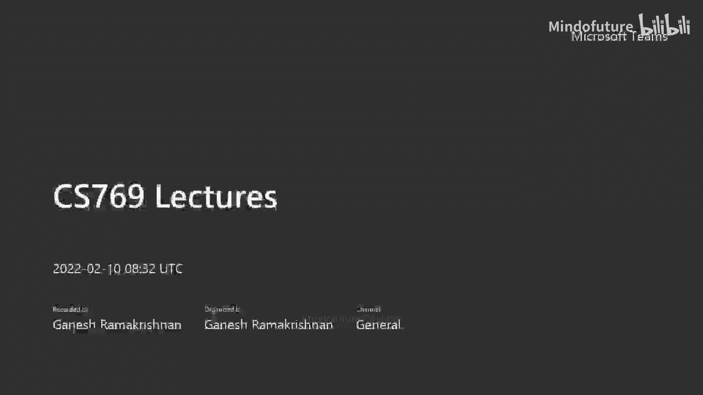
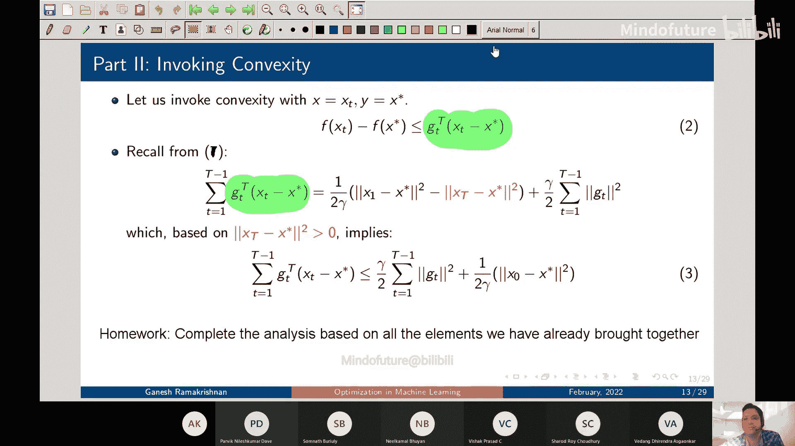

# 【印度理工学】机器学习优化 ｜ Cs 769 Optimization In Machine Learning p14 P14_第十一讲_10-2_优化与机器学习_利普希茨性质-机器学习目标梯度下降收敛性 -BV18cBSBJEH1_p14-

Okay， so welcome to lecture 11。嗯。We continue with analysis of lectures。

 continuity and smoothness of machine learning objectives and move on to algorithm for optimization where well realize。

😊，The importance of lipsts continuity and smoothness in addition to convexity when it comes to analysis。

So this outline。😊，We will conclude our discussion on the over problems。

And then you can actually look at。My detailed Con optimization course where I have more illustrations for lectureious continuous functions and gradients。

But however， we will move on to gradient descent and analysis for lips countries more than strongly strongly conx functions I won't be doing all the analysis and details at all points of time so Ill do some of them in details and then leave the rest for you to read up because they follow very similar patterns right there two most important you know tricks I would say are going converting dot products into。

Quratic equations， quadratic forms， and the other is telescopic summing。 Okay。

 so what we'll do is illustrate。But key。Tool set。Okay so there is a key tools for such analysis include。

 as I said， you know， algebraic manipulation。😊，For example， dot products。Converted。

Into quadratic forms。And the second I mean another set of tools is telescopics summ some across several instancetices and several termss get canceled in that process。

😊，We' will also look at you know rates again， that's when we extra reading extra optionalional。😊。

materialter。On rates and orders。Convergence， so。Okay， but we want to apply this。啊。For 8 descent。

Try and prove that and then also show what the effect is for several other algorithms。

 I mean I haveve just put a dot here and to was accelerated gradient in descent。😊。

And this conjugate gradient descent and。Approxly gradient the sentence one yeah。

So let's recap what we discussed on lipst contiity。 Litious contiity limits how fast。

Our function changes。And。The critical part here is that you can link this very easily。😊。

To the sub gradientient。So， recall that。This entire expression。嗯。

Can be intuitively restated as saying。That the rate of change of the function。

 that means Im now dividing。咪。The distance between x and y。Nmal the distance between x and y。

And this will be upward bounded by L。And we saw that if F1 andF2 es continues and the sum slip continuous product as slips continues in fact we can also show that composition as slip shifts continuous thats something we might require today in case you have done a homework your homework。

😊，So。If have composition。Op lip shits。Continuous functions。Is lipssheds continuous。

Do you approve this。You might have required this today for your homework。Fairly simple proof。

 So let's say F1 and F 2 e optionss continues。The composition also lifts continuous。

How do you build this？ So if you have a fun。Let's say F1 is lips continuous with L1。

F2 slipes continues with L2。then you have a fun off。F2 of what will you look at。

Say something like X and y。Applied in the sense of the composition。所。Okay。

 so there are absolute value difference of the absolute value。 now you realize that have fun。😊，sorry。

 F 2 x and F 2 y just two evaluations right， so this will be less than equal to the lipsitz constant L1。

😊，For the fun。Times， the absolute value of。F 2 x。Minus F 2 y。Ill of the difference。

Which you know is less than equal to l1 times l2。 the lipstitz constant for the composition is the product。

根本啊。佢。I'm assuming you would have required this in your homework。You like me。Copy this。

 you might require this when I talk about the homework。

Then we also talked about lipsshed smooth functions。It was a rate of change of the gradient。

Of the function。And。Yeah， let me recap that this again had us interesting connection。

With strong convexity。Recap that in the case of strong convexity。We had。A quadratic。Am。Yeah。

 we basically had a。Codratic lower bond basically function cannot be flatter。😊，Right then something。

Whereas here， we had a new quadratic upper bound。嘅。播。This is discussed again， I don't go to recap。

But yeah， this was the idea here。Function cannot be too flat。

 and now we have come up with an analog of that。Okay， and then we also discussed。Lpses。

 continuity and。Smoothness， strong convexity， the corrections are very important。

Re which I just stated， which I'm not going to prove， but。Wehich is。

Somewhat intuitive all of us feel that okay lipsshedds smoothness seems to be more strong， I mean。

 a stronger condition than lipssheds continuity and it turns out。😊，That it is。

If your function is bounded。I'm sorry if the function is or a bounded set。

 so the the set on which you arere evaluating the function。Must be bounded。So in that， yeah。Now。

 this is not。Necessary condition is sufficient condition the function。😊。

Is or a bounded subset of iron。Then。Typically， when you say that f is smooth， then you would imply。

That F lipss continues。ok。Further， the subset is not only bounded， if it's also close， then。You know。

 if。Basically， if is convex， then you would have the slip sheets continuous。So。

 most convex functions are well behaved in many ways， including lips stitch continuity。

 not just continuity。😊，Okay， so this is again a result we stated。😊。

And I left you with lots of some nice reading on Lister continuity now I'm going to draw your attention to the last two references which I had also left in the last class。

😊，they these are examples of papers that attempt to compute the locallyts constant to various deep neural networks now is the locallys constant because they could be。

😊，Local convexity。Local properties is what we typically analyze okay so mark this keyword local but that is important that helps you analyze conversion so there are some papers Ive put the links here you can pick these up for seminar reading by the way so I'm adding to the list of seminar papers。

😊，This is added。The list of seminar papers in case I forgot to add。

Do let me know you are also free to suggest more papers。嗯。Yeah， so。Back three homework problems。

Let's take the first one， which is logistic loss。What is the idea。

 how would you prove that logistic loss is lipst smooth？Anyone。As I already give a hint。

 you could think of composition and hopefully you have tried using composition。😊。

So could you divide it into two parts， part one。Where you take a simple function， F1。Yeah。So。

 let's say。Proof sketch。Using composition。Oh， by the way， this is I did this for loopshed sctinuity。

 but you can probably do it for lip smoothness as well。😊，Yeah， not。Get into that right now， but。Yeah。

 so lips lipsts。Smoothness， based on composition。So the part one， what would I do， I take this。A fun。

Let's say T。你只岁。😔，Log off。1 plus E is to T。Okay， that entire numererate that exponent is。嗯电。

It is a fun team。And what would I do I look at F dash T。Which is。E is to t divided by1 plus0 to T。

And。F1 double dash t because you're looking at lipsster smooth as you may want to just see if。

The double derivative。Hssian。Is super bounded。Okay， so。Is that。So you'd use a quotient rule。

Full of derivative。Yes， anyone has derived this？Please let me know。

If you have attempted and you have a different way of solving it。That's also welcome。

So if I have D by Dt。Of of A by Bt。What's the derivative， it's。Aashti。B Rati。Celebity。Minus B T 80。

The whole divided by。Do you square。So using this， what you get as the。Deeltive。

A doubleuble derivative。You can derive it itll have e to T 1 plus era to T in the numerator minus。

E race to T。Times E to T against the numerator。D divided Bt square， which is 1 plus02 t square。

And this is nothing but。All this era to T。An era2 T square we can will likely can cancel on only era2 T will remains era2 T divided by。

😊，1 plus era to T the whole square。What is this， Is this。Upper bounded。By some constant。Yes。

 it's like most half。as almost half， in fact， you can liberally take。Not half1 over4，1，1 over，4。Yeah。

 I mean， you can come up with tight bounceouts， right， so half is a reasonable bound。Yeah。

 you can also take it to be1 by4。Check it out yourself。So basically， it lipsts。😊，Smth。Yeah。

So this function is。 and now let's look at another function。F 2 T。啊。Actually， let's have it as X。😊。

Or this theta， F2 theta。Ors have two theta here。I mean， summation is actually not a big D。

 like summation of if。F O。F 2 Tta。Simply。When is Y。Theta transpose Xi。Right， and this is。

Eipes continue。 eip smooth。It's upper bounded。It's upper bounded by。Accordingquadicum。In fact。

 the double derivative rate if you take Iius get 0。When I say it's upper bounded by a quaratic term。

 the difference。😊，The difference of the gradient。So basically。😊，The hisian。U ordered by an L。

 which is equal to 0。Okay， so basically now you can prove。Let me just use a different color for this。

So then what you have to do is just。Do a summation。The sumation。Over。Eyes。

SoI use not a variable as such。 I mean， I use。The ice index inices into。Different x's。

 which are fixed。Right， so this is nothing but。A fun。Of F 2。Peter。For different values of I and vice。

would therefore be。Lift shes smooth。Is it also convex？😊，Yeah，It's also convex， right。

We have done that that we have so convexity will just come from our previous discussion。

Im not bother to show that again。Ok。Next one。Lipsts continues。Hingngelo。Any suggestions。

I'll do a couple maybe little detail others after a point you will pick up yourself right Hnge loss。

 what would you do？😊，Again， my my suggestion is use a simpler function。

What would be a simpler function。Any suggestions。Use composition wherever possible。

So you could take a max of。ゼロかな。This entire thing I'm going to abstract a t like I did earlier。

 right？0 comma 1 minus t。That's my fun team。So now I have to look at the difference absolute value。

 the difference between the function values。😊，City at T1 and2。So I'll consider cases。

What are the cases？Yeah， anyone。What cases will I consider？1 minus t negative or1 minus t positive。

Because you're taking with the zero， I guess。Right。So one might see negative or positive。

 but know now look at the okay， let's write down right so case 1。I have to consider the case， where。

Absolute value is a fun T， right， a fun T1。I'll just drop the one in this index here it just getting there'll be too many ones and twos。

So this is just FT and we can do a composition later on。So。F of T1。Minus f of T2。absolute value。

 What is this。This is。So now you ready to consider cases， okay。Is max of zeroa？

1 minus t1 minus max of 0 commma 1 minus t2 Okay so I'm going to just consider cases。😊，So， case one。

Would be。T1 less than one。If t1 is less than one， then immediately。The second part， my peaks， right。

And if T2 is， let's say。Greater than equal to1。And the first part peaks。Al right。

 or you can consider the other case where。T1 is greater than equal to 1。An T1 is less than one。

SoIn both cases。I mean，'s you'll have only one of them surviving。Okay， let's take the first case。

I' mean， case 1，8。Call this a if you want。Let's consider this case。This case。

 what will happen is you'll have。1 minus t1。Emerging as the max here。-0。Pudaging as a max for T2。So。

 this is T2。Okay， so this is。1 minus D1。Absolute value。Right， and this is what。 I mean， how。

How is it related to T2？😮，Alway less than equal to Ct2 is greater than equal to the one in the first case。

 right So it is less than equal to。😊，T2 minus t1。And and naturally。

 L is equal to one at least there's one L。😊，不 you说的。Okay， so this is a yellow case。

 and they can likewise do further。Second part， right。

So I'll kind of leave it to you to do the second part。Okay， so this is case 1。Let's look at case 2。

A would be case 2， you will have。Both of them less than one。T1， lesson one。And to t to less than1。

Then what would happen。Yes。What would this be。In both cases。

 you have1 minus t1 and 1 minus t2 as a max。 This is less than， I mean。

 this is exactly equal to 1 minus。Be one。-1 minus t2。Its even more straightforward。Right。

 this is basically just。T 2 minus11 absolute value。Wch is less than equality to minus1。A authority1。

Absolute value amounting to again L equals 1 did someone have a question。Okay。

 so let's just do the third case， which is。I would say。The simplest of the lot。Next to the KD。

Both are greater than equal to1。Yeah， so this case。You're just dealing with 0 minus 0。

Which is always less than equal to。The absolute value of T 2-11。Yeah， I mean， L can be one。 I mean。

 you can take L。Less than1 is also fine less than equal to1。Okay。

We are done with this and then you can do a composition right now。嗯。

Subsequently they just consider the composition f of the linear this function f is the linear function。

 like in the previous slide。😊，With linear function。Exactly。Assn't the previous。Gisss。😔。

So this is very simple， as we have seen。YeahI mean， there can be more complex settings。

But I think our first principles are often very helpful。Now multiclass logistic regression。

 I won't do this， but simply a generalization of the logistic case。😊，Okay。

So I don't see any challenge extending that。Therefore， we move on。Please squ？Any suggestions。

So by the way， all the previous were convicts， I am not sitting them again and again we have already done their convexity。

😡，This is while the first layer also convets， now we have come up with the K the E squares。

 which is strongly convex and it is also a smooth。😊，Okay， this， again， is very straightforward。

 right， I mean， we have done。The simple example of say Ft equals t squared。😊，Right。

 yeah so recap that this is。We done this is both。Oive shits。Smooth and strongly convicts。And again。

 we are doing with the composition。😊，No。Is it also lipst continuous？By the way， is logistic loss。

 I forgot to ask is logistic loss little liquid lipsts continuous。😊，In general。In general。

 lipsshed smoothness。Need not imply lipsts。Continuity， but in many cases。

 as we have seen right and bounded into the regions of the Rn。😊。

You typically have that lipsshedd smoothness implies lipssheds continuity。

And more of a logistic closet， it turns out that it is also lipsts continuous。

 so I should probably have mentioned that there。😊，嗯。Okay， so this can also be。I mean， I'm。

Assuming you will probably try this out。Okay， so this turns out to be。Theipture continuous。As well。

How about the next one。Hinggila。Its solid lipssheds continuous。

 smooththness is going to be very difficult， smoothness。😊，I mean， see the smoothness requires some。

Something worried and about just， you know。The gradient。To to be。They're on， you know。

 infinitely any point basically， it's not differentiable at all。A。Some number of points。

 almost everywhere。But smoothness requires a little bit more than that。😊。

So we can't say this will not be lifted smooth as far as I know。

But what now we we coming to is least squares， which is both lips smooth and strongly convex。呃，是王州付的。

So when we say lipssh smooth function。 So like they are allowed to be non differentiable at like only countable number of points or can the number of points be countable in。

Yeah， so if you recap at our overallal。😊，Positioning。

Lips so the definition of smooth smoothness didn't talk about you know differentiable almost everywhere。

 but it turns out that f is smooth is the same as saying that is different the gradient f is differentiable almost everywhere。

😊，But unfortunately。With you know， L1 loss， Hnge loss。 We can't say that either， right， I mean。

 you can say that F is differentiable almost everywhere。If if its hinge loss。

 we have we saw that concentric circles last time right so hinge losses or L1 losses differentiable almost everywhere。

 but now we want the gradient to be differentiable almost everywhere which is not easy。😊，So。

Deside help。嗯，Yeses。So we would not expect the hinge loss or L1 to be smooth。And so， this。

Let me make this point。W't expect smoothness。 basically amounts to。Deerability。It's gradient。

Themost everywhere。好。Case or， you know， case for both。Hingnge loss。And L1 loss。Elban regularization。

So good， good Does that there are some。Very potent questions， I would say because。

You deal with these losses right so we are not dealing with just general optimization problems we are dealing with machine learning optimization problems so nice questions。

😊，嗯。O。Okay， so least square lipstick smooth and strongly convex in a bounded region I would also expect。

😊，It to be。The just continues， right？It because in place， right？So， in a。In a bounded domain。Also。

 expect。M。 squares。B。😔，Denius。Which means an upper bound on the rate of change of the function here we already know that the there is an upper bound on the rate of change of the gradient。

😊，Otherwise， never assume that one implies the other。😊。

Now we start looking at combinations L2 regularization before we look at combinations。

 we look at regularization。😊，Eltoreization。Now by similar argument。

 right it is very similar case to what we saw F of T square。😊，Now， the C can be applied to。

A vector x， and that's what happens in little regularization。😊，So here。Let's say this is nothing but。

F of。All linear transformation。Right， the previous example。But now I have applied it to。Norm of x。

2 norm of x。Okay， so the same， I mean the overallal idea is that same argument。

 you the same argument。😊，Any questions on this？If not。Let's look at one last case， which is。L1。Again。

 I would say L1 regular reasoning is going to be very similar to hinge loss。Cases is similar。

It's going both are convicts。So that goes there saying。Their both lips continues。Any questions。

The reasoning is slightly different。 Okay， so， I mean， reasoning is similar， but not the same。

 So I would say， you know， if you want to be。Save， just， let's avoid doing this。 Let's。

Let's just go back to the。Firsts principles。 So you know， recap。嗯。We showed that the one norm of x。

Is。The shits continuous。In fact， this is simpler than even the H loss。In loss。

 we had to at least consider some cases。So this should be a better way of setting it。Now。

 let's look at combinations。L1 regular logistic law， so it turns out that。😮。

Some of lipsts container are lipsshedds smooth functions as lipss continuous or lips smooth respectively。

😊，Yeah。🤢，So logistic loss is lipss continuous。😮，L1 is lipst just continuous therefore the sum。

Is lips continuous。So地cap。嗯。么你。Shis。Continuous functions。Okay， so that is not an issue。

Convexity also because some of， I think the same some of lipssheds continues。Same thing I'll say。

Some of convex function。对。P mind。Okay so。This should be a possibility。I mean。

 there should be an easy proof。How about。L2 regular logistic laws。Now。

 some of lipstick smooth functions。😮，Is it lipsture smooth。

It turns out that same logic holds right some of lips smooth and lips's continuous functions are both。

Lifters smooth or lifts continues respectively。And however， for strong conx。

 you don't need both to be。Sly convexs， some of convexs function with。The strongly convex function。

 still strongly convex。Okay， so just make a note here。So， this。Strong convexity is largely because。嗯。

L L1， sorry， L2。Regizer。Onlyly convics。Some of convicts， plus。Onlyly convex function。

It stronglygon makes。On the other hand， lipsit smoothness is can be are attributed to the fact that。

We are dealing with the sum of。Two lipst smooth functions。Okay。So many。

 many of these are just following。The， you know。The definitions are some of the simple properties we showed in the last car。

这为呃。所。The third one， L1 regularize hinge loss it slip shift continuous why anyone wants to give a reason。

L1 is slip shifts continuous， Hinges loss slip shifts continuous。 So it's again same same sum。

 I mean， in fact， this things are become easier now。😊，There's some property。

Some yeah in the calculus。And this is some property of both lipssheds continuity and convexity。

Finally， I to recognize hinge loss。Its because。Hingnge loss is conx， right， so that's important。

 Hnge loss is convicx。That us。Elter utilizationization brings you strong conity。

Now if slip shifts continuous， that's importanted。😡，On bounded side。

 Lreization will also be lips stitch continuous it is always slip stitch。😊，嗯。Smooth。

But on a bounded set， we know that lipstard smoothness implies。Okay。

 I'm not going to keep saying slip shits， there's abbrevation。😊，Else Woodness implies。L continuity。

Well use L here after。Allbound it， said。Let us。L to regularize lease squares。Now。

 this is lipst smooth。Why because both the components have a quadratic forms is one of the rare ones。

 which has both properties ellip smoothness and strong convexity。😊，And in general lipsticks。

 continuity doesn't go well with strong convincing that's another point I want to make。😊。

So these that previous slide， what I showed。These generally don't go together unless you have bounded set。

😡，Okay， so this is important to point out。Generally， they go together only on a bounded。Set。😔。

How would L to recognize least Ques yeah， maybe just this we have seen that both components have a quadratic form。

😊，This is simple。Im spending a little more time here。

 this is critical is all MLs and this is going to be very handy for you。😊，ok。

Have we done there was one more right and again lips sctinuity and strong con just like this is an interesting case。

😊，What has happened is you had some property。😮，嗯。So let's say this property L2 regularization。😊。

Elterreization gave you strong convexity。Iip sctiity。😊，On a bounded set， okay so is on a bounded set。

 it gave you lipst continuity。😡，That property was also satisfied by leasequiz。Okay。

 so on amounted set again。The ona bounded set is very closely corrected to the fact that we are dealing with。

Lipstickitz sctiity。And what has changed between the these two。Is that hinge loss has now taken the。

placelace of l regularization or vice versa these two are analogs element1 regularization hinge loss analogs L regularization least square analog just say as both l1 regularization and hinge loss both of them areip continuous they are not yet just convex they are not strongly convex。

So the strongness has actually come from。This part。Elto legal。Or least squares respectively。

So one question might be okay， what about neural networks again I'm going back to my references all these analysis。

😊，Hold。For the last layer， right all these。Analysis。All for the last layer。Of neural networks。

They are often analyzed。Oly okay， this is going to be important they analyze locally and that' is where I draw draw your attention again to a reference I had given today。

😊，And also in the last class。I'm just going to draw your attention to that particular paper those two papers。

P one is in Europe and Europe 2020， but there will be more probably more recent ones that you can find out。

So。Yeah， so they are often analyzed locally， that's important。Any questions。

 otherwise we'll move on to the next important part， which is algorithms。Any quick questions？

We are now moving to the next part of our。Or， it is algorithms。

We have all the ammunition now required to move to algorithms。Okay， so algorithms optimization。😡。

As you might imagine。The key idea in any algorithm。Is that you're basically moving？

From one point in the。Space。To another void。And the best way of studying these is through the notion of level sets okay so we are going to often bring this up。

The notion of level sets。Let me just。Basedte on image here。You be often using this。

 so you have level sets。😊，And what is happening is the function could move from this green point to another level set it could also jump from。

What you see this gray point here？To another great point which unfortunately is in the same level set。

😊，What's happening is。You're dealing with two important components in the algorithm。

 one is that direction。The green and gray have different direction。😊，Are the in the levels。

Space of view。And the green and gray also have different magnitudes。😊，The gray one。For example。

Larger magnitude。So this is the larger magnitude step， the gray one。The green one。

Is a smaller magnitude step。But also， they have different directions。😊，Okay。

 so in the level space view will be often dealing with these two the magnitude and the direction these are two key components of any algorithm。

😊，Now where lipstard sctiity， strong convexity have start playing a role。😊。

Is that for the choice of direction and the magnitude that you have？😡，Well how fast will it converge？

To the optimal solution， So imagine that you know the optimal solution was lying right at D。

Center here， so let's say this was a center。That the optimal point。

You want to arrive this quickly right so though if you take the gray step you oscill I mean you might be oscillating the way you are taking very large steps so you want to take small steps and the right direction。

😊，So， convergence。To show convergence of any algorithm， we would make use of。

How fast the function changes， right？ that slip shift continu to show。Or analyze。Convergence。

Modulular magnitude interaction。We would like to assess what， for example， how fast。

D function changes。Exceptions continuity。Often we'll be dealing with gradient base steps。

In which case， we also look at how fast the。What is the curvature。

If it is curved upwards its convicts， if it is curved sufficiently upwards it strongly convicxs。

 right but if the upward curvature is upper bounded by some value， then it is lips smooth， right。😊。

Upper bounded。Lower bounded。Because the function is too drastically changing。😮。

Then you have a problem。嗯。For very drastically changing functions。

Which means that know I'll basically， yeah， if the function。Is thats actually related to continuity。

 but I make function J oscillates， right？😊，Oscillates could be because of。Drrusastic changes。

Then oscillations can happen the。The updates。Based on magnitude and direction。It also leave。

Oscillations。Crating solutions。And， of course， complexity becomes important when when you talk of。

Existence of a global minimum。Then then you can talk about convergence to that global minimum。😡。

So these are some of the considerations。😊，If you have questions。

 let me know these are I would say high。Highly important meta level questions as we plunge into algorithms。

Any questions？知道。Most popular algorithm which all of us are familiar with is the gradient decentcent algorithm。

😊，Great。And what's the idea given a convex function if you want to go sufficiently close to the optimal solution X？

So we know that for a convex function。嗯。We expect。Maybe we expect a star。To exist。

I know we have done the VT theorem。As per which no。

 there are some conditions under which there will be a。Global minimum and so on。

So notwithstanding that we we will revisit those theorems whenever we required。

 but let' us assume that there's an exc。😊，And the actual conveity becomes handy， it might be。

A local minimum， I mean， in which case we are talking about local regions of convicxity and so on。

And just to mind the notation very carefully， so star will typically require refer to。😊，The argument。

 argument is the。X， that minimizes fx。Okay this is the whole idea iterative algorithm。

 initialize xn either randomly or say to 0， then set your next iterate xt plus 1 to xt minus some gamma times a gradient this is a gradient decentcent algorithm。

😊，嗯。Rian decent belongs to a general class of algorithms called descent algorithms。

So this this gradient could be replaced with any descent step。So， general。AreDecent algorithms。

Is the gradient。心。Deent step。But nevertheless， it's a decentsent。

This is more important for direction than magnitude。That' is important。This component。嗯。

For the direction component。We have now separated out the magnitude discussion into the gamma。

The gamma has taken care of all the magnitude part。Okay， so it would be nice to always keep the。

 the picture， the image from here in mind。 We'll keep this in mind。😊，Okay。

 so I just bring this back here。This gamma is a step size parameter， which needs to be set。Right。

For example， if at this point。This larger magnitude step。

 So at this point setting gamma to be large is a little dangerous also。

 and you can set gamma to be large at the green point。😊，And can be dangerous。It。

A large value of gamma here， right。😔，Whereas that at the green point， it is not the case。😊。

This is dangerous here。But here you can you can probably play a little bit with Dma the reason we are this direction is not good is because its it's moving away from the point of minimum its not good its not it doesn't seem to be。

😡，Arriving at that black point at the gray point right at the gray iterate。Okay。

 so this our comment here is， yeah。Can risk。Slightly。Larger。😔，I love感ma here。😔，Okay， any questions？

So， we want to be able to of course estimate when to have that large value of gamma。

 when to have the small value of gamma， then in fact there are there are algorithms for determining the step size itself as all and the conditions。

 armo conditions， frafur conditions。😊，Backtracking， search and so on。嗯。高。

A important point I want to say is gradient is is some decent step。

 but the other interesting thing is gradient。😊，Is orthogonal to the level sort in the direction of maximum degrees So that's another point you know。

 I mean that' is especially evident the green point here the green。😊，Iterate here， Okay so。

This is another point gradient points。In the。Ddiction。아 orthogon。To the levels。Go。At that， it read。

Slash point。Okay， I mean， that doesn't mean that you can take a very large step。😊。

This is not a license for becoming very large。Because as you see in this in the case of the gray point。

 it probably is auto relevant here it's auto relevant right， but here it hurts。😊。

See if you were dealing with。Conscentic circles instead of ellipse soils， you probably are safe。😊。

You can take large steps because all the gradients will point towards the center。

 that' is not case if you are dealing with ellipsoids as against circles。点。

So now the critical question is how much time does a peak take to reach an epsilon approximate solution？

😮，I mean， when I say a approximate。And I'm asking questions such， you know。当然。

Can I now characterize this as a function。Of the epsilon。What functions can you think of。

Is it one byil？Is it one by Pilon square？is it log of one by selling？😮。

Which of these three will be most preferred question for you？第三次。II'm awaiting your answer。

Is it one or two or three。Hello。Am I awaiting your answer？Ope， I'm audible。We prefer the third one。

You prefer the third one。Is taking less time， right， So log of。I mean， you don't want。

1 by Epsil and square。So smaller the epsilon larger will be1 upon epsilon square。

Compared to say one amps， but one Am still。😊，It becoming its shrinking slower than log of1 by epsilon。

Okay。I mean， so three is。The most preferred， followed by one。Followed by it， too。Okay， so。

IfIf I want to get X star， which is the global minimizer of air。

 I want to get it in the smallest amount of time。😡，嗯。So。

Now we we back to some we still start with analysis and we are back to lipsts continuity lipstds continuity as I said。

 is a little bit more general， at least on functions on bounded sets， it is general。😊。

So we will start with theshifts continuity。😊，We also invoke per at some point of time。

 all this could be as I said a local。So。Be in work。L continuity。In practice。Thiss more generic。

Especially on bounded。6。Okay， so it's weaker in some sense that you will find that this actually leads to weaker。

😊，Time guarantees。Okay， that's very interesting。 You will get it。Verified。😊，Interesting。This。

 apparently。Weaker condition。2 weakergur。但。Guarants。So， if every smooth。

That's what we will begin with we also have cases where we will look at the tighter case。

 the more stricter case。😊，Then you will have a parameter L。 So I'm just bringing up front what。

Are there different parameterizations that might come up？L typically would mean。Smoothness parameter。

And this turns out to give you。Better guarantees。Eals。😔，Better time。Guarants and in fact。

 I'll be illustrating all of these through a note I'll be sharing with you a notebook。😊。

which I' will be illustrating these different algorithms so hopefully get a better idea we' will be doing that in the next class Ill share that notebook。

😊，Beforehand。Okay is idea gradient descent you are trying to move。😊，Orgon do the level curve。

 but you want to be informed now see this this x1 has become x2。Very large step science。There x 3。

X4 x5 now， you can see the step sizes are shrinking。Okay。

 so step size also has an important role to play as you can see。 what is that step size。

So there was some gamma here and I gamma did。uniformform step side doesn't seem to be a good idea always anyways。

Soo。Let's say this is gamma one。Thiss gamma2， and so on。So under what condition does it converge？😊。

So we'll begin with some simple analysis。I will refer to GT。As a gradient of F at Xt。

And from the definition of gradient distance so I'm going to apply some analysis now。😊，嗯。

It'll be nice if you have some parent paper already。Okay， so we already saw。

The gradient decentcent step。 Okay， so recall the。Grad decent step xt plus 1 is xt minus gamma times gradient fxt now I am just writing the same thing differently。

😊，So。Okay， so。出。😔，8ate。So what have I done， I've just added this X on both places okay。租。😔，XD。

M is x star。And then， I have also。Introduced。A dot product so。

It will be useful to see how did we arrive at this。Expression。Yes。

 I would like you to suggest how we have got this expression。😊，How exactly are we here at this point？

What transformations will lead to expression。Anyone？What would be your transformations。Yeah。

 please do prompt right， X T plus 1。So how do I get X star here。

Like we could take x this gamma times J on the other side and bring xt plus 1 to the right side。

Right， so this just gives you an exhibition。Correct， so G T is。还能帮你家吗？

Xt plus I just want to make sure all of your attentive na is a very simple transformation。😊。

Gt is 1 upon gamma X T minus-1， X T plus 1 minus X T。 That's all。

 We just plug that now transpose both sides and multiply by。Transpose both sides， and。

Pultiply by x t minus x star。 That's simple。Okay。So this part is the same。

So we'll get familiar with some such algebraic manipulation。Which become quite key to derivation。

 So now what we'll do is well give give these names。😊，嗯。

The reason we give these names is because we want to move from dot product to quadratic expressions。

 remember， one of the tricks we are going to keep in working is going from dot product to quadratic expressions。

This is called algebraic transformation。😊，Coratic square squared expressions。 Okay， so towards that。

 what I'm going to do。😊，Is。Give this names。 Give these names。Okay， so I'm going to call the say。

This expression has a W。And this expression S aV。Okay， and。Then I can。Write down。2 v transpose W。

This is v transpose w but2 v transpose W。 What is the relation between that and。Norm squares。

 are there differences。Anyone。Can I write this as something a non squared？Plus， a normm W square。😔。

And something in terms of so normoma V and W。Now， normal v minus w or v plus w。Minus the normal。

 minus the。And it' the norm of P minus w squared。 This is 8。Right。Okay。

So this will give a transformation for the left hand side。And we'll see what happens to the RHs。

RHS has only W doesn't have。😡，Ttranspose directly。Okay。

 so this is the first step2 v transpose w again， I remind you。This is V。 This is。W。Okay。

With this expansion。We will also do something to get the RHs into shape。😡，Our goal here。

Is that the artist is？Be such that。You are able to do this telescopic summing remember I talked about the second algebra trick。

😊，Tranform we will want to transform the RHs so that we can have a summation。

And the if the specific goal is to。嗯。Have。Say Xt minus x stars。X T plus1 minus X。Of differences。

That's exactly what you see here。Summation of differences across from from the X across it reads。

Okay， so。We just highlight this part。This part is what I'm talking about。嗯。I mean。

 we have done something very similar here， we have again done squared expressions and all that。

 right？😊，嗯。So what we have done is xt， I mean， we have done the same thing xt minus xt plus1 square plus xt minus x star square。

😊，M- X T plus 1 minus x star squared。That's the right。What happens？Is that。Yeah。

 you can do the same thing here so。If you want， you can again， have a V dashash。

V prime and A V dash and W dash here use the exact inequality this exact equality here。嘅。嗯。

And when you subtract Xt minus Xt plus 1。From that， you subtract Xt minus x star。

You basically land up getting。Xt plus 1 minus x is the expression you get。P minus w。

Square is x t plus 1 minus x squared。Okay， so now what have we got。

 So these are the two terms I'm drawing your attention to one is。

Xt minus xt plus 1 minus of x t plus1 minus xt square x star square this is expression。I'm sorry。

Xt minus x square minus xt plus 1 minus x square， these are the two exact two expressions we have。😊。

And what happens is。😮，If I now sum this across different values of X star。

And X T across different values of。第。What would happen？What would happen when I？To a summation。

Are you doing that。And I'm also waiting for your prompt， okay。书。If I take the。

Let's say the left hand side， right。And I do a summation。Across it trades。

T equals small when1 to say t -1。Of。Clear of10 said， what happens？At least for the highlighted part。

 we'll only have two terms remaining the initial time and the final time。Right。

 so let's write that down。 So G T。So now x t minus x star。

 we will have to do a summation across all values of t。

 nothing will get canceled on the left hand side， right？😊，So this is our left hand side。嗯。

Nothing vanishes there。But yes， on the right hand side， you will have some simplification。

The simplification will be。In terms of this part， as you said。

 now xt1 xt plus1 I haveve already simplified to norm Gt square， so let me write that as usual。😊。

So this is a mission。m gama my too。B equals 1。To capital T -1。

Norm Gt square plus exactly as we pointed out。Only two。

The terms will remain the terms corresponding to Z or whatever one。D1。😊。

So you have t1 minus x squared。Minus t x T 2 minus x square plus x T 2 minus extra square minus x T 3 minus extra square。

 Okay， I hope you you see that happening。 I will write that down， but yeah youll have。X 1 minus X。

Ext square。inus norm X 2。inus x squared。😔，Plus from the next value of T， you'll have x2。

Minus x squared。😔，Plus x 3。 I'm sorry。Minus norm of x3。Mine x stars squared and the algon。😔。

So the next term will obviously be x3。😊，us blah， blah， blah。Okay， so what will happen is obviously。😊。

These alternating terms will get cancelled out。Get canceled out。

These two will get cancelled out and what will remain as the first in the last term。The last term。

Would be what。What will be the last term？It would remain， we should not get canceled out。

It'll be a minus of。Normal。Somethinging till capital t minus1， so you will have a xt。

X capital t minus x star squared。ok。So the only the first and the last term will remain。

 of course there will be a 1 by 2 gamma。😊，So we all we have one upon2 gamma。X1 minus x star squared。

😔，Minus of X D minus。X star squared。Okay。No。So there such telescopic summing。

 this is exactly what we have been referring as telescopic summing。😊，Or illustration of telescope。

Which should actually excite us。 and we should look for such telescopic suming。Okay， so。Now。

 how do we take this forward from here？One thing you notice we are looking at difference between x we might in some cases we will see we will be able to write difference between f of x okay。

😡，So I would say that's like a little bit more thought process for the future。嗯。Let me write。

For the future。Can we seek。Such a telescopic。Ss。On differences of function values。And then。😔。

Points see the problem with points is that after all。

2 points might be very far away still their function values may be very close or two points may be very close。

 but their function values may be very large why can't we directly do this on the function values。

Okay， so this is just a question of food for thought。Let me call it a foot for thought。

OkayBut for the timing， let's stay with what we have。We want to now take this too。Some conclusion。

 any suggestions？What do you do with Dom Gt square？Could you make use of。Lips shits。Continuity。

I wanted something order。We can upund it。哦。We can upper one this， right？The normgty square。

Good point， yeah。So let' us move on to the next slide。

 so we are summing our all iterations we have the second expression。

sorry gamma by2 sum of normm Gt squares the left hand side is what we had in the previous expression。

 so the next step we are saying okay。Can this be upper bounded based on。What lips smoothness。

 lipst continuity？😮，Continuity。啊Yeses， correct。Okay。And it turns out that yes， that you can mean we。

 as I said， that's one with the simplest assumption we make。Okay。Yeah。A is called 7。

 I think there's some typo here。Yeah， this is。Basically， one。And I'm really referring to this part。

This part gets。Kind of cancelled out or what survives us only this part。O。Now， as I said。

 now we are we are trying to address the。Part。In O。都。Eclipse sctiity is one point。

 Is there something else also we should be doing。We also need to do something with the left hand side。

What do you do with this spot。What is a property we have not use so far。Right。

 so almost by elimination， you can figure out， you know。

 there's some property we have not used so far。What property have we not used so far。Complexity。

Can we use convexity here？So can we do something with this term？See， upper bounded。

I why be talking about upper bounding everything， maybe some of them want lower bound but bound it。

 so let me just make it more。😊，Founded based on。Convexity， Well， we will talk about upper bound it。

Because we want to upper bound the number of epochs number of iterations。So upper woundeded。

And this we upper based on convexity。 What is this， Basically， this term is。

A linear interpolation right between two points。Clear approximation。

 and we saw that this is a lower bound。To the actual function values。So let's start with the I mean。

 theres the green part and the orange part both need to be addressed well let's start with the green part。

😡，So we're going to invo convexity。But x equals x T and y is equal x star that's。The green part。

And all of you know， I mean， by now， we have。Seeed enough。But nevertheless， I'm going to。Basically。

 let's just write down this。you can see this image。F of Xt。F of x star。

And then there is this lower bound function。and that same thing has been reallywritten。

 F of x minus of x star is less than you go to Gt transpose x minus x。

But we were trying to get the green part， right So this has been rewritten here。Okay， so now the Gt。

Transpose  X minus X star is upper bounding the。So sorry， is。Yeah。S moing the f of x t minus f of x。

Okay， actually I should be using lower bounded yeah。😊，This is lower bounded。

It will be lower bounding this， but lets let's just proceed one at a time give hints here。

 but let's see how it pans out right。Okay， so now I just invo convexity。This expression。Hearin。😔。

Green， which is。From the previous， I've going to do summation。The summation were all values of T。

Okay， so。Okay somehow the7 has come up here， it's actually one except equation one。From the way。

 this swing is 7，1。嗯。So， recall from the expression1 that we had this D transpose x minus exactly the expression here。

😊，I'm just。I have this original summation over t， so that's what I'll bring up now。😊，Okay。

 so Gt transfers Xt X star summation now is upper bounded。By。

Two things one of wonders we have X myself of X。And the other thing we' will be doing is this x t minus x star。

😊，We know that it's greater than zero I mean， we have not yet reached the optimal solution。😡。

So as a homework， please try and complete this， I'm going to leave it at this point for today。😊，Okay。

 so we have several elements in place。😊，Complete the。I or rather， the analysis。On all the。Elements。

We have already brought together。哦。Yeah and we use telescopic summing。

 We used algebraic manipulation。 we use convexity， we used。Eipse connuing。

Everything we have from our magic hat has been used。

 So now we should just take this to logical conclusion。Any questions before we conclude for today？

Thanks everyone， See you on Monday to conclude this discussion。

