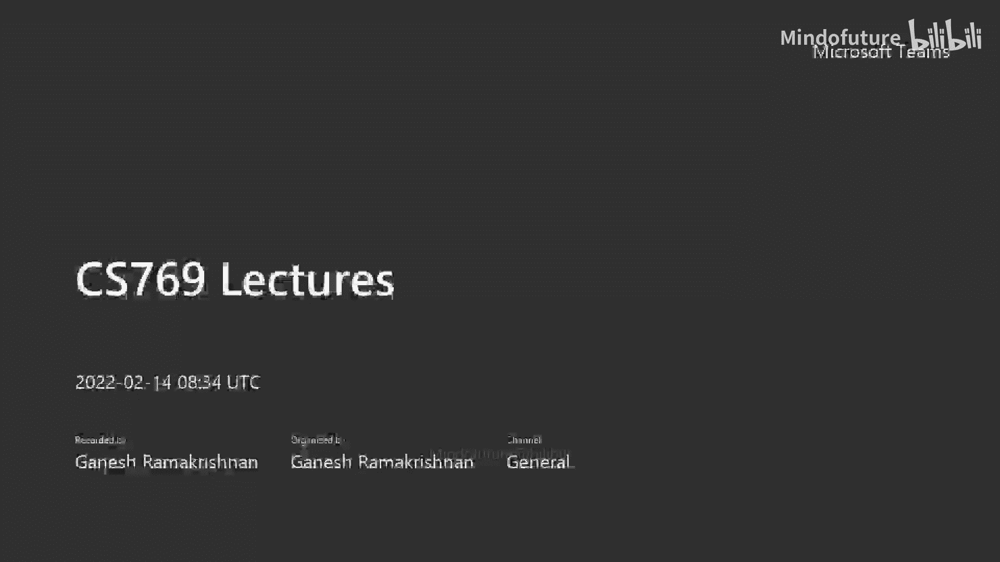
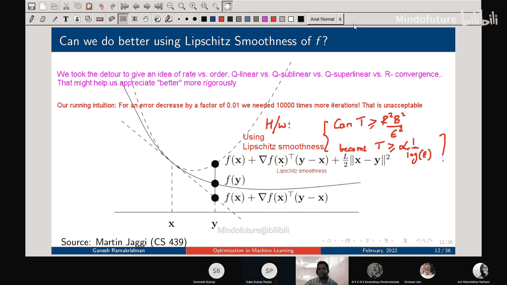

# 【印度理工学】机器学习优化 ｜ Cs 769 Optimization In Machine Learning p15 P15_第十二讲_14-2_优化与机器学习_梯度下降收敛分析凸性利普希茨假设与技巧 -BV18cBSBJEH1_p15-

嗯，Yes。Good afternoon， everyone。So， I've shared this。Notebook with all of you。嗯。要。

Created this notebook in such a way that it also weaves into。😊。

Some of the other optimization techniques， especially based on subset selection that I'll cover during the second half of the course。

 maybe little latter part the second half of the course， so we have this library called Spear。😊。

Can you see this tutorial screen share， tell make your full screen。Okay， yes sir。So。

It iss making use of spear。I semiupervised data programming， that's what SpR stands。And you know。

 there's associated paper and documentation。Here， as you can see。UmSo。

The data is loaded through that though our methods that we write are。Kind of from scratch。

 we don't you know， the sp itself has lots of。Optimization libraries that it uses whereas here we are trying to write the optimization algorithms from scratch So later loaders。

 etcter we are reusing from there。So。The SMS spam data set specifically is on what I illustrate。

 it's a binary classification data you are given。SMS and you want to data if it's a spam or a ham。

 which is a non spam。Feturization， et cea。A built here and now were going to use logistic laws largely。

And this is our very basic implementation of gradient descent。

We exit when some optimization condition and we'll talk a little bit about that。😊，Right， what。

 what could be conversionence criteria once we finish our conversiongence analysis。

 but until some conversionence。Pdition is。satisfiedatisfied or if the number of function evaluations is exceeding the max number of function evaluations。

Okay， it's has been set here。It trying to find out very absolutely。 Okay。

 actually sorry passes as passes as an argument here， Max is passes as an argument。

 So momentum function evaluation exceeds that then you break like either of either of these two conditions。

With the optimization condition being given precedentnce。Okay。And heres a simple， you know。

Run off gradient descent。都。You can see the function value。And this is a function value。

 And now what you are trying to see is the。Optimization condition。Based on which。

We would the opt condition， which is supposed to be less than say。0。001 and we are checking okay。

 what is optimization condition it's basically。Looking at some kind of gradient we we look at this right。

 some something to do with the。C点体的记。Okay so。You you keep inspecting it and moment it becomes very small。

 you you plan tend to exit or right all the function evaluations exceed some。

So here we have said actually function evaluations is 250。😊，Yeah。

 so it has exceed the moment it has each 250， it has weight。

you will see a couple other implementations gradient de with ArmyO conditions。

 I'll talk a little bit about that today。😊，Different kinds of I have some extra slides， though。

 where I refer to these。So yeah， a couple of other algorithms that we will talk about are implemented here。

😊，Yeah， but this is the， the simplest of that。 What we have discussed is illustrated here in this notebook。

嗯。And let's go back and understand。Why this gradient descent would converge？We talked about。

Convexity being useful， but at the same time， lips shades continuity which is more or less kind of guaranteed if you are looking at。

😊，Convex functions。In certain bounded regions， right？

So oral less lipstters continuity holes and then lipst smoothness holds。

For a subset of such functions， we will discuss a bit more of that today。

 Can we switch to the slides。Anyone wants to ask anything on this。嗯。Okay， so there's。

There's more in the notebook as we progress on our understanding of the conversiongence。

 So we will continue our discussion on lipssheds continuity。

 smoothness and convergence of alga optimization algorithms。Okay。Yeah so。We had left ourselves with。

The gradient descent。Discussion。And it's converligence。

We specifically were interested in what happens。If。Its lipsit continues with parameter B。

Along with Conity。Okay， so this is a recap。I left you as homeworkwork to complete the analysis， so。

I'll recap what we had covered as part of the analysis。First part was just algebraic manipulation。

Okay， so2 v transpose w。Would be treated as nomi squared plus nonw square minus。

No of female whole squared。And we just substituted。放。V SGt， And then as。W as x minus x star。

With that substitution。We got certain expansion by applying。This algebraic。Equence。

Then what we did was we took。This。Equation1 obtained as a result of algebra expansion and some did。😊。

Over the iterations。T equals small1 to t minus-1， so。got small tea ranging from。1，2 T minus-1。

So we finished this part。I'm assuming you don't have any questions on this。

We were wondering then what can we do， how can we simplify？So。There were some important。

Inequalities that come to a rescue， one being that。

The teeth epoch you probably not get conversed to extra。 That's what you're continuing。说。

If you have not conged， then。What happens to。The light side。In conjunction with convexity。

 so there are two things we are using here in working convexity。With x equals xt and y equals x star。

So， that's one。Its a excuse of convexity。And the other is that。

The P trait has not yet converged to a star。嗯嗯。I mean。

 the fact that there is no more need to update as a non0 gradient right， I mean had the X star。

Being achieved， whatever have at least expected。The gradient at that the previous rate to be0。

But there is still some scope for update right gradient at x t to be 0。

There still some scope for update。So what do we do next。

 you are you basically now so there's a problem with the tumbling here。

So let's just write down the numbering properly here。This is。Combining two with three。

Combining2 with3。🤧Okay。What's happening， we have gotten rid of our blue term here。X1 is x do。Don。And。

We have also applied。Dranstute。Transceptivity of the inequality。

 So f of x minus f of x star is designated equal to Gt transfer x minus x star。

And this term Gt transpose Xt minus X is also sitting here and this is the quality。Some the world。

The ind D。 So now， therefore， you can。In work。On the left hand side， the sum。

 that's exactly what has happened。We will move to summation on the left hand side。Expression。Okay。

The right hand side pretty much remains the same except that。You have， you have roed。Determin blue。

 it is anyway greater than 0 so。做。😔，What have we done you said that。By virtue of this。Part in blue。

Is greater than 0。 So this is therefore。This entire expression here。

Is greater than the expression here because x minus x star squared is greater than0。Histically。

Heel so far so good。What do you do next。Any thoughts。I had a question about equation， too。

So why the inequality reversed like the gradient is upper bounded the gradient should be upper bound right instead of gradient upper bounding the Ls Okay。

 so just。Read a Elizabeth bit carefully what is the original inequality we are talking about GT。😊。

So we know that f of x star， let me write this。F of x star， as per convexity。All。

 so look at this convex function if you have。A linear lower bound at this point。Xt。

 sorry I should have。Yeah。给停。😔，This is X。And this is your point X， the lower point。 So we know that。

F of x star。Is。Overover bounded。By of of Xt。Plus， Gt trans force。X T。should be X minus 16。

F of y is greater f of x plus Gt，d transpose。White man is x， x star。Mus X D。Okay。

 so now what have I done， I have taken F F X T and F of X start on one side。

 which is less than equal to。 So I have mode。This expression to the LHs。F of xt minus f of x star。

 that's for app here。😊，And when I move the Gt x star minus 60 to the ors， the sign gets flipped。

 right？😊，SoGt x minus is x so that' is greater than， so it is the same thing。Is it clear？嗯，也是。Okay。

 so the mistake you might make is take an x t minus X here， so notice that is X minus xt。😡。

That's when this will serve as an linear approximation。Linear approximation。

 which is also a lower bound for a convex function。Okay。Thanks。嗯。Anything else？Wd ask。Glaified。Sorry。

 question three is x1 minus x star squared， right？Equation 3 is。In the right hand side that is x1。

Yeahやや。So I sometimes in this systemm。Yeah， let make it excellent。Thanks for bit out。

The slides I will probably used。Zro index， and I forgot to change the indexes consistently everywhere。

 but mostly should be consistent。Thanks for winding it out。Any other question？Okay。

 so so far you are good， right？😊，嗯。O。Then the next thing we yeah after invoking convexity。😊，嗯。

What did we do next this is this is based on context what did we do next？I kind of left it at。😊。

Lifted as some little bit of food for thought as homework。Bevoked。Something to deal with the。

Cd normm square， right？We want to make sure that。Any own property can be which is。

Somewhat natural and organic to expect。Can be applied。

So the next natural property would be interested inshed lipssheds continuity。

So you have to look for properties known properties and therefore one thing you are doing in this goes through some of these example analysis。

😊，Is that you are getting hold of the tools， getting hold of definitions that might be handy。

So let just continue can give us some bound。Ingradient norm。Now， the question is， of course。

 we can give us some upper bound。If we use that as it is or do we do some manipulation is a question。

Anyone has attempted。Yeah yet after。Anyone。😊，Okay， if you haven't， let's。冇玩。

So we just now recalling what we have in the previous slide， the final result。Okay。

 now we want to do something with this red part。 Okay， I color it as pink， but let me just。

Use red color to be consistent。Okay， so we are going to do something with us。

This component in the next slide。Just want to be consistent with colors here。Okay。So， this part。

The norm Gt square。As I said。If you can make use of the。If it's continuity property。What happens。

So normm Gt square that just the right hand side right normm Gt square is less than b square now how many times am I summing well for t equals 1 to t minus1。

😊，The B of course， has no index into the T so B is independent of T， so youll have t minus1。

B square on the right hand side as an upper bound。So youll have gamma by 2 t minus1 v squared。Plus。

The one more property we are going to use， okay， so。We are saying that no matter what you do。

 your iterates won't have been， you know， infinitely far away from your original。嗯。

From the optimal point right， so can we make use of some property like this。And。

We just draw the circle here。So what are we doing were saying that？Your retreats cannot be a star。

This is your。St after point。The X， any x may not be very far away。 and。

 and we can ensure that explanation one at least is not。Now has limited distance。From X star。

 So X 1 x stars doesn't equal to R。Okay， so that can be applied。To this term here。

X1 and6 star square is in R。Squid。That gives you ask square by2 gamma on the right hand side。

So this extreme right expression。😊，Gmma by 2 t squared plus r squared by2 gamma Now what do we do with that。

Okay， that's this is a trick number。I've added some tricks so far right so we had a tick number one which was algebra manipulation tick number two was telescopic summing right this is trick。

😊，I probably have used many more tricks。 like I will give them numbers the trick 3。Is。

What do you do about gamma。What we can do is， you can see。How small can the upper bond become， right？

U。Minimize or determine。The minimum value of the upper bound。Which you can write， if's super bounded。

 then how tight it can can become。You can likewise， sometimes youll do maximum。Value of a lower bone。

I just could be。Ofrics。Okay， so what have we done here， we are saying the extreme right expression。

We will apply the strict3 this expression。And how is our trick helpful？😮。

So instead of having an upper bound in terms of gamma we are trying to find well。

 is there an upper bound I can write independent of gamma？Okay， and that becomes possible。

By setting gamma 2 are be are divided by b square root so with this I will leave it as homework I mean this is a very simple homework。

It says， it's one dimensional problem， right。So you basically are trying to minimize。This expression。

With respect to gamma。And that yields gamma equals R upon B square root T。

 Now if we can substitute the。Expression for gamma minimizer。What do you get。

 Can you please work it out， Let's work it out。 Let's see。If there's some insight， you get。

Please let me know what you will get when you substitute。A be。Oh。You get what are。

Are into being into therapy。Are it be square root。Okay， so。

Iing to be into square root is exactly what you had anticipated。Okay。

 so see there are there are other ways you can look for actual gamma instantis like what we did is just set gamma to r square b square root okay and you are doing that consistently everywhere not just right hand side left hand side also we have done that。

😊，Okay， so。嗯。So recall that we have this this is what by the way why are we I mean a very important question to ask I wish I didn't why how are we boldly minimizing with respect to gamma when the left hand side you at a gamma anyone wants to answer that。

😊，I mean，Really appreciate if you get the right answer， so。Here， on the left hand side。

You have a gamma right hand side， you have a gamma。

 Now we are saying determine the minimum value of an upper bound。

 but what if the left hand side that in that that your upper bound being had a gamma。😡，Anyone。

Is it because the experiment mean the inequality holes is true for all gamma， therefore。

 we can still continue with minimizing with respect to gamma。ok 嗯。

So see if this were the only only inequality， thanks for the good attempt as next left hand side youre right。

 if the left hand side did not involve gamma， you exactly your logic applies， right。😊。

So let me write this down more generally， so let's say I have an expression。啱。21。Okay。

 which is less than equal to。Etu gama。And even really the。If it was independent of gamma。

 then you will say that e1 is less than equal to。M gamma。Of E2 Gamma， right。

That's what you're saying， I that correct？😊，In fact， the two are equivalent。

Saying that even is less than equal to e2 gamma is the same as saying that even is less than equal to the mean of all of those。

Is that that's what you meant。 Sorry， I didn't know who suggested that。 Yes， yes， What now。

 my question to use， what is even and what is he do， Let's give names here。

What is E and what is E to。So can I assume that this is e1， this is E2 sorry。This is E2 Gamma。Right。

 this is E2 Gamma。If this is U to Gamma， what is even gamma。Even which is independent ofma， sorry。

Anyone。えそれがけりだるだ。れ。😊，So some noise me。How you come on？Are you speaking something。你都把一个人。Nil come on。

我要要条。sorry Sir you want to suggest an answer。嗯。What is even Anyone would like to attempt this。

 What is even here。Even here is this expression okay。So。We are not really talking about。

The intermediatemitted expression， which we are bounded。

 We are talking about the original expression that we are upper bounding， which is this expression。

Okay， so this is E1， which is independent of gamma。Okay， and otherwise we won't dare to do this。Okay。

 so this is important。Yeah。Is this clear to everyone， so I'm again making this point。This E1。

Is independent of gamma。And therefore， you can minimize the right hand side with respect toma of this here。

 if have questions， Let me know。So what we are we are not interested in the intermediate this。

 this part。Which have itvo this is really intermediate we don't have to really minimize this with respect to gama just minimizing the final upper bound and the original expression that we are upper bounding that's all。

😊，一。That's that's what happens。 So again， I want to remind you， we are dealing with E1 here。

Which is independent of gamma， Okay， let me write that even again here。Even。

 which is independent of gamma。And what you have on the right hand side。Is the E2。

 which is not just E2 now now we are going to go from E2 to Min over E2。Can谁 do。T2 gamma。

 And then what I have here。Is。win gama。Of ittu Gama。So， kind of。

Reeting here so that there's absolutely no scope for confusion。

So all this should be very interesting is giving you really powerful tools。😊。

So now we have said that f of x t minus f of x star summed to all values of t。😊，Average right I mean。

 or rather one upon team right is less than equal to Rb into divide by square root。😊。

There's a little bit more we can do。It sort of just doing a summation， leaving it at this point。

What we want to do is。You want to say。This expression。Which involves the。Argument。

 I think the argument got missing here and correct that。It ex。嗯。Exha， ex。Its is argument。

Or I of F of X say。this is a final it， the the final smallest point。

 right because whole ideas as we are。Proceeding， the function value is decreasing。😊。

And we are expecting the function to decrease。😊，Across eight rates。说。

As a reasonable assumption to make， otherwise， why would you do gradient descent。So therefore。

 I'm saying that write that。Youre saying here。This is C F。But now， F is with。With respect to X T。

And what we have is T as an index here。So what we expect is that the function value decreases。

 maybe there's。Decrease is high。 rate is higher， and then it's。And so we are saying， well。

 at some point you decided to stop。The point at which you decided to stop。Is your Xte。Or x X。嗯。And。

This。Is exact。So now what we can do is。Consider。A minimization， or rather。嗯。The lower bound。

For this right as since any xt there are lots of xts， the previous Xts are further away。😊，一心心。

Some X here， right。And the corresponding f values would have been closer far further away from f of x star than at x maybe x star x star or whatever I mean the function value at x star would have been let's say let's actually draw a hypothetical line I don't know whether x star is that x star I don't have access to。

😊，But what I know is that okay， it's probably here right F of x maybe here。So YF ofX star is here。

But this plot is showing as evolution。Of reduction of the function。Across it， epoxy。

So FFxc is decreasing F of x stars like somewhere maybe below F of x hat。😊。

But you would certainly expect F of X hat to be closer to F of X F of x star。

Than any of the other retreat that that's the reason you're doing gradient descent at all。

 is why would you be wasting your time？😊，You knowDecending would have stopped earlier。

Let's just give this a name。 This is F of。Except。So given this， can I do some more manipulation， Yes。

 you can。What do you do next。Anyone。Yes， please。Will expect always be the last No。

 why if you are if I function is con。So our point will move towards the point of minimum。

 so why wouldn't the last trade be the Army？Its possible that it turns out to be external but maybe your resource constraint maybe you don't want to run to total conversions maybe your your conversion criteria is based on validation set and not training set right think of machine learning youre not just thinking about optimization I。

😊，We didn't miss we didn't we didn't necessarily go till that point right in machine learning。

 we may stop early。We are on you know descending on the training set because we want to not overfi on a on the training set。

 we want to do well on validation set okay so。You recap this from machine learning。

Toika from machine learning。That often the more are the iterations。Are stopped。

Based on validation set。It is when。OnVidation。Accuracy starts dropping。And here。

The optimization is with respect to training set。So we may have early stopping。

For awarding overfitting。Slash to generalize。Is this here？哦， yes。

Except for machine learning the multiple reasons why you may not go。To X star。

 This is one reason It's possible that because of numerical position， another reason， Okay。

 so I let me list down reasons， right。This is certainly one reason。嗯。reason is that。Mumical errors。

Let me just go give it。嗯。Mummerical。Poresition。And sometimes。Be a deterrent。To get。

X hat no equal to X star。Okay， so these are， this another reason。

So the equality I'm talking about here is。If of。Exact。Becoming exactly equal to。Nextter。

Is this clear， That's also a reason。That's a very good question you asked。Sir。

 so this value of kma that we have obtained does this guarantee that we will never overshoot X。

This particular gamma。See the two parts to your question。

 what should be the value of gamma for which you get conversionvergence？Here we are saying that。

So no matter what gamma you use， okay this is saying no matter what gamma you use。

 if there if the upper bound holds for the under lips continuity。

 this will always hold no matter what gamma you use。😊，I mean， obviously， gamma is non zero。

 Otherwise， you are not making any progress。Is that here。

So that is one aspect that's why saying minimization over all possible gamas。

 basically this inequality holds for any gamma。😊，key is this inequality is voting for any government。

Is that point first part to the answer clear？Yes是。Okay， so I'll have to say。Onces for any dramama。嗯。

But we should just ensure that gamma is。Great than0。 otherwise we are making no progress at all。

That's one， but。You have another valid question。What should be the value of gamma for some other criteria I will find that there are there is an existence of a gamma for which。

😊，You can show certain convergence properties or you know rate of convergence so gamma in general gamma values or choice of gamma values can make a big difference to convergence right so thats why that is why you know this step size choice is itself a big topic of discussion I will be posting some extra slides on on how step size can be chosen。

啊就。There are multiple points we are making here。In general。Howward。Step size。Joys joys of step sites。

And the bigger。Important for。V algorithms。For even analysis。Yeah。你知道。Any other questions？Yes。Okay。

 great。 These are very good questions。So let me continue on this part of min over。I of F of xi。

 which is F of x hat。The argument is exact。What can I say if I try to apply this part here。

 what will happen？😡，Can you suggest。What would happen？Can I say that this sum over T， right mean。

 this is。It of course a t I mean， theres a t minus1 and divided by t。

 but we can call consider to be t by t okay。😊，So can I say that this。

RightThis is like if I take a one upon T。And I say this is nothing what F fix had。It is less than。

Or equal to。1 upon T summation。T equals 1 to t -1。😔，Of F of x hat。M this。F of X star。

Can I say this rules。And my claim is because。as you see in this image。As we progress。

The function values can only get closer to X hat。 They cannot get further away This is。

by design right where the algorithm itself is meant to progress when function values are reducing or minimizing。

😊，Irespective by whether reach effectsx had X star or not， you would have made progress。

That's a old idea。ok。The second inequality is okay。 How do you want。

So if you I think you're saying how do I get。That's a good question。

Yeah let me just put this as approximately equal to your right there will be one additional you know you have t minus1 here。

😊，I think we can add a dummy term here I have to。😊，Maybe think a little bit more。At the least。

 we can write as as you know， if you want， we can just write it as t minus1 divided by Let's lets just keep it at that right So this is。

😊，T minus-1 developed by T。Excus meYes， for the leftmost expression shouldn it be F of x hat minus minus f of x star it just wrote you wrote just F of x hat。

 that's why。2号 sorry你呀哎呀 yeah。Okay， okay， oh， you you mean that。 okay。And about the T minus yeah。

The Tbar is also something we can manage。this is additional scalar。

 but that' is not very important it just knows one small addition。

But this is this holds exactly what I've written is correct now。嗯。Show that oh。

 there's a problem here again。There's an argument somehow it's kind missing in the compilation。

So exact again， as I said， is argument。Couldpy word from the previously。Okay。

 so this is exact equals al y of X f of X I。So you can show that module that t minus one term right it it is pretty much this okay so this can be shown。

That f of x side minus f of x star is less than equal to the absolute value is less than equal to Rrb divided by。

😊，Squarerupee。So then let me ask。One question。 What， how do we proceed from here。

One way which you could try and answer。Is suppose。Supp we won't。Find D。Such that find a T， such that。

This expression on the left。F of x S minus f of x star is absolute value。This is close enough。

 which means it's less say less an epsilon have no idea what is f of x star。 Okay。

 so please note that Im in total darkness about F of x star。😊，We don't have access to。

But all I'm saying is an intention， I want to be very close to f of x star。😡，Close then Epsilon。

What is implication， so let me ask you a question， is there some sufficient condition on T that will get me this expression？

😊，So we can have RV by rope P less than Epsil and then it will hold Excel， excellent， right。

And this helped derive。AS。I mean， necessary may be sufficient condition。

 Okay T must be something at least something and what was suggested is exactly the answer。😊。

Early straightforward answer。 what are we doing here。Yes， the answer is。Yes。嗯。First。

Tip numerator innominator。And then what we do？And then square， right。Is that the answer。

Here to square as well。哦，对。Okay， so。Let's write that expression。You have。Just flip numeratorated now。

 I mean， let's say I want。This to be less than equal Eil。 This to be less less than uppsil。

But I know that f of x hat minus f x f of x star is less than equal to Rb by square root。😊，So。

 sufficient condition。What's a sufficient condition that。

F of x side minus F ofx star in absolute value is less than epsilon。😊。

A sufficient condition is that Epsilon is less than equal to。😊，Aby white。

Square root is not necessary， it not dead sufficient。G it is。Imount to amounting to saying that。所以。

Did I make a mistake Know it just be other way， right。has be other way， correct。哦，他发レ don to go。Yeah。

人。This is sufficient condition。So as long as this Rrb by square root is less than an equal to 7。😊。

You know that F of excitement of star is less than equal。Less than strictly less upside。 Well。

 you can。Yeah。This can actually yeah you can make a strict inequality also， but yeah it's okay。

So the sufficient condition will then be that。T， the flipping things， right， R square， B square。

Divided by Epsilon square。Is less than equal to t That is t is at least r squared b squared by absoluteps squared。

对。So， this is tiyea。It suffice us to have this， which implies that。

T is greater than equal to R squared。 B squared by epsilence squared。Wow。

 so this we have really got from。You know。Long way， basically， from gradient decent to。😊。

Garantee or you know when you would be close enough to an unknown f of extra this must be very satisfying overall and we can also try and summarize this by saying okay if if。

😊，The the T is of this。Form I mean， in an inequality sense。

 and it should immediately remind you that this is related to order， right， that for all。You know。

Epsilon greater than equal to some epsil and not t is greater than equal to some function right So that function is what it is1 upon。

😊，Epsilence squared。 that's the order term。 So big O。So this is the big old to algorithms。

Anyone wants me to explain what is this big O？😮，I'm assuming that silence means you' are all fine。

Yeah。So this is Ts order rock one upon Epsilence square。Okay。

 so excuse me could you give a brief overview of the baggo rotation， It will be helpful。Right， so。

It is basically a notation。This is talking about the limiting behavior， right？

It's like what happens when the。Argument here， which is Epsilon square as as it becomes larger and larger。

 how does it tend to be？Yeah， so。Big O is about the limiting。Behavior。Of the function。

 What is that function。It's it's a lower amount， of course。Or absoluteil。

Cercle lower bond we use big omega， right。Like， isn't big for the upper one。Yeah。

 this because in in fact， in fact， the upper bound right here。 Oh， yeah， sorry， sorry。

 you're talking about。Yeah， yeah， yeah， I'， I'm， I'm you're right。 You're right。 This is the I。

 I was referring to the previous inequalities。 So we should just use omega here。

 Thanks for the correction。😊，我没了呀。So， we are basically talking about。A lower bound for T。

 not upper bound yeah。一啲。做做咩噶。It's called big omega。Okay， so again。

 bigomega is also limiting behavior。😊，But in what sense， yes。

 what is the difference between big omega and big O？1路。yeah what we are talking about。A lower bound。

Right。The lower bound sense。So limiting lower bound behavior。Yeah， what we are saying here is that。

You can basically。诶。Characterize at different functions with the same growth rate。😊。

You can characterize using the same。😊，We pick over big omega notation。Basically。

 it's an asymptootic bound。Yeah。Big over， for example。Is saying that if function is F1 is O F2 right。

As extends to as the argument turnss to infinity。Then。Basically， you're saying that。

The function absolute value of f1 is less than equal to some constant m。Times the。

Function F2 apply to the same argument。Were talking about a lower bone。 Absute value。 have fun is is。

Great than equal2。Some some constant M or n。Times d function F2 applied to the same argument。Okay。

Or you can read up a bit more on this。Order of convergence。In terms of algorithms。

But let's try and understand what this means。嗯。In with some examples， okay。

So the idea is we have given lips continuity and convicxity。😊。

We have gradient descent which step size gamma equals say this is a exist existential gamma。

 but we showed that this inequality holds in general， right？😊，So if you use this gamma。

 then that is a minimum， I mean， this gamma or any other gamma。😡，까ma grade than  zero。

It a solution exact。Which gives you this。Upper bound Epsilon and ask square B squared by Epsil square iteration。

 but let's understand this in terms of。Some example numbers。And also analysiss a bit more。

The advantage is that it goes to zero。As tea becomes very large。Okay。

 so just go back to the previous slide。So as you know， P becomes very large。

 you are basically having。B going to 0。嗯。😊，That's an advantage。嗯。

And it is independent on the dimensionality of x。 well。

 your except for the fact that the gradient computation will depend on the dimensionality of x。😊。

Right。Mod of that。But here， when we say， we are talking about。Bounding conversions， etc cea。

 we are assuming。That each gradient computation is a unit step。 So it's important to。

Explain what is a unit， the the unit。Of each。Step slash analysis。嗯。Graient。这声。C in competition。So。

 we are not really accounting for the time we required to compute the gradient。So module that， yes。

Is independent of the。Tamamaistity of x。Any questions？Any other observations you want to make。

So the R still dependent on extra while you said that we are in complete dark about the value of extra。

 but still we are extra。So R is indeed you know based on how far the initial rate all we are saying is we are bounded by。

I mean， the points are not too far away。See， the issue is that there's not so much you can do about the choice of。

X1， right， I mean， we don't know X star。Sorry， let me just copy that image itself。

Let's discuss this a bit more。Let's discuss this here。嗯。The R is the R is an issue for us。

 but it's going to be issue for any initialization because it' is for x1。😊，So。

Is kind of independent of what algorithm you have sort of gradient you used。YouHis you know。

 Newton or subgraient descent。 You would have the same x1。Right so we are saying that that's。

Based on how well the initial it rate was engineered。

So it has little less to do with the algorithm it another matter altogether that the convergence for that algorithm is dependent on how far x1 is this particular particular analysis。

 maybe you could have come up with another analysis which did not require the distance of the initial trade from X。

😊，Okay， all we are saying is well， given this analysis says。😊，If your initial it is very far from X。

 then the number of iterations will be those many more mean almost squared， right？😊。

So we don't need the f of x star。 We don't need it。 I mean， there is an existential R。😡。

Based on what that f of x star is and。If you are too far。

 then there will be a automatic growth in the number of iterations。😮，Proportal to the distance。

Is that clear， So we don't need the value of。X star， sorry， F of X star。

We are doing it in an existential manner。Is that okay。

So said we can't use this in equal at this bound for you know deciding the number of epochs we need because anyway we don't have art。

Yeah， but all we are saying is if。My initial rate is fixed， right？If and I try different epsilons。

 I give you an epsilon one epsilon one Epsilon 2 Epsilon 3。😊。

Then I can come up with an estimate of how my number of iterations will grow。

So all this is modulo that we have the same initial it rate。Let let me like this。So above analysis。

 Yeah， like let me write this。Separately。电二是6。Assumes that。We are always dealing。😔。

With the same initial。It rate X 1， right， We are not changing it。Which determines。嗯。

And what we are all we are saying is， how does the rate grow given this assumption？Is that okay？

Yes sir， we are giving a recipe。For the number of it rates under this assumption。

The recipe for a number of。It ratess。Under this assumption。

Is that if you want to get more close to the optimal。😔，You would need。Right， oh。Number of。

Ittuerations。Conversely。Oional。To the square。Of how close you need to get to the optimal。😔。

InSome sense， that's， that's why we are using the big omega notation。

 big omega notation is because we don't want to。You know。

 be bogged down by the fact that there is an R and a B I mean。

 you can ask the same question about B of course， I mean。

 R is slightly more tricky because it's initially trade for the same function but B is fixed for that function。

😡，But again， if the tighter the B， the smaller the value of B。

 you can get the pure number of iteration side we are trying model all that。😊。

You have this inverse quadratic。Growth， right， as you want smaller and smaller gaps。

 you need to have those many more quatic growth in equations。 Is that fine。你就说。No。Yeah。

We saw some advantages。嗯。But there are disadvantages there are more disadvantages than advantages for this is is a very naive algorithm we are not very happy na analysis is another algorithm is also somewhat naive but analysis is certainly na。

😊，Its slow conversionence to achieve an error of 0。01。What happens right。

 you require 10 raised to four r square B for iterations。But if you wanted。And I have 0。001。系の。Now。

 you suddenly need tens to air iterations， which is like too much。So this is a problem。I mean。

 I've listed some disadvantages。 Well actually more disadvantages。 Let me list some more okay。

Is this disadvantage clear to other everyone。I mean I mean hinting at it already in the previous slides。

 but now we have got a lot more explicit about it。😊，Any other comments。

 So let me look at other disadvantages。 by the way is disadvantage of the the assumptions。

 the assumptions。They like this analysis。Is specific to this analysis。Of the algorithm。

 so we are not going to change the algorithm right away we we will try and see if we can get better analysis。

😊，So。What are the other disadvantages？I mean theres do you say that there is a kind of magical gamma that pops up somewhere we did say that it holds maybe looking at the minimum value of gamma that's a problem why why should we you know why should we not assume that gamma is obtained in a more principle manner。

😊，系。Does not。Assume that the step size。Gma is obtained。more principle。When I say principle。

 I mean search。Basedas banner。Right。So can realistically， right， so realistically。😊。

Gma can be obtained。Using a whole bunch of such techniques。So what are those research techniques？So。

 that are。Using search techniques。Does。Exact。Back tracking。Right。Research。

And then backtracking research under。Until conditions。Especially backting race， right。

 a backtracking。Specifically。Back trackingrack basically keeps tracking back， right， search。

We call ray because we want Gaba to be greater than0。So， gray search continues。

Until conditions such as， you know， there are there are armyo conditions。Poholeeen conditions。

Its satisfied。Whats this。嗯。I'm going to give you extra and optional slides。 They're optional。

But did it be nice？😊，Right to have a look at it I'll talk about a bit more about it。😊。

But the other is what do you mean by convergence。 I mean。

 so we have invoked the notion of convergence here。嗯。Need to also appreciate。

Different kinds of conversions。So this we say this is a slow convergence。

 what is a slow convergence about？😊，嗯。This is like the convergence。哦。It is a very weak form。See。

 we talking about this， Oega， right。Is Oomega the right thing to do， I mean。

 somebody I rightly pointed out right so。😊，Can we have a more， I mean， better know。

 more comfortable conversion， So we。😊，Again， I would say I see extraional slides。

I'm not going to go to。 I'm going to just flash them right now。But say we have R convergence。

Convers I might break it up later on let's see right now it's extra and optional and certainly for the mids it is。

But we'll see if there's an need， I'll pull it up again later。So our convergence with Q convergence。

 Lets so we will not use big omega small omega， right， I mean。

 biggo that was just so the entire discussion on omega is it's okay if you don't completely。

 you know understand。But this is a very weak。 This is not the analysis we'll be using okay。哦。

That's why I'm not going to delve into it。Okay， so we won't use this analysis。

So it's less relevant for us。Because what we want， we want really to know quadratic Quebic and whatever。

In a more principal manner。There is a notion of Q convergence， Q linear convergence。

 Q qua convergence and so on。So we we look at that。um。

I'll be I'll be posting those slides separately， but before before I move ahead。

 I'm just going to quickly flash those slides and then we can come back to。

So this I'm just going to show these extra slides on conversiongs， hope you can see。

It's a notion of rates of convergence， Okay， linear， superline， subline。

As a retreats the same thing I showed earlier， right。

 you want the function value to decrease now which is which of these is impressive。

 super linear conversiong， subline or linear。😊，What impresses you most。

Which is the best of the three。Hello。Can you see the screen？😮，Yes， sir。

 which is your highest priority here。So depends on the name。Depends on the need what we need。

 I want to fast， right？ No like so if we do not have much budget， like we have to do it in few talks。

 then subline would be good。 And if we have little more budget super linear would be better。Right。

 but typically we will assume that we have some number of epo I mean we are not it cannot be too vily。

 right。😊，So we have some amount， I understand， you know。

 you are talking about this this part right here。Module of this part。Super linear， right。But then。

Subsequently， it just goes down very fast， isn't it？A sub kind of really sta it after a point。Yeah。

 I can think about it。 I mean， would this be a preference one followed by two。Followed by three。

 yeah。I'm leaving this has put for thought for you。Okay， so again。

 the notions of r andq linear convergence。 So if you have a sequence。

Sk minus a star being less than equal to Vk。And then Vk convertverges q linear to 0。

 then we call that S to sk R linear conversion where the notion ofq linear is that Vk plus 1 minus v star。

😊，Is ratio with respect to Vk minus v star is less than equal to R。

If this isq linearly convergence R is like， okay， I r is a little weaker thing you are saying it has an upper bounded cu linearly convergent。

😊，Sequence， clean。And we are calling it Q。I I like will seeing this very soon。

 This is a quotient of the norm， so。This， this question。Is making it is giving it the name。2。

made it optional so that I don't want to again make this sound like a class full class on it。

 otherwise we be just stuck。😊，So Q linear convergence typically implies that you have R linear converence。

 but R linear convergence doesn't imply the other way。😊。

So Q is an order of conversions R is the rate of conversions lets I will just talk about Q super linear。

😊，So here， super linear conversions。Is when you even if you take the square of the previous difference here。

 right？And take the ratio of the current difference to the square of the previous division difference that limit in a limiting sense goes to 0。

😊，And in the sublinear Q sublinear， you are saying that it goes to1。

But you can have a general order P instead of the two， you can have up order P。激素诶。

YeahAgain some examples also in this slide， look what is fast， what is slow。

Both the S1 and S2 conversege to5。While 5 plus1 upon two raised to n。

And the other one is 5 plus1 upon。Right two ways to。I声。1 about2 ratio to two ratio 1， -1。

What would you expect to converge slowly。If you study。S1。

 S star is 5 and Q convergence order equals 1。Whereas for2， you have p equals 2。 now you。

 you need to think which is better。Ps 1 or P equal 2。 What's an intuition about S1 versus S2。

What seems to converge faster。Anyone。S2 looks faster。S2 looks faster Okay。

 so I maybe we can give some thought with others can also give that thought。

So then looks like p equals 2 higher higher is better。嗯。

So that'sqverses of order peak greater than onena super linear。

 That's what I was kind of canvassing for earlier。Okay， so this is meant to be an optional reading。

I mean， optional from the exam point of view， But I would say from understanding the course。

 please do read。 I mean， I would encourage you to read。

Just that I don't want to cover any exam something I have not spent sufficient time teaching the class。

 or therefore I'm calling it optional。And our converges， this is key what we have well I mean。

 the convergence analysis for lipsus sctinuity。😊，Hass R conversionence。

It's not even R actually it's almost R so its real weaker so thats how pathetic this convergence is。

😊，It's almost all convergence。 I mean it's not too bad， but at the same time。😊，嗯。

We just see the gradient decent with lips conity as conversions rate1 upon or one upon k。

So basically to get f of k minus of star is an equalse sal， we need order 1 upon。😊。

So iterations Okay， what I've also given in these extra slides is a gentle notion of decent algorithms。

Let's see if I get time to cover， you know， and then another thing I can cover in great detail in the slides in this optional slides。

😊，Is finding the step size， so I talked about exact research and backtracking research。

So exact research is finding the next T that you know。For whatever happened。Finding the next D。That。

Minimizes the F with the current step size。A current step direction， sorry。

 f of xk plus t times the current step direction which could come from any other decentscent algorithm。

So this should in general tell you that the next grade will give a lower function value then。

The current function value。That's exact。 But you in in in practice， what you do is backtracking。

 you can't find the exact retreat of always So you try and do some backtracking。

 So I I talk a little bit about， you know， I give details on how。嗯。

This implies sufficient decrease this is also called the RVO condition。

It's called the Army condition。Okay。So algorithm is as follows， you choose a beta。

 then you keep updating till you reach the sufficient decrease condition。

The in there are a couple of， you， you know， important points here。

 the the way you are going to iterate on the beta。And the way you would use Peterta is like you're going to shrink your step size T。

With a multiple beta meta is less than one by the way。

And you do this so that there's a sufficient decrease， that's a whole idea of backtracking lines。

' a sufficient decrease。😊，And we don't want to make minuscule insignificant decreases。song。嗯。

I'll see if I get time later on， I'll talk about this a bit more， but I give examples here。

And then there are strong wolf conditions which are in conjunction with the Ar condition。

 they are even better， they give guaranteed degrees and so on。Okay。

 so if you can function as convexity， you can actually get strong wolf conditions。

 you can satisfy strong wolf conditions。😊，Exect。Ander on。

SoSo exact research does better than empirical research only sometimes right exact choice of c 1 and C2。

 they are not very important the C1 and C2 which come from R O and。He back the wolf conditions。

So then I give example of you steepest descent algorithm。嗯。Yeah。

Which is a more general framework for gradient descent。Okay。

 so I'm going to leave this as extra reading for you。

I also gave conversion of decentscent algorithms in general。

There the and you know how the convergence can be analyzed very。

 very generic this is probably the most generic analysis of any decent algorithm and the the most generic use of backing research。

 most generic。😊，Analysis of the。Was genetic。Deent algorithm。

Great and decent is an example of decent algorithm。It recent is only a special case。咁。

But not only that， what we have done here is also analysis。Not for some magical gamma。

 but analysis it's based on step size。That's obtained right under the backtracking research。

Okay so yeah in case you are interested this might be helpful but in practice zero need to you know go this far you don't want to do it for gender decent algorithms。

 though the analysis is based on set size using backting I such is certainly interesting。😊。

Okay so it very it's a bit involved and that's another reason I'm not doing these proofs I mean it is a sticks will just take a lot of time。

😊，You have to bring in the c1 C2 constant and how they effect and so on。嗯。

And I give a couple of other algorithms。 So I'm going to stop this discussion here。

 Go back to the main part。 this assess is optional。边个。Yeah， the rest of this is just to know。

The versions of the gradient descent。ASpecial case， right here what I do is again。

 the gradient decent algorithm。Specifically， but under the backing research。

 I've used lipstick con and all that。I mean， you might find this interesting because now it's more specifically gradient decent。

 but。2。Under， you know， better step size。 Okay here back trackinging search you made use of the back trackinging search algorithm here。

Backracking step size， step， such。Okay， so this。Kind of you know， more general than our class proof。

Where we use some magical gamma， miniizing gamma。So write this but more involved， right？

So you'll have to do a little bit more work and so on。喊。Yeah， this is just run you through what。

And how backtracking research weavvees together with lipstitz continuity？Yeah， okay， so this。

 I'm going to just leave it at this。Going back， what I'm going to now leave you with a homework problem。

 which I think is going to be。Important。But to these slides。Yeah。WeGo to this slide。

 This is very important。So we are not very happy about you know what we got using lipstitz sctiity。

 right？😊，Can we do better。What does better mean， right？ I that that's why we took a that。The detour。

To give you an idea of optional reading material don know where where rates and orders of conversionvergence are used I talked about Q linear quadratic Q is basically。

😊，Right the order and then this R， which is the rate of convergence。Right。

We given our idea of Q linear。AQ linear。不es。Subq sublinear。0年。This is our conversions。

To a very weak form of convergence。Right。哦。No， that that can help you better appreciate。You know。

 what is better？Right， more rigorously。Our current intuition is exactly as follows。 We say that。

If I have we are trying to use a little bit of intuition for motivating here。😊。

We are saying that if it's going to take。And to error of you know。

 one by 100 is going to take one by 10000 I mean 10000 mopos， that's our problem， right？😊，So。

Our running intuition。For an。Eor。Degrees。A factor of。0。01。We needed。Basically，10000 times more。Epoch。

It对。That。Is unacceptable。 That's our main concern。Okay。

So instead of you know resorting necessarily to all that conversionverence rate we are trying to give a little bit more intuitive understanding if the class feels I want more you know rigorous understanding certainly we can do that。

But let's just stick to this。 And then our question is。And lips smoothness help reduce that。

And we know the lips smoothness。Put a bound right upper upper bound on how fast the function changes。

The curvature。Lipss convexity says， well there' is at least so much rate of change that is what we are trying to motivate through this image。

😊，So can the question is。Can liftshed sctinuity bring us down us lipsshed smoothness？So can see。B。

Which was the which， which was， you know， and of， if you look at the previous slides。

 we are saying that。T is greater than equal to1 upon Epsilon square right and I know R and B are of concern to us。

😊，So greater than r square， v square。My absolute care become。Now what now can we get。

Something like greater than equal to。1 upon something or RB， whatever， but some expressions， but。

You have。1 upon log Eel。Yeah。SomeAl times1 upon log。

That would be interesting for us from a convergence perspective。😊，So more of this in the next class。

 but I want you to there is a homework problem for you。😊，How can we use this lipsts。Continuity。

 this was lipstd's contiity。She smoothness。And can you use as lips smoothness property。To go from。

What about Epsilon squared to1 upon log Epson。That's that's own work。Any questions？

So this is my homework problem using lips smoothness， what。Can we do this。Okay。

 there are no questions， then we'll conclude for today。Thanks。We'll see you on Thursday。

You able to hear me right， hopefully there was no。Yeah， great issue here， thanks。

