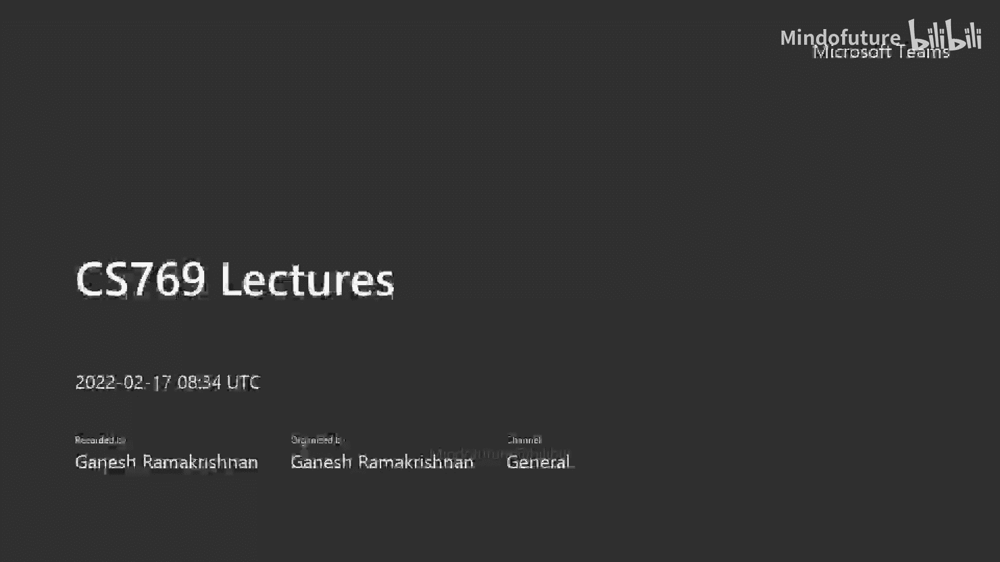
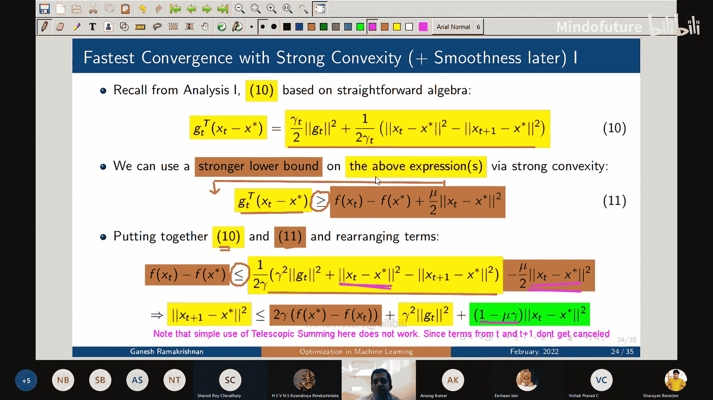

# 【印度理工学】机器学习优化 ｜ Cs 769 Optimization In Machine Learning p16 P16_第十三讲_17-2_优化与机器学习_梯度下降收敛分析凸性利普希茨假设结束 -BV18cBSBJEH1_p16-

Continue our gradient disscent conversionvergence analysis。For some very important next step。

 which is lipstd smoothness， but before that I'm going to do a grill recap。So， we have done。

Gradient descent analysis。4。Lipssheds， continuity and convexity。

that was also given as a homework problem。To see how we can extend that kind of analysis。多。😔。

Lipst smoothness and convexity okay that was the homework we will talk about that and as an example derivation of lipstds constant for logistic regression we have already shown that logistic regression loss is strongly convex but sorry is lipstd smooth。

😊，Not strongly on lipst smooth。But what is this lips smooth smallness constant？😊。

And then we'll then move on to strong conity and so on， so that will follow。😊，Also。

 the the coab notebook I shared last time has all of these elements。

 all these different algorithms implemented for the spam detection right we keep running through that。

😊，嗯。Okay， so again， a recap， the idea behind gradient descent is you want a direction。😊。

And you want a step size。So direction is。Denoted as。Now Delta are in this case。

 the direction happens to be the gradient direction。

Negative with the gradient direction and the step size happens to be。😊，Negative or rather gamma。

 negative gradient and gamma。So how do you get an Epsilon approximate solution is a question？

Or as I said， the analysis would depend on the nature of the function as well what we saw is slip shifts continuous and convex functions。

😊，Where we get one kind of conversions， not very happy about it。

So let's recap why we are not happy about it。Ive also slightly changed the indices just to be consistent I have made all indices into t equals 0 to t minus1 okay so we are going to start always with x0 x0s for here I suppose。

😊，So is that a0？So we will go from x0 to x1， and so on。嗯。

Or t equals 0 t equals capital t minus multi equals capital t minus1。嗯。

So for this analysis recap that initially it was a simple algebraic manipulation。😊。

Where we wrote the dot product in terms of squares or differences and sorry difference of squares and so on。

😊，And the fact that even the teeth iteration doesn't seem to have reached X star。😊，That inequality。

Basically lets us get rid of some of this some of these terms， for example， this term we get rid of。

And。We also do telescopic summing。So our first trick。Again。

 I'm recapping these tricks because well well have to reuse these tricks now when we come to。😊，Other。

Convergence proofs is telescopic summing。So hopefully we will see all tricks under one hood。

What was the second trick we had？I mean， actually， yeah， maybe the first trick was。

A trick one was basically。A dot product。Add some of squares。

Or as difference of some difference of squares。Okay。So these were this was one trick。

 the second trick was telescopic summing。😡，What were the other tricks？

Buthar trick was this one extreme right expression here yeah fortunately now because we are having index t equals 0 t minus1 the inequalityities become simplified here。

😊，So。Okay， so note that。Simplification。Of notation。Into。Lower index。

Becoming t equals 0 otherwise we had one more inequality last time we try to avoid that complexity of in additional inequality。

😊，SoThat has been saving for us。Okay， and。Finallyin， finally， we'll see how this。In the last class。

Give us the final。Converence now there we talked about order and rate of conversions as well。

We talked about P conversionvergence and Q conversionvergence。So this is our trick 3。

 this let me just put this in writing so trick 3。This was minimizing。Artics as a function。

Of some parameters。This was Eta。That。When the Lhs in the inequality。😊。

Which is less than equal to RHs。Right。It does not have that parameter。That was a basic idea。

Ill take three。Okay， so overall then we could go ahead and then show that。The left hand side。

 which had Xt minus as x star。Now， can。Replace each of these Ts with X hat。

 which is the argument orri of。F ofxi I can replace it to the ofxixi basically。😊，This left hand side。

 if you bring in f of x everywhere sorry f of x height everywhere here。😊，Then you'll basically get。😊。

A summation or all of these。The same term basically。

 so this is less than equal to this right hand side is greater than equal to。😊，Be a born Be。

Of F of X hat。So that you're summing this up。Three times。M minus if of x。Okay。

So this because I started index with0， this cancellation becomes easier otherwise there will be a little bit more work you room。

😊，Okay， so this is the final result we had got。To get。

F of x side minus f of x star less than equal to Epsilon。

You needed R square b squared by Epsilon square iterations growing。😊，Qudratically。

 in the reciprocal of the。Error margin you want。But can it be a slower growth is a question？

And we specifically again， give you this example。It goes to 0 as t gets large。

 independent of the dimensionity x those are advantages， but to get an error of 0。01。😊。

We require 10 race to 4 ask by B penetration its where b es connuity constant and r is the radius that contains the initial rate okay so I will not go into that again。

😊，Though it is something that we will have to use time and again， that is a requirement。😮。

We will often require that。The starting iterate。Is you know， within the。Rradius R okay。

 so let me just draw that。For completeness sake。Z image。And I had specifically pointed out that this。

R is characterizing the initial trace distance only。😊，OK， so。

So question we had left ourselves with this。And this。Numb the number of iterations。He grow。Or。Dandy。

Padratic。A quadratic squared or rather squared function。Greatd。W you not that I said broken。

The margin， which you want to be as small as possible。 So smaller the margin。

 the more the time it will take， obviously， but then。We don't want it to grow so。Ftster okay。

That is our desire。Okay so tools that I said can lipst smoothness bail us out we know that lipst smoothness is not necessarily a generalization of lipstds continuity but for bounded functions for L8 functions yes lipst smoothness does imply lipst continuity so its more general。

😊，In the practical scenario。书。So it though not always more general。And lipsshs。Continuity。He saw how。

Smoothness。Is more in practical settings。我ient。And what is what is it doing it saying I'll put an upper bound。

😊，On the rate of change of the function。给 this。L character are upper bound。嗯。Okay， so no。😮。

How does this help。This this was left us of homework and before we went there Id left you another homework also。

😊，O， so。If f1 f2 are smooth convex functions with parameters l1 to LM。

 then we know that the convex function is smooth with parameters， summation y， L， etc。😊。

Now can we do something and something more， let's say with respect to。😡，Spectral norms， et ceter。

To derive a bound on the value of L for the。Greent of f where f is the logistic function basically what you are looking for is the lipssh smoothness constant So we call this is the first order condition for lips shit smoothness So we want to determine this L Anyone had any success This was a homework problem。

😊，Any success on this？So first thing I would like you to recall is。

That we have already talked about lipsts smoothness， okay of。The logistic laws。So let me。

Let me recall。Canor recall。the only thing is we don't determine L light smoothness。

L of the logistic laws。So how did we derive that anyone wants to recall？

What is the proof methodology。I use composition。By using compositional function。

 So I'm just going to。They put that as it is from a previous derivation。Use composition。

And we saw that for the simple function， a fund right， a fun T， which is log of 1 plus era to T。

 which is the basic element of the logistic laws。😊，L could have been half or one fourth。

 whatever right basically anything that upper bound0 to t divided 1 plus E squared。😊。

E is to T a whole squared。And then we showed that you can have f2 is minus Y theta transposexi。😊。

Right， and。Yeah， you can basically show that you can the compositionist rule is going to work out。

 but let's get more specific Okay so this f1 f2 theta is all fine。😊，But let's get more specific。

 So now how do I get the lipsitzs constant。Could me。

So that we proved any thoughts on how to get the lipsticks constant？I gave a hint。Here。

There was a matrix involved， yeah， somebody has some idea。😊，Somebody unmuted herself for himself。

So this idea， right？😊，We could talk about。This norm， spectral norm。

How will the spectraltro norm help？What was the notion of a spectral law？😮，Or how is this。

Vctor induced B norms derived。There is something like， no， if I have。A victory， yeah。Super mom。

Overall， x bar V vectors norm of Av upon norm v。Yeah。Okay， what was the spectral norm。呃。

When you have the do on。呃。Then the spectrum alone was the largest singular value of。O。

 the other single value， okay。不。嗯。This turned out to be lambmbda max。那就性了啊了。

ButWhat's the connection we have with？That as I said， two norm is critical here。

But let's try and complete this proof。Complete de derivation right so the previous slide we have got the L when you have a1。

 but what is lets write down more specifically what the logistic laws is what is the logistic laws。😊。

Yes， anyone one。Submmission I1 to n log 1 plus a is2。Minus Y2ta transfer。Right。Right， so。

I'm having a problem right， Getting my pen to write。Okay， so basically。

The simplest aspect is that you have。Internally。This let's just call it F I think we call it F1 right。

 F1。So my logistic loss looks like is it like F 2 F1？比。

And what is the form of F2 in terms of what you just said？We can ignore the sum。Log 1 plus x。

 No that is there。 that is F is already there。 Lo of  one plus series。 I'm talking about。

F 2 should F 2 be inside or outside。Inside it F not exactly so。So， F fun。And what is a。

Yeah I thing I'm yeah， what is。What is the form of F2 T？😮，Actually you should not， we have two T。

What is F2， a function of。我知道。Theta， but is what is the form of f2 assign minus y in theta transpoence？

So can I just write it more gently， I mean， I could even write it as a matrix multiplication right if I have lots of。

😡，Features and examples。So this for a single example， of course， it's a vector。

 So let's just write on right。But again can， I'm just going to write it as exactly as I did in the previous slide。

 right pi a theta Xord。😊，It was my I why。The sorry theta transpose。X I。

 but Im going to write it more generally as just。Tta transpose。B some。闭。Okay， and now。

I told that composition of lipsticks continues as lipsts continues I in fact proveded it。😊。

But what is the lipsticks constant is a query， right？😊，How do you get that？Let me make use of。

Some property like this。Something like matrix norm。Hello。

You need matrix norm or vector norm is good enough。😊，So let's write down the actual gradient， right。

 So what's the gradient of。If fun。F do提他。What is the gradient looking like？😊，Will we have say。F one。

The derivative。Im Z F2。Petita。Into。So the P trans， okay。

 so the speed transpose P has all our PI if you want PI transpose。And if I substitute for F1 dash。

 what is a 1 dash？😡，We had a Vondi。Expression by1 dash， right E1 upon E upon1 plus0。

What would that turn out to be。What you have to realize is。F 2 applied to Theta will give you an X。

And then that PI。That when you multiply by PI transpose， P， PI transpose， what will that give you？😡。

A matrix。Times of vector。 So I think just just to simplify the whole thing。

You have some scalealr sitting out F F， F。A fund dash you have a scalealr。

But the whole idea is this will be proportional。So get the form the form of the expression theta transpose。

 I think you'll have theta transpose。PI， P transpose。Something like this。This is a matrix。

 this is the matrix I'm referring referring to as AI a call it AI if you want。😊，This is the AI。

 Theta Transse AI。😡，And then now when you start looking at the difference of two。Gradients。

Or even the Hasian go upper bound the HesN using an L。That L will really depend on。

Something to do with the PIP transpose， in fact， something to do with the spectral norm of PIP transpose。

Okay， so I'm not going to derive this， but roughly what's the the the。

The set of these pis is going to have an influence on the。😡，L， so L。

If we already saw that for F dashash， the estimate of L we have is like half or one fourth， right？😡。

So， you'd probably get。Okay， so this， let's call it。L for logistic regression。

Okay I'm not going to ask this in midum， this is not really a midsum question。😊。

So but but maybe for simpler functions you should be able to derive may not be for logistic regression。

😊，But the L of logisticistic regression should approximately be。Whatever your half or one foot。

Since we want an upper bound， a tighter bound is better so one fourth， let me take it。

One fourth from the previous slide。Times。That comes from theta DNA transpose。Times， you know。

 you would expect a lambda max of the。PI， P transs to come up。Okay， so this is。

To give you an idea of that。This is proportional again。 I mean， I've not， I've really dropped。

Other factors？But。The key here is that I have gotten an expression in terms of。I Lada max。Okay。

 so this is this， by the way， this comes from Ca shots inequality。

 So this I know is less than equal to say。The norm of。Yeah so I didn't complete it。 This was。

Assuming the yard worked out。So you'll have some you know some constant。Okay， in fact。

 let me just put this as。The logistic regression。LLr。Is say Eta， let me call it Eta。

So you'll have some eater times。Norm Tita into the norm of。P I P， I trans it。Okay， so this is。

 this is squ shorts。Okay， the key is。To see where the eigenvalue starts surfacing。ok。

Unless you have some specific question， I'm not going to go into me more details。

 This is the the sketch。 This is how you derive the。Lift its constant。Okay。

 let's move on to the other more important homework。Did anyone give some thought with it。

 how do you derive this analysis for gradient descent with smooth functions？😮，Anyone。Okay。

 so let me provide some leads here。😮，As usual we will have to think of whats the next expression or next inequality to apply right So if youre smoothness you could。

Start with。This F file less than equal to F x plus。

The the dot product between the gradient detect and y minus x plus l by 2 norm y minus x square so what would be a substitution for y and x？

😊，So naturally you would pick y to be xt plus one。Anex to be Xt。

And as usual we know that we are doing gradient descent， so we let just give it an m GT。😊。

Is y minus x is Gt。Well， it's not just duty。 it's also gamma。😊，Right it's gamma G。The step says。

Like why is this y minus x？Nm squared would be gamma squared Nom。GT squared。

What is the next step Okay so this I have just shown oh by the way I made a mistake here there should be a negative sign it doing gradient descent this will have a negative sign minusm gamma Gt。

😊，Now I have come to the next inequality where I've just substituted nothing smart has happened。😊。

Again， I need your help what do I do here can I apply T one trick to a tick T three I have a recipe。

 please help me choose from that recipe。😡，Which trick to apply next so this this is ra training you have to suggest。

😡，Trick 1， which was algebraic manipulation。😊，T two。

Right algebraic manipulation means the expand in terms of squares， which is already there。😊。

doesn't look like it'd be applicable。Tick2 was telescopic summing。😡，Should you get to telescopic。

Summing so earlier。So， early on。Iric 3。Is observe what's on the left hand side。

 what's on the right hand side， right minimize。Upper bound。With respect to parameters。

That do not characterize。That's just。 so do you have a case like that here。Anyone。Sorry。Okay。

 the third one comes to your mind I mean there could be more tricks we add to our kitty。

 but from these looks like third is the most reasonable one to apply next。😊，Okay， so。Let's do that。

 And now to apply the third one。What do I have to do。I will。Bound with spectro gum。Yeah。

 I'll minimize。The right hand side by。Differentiating with respect to gamma， right So set。The thers。

ID干吗？都这种。What what you get by that。Customom is independent of gamma。

 the second one will be just minus1。-1。Okay， so normm Gt square will remain everywhere。 Okay。

 so if you want put a norm Gt square minus1。Plus。Very simple。And gama。Nm Gt square is0。

 I know that we have not yet arrived。At critical point， a normmgt square is not 0。Therefore。

-1 plus Lgama is 0， which means。L equals1 by gamma。Or gama equal my rather。Okay。

 so this applies this convergence holes in the worst case mean this。😊，While this value。阿吗。

Polls also in the worst case。Oh yeah， there's no need for me to keep repeating this。 We have already。

Seen it use， let's see if this gives us something useful。Kiss with minimizing the upper bound。

And maximizing lower bones that is at the other aspect a frequently used tricks so we have we have here resorted to minimizing upper bone。

😊，嗯。So we have already seen that。The value here is。Gma equals 1 by L。Let's substitute。

Now this is interesting f of xt plus 1 is less than equal f of xt minus1 by2 sorry1 by 2 well。😊。

G T normm square。Okay， so we are saying that the。there is at least so much minimization possible in every step look at this very interesting we have not even used convexity here。

😊，So with just smoothness， you should get excited by this fact that a gradient decent trait is giving you。

😊，Some kind of guaranteed degrees okay。Let me。Iite this point here。做。Even without convexity。

 this even without convexity。Let me make even。Without。So， assumption， else wouldness。

Gives some guaranteed。Decrees。In every iteration。So this should be very exciting。Right so this yeah。

 again， I'm adding this note here。Without even convexity。Assumption。O。But now。

 if you bring in con assumption， maybe we can show something more okay。

So what would be the next step yeah we haven't used convexity I been I mean almost over emphasizing。

😊，That part， that's what we will do next， right？Okay， so I'm just recapping。

 minimizing upper bounds and maximizing lower bounds， how these tricks are useful。😊，Here。

 for example， we got gamma equals 1 by L。But lets just contrast for a minute what happened when the there is a worst case basically worst case okay。

😊，The best case could have been different。😊，So this is the worst case in the case of lipsts。

Smoothness。In the case of lipsshedd's continuity， this is a loose smoothness。😊。

But let's contrast this with lipss。Continuity。This the first case we got was gamma equals r by b into square root t。

So， just to contrast。But again， this is not the only value。 This is a worst case value。😡。

Or tightest case。These are values。😮，Of gamma。Building the。Tightest upper， tightest upper bone。不忙嘅。

Okay， so you could always have better values here。Any questions。Okay。

 so now let's go on to the next part。😡，嗯。So you can you can flip it differently， you can say， oh。

 I know that。😊，Fxt plus is1 is li than equal to Fxt whatever right now I can say this can also be used to。

😊，Get an upper bound on the Gt square， No Gt square。

What is the next trip I would apply I should apply。

 should I apply convexity or telescopics coming somethingm there are two tricks left in my bag right？

😊，So convexity is not a trick， I mean， which trick slash assumption。So let me note conity assumption。

Poscopicic。上面。What， what is tempting right at this point。

If you do telescopes comes something what will happen？Would we have some cancellations？

You can also go for some squared expansion， but nothing seems to work here， right？Any any voting。

 how many would go anyone would go for convexity， anyone would go for telescopic something。😊。

Convicity。Conity， okay， Di， thanks for spelling that out。As a possible assumptionco。O。

There's another opinion as well， nice to hear that you are good to see that all of your thinking。😊。

You can try both ways。 I'm going to。Go by telescopic something because I'm just finding it lot intuitive here that。

😡，The FX T plus one can get canceled with FX T or the the pre the next it rate or rather FX T can get canceled with FX T plus one from the previous it rate。

Okay so。What I can do is like summation first first I'll bring you know let's say I have to get these fx d plus one and fxt on the same side just for you know ease of operations。

😊，So，  one by2 well。Nom Gt squared。Is less than equal to。YouNow。

 I just want to leave some space here， Fx T。I know it rates are decreasing every step so I can take f of xt minus f of xt plus 1。

😊，I put a summation on both sides。I'll always start with t equals0 to capital t minus1。

Just to be consistent。See what happens。Okay， so this is the trick I've gone for。

Tsco pick somethinging。Okay， so let's see what happens when you do this。

So there's a small bistic here t equals 0。Yeah summing about inequality for t equals 0 to team capital t minus1。

😊，So as expected， everything gets canceled out。😊，You have。F of x 0。Minus f of x 1。Plus， f of x 1。

-7 x 2。That's exactly the reason we invoked telescopic summing。So。

I would like to know strike off everything。All of these get struck off。Okay， except for。

These two last terms。We' say， we' survive here， right。Of x0 minus of of xt。Okay。

 so these subviving dumps。On these， could I apply the next pending trick？😮。

Do you think now the time is ripe to apply convicxity？佢。Or is there some more trick we should apply。

It's not trick， by the way， again， conity is an assumption。So far， we didn't make that assumption。

 so that' is important to not where we make that assumption。😡，So without convexity， we can go so far。

 we can say the sufficient degrees and and this is all you know without convexity。

 we are saying that。😊，Theres sufficient degrees f of x0 minus f of xts at least the sum of all the gradient squares right so we have made sufficient degrees using lips continuity。

😊，I've already got。Sufficient decrease。From0。To teeth iteration。Using lipstster smoothness， okay。So。

Yeah， it's not bad。But were justing greedy and trying to see well， can we do even better？😊。

Lets do that now if you have to apply conxity I don't want to again you know the derivations I'm going to make more and more crisp because we want to build on what we derived in the last class right。

😡，So in the last class， you might recall that we had this analysis too。😡。

For lips continuity and convex function。 So we， in fact， in the last analysis， we began with。😊。

Lipsts， sorry with convexity and then brought in lipsts contiity。

So here we did the other way previous analysis we first。Brought in convexity。

And then we basically saw that norm of gradient sitting there。😊，And then。

Use lipsts conti we already say so mostly comicx functions are lipsts continuous right？😊，I mean。

 we go back to our derivation earlier， so。Most again， most I I'll keep this very loose here。

 will not keep on working results。 So let's invo the convexity。O。F。Now。

 how would you use convicxity again if you remember the analysis？😊。

You just we probably take x0 and xt and Gt， but you know you have to now remember somehow you have to get an x star。

 right？😡，We want to know how far we are from X。So far， we have not got to extra。😡。

So should we apply the convexity at x0 and the convexity as x at xt with respect to X star？😊，Okay。

 how you apply convexity is what I'm talking about fine， we want to apply convexity， but how。😡。

Anyone wants to suggest how you would apply convicxity。It says that X star。The optimal。

Which from there， I want to measure the。Gap， right。Also starts appearing。Any suggestions。

In the last analysis， we invoked a convicx city on F of。Xt months of extra。

 and that expression had a non duty square some minutes we。Go along there。Yes， yes。

 So So that's exactly what we'll do。 So the analysis willll actually get get from。😊，Previous。Okay。

 so I'm not going to again， you know， derive everything all over again just presenting the derivation。

So I now I' will be using a lot of color coding here so that you can quickly register。😡。

So remember we had this expression from the definition of gradient descent。

And then what we did we used this algebraic expansion， this is a trick1。😡，And then what we did was。

The expression on the left is in pink here。😮，B。Expanded。That that's exactly using a trick one。

Sum them over So there is again telescopic something we had done right this is so it is not that trick a trick can be used only once so。

😡，Trick to， again。This is a second invocation， possibly this entire proof we are using this trick for the second time。

 which is fine。😊，Okay， and then we said， okay， this this left hand side is equal to some expression now this we had a way of hand dealing with this。

😊，Xe is X star。 we said this is greater than 0。That comes next。So this is greater than zero。

And then the other part was using convexity on this we use convexity。😊，Okay， so all this iscap recap。

 okay everything is recap here。😊，嗯。So we basically boil down this expression now this is where we had invo lipss continuity in the previous analysis we saying no no no there is no need we now go back to our analysis from lipss。

 smoothness and telescopic something。😊，嘅。So yeah， this's combining eight and nine。Okay。

 so combining 8 and 9， what do we get？What we had got was。

F of x demon minus is f of x star which is exactly the form we want this this part being upper bounded a lower bounded by f x minus f x star so we just able to use that here is less than equal to the terms on the right now I have deliberately put the the some parts in blue。

😊，嗯。And you'll see why。So this expression。This should be all fine， so far。

Any questions so now how would you use this if we you are fine with this expression？😡。

How would you use this in conjunction with lipsick smoothness？😡。

Should we just use a gamma value of 1 by L here？We have something in terms of gamma。

 should we try and minimize this with respect to gamma or just use。😡，Coma equals 1 be。

What I meant was that we have a lower upper bound on Gt mod Gt square that。Yeah， I mean。

 you can bring the JanO Gt square to the left hand side and all right。

 that's what you are saying yes。😡，Yes， that is true。 The sum we have in upper bound。

 but we still want to do something with gamma。Okay。So in the in the previous analysis。

 what we did was minimize this with respect to gamma obtained right gamma， what I'll do here。😡。

Without， you know， this is going to be a jump here。😮。

I will assume that rather can you can show that gamma equals 1 by L is good enough here also as an upper bound。

😊，It can be shown。We need to do something with a gamma here that。😊，The gamma equals 1 by L。Is。

P enough here。😔，To hear， as well。桌面店。The uppermon。Okay， now why is it probably， I I'll not。

Spend that time in the class。不是。So this is going to be a slight departure。So the RHs。

 we going to set。Dhamma equals 1 by L。This gives you slightly different expression than earlier。😊。

And there a holes， I mean。So the gamma we had got earlier just I mean， just as a hint， right？😊。

What was the gamma we had got earlier， it was Rb upon square root t now it is possible that。

Rrb upon square rootity is indeed。😊，You know， I I yielding a value， which is less than one by L。

 that's how you prove it， right， That's actually the way of proving。Okay。

 so if it holds for one uponl， it holds for anyone else， basically that is the idea。😡。

So theres nothing there's no rocket signs here。😡，I mean， if you want， I can write that part。😊，Right。

 so。Since we had。帮迪。Lowest。Value。The audits。We have found the。Gamma。嗯。

Eielding the lowest value of the Rs。 So this any other commma。So what should be a problem， right？

I hope you got that idea。That is the proof methodologyology if any other gamma was found which or a gamma was found which minimize the right hand side。

 why not gamma equals 1 by l that also should work so using that analysis or that argument will continue our analysis okay。

😊，So I am just copy pasting this argument。Here。So with that， yeah， gamma by 2 becomes 1 by 2 L。

1 by two gamma becomes。Again， L by2。So hope this is all fine。

I this in I put this in blue deliberately so that。The right hand side， because now I'm going to。

Find some other value for it using gamma， which is greater than the previously found lower1 that should be fine。

😊，Okay。Okay， so then continuing。What do you do with this component 1 by 2 L this is exactly what sorry I forgot the name。

 but who are pointed this out thanks。You had a lot of farsite and that's exactly what we have done here。

😊，Let me use a slightly different。gaup。So， this。We had got from six。So I'll go back to six。

This is exactly where we departed into convexity， so 1 upon2l some of all the norm Gt squares is less than equal to。

😊，X0 minus of a xt， exactly as pointed out。By one of you。

 we are now just going to use the upper bound。😊，This is therefore this this part。Now 6。

 I just want to recap in case you're losing track。It's1。 2 L。Summation T equals0。To T -1。

Norm Gt square is。Less than equal to f of x0。Minus F of X T， That's it。

So Ive just substituted for that f of x0 minus f of xt here。And we seem to be all set。Now， next。

 what next。Again， let me ask you a question since you have led the discussion so far。

 I'm really appreciative of that can you help complete this It will be a real good success。😊。

HowNow now I want some analysis if I want f of x0 minus x star or sorry f of x t minus f of x star。😡。

To be less than equal to Epsilon， how many steps should I take， how do I get there？

A little bit more work is required to get there。😡，I'm repeating my question。How to go from here。读立。😔。

Convergence well what do we mean by convergence？And end of， you know。Speed of conversionence。For。

 I know。Upper bound。Function value Eson and upper bound and function value。

How many number of iterations？How do I get there Any suggestions？Yeah， please speak up。 You got。

So far， this should be possible。So do you see some terms canceling or there' is no cancellation。

 I there some cancellation here？We can take the terms in yellow to the left。

Ex take the terms and yellow to the left， okay， great。What else can we do。

And then what will happen as a result。The summary comes from one to capital。

Some becomes from one to capital t and what happens F of x0 f of x0 vanishes。Yeah， so it gets cancer。

 have a0。Will get cancelled and what will happen， what else will happen？The capital will remain。

 right， so it' it's simple。OkaySo the first thing we realize is that this guy will get canceled out。

Okay， so。嗯。So rewriting the math。Okay， so this is exactly what I was trying to show。This spot。

When you bring it to the。Left hand side。The f of x0 gets canceled out。And if big star。

 what happens to that is you'll have to do。Two additional summations no right。

 so theres a little bit of adjustment going on here。So just make a careful note。 So we had f of x。

Zero minus f of x star。So there is f of x0 minus f of x star and then there was an f plus so let me just use this right minus。

😊，F of x 0。Plus f of xt， this is what comes to the left hand side。

Plus then use the regular term the t equals 12 t minus1。

 so these are critical mistakes we can make and jump to conclusions。

That's why I'm spending a little bit more time。 So this f of x star。Should not be doubly appearing。

 I mean， it should have the right number of appearance of a star。😊，And here， fortunately。

 what happens is some of these terms get canceled， this terms gets canceled。😊。

But the f of x star switches its affiliation to f of xt， so therefore we get back。😊。

Where we began with right so which is same indice same summation indices have changed。

T equals now one to capital D。Pect deep。Manavic stuff。

So very too often people make mistakes by jumping and not writing terms very carefully。

 so please be careful。😡，So then now we are done。Havere we done or something more。😊。

Can we use lipstick smoothness once more。Last tip， and I'll tell you， this is really the last tip。

Could we do something with the raius， Could we do something with。You know。You remember the R， right。

 expression we had that bounding the points。What should we do next？You know。

 this is slightly longer than the previous proof。But we are there。

 the Rhs is less than equal to L square by。Yeah。L R squared by 2， okay， let's write that down。ok。And。

What else can we do？ So this is fine。And what can we do about F of xt minus f of x star？

What did lipssh's smoothness guarantee。Oh， the function value decrease in the generation。Here recall。

Lift your smoothness。At the function value decreases at every now how it decreases by some norm gradient square right which will not get into again。

 I don't want gradient coming up here again。Punction value decreases。

At every iteration and what else so that that how does that help again。

So each f of ht is less than equal to f of x of capital。Right， so F of x， greater than you could。

But what happens to f of x t minus f of x star F of x is any measure constant So F of x t is greater than equal to f of x of capital D。

 So even if you subtract both the inequality hold。Then if we sum that the RHS will become t times f of x minus。

Okay， so can I say this is greater than equal to？YeahD times F of xt minus F of xt。Okay。

 so let me write this down here。 So each of of Xt is。GreatGreater than okay， let me。consistentistent。

 Okay， so this F of X T capital D。You know， is less than equal to F of。X T， small D。Fd。T equals 1，2。

Capital D -1。So because of that， now I can just plug in。😡，F of x。T， consistently here。解散了。😔。

I'll just say this is this f of x T。I'll replace with。F of x capital。Of course。

 there' a outer bracket。Minus f of x star。Which is， as it is。Okay， so this part I have just replaced。

Okay， so with that。We're actually done。So what is this left hand side？

It is the same thing being some capital team three times how many times we just be again mindful of the number of sums t equals 12。

😊，Capity。We started with0， but that x0 got canceled out， so we don't have t plus one， we just have t。

😊，Okay， so then we seem to be set。😊，Okay so again。I've just written the same thing down right so it's the same argument。

😊，That。Lets copy this part， right。It's just， it's this reason。Okay， so。With that part。

We are able to now replace F of Xt。With the spot in pink。

of x capital I have not already divided by capital here that I took one more jump。

What is the same idea？This whole thing now on the right hand side becomes L by 2t。

X0 minus x star norm square and you've already gone ahead of me and you said this is。

Less than equal to。L by2。T R square L squared by 2 T。Okay， with the yeah， with the assumption。

We had from earlier。Assumption， rate。That all the points are。Or rather the first point itself is。😊。

Within the radius R。Okay， so now with this。Again， I'm just reapping this an additional assumption we have used here R square。

😊，Alask divided by 2 T。Now， what is this， How good is this。

I want function value reducing by at least epsilon。How many iterations will I take？激好晒噶，我未过玩过一。Okay。

 one by。Okay， let let's do that。1 by7 one small notice we can make this equality here。 by the way。

 this doesn't have to be equal this was。😊，Yeah， just make it equality we don't we can assume that this r is exactly0 when is extra。

😊，So with that， yeah， let's try and write down the。You know， if you want this。

To be less than equal to epsilon。Then what do we knew we need。嗯。For this， a sufficient condition。

Sufficient that this term is less than equal to epsilon。Right， and。

So what does this mean exactly as pointed out by one of you？

The T should be at least R square L by2 Epsilence so。

Is greater than equal to we right pointed out that this is related to the omega。😊。

Date of convergence， omega， but。We have actually resorted to P convergence so which which we have given us extra reading hopefully postm if wed find time we go over it in some more detail otherwise it's just extra reading until then what is important is this this nature of inequality right the lower bond we have is ask square L to haveel。

😊，O。So what does this translate to， So an error of 0。01。We need 50 R square alliterations。

This ist two upset。The lips shit scary it was。10000。 So we see it's a significant reduction at。

At least how many rats we require significant reduction， though。

Okay so this is the final result given L smooth convex function gradient step is step size gamma equals 1 by L you achieve a solution x t says that f of xt minus f of x star is less than equal epsilon and r square l by epsilence iteration again my point is this step size。

😊，This holds， but it also holds with any other step size iss like the worst case step size。Okay。

 recall that this gamma recall this value。Wass to give a lowest。Upper bound。 Okay。

 so any other gama will only help with that upper bound。O。In practice， however。

 the L is not found like this， I mean L could be inspired or the gamma could be inspired。😊。

By the value of L in practice， the back。Line search line slash ray we also call them research search because the gamma value should be non negative。

so this is going to be part of medicine because it is important the way we have developed on the previous proof to now show one more proof。

What I'm going to do now， I mean， please stay on because you'll you'll get an glimpse into know how we can。

Strengthen this further。 strengthening is really coming from。嗯。

This of you know analog or close cousin of smoothness， which is called so smoothness was this， right？

It was giving us a quarterly copper bound。But now what we are going to have is a quadratic lower bound function in the form of。

😊，不0。😔，You will have quadratic lower bound as well。The form of strong onity。

And how does strong convexity influence？Let's now get a glimpse because these are very related。😊。

I know I didn't give this other homework， but I' am going to help you understand this we won't go too fast。

 but lets make some progress， okay。😡，So。One important point I also want to bring up is the notion of you know for lipsius continuity。

 we had this matrix AI， right which was X transpose。😡，So what quadratic upper bound right。

 what was dealing with the6 continuity was lambda max okay。😊，So that was early today， right？So。

 he saw earlier。对。Connection。Of lipst L constant， right。T factor。For L continuity。It the lambda max。

 right the。The curvature associated the max curvature。Or direction of x curvature。Associated。

Because you are trying to upper bound。Now， I can give you an idea。

 I mean a hint that this when you start looking at。😡，不。

Quratic lower bound you will be dealing not with the max。

 but with min because you are looking at the minimum curvature。

 youre looking at the minimum upper bound。😡，Yeah， so。I mean。

 also you all know that this is related to。Haian。你。

The previous one was related I mean also related to Hasian Hassian square Hessian greater than equal to mui is what the quadratic lower bond is talking about。

😊，Can it turns out that。This has association。 connectionnection。With lambdamin。杰。

Lambdamin of that of the matrix we talked about。Earlier today。Okay， in general。

 you can show so the this Lbi mu will start surfacing。😡。

So youllll basically have conditions like this。So what you'll have in practice is something like new。

Which will be less than equal to lambdamin。So you can be less than Ladaine。

 it doesn't have to be Ladain。And Lada Max。It should not be greater than L will be less than equal to L L will be further away。

😡，And the whole implication of this is or the association of this。

Is the ratio so I mean the ratio basically of you know the largest and smallest eigvalue the condition number of a matrix。

😊，You must have heard， you know， it terms like air conditionition matrix。😡，So this。

 if lambda x by if this happens， obviously， you know， lambda x by lambda min is。😡，Less than equal to。

😮，Lbi mu， so you want to see the Lbi mu factor coming up soon。😡。

Just just to kind of mentally prepare you the why this L by mu comes in is lambda x by lambdamin is the condition condition number of matrices L by mu is a factor we will see soon so just。

😊，そうです。Associated with。The condition number。OfOf the matrix actually its as sort as the condition number of the Haian matrix so。

😊，We didn't go that far， but a Haitian matrix of the。

Logistic loss now ill condition mat are basically when the lambda max by lambdamin is very high so with the the small change the matrix value or you know。

 numerical computations will completely。😊，Change the iterates thats when one implication of ill condition mirices。

😡，So it basically is like saying， oh， the lower one and upper one curvatures。😡。

Associated are very far away。That means there's too much oscillation the closer these come together。

😡，The lower and upper bound curvatures in some sense， the well behave more well behaved。

 less ill condition， the matrix is okay so。😊，Let me just。Assoociate this with。

So this point at the top， what we are trying to say is。嗯。Hed。I mean。

 in general this is not this particular point right what we are trying to say is the more。😊。

The closer。The lower and。Upper bound。Ges。Od。The better conditioning， better conditioning。

Or you can see our behavior。Of the algorithm will be。We'll see more of that a little later。

 but just to give you an idea of that strong and strict conity sorry strong and convexity and。Smooth。

Yes， lipst smooth there are very closely related。But this is a little bit of insight。

 but let's look at the algebra。😡，Okay， so。What is the analysis here like？

What we are done right now is using convexity alone， so just using convexity。Let me make these notes。

So what you have done here is。Using convex city。Alone， and I'll bring strong conveity。Very soon。

You see this expression。嗯。Which we have been always you manipulating with respect to。

Some are squares， right this expression。So now I'm just going to。诶。BringB that up。

If you had strong convexity， you could do something more with this term。

That's what we are trying to show。 This is you only use convexity alone。

So how will this change and we have strong convexity？Well。

 this Gt transpose xt minus x star will be upper bounded a lower bounded not just by of xt minus x star。

 but also by mu by 2。😊，This norm of xt minus x square。This is a stronger lower bound。And。

And that's on the LhS here， this LhS part。Okay， so。

So what we' will do is will basically put these two together。

What are the terms you' are putting together on one hand？We have this。F of xt minus of of x downki。

And then on the other hand， we have mu by 2。😊，Nome x t minus xta squared。That。ItIt remains。

And then we have this term on the expansion， this is analysis previous analysis， this as I said。

 just trick one。So this entire expression。You see is coming up here。As it is。this expression。

 basically Gt minus。Its we substitute word for it here。As an equality。We get the same I mean。

 same inequality with some inequality with some equality substitution， we have got rearrangeically。😊。

This is just reging terms。Okay， so from here I want to reuse different components of analysis that we have already done like of conversiongence。

😊，Can we go from here to conversionence rates？😡，For strong convexity and smoothness is the best is that is that the best convex convergence I can get？

And it one of the best convergs I can get the best convergence I can get largely is when you use both both of these very strong conditions。

😊，Okay， so。I'm going to leave you with this for thought if there are doubts before your mid please ask me based on today。

😮，Okay， so we will continue this post withem。So this v， I don't want to cover this right now。

We will cover how this leads to。Very strong。I mean， the best good。Convergence。8。So is there any？

Question doubt you have based on today's discussion。Anything for bitsim？

What is the last topic The last topic is where we have just left off。

I'm deliberately not doing the all right the smooth plus strong conx so this is， I mean。

 I'm going to leave it at this。Right I have five to seven minutes so I'm going to continue if you have no questions。

 so mix them is until this point。😊，But I want to just continue make use of my remaining time to see simple completion of this proof。

 I will not ask that in the mid though。😊，Yeah。That fine。SoFor Mim。

 I've just given you a hint of you know how strong convexity might change things right change the scenario。

嗯。But the exact conversiongence proof， I want to do it in the remaining 10 minutes。 I will not be。

Covering it in the mid， medicine。Okay。Any questions so far？If there are no questions。

 I'd like to just continue this discussion。😊，A smooth but strongly convex function。

And the substitutions are very simple I mean there is really no rocket signs so left right so what we have done is the straightforward forward ED algebra whatever I highlighted in the previous slide I now I tried to put it as a thought process for you this post medicine as I said。

😊，So I'm just going to use this。Manifestation of pre one， p one。It here。

And see what's the next trick to bring up？So what's the extra to bring up？Yeah。

 students can actually stay back and think， right so。There is all kind of intellectual stimulation。

You do telescopic summing。From here。Well no， if you do telescopepic is coming you you only only use convexity right I mean use convexity and then telescope is coming what we could do here is。

😊，P convexity and then look at telescopic summing。So instead the deviation would be。Can start off。

Convexity， followed by。Isco somethinging。Why not strong con next？你说呃。

What happens if you use strong conxity， I gave a hint in the previous slide。

So we'll have a stronger lower bound。So if this dot product is lower bounded by f of xt minus f of x star plus this additional term。

The additional term is only because of strong conity。😊，Ok。What can we do next？Well。

 we can put these two together， right？Wegan the mine， then and living。Think 10 and 11 together。Again。

 it is going to be rearrangement of terms of F of xt minus f of x star you bring to the left hand side。

😊，And that's what we have done here。嗯。Oh sorry， sorry。

 I have not brought it to the left hand side I haveve just flipped the inequality。😊，Yeah。

 so I have flipped inequality here。下的。Hhm。😊，And the other part is substitute right substitute for GTX statement and X。

So this has been substituted。Here。The brown terms， even though they are separated now。

 what I have done is brought the。😮，One part of the brown term to the。Left hand side。So along with Gt。

Tpose  X minus the extra。 So that's what you see here。Okay， now xt plus 1 minus x star。

 which is sitting out here， I'm trying to isolate it。From the other terms。For obvious reasons。

 we are going to get into some telescopic summing， but there' is also another reason。😊。

You'll find that this is probably where things start getting slightly trickier。😮，Okay。

Because I have this term Xt， just note this term。X t minus X star。

Now this estimates X star also figures here。😡，So therefore。

 telescopic something cannot be applied directly。😊。

I need to do a little bit more because these terms don't get gets canceled out， right？😊，So。

 but that' is also one reason why we get faster rate of conversiongence note that。😊。

As a simple use of。Tescopic summming。Not work。Since that know。Toms from tea。And t plus1。

Dont get cancel。Okay， so this might look like a bad thing conversionence is becoming complicated yeah there's a little bit more complexity。

 but it' is also good because this is what leads to better rate of conversions。😊。

That this the things are actually shrinking because what you get now by combining is。

You get this one minus mu there is one from here and minus mu gamma gamma is coming also because there's a gamma square here。

😊，We'll deal with this a little bit more carefully。😊，Po midim。

 but I wanted to give you a hint why things get complex it is not that telescopic summing works immediately Okay so rest will do after midims。

😊，And as I said， this additional part。😊，嗯。From slide number this whatever 23 onwards is not going to be part of。

Mit largely because we have not even completed the proof just tried to tickle your you know。😡。

Imagination on how good we would proceed， given that straightforward telescopic something doesn't work。

ok。Again， any other final question are we going to。😊，Conclude for today。

I had a question pertaining to the exam。 please question ahead so the。

The last there was a form circulated at the beginning of end of last month about those who are in campus。

At that time I I was not in campus I put I was not in campus， but now I'm back in campus。

 So I'll go to the example， but my question is whether I am listed as one as yeah。

 anyone who's on the campus is listed not a problem。 So the listing is not a big deal。

 you Please be there youre supposed to thanks thanks for bringing that up。啊pen。

We had an option of appuding the scan answer， she written。For that。

 we need an additional mobile device。 So will it be like that in Mi Also we'll have to carry an additional mobile for scanning。

A good question。 Can you just post that on teams I will。😊。

Get it routed through the code quote on3 team。Yes， and I've already posted you posted right I'll get it answered。

 thanks。So so there will be like long answer writing which we have to write yes， yes， yes。

I will also be giving you sheets， we will be giving you sheets if you have your own notebook。

 that's also fine。😊，But everything has we uploaded， so。

What we will correct is what you have uploaded。😡，No physical answers will be passed on。Is that okay。

Yes。The other question？Okay， if there are none， we'll close for today。 Thanks you。

 thanks to everyone。 wish you all the best。 Well meet on。😊，Tuesday evening， I guess， right。

 Tuesday evening，6 PM。Thanks。The venue I let you know as soon as I hear from the Institutest。😊。

