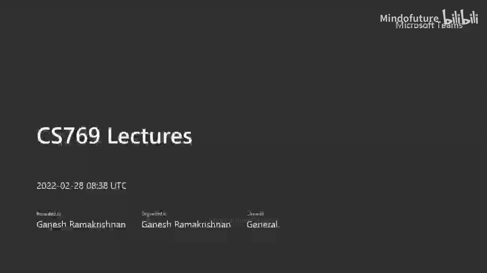
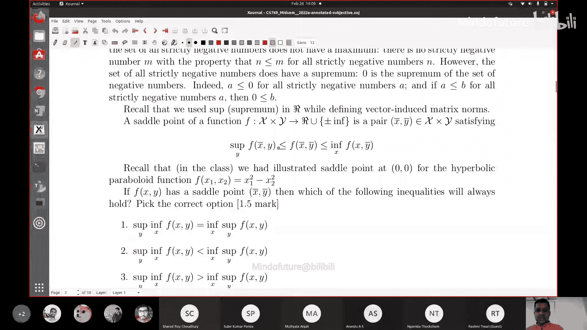
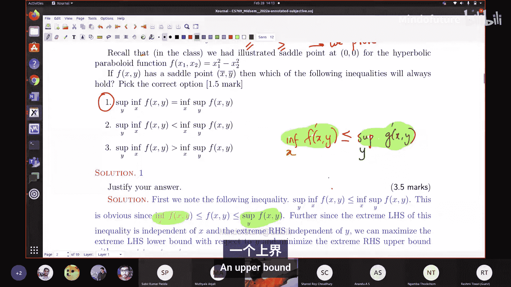
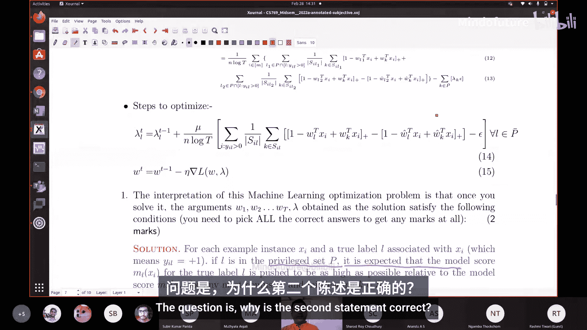
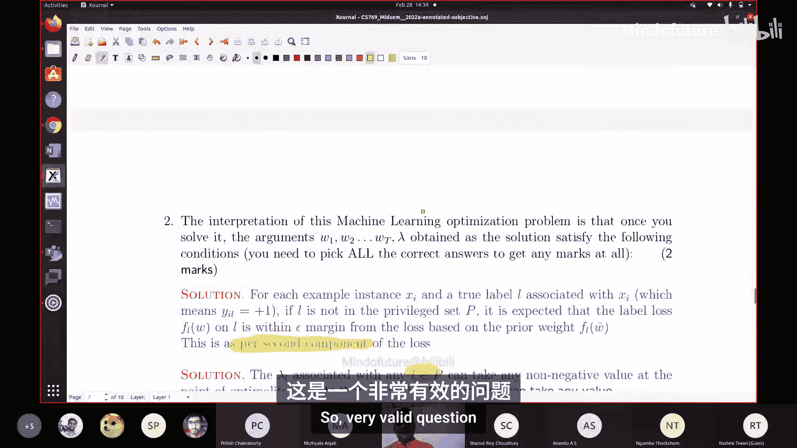
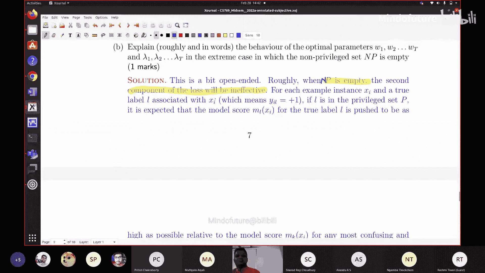
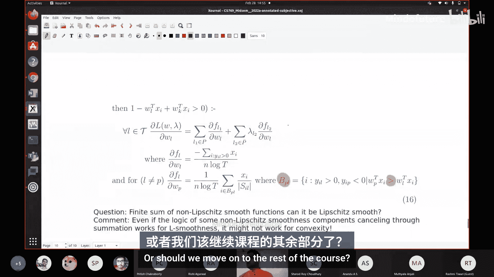
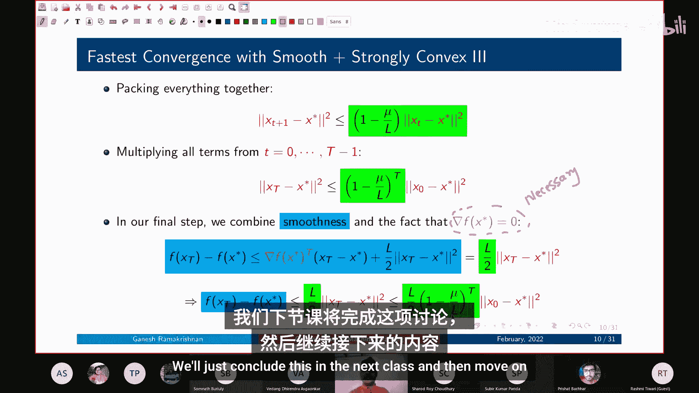

# 【印度理工学】机器学习优化 ｜ Cs 769 Optimization In Machine Learning p17 P17_第十四讲_28-2_优化与机器学习_中期总结_强凸性+利普希茨平滑假设下的梯度下降收敛性分析 -BV18cBSBJEH1_p17-

ok， so。

I比个。We found the mix some problems interesting。I'm just discussing the three subjective questions here。

The first question。It's about something called the Min inequality， so it's called N inequality。

 the one that gets involved。I've actually proved that here as well。And。第一。

Min Maxequality turns out to be an equality。😡，When the point at which you are considering this inequality is a s point。

Okay， so。This， we've done this the past。 often， you know， when you want to prove some kind of。

And equalityality should try and show inequality both ways。你做。This is starting point。This was open。

 It it like this。十你只未。think please on thisす。

We have some teething issues on day one， so very clear。

Yes。我唔经常件。So the way we go about this proof is。So the inequalityality the elderly。

So we even show this。And by virtue。But that you have a certain point， the equality will hold。嗯。So。

 the answer is one。嗯。So the the quality other way is actually great。Straight forwardward。

So you remember when we did the proofs for conversions。😊，Right， we often took an upper bound。哦。

Something that's sitting on the right with。Greatder than equal to right If x is greater than equal to y or you know some function F。

Exway。Is， you know， less than equal to。哦。G x y。And what do we do， We basically take。

What can we take on the left hand side while still preserving theequ。In in minimum， right？

There should not be a problem at all。And there' will be no issues， if you take a。Superリ on that。

I the superimman with respect to ex。Okay， so let's just call this F prime G prime。这个。

So that's what I've said here first。There's obvious in femoics of Fxy。Is。Less than equal to。Fx y。

 which is less than equal to supreme over y off of it。 It was D prime。😡。

To see here is nothing but this。Gance。Okay， so with that， then we take the next jump。

Which is is that the electes。This the Ls， which is。Independent of what。Okay， in this case。

 I have taken in with respect to。Exute。And superman with respect to why。

So that makes the Ls independent of。Thanks。And therefore， I can take up。

What can I do the LHS has become independent of x， What can I do on the RHS。😡，And。

But please speak， I think there will be no equal you can try speaking those who are there remotely。

The extreme mal is independent of x， extreme mile is independent of y， so we can maximize the。

Extreme alls lower bound with respect to。啊 Suprememan。With respect to why。And likewise， I can dig go。

in梦。I'm going to大。一佢无的。Tighten the upper bound by pushing it below and tighten the lower bound by pushing it up。

😡，That's exactly what we did here。So。So minimize extreme。R hs upper bound with respect to X。Okay。

 so this gives you。This is the min Max。Inequality。And from here， the rest should be very simple。

We did not even need to assume existence of starting point。

So if you have a saddle point at x bar y bar， then I just plug it in I'm done。So你 question on this方。

老。A lot of optimization with deep neural networks is about starting point optimization。

So you are not theie always dealing with。有个。But local optimum also in the sense of a start point。

 harsh side， right？😡，嗯。你知道。O problem do。It was about finding flaws。😡，And the solution here。

 I have highlighted in red。The part that was wrong and have subsequently corrected here。

其 it was exactly i source。We should be also。For step size gamma equals 1 by L。See。

 this is the same idea， right。For step size gam equals 1 by L， you really will not talk about。😡。

Maximizing that I。You will take advantage of the fact that the right hand side is independent left hand side sorry sorry is independent of Dma。

😡，I mean， you can maximize， but that's not important。More， more importantly， this is a。光的 function。

That's something we have also very different， right？The convicx。And you know， no fun。I mean。

 no point basically。Maximizing。You know are it just。Then Ls。Is independent outcome。Then it's just。

As before， and then there's one more mistake。I hope most of you who caught this mistake had put a plus here this a minus。

Its a very simple leg like expansion mistake。Okay， Im invoking complexity with respect to X T and X。

 I had reverse this。😡，So again， basic test of your understanding of complexity。Thatafter。送嚟算。所以。

stepep  eleven。When I have this the particular step， Oh， this one， this is it。哦。This should be 0。

 right， Yeah， yeah， I didn't。 So I made one more mistake。对的对。Okay。

 I think I made this mistake consistent to here。 Was that that Was it only here already。That is an I。

Okay， good that you report it。Yeah， only in this step， I mean， aid is working。Yeah。

 I think I made a mistake here。To many English is good。 So if you have got this as well， youre fine。

Yeah， thanks for point it up。 But thereafter writing， everything was correct， except for one。

Step number 15。Where so this is what I wanted test。

 I was not interested in the previous obvious mistake。But I want to test you that， you know。

 you understood that it's not just copying this expression as it is。From 14 into 15。What did we do。

 we actually brought the。There's entire expression and yellow to the left hand side。

And basically that led to cancellation of Fx0。And the phone。Gancelation of a big zero。

An introduction of Fxt。 That's what happened。做。再次。ok， then啊。

The same mistake persisted in both the places。 Hope you got this correction。我你个先息。Okay， problem 3。啊。

one job俾qs here。So often we have classification with multiple labels okay so the first departure I had from our original machine learning problem is that were dealing with multila classification not binary and not even multi class。

😊，So which means that every example， every document for it。做 document。Could have labels。

I would likes say this is an advertisement。So advertisement document。Could be on sports。Yeah。

 but true sports is probably trying to market some food， right？😡，boostost is a secret of my energy。

 So boost， and then there' is cricket。So you might want to label it as both。😡。

It could be multiple impact could have a hierarchy， when you say sports cricket。T20， IPL， whatever。

 it it could even have a hierarchy that hierarchy is to multiple labels。😊，最后日。So let's say a。

And sport。You have deep wind。So multi labels can be for different reasons。This is one。

 This is the other。 when you have a hierarchy。Now it's possible that treatment is all too popular。😡。

But all of us know runji trophy has been on the receiving hand。 I mean。

 I'm not a big follow of cricket， but I'm aware。 So selects say this runji trophy。Okay。

 so this has become a big rare for us。Now， what we are trying to do here is treat this as。Let's say。

 privileged。TheOn other hand， something like T20 doesn't need too much attention because probably almost any random news article on might be about T20。

So this could be， yeah， privileged。Whereas something like T20 might just be non privilegevid NP。嗯。

So what are we trying to do， We are trying to make sure that。The privileged guyss get attention。

And you assume that the two world is joined。 P and NPP have no intersection。Now。

 the possibility is that renji trophy gets。Confuse， often。With some other find me it's possible。哦。嗯。

Weing to this example as。系 e。So， let's say， I。嗯。Is example。 So can L S runji profit。

So there could be a bunch of Js， which get very confusing for that particular example。 I mean。

 let's say I is。Let's say the text document goes like this， right？On the second day。Blah， blahla now。

 obviously there is no second day in a P20， but there is a second day in a runji trophy and there is also second day in a test match。

 So it's possible that L is runji trophy and which gets confused with say with J。Which is P a test。信。

This is what we are referring to。😡，The spider day test。As a。A confusing and misleading you。

For that particular example second， and as I said， this document is possibly on。按来呢做费用。Obviously， so。

唔系我，即我就话再。跟嘛。I don't know Mumbai is a team in magic because I did it today。

 He said a team about Mumbai or this Maharashtra。Yes。That's how privileged。😊，嗯。O， so。

So that's quite misleading for that particular instance， IN David。So with this。

 and I'll give you some other examples， right， I' give another example。

 This email is not concerning the。Mathematicical aspects of AI but concerned So these are not sometimes it's not cheap just because of popularity。

 but it could be just the use of neations right。😡，I won't recommend going to this restaurant or watch this movie。

 so don't that makes it negative， but can be confusing cost。So okay， so with all of this。

 we define this function at L。It gets used in a loss。

And this is very much like your things loss in support vector machines in case you are done。

But it's a summation for all the。哦。All the case。hich are potentially confusing。this is key or do。

I used scared on you。ok 啊。So what we are going to do now is doing a min and max so you can again see its relation to the question number one min max in fact。

 this is a this can we shouldn have saddle point you won't do it now。But this is a 자기 got。说。

And we are trying to interpret it。So for all the guys in the privilege set。Missing that I want。

To discriminate well from the correct label for that instance from the confusing labels。

 but for the non pre set。Okay， I'll try and give a little bit more insight in the non privilege say。

We are saying that I don't want to overdo this discrimination。

A popular classifier right a classifier based on popularity simple one versus classifier might be doing a fair job。

😊，So， therefore。I'm just trying to。They will play down。The component from P and look at more like MP。

 Now， look at F， F itself is there。 But the focus here is F L minus F L W1。

 W T minus F W1 had W T E hat。Because that hard makes a difference。 So you're trying to match with。

Something， how the model performed。Without any such privilege。It abri。So。

So I have given some more insight here。 We can use saddle point optimization for the above and all。

 I mean， these are the steps that it turn out to be in case you're interested。

 let's see if we can we get time will re use this as a use this。😊，Okay。

 so coming to this interpretation， what are we trying to do？

each example exists Xi pool label L associated with Xi。If L is the privilege set。In an average。

 on an average， across all the examples。That the model score。

Should be pushed to be as high as possible relative to the models for for the。Confusing label scheme。

So if you want， I mean， to be even more technically precise， you should say on an average。😡。

But this is sufficient condition。 It's expected。 I mean， if we would be happier if for every example。

系 every。You get this kind of push。So the second one is saying that。

It's possible that if L is a nonprivileged state。It is possible that's also something we can't rule alone。

 right？😡，Whereas in the first case is expected for the privilege said， the second case is possible。

So that's the reason why the second one so this Ive clearly said here， this might happen。

Through the first component of the loss， both of them are based on the first component of the loss。要。

Good point。 Okay， so first of all。What's pushing us all here， So its this is this is FN， right？😡。

This component。Now， look at the second component of the loss， it also has this FL。

 its not that it doesn't have it。😊，But it' is not directly optimizing that it's， in fact。

 trying to match the FW1 WT with the F W1 had WT。😡，So， there's nothing discouraging。

The the comp the models on the non privilegevied set。

To match or to discriminate well from the confusing ladies。 There's nothing discouraging。

 The emphasis seems to be more on matching it the prior not it's possible that the prior itself is is such that it discourages。

you for example， the output of this model you can use an a prior for other instantiation of this problem。

😡，你定。Yeah， but see this S is relative to each I and each L。 so you could have an sorry。

 those were on the call。 I think the question is as follows。

 I'm sorry I should be repeating questions the question。😡，Yes。

Why is the second statement correct？😡，对。嗯。And things were asked。

 don't assume that question would be clear， so I also forgot。

Why is the second statement true， even though it has a might happen， right？😡，嗯。啲。

Pairing is off label with an example， and the SIL is all the confusing labels for that example and that label。

😊，Now， SI is also defined for the non privilegevilegd sake。😡，Right， so it's very much possible。

That is example I gave you ethical aspects of AI。It's possible that ethics is actually privileged。

 Es could also non privilege。 This in both cases， this a different S。 The said S I will be。

Indexed by the L。 I mean， it's not indexed by privileged not non privilegevid。

So it is not that if L is discouraged K label K gets discouraged for a privileged label then you won't have that benefit to the non privilegevid because there's another index index SL for another L in the non privilegevid set。

Is that it。我杰稣。So this might happen again。 I want to repeat， and I don't mind going so。

 Please ask me questions。 So there is。Nothinging in the。object。That discourages。点。我的 in。Len嗯。嘅。边。好不好。

关厅啲。但是。Okay， so any。Any any questions on this？Let me move to an next the next one。咪你 other ready。

Do I need to explain why they are because for example， this one is going a bit overboard。

For a false label L associated with Xi。We are not even2 level。 If L is the set is expected。

That the models code blah， blah， blahlah there's no component in the laws that talks about the policy signal。

We're not expected。And here we are going even further and saying any label。

 Any label obviously involves includes false label。 So the previous one is wrong。 This one is wrong。

有。哦。The next one interpretation is that。Now we're saying what each。嗯。Example， instance， X2 label。

 which is not the privilege at B。The label loss FL is within apsil margin of the loss based on the prior rate。

😡，This is exactly what the second component of the laws was designed to do。😡，So we expect this。

I don't think there's any。Keep for clarification here。

Other thing the lambda associated with the EL in the privileged state can take any non negative value at the point of optimality。

 Now let's go back。😡，So let's look at this。这是上面。哦。我诶。I think this was correct in the question before。

 it's land island。不。肯定。I think I made a mistake here So Lada N。

For the P this has one all to plain the objective function。And therefore， it's like a free variable。

 though I say optimize all of them。😡，你路。It's free。 So that's the first。

 that's the thing you should note。So， note that。林得人。我。It's free。今啲中用。So， that's。

So same explanation I'm going to give there。The remaining two statements。

If L is the privilege said expected that the label loss FW and L is within Epsilon margin。😡。

There' is nothing in the loss that is insisting on this for the privilege set so again， note。

 the statement is all on the privilege side。No component of the loss is going to ensure。

Ensure even increases。嗯Again嗯。For each example instance， assign any label， again。

 we are just going a bit over。Okay， so mean in some sense， you know， this。Okay。

So then the next is basically roughly explaining in words。 now I don't mind it。

So interrupting sir I mean， okay， can we just go back to the second option。

 like the one with the Lambda L is free for N LNP。Yeah this one there should be a lambda L in the expression as well right for L L longs to P I mean this was slightly confusing during exam time because。

嚟嘅，你哋边。Like in the expression。There's no component Lambda L or L yes yes。

 so if it can take any value， it almost sounds like there should be a Lada L multiplied by this sum where L inP。

咁到你喺人哋上足啲。It has no implication on the value of the objective at all， right？系林得。landda P。

 whether it's zero or non zero， it' not going to change the loss at all。

So when the option is lambda L for LNP I mean that it's not even defined for LNP right it's only defined for LN NPP that's what I'm saying just it was just slightly confusing during the exam Oh no no but no no no you look at it right it's in the optimization problem it's there。

You have lambda12 lambda t， all of them are doing greater than equal so they are there。

 they are defined， I mean， otherwise， they won't figure any sub of the optimization problem。😡。

RightI mean， I can say maximize over W and theta W。😡，I mean I can put a constraint on theta， right。

 So so imagine I do。Max of w transpo x。代表讲乜 ti。And I could， in fact， put a the greater than。

So there's a very well defined problem。Is that right sir I got your point I got your point so I think got because it wasn't figuring in the objective and that's good to happen very often you will in fact。

 a lot of dual is says that you turn a problem from a primer to duall and suddenly you will find in the dual optimization problem some of the original variables are not there at all。

😊，that means there's some redundancy， there's some constraint because of which they disappear。

 it's possible。😡，Is that right？Goa， thank you。Thanks， so very are very valuable pushing。

哦。So please ask questions。I mean， every question will be entertained。

就。Okay， so roughly speaking the behavior of optimal parameters could be， I mean。

 I'll be fine even if you cl together explanations from the previous two questions here。😡，Right。

The fact that the lambda is for LmpP have no implication at all on the loss。

 that means they can take three values that can be an explanation so therefore if the privilege said P is empty sorry if the non privilege said NP is empty。

 then the Lada ask can take any value。😊，你。So the second sorry when p is empty。

 the second component of the loss。Willll be effectiveff。And。我你是 sorry。NP is。 This is N。In。

And P is simply， the first component of the loss will be ineffective。

Right and then the same basically now if E empty。Then you're only trying to push all the Fs towards the prior。

And when the NP is empty， then the landers can be unconstrained。And what will happen。

Youre trying to just discriminate every point from every label from it that using locals。

There's no role that prior is going to play when the NP is in。😡，做。Yeah。

 mean there other observations you've documented Latino？So I left that a bit open ended。

That's why certain graphme works。耶稣诶。Any other？Any other answers you have。

 any other observations to have。Maybe not in your exam， but while we post the exam。

 you had some thoughts。

Okay， that I'm not many more。嗯。Okay， so for a fixed set of values， lambda1 to lambda T。

 So now we are going step by step。Theyre ignoring the inner optimization sub problem， Max over blah。

 blah， blah， Max over the land us。So what happens to them？Convexity or strong or strict convexity。

Or even 관계 of it。这定一啲。Thoughts， are going to put this answer here。哦，你嘛 interchangeジ。

I interchans these to push the answers。就是这样子的。So convexity。Strong obesityity looks very unlikely。

 right， And we're looking at maximum linear functions。嗯。Sopon mix。Is it Gs？Now。

 there's one potential source of confusion。There's a negative associated with some WL。

Can let me just copy past thisll just reduce it again。So so look at this。

You might get you might think。That FL my there's an FW1 to WT minus FW1 hat to WT hat。

That may not cause a problem because the W1 had to WT hater all constant。😡。

But what might bother you is that。You have this component where。They have a negative of WL X。

So why is that not a concern？Anyone。So one way to look at this is that if we concatenate all the W vectors to form one long w vector。

 okay。And then what we can do is it can be thought of as a dot product where。

Where we have Xi corresponding to Wk and minus X corresponding to WL and all the others are zeros so that can be thought of as a thought product between the long w vector and another created vector for x。

租。啊。That's when I somebody else thanks for that。好。所啲。😊，There's a condition。嗯哼。😊。

Where they would regular。No was my that was a bold mentioned here， right？Those was like great。

 I didn't understand。Here there's no condition W。哦。Oh， you mean this。Definition of a。What was that？

SL is all the WJ X greater than equal WL X。Okay， so there are a couple of observations。

 so one observation， okay I'd like to lets document both of these carefully。😊。

So the first observation that was pointed out。Was that you can think of。A massive giant victim。

 right？Ma you have W1。W two blah， blah， blah。I think that was a point right， and then excise。

 you can have poppies。maybe in one place where you have WL。要 lower minus x。Another please。

Where you have a。WK。有 a plastic。This was one suggestion， one way of looking at it。😡。

 what is being further pointed out。Is the relation between WL transposexii and WK transposexi as per SIL？

So as for the sign。What do you have？The Wl transport。唔识。

W k transpose the J is the same as k k transpose X minus wl transpose X is greater than equals 0 right。

😡，So as for this。嗯。WK transpose minus。WL comes。这个ね。I would say this is there， but this is not still。

More critical for us。We are just dealing with a max of a linear function and zero。😡。

So it is not necessary that the linear function cannot needs to have only positive components。AndW1。

其实。So that's good， but maybe said the extra effort for this may not be even required。😡。

I think that this this observation is key a key。 that is just a concatenation of all Ws or maybe。

Even more simply， as I put it here。阿呀。In both cases， right in both lips continu and。

Convet it's a match of linear functions。你啊说呢啲 function。安静。

Even that linear function involves defensive two components。So。

So max of linear functions is always con。Also， we shall show that for lips sctiity。

 right Max of linear function and0 is also lipstick sct。😊，So both ways iss。

 and I've given an exact lecture references here。Okay。Strong Comities， so lipsick smoothness。

 why would you not bother about lipsick smoothness here？😡，like with strong。所以。😊，Great deal。

It's not defined everything。Sp corn is the grain is not defined everywhere。 In fact。

 it' not defined at。My large number of infinite number of maybe I don't know if it's countable。

 but it certainly infinite。Number of points， it's not defined at all。Okay。

So the gradient is not defined find everybody。Okay， the next last point is。

They like the gradient or sub gradient。So in I'm reading the expression。OkaySo this。

Maybe you getting ready fight。要食。So it's basically accounting to。For all in。Equal to P and L。

 not equal to P。Baically， I had do special business。Ideas that you wouldn don't want。Equality the。

 that's very you problem。So we have put this as strict un equal WP trans X greater than W。

And we have defined as index VPL。你出边过。你食见。It's okay you use a modern location。But in spirit。

 this is what you reach do。Any questions？Any other questions on the mix？Sorry， I have to go。 I mean。

 I can't hear from here unless we speak the fans。再次。完了意思。呢个。す。

So the question is if you have a finite sum of lipstick mode。😡，Functions of the same form by。

 by saying。好。So let's say we have a finite sum of quadtic functions。在哪里出 school。喂。对的。讲で。

Non smooth functions。 Oh， finite some non smooth functions。 Can they be lifted school。

 That is possible。I'm not able to think of an example of。啊。But there are pathological cases， I mean。

 ordinarily that won't happen now you're a good point。😡，知道整件诶。

You'll have to still deal with the gradient。 but point is if assuming the gradient exists。

 are it still not lips smooth。Is it possible that a finite sum of the lips is smooth so non lipsster smooth content differentiable？

That's possible。I mean， it could have something to do with Z cancellation。嗯。

All of them would be comicvics。 so let me just type this question otherwise I think people on the call will not understand the question is。

我烦你。Some of none。要 small。Functions and。对面。M， this is one。And the other question was。哦。

可要出释咁 you coming towards that。So the comment is as follows。

 one is even if even if it works for leadership smoothness， the logic may not work for context。

Is that that logic because you may have complexityity and connectivity。

So at some point of time also it's important that you know， the dominance。

 how much is the contextity dominating the conservative behavior？

So we can't make very hard statements that won't happen。😡，But they're not very common。Yes。Okay。

 any other question very interesting discussion。Anyone on the call or should we move on to the rest of the course？

ok 嗯。

呢啲。This doc。We not will do much today。Yes，35 minutes later。By the way。

 do you need me to discuss any of the other objective questions anyone needs me to discuss？And。

 I have not put them on that。几啲。So those on the call can see this new stream， right？😡。

I don't know what screen I'm sharing。Yes， lecture 14 weekends。Yeah。

 do you have any other questions from Mion？Okay give me more。Tll us assume we can mourn。欢啊。

So we've done a whole bunch now and I'm able to move now a little fast on the convergence analysis because I really want to move on to some model optimization。

 I also want to cover accelerated gradient decent some of stochastic optimization as well。哦。

Generalized gradient in the， proximal gradient in， these are some important。Cons and you know。

 the collaborative notebook has all of these running exam。嗯。So you果 all that。

With the smoothness and convic speed。You got as far as。아 beingレ걸도。Oneboard app it's even a of 0。01。嗯。

He had 50 yards square in。啊啊成肯定道。Earlier， we had 10 days to forward。

Which is just in the lipsshitzs continuity case。 So when I say lipsshitz case。

 I generally mean continuity。Sometimes you'll find。

Yeah continuityians smoothness is always going lipsticks will never mean lipsick smoothness。

But when these often say lips sheets or paper say lips shields been continuity。And you know。

 we made this proof in the in the kind of worst case with some。Dmma where the inequality。

 the worst is gamma， where the inequality of whole。

 so typically these will hold to the other gammas as well， similar to other gama。

 and we did that we took the liberty of substituting some value of gamma remember the step size in the previous case。

😊，嗯。So now we' are trying to come up with even better bound， small。

 smooth and strongly convexed functions。And as I pointed out in the pre some discussion what？

We are doing in the upper bound L。On the lipsticks。Smoothness in terms of eigenvalue。

 if you were to deal with quality expressions。喂 in terms of诶。我哋系死人。

RightWhat are we talking about here is in。It is basically。The largest organigenvalue。

So that's what is roughly correlated with L。😡，Whereas if you're dealing with。The dealing here。

 the mu。啊 this is staying down up。Lerman。咩跟。Now， you don't want these two to be very aside far apart。

昨然你在重新时候楼做没几个 decision。Okay， so we'll try and get the fastest convergence with smooth and strongomicity。

And before the medicine， I sure how these can be put together。系都。

So the strong convicxity is now emerging。哦。With respect to this do product。And just real terms。

So we have dropped the gamma T after rearranging。😡，And you have this new term，1 minus new gamma。

This is what where we left up before thes。So if you want very carefully， you have the steps。

This is straightforward for algebra。I will not delve into it deeper because this is revised during a mid。

And now what we are going to do is this use a stronger lower bound thats in brown。😡。

For the GD trans 60 minus6 star。So we're just putting these together， right？Theyre putting together。

This don't。The strong con lower bound on the linear function。With this term。

And weve also got minus of xt minus X on the left hand side。😡，So you can put this mu。 Basically。

 we have taken this。알리리지 설정ト。On the other side of the hill。It was a cerate manipulation。

 and that gives you an x t minus x star inequality。 So again， x t minus x star has been。😊。

Brought to the left hand。耶稣呃。I'm going to focus on one interesting difference or deviation from the previous two techniques and that deviation has come because we have this。

Youga嘛。Okay， so new is the strong con factor and the gamma is the step size。They the same thing。

 I've just restd the same thing now on the next slide， just to give continuity。

This was a question again I left left you with this what to do with new， any suggestions？

At this point。Let's have a discussion around it。Again。

 the Mi order have probably opened up your eyes on how important techniques are recurring。

So there'll be something recurring here。So we can convert it to telescopic sum by dividing the electricity rs by 1 minus nucomer is2 t plus 1。

Okay， telescopic somethingming。喂。呃。Dividing both sides by。1 minus mu gamma racetro T plus1。

Allhole race to keep this one。Yes。A smart。Any other issues？How why would this been。

Because like the xt plus one term on the LS will have。AT plus one in its denominator。

 And the T term on the RHs will have just a poverty on its denominator。 So if we。

Addd up terms from x0 to xt and just cancel out in pairs。O。Let's try doing that。呢法你你啲种。

有 you can also also like啊。I don't want to just run through the lightss。

What do you do with this two gamma fx star minus fX team。

 so that that remain with one minus book bar is2。was one big。Yeah。It a lot of。

I think the intent here is to get the same kind of form， recurring form。Yes。

Do this and then the idea is you'll sum the left hand side and right hand side， correct？Yes， Sir。

So should after。Okay， so this is one question I have。I it great to work。

Whatever are really inice is you have to guide me through this。T equal to0 to t equal to t minus1。ok。

is这个。Subsidies。Yeah， like in the edges will just be left with。

X p minus x star term the average is only x0 minus x star。And this rest of the summer too。O。

And so the suggestion is， if you some this， you'll probably be left to it。On the religious normal Xd。

I is it job。Wherequa。我有啦咩先。De this one。我所而家俾。哎。We need to do something about the second summation here。

Any suggestions on that？We already have another inequality， which involves Gt square。

So we can substitute from that。In one of the previous slide。Okay。So let' just finished it。

 so x0 minus。Stop。And on this part， you're suggestinging me。And won the previous。我 so。

The previous slide had something to offer on Fx star minus FXt as well。

You're talking know what this FX time is effects to this one。这有关系。Inequality I mean， equality one。

 this equation one。过线了吗？It is G T square So if X star is X don bother。 you're talking about。

Jig with this first expression， yeah。一个嚟。That only gave you something on norm G square。

 but again involve。XPM is started and X plus one month it started。All of this baggage will come back。

😡，You don't want X even as they start to haunt you again。SoI think for non dutyty square。

 we can use theness。Of the gradient， mean gradient is bounded。

Yeah that dissent in case of fuel dising。Not this lipst by lipst's continuity。

 the norm of the gradient will be bed。AlsoSo we are using only smoothness and convexity， strong conx。

Where did the congulity come in there is no continuity so far assumedd right So are you saying let's bring in the condnuity assumption as well。

So we could invoke this result rate which we proved in lecture smoothness that fx t plus 1 is less than equal to fxt minus 1 by 2l norm g square。

So we can substitute normm Gt square from that。So so there is some results we had earlier。

TheP stem was some result on。In fact， we had a sufficient decrease， right。

 we this gives you sufficient decrease so from there。这对。对。Okay。

 what was the guarantee smoothness Susan anyone can recall？

F of x t plus1 is lesser or equal to f of xt。Minus1 by 2 a norm g square。O。

So that will give us again f of x t plus one and f of x t we like to get that in here。

 which is fine at least so far we we haven't done any telescopic something。On X。

 I mean some of these get get get cancer。 So good。 So we seem to be on track。

 I think this is how we should we should kind of ensure that we have the intusition at every step before we write down。

Inistic。So。Yeah， so we have kind of done that。Almost immediately lecture 30。The previous picture。

We have done that。 I brought that up upfront。Whatever your。Whatever you're discussing。

 I just brought it about。嗯。And let me just copy this is。Yeah， tell we know， will it help us。

How will it help us simplify this expression？Not necessarily only this part， maybe the entire point。

能带出。Cons。If we had already substituted gama as one over All said。

Then you can just isolate the duty square term。嗯。Dharma is 1 over L。 Okay。

 so that you're suggesting Dharma is 1 over L。 So by one specific value of。E， did we do that already。

呃Yeah。Liip ships。Or you're saying to get this inequality。😡，だ 이런んで。We had to minimize the RHS。

 the the red color text we did that。So you're saying not， don't just stop here。

We also had minimize the averages， good point。Okay， what did thatug use？

That gave us some expression independent of some， obviously， what was that？Anyone。Soty。Minus。Okay。

So this had down G square we got。你都唔感嘛啊。And then we let us substitute this gamma here as well。

 which is fine。Because his inequality were held for。A bus case is gama goes for any other gama。

Since it vote for worst case gamma， I can also substitute that worst case gamma。

Is that the idea so this idea is that now substitute？Not just this， but I mean， all these spaces sub。

And then do what。Like we can take this duty square term from the。

Inequality 3 and put return into this blue color。O。Yeah， so something along these things yeah， so。嗯。

We also make this one more additional。Assumption or not assumption。Make this fact。

This of this fact that aic stars less an equal aix equal one。Because case of F of X star。

This one if x star is less than equal equal of x we didn't use that it all for。

 right so that also we can use。HT or income wasn't XT or XT because I don't。This。给你个公司。Okay， so。

I think I just got this F of Xt because one。s fine啊。So we have just made use of that。

 that's exactly as you suggested。And because of the worst case gamma equals 1 by l are not inequality holds there。

 it should hold for any other gamma as well， so I have substitute substitute this gamma equals 1 by l。

嗯哼。😊，And what we are trying to do is show that2 gamma effects star minus fx t plus gamma squared Gt。

Square is there's an equal。Okay， so this expression。This expression。

2 gamma f star minus F x t plus gamma squared G T squared。

This we are trying to show is less than equal to0。Why。

 why would that help So all that amition you brought you suggested Im saying is being used。😡。

To show that this expression is less than equal to0。😡，Was there喜。

Because this is less than equal to0 what happens this entire right hand side is。Does's an equal do。

X t minus x star squared development1 minus nu B squared。

And now we are showing that xt plus 1 has come closer to x star。😡，But not just closer， I mean。

 it's closer at a particular rate。😡，其他在 here。So this so I'm actually going back to the previous。

 I hope hope you are also making these notes。 Please do。 right so that's why。We are writing here。

 so I'm just going to say。Again somehow。Sps。If you can somehow show that there's the entire thing。

Is less than equal to。せ expressionですね。Okay， so this is what you're trying to show。

And that for us is very useful。I mean， in sum we have the same thing。所以说咧嗯。Just。

There's not point this in。this is the key。 You're trying to somehow show that this is。

Less than less than equal to 0 says so that x t minus x1 minus nu T to nu gamma is to t is less than equal to x0 minus x star。

Squiid。I want to get rid of this pattern do itself。At this， I mean this Spartanly。Okay。Okay。

 so then now all our efforts seem to be ftifying。 I'll just complete the。5。

So we have us use strong convexity so far， we just keep a check on what we have used。

It takes smoothness。但系 let me know second more I。多啲问题嚟。O。Can I assume you're all done to move on。

Okay， so that's all。 The next few slide we are just proving that this part in blue is less than equal0。

And that's exactly as for your suggestion， we have useful we basically use expression 3。

The gamma equals one by l。系啊。So this is just about lips smooth function。嗯。Okay， so that's not。

Like this this expression， which we are trying to do less than equals 0。

For a particular value of gamma。哦。We are going to again use lipstick smoothness in the next slide。

 because we want to do something about the。It is square。做。

So we are basically not able to pack everything。So that's what you give minus 10 uponn squared norm Gt squared plus 10 uponl square normm Gt squared。

I think you had in this last expression。Which is basically equal to 0。

This part is less than equal to1 upon minus1 upon n squared on G squared。

 This part is just 1 upon n squared on G square。I should I just。P is in the same color。

This is what we had。好。Is this clear？This is basically zero。I mean， I mean。

 I didn't do that just obviously。That's it。 That's the。He's unfolding this， so packing everything。

 what have we basically got？Okay， so the two ways of doing it one is x T plus 1 minus x star。

 you had this expression。iss less equal experiment in Excel。

But we can also write this in terms of not just final XT。Intermediate steps as well。

 This is a final step。꼭差咁嗰 밖에人。嗯。哦。So we are just getting a bit more fine grain here。

So we are also talking about XT plus1 minus external。

squared is less than equal to1 minus nu by L Xt minus extra squared。

It also it basically holds it So except the subsequent steps， also。

 you have particular rate of degrees。Now， what is this new by L？You。IThink it can exceed one。Sorry。哦。

I had to come here， yeah。没事有。维修。在6才。You think it look good I get it's not exactly。

If it have already comes to prison。哦。But if you take the Ha at a point， yes。

 it's also a kind of upper。开个去。反正就是。两不呃。Just only in terms of curvature， what do we know？

It cannot be more than one。So what did we say Hessian， right， Hessian？F at any point。

There was some inequality of it。Yeses。HN is upper bounded with L and lower bounded with mui。Good。

Upper bonded with A and lower bound with。So by definition， you really can't have。New肯个人。

Which implies basically that new must be。There's。Whether you do it through the hesian inequality or through D。

😡，啊。The quadratic inequality involving the gradient you will find similar result。

 so it's simply not possible that new exceeds。So therefore， this will be。Between。Actually。

 you can show that between the open interval0。O啊，我去等一问。Okay， we just go this。Okay。

 so we have backed everything together。And that's exactly what we have。 I mean I began with this。

 you can both are for us。要一个人。So you could have this expression or multiply it。

We just jump to that other expression all year。Right where we had so recall this expression we jump to。

XT minus X star， run upon new P， new Gama R2P， this we jump to because I think this of the discussion in the class。

 that's not exactly how the slides unfold。我 guess。Hopy what we had said。ですか。我笑点。Oh， sorry， new gamma。

 I just one month point correction， new upon gamma， new upon El。이럴大不着。So what is the say。

 I think the most important point now is inclusionition。 is what is the。Everence。

Compe back to what we had earlier。You had this one upon Excel in right？We need time。

 at least order of earlier， we had this。你 to做ome噶 like啲 go do something。哦。

1 upon omega some involving on a here I can put an order of1 upon omega obviously。But I mean。

 you just put it， leg'see is mega。One of one absolutely。电视而家我有个唔。So now。

What do you think will happen here？啊，老的人哦，有。This seems to be hinting towards。李名。Log of work。

 one about them selling。继续。Yes， but you're not happy with that。

Well because we don't want convergence of the points， we want convergence of the function。

 that's what we should be seeking So while you might settle for a step like this。

We should take the trouble of seeing if we can do something in F。So it's already hint thing。

 but what we want。Is convergence of Xt。In if。仿身系 strong。I mean。

 it's just because you're may be converging very fast to from extremely me close to external function values。

 maybe still very far away。So， this is more assuring so therefore we want to put a epsilon bound on the function values the difference of the function values。

sty。Ass。But what is the notion of closeness see， this will only tell you if if I want Xt within epsilon of X star。

😡，Right， then I have to do too many steps， but then that doesn't ensure that I am getting epsilon of the function value。

😊，Function value gives you a total left。Assurance， are you closing。The function could be fluctuate。

 It may be continues， but maybe still fluctuating a lot， It could be。I mean， sorry。

 let me make it on in miniization to。Your ex0。And maybe your ex is a very close bike。😡。

This is very close by。1。But the functional values are different significantly。我声你。

So what we want is this。 So therefore we again。Use one fact which was not used so far。

 You use smoothness， but you now use smoothness on this。

Tere x star and use the fact that gradient of F of x star is 0。😡，Yes， that's a critical point。

那个 issue。If you just use the smoothness with L here。

So now what this is very standard three moment you want to translate from inequality on Xt the inequality is on FFHT。

You can bring in the。Strong bond or you。Litric smoothness。

 both of them relate the distance between the X T is to distance between F。

So that's an interesting observation that really kind of bails us out。Okay。

 so we we continue the next time， so we。Thanks这个东西。

We just conclude this in the next class and then move。

