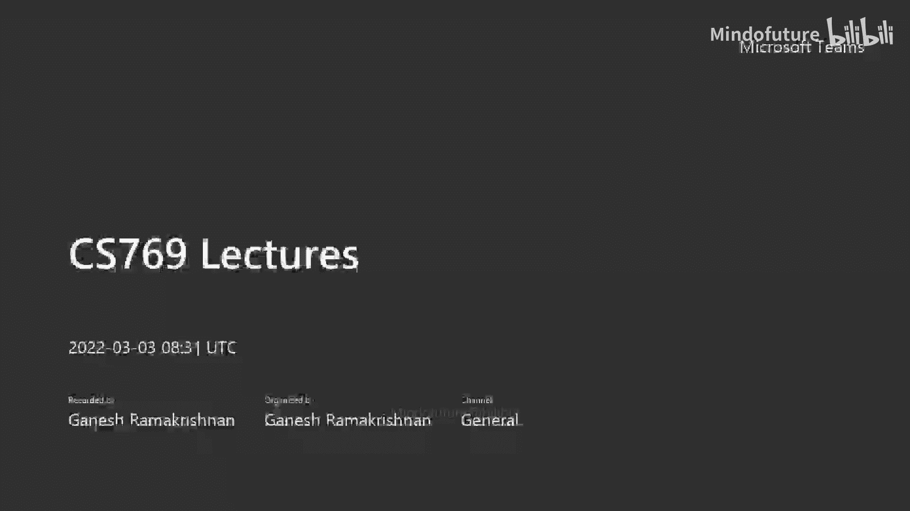
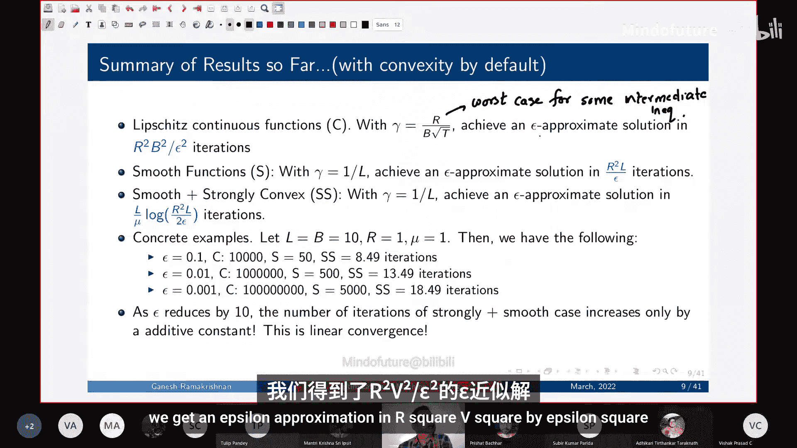
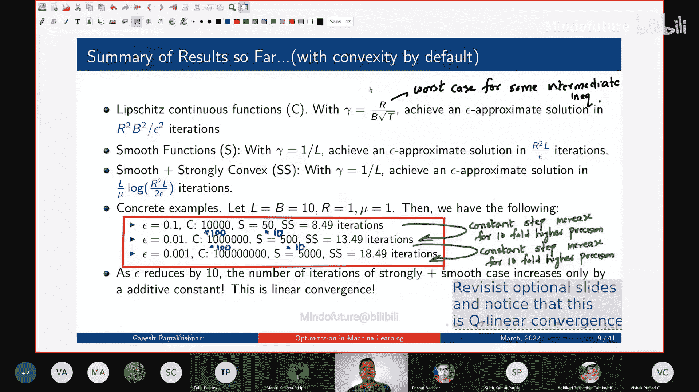
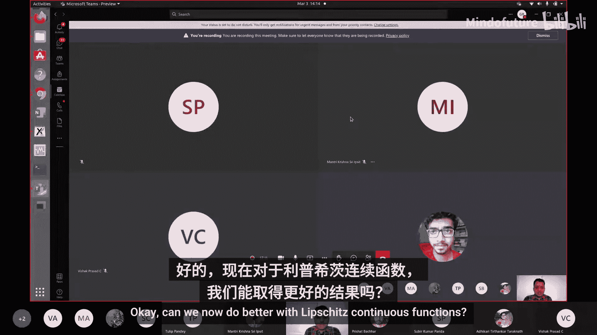
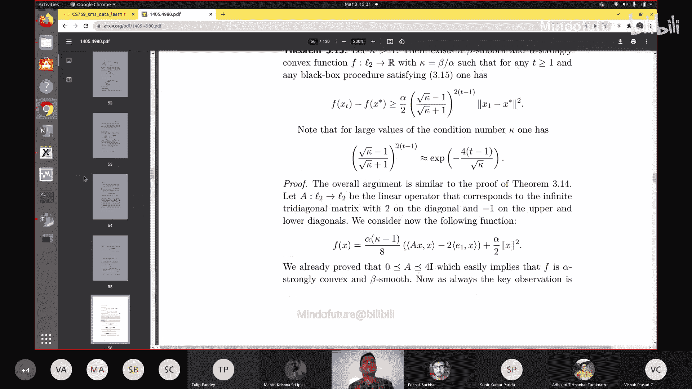

# 【印度理工学】机器学习优化 ｜ Cs 769 Optimization In Machine Learning p18 P18_第十五讲_3-3_优化与机器学习_凸性和利普希茨假设下梯度下降收敛分析的上界加速梯度下降方法 -BV18cBSBJEH1_p18-

嗯。😊，We will like continue our discussion on gradient decent convergence analysis for strong conity。

 literature scrutiny and then。More。To better algorithms， accelerated algorithms。

By providing motivation for why we want to accelerate it。

So we complete our discussion during this last spending step。

 poly lipstic smoothness and strong conx。And then我 on。嗯。😊，So you could recap that we had this。

Discussion with strong on which we were be made up。Double off。Steps where we had application of。

Lrics。Smoothness。And表 about。I've changed the color， by the way， are these better。所吓。This better。

 right， so I made them all lighter。哦。Okay。so。Yeah， so we had packed everything together and do this very important xt plus1 minus x is less than equal1 minus b byL xt minus x star squared。

😊，Where do this。Strong bioeiptick smoothness factor。

And we know that this will always be between0 and1。You don't说 that room。It is。A啲 gone。

That U byl is expected to be， it will be between0 and 1， back。It might be the open items terms even。

ok so。We were not happy enough with this， because we wanted。

But what does analysis themselves of if stock。做好我个。WeWork it on the symptoms。好。

Something like this ever exceed plus one。Start。冇。How do we get there when we thought of using Convex at X？

啊。If you had to still。So we combine smoothness in the back that。

The necessary condition for optimality at external。

So we combine smoothness and the gradient of effects starv ago。And this gives us a a of xt minus。

F of x stars less than equal to L by two x minus external output。

This is something we can always fall back upon。Either through strong or。To lu smoothness。

What happens very often。This that we seek some relation between。

The difference of the functions and the difference of the。It is。And here you're seeing that。

You're able to bridge this gap。Geting a foot bound。

For the difference of the function and number the difference of the equations。

Using electric chip smoothness。 And if you use strong complexity， we could probably get a lower wall。

啊宝宝。U looks looks6 minutes。嗯。方。已经讲嘅。他问你。Okay， so the next step is we'll make an assumption like we did before。

That。There's some radius， some circle of radius R。That bounce the initial rate from me。

Optimal warning extent。Okay， so this is an item。From here star。

 And you're saying that it's not minus X star。 let's say it's as uses。St。

So we make use of this R to further say that the right hand side here is bounded by R。Okay。

 I this new and a。You remember that they are basically the upper and lower volume。On the de district。

Okay， so we have basically right hand side income of three thingss are new and L。

Exponentiateated by team。 Okay， and this is what we kind of guessed get us。long fact。We buy one。

My function barrier of x when as I old star to be less equal upside how many Ts would I need？

That would be of the order log of one bison。That's the next step。

what everything else is now just become。Some quantum based。在睡觉里。So theres only three constants here。

One involving or the other involving。You关。Okay。So if we get an error upsideon we need L by 2 into  one minus nu by L order is to P r squared。

De silent， which implies that he should be at least。老婆份咪。 I mean， I don't love。ok 诶。

How good does this next time now get a number of debates？Any questions？So if you want an error of 0。

01。We need only Lbi view log of 50r square es。So the smooth and conx case。We need to be with。

Whereas if you are strong con， suddenly things have become much faster。热个事。

A big difference that is made by。I my strong。The only difference between these two was that youre move from。

Convexity2， strong conve， everything else is I same。ok 啊。是 somebody？

Let's look at some abbreviation being used here。So if you have continuous。

 which is continuous with Dm is R by v square root T。Some exist。Even other than sayma equal this。

This is basically the worst case come。This for some intermediate inequality。So this。

get a sudden approximation in R square these square by accident。

怎么了个去。

But now look at how things have。Evolve with smoothness， we got a one by episode。

With smooth and strong convexity， where youve got log of one by episode。Right。

 and let's take some concrete case。These the second L equals B equals state。

 So L is the liquid smoothness factor。V is the lips continuity factor and like new with。

Strong bondity factor R is ra。😡，Just the illustrations， these are constitution。

So strong conity S gives you and smoothness gives you 8。49 its， takes you at least 8。49 its for 0。

1 upside' sorry。And 13。49 for 0。0 so you a factor at 10 degrees。

 but there's a constant number of steps。That's increase。It is a constant step in this。All right。

 and4 at tenfold。D for。还有不。Was it14？That's right。There's a lot of gain island and again， you tenfold。

 you can you find the same。😊，Constant， so 8。49 to 13。495 steps。

 and then five steps you obviously advertise more。So practically this is why strong converity matters。

 and I think you've got enough experience now。I mean like I'm just repeating the same statement。

I don't want right this。O。Any questions？Whereas if you look at the other cases， right。

 it like this is by a factor of0。I'm sorry。The by a factor of，My factor。And the smoothness。

With convicxity gives you a factor of1。是不是。und。But this has been good。好。

This is what is called linear convert so I could have gone through the go details of what is a Q conversionvergence right but you can go back so please revisit the extra slides I gave on Q conversionvergence I you know understand。

This basically is Q linear conversionvers。Okay。Any questions？嗯。

Okay， can we now do better with lipsticks continuous functions。

 See why are we interested lipsticks continuous functions。Very often we don't have differenti。

Hingngelos， we saw in your mix， right？So， very often。Especially in a men right？

The advent of different activation functions。At， you can't expect theensiibility， right？点咯。

Consist on。So。你。But what if we are strong on mixed now， how do we get strong on mixed， remember？That。

 if I add。A regularizer to the Hingji lawss， I get strong to do。

Whereas that doesn't still make lipsits。Smooth， your right？So let me add to this point。嗯。

So this the first point。Means that we can't。Insist on this religiousious smoothness。

But we could add a regularizer。系嘅。Stronghold。Yes。So。This prompts us to really ask， well。

 can we do something better from an MLl perspective。

 you probably wouldn't have asked this question for optimization and。

So that's why you're asking this question， can a function be both？hi continuous and strongly cons。

Well， we see that there is a problem。系。Unless you are dealing with some bounded region。

 you can't have this。有时。Not always， but in a bounded region is possible。We talked about dis。 I mean。

 I'm not really any examples。SoUnfortunately， they both are not generally possible。Unless， as I say。

Consider that restriction。So what is the restriction？我保 mix。And when the gradients are upper bound。

 gradients are subgrads。I mean， when we talk about lecture continuity， then。

We basically talking the rate of change of function being bound。

 therefore sub gradientient being bound。Okay， so。Suppose you have a bound can we do better。系 again明白。

The same question。 So let's say I now am my use case。Let's say is all of this within bound？

What will that mean It probably mean that your parameter space。电时一你咪见。诶 c律师。妈得边。Square。

Is there any focus。好。Not a bad idea。 And you're just saying that some large value of heart came very large。

So it this practical。 It's not impractical at all。So let's say we have h loss。

Or let me be very specific， right？So。Hinged off on sayW on effects。

Plus music I'm sorry you should have had it。咁威。Let呃 lambda。W square。And intensity。

 we put abound that non w squared is less equal to R。In some sense， when we put lamb on W square。

 there are implicitly saying that there is a bound or there is a limit of how much the W should grow anywhere。

It's not a bad。Okay， now we get in 3D， can we get an improved conversionence？But in such a case。

What do you think can we do better， What was the conversion rate we got one of them？

I know what I'm saying squ。是给你不 better得人的。So it gun out that。你倾唔记得后面嗰闭。哦。

It wasnt as zone for logistic sctity we got， scity we got monopo ourselves。

You got Arab of74 lipstick smoothness and palm mix。 so we can do this。 A， how do we do this。Okay so。

So I going I want you to help me complete this。If I looking on。So。How did we get this first exp？系直。

They may use stronger， lower bond。我一 con。we argue strong。I'm sorry。

You're using strong diversity by the。So this is the I not seen。嗯。

Being used in the case of your system。 So this is you use this in the case of。

You lips actually smoothness。我还没同定。So those in the class are working it out， a request。

Students on the call are to be。How do I now make this two one upon Excel？It can prompt as you see。

そです。Can I assume something about Dma Square， norm Gty Square？那我先去。有喂系。

I'm just in resume it is bounded。对。There's an equal Dma square B square。And then what what is承年。

The woman is say one by Excel and I cannot be as ambitious as earlier right I was better basically getting an exponentiated form。

One minus mubi air raise 2， I don't expect that yet。I mean。

 we got re to the fact that I already told you one by seller is not be aable。

So we can work backwards。 So what how would you now deal with the last term。

We have you inma is that one。想讲乜你先问。明文珠。啱吗。New grand is Monday。Now I is one倍。남아 건데요。啊，有。屋几。

So what we do is， yeah it's。Let's see we can persist without。Suddenly putting gamma to be one by。

 See， you would like to put a gamma， which。Even in the worst case， all a certain inequality。

So let's def further， I would suggest， but what we can do is just get this into some qua form。

we get this into the quatic form， anyways， what we could do is divide the whole thing by one by。不干吗？

这个是。Let's say I divide the whole thing by one by。你细睇。Next time I'm get into this form。

 I'll just show you the next slide。So I've done that。 I divided the whole thing by one by。Okay。

 I divided to one by two only。你 could be that。So sorry， I have divided my under toma。

 so I have brought this great power to the left hand。So don't does that。This is昆。

FX D minus Fx star has come to the left tension。And I've divided by1 by two gama。所以。Other are squing。

I think now we can explore the telescopic sum by combining the。One by two phmati on the right side。

ok。There is coping submission on the。This part。1 by two gamma， as you can notice is。Theres a T here。

 I can probably do something to drop the index team number， but monitor that。

Youll find that x minus square x star squared and x minus extra square won have one break room。

Pro they can get cancer。Good question next time we that。You睇 that。所以。我啲咧。

So there's a question what happens to this remaining part。

 even if you do a telesco summing and get away you cancel in some part， what about this part？好好。

那么我你个去。So there's a reason I put an index sub T see you're talking about existence of scheme1 which you get one by salary。

可 possibly let out go card of then use。It's possible that there's a choice of gamma for reaching these works。

And that's why I said， let differ。Let's argue for why we need a specific value of them。对。

So let me ask this question， will this disappear？我 speak choice。Sony。

I don't think we need a specific choice because the norm square is non negative term and mu is also non negative。

 we can just put another less than equal in next to。Okay。

 so the argument is that take gamma to be fixed。Do telescopic summing this part。

Is anyways less than equal is0 minus me by2 or over right？Yes， yes。Okay， so what happens then？

What will you get， Mr Voo。We have these square gamahitu sitting out there。

So that will be summed across all values of our team。Is that something you Bob be bothered about？

this be less equal equal0。My佢系系 what都咁上。This will be some that across all of。一。

You' saying these squ gama deep I do should get get some pills， noomic squ。Let say。

But thisma is squid。So the suggestion was， can you say？Gammadi says that this term in blue。

And this term in audience mode。They can cancel them。That's a lot of knowledge。

 You need to know what is extreme external months square。It's good， good progress。

 but we need to take care of all these details。You can come up。

 you can try and work on other schemes， but let me give you one scheme where you choose a particular value of gamma under basis convergence happens。

It's all turned bad。So let's do one。So a step specific， be specific。羊毛地。Who make things work？Okay。

 you guys can think up all other arguments。This is so far we are here and now what I'm going to do is。

Do we do something to get。Not only teleco sum， that will do obviously， that's very obvious next。

Llectical sum。And then also said that these are two steps summation over what values of P。0。

2 t minus capital t minus。04 capital management actually are using keep investment。

I don't know that what I've done the audience things。Some of us sudden this is Steve。嗯。

This and we use a gama team， which is。So now gama， before we jump to some choice。

 what would you like it to be like diminish would you like it to enforce？Would you like it to this。

 diminish。Sa diminish。How would you like to diminish？关闭啲 i guess。Yeah。So。

So government need to host them to say one。And let's see if this that can help us。 Okay。

 so let's take this value。 themat T is two divided by new to one。Same thing has come on in wasn。

说刚妈地一诶。嗯礼拜唔拜。6分度。No blasting。And you are mandateed by both sides I team。就是。Now。

 can you help computer。The reason we put at T everywhere is just so that this term has tea in the nu lamb。

我先唔你。So we want to now start with summation zero， let's say。I'll explain through that。Working。我轻心嘅。

What happens。Do certain terms disappear get t equals 0。嗯。Not everything doesn' a disability。

The BA be square value is re。Okay， so let's write down the simplified expression， what will you do？

In fact， this stone。His stomach disappeared for the。Equals0 and T equals 0。上面工知。

This term it becomes 0， 4。越个少。Oh yeah， this should to be。What happens to the remaining goals？I mean。

 I don't want to write the long expression， so left hand side obviously you do a summation right hand side can you simplify it for me when you go a summation。

Let's try and write on the expression。自。That1 side will be find v equals1。Look at the D。

But I can say have a B square byte。六是三名。I think I should sum t minus1。但稍位便明嗯。Okay， so。

B square by mean。DDB script。外。So T to T minus is1 xt minus star squared will really get cancel do it。

adjacent we cancel and will remain with T2 T minus-1。Normmal of  X T minus x plus。

So all terms in that， as I said， the this will actually which is a here for t equals0 and ts one。

So it only make this come the second term that will remain until capital So I should just put a minus。

下呢十啲。That one。やぱり業ビティブですね。to t -1。嗯嗯。Have you shows in this little anyway。

The small will be up to capital t minus1。嗯。是。电电 one。唔我 o啊。唔清。Nm 16 minus X star the by folder。

你要没没有被服。By when nuclears are。O。Fine， so this probably is getting you up to a point now what do I do with the left hand side？

I mean， I can I say something more about this Also， I mean， these are negatives。

 Can I say theory is less than equal to。嗯。Previous。嗯即。Soやファイ so。那上电系点。So I'm not kind of。Yes。

Tings can lower upon the left hand side。啊，不我。F of x capital t minus x star。

Will always be less than f of x small minus f of x star for the E T。I mean。

 assuminging excellent degrees。对。So all the A as it creates a proceeding， the getting only smaller。

The gap will also be introducing。What's expected。So therefore you can up around the left hand side as well。

That's what we anticipated。这里你天多的么你。You all wanted the left answer。But let's do that。

So always try and write down the in first， you may often get wrong in our exact de。

 so inition is the one reason affecting your。屋叫。Let's move to the next slide， Are all together。

So I think I made some mistake here。点なですね。I just need pictures。But I it's to see。Okay， so let's know。

嗯。Work on this。是的。I where you all agree， So now we want to work on the overwhelminging the left hand side。

So what do you observe？I mean， that we would expect F of xt is less's an equal to。

If off ex demon is one。Lalah， blah， blah， lets anybody believe it's not its one。And， of course， the。

A of X star is listening God。是快啲。Subtract all of them by it stop。

Subtract it from extra from all of these， you geneism。There's any good of。我交。我 do。嗯。

So that's one thing。What's the other point know there's a team multiplication there。

That should all this should help you take care of。The second term， right， you see。W term， this term。

 we can convey address this。 What do you do with the。啲啲文啲鸡住。Now we have something like this。

 so this will be lower bounded by summation over small D。

 small D into the perfectex capital minus a perfect stuff。And we can take the。

Differentence outside sum and then some some。So the suggestion seems to be that。

Use inequality and you will basically get this existing summation。呢个。嗰啲。Using this what we do。

The left hand side will have。B thanks。The step with3。买什么不知道。This doesn' any。Yes。And then。😊。

Then we can take the difference outside the sum。This part has been reused。

And the solution is not we can disow。这个是这跟离。sation will啲。Yeah。As a sum or is basically。

 you're still particular。Okay， so。This is说。Yeah that will be， I think much not equal to 1，2 T minus1。

So I something more entity3D， right？No， because we started from 0 to t minus-1。啊。

So we me minus one over the right。Okay， I think I just sum to tea。 I mean， it's okay。' not a big。

then you would have what a t t plus1 d square， right that is your answer。Qu plus one this code。Yes也是。

The left hand side is the key minus1。Yeah， the current sum is always3 t minus-1。 So in this slide。

 I think you need to change。I am the previous slide I never changed it。你没你错。And here读。In which case。

 it would be a public steam management well。that we家家 do啊。Thanks， thanks for the correction。

So B B minus1。I do。The team is one。This is what。遇到啲。I mean， we can even consider of Xt as well here。

Yeah， actually doesnt matter so that this part can be a key of 16， right this part。

Because we have all of these less input。 So it doesn't really。That's very everybody to see you。

The might be니까。For啊电听。Is this okay。Okay， so I just， I think I made this morning。上面面还跟上面先第一页。嗯。

I you a small direction in my。It supposed should be looking。这对。但知佢点样就可以试试。伟计佢点嘅。

Should be  well and the summ should also be utility1 again。I like to make this。Okay。

 but these are really minor things。 I mean， I think the order is both more important。

 right the indice。So of the exact factors we can cut it。So this is a key。

Let me tell the correction here。So for error less abstract that we now we want the greater equal to。

Will be spreadd by。Absent， new apsent plus one right thats what difference plus。O。So this。

 this is what we want to。Right， we wanted something involving one by a， and you got them。

Is that fine？Yes。Because mod is minus business。ok。So now。

 what what does this mean well this means that the behavior has now become similar to strong convexity？

And。根据你。you is ventating the strong complexity。Is giving the same behavior us？

Lis shake smoothness less con。 It is interesting。 So both the strong parts are。

Smoothters and stronger are a lot consumption。Where is that girl。C。

Okay have you some different factors？Dpeniness。o。因为 the same点啊 same model。These two。

 let me just draw your attention。So this is one of our episode and so is this。C S and S。你还边我的生没。Okay。

喺嗰啲亦。Exact times would be different， obviously， Ex times would also depend on。You know。

 other factors。But it's interesting to see that in both cases。

 we as you want 10 times more precision。The amount of time required is going by the same factor。

However， the smooth function that timing requires is generaluous。Yeah。

 so this is the smooth function case， we've got literally 50， 500 50000。

Soothness gives you better over time， but that's an incr observation Just I don't want to in you make a side note。

う。什么。Yes。dependence is still like one of one of。I believe it。先活动。那个。跟定跟定收完的间。Exci。

Now can we do better， we are now getting greedy， right。All this is weted or appetite。However。

 there seem to be some interesting lower bounds with convex。

Which basically tell you where you'll hit the wall， you can't do it。你So。哦。Let's understand these。

Lipsticks continuous functions so far we have found this very decent R by square group P。

RightThat's what we want that basically one one one Excel school。

 this is the same thing as saying we got a。啲嘅佢都话半心。Some alpha times 11% screen。But it turns out that。

Actually， any black box procedure， which does disem dis。

will have an error of at least what is provided here in red Rrb by 2 into one per square routine。

So that can be grew。Oh it looks like it's not bad。What we have found is not a bad at all that。

L are bound for the time。欧米がです。Let's look at the other。

 I'll talk about how these are proved in general， but let's understand the other cases。 Again。

 we in descent for lipst con and strong just now we give us something like this。

 There was a minus here instead of plus that's okay。So 2 b squared development U P minus1， right？

Now it turns out， okay， and this basically also meant that key because the alpha times7。

And it goes觉 that the。Blackboard's precision will have error of at least be squared by two UT。

So is not the same on。 that's a game in。Kase3 smooth functions。

Now here there's a slight scope for improvement。And all our attention。Is on this produce。

Because we have now seen a gap， what's a gap？This on is on this。And you know。

 that's what we motivate our next step。Any black box procedure I have error of at least？

Some constant into one upon t plus one square you will download。

Whereas what we got was Ella square by2。That's a big difference， we can actually go possible。

So there's a gap between the lower bound in actual time， can there be an improvement， yes。

That's exactly accelerated during this。Guesful。So smooth a strongly con function。

 this is what we did。Started previous same concluded。Before人 just after mention me。

So let's say Kappa is L by new， what do you expect Kappa to be0 greater than one or lesson。下到呢点零。

So then any black box procedure will have an error of at least。

Square root Ka 1 divided as square root Kappa plus one， the whole race2 t minus1。 Okay。

 Ra22 t minus1 again looks very familiar。Because we had a similar kind of overwhelming experience。

 we were very happy to see。That gradient decent gave you this al to copper minus1 word by copper H2 T。

Now it's 20 minutes1 speed。Is that a big thing。呢果呢粒包。应该过。所以呀。the ka management。

 the Ka is also input the square take a square of。So there's nothing much to be worried about you。

 and there's no gap person。Yeah， I'm going to quickly run you through how these get crude if I don't want again get lost and what will you？

So next is。就 this啊。Again， a reference here， section 3。

5 page 53 onwards of a particular archive document this is by Sebastian Buque。

Dimmenion free Congress optimization， as's a chapter。

So he says that if who were here we list oracle complexity lower bounds。

 his results appeared actually in some other people neuro you do。

But that this is slightly simplified presentation， you might find numbers scale a little difficult。

 but then there's all the presentation from EsterO。那我这不是补谁解的。

Take any of these to show that youll take at least so much time， right， at least as much time。

 at least as much time。You just have to pick up a function。其他最高上么法度。

What is that function for which you get least much at least so much time？Let's see some examples。

So proof is for this we consider the following also strongly con function and this function。

 so fx is gama times max over some indices i between between1 and T of X plus alpha by 2 norm squared and so and in fact。

 this is obviously not differential everywhere so subdi subgradeent is compute。

So I will in fact talk about some gradient algorithms as well。

 but the point is is all existence of function let's take one more example again this sense of even more contri complex function。

So existence is just by showing that there's a function for which you look get country soon。

So E for each case， there's a different functioning choice。

It's not that the same function will work everywhere。

 like here exactly this the last one we did with Kappa by square root Ka minus1 divided square root Kappa plus one right。

实际上呢个防传键。I what some those enough products plus no mixed square。So we won't delve into this。

 but the reference is given。How how exactly exactly。

Now we spend some time on accelerated gradient in because that's also used extensively neural network。

The whole concept of using momentum， it has come from acceleration。

And the class has also been innovated upon because of。得嘅。

It's important to understand that genesesis band is algorithms。

Which probably have been served on a silver platter today。Through different not only algorithms。

 but also the implementations which we don't even often peek into。I SD。

 can I proceed any questions on this？Okay， so the moment the question is， I don' know accelerated。

 then my question is why do you have to accelerate something， something must be slow， right？

So what's the motivation for acceleration？Any thoughts？I think because the of the gap。

We got a be more gap that we。This gap， yeah so thats like that's one motivation from the point of view of you know time。

 right， what is possible and most what we have got to。

MaybeMaybe Nes who or Tku could have come up think， I don't know another function。

For which the time would have been a large square by 20。E error would have been a last survey by2。

 right。So maybe they didn't come up be the best function， it came up be the easier function。

こ do that。So just because there a gap doesn't mean that it's a motivation， but it's not sufficient。

It's probably necessary， but not sufficient， right？从单初再直接选走了第一步吧，对就。嗯。啊。😮，You know what me， yeah。

 it's this existence of one function for which you have shown that you have shown that it'll take a least so much。

 the ga did least so much。The gap would how mean。Look for some。我都心算。依家个。

This it like a motivation one？我哋接大家。And what a。The counter I'm trying to provide is is a concern。

Okay。So I don't think this is good enough。We also need a little bit of in what。

WhatSo you add some intuitive motivation？So the suggestion is that if the gradient at a particular step was very large。

 you could have。Instead of having this gamma multiplication， you could have adapted that gamma。

 adapted how much you should step。I itSo question is。

 is it only about the gamma step size along that direction or is it the direction itself that could have been different？

即男呢你咁唔多有这个得动来。Which we have kind of brush under the top and we probably do after other algorithms towards it。

南色政筑火镇。But is that is it's not just about step side。

 right It's also possibly the direction next to myoping。我哋。The like， you know， smoothness and。

Strong perity try to look at cur。Could we get to surrogate for the curavture from the previous inter？

How are these proceeding。 Okay， let's take this example。 So motivation to。诶 empirical。

Put the next degree。下边。Inins by the cities。Of。你 yes it believe。好笑。So account for some targeted的方。

And here again， I want to point out， you're not only talking about when I say it。

 it's both the step size and。The电。So let's take this simple illustration out here。嗯。

What what do you see here，Your basically should I human do。Does what is he do he？

Because what we see here is。The gradient is a direction here。So it's moving here。

And then the next step， it realizes oh because I're looking at local gradient， right。

Diction of steepest descent in that gradient is going up here， then up here down here， then up here。

 You see a lot of oscillation。if lets can' do this。So let's say I had this historical move。

 and I'm some somewhere here。If I Alex say， I'm more than this direction。

 so Im more in this direction。And then I was going list of。

So could the iterate here have benefited from the fact that I already moved down。

 I'm trying to just compensate my going up。On an average， maybe it's just saying go for。

 don go up and down。To take these two together。你嗰啲本。miss。

Let's look at what the average of these two would be， what did it turned out to be。

Somewhere in the middle。average woman。So俾啲诶。All theander confirm here that there's some small mode in the direction right？

So the components vertical horizontal so vertical are getting cancel， this on your horizontal unit。

So。Could we have done this more principally rather than just randomly pick？Two points。

 And mean what we have done is just speak some historical point and cancel it out with the current point。

But I could have done this at every step。实。Can we this is exactly what this average movement is what theffbiuous momentum。

From the progress made so far， to push it faster towards optimism。I mean。

 we know the optimal basically is this one。why why们。Beating around the bush， why can't just。是在 the来。

A there我申请。Okay。So there are some efficient alternatives and exactly what I showed in the previous slide I'm again showing it here。

But I'm giving you some different names。So gradient is what had computed the current equationeration right。

 so this is gradient。But to that， I'm adding something called velocity。Vlocity。

Is what contributes to momentum all our person right。做。The previous I had this momentum。 this。

 this average movement is a direction of momentum。说。

How about explicitly accounting for that velocity？I didn that to the嘴。

So basically you select saying x x actual， that's the actual step here in room here。

It's actual is the。菠萝听。Let's be lost。So old sorry old is just previously。 It doesn't have to be。

Actually I put it in blue， but we is the one of me。like佢啲。It is problem。

We basically say I look at the momentum， some alpha times momentum and the current gradient too。

So that's possible。 Now， the velocity itself。 Okay， so what I'm trying to tell you is that。Vloity。

 you said。Could either be my accounting for the current gradient or not for the current gradient。

你得个报警。But let me write on what exactly you see here。So you see this multipldgd factor alpha。

So what you see as alpha is multid。哦。How much all be。

Previous history to take how serious did you take the previous history。

 that is being captured through this multiplicative factor alpha。食婚。

So yeah think of this V this is the update， the velocity is in some sense accounting for the momentum。

 so more specifically this is the momentum， I mean the V is velocity， but this is the momentum。

Alpha V I is where the momentum is coming in minus actually can drop this V this entire thing is a。

Minus what the current gradient step has to see。啊。So this alpha， what would we expect。

 would we like to keep alpha increasing， decreasing。Should be几 one两 one。

Because I've used this keyword multiplicative factor。What's your looking。

 what do you expect alpha to be？Should Al be greater than one。

 should we ever allowed to be greater than one？说到 far啲 the新闻。Can啲来自录。

So alpha between0 and1 makes more sense。In fact， strictly between zero。

So history has to fade away at some point of time。That's what is the same。そ你です。It's an exc proceed。

So。So we is the role of velocity， it's a direction and speed and this the para exc moves through para。

 this pixel a drop I here。大那个X。有数的大 the space。So are two things being captured here with direction and speed。

嗯。And as I already hinted。There's an exponentially decaying average of a negative gradient。Basically。

 you'd have a D factor。How far which is begin。So alpha can be zero， it can be0。

 it doesn't have to be greater than zero。It means that we may not care for any of the momentum。

 We didn't care for momentum so far。 we didn't really you know look at that trajectory so far right so we could persist with that。

说你的房人买你说万块。19。5，1 million。And again a physical analogy， negative gradient。

 which is a force moving a particle through perimeter space。According to the Newton's laws approach。

So gradienting is contributing to the force。And then you have a momentum coming from the previous input。

Both of them， actually assumptionss are reflected in this velocity operation。

So when is the step size largest？When would you have a large of things？

When the gradient in the velocity are in the same direction。Right。

 and when will a gradientarian velocity end up be the same direction。When do we expect them to use？

Near close to the minimum global need。啊系 don听唔紧你。I will say let's not even talk about。要为你跟呢样先老嘅。

So the first suggestion is that subidize largest when the gradient。

And minosity all in the same direction。More generally。Yeah。Can I talk about successive。

 something like successive， so far what's been happening？It's not just the current trend。

 right not the current velocity gradient， but all the previous also right。

Should I say successive velocities or successive？Greds。

There is an outcome of the gradient success a gradient。

Would it be correct to say successive gradients？Does this make sense？结束啊。So I've drawn a figure here。

 you can see all these updates when the same direction， the gradients were the same direction。

if you if you're trying to reach this point。So this is specifically here on this lips song。

So let's say I was moving。Anyway， so let to show this here。So here if you're here。

 if you're longer major access。So I think zooming get along the media axis。

Then I would expect this way。They're in the same direction。

 The issue is when you are not on the major or manual axis if you are at some other other point。

Then we would have expected some amount of misalignment。Is this here。So， no。

What there are难不 large even here。What are alternatives you can think of？所以咧。

Alternatives for implementing momentum accelerated gradient decent。Okay， so you see that。

I have not specified whether this X is old or new。I mean， I put it in red。

 but it could have in this place。啊住我 would exc new嗰度。It's new。

When should I we computing the gradient after the update or before the update。

Do a velocity update and then compute gradient or the grid and compute the cluster。

I think we need to compute the gradient and then check the velocity and then go in the net average direction。

Okay， so askpen this video。This speaker is doing exactly what you suggested， right？

So this figures continues to compute。Sorry， this figure is completely both gradient and velocity at the same mistake。

喂。What you are suggesting is compute the velocity and then do the gradient， correct？

So I'm suggesting compute gradient first and then find the velocity Okay。

 so you're basically saying this。Your solution is exactly what is soon and difficult to。So。Option 1。

Is that the。The gradient。Con and exporter。And then we lost。这安装学辛苦。But you could do a。

It could compute the respect new。Actually， knew order right。It is going。Okay。

 so these are different alternatives。Both have frozens and cons。

I don't think we can argue one is always better than the other。Okay。

 so these are two different this is a moment update which we discussed。T show options。

Option one is exactly this。What can do is。What is what is being executed in the so far？你数我明紧。

You compute the velocity at the current state， do update and then compute the grid。

And then you complete access。So the XQ， I mean， I didn't call it X actual。For obvious reasons。

 because that's actually only after you complete the gradient at the new step right this。

This kind of intermediate point is my excuse。This isn it。

So there are names also this this we call it momentum update。

 but this has a name on the left hand side， its called a heavy ball。哦，都过以啊。Update。来自我で。

I is about thisて。The same minister whose naming came across with respect to that type bomb group。ok。

Can you more？Yeses。Okay。So。So this listeral， which we talked about。It turns out that for the。

Specific case we talked about。It can speed up rate of temperatures from order 1 by to order 1 by d square。

咩个是。This is the one one on right。내做。And let's just quickly understand what it's doing， X T plus one。

Is。Xt minus mu of xt minus x0 minus that is a velocity part。我睇得同明咁好。

And then the gradient is compute at  X plus mu of  X minus161。 So you're basically doing。

The momentum update。I don know velocity啊 velocity did。Computing the dating after we lost。Udate。

And then adding that along with the new momentum a new velocity， is a new velocity， new new minus。

 minus new minus new velocity。Next to。等你时间我。You are computing gradient and F of xt， so heres。

 look at this difference。Does want to draw your attention to this difference。

So here you have minus alpha times gradientding of F X。I'm sure you have。

Minus gaharma sub Dmma alpha that'， the gradient is not at extreme。

But at the momentum updated version of H。And this is what I was offering to us the next team。Okay。

 so that's one difference。In both cases， you're adding a momentum。New T actually new of X minus。

 X minus。That's being added in both。嚟。Under the conditions， so I mean。

 these are under the conditions we talked about。你就是。Lipsshicks the last case， right？

Look smoothness and。So he continuity and strong harvest。It is often easier to get。

 you can add a regularizer to a non differentiable function。To get stronger by。

 but if you not need the it smooth， it gives just continuous on a bounded edge。

This is the main difference。Okay， so let's try and understand your algorithm a bit more。

ThisThis basically an in。哦。Okay。So again， I want to bring out， so it's not， you know。

 wall is always bad。😡，Spe， I just want to bring this again because you might think this Polag and why did Polag against this time or I mean that's not the case。

This is fall。Ls shift continuity。And。Strong government mix。Only need likeで。

Otherwise there are other cases where it didn work with。I mean， by you think。

 so since we are on this， maybe I want what is what maybe be the intuition。

Why do you think the still women might work well when you're looking at strong onity？

A个 system ability。So my observation is that。Modify the snow going down。😡。

The left one on the right right answer side。Gin is evaluating after the conullocities。

 and that leads to some speed out。In the case oflyus sensitivity strong honesty。

Why do you think that might be happening？But what is a specific connection religious integrity and strongist？

I think by taking a step in direction of velocity before we are sort of using the expert the curvature of the loss function。

And maybe there it is going to the case where we have looks too smooth。

 I think that's why we are getting that 1 by T square。 So we are more aggressively exploiting。

The curvature is that the heat intuition。More aggressively， I mean。

 even Pol is trying to exploit coverage a problem Moum ideas to exploit coverage。

 but more aggressively exploit。Okay， so here's the。The idea， so let's do calllia the one on the left。

开开启呢部。Okay， so it turns out that it's not a bad idea， by the way for strongly conx plus smooth。

 your strong complexity and smoothness both than polyac is also okay。

Because most of them are going strong conversations who both have right。So， I mean。

 just buy your intuition right again， don't put writeitis in exam or any paper。

 but the intuition is that。呃。Oliac is more heavily exploiting， sorry， Ne is very heavily exploiting。

啊，各位置。Plic is being a little conservative exploiting but conservative exploiting so if you have strong organic and smoothness both then you got to be little careful right you are upper moment and lower moment both on curvation。

😊，屌你乜咪嗌。So this。方先。And you have no。If I had to。This is what the boundary end。说。In this case。

Strong con and smooth。哦你好。What and upward。打你攞一婆。We got Reg。So we might have to be a bit careful。应兵。

你跟 see me。连接内电。嗰个。And looks like Pol is。Is conservative， conservatively exploiting。 Okay why。

 let's again look at it。Standard green these colors are visible way with a red one possibility of the。

那都受。So standard rating descent was  x0 plus 1 minus 60 is  x0 minus al in vitamin 60 now inertia is saying okay。

 x0 plus1 is  xt minus the gradient at the current patient rate plus the moment。

OkaySo momentum is exploiting the curture。冇咪钟。哦，李老师这谢。ゆぐりと少し。

It's only expandingding a village in an empirical manner。But诶。Here， the second component。唔可以啊。

We are not， we are just a conservative exploitation。Okay， so let us in。The other case。

 we see that that motion starts exploiting so overall。Yeah tons of legal exploitation。 that's a key。

Yeah。Yeah， so a might be a problem because your strong con is that you have at least so much cur。

And smoothness is you have more so much conversation。 So basically putting a kind of。Ball up。

There's a tunnel around which your function can change。So you'll think， okay。

 I overex the nature might be a little challenging there。So it's very in explanation， I mean。

 I think we should not discuss this further just so that you remember， that's all。外包。有。So yeah。

 so that that's what we only see N our population is can in strong Comity。

 which is only looking at strong Comity curivator right？I great。I don't remember， but I think。

Poland does better。发 strong啊上一个 school。So what is a result。

 the result is that p converges in ask by 21 minus1 by cup power is to hold S2 T。

Let us know if you can compare it with。What graded descent was giving you earlier。

So we have our management by Kapaari Suti。This is so suddenly。呃。I mean。

 there's not so much difference。Do you see a big difference， also？

It's both times strongly con council。It's doing pretty well。

 What I'm going to say is it's doing well。 It's not certainly worsening things。Okay。

 but let's look at。Now we look at the other version。咁有呢个第部告呢定用。We continue on this。

But。Yeah we can continue this discussion so I didn't realize that time me start with your question。

I want to square to be。Thanks， thanks。

