# 【印度理工学】机器学习优化 ｜ Cs 769 Optimization In Machine Learning p19 P19_第十六讲_7-3_优化与机器学习_加速梯度下降__线搜索方法演示__次梯度下降 -BV18cBSBJEH1_p19-

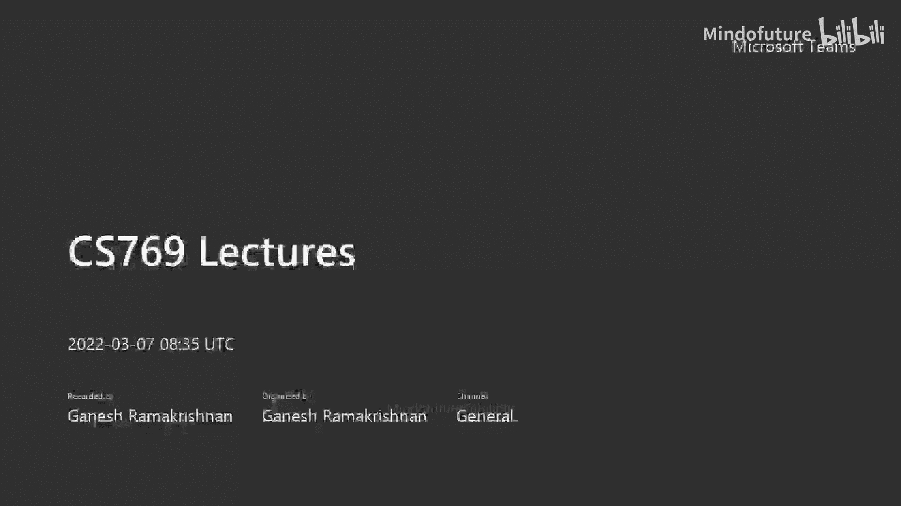

Welcome to lecture 16， Grding Descent converging analysiss will now culm and acceleratedinated gradientding descent I'll be spending some part of today's class also doing demos。

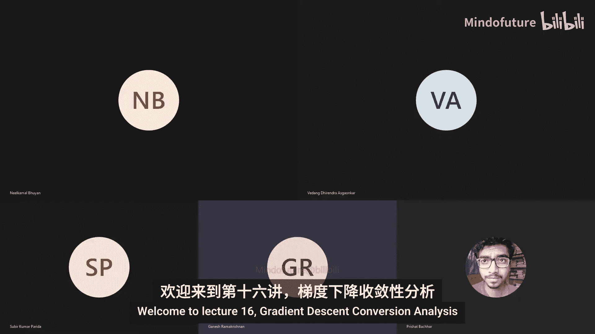

So I probably put the link on。The link， the same link。

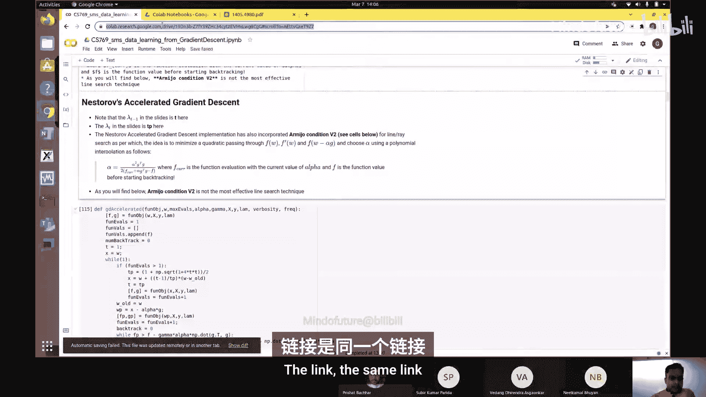

Okay， so you all have access to it in case you want the run。嗯。So。We been at this point。On Thursday。

 where we discussed Netros and polyacs accidentallygrade decent and as a homework had given some foot for thought。

 how do you， what would be that gap bridging， right？Through mistres。

The same for the lipsshift continuity case。As so recall。那个。

We had the best case using smooth and strongly economic functions。啊。

And there we had log of1 by Epsilon， omega log of1 by epsilon。

like to go that way and basically we're saying for every 10% or sorry， every  tenfold increase。

In the position。You would require a1 mores， which is very impressive。嗯，跑过。

We also looked at lower balls of complexity and we said we're not looking at proofs as such。

But what bothered us？Based on existential functions， which Ill give you some external link， right？

So what bothered us wast the case of smooth functions。We have a gap。

The gap was that gradient deer L squared by 2。E error of at least ala for by 2 T， whereas。

The lowerboard using some existential functions said that it should be。

LR squared by8 squared P plus one squared。And this is what we' have been trying to bridge。

Can the two become closerr？And do that， Well， I also said that for smooth and strongly complex functions。

There seems to be slight a difference， but it's not actually a different right because I pointed out last time the same order。

Underro kappa minus1 divided by underro kappa plus1 is to t minus1 now one way is you can take the squared inside。

 but the kappa minus1 a square root ka minus1 that's not a big concern for there a different factors I think this the t minus1 is the exponent。

And啲呢欢 be competitive。Who can always be factoring？Okay， with that， let's。

Look at why we said you could try and bridge the gap in the previous case， the second last case。

 case 3， smooth functions。B am function without strong obesity。

Smooth functions and complexityity of this。How we can reach the gap。

And that's where acceleratedally grid descent becomes interesting。Um。

 and we found a reason why great and might be so I zoom into the speaker and showed that there's a lot of。

Oscillation。And can we add a momentum。From the progress made so far so that we tend to go slightly straighter instead of oscillating。

And in that context， we had said the whole idea will come up with a velocity。The velocity。

Can there be。Complemented with reading。Okay this is what we have。

 so velocity complemented with gradient descent。佢嗯。

And velocity has two components a resurrection and speed at which the paras moves。

Now the velocity obviously I don't want too much of history baggage with me all the time。

 I would like to at some point of time do away with my history baggage。So therefore。

 there was also this exponential moving average。A decay average of the negative gradient。大告诉字。发个去。

Its new here。So there is a decayK factor， that means a new the first first time you have new times B。

 then it become new square for an older knee。You so the history is also fading out。

 basically that's what we want。Right。Okay， so this again recap。

 this importance of just doing a little recap。 And then we found the two organs possible。

 One is a one is a momentum。Computed， based on。ThePrevious。So where I would to compute the gradient。

 that's the question right will you compute the gradient after the velocity update or before the velocity update。

😊，So here you see in the Neero case。你首。Graient。After last。And in the left hand side， the Polo case。

The gradient is at the previous entry。好好然的た。So you have gradient current。

 youre gradient after velocity at current。That was a differentiation。オーそれに。我这里你你。嗯。

So we have this polyac heavy ball momentum as the first option which adds as inertia term。

And as I said， you have the gradient the current grade， and then you add a beosquito。

This velocity of how is the exponential exponential。哦，你奇。Through this meeting。

And it turns out that was smooth than strongly economic function。Is wind pretty okay？啊。

A smooth and strongly complex function gradient decent gave you Ka minus1 by Kappa， the whole T。

 and this gives you square root Kappa minus1 the K， as I， this shouldn't be bothering us。啊嗯。

So for all practical purposes。And by the way， this was also the digest， right。一対で。

Compar and commensurate。阿喂罗讲。Which we kind of alluded to the last class。

So this seems to be fine but more than strongly con。

You might have a slight challenge when it comes to。哦。Just a small case， only the smooth case。

Without strong reason。So when I say only smooth， that it' is only smooth plus。嗰啲 number没。但过去都是行。认为。

Please interrupt me if you have questions。We hold purpose of hybrid classes that give you more discussion。

So this is our recap from last class。I'm not he ended here， so I just wanted to spend it bit。

This year， somebody had a question whats the end of last class？あ思ますよ he goes。So raise two。

 so the question is。Eero bone we had。Was arranged two even as one， right。

All I'm seeing is is square you can think inside。These are all referral factors between zero and1。这要。

好熟。Yeah不给你的给我这东西。嗯。我啲嗰啲。So in one is as follows， this entire number is going to be zero。

So let let me again highlight this part。 this entire thing you are exponentiating is this between zero something。

Okay， and you're getting some similar factors。 So that doesn't matter。 So you you can， I mean。

 you square it it will be be。不是。So the better you have something， some fact。

There you can just think of this。That's like the square。Next。这。Thanks again， brother so much。Yes。ok。

Okay， so this just to kind of contrast what's happening， leading dissent。Is oscillating here whereas。

Sav wall or as least with Mrer O， you have some course correction Co correction is because of the philosophy you know it not it's not that it's like heading straight with stuff。

 it's still having a little bit of oscillation but oscillation is reduced。It so。

This is a reduced oscillation。So within three steps， you have more much。Forly。

We get the amount of movement to gone overall。When comparison to justice this。This is the moment。

Okay， but let's now look at Netero and see if can it help us in that smooth case。

 That's what our interests was。 And I kind of。啊。Just mention that the Poac is not going to be great folks smoke has given them analysis or presented analysis。

But you can believe that nestello turns out to be a better option。And。

We not be in the approval of the class。But I'll be telling you what the basic idea is。

Just recap the Mr does the updates。A gradientient computation after velocity。The post。In a of date。

内容可不。So what exactly will it look like？And this is going to get us two。T plus one squared。

 that's our target。So what will the out you like？So I think it doesn't look that neat。

In my conference optimization course， I spent a lot of time。

But I don't want to do that here because I tell you how。This gets used in practice。And interestingly。

 some of the advantages you get through the accelerated gradient you can also get some of your through proper lines。

你嗰啲诶五十点好你得我。But， let me。进。Show how this fix is okay。 So the fix。Go I in theory， in theory。This gap。

Is fixed。But， let's。We can see how that gap is fixed。So I want tell you， I find it a very， I mean。

 the exact update very under YouTube I in YouTube。In terms of exactly。

 I algorithm of them might be in YouTube。So， let me just clarify。

They're basically unintuitive details。我哋。Be most precise。The details are about unintuive。

And the proof procedure is certainly very complex。やる？Fixes the gap。

 So recall that this in red was lower mode。Right， and this in blue。

 what we had shown was obtained using。这点。呃The文。一六け。That's what you're fixing it。随便。け。Exsscribe the。

诶嗰当边费嘅。即 a f 室嚟一。In the epsilmen that we get。We get your bounded by。Something like this。 I mean。

 t plus one squared。 so when you say fixes this。We will get something。Like one of one。

 as think something proportion。One upon these。お便よいうです。Okay。

 so I will refer you to these more detailed。No notess and the thing is in these nodes。Yeah。

 I'll make a bunch of comments here。So these notes， I don't present Nea only for。Graadient。

 I present this for something called generalized gradient decent。

And even there for generalized breed descent， you know。其十。

I present a couple of possible cases under which the schools。我不放。这是现在的。电那个。

I'll talk about what is generalized gradient this。For example。

 if you have heard proximal gradient in， that's an example of Gen。😊，白么。

Is an instance pro gradientism。 have any of you word proximal。You would。Okay。

 so the proof is a lot more complex because also I've used it in more general settings。So here's the。

Yeah， here's what I can do， So is this。This accident really the same。So thiss a slightly more proof。

And because I said generalized it has this products operator， et cetera。 So well talk about proxi。

 of course。It runs into multiple pages。I don't think。And losing the machine in case。

So you can feel free to go over。嗯。But let's do the steps， what are the steps here？

So the algorithm is as follows。嗯。So I tell you the intuitive parts and the non parts we keep them separated Okay。

 so intuitive intuition is that we're going to have an XT。

You can make notes of these in one and before you get lost in the patient。

So we wouldn't have extreme as velocity。Okay， at visual ticket。I。其所以呢啲审经理。

About people before I write on the update。YT will basically correspond to。Update post。

这ing computation。At XT， so at XT we vary the。So overall， your updates will look like a YD plus one。

Equals y B。所。16。Minus dma T。It to。And you will set your xt plus one for the next it rate right away。

 so xt plus one will be。This decaying average， one minus beauty， that's a decaying average。啊。Oh。

 wait did this one。Basically， muting is a leak language， so it's a complex combination of。

Y T plus one and y T。But you can expand it as well。So。You basic subjects。Okay， so this。

So you can write the rewrite business if you want， I think in rewrite business。W it was one。

Last as you逼。Sometimes why be。I我 do。I'm just it。So I'm basically now computing my momentum for the next step and next team。

你几。So this is the velocity component， right？This is a个 company。

And I'm adding that velocity component with them。嗯。Became factor duty。Do I did this？

And then in the next step， the gradient will be completed x T plus one。This is a basic idea。负在给猪发呃，都。

Of these termss， one is gamma and the other is nuclear。Okay。

 so the dirty one is how there's actually one。那你搞本我。

This gamma is going to be obtained in terms of other factors， this gamma is little。The， right。

I expression。I'm getting。诶放站埋点。没 miss事。That's the funding part。

So gamaT itself will be obtained using some Lada that Lada will be obtained。I think in， in terms of。

Previously， so this basically the gamma is going to decayk。

 but the gamma is going to decayk according to some other factor now。

So this the update expression looks complex， it's a digging expression。

And I just I this wife I speaking on me。So second is a big case。ok。啊。Yeah， not exactly solution。

It's slightly complex in knowledge。Okay， so and this beauty itself。嗯。So nuity is there are options。

 okay， so nuty doesn't have one solution。There are just options for updating it。

So it'll be nice if you can write this down so that you don't get。啊。

Caught up in the details in the next slide。第不第。Okay， so now now the slightly messy part。

 so lambda n is what will determine how the gamma will do this so I talked about you know。

That update expression for Kama looks complex and everyday decay。

So that's exactly what I'm showing you。It decay， but it's not that big。Because case on the word go。

 initially Lada not is0， in fact， I think in the code I have Lada not have set to one there are multiple options。

But anyways， we are lambmbda order is zero， and in this particular instance， Lambda t is one plus。

One we are this interesting expression， which involves this。Re lambda。

 And this gamma is determined with the lambda。Okay。

So we will compute the Lada t plus1 and then obtain the them。The D is lot is greater than frequency。

 that is essential。Okay。So what you do by initially。

 you have pi1 and X one you say there's no momentum in， right？So the way we are specifying that is。

あの。诶度。More prior momentum。This is the way we begin with x divided equals y1。

 y minus is an arbitrary point。And then。两个你出来跟。How much it should be？系です。如个时。在す。Mm that why。

1 plus4 lamb square minus1 is greater than to。十分这个咧。你外解。So one So might。I not be。非常啲。

Let me check this。哎。never to my。Lamda by this one， let me actually look at my code， whatever。😊。

Could be the case， as I said that。Its a slightly unpleasant part。 this could be lambda email as well。

 Let me check the。所。えな。一。In thes。O。哦。Yeah and then as I said。

 yt plus1 is obtained as a gradient decentcent update step on the X team。

The X is used in workplace that。We we are deriving our momentum with respect to X team。

I great decent。Glain descent on。Viveocity。Update， that's basically the idea of my people。

And then the next step unfolds。你啲好贵咯。The more is the。We lost you for the next step。

So this's the velocity。For the next hit。Obviously will update。Some one does love speak。

This velocity update for next。你要经个。As I said， the velocity would be。This will be the most thing。

你开下就是。So you could think of this differently， you could say this is。X t plus one。Is writing plus one。

Last meeting。Thanks， my dear management。NowMT is again said to be doing that's another thing I didn't I forgot to point this out。

 but beauty is also diminish。那个。对。Oh。啊。Any else here， otherwise I select I'll probably like。Okay。So。

给你。你你出一先。So啲。The白色。why wouldn't we have a nice expression for Dhma， right？

So I will talk a little bit about line search methods today。

 and you'll find that lots of these line search methods。

Are inspired by some kind of interpolation See you want these step sizes to diminish， that's obvious。

We'll see more so in the case of stochastic convey。

 stochastic unitdes step size diminishing is even more required。Now， how should diminish。

So one post is keep half it。But there are more context approaches value trying interpolate。

 the interpolation is based on something called a sufficient degree deviation。

So maybe I'll make a note of this year may not be able to elaborate。So this inspired。By sufficient。

Do this。 so let me make。嗯。When is up。Do just答是是。那个那个楼板。系贵。So sufficient degrees graation。

 if you remember when we。你。Lipssh smoothness。 We actually found a sufficient decrease， right。

But it's not always the case， that we have different movements。So there are some army or conditionss。

 which as I'll talk about today。Would you say？army of conditions is gold steam conditions and so on。

I put extra optional rights to medicine。 right I talk about those conditions。 Again， it's optional。

So that's one thing that is inspired， and the second is。

To have this condition satisfied across epochs。Across iterations。You may do some inter。

ge电定 pollution。On the。咁啊 the steps。Across its。WeHe satisfied。These conditions begin。

These are the two major motivations， so the linear YVC such complex expressions is because of this kind of interpolation。

Not necessarilygen， they could be polynomator positions。Is that okay？我个不事。O with that。

I want to move the demo。哦。是。Because this was proved basically by。那 still。

That is if it convicts and lips smooth。Not necessarily strongly convinced okay， again。

 I'm pointing out。Millly strongly context。So under these two conditions。嗯。啲。

F fighting minus if x star is less than equal could do。Two Lr squared divided square。

So if you want an epsilon data then some value what do you do？

So a difference should be less than equal what do you do？A sufficient condition is。さるですね。有。

So upside we should be greater than you could。You just put it here， right， This is what you。

And then that would be p squared omega1 upon。Exbsent all。D欧メ가ワ。这问认是。我打佢。Or this auto context you。

Okay， so now let's see this is great， isn't this the lower bound？

Tborn will had a steep plus one square， right so。还你是那个。哦。Okay， so again， the proof is there also in。

These mode， I don't think I I've followed a very different convention not convention than this。你攞。

Follow this， if you want to begin now。I think that this。

So this matches a lower amount of the constant factor。

But for us now the exciting thing is how does it affect in practice？So let me just speak the link。

个签了。Okay， so I'm going to run through this really carefully。Let me。

Id I provided this notebook long that， we never actually stepped through it。So。

This is the SMS family living dataset。This is going to be a canonical data set on which I illustrate many。

还有嗰东西。So we have used the logistic loss。Is that class strongly context？No， well， if you add a1。

 you get， let's say for the time being。哦。We stay without the strongly legal law。

Because the first thing is well do simple gradient descent with fixed step size。

 This is visible to everyone。另你都可以。And we have a fixed step size。

 We can try to different learning grades， Okay， but I will also fixed。Fix steps， size。

And what I doing to compute is the function evaluations。

 the number of times gradient and function computation are done。嗯。

The optimal condition you're going to use is the max con of the gradient paper。

 So take the gradient paper。And you want the max component of the gradient vector to be very small。

 Basically you want the grid to go to0， which means you want every component to go to0。

 but if the mass component is significantly diverging。

 you're probably not close enough to0 So it's not looking at a norm which can be a bit deceptive L2 can be deceptive L norm might only look at。

Some most ways。And know someone squs。It can diminish right， space in this。哦。Make。

A value unnaturally good and naturally small。And it doesn't look at the smallest title for the largest title。

Because are all items。Like for infinity norm is often often used conversionvers criteria。

Okay so this is the default。Will in dessert。So our function objective。

 what' going to pass is the logistic loss。这是这。And we keep it， keep writing a function evaluation。

The alpha， which is obviously going be fix in this case。还在房屁里边有。hello。不是。

And you will update your w as w minus is alpha G， very simple。

Until either small the largest component of that gradient。Becomes。Less than 0。01。

Or some maximum number of evaluations is exceed exceed。 So here we have when we call。

 setting maximum will evaluations to5。啊。难得吧你。We are。发生也 one。

Lda that's a because we are make it strongly complex。

 though we are not really using strong convexity。Okay。

 so let's look at it function it goes until some two of the evaluations。It be all the vibrations。

And look at the function value 2713。28。it made amazing。And the optimal condition is 14。43。

Not a very good thing to have。So this natural accelerated gradient acidcent implemented here。

So just made some notes here that the lambda in the slide is T。

 Lambda t management the slide is T and Lambda T in the slide is T P。你个俾讲咩嘢。

But that's a smaller issue， the more important thing is。

I have not used exactly what I have in the slides， you are welcome to try what is mention the slides and shared with you。

小有。We have used the ideas of RNA conditions because I we go talking about some RNA conditions now and based on that basically the line search。

So， I've used Al。Based on the language。And there are multiple versions。

 so there are four versions in the same notebook。This is the second version I I do。But otherwise。

 all the other steps are basically and you you find out that you this is not very different。

 this condition is not very different from what this complex thing you've done。不翻译个。Okay。

So it's pretty the say。And now， okay， by the way， there's something about backtracking。

 what I didn't talk about is backtracking。 So moment you do line search your basically searching。哦。

 select那 me。你说啊M度。And refer to this。So。The idea behind line search。Is that。If I at this point here。

I want to know how much。动物那来的东。Should I move this much， should I move this much。

 should I move this much？Okay， I mean， Id rather， let me show the the form of。Level points。

 that's easier。嗯。So yeah， should I be？If I'm here， should I be going all the way here。

 should I move this much， So what backracking does it says okay let me try move this much。

And then Ill cut， I will not do the update。I'll check for some condition which I said is a sufficient decrease condition I mean I gave a hint of about what sufficient decrease means with lipsticks smoothness right but you can compute conditions without computing the extra。

So the idea in line search。Inult reasons。Well， it's called line or ray because lambda as always for the step size。

 Al is greater than equal right therefore it's called ray。But most of it， it's called lis。

Don't get can design research。It will take a step。Or consider not be really but consider。

Some step signs。Okay， and then we check sum。Decrease conditionation is met， the RBO condition is met。

I'm going to use a different color here。啊，苏跟单。The mixed j。If some sufficient decrease condition。嗯。

Yes你。So it's basically longer to probe into this point here。

I now have to move back to the function space， so we'll have to do that because。

With level cost space， you can't get an idea what functions sufficient。So what is。行。小我 just是。

Flash this。let's look at this。This is from the mood I posted this right。

It be easiest to just show this。好奇 here。Because basically you what to check， but you can see this。

 is this visible？I think I get gone very fast over these in the pre itself。 Basically。

 there should be sufficient degrees if you are here。It should。

 it should be that I move move so much and I've actually started increasing at the other side。

 You see this side， started increasing。 Let me just。这个。People of this。This is一。这不地。

Pt take it anyways， So I like to present here。So this is what we are concerned about。

 we don't want to take such a big step that we have。

We have exceeded or we are tending to the values from where we began。喂。

So that's exactly what Car conditions look add。系般系接你得度。Okay。

 so you check if some sufficient degrees conditions is met and then。It this picture this。啊，If not。

If not， then what do you do？I'm here。 I have a kind of overstate。If not， I will shrink the value of。

Lada alpha嘅。So if not， shrink the。This is clear， that's a basic idea。And you find that， you know。

In some sense， accelerated gradient is doing that， it's not just doing that。

 it's also looking at direction this problem is line service is only looking at the scaleal。

Accllent gra goes beyond the scale to also the direction。 that's the additional part。So。I mean。

 this two kind of point of right so this shrinking is doing amda， all of this is doing。

 but beyond beyond the spirit of line search。If it's also。Getting momentum direction。

So let me go back to the lot accelerated it。 and that's what we' have done here。哦两身嘅出费。の。

And as then he has still been。Yeah， exactly。 science tries to find that somebody will。Okay。

 is that client cells is trying to find the kind of maximum output， so that is sufficient decrease。

But here we are doing right such and also assess the momentum direction。You know， just contrast。

 Let's just contrast。 We got。啊。Some 14。43 condition， right？And function value 27。

13 after two of iterations， but let look at。What accelerated us them？I mean， it's got us much closer。

 right， you see？This is quite imp。Any people on the call in case。

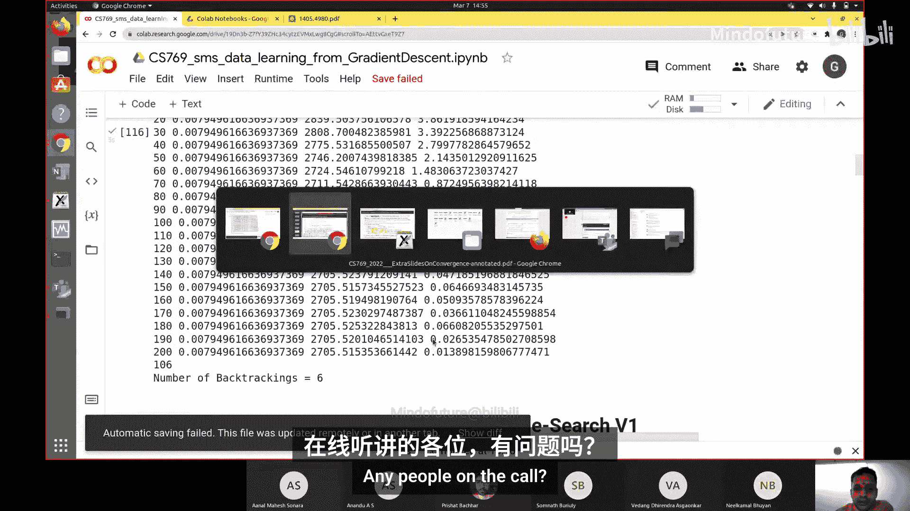

W is't it？

So this is interesting look at a backtracking here at media， as I said。

 we are counting backtrackings， Backtracking is because。😊，You might not overshot out。Yeah。So yeah。

 this is to convince you that accelerated duringdecent as well， but I have a couple more know。😊。

Use cases here。 when you look at this。L Sir gson。So gradient descendcent with army or backrack line such version one。

 so I have kind of also written later what these do。So。

Simple master strategy started a large value of。This is the simplest okay。

 divideivide alpha by half if it doesn't satisfy the sufficient decrease。

 sufficient decreases F w1 is alpha G G is a gradient。W is the current parameters。

Should be so this is sufficient decrease， which is this should be less than equal to Fw minus gamma alpha norm g squared。

 You can see title inspired by strong complex should there should be that gama D squared gap。

Rather inspired by the sufficient degrees， the nation may get lips smoothness。

So you keep decreasing number， that's the simplest line of strategy。Okay， this is version 1。

 Let's see what happens。 So you can see version 1。I mean。

 it's looking it's better than gradient in decent right you can gradient in decent after two of the iterations。

 the condition value was pretty high。I mean， a group of teams done well。

 it's not but as far as accelerated， which is okay。Very simple。不是ok。But let's look at version2。

The issue is that alpha make become very because you have initialized alpha once in the beginning and then keep on dividing my heart。

I mean， then alpha just can become zero， very close to zero because numerical position errors。

Actually gamma is there in a gamma is there in previous。

 so same condition is used there so gamma is some kind of scale factor。

 if you remember I had shown this lot here right。

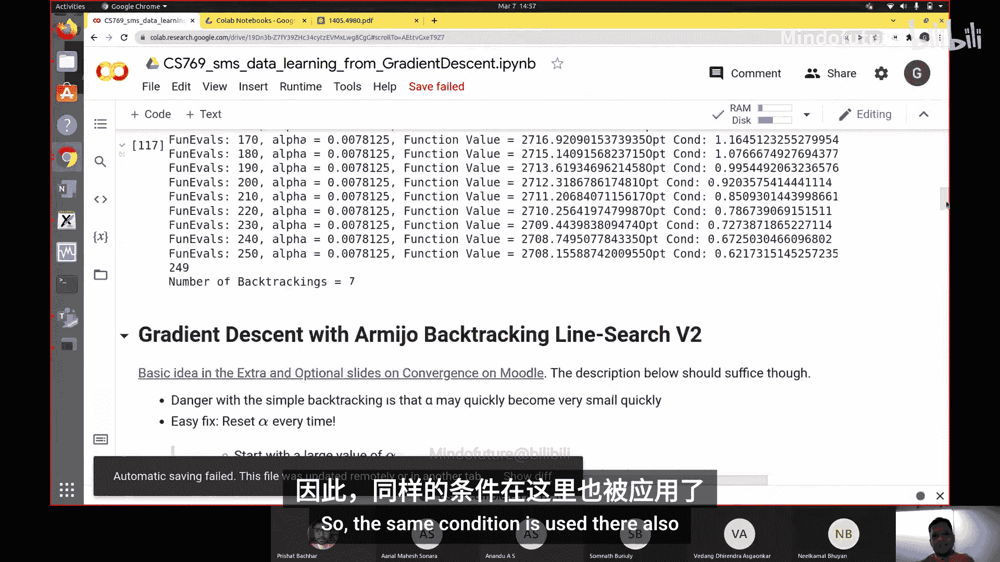

So there's this beta here so I mean I've use beta here gamma and the code。

 so you have to be a little robust on notation the different notations are used in my different slides。

It's very difficult to skip to one notation。 I tell you this is impossible。

 So you should just become robust， become in terms of notation。This is比ta is什么。Ga， the teas are our。

Okay， so now what you're doing。Instead of。Just setting， keeping on during alpha。

The first line search strategy， second line strategy can say I will。你 said啊。After step。

 I find you know a sufficient degree and at least makes less sense， right。依家个次唔识拉准。

So there's reason offered to the same last one。Now， you have a good problem。 Now you。

 you have identified money issue， because。All the advantage I got from my search in the previous petition is all lost。

So I have lot more backting here see this way in this code and we are counting backting steps as well。

OkayWhat we print here is。functionunctionction value， alpha and then the end back。Okay。

 so now in with 34 34 function evaluations， it's done well。 iss gone。

 It didn't quite right It did not even you know， it existed。But it has a lot of backtracks。

23 backpacks。If you look at the previous one， I think the backtrackings had 200s， seven， only seven。

这个。The previous one， the version one kept backracking。

And use will set back in information in the next。It this guy is going to start from scratch。

 so it's going to backtrack a lot more。Those surprise place。I this here。So now this is our version2。

Yeah， I mean， this is best done through You should run。 My is running is。あすくい。です。

Which one this might go worth yeah。Yeah， but then you' design your objective function with regular。

A I。There are always pros and cons。But at least given the objective function is doing a fair job。

Okay， so now let's look at version 3， which says， okay， why should I。If this is exactly the idea。

 why should I backtrack so much？That's where interpolation comes。

I don't want to start from the same large alpha every time， I don't want alpha to keep on shrinking。

 Ill interpo the alpha。Okay， that's where you saw that magic coming even in。The accelerated grades。

Please ask questions that today I really't want this to interact。Lets be completely grounded。嗯。

最一要这样的。Some polynomial interpretation， how why this exact form being not be replicate？

What God we're doing is basically looking at the current function evaluation with respect to。Again。

 function evaluation before starting the back。 before you did any backing， what was if。

 What is current， So I might of you doing some oil inter pollution。Get mail。Anyim passing to FW。

 the derivative of W and Fw minus Alpha G。是说给。By this FW dash W I is basically think of it as a function of alpha。

O。With version  three， you would certainly expect。Number of back， no what has happened。

You should have a help improved rate。But what has happened back sentence is English 137。嗯现在略C知道这还有。

买啲呢个。Okay， so， so idea is that initializing alpha equals one school large and bracket。

 So what do you initialize Al Al is also important。Okay。

 so mean interpolation as broad has exposed potential issue with what alpha initialize。

We interpolation be as good as what you're interpoating， right？😊。

So this version4 it seems to be a good idea and just some you know。Use a heuristic。

 It basically uses alpha as one uponology the big。Think of this as you there one upon the lipstitz continuity factor being。

But you don't have access to B。所要已经问得呃。So you're basically now looking kind of clickping on。

Win of one common to。 So again， a lot of it is tried empirically and based on empirical knowledge。

And that's why I'm not running slides for this。 just best to try again。Okay4。

 I would say a fixed version of version。Yes， this is very。

Backracking is reduced number of evaluations is reduced 17， thats。Again。

 if you compare this again it accelerated， you'll find mill accelerated， what is it doing？😊。

This seems to be good enough。I mean， it's not a synthetic data set。

 it's actually spa data text data set， it's not totally equipped up。So acceleratedator has value。

 I'm not saying it doesn't have value， but。The story is accelerated as the additional direction evaluation。

 which might be helpful in many。I do say many。就 can think。Settings， so stochastic settings will。

 again previously。Aolly。Yeah。Okay， so just let quickly look at these different lines of techniques。

 he then accelerated。I don't want to embarss accelerated here。

 So I accelerated my book worse than before。😊，But it certainly is better than the others。

 but is better than anyone。你 so。But using V4 is pretty good with just this one is it visible？

This one before， this has dropped very quickly。哦。we think it was a slight ambitionbolition。

Because of， you know， it's just alpha equals 1， what is the interpolated value was important。

 So B3 was end of a precursor to V4 so we can ignore B3 the V V2。

 which is green was certainly an improvement over V1。Which is an orange。

The fixed alpha was slightly better than orange in some cases， because it's not really backtracking。

See， back riding also take some time。你做。Number of iterations， you kind of， you know。

You find out though。Yeah yeah， the the before really justね。

And what we have done in the next plot is so okay。 the behavior initially is fine。

 but what what about subsequent behavior， So 50 iteration 50 onwards。

 we have looked at the plot here。And。Yeah， we B has done a great job already。你夫就攞唔咗。Yeah。

 before is out of this。It's already it's already done basically。Yeah， so it's hard difficult。

But you can see if you do。We eventually even he is doing that。It reason。所真嚟嘅。So not， basically。

not important。you use that， then you will find okay， just five。就那部。Any questions？

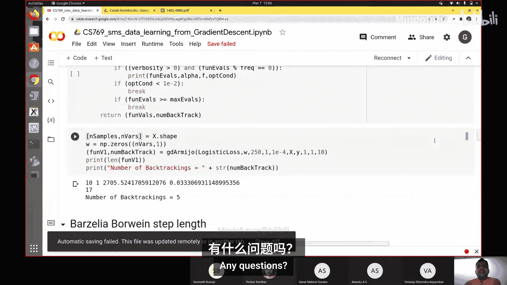

对白け。So I'd like you to summarize your learnings， maybe I cantypo as just speak。Whatever you live in。

Anyone on the guard you。Yes。😊，Learning summary， whatever I what do you understand from this。D或ence。

Because。Initialization of alpha matters。I would say not only are condition before。

 but even absolutely gradient decent does that way。

Because it's combining the direction with the step size。Okay， any other loading？Yes， please。

Anyone on the hall， I don't know if you're speaking this。今清。啊，So。TheReutizing alpha metals。Actually。

 in the Al mean。Just that know。你识边文噶。嗯。Lesing alpha gave better results because。

But it gave better results in one sense。You increase number of backting。

But you get better results because the alphas are not just if across iterations or youre just making alpha0。

 then the steps are trivial right there's hardly any step。Thank you're thinking。系 so。

And it becomes too small and。The steps will become。Meing。喂。Indience。你家度到啲。该系要咩。重要。

What value one resets。The these alpha step science。My girls。啊，哎。Especially。

When one is doing linear interpo all interpo。Great， good， this is very nice。Any last point， anything。

 any good thing good to say about accelerated regular design。

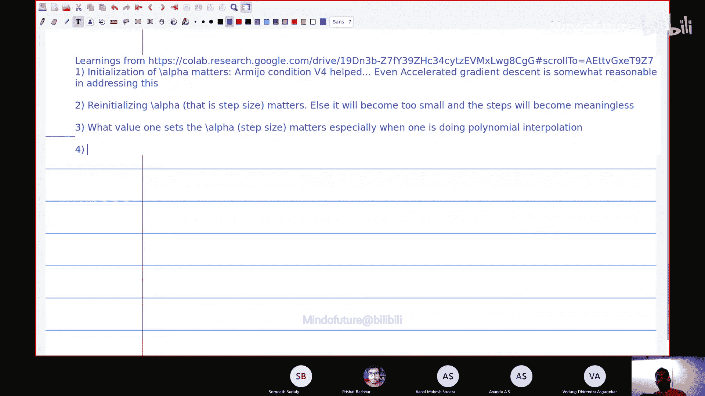

Any youone the what。Anything you like about acceleratedccator the？你。我先啊。

So when you're controlling the both direction and step size。

 there seems to be something more principle about the way you're controlling those to it。

We need do better conversionence。So reducing that gap。都。喺你。お会さ。

Why did the line such condition for converse muscle accelerated。

 Because I think accelerated also you can use a condition pool I didn't use。You can， can。

As I said okay， question coming from the class is， can we use the R conditionss in accelerated ideas。

 In fact， as I said， let me go back。 Very good for a question youve asked。

I think I have mentioned this。吓死你。Our accelerated gradient December was inspired by our implementation。

Whats the version do。I've said there。咁。Has the Netro accelerated gradient decent implementation below has also important argument B to。

那衣服。Including put in corporate people。 So again， as I said。

I think the V tool gels very well or aligns very well with the default version of accelerated register of reading the site for which the proof is。

😊，I mean， it's not having rules for all ourselves。 You can have all communication combinations so you could。

 in fact， you could do that。怎么不会。那。把0这个。What about gamma and new right new is， as I said。

 new is coming here exclusive to。A。New is that that Dk has associated velocity。

 right that you don't have that doesn't exist even。L色。喂。So you can do it really about that。

That's exactly what doing。So seems to be a principled approach to determine。The election。这 velocity。

As when as。The step signs。炒佢。离滚。Improve our implementation。Of this growth accelerated。命で same。

 and the improved instance improve beyond。The家。A your condition before。O所月度。With the kind of default。

呼是。唔是。衣服。But again， I want to make a note here。That this is。Can be。放假啊。8会点。Right beauty for beauty。

The updates。Alexcus me。Excusly。For accelerated the， I mean， you can't。

 You don't have an equivalent of。Beauty for license。this gear。Any other point already get done。

Unless someone has us more to add， we'll probably move on。

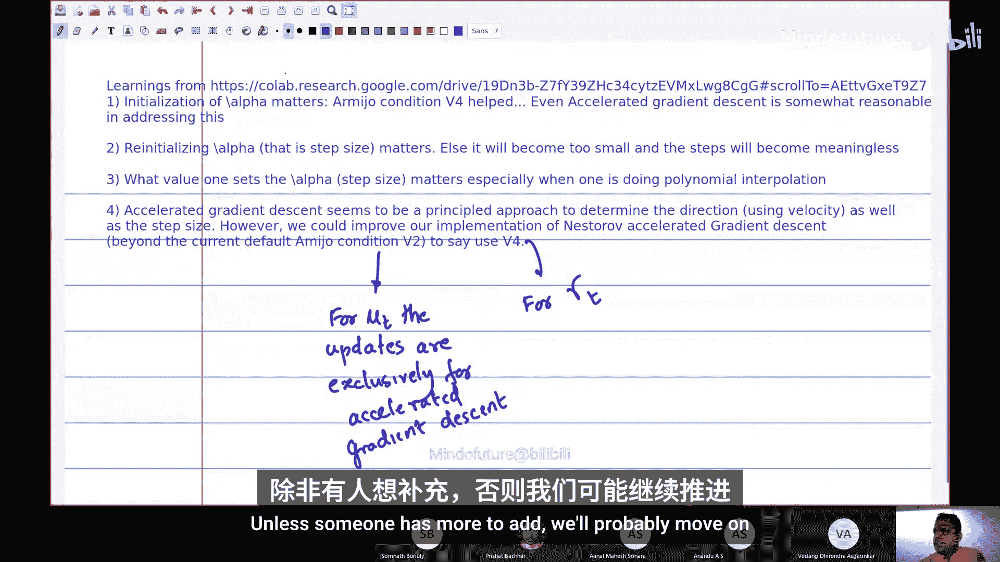

你好得光。

Okay。So somebody results too far as far as， this is a concern。嗯。我发了。square and as I said。

 matching the lower one。欧omega。你有话个。对以我们的。And it's must mood functions without con， a strong con。

Of course， if you have smoother strong understanding than you probably and that's that's my one reason my accelerated might have not made a big difference for the logistic equation plus the globalizer。

They is award booth。Staw smooth and strong。So this could be reason why our new V4。啊 from this。

而即四六年今晚俾都俾得。Better嘅。Step sites， you' need acceleration。Because you already have schools and strong。

So it didn't necessarily benefit so much from me。All the hardware paid for smooth functions that are stronger。

게임 말디 이으로 했。Okay， now let's look at。The next chapter， the next part。

What if you can't complete gradient at all？哎，对的。So you know that the subient descend to our rescue。

It's like gradient design but you're replacing。嗯。The gradient is the subgra。

 but when we say replacing gradient with sub gradient， there's so many sub gradients possible。

So therefore， we have a notion of any subment。So you just take any subgra， remember right。

 we even as simple as N2 laws where we discuss the style algorithm them。Something like this。

 you have an entire home。So you can pick any of these at this point of nondiability。

So because now you have any subgraient， you can possiblyly consider multiple sub gradientient you can try descending along one would say let me explore。

 let me let me try this direction， let me try this as sub gradientient。That this might be。I mean。

 even at a particular retreat， right？This could be。At T minus-1。换了。But there could be another one。

 which could be。This in loop。 and you may want to call it H。20 minus。 So you can have multiple。

Possible directions。What the sub。I mean， all logical regulation， it doesn't matter but forh laws。

Amids some problem， huge loss， This't matter。So therefore， a lot of the analysis will can find。

Is not disrespectful。Any， but with best。In fact， there's just one cave you。

Calling it disent itself is a little misnomer。 Will it dis at all， I don't know。

Radiate desent well there's some assurance， but it part say is thesent is guaranteed a gradient de Also。

 if you don't use the right step size， you not dissent at all。

But things are a lot more ifffy with subing this and even even more if then we start looking at stochastic efforts。

It should be the next thing。So now we are going into Merrcurre territories。So。This is。至于我觉得。

Greatly decent。But less muier。Then aastic grade。啊。So then that's the rational behind having this F best we not take one。

 but we take the best then。Exteest。And well basically keep track of。The best XT among X T1， x1 to XT。

So the then each there two basically cool this。比如说。Fix step size。Or diminishing step size。

 fixed step size for all values， like our nine grade and brighter dose doesn't work well at all。

All diminishing step size is what you typically encourage。 Where you saying of the the ga is go to 0。

 but the ga is also should go to 0。In some particular way， it's possible that gama is go to zero。

 but yet the sum is infinite。That possible。But then you'll see that you know。

 there are other conditions。做able。Let's say t equals 13 p。d squared。

Is it a good idea that this becomes finite？Does that help， so these are questions we have。哦。对。Okay。

 so the two things we like to take here， again I'm going to highlight here。

The first care you have to take here is this， this one in pink。The addition。嘅顾云。

And the second care you have to take is the one in orange here。

Is what the step size should be starting mattering even more。

 I mean today class was to kind of eye open around how important the step size is already for marginal relations。

But youll see that even more more pronouncedun。With these workier approaches。So is additional。嘅。关。

Whi's the best one， not a functional wise。I mean， you you you have all these。 It's a good question。

 So if I have a。Lets say this is a non differentiable function。我装这份叫嚟对对。是。

So let's say the function was like this。It decreased and then increased。

Basically it increase in a sense from here， let's put it as point right this point。 from this point。

 I went to this point。And then I went to this point。It's not convicts， but even the convicx case。

 it can help。So this is one。 This is two。Let's say this is three， I'm oscillating a bit more four。

 I'll give you the best of these。And那边。哦。我发 again过上我上意思。真是废。

So the best in this case is going to be this guy。F or another。X right X5 list。To5 equation。

 the x P v is what。X线。你这这。最鬼啲。た拜。S numberD being呃。为佢得上。Why should the sum infinite。

 so basically we are saying that we don't want to put too much restriction on how fast they diminish。

你去部but。So let an example， right， So what about let's take an example Lama。Let me just complete this。

 I think I should move this text3 a little down so that looks nearly below。

let's look at your question， The question was， why do we need？

Or why do we need to cater to the sum of Gama TV infinity， Let's take the example of。

Gmat T is 1 of upon0。As against gamma T is what upon square root T。

 what do you observe with each of these？觉得。Both the subsequent community。好。What's what动。

is it a max step size？我。I mean， it doesn't look like a bad step。It's diminishing， in fact。

 in some just backing upon some of our previous experiences。

 I think we've seen some versions of these。Okay， so these are commonplace and that's why we're saying let's not be impractical。

What is。Proational。你呢个。It was good for， right？Yes， so one what you see。

 So what happens that that's the that's bringing to the next question， What if you make it finite。

Does it help， So I don't want to jump to the conclusion next。Let's investigate a the。

 but good questions。Okay， so here the analysis。哦。So if you have F being lips scruous with constant L。

So they kindt double smoothness I。Because they are now looking at sub gradient。

 so sub gradient would mean。Smoothness。strong con， strong con。都六。I mean， at least everywhere。

 you can say at some places， they may be。经常都要跟努努力。So therefore we know putting up it the just。跟进。

方宣 here。And if you assume that your points are within some radius R。

 that's again something we've been doing since a very long time。我定要。So， this is。Ext。系ex like。

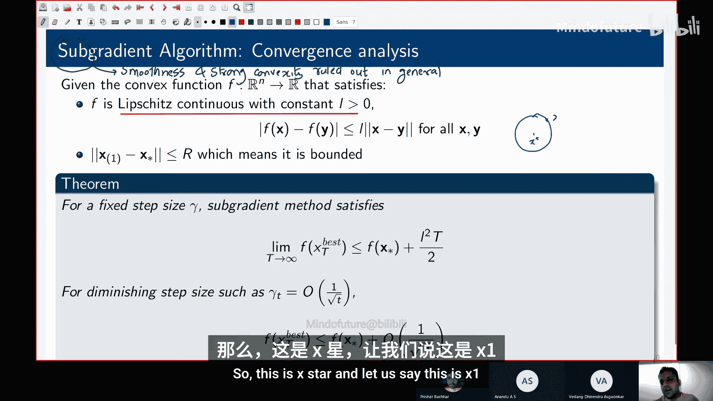

你面是出面的。嗯。So， under this。The fix if you have fixed steps， option one。The exist best。If it's best。

As the social infinity is less than equal effect star plus elsewhere he。Not very happy。

 right to see this。 I mean， else just like。I see increases when the gap is not anywhere diminishing。

 right。So basically you're saying that， okay， it's less than equal to f of x star。

 but then else equal by two。都是一。Yeah呀。So， but if therefore demoing step size is important。

 but if you have diminishing step size， let's say order1 upon square root P。Which I I mean。

 which has its summation going to infinity？Then university have this。

It cheapest is the where start was ordered one by expert terms。So we can we will really do the proof。

 I'll be press， I'll be you know posting the proof。即系东方嘅。The finite where goes to include。

 So itll be anywhere less than。Now this is actually somewhat helpful，I。怕。你个水。Well。

 all you're saying is its not， it's not terrible。Yeah， there's there's not much happening here。

 this is our only interesting case。你就说。One about square root， not not something to be excited about。

 but this is what's stochastic sorry this is what somebodyian does。

I'm going to leave this as book work。 please， I mean。

 I don't want to spend again time doing groups in class。 Please do have a look at it。

And it's a simple inequality with telescopic summing what happens。Okay。

 so you'll find this expression， gamma Square elsewhere。

 So that must be open up the doors of something called the gamma square。So。

So if you this is the part we want to draw our attention to， so I will spent some time on this part。

 but please do go to the proof so that we quickly converge on the take home from you。So， yeah。

This is a convergence analysis， which I will add of So until this point I would like you do this read up。

And basically， you see sub gradient method convergence in mega or prosperity。

And then we want to stochastic。 So this is is an important homework for。Any questions？Soing。

Slide number。可定嘅。

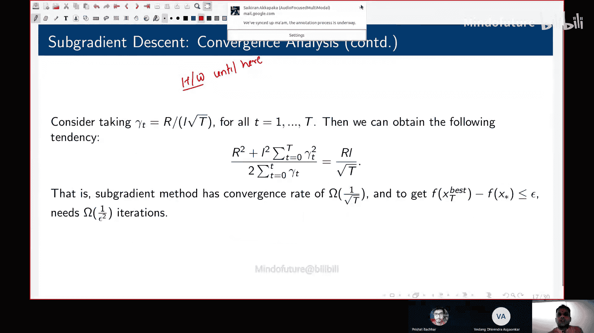

I'll be posting it。Any questions？

One minute bus。So is this help the base is okay， the case of the class。

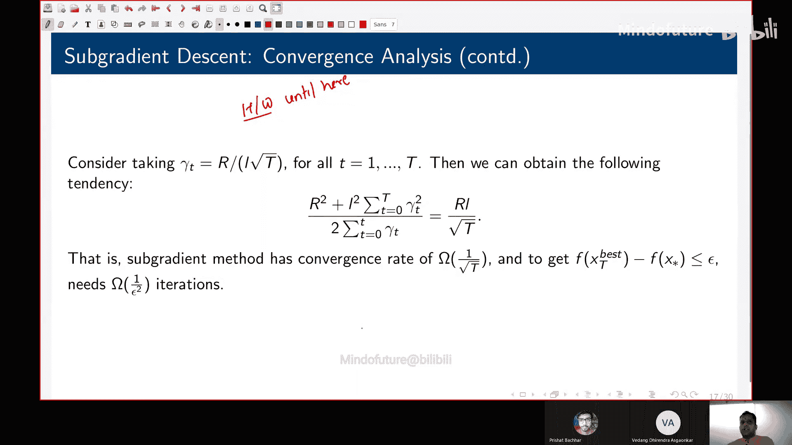

看一下明的。

Thanks for joining。