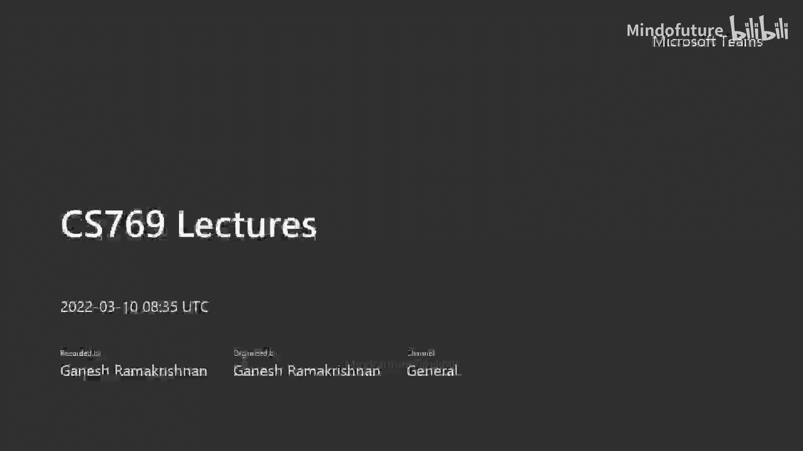
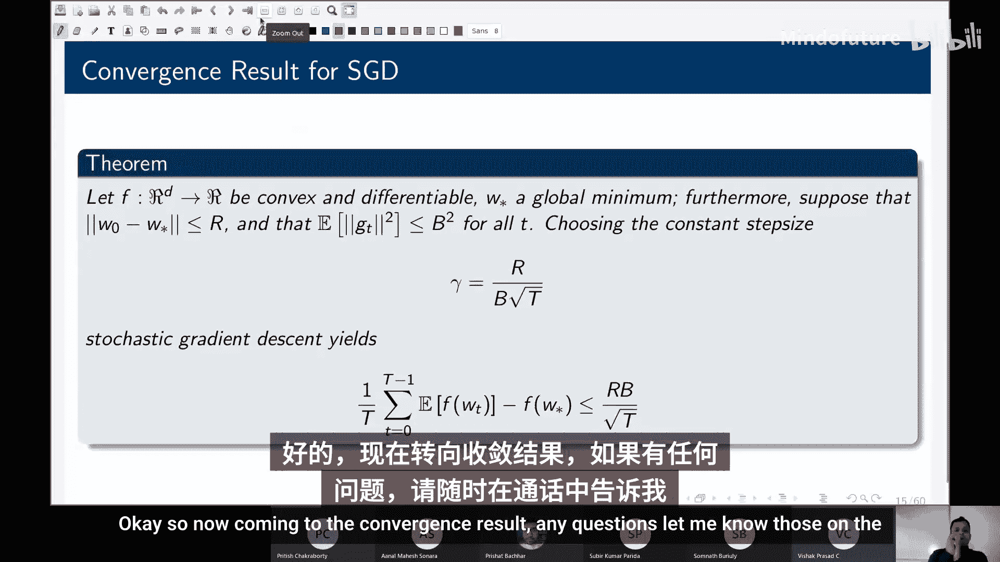
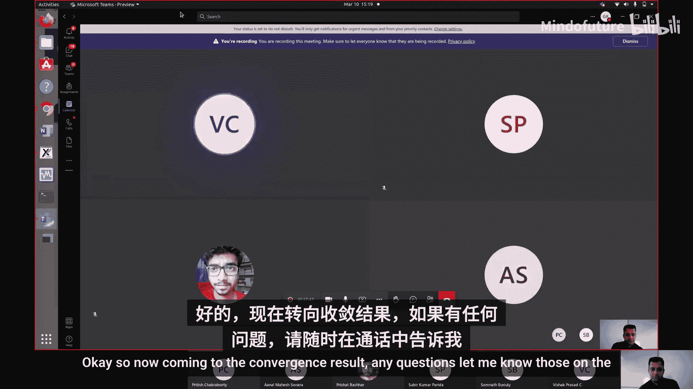
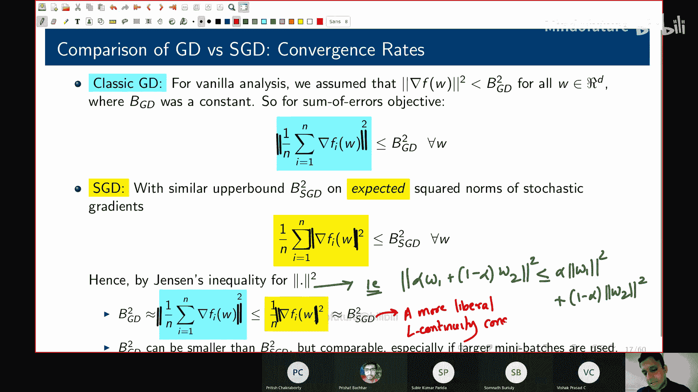
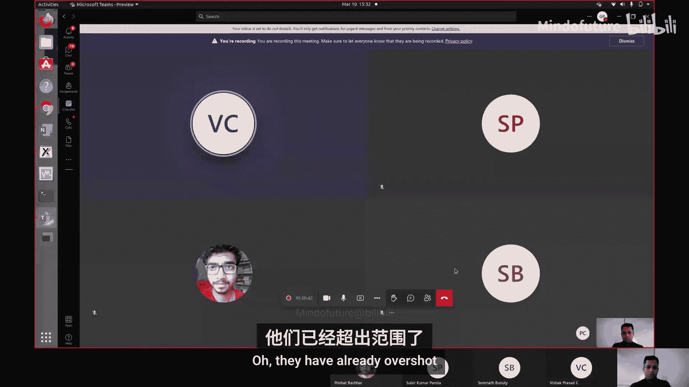
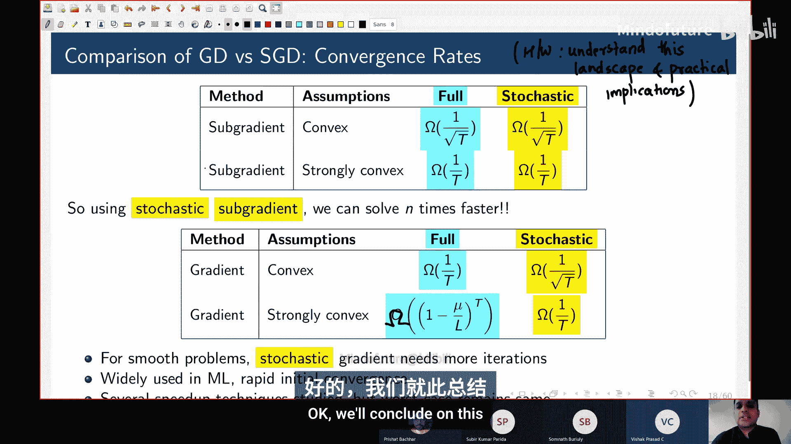
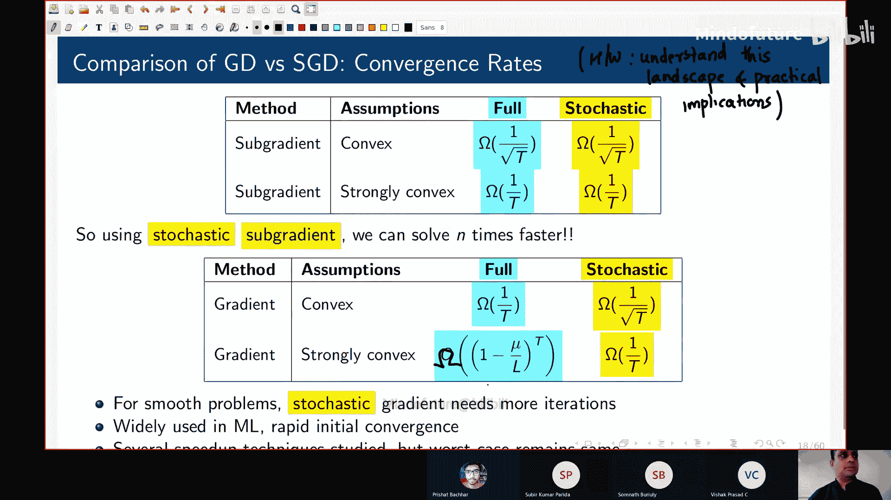

# 【印度理工学】机器学习优化 ｜ Cs 769 Optimization In Machine Learning p20 P20_第十七讲_11-3_优化与机器学习_次梯度随机算法_机器学习损失函数的数据（子集）选择 -BV18cBSBJEH1_p20-

其实我今都。Let'ser 17。H。Yeah， so we had left。Aels with the homework problem。

 which was to study the subient decent conversionence。 I put the post， as I said。

 I'm not going to spend the time in the class， but it be useful to。Understand salient elements。Right。

We saw our journey from oneon Epsilon Square。To know log of one upon Epel。

And then we tried two course correction， one upon rude epsilon for。U。For the case of acceleration。

 we were able to get when we have smooth functions in just conxity。So this was an achievement for us。

But。We are in for a bit of an anti climax here。When we do some gradient in descent as a generalization of gradient descent。

嗯。So for diminishing step size， So this was a kind of something I gave you for reading to claim that。

If you look at the best iterate， okay by the way， we used best iterate。

Because we are no longer assured that it's a decent algorithm。Okay， so Miss Mayor。

 let me put more there。So best， because。We are no longer。Carante desent。

So look at the best iterate so far from the key updates you've done so far and。

You can have these step sizes either fixed or diminishing。The fixed size is not very interesting。

 as we all agreed upon。Dminishing was somewhat， I mean， never seen there seems to be some。

Convergence， which is Fxt best is less than equal if of x star。Plus， there's an additive part。

 which is。It is diminishing， it square routine。Okay， so this is the proof procedure。嗯。

Just invoke the definition of sub gradient method her。What is the sub gradientient？That which。

Lower bones。In a tight manner。Or creates a supporting hyperplane。In other words。To the epigraph。Okay。

 so does。Supporting hyperlink。To the epi。Okay， I showed this to be differentiable， but， you know。

 you can have it nondeiable as well。And this is fine。 And then we said， we add this inequality。

Across all epochs 0 to。We will not overdo this battle of T， whether it's T or t plus1 not。Right。

 so Z says 0 to TV do that。 You have you'll have x of t plus 1 minus X star square is less than equal H T minus x star squared。

And this component here。Like adding across all。And。Now what's happened， what has got canceled done？

Has anything got canceled out here？Soy。Yeah， the terms， which terms to cancel out。

D termomic D plus 16ter。Sorry it should not be。Mus。This should not be minus。为什么。

But this is your sinkch plus。Okay。Does that disturb things。边有。嗯。So， so wait a second， so。

Because if I fix out as a。They just minus。Just。about experience。嗯，因为他也说。Oh sorry， yeah。

 this is 60 minutes external okay。So we are fine， I think this was a small correction。🤧And。

so when you。Use this inequality， then you'll you'll basically get all termss cancelling out except for t plus one remaining on the left hand side。

 T on the right hand side。嗯。So what is。As usual， we can make an assumption that。你。

First its within a ball of radius are。X1 x0 water later， so。Automatictics stone。

I something like that。Okay， and the other thing we notice， yeah， so that R square we use anyways。

But the other thing we notice that the left hand side is also greater than equals 0。

The other thing we can make use of if you want Gi sheets。

Continuity to be in work is with respect to S T square， Nor Nor S T square。

Lipstick continue not smoothness， right。So that is also possible less than equal to L squared。Well。

 it's less than equal to gamar T squares。Yeah the specifically is less than equal to。Okay。

 so with that。Okay， so with that。We get this expression L squared。R squared。

So we all seem to be said。Com。ThisThis part in yellow is now bringing to four the reason why we have any condition on gamahi at all。

Right。So what would we like on Gamay， I think let we should discuss that here。Right。

What conditionss do you like on converting？I mean， would you like gamati to go to zero as。

T tends to infinity， for example。See， we want to make sure that， we made this transition here。

That you know， the summation over gama T F X T minus x star is less than equal to R square plus additional term。

 Now， we will translate that to F best。 So that that also will hold。

Because this is anyway less than equal to。Okay， so。What would be like the gama is to behave like。

Retors。I mean， what happens now if gama tea is constant？That's what we showed earlier。

 It may not be most satisfactory， but what happens。Yeah， I guess， you know， this is。

You'll have basically some of the gammas here and then gamma square here。so you'll have f of x。

The best。Mineus a little fixed star。It less than equal to ask square by。5D港吗？Plus。D。

So sorryly the T will at， right？Plus， gamma S squared， something like this。Thankss for。啊。然。

Why would we have a gamma Well， you'll have this， this also summed up tea times。

And there's also someductative times。By two you saying two， not。Okay， so now ask where。

 now what about this term？R square plus L square gamma squared T by 2 D gamma。

So as T turnss to infinity， then it just ends to L square comema by 2。That's what we saw earlier。

But for diminishing step size， what do you get。So。Okay， what is notion of diminishing here？

So certainly， gama T goes to  zero。As you to infinity。But what more。So somehow squared。

 what would you like to happen， elsewhereswhere can obviously be taken outside。That should be。

You would like some of the elsewhere to be finite。Right， so。Sorry。安。你打个。Right。Iallyally。Okay， so。

So certainly one summation。For gamma t squared2 be finite。What more。Some why should be infinity。

So let's actually write down the expression。 Okay， good。 So yeah。

 we have to write down the expression properly。So well have to take。F of x。The best。

Mine is of a big start。So this entire thing will go to the right two summation gamma。

 so that that becomes important。R squared plus L squared summation up。Gmar quick。Okay。

 so what we want is that this denominator。I mean， we don't want it to remain finite。So， this。

Select the two parts here。One is this gamma T square is less than infinity。 That is this part。

Sation Deary School。And the other part is， we want。This summation。To go to infinity。

You can only see why those conditions are required。So what happened to this， this is finite。

 the denominator becomes in finite is goes to 0。Has statement is clear。

So what's an example of gamma t square greater to  zero？Subation numberma squared。Sorry。

Why am one these squ？want I want tea。So you're saying gamma t equals。外卖地。Anyone by。

Subliient term will also work， so what what else what are the subient terms you could think of。Okay。

 great。U。Okay， so I've taken this one example。R， so I've taken R divided by L just so that， you know。

 some of these also get canceled， but that's okay。But important to note， just the1on routine。

So then the tendency we obtain is what？That's right on the full expression。

 What's the full expression。Oh sorry， sorry。Thanks for pointing up。 This is small team。It的。

Gmatity is。How I else go team， What do you get。So if you say I want to get f of x。The best。

Minus f of x star is less than equal to Epsilon。Requires。How many patients。

T to be greater than equal to what。Yep。So we want this to be less eent。

 what's a sufficient condition？Yeah。RN L by rupee， something of that sort， right？所以。

All you need to make sure is that the right hand side divided by this summation is less than equal to。

So， let's write that。I。So you would need that this expression。He is less than equal to。Okay。

 what does it require。What is the require of this term？This should be。There's any good option。

And when is that going to happen？Yes。How do you work it also。Sorry。We can't get a close phone。

But what will be that。Dmling。Pun sorry。Can you maximize that left？With respect to capital。

So what happens， that's a good point。What what will you get then？Should we maximize。

 minimize again as a question。Okay those on the call could also suggest you。What would you do。

Could could any kind of expansion help you， We just need an idea for dominating them。Sorry。Okay。

 so you'll maximize the left hand side is what you're suggesting then。

we are saying that denominator should be as small as possible here。By the way。

 know numerator is diminishing slower than sorry faster than a numinator anyways。

 the deator in the sense that non。Fixed term Ha square， obviously， is fixed。

But this is diminish fast。The part in blue is diminishing through。Yeah。Try and work it out。This。

Comma。So you're saying that in， there was a purpose Id put this capital T， right？So you' are saying。

 okay， let's take the MRT to be the worst case Ry1 L square root。Capity。啊。Okay。

So that gives what bone。We。So what does that give you？Whath。I。Okay。

 so instead of saying maximizing by so this then it's not exactly maximizing with respect to T。

I mean， the spirit is the same， right， the spirit is that you take the。The smallest value of gamma。

He is。Aurbon ill。Square root， which is what had written earlier。All dumpling tips。N。

So suppose we have that， right it's the smallest value and what happens？We'll get。Wna born。读。E times。

sorry so you'll have to。Od。Square routine by El and deling。Ill。R square。Plus L squared。

And this will be。Simply R square by square。Which implies that。

So a whole bunch of things will get cancelled out。Any other element get cancel or no， right？Okay。

 okay， sorry this R square。And get all sorry， you will get square root t is greater than equal to。

Hell upon to Epsilon。Sorry。分。So I owe yeah this。Sorry。Now， the second term will do in， right？What。W。

Yeah， works's an addition。Oh， sorry， sorry。 I made a mistake here。 Okay， thanks， thanks， thanks。

's some。Yeah， this is a problem with trying to take shortcuts。So， this。Yeah。Okay， thanks。

 So this is S Laar plaar2ar， and then。Eleon。Eon， So this two will also get canceled out obviously。So。

 El1。Into all is as a of silent。So basically， you need T， which is greater than equal2。

L square R square by。I've said in school。Okay， so this basically amount to saying that。B omega。

One of upon obence。Okay， for all the hard work。Now， is this something we are happy about？I mean。

 we had to work really hard。To get so far。But is this something they' are happy about？Oh。嗯。

1 about7 squared。So like 0。01 then you would require。Too many iterations， actually。So。Yeah， this is。

But be God。Right， so lipsicks continuous functions we had earlier got asked by B square absence。

 but we got exactly the same。At the subient， yeah。No surprise at all。TheOnly thing is。

There we were able to do some， somewhat。 We didn't talk about step size so much。 We had to handle。

 We need more assumptions on the step size。 That's important。So I' just make that note。嗯。Subcrient。

Requires。Similar。But。With more assumptions。Oncom。Because that。Get that to somebody。

And the proof methodologyology was also different by way。We could not talk about dissent。

 so in fact there are many differences， we should write them down so that is registered。

These are more important than the actual proofs。 right。

 So this is one the second assumption is we could not use dissent at every step。We use the best it。

So subd design analysis this。Are in。Terms of this best Italy。So I'm not even。 so I just disent it's。

 you know。Sometimes you are embarrassed to say desent。 I mean。

 it's not guaranteed that you're descending。Okay， great， so these are the two steps。So now。

 I will want to。More specific， you know。Things we can do for machine learning。So certainly， you know。

 subgrading descent would never come up in a general optimization discussion。

 So that's specific why subgrading descent is specific to machine learning， somewhat specific。

You can be even more specific。Well， I must tell you that the lipsticks continuity is smooth。

 There's also a lot of the。Analylysiss developed because of machine learning。U。

So lot based on lipsshift smoothness。And continue。Can we be。Are even more specific。哦，我先咯。Okay。So。

 the thing we note。Is what machine learning， What do the。Last function。

You probably have a hint from all of this。Examples。What strikes you in all of these？

Does it strike you somewhere。The summation component。Subation， overall。Examples。

So the summation of all examples should strike you。Now， are these examples all very different？

If I give you a typical data set。Classification data set。

Would you expect every example to contribute equally？So it's say classification I have。

These are Boston and these are。RightAnd you can happily come up with the separation。

But you realize that。Some examples better more than others。租。

Which examples matter above well the positive case may be。These examples matter more。

For the negative， maybe these examples might more。So why should we sweat it out on all examples？Okay。

 in fact， I will be motivating subset selection later on when we do some model optimization very soon。

Also， from this itself。So I'll say that there's a subset that might matter more。In general。

 a subset subset of the data points might matter more。

 what that subset is an interesting thing to identify。😡，So I would like a little brainstorming here。

 what do you like that subset to be？😡，Instructive summation were all examples。

What would be that subset that would make the difference？Okay， so。So。Sorry。Okay。

 so let's write down good point。 So this youre talking what maximum magnitude is like。U。

Maybe high uncertainty associated with this as a measure of uncertainty， right？So， let's。

This reproduces on the next slide。So question。Whi your subset of data points。买买个。

I'll be actually using this slide later on again， so。I want input from all of you。1，1 suggestion was。

 perhaps。Wors。Close to the boundary。Well， I don't know what are points close to the boundary because that's a chicken and egg problem。

 right？But here is a chicken。系一个。To find the boundary。你你不乱的吗。So who gives you with the？

So you may say， oh。Current boundary。I possiblyibly gotten。Faky boundary， I mean， it's changing。

 is's evolving。Lggy walkinging。冇驴。Okay， so that's possibility， right。Orientation could change fine。

 then I my semantics boundary points will change。If it becomes like this， some other points become。

 if it becomes like this， some other points becomes so fine， I'll live with it。

What is that's one second suggestion that came up was。Fines with height。Graadient。Very interesting。

Again， I mean， all this will have the same issue。Question is， what is less flaky？

I wanted to high gradient。With the understanding that。I mean， when you say high graded， I mean。

 high graded magnitude。So with the understanding that。Gient norm。Is the uncertainty。

Why do you say that？Why do you say that。So。By。It will be very well。建康。So for those on the call。

 the suggestion is points which are very far away from the。Boundary will have high gradient。Sony。

We should not use it as a subset。Yeah， so what is the meaning of high grade， again。

 my question to you。So the function changes drastically at that point so function so there's another suggestion function changes drastically at that point。

Okay， so that is interesting。Sincely。Let me describe companies function industrialally at points。

 which right。so I。It's very kind of uncertain。 What's another suggestion。point。不定。Okay get pointss。

 which are。At the shortest。Distance from the points of the opposite class。Okay， I mean。

 each of this is interesting。So you're basically saying that the points are far away from the opposite class。

A want。I mean， they were already satisfied。Okay， so。And， hence。One be critical。D don Wayne。I mean。

 it hence is not it back。And won't be critical to determine。The mon。

And so as your let me just tell you each of these， right。Points close to the boundary。

 which you are trying to select。嗯。This is。The general idea of core sets， okay。

I'll just write on these names foret。Since I said， it will be moving to subject selection。

 So for set。Based approaches。They have this， but I'll get a look at more specifics。 So gradient norm。

 there's a lot of。 So this is。Reference， I'm just refer the second class， which you talked about。

Again， there are a lot of curriculum based approaches。

 So what they do is they have a curriculum which iterate over points and then look at gradients with high magnitude。

Of course now you mean initially you may do that， but eventually you will youll say， okay。

 these are uncertain， Let's forget them。So可。A thought， there is。呃。This， this algorithm will crust。

Yeah， hope maybe some sometime we talk about it。But what K says is that， okay， I will。For each cloud。

 I'll identify the canonical points。So I'll identify the representative points for that class。

And use only those points and basically the nonrepresent points for these class are like the noise points。

So crust is an algorithm。 So there is a reference。Ct， I think this was ICml or New。 I don't remember。

 but the 2019。Which are。Identifies noise， see。Data points in each class。Rather。

 identify as representative data points。Thank。So what it does is it gets this representative data points using something called。

 you know， cameer。Plus3。And now it can be based on gradient。So there mean variances there。呃。

Can be in feature space。 You can do it in feature space。

 You can do a clustering in feature space or in gradient space。 Since now you're already motivated。

 gradient has a lot of information。So there are a lot of algorithms which do gradient space。 in fact。

 there's an algorithm called cr。Just writing Craigs too to ICml。All the。Ass in。Theygan。And this is。

 I think， I the。2020。Computer。OhYeah， oh god， what did it do。He' something。Okay。

 so something went wrong。W doesnt。Sorry， I to type of it。No is the foot。Yeah。

 or as in Craig and Il 2020， which computes， yeah。Gradients。The computes came we。Lsters。

Ingredient space。So that remaining point， remaining points are noisy points。Okay。

 and now not only that， it。I mean。Such clustering is done in each class。

So each class you will find this。Because the training data you have the labels， you can do that。

So that's how it tries to do away the chi egg problem。

I'll know there's still a chicken and egg problem because you are still the gradient will change。

 but at least I'm using the class labels。Okay， so good。So therefore for。Grusst。Justice。

I think in Europe's 202 19， okay。Okay， so these are some points。 Is there any other thought？

how does subset up points。Would be selected that matter mode。Thanks。We can。好多。he said。This。

So draw a ball around each point and look at the neighborhood and if there are too many neighbors。

It's like gred。Then it's important。On they of the same class， you mean。Okay， I mean。

 in some sense what you're doing is taken care of here， but like good point that you made。😡，说。

So what he's saying is exactly what these would be doing。

So let's look at these right positive points are there。And that's why you're doing K Roit。Alex say。

 these are negative points。You know， negative， these negative points may also have clusters。

 Mostum may have clusters。And there could be some stray positive points and some stray negative points。

Now without any regard for the boundary， which we were trying to do earlier。😡，You're saying， okay。

 I'm just looking at gradient。 and then I'll try and。Find the cluster centroid， so to speak。

The goal is to eliminate。 I mean， yeah， not exactly what you're saying。 So。

 what you're suggesting is slightly different。 You're saying you only pick some points。Here， you say。

 here they say that you'll reject these points。 These are rejected。

These are because they're outliers。 I mean， the outlineers distance in sis。

But you could go further and say， oh， I will use these cluster Androidroids in a different way2 many points around the cluster Androidroid。

I not picked that point。So there are multiple approach。 now。

 I think they are talking about the same thing using it differently right。So manifold。

 you're looking at the manifold。 So so in fact， crust has this very interest sorry for interrupting you。

 but you know crust what it does。It says， let me just give you an idea。

 So grass looks at the Jacobian。 No， you know， Jacobian， basically the。Graads all stacked together。

Thiss what Christ does。So what is Jacobb and J？It's all the gradients stacked together。F4 x1。

F of X 2。Okay， I might be wrong the reference， but Ill。Would it correctly approach。So this this。

 it says that's the original intent， though eventually they just do clustering。😡。

But the original intent in class is that you take this Jeopbm and decompose it into a noise space and information space。

So noise and information is in the gradient space， basically as you can see。So， cast。

So I'll just write down what。Goodness。Trust in。To be composed。The Jacobian。

Into so you basically think of eigen vector deposition， right。

 So find the principal eigenvalues that will correspond to the noise space。

So it's a linear transformation of the set of gradients。

 So you are going beyond a single gradient So far we are saying， okay。

 find the highest magnitude individual gradients。But you are having a macro view。不如。Eigen Victorctor。

呢个 position。We get out my。Okay， so it intend intend to do that。 But yeah。

 it eventually lands up just doing this clustering。Look。Are there any other thoughts？

We can do kernel computation， non nonlinear kernel computation and then。In thecon space again。Okay。

 well be doing， okay， that's interesting。 we give you some kernel function to find similarity even in the gradient space。

 you can find similarity of points。 we can do polymial kernels in the gradient space。😊，In fact。

 I'll be talking about our library called submod live。

 I mean you've probably seen submod live has those right so we allow for。Computing gradients。

 and then kernelds on those。And you know， even with those， we can have different， you know。

 we can have graph cut， which has a different notion of representation。And then there's BppP。

 which does diversity， so。That's good point。 So， let me。Add that， as well。So。Such。Clluing。

Subsjectex selection。Also， being computed。Will you on。Ernal。Functions。As you see， some modeling。

Which I'll be talking about is very soon。Okay， great。

 I think this was very useful discussion I'll revisit this slide。

But now we're going to start with something very simple。 what the simplest， all this is very nice。

But what's the simplest you could do。I mean， this is this is all quite sophisticated， right。

 it's saying， okay。I'm going to。Take gradients。 Look at the noise。 Look at the information。

 do clustering a lot of work right。 work is there。 I'm not saying that's not worth it。 It's worth it。

 In fact， I'll talk about you know， hervo on match and you know。啊。We have， you know。

 blister approaches。 That much is actually totally based out of gradient computation。

so there's a lot of value。 Let me give you an idea what thema does like， So what is it。U。Yeah。

 actually， we have this Gr match as well。There we say。So， that's。We take the example of gra match。

We say I want a subset。Man over the subset of the data points x。Let's say training data points。

Such that。The sum， I mean， there's also min over W， okay。

 so I'll look at the weights also you can also weight some gradients。Weais wait on them。

Ls on the excite component。So that this weighted some ingredients。Best approximate。

The full drain gradient。Call it L。So here you say I want to subset of points and the weights of the gradient such that this weighted sum。

Is best approximating the entire day trading gradient。

 So this is all nice and there are know we'll talk about how we can do this efficiently。

But on the face of it， all this looks very computationally intensive。 you had to do some more work。😡。

Unless you， we learn good tricks of some modelular maximization and so on。

So what would be a poorman start？In this。Okay。Yeah。

 but all of this will require gradient computation overall。Can I suggest that， you know， we could。

Hello。Yeah， somebody was saying something Yeah， sir for a start。

 we can just select the random data points Okay， there' is a suggestion for a start。

 why just not select a random subset。Right，I mean。Why will a random subset work？I mean， the。

 the basis of why your random subset work is pretty much what we have been discussing。

What is the logic behind a random subset working？Anyone。你今デた会すね。Yes。

 so we have we have data points and all the our approaches are trying to look at redundancy。

 So if there's so much redundancy， why not just speak a random subset of points。And I'm telling you。

 random is not a difficult baseline to beat。Okay， so it might look， know。

 especially if you do random， if the random subset is random every epoch。

 it's quite difficult we call it random online， it's a hard baseline。😡，To beat。

So you had to work hard to beat it basically。😡，So thanks， yeah。So， let's。

So a simple and strong start。Since about approaches。Leverage， data redundancy。Why not pick。A random。

Subsject。Of course。That， that's a。Let's see strong start， sometimes hard base like to wheat as well。

Okay， so there's a suggestion that if the number of points in the boundary are not very less。

 youll anyway pick those up as part of the end。请说要。Okay， so with that in mind。

 let's look at the framework of loss functions。 So as I said there， they look at this。

Large number of components， if I as a cost function of light observation and so on。And the issue is。

 as I said， this is in computing。The full gradient。U。There's order and computation。But not only that。

 it also is redundant。So we are okay with this overhead if it was completely worth it。😡，Moreover。

 it is redundant。Okay， so I'll be using some。Slightly different indices。

Because we are moving to this stochastic space， I is index into the example and W is representing the function parameter。

 so I will not use x， I use w weights。And T is an index into the iteration。Okay， so。

Let's now move a little fast。With this understanding。The simples。

The simple scheme which we wrote in the red， right。So I just copy this partners。

So the recap is simple and strong。Yeah， so there are previous approaches。

 we are trying to take the best lesson out of those。U。

So for times t equals zero capities with step sizes now step sizes start becoming very important。

If you are looking at sub gradientient and also with stochastic， they're important。

We also saw how in the previous class， right through some collab notebook exercises。 we saw how。

Some of the accelerated versions， the momentum versions in some sense are also giving a different perspective into the choice of the step size。

 but of course they have an additional direction momentum also。嗯。So what you do is you， yeah。

 you start with some initial weight， sample I in N uniformly at random。

Okay this is the simple scheme。And then you compute the gradient vector or sub gradient vector。

And sometimes we even drop the index I called just GT because we're looking at some random point。

We don't know what that random point is， right I in random index。And then， you'll update only。

With a gradient of FX。It's a free， so。At the outset。

 this is by design and times cheaper and full gradient and designcent。Okay， but let's do some。

 I mean， get some more insight。So now there is inherently， right， because we are now doing。Look at。

 this is here randomly uniformly at random， uniformly at random。

Gives you something called unbiasedness， and I would like you to help me complete this。Right， and。

In theory， most of the times you're assuming that it is uniformly at random。

With replacement or without replacement。What do you think。hu。

With replacement now if you had to do without replacement。😡，I mean， there's a lot of bookkeeping。

伟大呢都。Keep track of all the points I picked so far。 I will look up that the heap， right。

 I will look it up and then come back and say， well， don't pick it。 Pick another point。So。

Uformly at random。Without replacement。Sorry， with replacement。Thiss defaulted。Yeah， and I mean。

 in practice， of course， we， what do you do。Would you like to do with replacement or without replacement。

So in practice， you do with replacement or without。 and question is in theory。

 is it with replacement or without？In theory is without replacement。And in practice， you do with。

With replacement okay so's I'll write down your suggestion， I'd like you to think a bit more。😡。

So with replacement is default。In practice。That's what you're suggesting。Without replacement。

Is default。Incurity。I'm marking these ask questions。

Yeah I think this these go unnoticed it typically uses users of optimization you don you don't even pay attention right so give us give some thought to it so let's do that okay we have taken you point uniformly at random。

😡，SoCan we use condenity for vanilla analysis？What inequality holds in this one this expression consistently。

 Any suggestions？Okay， this left hand side is。Left hand side。So look at this WT minus Ww star。

It's a GT， by the way， not a G star， right？F of W star。So you have to look at it the other way。

Don't get deceived， right。So what if you're looking at GT， then what would you look at F of？😡。

W star is greater than equal to FO。WT plus。Gt transpose。W star minus W T。 So we have flip things。

 So what would this be。What inequality would you have here？Okay。Okay。

 so now what happens if I do sum？If I do a summation over tea。Soor is what。Yeah。

So it should be a submission of what I。I mean， this is all this is for a single point。

If I do summation over I， text we call this aI。Of the left hand side。

And do Sam or I of the right hand side。Will this hold。This holds right in summation as well。Okay。

 so answer is yes。Now， the thing is。This may hold or may not hold depending on how the stochastic gradient degree turns out。

 why。So， the previous slide。So had we computed over the entire thing， we would have sure。

But now I've taken a point and I'm still looking at F over the entire set， right？😡。

The update is on a single point。 Okay， so so this is the complete loss。Total laws。

Whereas GI is stochastic gradient。Is that here？所。Does this hold for every point consistently？

It holds。For laws。SoFor complete loss。If Gt。We are complete gradient。Goodect。

But JT is not complete gradient。So therefore I have a question。Now， will it hold。Is this clear？

I can say that for the eighth point if I only compute the irreality at the I point。

 then it's fine right。So， F IwT。1 is F I W star。Is less than equal to GT I transpose。

assume this whole。These are some great high points， obviously who。Okay。

But if I were to just insert this GT， get this。Okay， call it Gti if you want， just to be clear。

 right， I mean， when I'm assuming that Gt is8 points of gradient。 whereas is F is the entire loss。

That's what I'm looking at。 so this。The pattern below holes。Question is where this holds。

So okay may not hold since if。I。Do the laws。But， Gt is。For。Igo。Is that clear。

So that's the challenge we have。So it may hold or may not home depending on how the stochastic gradient Gt turns out to be。

However， what is a saving grace is that。Thisequ。Holds in expectation。

Okay so in some sense that also helps like some of the analysis well do later on we'll wait on this when we do subject selection as well。

But this words because。This Gt is an unbiased estimate of FwT because we have picked the point completely at run。

 the uniformly run。It in so。Point for computing G。I speak。Then。Because so this。

The expected value of GTE。Is basically。The average value of the。

Grads some of the gradients divided bank。Why did this hold。This one。やややや。Now， actually， a media of G。

 so I sorry this。This is GTI， so right me just call this GT。So， let， let's use a different names。

 Let， let's just call it。GD板。So this holds right， GT bar transse。This holds。

So both of you hold the par red and the word pink hold。😡。

Because your GT bar is complete loss force for complete loss of GT bar a complete gradient your GTI is admittedly only for the right point and the loss here is also for the right point。

Is that clear， so if you want I can put an i index here also just an i index？Yeah。

 thanks for pointing pointing on， I just。But the GT bar is the complete gradient。Okay。

 can you proceed。So， this holds。Okay， so that may not hold。 I think let me just。 That's a good point。

 You write why， I wrote this may not hold what I meant by may not hold。嗯。Let me。Yeah。

 I understand the confusion。 I've wrote and written this side by side。

I'm just going to create one more write up。So what may not hold al separately？Like， let me。

Thanks for pointing this。 This could have been potentially very confusing。U。This part is playing。

And what I'm saying is may not hold is。This explanation takes。Fton。Now， I'm looking at the F。

 the complete F okay， so if you want to put a summation。Some reason would I。If I。WT minus。F IW star。

This。I don't know whether itll hold。If I， right， where。Now， to take this Gt as the。

Graients are sub gradient whatever for the eighth point alone。This is clear。 So this， Im not。

 this may not go。I'm applying the function on all the points。

 but the gradient is only on the eighth point this is clear yeah so thanks for bringing it out I in hurry I just wrote down many points together so this issue is because we are dealing with total loss but you are dealing with stochastic gradient in pink。

Now， everything is clear， right？Yeah in the green， we still a document stochastic gradient。

 this is still stochastic gradient， but then the function is also on that point only。😡，Yeah， so I。

 if you want， yeah， I put this in。This I just put in red。This is an abundant pink。

And the one in green are both talking about individual points。Okay lose us。Function or loss。

Is this Guetto。GT bar is complete gradient。KGT bar。

Is the gradient of F the complete loss or if you want。

The gradient of the summation or all I points FIWT。Is this Guianna。So that's where we say that。

That inequality may hold an expectation。 Okay what's the time。Here something。Okay。

 so now we coming to the convergence result。

Any questions like me those on the call as if you have questions， let me。

Okay， so now the step size will start doing magic。 Okay， so hereafter。

 conversionvergence results are not going to be easy。

And sometimes we have to do assumptions I mean it's sometimes very difficult to apply all those goals steam and you know Ario condition one two。

 three four show under those assumptions and holds it's not easy always after a point it just becomes made more of best practices though in the you know simpler cases we could prove in all conditions okay as I said my additional loads have moves under different conditions as well。

But here you'll start finding some black magic coming in。So what's the black magic here？朱先嘅啊啊。I mean。

 not sorry。 this constant， we say constant with respect to squarerupee here。

If you choose the step size。And if it' convex and differentiable with W star a global minimum。

 and W n is within radius r of W star。And now we don't talk about lipsshicks， continuity。

 but expectation。All right， our other lipses continue in expectation。So that's a small twist。

So Ill look at， in fact， when we I present gra match。

 we'll find that there many algorithms which don't require this lips is considered expectation。

 you may also sometimes。Use the full data gradient and try to approximate it。

 which in which case you deal with the normal notion of Li continuity。But in this specific result。

 we are talking about eipus continu expectation。 So it's not that all variants we'll talk about。

 We'll only hereafter subscribe to lipslipus continuity expectation。 This is one variant。Okay。

 so now what with all of this， What happens I this And this looks， very。

 very close to what we did for。Sub great in decentcent， right？In fact。

 we have one upon square root T， small， small tea。 And then we said， look。

 the smallest you can take is one upon square root， Right， So recall this choice。

So this is motivated from。Subgrade in decent。Okay， so now what does it look like It is that the in expectation。

 if I look at now， the expectation is what of。The F of WT。

 right because every WT was obtained using them。One example， uniformly at random。

 its corresponding ingredient。So the expectation of that update， a kind of stochastic update。

Base function。Mineus the actual function value。Some do is now less than equal to Rrb by square root。

😡，Again， it's like。looking for me嘢。We had this。In which case did we have this？So以。

Lipsture continuity， so lipst continuity， we had this also， so things are not changed completely。So说。

So results， similar to。Ltures continuity。For both。Gadient and sub gradientient。Descent。

 but of course， in sub gradientdian decent， there were some slight changes。

We had to keep track of the best Iterate so far。 We had some step sized specifications。

 but somehow you managed。And we simply be managing the same gene here。

Now you can also talk about strong conity again， some a lot of this analysis will not be doing。So呃。

If you have now a slightly different step size。 Okay。

 so the previous one was one upon square root T order。But no。

One upon new two upon new and two p plus one。Where we have mu as the strong convey。Pararameter。

So now the in expectation again， so the expectation of you know。The function value。

I will we'll talk about this soon。 But you know， in the function value， basically now。

Is less than equal to the differences in expectation less than equal to be squared by new p plus1。

So actually， we didn't do sub incent， But， you know， it turns out in sub in decentcent Also。

 we can get similar results。 Now， what is this， yeah， can you help。

So light on what this is doing here F of。2 divided by T E to T plus 1 T into WT。 So there's some。

So this slightly different normalization。Yes， it's a weighted average， yes。So都 send大了。Expression。

Can we view it as。What is that？And by summation into。Sation of tea。No。So。We are slightly different。

 We have a basically。An average， but weighted average。The weighted average。

So the entire thing can be viewed as a weighted average。And that graded average， by the way。

 is somewhat commensurate with。The gamat tea， right？Compensate with the fact that we are scaling by。

Oneaponti an order of oneaponee。So again， does this look familiar。Okay， by the way， B squared。

This be squ is。The max over all theities of。Expectation。So does this look familiar for strong on。

 What did we get to strong on earlier。Oh。So以。It was similar。Here we're using lipshis。Continuity。So。

This is similar。To convexity。放。Strong convexity plus lipsticks， continuity。So all this is assuring。

 as I said again， just with the additional stringent。

Constraints one are how the gas are the weighted combinations。 since's a mated sense it's converging。

Getter Robertinson。Okay， so now let's just we will we do some comparison how classical gradient and descent is comparing against。

Glaing as a result， stochastic gradient descent。So just putting them side by side。

So we had that norm， the gradient square was S equal to b square。So for sum of squares objective。

 then what's happening here， Oh there' a norm missing， right？送唔通咁嘅食。This is。

I think enormous missing everywhere。I don't know how that got Well Muslim。

No of the color has made it gone missing。No。Okay， so。Yeah。

 so now you see the parallel for upper bound， B square SGD is now shapes， right？

Which is unexpected squared norms of stochastic gradient。 Thats the only difference。

But there is also some connection。 So one is to say， okay， there's a difference。 You know。

 you just replace。嗯。There is a Jensen's inequality， which is。Basically， the convicx inequality。

 What's the Jenen's inequality for。When you say Jensen's inequality for Nom square。

 what does that mean？That is。Yeah， Al W1 plus。1 minus alpha， so you can yeah。

 you can avoid the alpha you just W1 W2。Is less than equal to。SoSo the absolute value。Okay。

 assuming alphas between 01。It didn't。Why don't squ normals？Norm is also complex。Yeah， actually。

 it holds for Nom square root。Okay， so now there is some connection between the gradient decents v square and the stochastic gradient des v square。

So you can show that the gradient decent P square， which is like the average of those。

If you take the one upon an inside。Like the。I mean， basically this。This is。Gian descent。

We square a stick1 on1 and insect。And then computing a gradient。gradient of the average loss。

Whereas this is saying。Soy。Yeah， actually， I should have written Oh， yeah。啊有有有要来。In fact。

 all of these here。Here。Thanks。Okay， so。This is a gensen zero equality。

 which says that the b square for gradient in descent。

 I would expect it to be less than equal to b square for stochastic gradient in descent。

So I'm just the beast pipe for stochastic gradientization is like a little bit more liberal。

 larger be， basically。U。The whole liberal collapses continuity。Consted。

Okay， oh we have already overshot Any questions well continue on this next time next， the next class。

 I would like you to。

Just look at this。 I'll pause this， right。Get that idea of， you know， subreient convics。

 sub gradientient， strongly convics。Graadium convicys， gradientient strongly convics。

In each of these cases， basically what's happening。Basically， oh there's an omega here。

 sorry it's not。你说那种那个。So understand this landscape， so I would say this ist homework。

Understand this landscape， but lets not let it not just be you know， the analysis part。呃。

What are the practical implications？Of of you such results。And when you say practical implications。

 now were using like deep networks， deep learning。Assuming that you're dealing with the last layer。

 you probably still have some convexity。On the last layer， but yet what does this mean？Okay。

 you'll conclude on this。

Any questions。

Yeah， thanks。On way。

