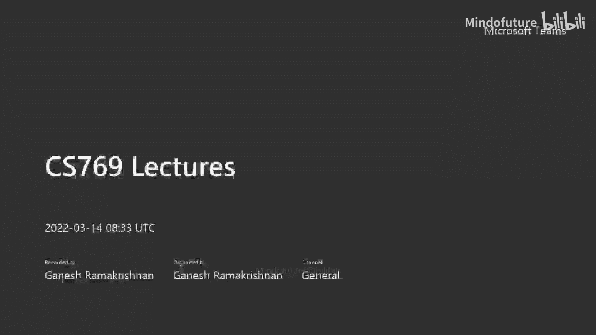
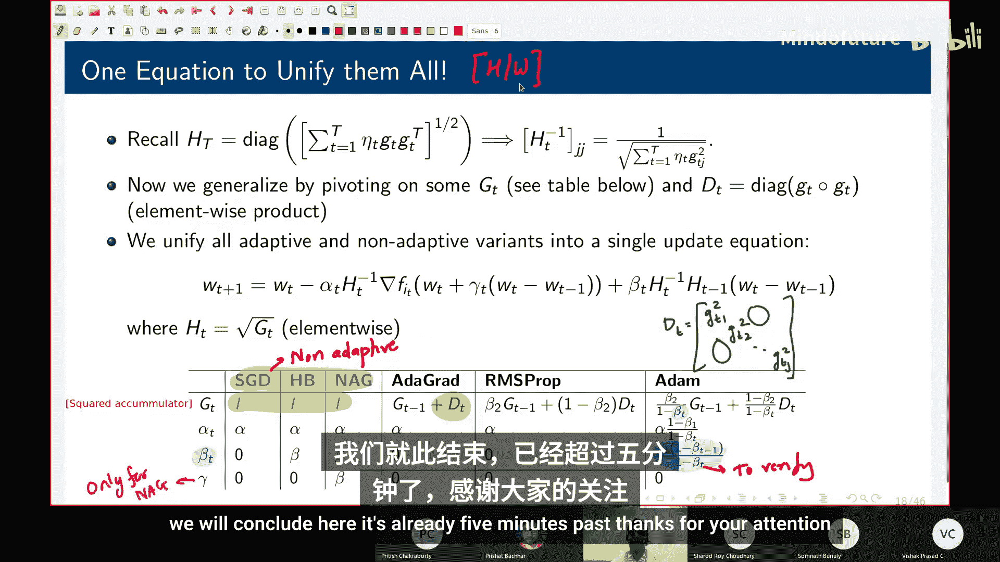

# 【印度理工学】机器学习优化 ｜ Cs 769 Optimization In Machine Learning p21 P21_第十八讲_14-3_优化与机器学习_随机算法变体重批次__方差缩减__自适应方法 -BV18cBSBJEH1_p21-

Welcome to lecture team。嗯。We had a discussion on data subject selection， the last class， but let's。

Conclude our discussion on the whole notion of sub gradientient descent。

Through stochastic gradient descent。We brought in stochasticity where we didn't want to incur the computational cost。

Of computing the sub gradientient on the entire data set。

 So as a homework I had kind of left for you to mull over。U。

Some aspects that stochastic gradient in descent brought us。

So recall that by classical gradient and descent。We were able to make use of something like lipstitzs contiity。

In stochastic gradient and descent， we' are looking at kind of lipsicks continuity in expectation。😊。

Okay， and there we had this Jenensens inequality。嗯。And。By this Jenensen's inequality。

 the ordinary lipss continuity constantus。E of a lower bound on or is upper bounded by。

The stochastic gradient in de lips constant。Yeah， and we will talk about mini batch very soon today。

😊，But if you use the notion of mini batches， then this gap can be bridged somewhat。this gap。ok。嗯。

And I left you with this homework was very you。Good look at， you know， the。Full versus to caastic。

You find that。Under normal conxity assumptions。They are very comparable。

And if you do that's with subgrad analysis and if you do strong convexity again， they are comparable。

😊，And。However， if you do strong convexity with。Great and desent。Then there is a gap。

 and it's a big gap。 right， This is called linear convergence on the left hand side you saw。For。

 you know， tenfold increase， you just need a constant number of step size。

So this is the probably the only gap that we will try and bridge now again。

 the conversion analysis is to just show that there is something amiss， something more can be done。😡。

Okay。So。What else do you get from this slide？Anything else？This is a homework problem， right。

 I give you one possible。Improvement， what else do you get from this slide？

Just because all of these are comparable。Have you got nothing out of stochastic。

Might as well go back to the non storcastic version。How did the number go。OrComp in the sense that。

No the oh， sorry， sorry， sorry。 These are not。 Yeah， This is also， yeah， I mean these。

 these are comparable。 This is not This， the still is， I would say。Not significant gap， right？Yeah。

 this is also correct。 less significant gap。你 a gap。没得啊。These are干。Okay。

 so certainly we want to bridge these two gaps。What else do you get from this slide。

We should have mentioned something more， right。Is there nothing that stochastic gradient descent is giving you？

Even the subient case。So what should I be noted additionally？😡，In the。Sttoastic is。Yes。😊，Pooritians。

Does it look like in the subgraient case。😡，Yeah， there's a gap in the gradient case。Okay。

 so there is more the gradient gap calculation is going to be much cheaper in the stochastic case so that that is the advantage you are getting in the first place right。

😊，So how much， how much is the game。So if you have any examples。Egypog is。And times faster， right。

Well， I mean， I want say epoch in iteration， not epoch， right。

Epoch typically is when you have iterd over the entire data set， so each iteration of update。😡。

And times faster。And what is that， because。Faster than。The case of fulliltration。

As an ingredient decent。So that's something we。Have gained。And thetochastic is。

But what we also pointed out is that for smooth problems。

 there seems to be a big gap that that is the part here on the。😡。

So this part is still a bother for us。For smooth problems。嗯。This gap。

 we are still concerned about it。Okay， so let's try and see how we can fix that。😊。

There is one more point I want to drive before we proceed， I mean。

 theres one one more kind of homework based observation。嗯。We， we already pointed out that。

The stochastic gradient descent will have an unbiased estimate of the gradient， right。

So what did we note？That expectation。Of the gradient。

So I'll be using some notation on the next slide， but。😊，In anticipation， I can just say that。嗯。😊。

So let's just call this， you know， tilde G tilde T evenwt。Current set of parameters。

Is the same as the？Expected value of the gradient。As per the full update。That's up。呃，你的点道。我唔 sorry你야。

我谢你。Okay， thats what do you have on the left hand side。Is he。The expectation。

 So this is just based on。Sampling any formulate random， okay that's an assumption。Okay。

 so now what do you think？The left side is sampling with replacement。Goodect。

So that's another issue I pointed out that in practice， what would you do you actually。

what would you replace？In practice。8ight。So there is a slight discrepancy between theory and practice here。

😊，嗯。😊，ok。But there is another another bigger issue here。

 so that that certainly is a discrepancy to be resolved with and without replacement。

 but what about the variance what do you think will happen to the variance。😊，Right。

So what do you think？It's the variance， let's say variance of the norm square so so。

dealing with a vector。第三啊。Some kind of metric associated with GT。Tillda。Because I leave it at this。

 right，Orant to put a norm。 That's also fine。What about this？Okay， so what I wrote earlier。

 I'll try try and bring it back。Whether you call it GT or whether you call it expectation。

 it's the same， basically it's okay to write about GT。😊，As an expectation， right？

Expectations were matching， but。What happens to the Vs？I can't write an exact expression here。But。

Right but qualitatively you expect it to be high。So what we are trying to point out is that the solution we are seeking。

For the smooth problem case。I very related to reducing the variance in some sense。

 I mean there will be more things else as well， so something Ms。Right。And reducing the variances。

 you probably have related approaches。So with that note， let's move on。

And that turns out that one small fix and maybe several follow ups to this。

Which might help us out is a notion of mini batch stochastic gradient so instead of taking single instances。

You're basically taking a batch and then taking an average。Okay， so this is the。Aji tda。

T is not just a single example， but。A batch of them。Average of the batch。

And of which you have simple extreme cases。Okay， the extreme case。Where you are dealing with， say。

It's a single which is stochastic gradient descent。Or what we saw in the previous slide。

 M because n is a full gradient descent。Okay。So。Believing that the variance was very high earlier。

Now， the variance is going to be reduced， so maybe I should just go back to the previous slide and not call it t。

Alone， maybe I'll just put it as a。嗯。So this is stochastics。Let just put in a superscript as。

Okay so superscript S。So this is G do with this batch based。😡，So。

What the statement says that the gradientest has now reduced to1 aM of that of vanilla HgD。😊，呃。

So basically what you're saying is。Expect will remain the same。But about a variance。

With this new GT D T。Given WD。Is one of one M times the variance。Of the single instance based aastic。

嗯WT呃一种。GT， T Ws， it might be a good idea for me to just put some norm here。Basically。

 I'm trying to measure。So the whole thing is in terms of norm。It's a magnitude。Yeah。

 I should put our norm here as well。So that's really important because stability is。😡。

Very vital to the performance of SGD。Okay， so。You can also do sub gradientient。

 I think that goes without saying sub gradientient can always replace gradient implementation bias。

But again， what is the implication？Of this fority bad。So earlier。

 we were just sampling I in N reading from random。So iteration， you have n times。

Cheaper than the full subient descent。This is again， for stochastic。嗯。

We have used an unbiased estimate of the sub entity each tip。

So this gave you convergence in omega1 by epsilon squared。😡，Now。

 if I imagine I were to add mini batch， so what would mini batch do？😡。

How would it modify the algorithm？Here， what are the places I'll modify the algorithm？😊，Here， so。Oh。

So what are the pros and cons？😡，Rucuction and variance that I've already mentioned as a proof。

But what is negative。You won't have the end times cheaper right so end times cheaper which stochastic will become。

I a mini bad will become。What。So let's say sampling a batch of size。Me。Okay， so fixed size B。

 then how would things change？要。stoastic。And went mini batch？N by B。Thanks。Cheeaer。

While having maybe reasonably controlled variant。😊，And it's natural， right？the variance， if。

 if you take the extreme case。Ready。M equals n。All right。Then you would basically have。

You'll recover the invari also， right， one of one n。ok。So very quickly， like in text。

 lets us understand why machine learning。😊，People prefer batchched variants。嗯。

Of stochastic gradient descent， well stochastic gradient descent is slow compared to gradient descent in convergence。

😊，That's a practical aspect。嗯。So though gradient is unbiassed， it is noisy。

 that' is what we mean by high variances。And there is not guarantee that youll have reduced objective at each iteration。

 therefore I said both the subbridient and stochastic， calling them disscent itself is a misnomer。😊。

A deent。Okay， and。The learning rate setting has now really gone for a to。The Armyo condition。

 the strong wolf conditions。we talked about army different versions and there was a motivation。

 there was some quadratic interpolation。嗯。你老总跟到。Exponential decay that we were trying to counter。

 All that goes out of the window。 So most of it， either it becomes more of a。Art nano science。

 So those are the cons。What are the pros？Besides speed up。Anyone on the call as well？

So one is certainly speed up， but then what is？Machine learning。

 So we are discussing not just optimization。 We have moved to machine learning。Right。So。Actually。

 I have brought that picture later on， but let me copy this here。S。Okay， yeah you。嗯。

I'll discuss this from a different perspective the pro1 pro would be that。You are a。

You have the capacity。To escape local minimumma。Okay，TheThe left hand case is not an issue。

 Let's discuss the right hand case， right， so。The con case is not going to help much right lets say theres the minimum here。

So。Whereas gradient decent might try and get to this local minimum， there is a local minimum here。

So Iastic gradientcent might help you jump。😡，Just because your your stochastic view is not the same as in that data view。

 that's it。 That's basically it。So it might lead to escaping local minima and therefore generalization might generalize well local minimum is also。

Aspect of overfitting。But even if you consider the low escaping of you know。Global minimum。

 sometimes that's also possible I've got a convex problem。

 it can even escape local a global minimum even then a stronger point in its favor。😡。

I would say is might help generalize。That's just because it's stochastic。

 you're taking a point completely at random。So and that random point might be an adversarial point。

 a point difficult to classify。😡，Of course， you are not really pick the point which is difficult to classify。

😊，You can get fancier there。But might help generalize thats our intusition。As of now， better。嗯。

Especially。When the point randomly picked。Are adversarian。Okay。

 so it it might be that the point is a in the sense that it's helped you escape a local minimum。

Maybe because it's just very difficult to classify。So it could be sitting out somewhere here。Okay。

 but there are a couple of other advantages is one pro， but lets。

The other more routine ones are poor pertration cost and times cheaper。Or in the case of。N by B。

 it case a batch。It's N by B。Initial conversions is very fast。 Why would you think this happens？

And I would say this is there is not de for Dml。 So some USAs very non convex therefore。

 but let me put a。This disclaimer here。你咩。Type it。So why do you think this happens？Any explanations？

Remember we talked we motivated in the last class about。Using sub selection。Finding the right subset。

 what was all that for？So you need the answer is you need or one answer suggested is you need a representation of the entire data set。

 a summary of the entire data because the data has some amount of redundancy。😊，介少有。It represent。

 right。We that to represent。Effectively label，s all。So， of course。

 we have not been most effective in just taking a point randomly。

 but if the data set super super redundant， extremely homogeneous。

 then any random point will be as good。😡，And therefore， that brings us to the next point that if you。

 I mean， so because the data set is not so super homogeneous。

 therefore in practice the representation through mini batch works well。😡。

So mini batch is a more practical representative。A map more practical approach for representation。

Okay。Yeah，Let me know if you want me to stop at any point of time。嗯。Okay， so。Basically。

 the other aspect is that。We are more interested in getting generalization。😡。

Then just get a global minimum。 right So again， Im。Bringing back this。

So you may be attending a local minima but。Are you even a global mini？

Even if youre attending this point， what you want to do is generalize well。U。

And from machine learning， we know that if what you see well on the trading set may not generalize to the。

😊，That's it。嗯。😊，So so I think really decent for the reasons I've been talking about generalizes generally much better。

😊，嗯。But however， there's a big gap between the theory of stochastic gradient and descent and you'll see you know some analysis to regret bound more of it has extra reading。

 otherwise we will be stuck on this for too long。😊，嗯。

So there' is still a large gap and if a lot of this black project is because of the learning rate。😡。

嚟到。At least we have some motivation for learning rate existential in terms of you know e lipss smooth function there we have were talking about know minimizing an upper bound。

😊，Many of those things don't work out well here。Okay， so very。

 very complex learning great tools are there。So the analysis， when you say theory。

We dont your two things。One law is high enough that the fact that analysis is largely through expected values。

The other thing will you know very。Extra optional reading， which Ill I'll probably just run through。

Is a regret bond。Its an online learning where you have access to seeing one point at bunch of points at a time。

Prorossing them for updating。Your parameters。Okay。嗯。Yeah， just further emphasizing on that point of。

Step sizes。A learning rates。So the learning rates are the most not trivial part。

 as you can see these two pictures。For convex and non convex。

 it' is not unclear what what it is going to be。😡，It learning great part。嗯。😊。

So when the learning rate is too large。The gradient de can inadvertently inadvertently increase rather than decrease the training error。

😊，So that in a complexvex case we see in the picture about， that's the reason I put this image。

So here you see that it。The learning rate is too large。But at the same time。

 it could also help you get out of a local minimum， that's also possible。😡。

So that it is relative so if is too small， training is not only slower。😡。

But it may just get stuck with a local minimum。How you training error。And I would say， more。

More generally， also local minimum。And somebody may say， okay。嗯。

W not just treat it as a hyperparameter， the learning rate itself。

The learning rate can be then the hyperparameter， that' is worth tuning。

 but if that is only possible if there is only one hyperparameter， I mean。

 if there are too many hyperparmeter， your moral architecture。😊，You have a。You know。

 regularization constant。Then again， your collea are asking for too much。😡。

And if using a fixed learning rate。😡，You should tune it over a validation set。😊。

Its just just one fixed， but its just a learning rate schedule then we have a bigger problem。😡。

So then there are also learning rate schedules， for example， linear your rate decay。Cyic， cyclic。

 So you kind of increase and the decrease。 So there are a whole bunch of。Iless El linear。He。

Cye creates。Many of those are implemented in。Pytorch， I mean， provided as options。

But if you have learning that decay， then skyric in decent somehow becomes more robust。😡。

To the initial learning rate where you begin。Okay， so this is just more of a general discussion。😡，嗯。

But I'm going to give you some more generic principles now before we look at the next set。😡。

So we want to improve the convergence rate of SD。And we saw especially strong convexity。

 right so let's slide down things that bother us。😊，And see how we can improve on those。Points。

That bother us。You can help me right obviously you know you can say subject selection we come to that maybe one or two classes。

 but what are other points that immediately bother us？😊，We try and reduce the variance。

But is that only is that is is that result for one and one cent for all？

Why did the use of a batch actually reduce variance， can that principle be reduced？😡，好。So can I say。

How can we derive principle？Are availableable。For reducing。Various， let's say to I come up with。

Accel versions so acceleration also I want to reduce a variance what is that basic idea is is is mini batch the only way of reducing variance and why does mini batchs reduce variances in the first place。

😊，Okay， so we' will try and look at this。嗯m。I have mentioned the point here as Jd has much lower complexity penetrationration。

 but it can have more much lower convergence。😊，So can we increase the convergence？Improving。

Convergence。Of his duty。What comes to your mind？Okay， learning， okay。Okay， learning rate。Schedulules。

What else。Accelation。Anything else that comes to your mind。Actually， acceleration means momentum。

Any other point from those on the call？So subset selection， yeah。So subject selection。

I won't go into that right now we will directly jump to solutions a little later。Anything else？Yeah。

 there's one point we want to specifically hammer right the gap we found between strong in strong conction。

 that was a bit too much。A linear rate to this 1 bondti is like too much too embarrassing。

The case of strong convexity。Can the gap be reduced。So。

 I must point out that the reduction in gap in the case of strong convexity is very related to reducing variance also。

 actually the two are related， so I am going to highlight them in the same color。😊，So this point。

Reducing variance principle for reducing variance is something will actually kind of you know reuse for both。

Reducing the gap is a case of strong convexity or even just convexity。

 but strong conxity was certainly a bother for us。Okay。

Anything else that comes to mind or should we move on？来做。

Can we have the same low cost penetrationration but the convergence of gradient descent and so on。

 so we are getting a little ambitious here。😊，Okay， so。I'm going to start with。

The first basic principle for reducing variance。What happened when I consider a mini batch？

And a mini batch in the asymptootic extreme case could be the entire set itself。😊，Right。

 the entire asset。嗯。So entire asset means that the randomness is reduced。😡，I mean。

 there's no random choice。😡，Miri batch has kind of reduced the randomness， you see。

The way you reduce randomness is by adding a。So if I want to。

We reduce a random associated with generating a number。Can I add a constant to reduce that number。

 randomness？Great。So well see that this is related to kind of， you know。Bringing in some constant。

Some constant factor， I won't say constant but constant factor。Iitive， I very good point。

 so additive constant factor。ok。So can I suggest that you know that constant factor could come from so lets say every time I sample an example。

 I find it gradient。😡，Should I just throw away that gradient？Over a course of time。

 let's say I've actually landed or landed up scanning every point。😡。

For every point I have access towards gradient in some previous previous epoch may not be the most recent one。

😡，Can I read those as kind of constant additive constants？ok。So let me just write that down。😔，Okay。

 so my question is。Instead of computing。And then， computing gradients。On randomly chosen points。

And then discarding them。Can such computations。We accumulated。And made to。Contribute。To some。

Some form。Of additive constant。I mean， it's constant I'm using with within codes。

 it's not really constant， it's want to change。😡，But the its radio is basically pulling back things。

I mean， I don't expect the gradient at the same point to change too much across iterations， right？😡。

So if whether I use the gradient of the point from the。

Previous iteration or 10 nutritions back probably may not make a big difference。Okay， so that's。

Is the basic idea behind。Our next approach。The hybrid。

hybridbrid kind of approach SD or stochastic average gradient 2012。

Like the first kind of jump in this space。So store the gradients for i equals 1 to n。😡，Right。

And then select uniformly at random some IT。😡，Only for this uniformly random choice， IT。

 what do you do。So if I equals I。😡，You basically sum across all of them， but only if I equals it。

 you compute the new gradient。😡，For all the others you have the stored gradient。😡，So。

 for all the others。You call it you know， Gt this unit I name。

This is the Gt minus1 i that we see later on。Okay， it's like a goh。

that cash might be out of sync with reality， but that's okay。Okay， so you may want to expand this。

 So you may say say that this， well， this is nothing but。W T plus 1 equals W T。

Minus gamma t divided by n。The gradient of IT。A grid of I。😊，What I？Mus some。Constant。Okay。

 minus plus what we call it plus constant， which is a negative value。

So this is what we were referring to as an additive constant。The previous slide， right？

This additive constant factor。Because this will not change much across the box。😡，Okay。

 so now you look at it， all that you have now to do is some storage。😊。

And even that additional stored constant， you have to just incrementally update it。😊。

For the points that are changed， I subtract and add maybe because this new point is going to change the constant for the next people。

 but very marginally。😡，There's a little bit of storage issue， but。I mean。

 depends on you do you need to store the because now when you have this constant。

 you have to subtract right， you need to know the gradients of all the。Point gradient of the。

Function at the points in the previous epo。That will require a lot of compute a lot of storage computational wise overhead is less。

So的呀。Not all the points in every iteration， they are from the previous iterations。😡，No， no。

 the gradient in some previous iteration。Nothing， nothing was updated。 Yeah。

 Otherwise the whole point is defeated。 Then you are back to full。

 if you start questions or E was is Gt。-1 I， right， this like a cache。 I this。

 is this going to be updated。At everypo no， the point is defeated。Right， like a go with。

Steale entries。For last dataset set。Very few times。That's a good point。

 So there are some engineering tricks also that get employed。 Now to be， the question was， you know。

 if youre， if you are not going to you know use all of these。

Compte all of these points very regularly。 just very old values。

Then that stillness wouldn't it hurt more than help， that's a question， right？😡。

So there are multiple takes around this and youll see you know there are lots of follow ups this is as I said。

 this is the first initial idea， the stillness can hurt。😡，So you could take a mini batch。

At every book， you could take you know once in a while， you can flush your entire cache。

 You can compute all the gradient from scratch。 So all kinds of variants exist。Right， but the。

basicsic ideas to build around this。Okay。So yeah， the storage overhead is what I talked about there is that additional。

😊，嗯。Constant。So that that incur storage overhead。And that' is acceptable in some ML settings。

 so you have to basically now compute this。😊，As do it。But now what we may do is okay。This sp AI。

 right， you instead of。So since the whole thing is like depending on x transpose Phi AI。

 lets say let's say in the case of logistic regression classify youre looking at this dot product。

And I ignoredd around that。So what should you store you， I mean。

 you have to store a little intelligently。😡，The points are not changing。The parameters are changing。

 so the AIs are not changing， access changing。Im sorry， x is basically not the point。

 it is the parameter to just notice a is a point y is the label of that point。😡。

So Ps are not changing。 So is there a way we can now do this x transpose5 more。Efficiently。Okay， so。

Yeah。E let just to the n scales corresponding to the components in x。

 but compute this more efficiently。These are engineering tricks。Okay。

What I'll do is I'll just quickly。Show you， okay， this one。So래。There's a bunch of slides。😡，嗯。喂乐。

So's a bunch of slides from Pradi Bravi Kumar。On the different variant of。

Sttochastic average gradient， That's what we saw， right SG。Which I said was a breakthrough method。啱。

But then that has been improvised upon。These are not my slides。

 so I'm just showing those slides as they are。So some of the questions you are asking right isn't it expensive to average all these gradients？

😊，Right，But you have to be a little clever。 So you have to keep a table of old。Right average。

 update that， but you still have to store some parameters to be able to update。

So there have been variance。 Some of you had a problem， right， is the。

 are we carrying too much old baggage。Right， so this， this approach tries to address。 Okay。

 so it tries to。Address the issue of。Getting a very steady。Gash。So it's called SG variance。 I mean。

 basically， you can see how variance reduction could be。Aie this is various reduction。

 I think I'll talk to SVRG sorry this one。Yeah， these are des sa。But let me go to S V R G。 Now this。

 this。Okay， this one SvRG， which came much later， this is what I was referring to。😡。

So it says okay Im going to keep that overall average being high mut tilder。

 so the nots change that I will not spend too much time the nots here w is not a parameter x is a parameter。

 right。😡，So。But what you are also trying to do is。F auto mini batch。You are able。

 You you are trying to。Compute the latest update， as well。Okay， so not for the entire， so。I mean。

 if you， if， if you going to do this every iteration for all the points you're back to old this。

 which we want to avoid。Okay， so。Yeah， I refer you to these slides， stochastic optimization method。

 it talks about these three methods， the first one which I talked about already and two improvisations。

😊，Actually they they are themselves slides erupted from Ryan tiprai So I think there's a legacy of how these slides have been built。

 So I'm just I just refer you to those slides。 Let's go back to our main。😊，Bein slide though。

This is this， as I said， this is the initiation of that entire work。😡。

So let's understand how it helps in speed up。😡，It turns out that this has an implication on speed up as well。

😡，And for strong convexity， that's exactly where we wanted to make that improvement。😡。

Now we have something interesting， so remember for gradient deit for strong convexity。😊，We had this。

 right。I wish we were trying to match up。So it turns out that。

While we had omega 1 minus mubi L hold is to T。Here are your omega 1 minus min of mu by n comma 18。

 some 18 factor comes in 18 n。😊，So just one minus something the whole race to be you still have that the implication is basically if your batch increases right so the as to decay will become basically gradient you can you can basically verify that。

😊，M is the mu remains a strongly convex case。嗯。😊，So this feed up is also observed in practice。

 which means that。😡，The hybrid stochastic gradient descent indeed is a very effective IDI practice。😊。

And with all the other engine tricks I talked about， in fact。

 all these I mentioned righttochastic variances reduce gradient SVRG。😊。

And then proximal methods we will talk about， but we won't talk about you know SVRG or stochastic dual coordinate I think even prekumar slide doesn't have many of these。

😊，You could pick some of these for your seminar if you want。😊，I think I've listed them in seminar。😊。

These are potential seminar topics。嗯。Yeah。Any questions on this？Okay。

 so this is just one illustrative slide to show how the stochastic average gradient。😊。

Has made a big difference。 The one in pink here。嗯。In compared to say comparison to save a stochastic gradient descent。

 I didn't talk about LBFgs， et cetera， which are。quasias New methods。 So basically。

 where you look at。And of surroates to your Hasian matrix。

 which can be used to account for the curvature of the。Function。ok。嗯。

So now we study some more variants of SGD which are commonly used in deep learning。

 so we are going to jump a little bit from the history 2012， 13。

 not go through the entire trajectory to what gets used nowadays， right？😡。

And present a more generic architecture wherein you can you can basically pick recipes。😊，嗯。

And you know we will worry a little less about the theoretical convergence results， as I said。

 many of these analysis are actually for convex case。😊，嘅。嗯。So。

But the motivation for non convex is the same as for convex so convex。

 what happens is very interesting for convex optimization。😊，You are you saw see a gap， right。

 and that that you try to bridge。But the process by which you are trying to bridge the gap has also benefited the non con optimization problem。

I didn't bring this as an important know outcome of convex analysis。

 but let me write this down explicitly。😡，So多得人啊。I hear everyone。

We saw gaps in which what cases did we see gaps， Can you recall。

Lower bound and upper bound lower bound and。The actual。I you got to them。We seen in one case， right。

Just after Simps。And that was through existential the lower bonds attend through existential。😊。

I mean， existence of certain functions， which are hard to crack。😊，Yucks。Strong。

 smooth and strongly conves。You are born。P this。Great and decent， right。

And that basically brought in accelerated gradient descent。😊，Smooth and convex。

 not strongly conx Yeah， right。Hey。😊，Or in the previous case， right？😊。

Such as what did we see in the case of stochastic？Good。In fact， both strongly convicts and convicts。

 both there were gaps。I didn't show the case of convicts。

 but strongly convicts we seem to have got gotten into some。Similar territories。

 we got a exponunentation with respect to T， which means linear time。😊，Under certain settings。

 so strongly conves。And。As you need。This is。Strongly gone。 I mean， I would say strongly in bracket。

I' LED to。What did that lead to in the2。Shochastic average。ok。

So I think I should just move to the next lady。We then try to bridge。Such gaps。Using improvements。

That's what I meant， right？Now， but it's not that this improvement the。

Imp algorithms benefit only the convex case。Okay。But we are going to take a little bit of plunge。

 and。May not even state analysis in many cases like we been st analysis。

 though we stop proving since a couple of classes。So。I mean。

 we already we already have enough reason to now look at you know Nerovs adapted。😊，Versions。

 right for improvement。And we have seen how we can get。

The constant addive constant like those two will try to bring together。

 but we will try to bring them all under one umbrella eventually。诶。

There is one new thing new dimension were going to add， which is adaptive methods。😡。

And that adaptive specifically for learning ratess。😊，Okay。

 so we we did try and talk about armo condition that's another thing we again。

 I mean maybe I should have mentioned that here。😡，ok。嗯。Also。A up斗 learning닝。Rates motivated。

My arm conditions。There are lots of old in。Wollf conditions。Also motivate， adaptive。At heartts。

Such as item。So you see the list here Adam addgrad， which are algorithms you typically use。😊，Okay。

 so all of these。Do owe their genesis to lots of adaptive learning grades in non convex settings。

Though， I also did point out that there is a connection between the adaptive methods。

Especially learning rate sensitization methods and the momentum methods， right？😊。

The only thing in momentum is also accounting for direction。

So we will see some of that coming back so with that kind of preparation。

 let's move on unless you have a question here。😊，Okay， I just want to again。

 highlight that theoretical。Convergence results may not may no longer apply。Okay。

 so let's start with SJD and momentum， simple integration of stochastic of momentum into stochastic gradient in descent so is SJD can you propose how you incorporate momentum here？

😊，我住6度。Wt plus1 is Wt。And then what else？Any variant， you can suggest。Okay。

 so you could have velocity。But velocity could be incorporated into the into the grain computation or may not be incorporated right so how about the following I will just say minus alpha t。

Graient。Now I'll still have this index IT。😡，But， Wt。I could have。

The moment the verroity already integrated。Through a gamma T。

 the gamma T I put this because we will we I mean， momentum method weve seen that they do look at adaptive versions of gamma。

 etc cetera。 So there's a gamma T。And you can look at W T minus Wt minus1。Plus。What。

So this is the gradient part。Can we also have explicit velocity。

Question is that with explicit velocity， should we have gama T or some other parameter。😊。

Should we have the same thing？Dmat T Wt1 is Wt is 1 in the velocity or something else。

You could have same。But in a more general setting， you could just say this is a different parameter beta t。

I'm doing that because let's say I wanted to recover。😡，The heavy ball method。

 And if I made gaman beta the same。Then how would I recall it。In heavy wall method。

 what happens to cama。0。Right， but I don't want the last time to go to 0。So what is your expectation。

 What would。这个是第。And I just moved like。 This is the。Overallall update scheme。

 so let's write down what would happen with heavy ball。So we will abbreavate every wall as HGB。

And this is also the polyax。Heavy ball。So as you pointed out， gamma t would be。0。

And there would be a scheme for be T。 We can fall back on。The expressions we had earlier。嗯。

Goodness still。Okay， this is also called accelerated green。😊。

I think we call it accelerated stochastic pain descent。Yeah， what a happened？Gmatity would be bitter。

Okay， now I' will be adding a little bit more complexity， so we are starting just from recapping。

But we also look at adaptation beyond just getting the gammas and betas adapted。

You'll also try to bring in a little bit more curvature information。

 that is how things are state of the art okay so lets。So okay， heavy ball momentum， gamma t is 0。

And the accelerated gradient energiess gamma t is Bta T。I think I should just correct this NG。

That's the teaching I used。Okay。就。There there's an issue that these are not adaptive。

Adaptive in terms of the behavior of the gradients。Okay， so when I say adaptive here。

 I'm specifically saying。Gammas， bes， or whatever， adapting。都。If you remember RBO condition。

 there was a sufficient decrease condition。😡，Right， that you look at。

The fact that I don't want to overshoot my minimum。Yes。Okay， so without the right。

 learning great schedule， otherwise you can have you know nightmarish time converging at all。😡。

So the fixed thing well discuss this is where we are going to look at slightly non trivial updates。😡。

Is adapt the learning rate based on gradient information until now。Okay。

 so that means you're looking at GT。GD-1。And so on。Okay， so I just draw a quick relationship。

Newton's update， you probably may not get time to do it if you get great。

 but there is something called Newton update。😡，Which will probably be related。

So in a Newton's update， what would you do unlike gradient descent？Where do you say Xt？Plus1 is Xt。

Minus。还正干吗？Of the gradient of F at。It should have used W， I'm sorry。

Since you are doing machine learning， I'll just use W here。Okay， so。This is what you do。

 and this is basically。A first order approximation or the first order function approximation being minimized。

😡，You can show that this is equivalent。To minimizing a Taylor series approximation。With just a。

And use only the first until the well basically second second order term。😡，Right。

 but where you use a second order term to be a conman， you are in kind of ignoring。

The variable is brought about by the second order derivative so in one sense it is just the first order derivative used。

😊，This is rather minimizer。Of Taylor。Cds。Approxiation。So limit until the gradient term。Okay， so。Yeah。

 let me just。Okay， so this this is what we ordinarily use for gradient descent。

But now we want to go beyond and say， well， we want to do something with respect to。

This adaptation that I've talked about here。We just use a different color。The fix。

This is a fix we are talking about where we want to make use of the gradients， but。As I said。

 this going to be inspired by。The Newton method which says instead of minimizing the Taylor series approximation until the gradient term。

😊，You also look at the second order limited to until the second order， which is a Haian term。😊，Okay。

 and that gives you a slightly different update。You can have a learning rate there also if you want。

 but it becomes less sensitive to that。😡，And you could look at the。Heian。Okay so there's Hesian。Okay。

 so this hisssian when you multiply it with the。Greient at the current term。

He's also kind of accounting for the curvature of the function。😡，Okay。

 so going back to our example in the past， if you had ellipsoids。😡。

These are the canonical example to motivate This is a canonical example to motivate D。

the Hassian use of Hassian is against the gradient right so what would the gradient de do it basically take steps。

😊，Perpendicular to the level curve at every point， so lets let me。Heres a different color for these。

So your gradient updates would say， okay， I'll go per particular here。

And then the perpendicular here。 So therell be there will be a lot of wobbling around。 actually。

 in fact， Im not shown very。So， there'll be some。Okay， whereas the Haessian based update。😊。

Even if I'm beginning somewhere like this， itll probably it' will detect that the the overallal shape is curved towards this guy。

😊，So it's， it's going to。In fact， you can even take large steps around this side。

 so it'll move very quickly along these in this direction。

So it's not just behavior of gradient at the current step behavior of the GTs， that's why I said。

 right？😡，The cur。That's exactly the point here。Yeah， but this is just a motivation。

 We are not going to use HeN。That's very important。 Okay， this， as I said， this is a motivation。

Or related。So， is somewhat related to。Newton's update。Why was it？If I if I use a。

Graient of the loss with respect to eye teeth。I was a。

So if you see we had an IT being sampled everywhere， right？Okay， so this I， yeah。

 you probably missed that。Yes。Subscript is an I。ID。Is the same as I。e。B。Example。Look you。

And thanks for asking this question。Okay， so with this motivation， let's move on to。The adaptive。

 grade and decentcent framework。What well do is this adaptation we will do through this。😡。

New magical， somewhat magical matrix called edge。Okay。

 so we will have an h T or h capital or small t so this h small t。

Is basically your think of it as an approximation to the。😊，A surrogate to the Haitian。Okay。

But we will not use the Hessian actually to compute it。 We look at the interactions between the Gs。😡。

嘅。What's the thing this captured。Inactions between。Okay， so with that background， let's look at。

This adaptive de in decent framework of algorithms。So H is this by the way。

 the heN is supposed to be post some different metrics that' is another thing we should note。😊，Okay。

So yeah let me just note that。Should be positive7。And， so we will ensure that throughout。

So it's a positive sub matrix， but how do you compute it is what we will discuss now。😡，嗯。

So simplest definition is a diagonal matrix。😊，As I said， interaction between the GTs。😡。

So G ET is gradient of F。You can put an index I if you want， but I mean， I just made it simpler。

So then grain of f at with respect to WT， then youre looking at。你。

Outer product this is called outer product。😡，Outer product interactions between the different Ts Okay。

 so this Gt is evolving over time。😊，And you you are trying to not capture the revolution over time instead of looking at the second order derivative。

😡，Because these are railways stored there they are available。Maybe some of them are。Okay。

 so these are regular metrics。Now this looks like this， there a diagonal ht is a diagonal matrix。

Where these elements。Has zeros。The opticalagon elements are zeros and these elements。😊，U。

Are exactly what we are showing here。Okay， so this， this entire。Exposition。Le to half。

Let's understand a little bit more of what these。Out the practice。

Soang matrix we have seen this before。Right from， you know， when we talked about。

Low rank approximations as one motivating machine learning problem。

 we actually talked talked about such a rank1 matrices， rank 1。

Matx is also called based on autoer product。Okay， so this， this exactly is out the product。

And I've written more specifically if you want how exactly the。

Expressions look like this is how you compute。 That's all you need to do。H T inverse Gh element。

 the diagonal element is just the scale it is very simple。Ma made drink？

Ba square root because all others will be zero you only dealing with the diagonal metric entries you will basically take。

😊，Oh yeah， yeah， thanks， that should have been here， Lis been。I think this summation。

Please2 have yeah。Good。So， the Argrarad is the simplest adaptive algorithm。

 so now the adaptation is what alpha T you have。😡，You still have alpha T。

 but you are not over dependent on alpha T now thanks to your curvature matrix Ht or H ht in worse。😡。

And there's alpha T also the base learning rate。😡，It's not the only learning as a base。Okay。

So we will now look at how all of this can be put together。

 we want to now put together the adaptivity width。😡，Accelation。Okay， so in the previous case。

 we just put the adaptivity here。 That's all we did。But now youll have acceleration and all of that。

So I'll be presenting a table right below， but before that let me again get you warmed up。

We will introduce some notation where the Dt is a diagonal element of the Gt into Gt right the basically this Gt into Gt is what the element wise product。

😊，I have written it here。Dagonal of Gt into Gt that that' is how you got the Gt square right G I T square this this expression。

😡，DG TJ Square， sorry。This is not the out。This element wise product。Yeah， yeah， yeah。 GTG square。

 right， So what we saw there。In the previous slide， this GtgS square。So， you could think of。Yeah。

Next proceed。You could think of actually H as a its diagonal elements will be derived from the。😊，弟滴。

嗯。😊，So we can actually unify all of these into this single update equation。嗯。

GT I'll show you what different versions of GT are。😡，For different algorithms。So GT， for example。

Could be I， the identity matrix。Possibilities。For Gt is one is identity matrix。For example。

 if you' are doing non adaptive。😡，If you're doing nonadtive， stochastic gradient and descent。

Our momentum。Then Gt is says I。And well see there are some other variants。😊。

Where could be some function。You know of say， Gt minus1。And the current D。Okay。But again。

 I repeat the Dt。😊，Is just。G T1 square。GT2 square annual。GTj square。

 which you saw on the previous slide。All other0。 This is how Dt is okay。Okay。

 so the rest should be straightforward， but。😡，This HT will now be derived in terms of the GT。😡。

As a square root of Gt now with different choice of GT we will get different variant。They are clear。

 so the the table will be listing out what Gt variants are。Also one more point。

You will find this let's get the intuition correct， okay。

 so this hverse h minus1 you see there here right。😡，See the velocity has to be somewhat pure， right。

 you don't want the velocity velocity to be too much affected by。😡，Your curvature learning rate。

 right， So we also it's just how things have been moving。So this is you know。

 kind of I would say pure we lost T term。We are luy。Discounting， just type it。

K of discounting for the Hassian。So， therefore， you'll find that。I mean。It's not really hesian， but。

Itch。Over time so this you will find that there is an ht inverse into ht minus1。😡。

That's what we mean by。Discounting the effect of edge over time。

G I said this is a kind of umbrella expression。😊，Yeah。X3 is accumulated until now。

So it will be small same thing small t so this is because there is an accumulation of t equals  one to capital t。

😊，Yeah， but this tea is an index see。If you want， you can call this T prime。

T prime and replaces with T。here should I been。그れ可。This year I been。That's otherwise okay。

As said we become little robust on nots here， but yeah， this was a genuine mistake。Okay。

Are we fine otherwise， so now we will just unfold the table， lets look at the table。😡，So as expected。

I I mentioned is already here。The GT， okay， I mentioned the previous letter， GTI。That's this case。

If GT is I， you' will basically get。All the non adaptive versions， these are all non adaptive。

That's what I expected here。 This an on activity version。Which is making sense。

 so always going to be in I。H T was L be I， H T minus will be I everything will be I。

 So you're just getting back the。No adaptive case。But by now changing the form of GT when it's non identity。

 you are basically now recovering。😡，Three different algorithms， addrad， Rs Pro and Adam。Okay。

 so in under grad， you are taking the previous Gt minus-1 plus the current Dt， which is Dt is。

 as I said just the。😡，Digagonal of all the gradient component squares。So think of this。

Gt as the accumulator。Square accumulator。 So think of this Gt， that may be a good。

 Think of this Gt as a squared。The squared。Every day。Oh， we are already two minutes beyond time here。

Squared。 therefore， we have to do a square root before actually using it。

And you're just adding the squared square of the。This Dt -1， maybe copy this for。

Its a square of Dt you are just adding everywhere。So， that。Your current curvature is being。

Accounted for in the squared accumulator。Now， the difference is whether you take you know a convex combination like this dt minus1 plus dt。

😊，Right or just this basically beta2 is half in another gridd case。😡，But as in Adam case。

You' are doing slightly more。I mean， that you are also looking at the not just beta 2。

 but there is also something called beta t。😡，How much to weigh is also you learning that from history？

😡，That's beta T sitting here in the Adam case。Okay。Yeah。So this beta t itself has a row here。

 so I think this beta t in the case of Sjdhv and energy are all constants。

 either 0 or some constant value beta。😊，Iag Rs pro there 0， but this is value of beta T。

 so this beta t which you saw here。😡，嗯。I'm just going to highlight it。This beta T。

Which is consequent only mainly for Adam。😡，Is listed here。

So it it basically it is looking at the evolution of the beta across time and using that for your update on the GT。

Okay but then gamma is zero in all except the NAG case。 so gamma is just very。

 very purely for accelerated gradient you could you could have just ignored it other than the fact that it matters for。

😊，好。Nest of accelerated gradient。So this is gamma， gamma doesn't matter otherwise。Okay。

 so I would say the only tricky part here is this beta T。😡。

Others are very intuitive why the exact application of beta T of this form。Yeah。

 can probably can read up a little bit more on the Adam paper。

But I'll give a little bit known narrative of this in the next class so just maybe internalize this one slide for the next class。

 I just say homework。😊，This E， yeah， so this says GT is updated。😡，This update。啊。Sorry。

 can you repeat the beta t will be updated to beta 1 into 1 minus beta t minus1 this。This。

 this is beta T， which was updated already。😡，Wait a second。Oh yeah， that's a good point。

Is there okay， this this the denominator beta T， right？Yeah， that's a good point。No， no。

 this this has to be， let me just take this， these to be verified。😊，YeahThis B I is otherwise okay。

 I think this denominator is a concern。I look at it here。Thanks。Okay， we'll conclude here。

 it's already five minutes passed。😊。

Thanks for your attention。

