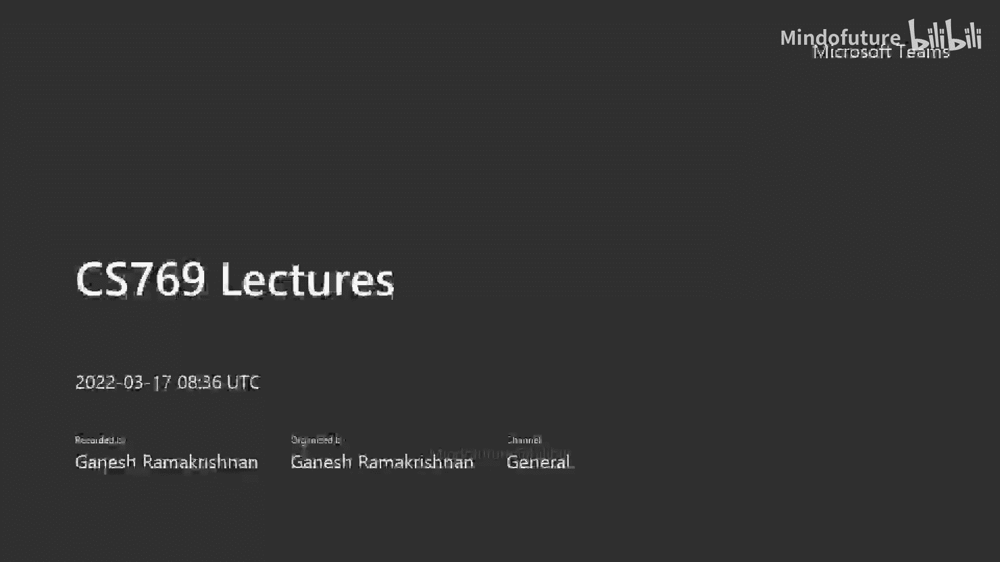
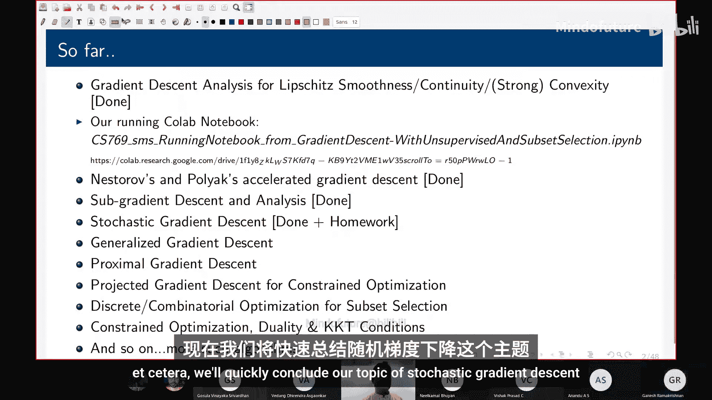
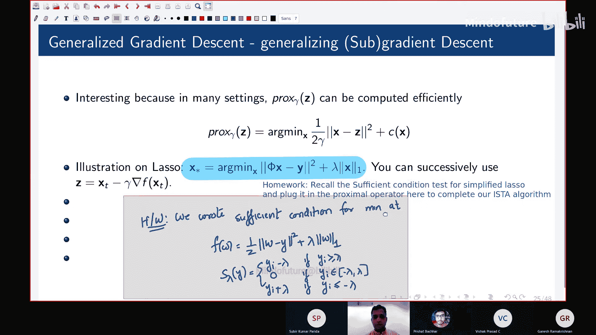

# 【印度理工学】机器学习优化 ｜ Cs 769 Optimization In Machine Learning p22 P22_第十九讲_17-3_优化与机器学习_随机梯度下降__自适应学习动量__实践方面__广义梯度下降 -BV18cBSBJEH1_p22-

So good afternoon， welcome to lecture。9。嗯。做。Having you know gone through this entire journey of seeing the convergence analysis。

 et cetera， will quickly conclude our topic of stochastic gradient descent。啊， I just didn't wait。

一个水平。

Yes。这个是机。嗯么。Okay， I just saying that having set a background， we know。嗯，登记我。

Our discussion on stochastic gradient in descent as a homework Id asked you to just pond over the table。

 the general table that had provided。嗯。So basically， we had talked about this。

General framework of algorithms or adaptive gradient in the same。

The last class had motivated this entire discussion。Based on curvature。

 but today based on a very nice blog。R dotio I'll take a a slightly different perspective so。

motivationti in last class。Basically get talked about adaptive。😊，Learning， learning， rate。But I said。

 well， what is the adoption adaptation because？It was motivated by。一个。

So I talked about what's general youth and update and I said that this curvature comes coming from the。

Hisss theian of the matrix。The metrics of all。Second。

 audit derivatives and mixed partial derivatives。Audits， surrogates。😡，Okay。

 very often we have quasi mutant methods， which don't try and get the hesN。

But surrogate an approximation。So that's how I motivated in the last class。But today。

 I'll be using a different narrative。😊，This is very nice Rat Io。

Which doesn't get into the hissian part。😡，But gives motivation more from accumulating gradient from the perspective accumulating gradients in this course。

 okay？So a different。Popectively。On the site。And the perspective is。

Two things aating gradients and gradient。😊，Qus okay， so aulating gradients in some sense， you know。

 that's what momentum methods do。😡，ok， so。Yes。Now what gradient squares， I mean。

 gradient squares in some sense is what also is related to the hecum curvature。😊，And therefore。

 the learning grade， okay。Or rather adaptive。Lning read。But which are you。Can also or recall。

Our discussion。On four different， right。Army or conditions。

 so I'd run you through this coab notebook also， right？哦，我俾你在发票。Here you see our new conditions。

So I motivate is visible， right， its too small。嗯。Okay。

 I talked about backtracking appliance and so on。 so this was and in one of those discussions one of I think the version three we were also trying to。

Do some interpolation。Is it a polynomial interpo， you remember？So whenever you see gradient squares。

 et cetera， there's some kind of learning great adaptation based on some interpolish。

So we had seen one motivation that's not the only one。

 but the other other motivation that has come today is from。The perspective of Hass。嗯。

So we will we continue on this discussion now from that perspective you can think of all of this makes a gradient square accumulation。

 which is very closely related to curvature。Is。Is what gives rise to adaptive learning needs？

That's a kind of connection。This is a recap and then。He said， well。

 here's our grand one equation to unify them all。when we said them。

 we' are talking about stochastic gradient descent， heavy ball， nest adapted gradient。Oh sorry。

 momentum and then at gra。Proot means square accumulation。And then item。

So I had kind of left you at this slide in the last class now one important thing to note is we are dealing largely with all diagonal litrices so whenever we do inverses we' are basically dividing。

😡，ok， so。We don't have to get intimidated by inverse， all inverses。😡。

Parttplication my metrics inverse。Is amounting to。What。Livision。Ed squared。

Of the matrix is basically square of each entities。😡，What's you dealing。We're diagonal images。即第个路。

So。Yes， we can see that。To a right a thing。Paggno matrix。So multiplication， my matrix is amounting。

Sorry inward is a mon division squared is a square region and so on。

So now let's understand what are these different methods？😡，嗯。Under this grant unification。😡。

It's easy for us to understand stochastic grade in where we just have。😡。

The GT will be an identity and because of that the HT。😡，You also be。

And identity with the Gts identity， then H。😡，Its also， I mean， all大。2。It she's also。

Sin versus identity， everything is as identity so you can easily see what this amounts to。😡。

WT plus  one is Wt minus。A constant alpha T。Bta T is0。Constant alpha。印du。一一。Deeleive。

Of the loss with respect to the， IT is basically either a simple index or maybe a collection of indices with respect to which choosing derivative and derivative。

And then gamma is also zero， therefore wereing is WT。

That's what the stochastic gradient descent amounts to in this grand scheme。

So the second one is heavy ball。Again， heavy ball is pretty much the same just that the beta has come up。

😡，Yeah， so I quickly， I just know。The only difference now is that。The beta has come up。

 which means that now in addition to this， you have。Plus a constant vita into。WT minus WT minus。

That's the second one。Okay， that's everyone。the third one。Nesttro well adaptive。Okay。

 so we are just moved away from。I'm let please write this and then I'll shrink it again。

So the only difference now in N adaptive is that now。We are not just adding this beta here。

 we are also adding to the argument here。It's WT。Lo something。the gradient is evaluated at WT。Right。

 plus a。Now， there's a beta。The step beta。Of WT， the same thing。Wt minus sorry， Wt minus wt1。ok 啊。

So with this， we are done with。Maybe are more well known。Pions。Now we are the new ones。

 I agra arm is proper Adamom。So I'll probably quickly run through this。来ed到哎哟。

Optimizing gradient desent description， so。Let's understand the others already quickly here。

So what is agrad doing？😡，嗯。But what。So Aal has this adaptive gradient， it's taking a Gt minus1。

Adding adding to that is this diagonalmetric Dt。😡，So D DD is where the square comes in， okay。

 so let's make a note。The DT and HT both involves squares。😡，GT is accumulated a DP。Is wearing。Gty。

Whereas GT is accumulation。😡，You can see the GP has an update here。Igrad has an update。

It's a G at comms。So aide is well now your。嗯。Kind of adaptation of the learning rate is happening through the square。

 the curivation of the grid the curivation of the。Function through the Canadian school。So as I said。

 Gt squared is being added to Gt minus-1。🤧嗯。😊，And then the update。

 so then all of these start mat so far they didn't matter， but here。😡。

You'll find that by virtue of H being square root of GT。

 this starts mattering and so does this start matter h and ST minus1 ST so ST in wordss into H minus1 we discussed in the last class。

basically， what we're trying to do is。Alligned momentum， largely。With。Just the previous updates。

 we don't want。A cur a rotation to be effective。 Therefore， H T inverse into H T minus-1。 Basically。

 think of it as H T inverse into H T。 says the previous version H T minus。

So this is like discounting。Or anything we other than momentum。We discussed this in the last class。

But you got the explicit effect of G through h inverse in this part that's the adaptation。

 so you will start finding that the alpha the alpha t is in agra is alpha fixed so you're not changing it in every iteration the adaptation has now come through h inverse。

😡，In fact， that's true with Adam as well。🤧嘅。Rm is Pro is doing something more。 So see added alad。

RMSs Pro， all of these basically so RMS Pro in fact there was a max。

 whole bunch of these try to fix a diagram。Andaragra says let me let me accumulate。😡。

The squared gradients。But the process accumulation might lead to。

Very diminishing values of the learning rate in R is Pro。 the idea is that。Okay fix。啊点诶哦。

Significantly diminishing。Learning great， created by。二大。Okay。

 so it said that I won't just keep adding the DTC Gt minus1， I'll add this convex combination。

 the D2D beta tool。😡，The Bika2 has been introduced convicx combination。嗯。So that's the。Sllate cheese。

Otherwise， it's pretty much the same as a。😡，不。ok。What does Adam do？😡。

Adom combines the learning grade accumulation， accumulating the gradient square curvature。😊。

Along with the momentum， accumulating the gradients。So Adam is of most interest to us right now。😡，嗯。

So Adam， I mean， unlike C， unlike Adaggrad and Armus Pro， Vita and gamma both were zero。

 suddenly in Adam， those are non zero。😡，So there is some effect that。

Vita and Kma have started playing in Adam。At least the be done the gamma is basically you know。😡。

What the。Nextestster of got you， you try to incorporate the momentum within the next gradient of。

So especially this part。冇明白。😡，So Adam could be thought of as you know RMSs probe plus momentum or to be at agrad inspired plus momentum。

😡，That's做。Item is adaptive。So， you know。Aam is Pra。

It looks more like Armus f because it's having this beta too。😡。

Convex combination be 2 based convex combination of Gt minus1 and Gt。

You can think of adaptive based on elements as problemless momentum。

Fment time looks more like heavy ball momentum winter。😡，Okay， so this is basically the。

Overall landscape with this understanding。Unless you have questions， let's move on to the。

This overview this blog credit。I just highlight some important points here。Okay。

 so this has a whole bunch。😡，Momentum N probe， added Dlta RMS probe， as I said。

RMSMS prop is a fixed to agrad， but add delta was also a fixed to Rs to agrad both add delta and RMS props are attempted fixes to agrad yes。

😡，Save。不。系。Okay呃。Yes。嗯。So question is， Adam。Has this additional component here。

Or rather division one minus beta2 raised to p。And as t turnss to infinity or becomes large。

 then one month weaker two risk T will become one。So it's basically Adam eventually is tending to RMSs for like update。

😡，Or on the G front。There's also beta 1 associated with。😡，😊，冇明ington吧。So that still remains。

 that still remains a difference。So the question being asked is。

 is it by design that Adam is meant to resemble like aous sp？Yes， it is the only difference is that。

Because you're also adding momentum you。See， this has what to do more with initial operations。😡。

Initial iterations， you don't want the momentum to be completely swamped。

By your update for GT is based on coveragevaage， it's more of a detail。😡，But in the steady state。

 it's attempted that Adam behaves， right Adam is。so this one minus is beta to to T is for certain stability reason reasons in the initial equations。

你过信。Okay， sony I was on this， I was saying Agrad had two fixes at Dlta and RMS problem we only talked about that and Adam tries to combine a momentum and RMSMS。

😊，That's basically the idea， but there are many others and you know you can look at a very nice descriptions provided here bra batchs and stochastic knit decent how they behave and how did mini batch come up with。

And just now I'm just trying to close the story so momentum you had this zigzag movement right momentum said let's try and fix this zigzag moment if a ball is rolling down a slope so to speak right so ball may have zigzag movement because the path has lot of stone pebbles etc but ultimately the ball is rolling down right so what you're trying to do is capture the major trajectory three and not let the oscillations the minor trajectory trees over in the major trajectory。

😡，So therefore you're kind of reminding the ball， oh you're supposed to go down。

 don't get distracted right that's what happens in moment。😡，嗯。that to accelerated momentum said。

 well， let's be a little smart and that's nicely written。

 we'd like to have a smart ball all that has a notion of where it is going。😡。

The ball has a little look ahead also where I'm going so that it knows to slow down before the hill slopes up again。

😡，So that's Ne updated。At a grad， as I said， it adapts the learning rate to the parameters performing smaller updates。

For parameters associated with frequently occurring features。Okay。

 so this is an interesting point which。😡，I should just given this reading， let me highlight it here。

 so I told you that all these divisions。😡，Are done through。Metrics inverse multiplication。😡。

So wherever you see matrix inverse multiplication， there's a division。😡。

But what is it effectively doing this division？😡，It's， of course。

 looking at accumulations of gradients， but that's one thing。😡，But it's actually also looking at。

How the features are changing， GTJ。The teeth iteration， the j。Parameter。

 right we're looking at gradient。So。In some sense， what these adaptive methods capture is the relative importance of features。

😡，极。租。Wherever you have the HTs wall coming up that's adaptive， diagram and so on。Please capture the。

Relative importance of some feature。 let's see with index J。Or some other future。It's other index。

 so that's the basic intention。Or， you know， another intuitive understanding of what these。

Adaptive with school。That's been explained to you。You're performing smaller updates for parameters associated with frequently occurring features。

And larger updates for parameters associated with infrequent features。😡，So feature is very frequent。

😡，The update can be small because there's anyway an effect of frequency。😡，Okay。

 it's often no for spa data。😡，啊。But there's an issue with undergrad。😡。

At a grad basically you can you know keep adding it your effect cumulative alpha into h inverse this。

Can become very small in a diagram。So this part。You say diminishing learning rate。

 we're talking that agrad。AsSo just。It's basically suffering from。Alpha T into。

HT was becoming very small。That's the issue we are trying to fix。Okay， so the added delta。

 it seeks to reduce the aggressive monotontically decreasing learning rate of adequate。

That's exactly what I pointed out， what anonymous problem does that。😡，But these are efforts。

 so RMS Prof does it in a different way。🤧嗯嗯。stemming from the need to resolve agras radically diminishing learning。

Abas Pro also same issue。So remember what we talked about is diminishing learning rates alpha for。

What other setting？Remember remember the army of conditions？Sorry， we had this， what is it？Yeah。

 there you can see。Armo3。P I we do。Danger， simple crackings and alpha make quickly become very small。

 they are related。😡，Remember this， you're able to access this notebook， right？

So the Army was line search V too were trying to fix this issue。Okay， so let's go back to our。

Big picture here。And Adam what it done it did Adam said let me combine the advantage of RMSs for op。

😡，Right and add so a is prop momentum。做。It does so in addition to storing an exponential decing average of past squared gradients。

It also keeps an exponentially decaying average of past gradient in their moment。Is this piano？

This is the big picture。ok 啊。So's。Kind of understand little one more slide on Adam and then we'll move on。

It's heavy ball momentum as adapt， not really in a stone， but heavy ball。😡。

You could I'm also a variant， which is I think one of the follow variants thus nest of momentum as a adaptive。

😡，Okay， so as I said， there are two things going on here。

 momentum component is only looking at the gradients accumulating gradient。Let us。We call it V。

 but this this v is basically accumulation of squared gradients。😡，You know diminishing吗。I mean。

 you really want too far away history to count less。😡，So that's true with both。😡，Momentum。

 there also you have a inner a diminishing manner。What you're diminishing is。

About accumulation of gradients。And then there's another interpretation you can have。We just。如个边个。

the momentum itself。As accumulation of the first order。M， this is the。This is the fuwaring me。

Whereas the square ingredients。Which is where momentum had come。Sorry。

 the adaptive nature head comea is related to the second or uncertain variant of the group。

So if you want to fit a distribution， you want to fit。😡。

Asimate parameters of a distribution to fit the data。

I you you do try and estimate first order moments， second order moments or even higher order moments and try and fit right you want the data moments to agree with your。

Model based movement。😡，So in some sense， that is' trying to do both。

But here we're not talking about data， we're talking about the trajectory three of your objects。😡。

Okay， so think of this as basically。That is hobby。Trajectory of updates。

And that's exactly where you began。This makes most sense because we really wanted to fit something on the trajectory of the updates。

😡，This is what we mean by fitting the trajectory of the gate right so on the moment multiple moment basiss。

So you have a slightly different perspective now。😡，唔好定。A more refineable perspective。

So then there was a question， right why do we need normalization by  one minus beta T？😡。

That came the denominator the previous slide。1 minus beta1 race to t or 1 minus beta 2 raised to t。

So the explanation for that。This this part。We just。See all of these。

All of these is you find this division。So empty and VT are initialized to zero。

 and I said there is this issue because both are initialized to zero。

 they are initially biased towards  zero。😡，So if the betas are them， so what will happen？😡。

The decay rates are initially small。😡，You would need to normalize by those decs themselves to make sure that the decs。

😡，Appear bigger than there。😡，Absoluteate values。😡，So initially t is t is  zero。😡，My T is right。

 so the delominator will be our T is small， like two， three， whatever。The denominator will be large。

😡，So deoromeator will become small， the overallal expression will become large。

 the one upon the denoator will become large。😡，Therefore， you have this normalization by。嗯。

So just again， what will this do？Normalization by one。make。One upon one nurse whichR is P。Lch。

That's what we have shown you。Okay， so。There are some parameter values express here。

 both be 1 and beta 2 index expected to be slightly large to begin with。

So that as the exponent goes to infinity。Then eventually this allows become  zero， I mean。

 beta1 rest to T will become 0 beta 2 rest2 T will become0。

 but initially you want to start with a reasonable value。Okay。

 so this is item and very popular Of course there have been errors。

There have been convergence issues and so on that have probably talked about a little later。Yeah嗯。

Yeah， so in fact， it did does come up。So there are many extensions of about techniques。

 item Max is an extension of item。That uses the infinity norm instead of square norm。

So you see the we use the infinity as a。Square norm here， G to Gt squared norm here。你。😊，GTj Square。

This is out product。So。What you might want so what what does the squared norm do as a infinity norm？

A squared no。Looks at almost all the increase。With equal voltage。

Infinity norm I look at the max simply。So if you want to be somewhat sensitive to noise。

 robust to noise， sorry， not sensitive， robust to noise。You may want to take the infinity， now。Okay。

 so that's one variant。In that blog， youll also find Naam。😡。

Where you apply nestrous momentum instead of。The heavy ball momentum。

 So I think I mentioned this right So Adam is basically HB momentum plus adaptive you just making。

You make Nstto。Plus adaptive and that gives you madam。关系。ok。嗯。

So then there are other variance added data where you look at the Rms operator。

 the root mean square accumulation on weight differences as well。

This is a point I made in the last slide I said that there have been some issues。数。AM is Greg。

 says there's a theoretical error in Adam。Because of which it was not converging for convict functions。

😡，So， the VD。May not remain positive。😡，对。So it made a fix by which it remains positive， that's it。

Okay， otherwise I've shown you running through this blog as well， let's move on。😡，好。学信。嗯就是咩。好。Okay可以。

Yeah， so the initialization to zero is more of recently。So the original version of Adam。

 there were issues for initialization and therefore。They need to become negative。

So what you see here is a kind of clean up version of Adam， this is what you would implement。😡。

It's a fixed version。By the way， the important thing。

 the error we are talking about is not just implementation， there's a theoretical error。😡，So yeah。

 if someone once can pick up because I see a lot on it paper as a seminar reading as well。Now。

 very quickly， we look at。Underm the direction of。嗯。Of analysis of this entire sector。o work。

And that is through regret them。😡，So you may say what are the technical tools available right beyond what we showed earlier？

啊。这跟我就日子2。Is what we are not what you're not covering， but there's this entire。

Idea of looking at an adversarial example for an adversarial example， what would happen？

If you had access to the true model parameter as against the model learn for this adveral example。

 So that's based on。Reg Bo， which is very common for online algorithm。😡，Again。

 this is not going to be covered in the class， I just run through it。So as I said。

 there's a paper introducing Adam had a bug。So theoretical regret bounds are not there for most of them except for a。

😡，啊。I mean， if you remember with this army conditions and all we had we had proper convergence analysis also right that's not always true。

And。Yeah， there was an As Greg。Which I told you had this fixed right As grad fixed the issue with Adam with theoretical issue。

😡，So it basically used a modified version of Adamom。😡，To show regret porn。And very importantly。

 all this will work on questions。😊，嗯。Though the analysis of conx functions has often opened up the frontiers for advancements。

 as we have seen so far， whether it's momentum， whether it's adaptive learning。

 all that has come because of analysis。So that cannot be minimized， it's importance。

is one of the most influential papers of the last。know many numeric techniques that have been revised upon are based on adequate。

 as I said， at a grant in what。Fixed through RMS probe and so on。

 but it's still a very important pivotal the whole notion of adaptive learning grade。

For which we struggle hard， you know， in a standard gradient descent paradigm to Ar conditions。

 it has really opened up that entire space。喺度。To recall this know for improved convergence in this in the case of。

Simple readingism。Right if you look at this movie。So that sense Araragraitis was a big contribution。

嗯。Now， somebody may say， which is the best of these techniques mean you can't。😡。

Nly have a proof that one is better than the other， the pros and cons of each of these。嗯。

But there are some interesting takeaways。For example， the Mist data set。

With a multiion neural network plus dropout。It was found at Adam， I mean。

Has very quickly diminishing cleaning cost。😡，the one in pink here is item。Is doing pretty well。

How does。Agrad or rMS prop so remember item is basically the is put together two things momentuming them。

 which is the one in red。100 is moving time。Of course， it's Neal momentum。And RM is F， one green。

It was adapted。The two have been put together or in some sense， this not necessarilyling momentum。

 but you use。Heavy ball momentum， not nest momentum。

 but nevertheless it's put together both of these。😡，Now， if you look at the green part。😡。

Green adaptive because it's adaptive， it's like。Started diminishing quickly。

 but then after a point all these diminishing values and all such that you know R is prop tried to fix。

😡，The learning rate going to zero very quickly， but nevertheless it has issues moment you have this adaptive learning rate you have struggles with engineering struggles will be alpha right the diminishing learning rate on the other hand momentum。

Initially， it is not that fast。 I mean， it's it's very slowly catching up。😡，Obviously。

 right because you need enough gradient accumulation for momentum。😡，To be effective。Okay。

 so let's just make these observations， right？You need。已经。And that's what we see here。😡。

Whereas adaptive。It adapts fast， but then it gets starts getting。小妹。and in some sense。

 momentum has best of both worlds。Okay。嗯。Yeah， so the benefits of Aaggrara art is that。

Hagra can significantly improve over， you know， stochastic gradient descend sentence past feature6 because of adapting so the whole。

Aruppting itself。Apting game itself is because you're able to adapt to the feature space。😡。

So that's a key point here， starts fast。嗯。Quite quickly。Adapting feature skills。

But slowing down might be a little bit of artifact of this data set。😡，ok啊。So yeah， as I said。

 because it's looking at the feature space more seriously。Or rather。

 because it has a per coordinate learning rate in some sense。😡，I's able to look at the feature space。

We't care for you。It was a coordinate learning group， remember the entire expression we had Alpha T。

SoWhat does alpha or alpha into H inverse？😡，So it's basically saying that why you have a base alpha。

😡，The diagonal entries of HDN words correspond to per coordinate learning rate。😡，🤧。

But if you have very dense settings， I mean， all features matter equally， right？😡。

You don't expect adaptive methods to work very well the whole advantage is being fittedttered away。😡。

Yeah， in some sense the learning rate is also decay， so adding know insult to injury。

So then I add MRMSMS prop added Dlta， I've tried to fix that issue because of the issue with agrads learning it doing well。

ok企。Also， momentum generally improves upon the non moment of variance。😡，If' accumulating gradients。

 if you start also accumulating squared gradients it helps， that's what we're seeing。😡。

Second order momentum helps if you already have first order momentum。😡，冇明 let me round冇明冇。永要按按啲。因为。

First。A one。first starter moments is like gradients。

And second order movement is like these gradient squares。Okay， so。Yeah， just trying to re。

Some important point。What learnings。呢就把 and s。哦，嗯个明。你呃呃这给。啊佢呢个三边开。Yes， yes。That's what is happening。

 So I mean， if if you're finding it difficult to understand imagine what this would mean right if alpha into H。

In words， what would that mean？HT was basically at the square root of GT。It's stillquad of Ji。

Acccuulated gradient， right， So what is basically this doing。Saying that I have this。

Al far divided by。Squaル GD I。はい。我阿姨讲过。And when you now multiply this with some other networks。嗯。

So let's say this if I multiply this with。Oomes。哦哦，唔用。A。

 so now you are basically dividing each row of those of that matrix。With this entry， right。都。或者是嗯。

Then I motion dividing alls。我 sorry this is worse。我这得。Oring multiping rules。

So you have alpha divided by square root G。Okay。And GI， again， remember。

 it's this accumulation of the squares of the group。Okay， but also remember that all this is fine。

 but the generalization is more important than just optimizing the training laws， right？😡，In fact。

That's exactly one reason why some of the reset work has shown the marginal value of adaptive gradient metal。

 so too much adaptation is not worth it that's diminishing returns。😡。

So there's diminishing returns and doing all overdoing all this。诶。

So you're basically getting more complex， less generaliz solutions。

And then there are theyll also give a essentiallyy examples where SG and its variants obtain less context solutions。

But adaptive variant of pain solutions， which do not generalize。

So there are a lot of discussions around this。But the。

The generalization becomes difficult if you have very complex objects， that's basically the point。

So this is from the paper， the marginal value of gradient methods and machine learning。

So if you general you know， look at items which are somewhat more complex updates。

There's some two variant of item， one is an item with a fix which I talked about earlier。😡，嗯。

So res never go negative， so is this was their observation。And as you can see。

As you progress in epochs。😡，你就。I mean， the SGD， which is really here right the one in black。

 it started out bad but the SGD seems to be doing okay。😊。

Error training error percentage has gone down。😡，You know you may see this C for 10 so you just gone down。

 this is the C410 data set。😡，So。Yeah。There's on this marginal value， I mean。

 at least you can always show a settings。Sorry。So they're showing that SD does pretty well as well。😡。

The settings in which SDD is doing for all the hard work you do in Adam well Adam has gotten you off to at least in this setting。

 I mean it's getting you to a good start here。😡，Maybe the fixed to Adam， the one and。😡，Purple。

 I mean， it's better， it's certainly better。😡，But again， the domination of this。😡。

This Adam fixed Adam。I until a particular point， after which， you know。

 you can see stochastic grid doesn has caught up。That's what they's showinging the's basically the marginal value。

 there's not so much value all the time。😡，啊。Okay， so look at this。

 like this is training error this test。😡，Okay， so training error has got reduced significantly。

 but look at the gap here， okay， there are two points you are trying to bring up。😡，嗯。Momentum。

 this argument is not against momentum， you can see that momentum is doing pretty well in both cases。

😡，So this is about adaptive gradient methods。 So not about momentum。 and both Sgd and heavy ball。

So while they are showing some marginal reduction in training errors。😡，The test on the test。

 the gap is wider。😡，Exactly。Okay， now the training around was very high。😡。

For SGD or the heavy ball even eventually， then one might say well it's just deceiving us in the training set right but that's not case it's not deceiving us on the training side it's doing well。

😡，Maybe the gap is not as pronounced， but test the gap is pronounced。

 so that means it's generalizing will。😡，So did that make sense。

 like that's why the test is shown here on the right hand side。😡，Any other question on this？这什么意思？

Excuse me， so。Okay， so theres other readings， margin and value paper I talked about already。

 but then there's also a IA 2018 paper on the convergence of Adam and beyond。And yeah。

 feel free to go through this blog， which I think we keep updating once。

I'm going to just give some extra optional reading， which is not going to be part of syllabus。那好。

Re bound。That characterizes analysis in approaches such as Algrad。

 I think I said Algrad had this first kind of analysis。So I mean。

 lot of the analysis we did so far was not specific to machine learning， right so this is。😡。

In some sense， when we see empirical risk miniization。

 this is analysis more specific to machine learning。Okay， so since it's optional。

 I'm going to be very quick on this。Yeah。The connection of these approaches is also seen through regularization。

😡，Well civilizations， again， characteristic commercial machine learning。嗯。

So what is the idea of machine learning as optimization， we had a loss function。

 the regularizer and you know we had a we started with a zero1 loss。😡，NP hard problems。

 therefore we have a surrogate。Propoive wrong。嗯。😊，But then we move on to logistic regression。

 have more complex with the Sigmod neural networks。Okay so great the idea。

We have seen so far as stochastic methods say， well。

 why should the gradient depend on the El data take a subset？

And I had this big picture we had collaboratively from this big picture what subject so we'll come to that soon。

 but he said let's。Do random random selection of the points。

 Let's do random selection of batch of points。There's one perspective， which is optimization。

 but there's other perspective is a generalization。

 I want to generalize well right I want to do well on。😡，Arbitrary， adversarial examples。

The two are actually correct。😡，Okay， so there's this fact learning perspective。😡。

Where you're trying to you know， have an hypothesis back learnable。For all Epsilon oil data。

 when you've seen M examples。😡，Which where MS omega of the a polynomial in the data Epsilon and the dimension of the hypothesis space。

 an example of hypothesis space might uses the neural networks。

The space of parameters would be constrained parameters would be like in a day。

That the non negative parameters。So the algorithm being able to find a hypothesis edge with probability 1 minus delta such that the error of the found hypothesis is less than equal to the min error。

 the best error。😡，Plus， this episode。So in such a case， we say that it's just packedler。😡。

So you want and this ER is explained here， this is the expected loss。啱。

Often you're dealing with an  empiricalical expectation， expectation over the same dataset set。😡。

So what you do in online learning and rigorous minimization。😡，Is。For all the。Example IDs。T equals1。

2 capital D。嗯。叶辉。Consider any aial example XTY2， so for every possible aal example。

 think of it that way。😡，You want to minimize the expected regret。😡。

What is a regret well h star if I were to obtain as optimal as against the Ht obtained by seeing that teeth example。

 an adversarial example。😡，Okay， so I mean， regret in common sense。 what's you regret that。

You could not watch IP right so because I was COVId you couldn't go and watch something personally what's the regret that students could not enjoy mood indigo is more indigo virtual or physical Im actually out of sync。

😊，So so you have a regret associated with every event being online versus offline right so had things be normal you would have had it offline and now you have a regret associated with that online event。

😡，So that's the kind of regret here at star if you had access to the。All the data。

 the entire you know search space as against now you have you're looking at through a lens of T Xt。😊。

喂。😊，So you get generalization in a probabilistic approximately correct setting when that regret。😡。

Poose to 0 as t tends to inferity。So the analysis。嗯。Here is basically you know。

 how can you upper around this expected difference the regret？😡，So， it turns out。That的。🤧嗯。😊。

This kind of generalization， at least is a stochastic gradient descent if you want solution that is absolute approximate。

😡，With Eps7 equals Rv by square root T， youll basically need number of iterations t that is1 upon Epsilon squared omega。

 so this is omega。😡，But now the analysis is from a different point of view， as I say， this is from。

Upper bounding。That regret。Exactly。So you see that the the expression looks very similar to what we had earlier。

😡，Things are not drastically changed。是。So if you want approximation。Apsallum。

 then you'll need a number of iterations， but now it's an expectation。😡，Be expected。

Okay that's where the jargon has changed。😡，Because the expectation is over all the T's。😡。

I do examples that you pick based on which the hypothesis is grounded。Z you。Okay， so。Yeah。

 so this is like extra reading in case you're interested， but we should move on。😡。

So I'm moving with the last part before we do subject selection some modularity this last component。

Is generalizing this whole gradient decent framework？When， when you have nondeability。😡。

When you have constrained cases。I will probably give you give you some optional reading material in general for constraint optimization。

 but I think what Ill give you probably will be sufficient to deal with several cases in the constraint case。

 So what is idea and constraint case you。You're looking at you minimizing a function。

 but you have a constraint。This is a constraint。And the constraint because。

G the constraint doesn't matter much， but if you are minimizing under such a constraint， right？😡。

If you are sorry an extra right plane。The constraint where to look like this。Okay。

 so if your constraint was something like this。So the minimum， okay all here。

 So the minimum is going to be somewhere here。Sitting in the boundary。

This is where you got minimum Mkey。You're not hitting the global minimum。😡，喂。Constrain minimum。

m not诶。Be unconstrain。You see that two example。And therefore。

We see how we can generalize gradient and for that matter and stochastic gradient， matter all。😡。

It also has some other applications， for example， if you have non differential components。

 can be faster。One more small deviation will go back to representing excess variables as against w we use w largely because we are。

Trying to look at stochastic approaches。You look at access variance other than them。Okay。

 so let's get started， I'm now going to make it a little bit more interactive like you thought。😡。

So let's see， I have。Some of a differentiable function effects and a non differentiable function Cx。

An example I've said is this right so submission ICIs and what what's an example let's say I had。

A constraint， C one。Another constraint。C2。P。So， IC。I see too。Equals0 the or another。Easy to X。

Is 0 if x is。嗯西 do。And equals to say infinity otherwise。Likewise I say， I see one。X0 if。

It says in Z1。And equal to infinity other ones。that公。So that's an example of the sea。😡。

Not with C I mean， sum of the ICs， or each of these ICs， does it look on mix？😡。

If the constraints are。Close boundary intervals。Do expect this to look complex context next？

0ero and then infinity。It's one mix。Basically， we are saying that these are 0 and then they become inity。

So，0 in。C1 intersection， C2， blah， blah， blah。And in three other ones。知嗯。ok啊。

If our is properly different will have all nice properties you may want。So now。

 just because C is not differentiable。😡，C is constraint。Will you now put up your hands and say， oh。

 I can't differentiate。That's a whole point。Can we be a little smart here？

You all know right that the lower rope is as weak as it weakest link。

 so our I see I is like our weakest link here， but you don't want the whole show to be pulled down because of our weakest link。

😡，So let's these are like our weakest link， let's look at the the strong link， the strong link is Fx。

 right？😡，This is our weak link。But let's look at us strongly。😡，Can a strongling business？Ethics。

For which we have so many approaches。😡，So that's what did gradient listen do？What does it do？I mean。

 you， you all say that it does xt plus one equals whatever the whole boring equation。

 but some some can you give you a different insight？Yeah。Yes。😊，What is this equal into can I say？

Okay this also is bringing us to。Optimization， you can always have optimization in parts in phases and have something called bilel optimization。

Any of you heard of bilel optimization？Optimize with the respect to something。

 then optimize with the respect to something else。😡。

So could you think of the optimization on effectsx？😡。

Through the gradient descent as an optimization form。

 it can be think of gradient descent at xt plus one。😡，Was nothing but。Argument over X of what。😡。

Even in the last class， I said that you could think of the Newton update。😡，Bby。

Optimizing some Taylor series。Approxiation in certain terms trading terms ignore known， right？

Cmunity of gradient descent， also similarly， what is gradient descent doing？Yeah。Yes。😊。

Without any reference to convexity necessarily， I mean you need convict， well you can see。

If conity becomes required。Let's and walk it。Yes， please come up with your expression。

What is it that gradient disent is optimizing？😡，Help me fill up the right answer。Yes。Okay。

Anyone on the call， I mean， I don't know if I can hear you guys。So after all， it's updating based on。

😡，Some approximation around f xt right f of xt is there。But plus what。If I give you some photos， so。

You have to help me fix the other。This looks familiar this part from convexity。😡。

Obviously this cannot be sufficient right you set the few side try and set the gradient of this with respect to x to zero。

 something' is wrong。Okay， you don't get any time involving yet。

So I would expect one more term to be put in there。

A quadratictic term I only give you a hint right some Taylor series approximation with some truncation so what if my quadratic term involvesvoice not just x minus xt but norm of x minus x0 squared。

Now what would be so yeah， I'm going to leave you with this， what would be the scalealr here？😡。

Give you some scalar， help me you up the scalar。And then people will help here。Sorry。One by two gu。

 so that's a suggestion one by。互感吗？straightforwardtra。

You take the derivative of this with respect to gradient with respect to X。To basically get。还瞓唔到吗。

What's the gradient is x norm squared。If you want。Yeah， so x minus 16。

This F of Xt will just is just a decoration。 It will get any war away and you take。这边。

We get this plus。So you always know bring x gradient transpose times x as x transpose the gradient。

So yeah but the x3 always we basically get。Thus gradient death of 16。0。Whi basically means that。Exs。

It's t minus gal length during the wrong。诶。So I'm going to know based on this observation。

 I'm going to know prompt。😡，Could we have you？Is optimization differently。

Instead of trying to do everything in one shot， can I now break it into parts？😡，I'll ignore Cx。

 look at what is this， this is he。😡，Already。Approxiation to the function。喂。😊，So I'll look at。

Quterality approximation to function， mini it， and then bring in Cs。 Can I do it in parts。

Okay a lot of optimization is about that， you know we'll see some examples of bilel optimization in fact we did bilel in the mix also。

 right？😡，Rson we had lambmbdas and eggs。No， forgot， in meet we had lambda an X right。

 he said so there two components of optimization。Okay， so。This entire thing， again。

 I'm telling you this entire thing or rather this component。Is a quadratic approximation。读诶。系咯。60。

Okay， so this is exactly what we have brought up here。😡，Accordingd to approximation。

But now what I'm going to do is。I instead of now just doing a gradient decentent update on this part。

 I'll take the quantity approximation onto that I'll slap on。Why is he accessible？

Why because my function has now become simpler。😡，And moment I write quality approximation。

 I mean that I'm doing a gradient decent implicit。😡，8 buck。Here， I'm going to。I'll add on Sla on Cx。

And obtain the next eight grade x plus one。😡，You may be wondering why what is the advantage of doing all this？

😡，I think it the best explain when you have a motivating exam。

 I'm going to take some motivating exam but if you have any questions here， let me know。ok。So。

Imagine， okay， let's take a motivating example。CX is。The one norm of it。😡，O， last。

But this after slapping on night。But started approximation to the function。Does this become easier？😡。

That's this。先。Simplified formulation。Based on first order approximation。I don't X。听。

And it's best to take this discussion forward and see an exam。😡，We'll be seeing this example。

The other thing I have done okay， so before I yeah I think I I jumped a bit too much。嗯。

Let's also reformulate this a reformulation would be helpful。😡，Let's reformte this。😡。

What I'm going to do is。F of xT， if I trying to minimize the entire expression with respect to x。

 f of xt doesn't matter。So I'm going to cancel out， write this whole thing differently。😡。

Now the moment I see something like this squared x minus xt squared now squared。A term like this。

From your experience with analyzing conversionence。Are you tempted to do something？😡，Sorry。

Teleescopic summing is no not， telescopic summing that's that's telescopic summing may not be useful here。

 directly。😡，But if used to do one more trick， why will three two or three or four tricks。

 whatever we learn， just list them down。😡，By elimination， it's not telescopepic something。

 what's the other， what what are the other tricks。😡，对。Ha you transpa fee， we wrote it as。😮。

So norm square， norm square， some completing squares。😡。

Can I can we complete some square here can I write this as so I remove this。

 but add something to complete a square。😡，What square will I complete？😡，好好好好。咁啊。好，行。

The rened ratings were。So the suggestion here is。Okay gamma squared。应该唔嗯。Nom gradient square。Right。😊。

Add that。He's awful regardinging you。So remove this， but add this in place， let's see what happens。😡。

Let's simplify what happens。What do you get？X minus。Pma by two times。Ogama squared by two。家开。

Only gamma we do not squ。Yeah because there's only 1。2ma here Okay。

 so let's try doing this so let's say。😡，I take oneon Kma outside。don you have Gamma Square？

Plus a two gamma here， so if you want to write the whole thing。Make it easier for you。So you have。

Dma Square norm。FP squared。Plus two gamma of this dot product。Plus。

Normal experience extreme norm school。Holding plus CX。

Now is there a way we can write this first term as a square one upon2 gamma times some square？

What is that？Yes。😊，好好嗯。这是啊。Is it plus or minus？😮，不去。Okay。

 so I'll write it as norm of x plus sorry x minus。X D minus Gamma， thanks。It's minus minus plus。

CX exists。han紧으로。I think special。This is okay， so what is this basically， this is saying that。

Armin or x of the difference between x and the gradient doesn't update。😡，都好吃 great。Bless。

So that's what we're showing here。This is what we got。In plain English， what this is looking at this。

Squared。Norm difference。Of x from the。Radian descent。I good。That's what this par rate is。

So it's called a proximal step。And I'll show why this pro step is required。😡，It's an illustration。好。

Oh yeah， thanks I mean and thanks for reminding we I'm really to look at the homework so this。

So let's consider the homework， I mean， recall call。A case of cx equals。One norm of this， okay。

And I want you to recall the steps we had written for。😡，拉索。😡，So that's very timely for the homework。

So Laso it require you to brush up， otherwise you might get lost if you don't brush up so please brush up how we solve the Laso。

😡，What did you solve in last so， can you remind me， we'll end with that。

We spent a lot of time writing down the subient， setting the sub gradientient to  zero。😡，我来诶 road。

Ne condition was necessary or sufficient， I think it was sufficient condition， right？

S vision condition for Lasso。What was that exact？Especially I had done his homework。

We recall call sorry， not who work as past work you had done this， right？If of。W is1 half。

Normal w minus y squared。你land噶。One norm w， right yeah， given these steps。

And we had this soft thresholding operator， you remember S Lada why？Equs。Why am an Islamda。

If Y is greater than equal to lambda。And0。If you know， Y I was between minus lambmbda and Lambda。

And it was minus sorry Y plus Lada。If Y is， there's an equal group。I is Lada you call this。

So can we make use of this for now completing our laso sorry completing our iterus soft thresholding？

😡，Youtop。All we need to do is do the proximal I mean。

 and we want to invoke this in the proximal school。😡，So that's homework so homework。We call the。

Sufficient the condition。Just for。Lasso simplified Laso。And plug it。见个螺师蚊。Operator here。都。

Complete art is style working。Okay， so with that will end today。哦。Yes。

这子。啊。