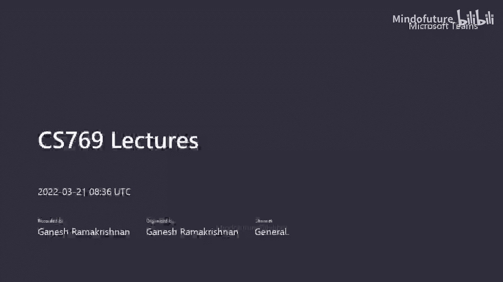
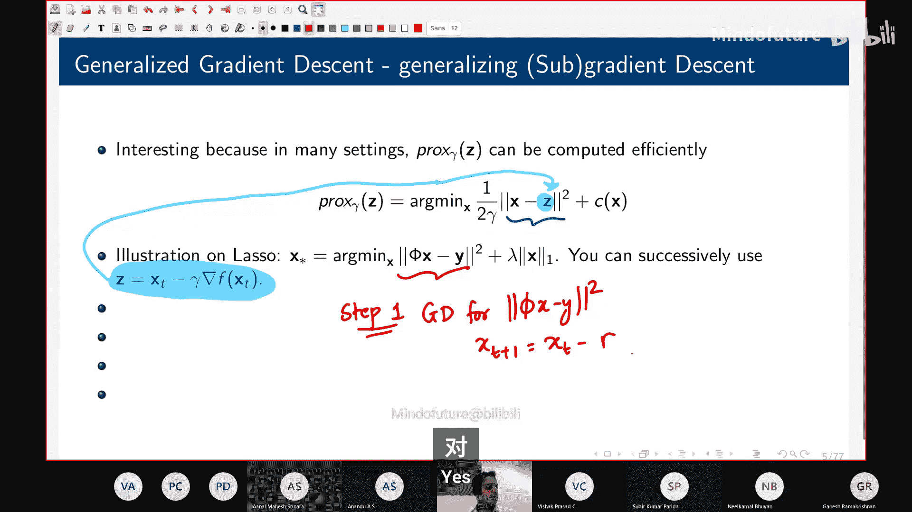
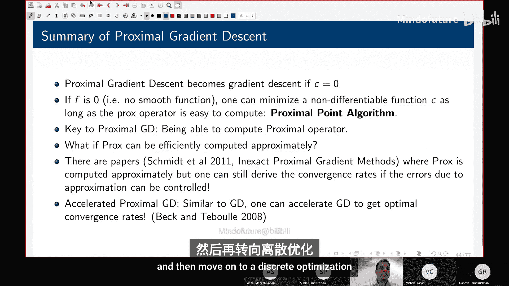
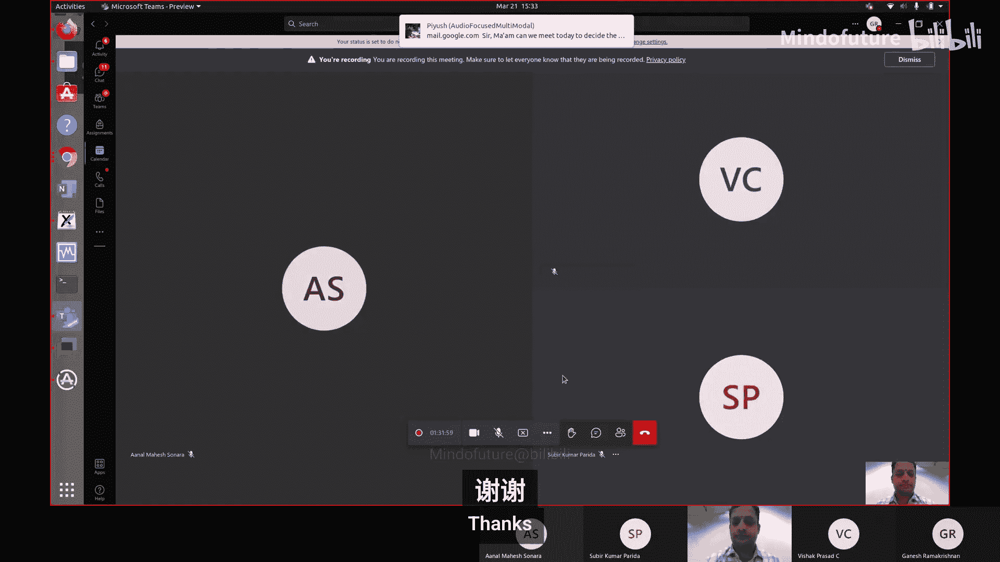

# 【印度理工学】机器学习优化 ｜ Cs 769 Optimization In Machine Learning p23 P23_第二十讲_21-3_优化与机器学习_广义（加速）梯度下降收敛性与近端投影梯度下降 -BV18cBSBJEH1_p23-

你今个疫住。question iss a place bigger。呢啲公司。Specific versions like maximum gradient dis project gradient discent。

Or I had given you some for thought。Application of this so Gent is3 the same。

你 can work was诶 play this。嗯。嗯诶也缩路人。For which leader I could complete the evolution of。

They take it soft the short group。寄稣你改嘅。我弟啲住你。Some Korean in college is gradient interest like you。

Have this function effects that you're trying to minimize capital effects。 It is a combination of。

A differentiable。翻讯 x x。And are non differentiable。单身是。SoSo we will be using Cx or etX the changing。

😡，I recently use Cx on the following users， so I do laterX for symbol。

Re in the last class I said that the C could also be including indicator functions。

 colon on constraints。 That's why C is only like constraint also。

But very often it's not denoting any constraints。Right， so in which case we。听个。The ticks。

W doote constraints。诶。But just say non defentable。那 just。Yes。你确点。The one not。In which case。

 you just use X， cx therefore I say。😡，For a particular purpose。Okay。Like this no。

What we did in the last class said well。You could try and have a first start approximation for effects。

已定。I don't exceed， I leave the Cx part as it is。Okay， so that first start of approximation was。

Only for the Fx people。 because that's exactly what。The response to rating descent， it read。

What what is grade decision do it minimizes。This approximation， exactly。How does it do it？Ex一份。十三。你知。

诶三号等于十所度。你个。So we can verify， but now what we have done is， we said oh。

 we is the first order approximation。Frida。Effects。啊 and。几个东。These the exitives。

So what does that lead to。He also said that this basically can be reform formulaulated。😡，As。

The first component。一个的钟。As a squared difference。Exactly the。 So squared difference。Between。

The gradient percentcent between and the new points。If this were only component。

The new point X would be exactly the gradient decision。来的。不理です。So just let's copy this part again。你。

So what you trying you say is that。So Gr， this minimizes this。Exactly。喂。😊，嗯。So this。

Proximal is coming for a particular reason。 What's what's the reason we call it proximal。😡。

It's because I'm trying to get the proximity to a gradient decentcent retreat。

So this was approximation s with the seat。That's why it's given the new proximity。ok。So but this not。

I had left you with a homework problem。Well you had to recap what happened with Lasso。拉锁。

And we think actually its all last， we just said， okay。

 simplified version of last when we said this is like a simplified person had kept it abstract at that point right。

So what was the solution here？😮，Did you try in Ri。Yes。😊，Oh， what you done。I you have。

Insteadr of phi x minus y， Yeah， z minus x minus z X。to think of this sp as an identity。

So you can take this zig。喂。而且诶。This company there you said to。XD minus。

Tma time creating of pregnancy。It you just said this part。What is this imply basically saying that？嗯。

I will take a greater and decent step for this part。So that's why didn't blame English。Reing。

step one。For great to come on。This干。Let right on the gradient。

 what's the gradient step going to look like。Xt plus one is xt minus。Not only want exhaustedive。啱妈。

What's the gradient of this component？Yes。

Yes。😊。

I hope you help me。Yes， I Iex see。杜温度读温度。ok。现在你发单操操之的。啊师得。Gll me the exact expression， please。

I hope people in the car are able to hear me。please confirm once more。Yes。Hello。😊，Yes， sir we do。嗯。

MiS， can you confirm that you able to hear me。Yes Sir。We can hear。标政系干支部。我傻逼。Jack， can you hear me？

I'll give again。So minus2 gamma。By transport was fight。HD minus。W ask was why？Why is a vector？

Of all the predictions， is this correct。So this is an exact expression。 you said it this way。

 and then what will you do？Step 2。Second。Z equals exactly as x plus 1。Soul。For the pros operating。

It is pros stomach Z。I argument。Or x。哦把他半呼家嘛。X minus 0， which is exactly x minus 60 plus1。嗯。Thus。

Lambda times is a one norm of this。So I'm beginning the regularization post factor。😡。

To bring the regularization upfront。I'm saying， let me solve the gradient step and then bring in。

Egnoization。嗯。Oh。而 that you。This has come post post。

That' it that's exactly the application of the Gen is gradient in this now too。那是。😡，That was。

I know homework works settings right？Did anyone derive the steps？

Let's derive the entire actual steps。So what would that be？Anyone？Because in terms of Lada。

 I think monoon gamma， we had to factor into Lambda some。I put the。It's the same basically as saying。

Agon what x of1。2。X minus01 squared。Las lambda gama。关了吗这些。I just would you like佢去定噶。我其数 what都呢件咯。

So remember， we had a soft thresholding operator。Now to bring that in this was， this was salt。

This is recap on the。From what of we reapping。😡，Sufficient condition based on。

Setting the sub gradientient to0， it is a sub gradient to zero that either， right？Okay。

 and that was basically what。So it the three conditions。啊。做。So saying that blockss the I component。

Of drugs Z。喂。So what was。Why I you minus？在淮难到干嘛。喂。啊。就你。마야 그러겠나 뭐。

And was what is the role of Z we not do anything with Z。It' just why or something else。

How can I be just why what's the role that？😡，Yeah， so we had to bring in。So this this， this why。

 I mean this y is our said right we are write in terms of said。😡，Goodect。You cant be white。对。

Dave Zdi is。so it's very simple if it's it's high threshold it， bring it。And zero if。Zdi is between。

Mus longer。Dma and plus lambda gamma。啊。The right plus。能得咁嘛。G their eyes less than。结管钟。还个。Mine is。

 is that correct？I that what I wanted you to attend this homework？ok 。Okay， so this。

 let me just now outline the entire athletic soft thresholding algorithm for solving Laso all under one umbrella。

结束。We have5 w minus you know I use W sort of x that should be okay， it's a V x sorry。

And exactly using。What we call proximal sub and decentcent algorithm where to error。EW。

 we have also added。A lambda W or lambda1 number of W。

So WT plus1 is an next gradient trait for WT compute Wt plus 1， which is argument min orW11。2 gumma。

h blah， blah， blah。By setting a subgrading， I mean if you want to be more specific。

 you can say by setting a subgrading。啊 some subject degree。

And this is exactly what I derived on the last slide。But。Now it could be more specific。

 this will result。电 w。Which is or WI， which is WI。He was one hard。

Or our if you want you call it W T because one example， let's just call it。十表结好。W will be i。Whi is。

That you had p plus one， which is without。啲啊。Non different component。你啱唔简得嘛。你量够够嘛。Yes。是那个。

Keep putting an I index everywhere。Yes。Okay。我是我啦。哎嗰度。I think I've written this。

We'll just recap the from picture talking exactly。嗯。If he base on the size sufficient。

This we opportunity。Okay， so now we。So that's true。Or did I have by2， I think this by2 is wrong。是的第。

Wait a second。 it it should have been a a probably。I buy two is wrong。Should just be。嗯随便个。Yeah。

It should not be vital。It's not5 by two， right， I mean just confirm。嗯。好多使。Okay， there was a very。对唔清。

看。That's a good point， what would be a good stopping criterion？

What did we use in our collab notebook？嗯对好。Inferluence is less than ofpsy， we also use the one norm。

我 infinitefin know。Infinity norm of the W at the largest component of W is not。不必。

A different stopping criteria Okay so you left it open。be a better one。The infinity dome。哦，你就是有。

You check give the max。哦个明。W。Yes实 that's one我呃。We also look at。

Difference between the function values。Conunction value， absolute value is very less or。

That's difficult to check because you don't know the optimal value。

 but function has decreased sufficient。好的。Difference of weights are difference of function values。

Tically you should do difference of function value。嗯。哎好。我s you。所的方全 function现这部。Okay。Okay。

 so now let's discuss some other cases。肯你当个的。Application of。박스벌도 라소。What happens if？CX is0。

We basically get grade in decentcent， right？😊，I mean， gradient descent。

All you can say or sub gradientency。But if you have an indicator function。😡，The second case。

There you have。A constraint。Or maybe a bunch of constraints as shown in the last class， C1 and C2。

And each of them has an indicator function， I 1 x。Is zero if excess one。

And let's say infinity other ones， right like likewise。系思做。Require that。Ex is in。To do。Okay。

 so if you have some indicator functions like these。

To insist that your point lies in the center region， you get projected grs。嗯。Pracximal minimization。

咱们的。Where you are trying to find a feasible point， you're not even trying to。

Minimize a function Fx itself is zero。 you don't care to minimize you're trying to find a feasible point。

I have a bunch of constraints and I want to check。I'm able to satisfy those constraints。玻你个。

Or I just have a nondiiable function， no differentiable function。😡，That's promal minimization。

This is special。做哦。我哋 think常讲帮你哋讲。Projected gradient in decent where you see。

But let's understand how well we are doing on conversiongs。Right。

 now let me ask your question also coming to convergence。

How was the convergence of submaridian descent？See we could apply sub grade in decent。

On this not or on non differentiable right function 3x is non differentiable。😡。

So how was the convergence of subbriid medicine， can you recall？我们而家玩 a point。Okay。

 all in terms Epsil was diminishing like 101 square root equal3， right？One about square root。

 That's how it was。The error was decreasing。I said Square it's time。

Omega7 1 of1 maximum squared is the time or omega 1 of1 squared root is 0。😊，系 so诶。

So if we apply sub gradientient。Desent to FX。Yes。Tx。你嘅 do后面家运讲。后边会。Oomega1 next square。嗯。所以。我。哦我那个。

你开。helello。So if you bring it to the other side。有没写的。ok。So you're doing so much time。哦喺到。我嘅。

It please。As。欧米伽。在听的说。阿le。Okay。Yes。Okay， but are you doing better， I mean。

 if you're not doing better， might as well go back to subgrading and you are not very happy at all the subgrading December。

不。Yeah， there is a reason why we call this generalized gradient incent what do you think should behave like sub gradient in decent or like gradient incent？

😡，吓。😮，You think we have like sub in decentcent？成到唔到。Isure。Encumbers both the classes yes。

 see but there is some now we have we try to be smart right we we try to do proper gradientd descent on the first component。

😊，And use the Cx。As an afterthought。要人个评问。Yeah， yeah， and in fact， I'll show you examples。😡。

We are minimizing。P since。Generalized gradient design ava， right？So let me make that point。

So general very interested avails。好。The regular gradient descent。Update。And brings。Cx。As an afterth。

 almost like enough， almost like。For this can we expect it to behave like gradient decent？

I will get advantage of gradient this。So what's the conversiongence of gradient descent？Obviously。

 we can't expect。Strong convicity overall。Or rather， can we stay strong on this weekend can。啊。😮，嗯。

只有一个咯。不到那个问题。So at least advantage of。O费人士 how many你你来不行。For example， under literary smoothness。

 we could do something better。So can I say should be。I think you know。

Omega 1 uponee because omega 1 upon is at least that much we should do， right？😡，我 probably do我咩噶。

A is to some fact。Right on log log log one on lock。But at least one upon TV should do。😡，T square。

 you saw T square also we caught underwriting lipsticks。😡，Fundinity。sorry咧啊 under个。

Let's take smooth test， plus。光lic事。So let's put a question mark， do we get there？Okay。

So this is the analysis if effects is con differentiable and。The gradient of F lipsitz continues。

 like these FS lips go。😊，Only for if we are expecting ws。不不起。And Cx is convicts。It should be fine。

And the pros operator can be sold exactly， that's important。Instead， we can solve it exactly。😡，系。

你给 staffer来说。We had it。都ose。Form sufficient condition。Not for the entire resolution， but for。😡。

The blocks。😡，Right， it was in terms of， you know。早兄弟。

So we had in terms of the software thresholding operator。What was that is whatever lambmbda， gamma。

 lambmbda。欧笑。So if you have that。It when any status qualify， seeing convicx is okay， right。

Tg now of one now of6。They might be defiable。What is convicts。F convex and differentiable。

 which is fine ellip continuity can we have？For the gradient， that is。Why X when is white。S。

This is lipst smooth。喂。Yes。So under these conditions。You get exactly what we expect。That is。我没家把他帮。

To get this。这个。Fx t minus fx star is less than equal xton minus x star or non squared divided by 2 gamma。

😡，B。Yeah， made a smaller look。我条水。Should that be。It should be capability。reThe left one right。谢说。

ok 嗯。There is not no time made here。 What happens if pros。Cannot be solved exactly。So else。I mean。

 air what you can do is you can treat that crops itself as a normal minimization problem。😊。

That option always exists。😡，So again can do great， I mean， do something as do some great and。

App solution say using no sub gradientdientency。But at least you're doing gradient in descent for the first and then do some gradient in decent as an after。

好。O。Yes。Okay， so for subing to knowledge is the contrast sub to have conversionverence rate。😊。

おさりですメが。我就你个。呢个。Yes。He aren't they now。A gentleized。You already know see India getting omega 1。0。

So can you now quickly tell me why where are we getting this game， how is this really happening？对思。

Oh sorry， that is absence。Yes，I be个不。Okay， so where are we getting the gains from？

What's really benefiting us？😮，Yes。The fact that we are。Taking the full gradient step， right？Okay。

 so this is， this is really good news for us in some sense。嗯。So these are the reasons。

 better convergence。😡，그래서아디 오메가요。Because of assumingsuming the following differentiability。😡。

Of effects。Lipshis continuity of gradient， which we could not do again in some gradient。

So that's also an advantage。Now， the good thing is。😮，It's not just this。😡。

You can now avail accelerated gradient descentment。Where will you use accelerated gradientdescent？

Just by this decomposition of some sort。😡，How are we not able to avail a lot more？😡。

Where can we do accelerate it？an one。I it's the most exciting part。😡，Where will you do accelerate it？

So what could we do instead of。Sa frogs。加嘛。you can do you what I've done xt minus。😡，其他吗？

Gradient of f， so this is the gradient decent， right？But instead of this， what could you do？

Use the proximal step on the accelerated step， right？bs summer啊。On accelerated。食。

So we may not have strong mixedity on Cx， but we could still have strong mixedity on。😡，Effics。

Can that be a way and so now you can think a lot more proactively。😡，Let's take more examples。😡，Thank。

Very good question okay， so a very good question。Can be solved exactly if well you're raising a question。

As I said， if it cannot be then you can do。啊。Basically some gradient and descent， but let's。

Let's take this very seriously。I show that for several cases。

 you can actually computerox camerama also in close form that's that's why the whole fund。

In severally。I is。Of non differentiable。OCs。As well as。In several cases。哦。Pitch。The Cx yous。

Constraints， indicator functions。Deep ropestep。We are not only computing close form computer efficient。

And that's why they're excited about the whole。Is this okay？This is， this is very。嗯。

It' very hope giving。That we are not just limited to。The the biggest g。Through subating descent。

 but we can decouple that part through a prostate。Yeah。一个钟。系一该去。嗯好。Right。

 so this entire analysis is assuming youve got the pro step。😡，Efficiently。

 hopefully in close form like we read in is， that's why is is very very fast。😡。

Because you get all that useful。Okay， so I mean， I'm giving you proof for this kind of the last gradient descent and it's accelerated version。

 but it's really extra additional optional material。😊，Which I will not get into， right？Yes。

So this is just one to the optional。Yeah。Okay， let's now look at the more important part of when we can actually solve this enclo form。

Okay， so before I get there。嗯。A quick kind of special case。Of projected gradienting descent。

 as I said， the example of cx is。Inddiigator function on IX。So you could have， for example。

 an indicator function which says。As positivity， right？IX is。嗯。So let's say it's infinity for all。

I access x if x is greater than。记录。And equal equal infinity other。Yes。So what is I mean。

 what is this projected gradient this going to do， You will talk about it real later。

 but what do you think this will do。😡，If I what will this do， I'll find xt plus one。😡，Is XD？us gamma。

It's a gradient of X， right。And then that's what I would have done ordinarily。😡。

And then I'll need to a broad step。😡，Bs加ma。It's t plus one。Which minimizes basically right。

 which minimizes。X minus xt plus1。老 square。Plus。Oh， this is Gamma lambda think。我男嘅。Anyway。

 I I can use La。8 plus。Lambda doesn indicator function。This particular ICs。

 sorry are you you asking question？What should be that？Well。

 indicator function I talked about the last class， I'm just saying that。😡，If you are in the set C。

 okay， in this case， the set C is all the positive coordinate， right？If you are in the sexy。

 you are doing well。 if you're not that you're doing horribly bad。 I mean， not just bad。

 Horribly bad means infinity， you just。😡，Just kind of bombards。So how do we do that？

What be the solution here？So this is the indicator function。 What would the。Pros operation E。嗯。哎。But。

Yeah， Atlanta lambda doesn't matter you。It doesn't matter， right？In this case， doesn't matter。

You can know yes， but what will the output be？😡，First finite choices of lambda， what would that be？

叫他。Say x plus one。哎。It exceed us。The I component of xp plus 1 is greater than equal to。0。

Would it be otherwise if xt plus one？😡，Ive component。Yes。Is negative， what would it do？啊。😮，记录。

So it's basically this。Spspecing it， I'm saying I can't image exceed you I want be on the border。

 the boundary， the boundary of the set is here， right， excess zero。😡，This this kid。A simple example。

So there are also other。Spial cases says。You set the F to be zero。

 then you get something called alternating projection， proximal minimization。😡，嗯。

We're also alternating direction method of multipliers these I'm going to give this extra additional reading we will bring not of time。

OkayBut I'll talk about project ingredient and last so we have already seen as a special cases for specific objective。

😡，Okay， just some more part here。😡，要我们一个进止。I'm not continuous。

Tale which just continues without strong con can be generally very slow for convergence。😡。

Any ML problems such as L regular logistic regression all lipss continues。So the the main。

Assumption that the function that causes the non different is simple。And they got were isolated。

Can you can isolate it。To yield the remaining part。That is。W shit smooth。Slash strongly convex。

 right all the nice properties。Okay， so that's another reason why all this acceleration。😡。

Health significant not sorry proxi health。😡，This。哦。So so just recap， this is the overall step。

I'm just running through it。And now the optimization problem is being over x of x plus Cx。

 CSc is non differentiable。The update then basically becomes。Of this X plus one。嗯。

And after some manipulation， this is where we are。系。我。就是。What is confusing。嗯。

So I think this was the first time that starting last class。

 we took this Fx plus so what we are looking at is。Weow。Ex。Fx plus Cx。 so far。

 we never had a Cx component。Yeah。So this is totally we never had this early。😡。

You can this only in lecture 19。ok。And then the convergence bond your phones。E ask where duty。

Okay now we' are going to delve a little go into how easy it is to compute the pros operator。7。

Or rather， let us see when。咁标点。The Bs operator。This isn't。哦先思。Oh。Okay。

 so I'll start with very simple examples， but then。These examples。

Can be composed as well because there is a calculus of crop functions。

 like you talked about calculus of。😡，Subdiffers， calculus of convex function。

 there's also calculus of rocks operating。So。Yes。O。So here are some examples if CH is。It transpos。

How would you compute the B operator？Let's take this one example。L C is not even。Nondi。I mean。

 is any of these are any of these non differentiable？😡，Plogs at x is zero。😡。

What do you do with Xide0？个logs。Certainty is defined for x greater than0。😡。

So this actually should be exited them。冇。All log is defined for x x equal to0 as well instance。😊，32。

W is infinity。But we have a problem with having a derivative。

So how would you compute in these simple cases？😡，Yeah。😊，Yeah， this is very simple。

 so all you need to do is。Computed gradient， see dashash。😡，喂。都。

So the question therefore is the more interesting thing for which we design the whole。All right。

 the apparatus is non differentality。So what is the function is not difference。😡，极暗。So， I'm this。

There's a slightly。Notational aspect here。Sometimes， you know。

 you define the pros operator as procs you see because you're trying to find a new estimate based on the old estimate。

😡，So you can think of a Z。Which is Xt plus one hat or also to speak。😡，This is x0 minus ground gamma。

 whatever So that could or you could use an accelerated gradient descendcent also this is basically your。

Old exp old。Right， therefore。Some textbooks say it pros new。😡，But that's more of a vocational aspect。

Okay， so main ideas。😡，For computing blockss operator。But conx function the C dashash x0。

If3 right x is0， then x must be one of the minimizes。

If the minimizer exists and is not attain at any point of differentiability。😡。

Must be at the point of nondiiability。And that's where you look at subding。

 you look at the lower bone。Lower1 tangent。And that。Is what we did in lesson。But let's look at。

Slightly more tricky， I would say I least functions with points of non differentiibility。😡，行。Yeah。对。

Yeah。好。If it's a strictly convex function， it'll have1。😡，So the question is， if it's con function。

 why are we talking about one of its minimizes because a linear function can have multiple， in fact。

 quantum to an infinite number of minimizes。Okay， so let's consider some of these cases Cx' is lamb x cubed if x is greater than equals0 and minus infinity otherwise ones this is becoming like。

😡，Projection。They a function。So what would be the Bx operator for this， the first case？这三呢。琴天。

Here's the first one， quickly。What be the pros operator？Yes。There's not just Lada X cube。嗯。啊。😮，Skier。

6。对。ExN said， yeah， guess killers， first case， X Z， I mean， all of these are root killers。😡。

So what would that be？Can we straightforward forward， right， I already give you the example of。

APosivity constraint， those looks very similar to positivity。So lambda cube。

But it's greater than equal student is it？Onevi。No。Its there any convicts。嗯。嗯。诶开。Yeah， yeah， yeah。

 Okay， Lada， let's say positive。嗯。This is convicts。😡，So what would it be， let's write down。

We don't have to look at component vi as one scalealr， what would it be？我。Sony。We find it derivative。

 but what if the Z is saying negative？😡，Yeah， don't you need cases here？对。

If that is negative will be zero。So I already that is negative？嗯。So one simple take is。😮，Just right。

In your rough nodes， right， translate the gradient to 0， assuming that node exists greater than0。

 this is a upon function。哎 so。EY DX。Or zero in place。This afternoon。2算你就是。Yes。关。😡，好。Ultimatelyly。

2 x minus is z plus。Yeah。嗯，呢个。So the sufficient condition。What will the solution to this？

P square minus4 a， right you'll just apply。What is V square here？Sorry。

AI'm saying if you set it to zero， what happens and yeah， assuming that x is greater than zero。😡，啊。

24。Where is Lambda？哦，系好。What is lambda？系系呢个。Yeah。But there'll be a。But maybe is lambmbda here also。

 right， it will be if you misled on something。好嘞。24 Lambda here。或者人。系。WhyDo I reply？O。

So now you can just check if it's greater than zero。😡。

Under what conditions will it be greater than zero？그 equal是0。等。And is that positive？

So is that possible？所所又 you见到。So in that okay， let we us right down here。In retrospect。

 we are saying that。嗯。So X this。呼过。If that is greater than equal to 0。And otherwise。

Are exception equal to？😮，0。谢。喂。😊，Okay， so likewise。

 you could try and write down the expressions of the other cases。😡，Good ideas。

That you could identify some of these simpler cases and now we very soon't talk about the。알지브라。

Compose it for the more complex cases。Here one just some examples。

 I would say try out these as one we are very simple。I mean。We already seen this El norm。

 I'm just bringing it back in perspective when C is non differentiable。我啲嘉边。

Last so all we are trying to do trying to bring out here is how exactly。😡。

Were we able to come up with the expression？It was based on the sub gradientient optimality conditions。

 so this is like a recap。Yeah呀，这说这是理讲。Since we've spent some effort。So this is again， I mean。

 Ill be skip these lightss。But let's now come to the。家你就备。Skin to是。

So now come to the table of proximal operators。😡，However you look at Lasso as one example。😡。

But we saw a couple of others Lambda X cube。系。嗯。Maybe how was asked different？是的。

Tmags cube's a mistake here， right？😡，俾人噶。哦。我。Oh， I didn't have a。 I didn't have a hobby。Yess。

This with the好。啊。Mus Lambda logs。can come up with this expression。

Z plus square roots z square plus equal lambw divided by two。嗯。So by the way， these are all cxs。

 all what we see on the left hand side are examples of cxs。😡，Okay。

 now the lambdax cube minus log eggs are not necessarily of the constraint types。I mean。

 the they are actual valid functions。Constraint indicator functions are typically zero or。

Mison zero or infinity。😡，So以。These still qualifies proper functions。Not just the。

Indiiccate a type which we see for projected gradient。The last one， lambdas。到 you。

It's Ladas is only defined to be。No， I mean， non trivial。

 rather non infinity between the close interval zero and4。So in which case， again。

 the let's just look at the intuition behind these expression without getting lost in the television we are already。

😡，Deiveive this one。But let's look at the intuition for the area。Let's start with the last one。

 what's the intuition for the last one？😡，P。You have a min of a max of Z minus is lambmbda zero。😡。

How do you justify that？所以。Z is exceeding。A particular value。

You would like all z minus lambda and0 the max is exceeding a particular value you're saying I would like to go with alpha。

I'd like to hear your intuition。So， it's。系。但实边个师。You don't want this overallal term exceed alpha。一。

But what if that scholar component becomes。Less than  zero， is it possible？😡，多啲。

That will also not exceed 0。 I'm sorry， it will not become less than 0。

So this is guaranteed to be greater than equal to0 and the overall expressions is guaranteed to be less an equal to alpha。

That's what you're trying to do， simply。That's。对。Sorry。

So segment islamda the spirit is the same as in subient sufficient condition using sub gradientient satoy。

The second you are trying to。lim。Values that when were becoming large。Drimming is through the Lambda。

 so in some sense，s Lambda access a regularizer。I mean， it's a different kind of regularizer。

 like a regularizer that's operational only between zero and。爱法。O。嗯。What about the others？

The first one is the simplest of all is kind of simplified Laso。All you're doing here is。Yes。

You are basically looking at Z+。It's not Z plus it's like8 plus。

We give it a different and the that is already inside。So a plus， I am signing of say this part is a。

Okay。I hope this's all clear， we can proceed， probably proceed。好奇酥。The board general。

Set of functions for conancy。The prox is just z。Let see is' basically ineffective， right？

I find functions a transpose a transpose x plus B is just z minus a。Now。

 if you start putting thresholds。😡，If I of a transpose x plus B when x is in some interval。

 then suddenly you'll find that。😡，You will need operators on Z minus。你 you系。D see the relation。

The a function， Aanddas。Was bringing in this factor Lada。😡，Exactly like。Here。

 Z minus a is like the lambda。😡，这个。please。Or it's so collea constraints， I can say。

Post processing operations are going to be more appropriate。that's道佢改嘅嗯。Okay。

 so likewise for convic quadraotic。It's a plus I， the whole inverse。Z minusB。

 so Z minusB is again figured here。😡，It's the same mom。You had a z。

And if C was just B is Z minus sorry Z C was a transpose x plus B is Z minus a if now instead we had。

B here， the Z minus is B。And the quadra component needs to。

Preconditioning this is called preconditioning。ok 啊。Okay。

 so now we go to the more generic calculus for the proximal operator， so all this is simple examples。

😡，But as I said， we can try and compose。Let's spend a little bit more time on this part。But anyway。

 this is。Book available from Amirbe， some chapters are online。😡，And。You can find the des。In that。

Chapter6。Okay， so let's look at these more generic settings。If you have sum of components。

 not just one C， but multiple Cs。😡，But the CI is such that they operate on individual components of vectors。

😡，This translates into a product to our company。😡，Some translate into the brain。甩得多啲。

Prorximal operate。Operator transformation。If you have a。Linear transformation on x， lambda x plus a。

Okay so then what happens is the lambda reflects starts reflecting here。In the prox argument。

Pros of Lambda Squarey。The C is a function。Approx additional function。 You have a lambda square here。

Operated on the lambmbda times Z plus k minus k。 right So lambda。 So this is by。

 this is what you're doing， subjecting proxi to。So mine is as if also。

So you're doing a pro step and then discounting for the editingitive directly。

If you have one of one lambda eggs。Then。It's hard sitting。You just have。A division by Lambda。

Thank you。嗯。Yeah， now if you have a Cx plus a quad component。😡。

so the Cx I mean that's why calculus Cx would be any of the the previous guys and now to that you're riding a quarterly conference。

So that date too separate the the。Subtraction this is we have seen this again in the past any term involved with a linear component a gets subtracted from Z。

😡，And the gama。Is this。Going to be sitting the denominator actually there should have been beta and that data you can see here the effect of so remember I talked about the sp conditioning。

But since we are dealing with a scalar all this isn't real right I mean the scalar this be is basically it's not a matrix be where a matrix you would have an inverse premification。

So this is basically preconditioning， which all。Right so your only difference is that here we have of matrix a you have。

He has。Beta or beta by two times in ID remotes。ok。So if you have Ax instead， Ax plus B。

 that's what you saw here。So then yeah， things get slightly more complex， you have A transpose。

Post proximal operation。The last one is very interesting。If you have C of norm of x。

 you have a nondiiable function defined on or an x but a norm of x。😡。

So you can do the pros and then look at the direction of that Z vector。

So Z divide none of that is a election。嗯。Yeah， I mean。You can apply this。 We are very handy。

 but well probably not spend more time unless you really one week is。 I mean， just books。

These look like they have fallen from the sky somewhere， but they have some rationale。

 which is what I'm trying to impress upon you。😡，So especially if you can。

Just take if take home messages that。If you have a linear component， then you would subtract that。

Like the scalar associated with the linear component， if you have a matrix。

 then you have something like pre multiplication， preconditioning。😊，嗯，按卓。O， so this is all我 summary。

😡，Un proximal gradient in descent becomes gradient in descent if that h， the second h。

 or you call it C， right？😡，It becomes zero。OkayIf F is0。

 one can minimize the non differenceffer will function language。😡。

That's called the proxi point algorithm。The key as we saw is。

Is the computation of the proximal operator and thankfully in several cases we are able to compute and it's basically now well establish art you can just apply。

😊，What ifs can be can be what if rocks can be efficiently？Computer only approximately。

So there are papers where prox is approximately computed but content still derive the convergence rates。

So let's say I compute approximately using。So some great incent。

 so there are some analysis that have done with it， but it's still a very open area。

Now accelerated pro gradient descent is similar to gradient descent。

 one can accelerate gradient descent you get convergence rates。😡，O。so诶。

So this is going back to the overall gradient descent scheme or sub gradient descent comparison。

But my point is now we can also apply。Acceleation who gets in。咁合ly。是。Explanation to get there。And。

And actually convergence rates improve that's accelerated generalized gradient de so it's not just accelerated but accelerated generalized gradient de I'm not going to delve into it because it's the logic is exactly the same as I said only differences that actually computed。

Using the atic step。And somewhat relevant to your assignment too。We were going to lease it now嗯。

So you can see that if you do netro accelerated over generalization again youll find a big difference as again sub gradientient method。

 so sub gradientdient is the worst of the lot。喂。But you could have applied generalized gradient decent。

 which has given you a big gain from the sub gradientient。😡。

But any advancements you probably have in the。Momentum space， right， can benefit。

The generalized gradient dis， that's what I'm trying to impress upon you。That's why， it's a very。

 very neat。Genteneralization of breaking this。And。😊。

What I do that these are some extra and optional detailed slides on isolated gradient。

Accllating generalized data the same。Yeah， I don't know， thats just four things。

So I'll just leave you with these extra slides I'm not going into these these are things just get very very messy with too many more。

😡，You know， rotations and updates。 so I have basically you have to use。

You know unprojected are non proximal updates and then you have to bring the proximal part so the analysis is very very messy but provide I provide some the proof of its rate of converence。

 etc。Would youre welcome to I try to color code it in case you're interested。😡。

What I'll do is the next class， I'll be concluding one last part。

 which is the projected gradient decent。Because just like I said， there are some rules for。啊啊。

Prorximal there are some interesting tables for projected as well。😡，These are very handy。😡，So。

Just to give you an idea， right？In the ideaN projection is that。😡，If you have this constraint space。

 I'm going to project at the end of。through the proximal step every step Im going just project path。

😡，And it turns out that there are some very neat。Fors here。Like very。

 very nice projection operations as well and there's in fact， a calculus of projections as well。ok。

So I'll just conclude this part and then we will Ill also motivate how this is obtained。

This is all this is obtained through a use of kish puntaical optimality conditions is necessary and sufficient in certain cases。

So I will not go over the details of how they're obtained because I want to move to the next next part。

 which is discrete optimization。😡，I'll be leaving you with some optional lectures which you can go through if you want。

But I'll very briefly talk about the KkT conditions themselves What are the KkT conditions which were used to derive。

The projection operation so that's that's the agenda for and then we'll move on to。😡，Okay。嚟两个纸。Yeah。

 it's actually pros， but pros with an indicator function。😡，You can call it projection if you want。

 but it's the same as pro with an neigator。That's fine。Okay， so yeah。

 I'll leave you on this well probably we hopefully complete this in the first half of next class and then move on to。

I just give that， thanks。

Yeah。