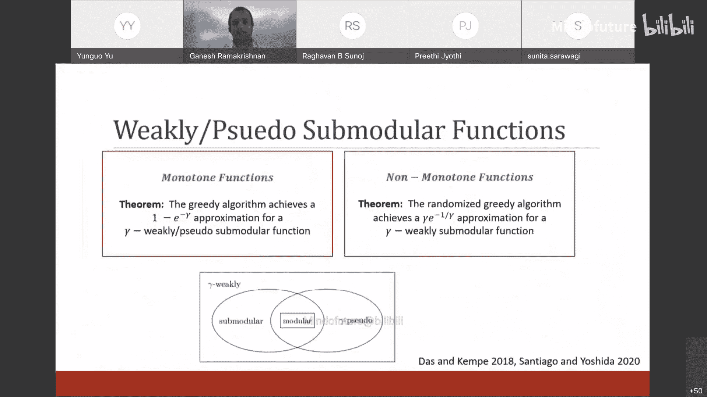
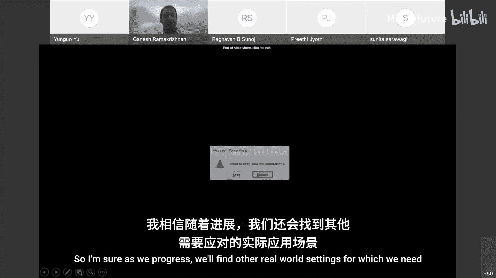
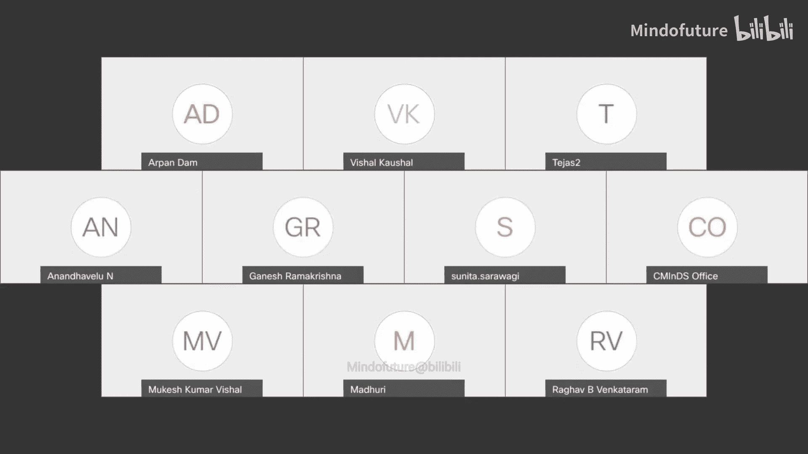

# 【印度理工学】机器学习优化 ｜ Cs 769 Optimization In Machine Learning p25 P25_数据高效性机器学习算法与工具包（福斯讲座__2021年8月11日） -BV18cBSBJEH1_p25-

This is good people to hear you clearly。😊，Okay。Maybe we wait for one or two more minutes。

 Will Is that okay。 Yeah， I think both students suggest。 Sure， sure。

So are you able to see the slight tro in this issue。 Yes， it's it's， it's clearly visible。

Maybe we can get started。Okay， shall we start， Ken it， I I suppose？Yeah， I'm fine for mine。

 Okay I think should start Yeah okay good evening everyone。

 Now thanks for attending the first C mind seminar series talk。

 which is also doubling as a first talk in the CSC department。

 I'm very happy to introduce our first speaker Prose Gation Krisrhnan from the CSC department。

 And today he's going to be talking about his recent work on data efficient machine learning。😊。

So over to your village。Okay way， Danash is also associated faculty in sea Mins。😊，Yes。

 yes and he's also serving as the professor in charge of the new Center for Digital Health。😊，嗯。

i thanks for the agenda intro。Can you see the slides ors some problem？ No， now it's not visible。Okay。

 something went wrong。Let me know when it comes up again。Not yet。You put the post control secondary。

 sorry。The slides are not yet up。 No， they're not visible。 So I've made you you are the presenter。So。

Can you stop sharing and share once again， Sir I mean， if that helps。Okay。你说。Yes，'s yes。

 it's visible another。Okay， thank you very much for the center centtro so this talk is about our platform data visions machine learning and the underlying research。

😊，So why this talk， one goal is to present our open source toolkits in this space。It's called decide。

worthy， which is released under MIT license。But also the goal encourage people to build upon these in two ways。

 at least。One is we can work together to introduce new algorithms into these and also use these toolkits in your applications。

嗯。So deep learning has seen a lot of traction through multiple modes。

 one is through improvement in the models themselves。

 as you can see here compared to older algorithms with large amounts of data。

 deep learning models are getting nearly human performance。😊，This is in multiple domains。

 whether its image processing or speech recognition。

And this is largely also because of some super linear complexity that these models have introduced。

Right， so you can see the growth here。And also the attendance at different conferences and workshops has been actually growing over years。

So this is overall unprecedented participation。However， is the problem solved？😊，So。

There are some key problems with large data sets and these massive models one space is compute efficiency。

 the staggering training inference costs。But theres also data efficiency， which is know it。😊。

Basically requires a lot of human labor to label， but even that has caveats because you may have biases in the way humans label inconsistencies and noise。

😊，So here's an example you see below， you know you can have web label noise when you try and create cheap labeling。

😊，Where you introduce the label that the web search engine already has inherently right so there are a lot of fragility to biases in the data and overall there is an information low overload both labeled and unlabeled。

嗯。So the compute intensity reflects in cost， of course， for example。

 training about model Wikipedia book corporatepo data set is 15 million INR roughly。

right or deep model for NLP with network architecture search NS stands for network architecture search where you are searching across multiple network alternatives。

 so you can also compute these in GPU days。U。For example。

 the ElLmo model which is used for contextual embeing in text or the Yo model which is used for combined object detection and recognition again on V00 GPU takes eight days。

So we can also measure the cost in terms of carbon footprint and it is not trivial。😊，So， I mean。

 if you look at the sustainable development goals push right。

 then this is certainly alarming given that you know。

 there is a phenomenally larger cost in training a transformer as compared to a round trip flight between and New New York and San Francisco。

So labeling cost is another big worry I kind of valued it earlier for some domains no the cost has maybe lower for example image data set for classification may be low but as the cognitive load increases you will find that the cost also increase phenomenally。

😊，Sometimes by a factor of 10。😊，嗯。说。The talk is about data efficient and robust machine learning。😊。

And。We identify all the places where efficiency could be improved data preparation stage。

 model training stage or validation stage where you're doing network architecture search。

 hyperparameter tuning and finally even in model deployment of course now there with the advent of TF chips。

 tensorflow chips you could probably delegate some of the algorithmic efficiency to hardware efficiency but nevertheless if you would like to do our best on the algorithm front as well。

😊，收。A common framework we are going to leverage in both our platform and also the algorithms is of subation。

And why do we do that well if you have large set of points。

 large space of architectures or a large space of hyperparmeter。

 you really like to identify some subset。😡，For most of the talk we will be really addressing subsets of points think of this as data points。

For most of the talk。啊。And you have some。Information function， F， which reflects some cost。

Right or informativeness of a subset of points。This entire set is called the ground set V and we are interested in doing a subset selection。

😡，We will be using properties of subsets or properties of functions on subsets。😡。

In the form of some modularity and information theory for most of this。Toxo submodularality。

Which I'll kind of define in a few minutes and information theory。哼。

So from a subject selection viewpoint， there are kind of two blanks we try and fill up。😡。

We are interested in selecting subset of dash for a particular purpose， so the second is a purpose。😊。

And the first is basically about the ground set being。That we alluded to in the previous slide。Now。

 depending on whether the subset is say a labeled set or an unlabeled set when we say labeled。

 we mean the。😊，The desired predictions y， for instances。

 x are known and unlabeled would just mean we have the x is known。

So typically in a cold start setting where you don't have。😡，Me too much label data。

You would be interested in basically identifying a subset。

Of the unlabel points and if you have a warm start setting。

 you would be interested in identifying a subset of the label points sorry this is this are the arrows got reversed so these are reversed arrows。

So we can also look at subset of model parameters， Sub of architectures and so on。 So we'll try and。

Divide up our platform in terms of cold start and warm start settings。😡。

There's been a lot of research in these directions these days。

So overall people have looked at coreets， people have looked at information theory also information theoretic functions and somewhat modularity。

 but overallal there has been a lack of benchmarks and toolkits in the space algorithms such as greedy。

 lazy greedy lazyziier than lazy greedy all of those have evolved in the space。

 but then benchmarks and toolkis is one big lacuna。😊，And that's what we are trying to address here。

So this how we divide up de， the first I would say the most fundamental component of all of these is the submodib。

😡，Which is about summarizing massive data sets using submodular functions。Some model optimization。

Some of them are not nest submodular functions， but they behave like sub model functions。

 the algorithms give you。😡，Guarants which are mimicking some modelular function。

 So we use some modelular in a slightly generous sense in the stock。

And I would like to acknowledge that a large part of this work was done by my PhD student Michelal Kashll。

 who also fortunately there on the talk today is an excellent job building this model and this has been used。

😊，By us， along two pipelines。One is the all start scenario， which is where you have。Unlabeled data。

 but very less label data。And the other was a warm start scenario where you have some amount of label data to bootstrap around and you are trying to increase that in a very principal manner。

So let's start with some model。😮，And with that， we also introduce a notion of submodular functions。

So， as you can see in this simple illustrative example on the right。

 prototypical example is of a submodular function is when you associate。😊，四。These the on with。Sa。

So we have you set A and set B， and you can see that。This B is a superet of a。

And here you have this one ball。Which is being added to each of these ones。F。

 the function measures a number of distinct colors of balls in the urn。😡。

So the distinct number of colors of balls the ur certainly increases monoonic function。

 but besides that。It also has this interesting property of diminishing returns as you increase。

The elements， number of elements in the set go from a to B。The additional benefit you get。

Is diminishing。 So in some sense， some model functions do behave like concave functions for those who are familiar with concave functions on continuous spaces。

 but here the the issues that we are dealing with a discrete space on the x axis。嗯。

But then they have some very nice properties these functions we see lots of examples of these they they are quite ubitous and besides that they are some very nice efficient algorithms now as far as using those is concerned I mean Vihal has made it very easy for all of you so this it is available as part of the desired team somewhat lab library and you have an excellent documentation there using it is as simple as a P install so。

😊，Let's now get into。嗯，诶诶低湿十失。So this is a bird's eye view of what we will delve into。😊。

You might be looking at subsets which represent the entire ground set。

 This is a ground set we and here is a subset that we seek。😡，So these are the ones marked in red。

Are the elements of a subset x。So in the case of representation function， you are seeking an X。That。

Basically maximize these the ground set well so think of the representation in terms of representing clusters so you want to really represent each cluster of set of points here。

On the other hand， if you might be interested in a function which measures how diverse the subset x of v is。

So in this case， you know you are trying to pick elements from clusters but not necessarily represent every cluster in fact two clusters here are very close by and therefore we are picked only one from them as you can see only this one has been picked and an outlier has also got picked because we have one diversity。

😊，On the other hand， you may look at coverage， coverage of concepts， so here are concepts， mail car。

 greenery and so on。So we will give examples of functions of each type。

 but now interestingly you could also use these functions in some kind of conditional sense you may want。

😊，To get this subset x， this is x1 and this is x2， you want these subsets possibly conditioned on a query queue。

😡，This is a ground set， so you have a query which is save person。All you may want it condition on。

Some privacy elements person， so what we mean is that x1 here in the first case is a subset which represents persons more than any other element。

😡，Whereas x2 tries to hide information about person this this is a case of privacy preserving。

 Now how do you really materialize these？😡，Is what well talk about。

So let's go through some instances of set functions。Representation functions。

Examples of facility location。If all most of you have probably heard what K means。

 but K means finds arbitrary means， but now think of B dooid which coincide with points in the space so that's what facility location gives we run through visuals。

😡，Then there are diversity functions and coverage functions so there are largely three categories you could you could think of besides you have set functions which are simple ones which are like linear functions where you know you。

😊，The F of x is the summation over all elements in x of。Some modular function M of x。

So there is no diminishing return， it just linear increase。😊，Now。

 we're going to pivot on information functions。 And now all of you probably heard of you know information functions。

 mutual information， conditional gain， etc cetera。 But well build all on。

These information function variant of these basic representation diversity and coverage functions。

There are also others which will not talk about discounted cost functions and so on。

 cooperative cost saturations which is obtained by kind of clipping the functions right with respect to some saturated saturation level but we will not really have the time there is too much already on the agenda and then there are other complexity functions which look at cooperation between points that are selected。

😡，But let's， just look at。Representation functions to begin with。I'm。

 I'm sorry before we look at representation function。 we look at information functions。

 which are going to be。Composed with representation， diversity and coverage functions。😡，说。

All of you have。Come across this most basic definition， right entropy。

 entropy or random variable and here we are is showing discrete random variable。

It's basically some overall values it can take a probability of x equals x into log of Pxc equals x x this is a discrete version and you can come up with a continuous version。

😊，But we focus on the discrete version now it turns out that this function。

 this discrete entropy is one of the canonical examples of a submodular function。😊，And。You。

 you've probably also seen this expression。 So you can look at not only entropy of a random variable。

 but you can look at。For example， this difference which is called the conditional gain。

 so this conditional gain highlighted here in a yellow。

Which is basically looking at the gain in adding an element E to an existing set in。😡，Now。

 it turns out that this conditional gain is you know monotonically increasing us。😡。

And because it's increasing or non decreasing rather。😊，It turns out that entropy is are model。

But this conditional gain itself is of interest。😊，And it will be interesting to see if you replace this edge。

 the entropy function with some other submodular function。😡，What the results are。

So this is how we play with submodular functions and create variants which are query relevant variants and privacy preserving variants。

😊，So imagine just replacing the entropy function here f with another submodlar function and will again delve into those。

😊，So you've seen mutual information， which basically is defined as。

F of a plus f of  Q minus F of a union  Q which also also could be written as F of a given  Q minus f of a if you want to borrow from conditional gain definition that we mentioned in the previous slide。

😊，So mutual information just shows how relevant a is to Q now you can replace f with a subular function and basically get other notions of relevance beyond just entropy。

😡，Likewise， you could also look at conditional gain it says okay given a query which I want to be kind of agnostic to what is the gain so this measures irrelevance to set P。

😡，Could be a privacy constraint。 And we'll see examples of these。诶。

So I will also try and take a canonical example， so lets say we have this query set I will focus more on the query based privacy preserving just follows so lets say this is my query set。

😊，An image of a dog， an image of some structure， turns out to be a church here。😡。

And if you look at the TC plot of a bunch of images that you are trying to retrieve from。😊。

These are the clusters。 you know， there's a cluster of gold images there a cluster of truck images and red in yellow。

 you have parachute images and so on。 So very well separated。

 And let's see what happens if we subject。You know， the the Gty。

Based information measures to the the the submodular function that we going talk about。

So first class of submodular functions is representation functions。

These are characterized by a similarity kernel， so you're looking at similarity between pairs of points。

😡，And the the。The simplest example is a facility location。Where think of， you know。

 trying to locate facilities。The points in red is what you are trying to locate。😡，Such that。

You are representing the points in green will。😮，The representation is measured through the similar function S IK。

So you are basically seeking these K facilities。😊，啊。

And you are seeking this cases facilities for all the points I in the ground set fee。😡，Okay。

 so there is basically some overall points of the max similarity of a point in the ground set to the k so you want to disclose closest this sky so this is like cameidoid clustering。

😊，Okay， so it turns out that this facility location is a submodular function。

 It has that diminishing returns property。😊，Which we mentioned earlier。

So what happens when you apply to bunch of images， basically you get。

The sames this is the class of representation functions now there is saturated coverage which you know also is a representation function where you have a threshold alpha I on the similarity graph cut is an interesting variant where you look at not only representation you have this representation。

😊，Part， but you also subtract out cell similarity。 So its kind of indirectly saying I want some diversity as well。

😊，Okay， but we will see more of diversity later， but largely this is what all these functions give you。

 They give you these good cent drives。😡，So they picked cents。Now。

 what happens if we subject this class of representation functions？😡，To information measure。

 what we mean by that is。We basically are conditioning them with a query right。

 So let's look at the mutual information。Version of facility location， the the first function here。

And now there can be other convey variance of that。😊，So we won't get into the details here。

 but for example， you might be looking at a mutual information version which is grounded。😊。

In the the set V that you want to represent。So we call it FLV MI so the ground set so but the key here is that you want to represent a query well so it it does pick up few query relevant instances you can see in response to the query of dog in the church youve got some query relevant instances but it tends to get saturated it iss very happy with just three images here two from dog and one from church and then then just picks up a whole bunch of other images which is basically just you know I mean basically trying to get some diversity。

😊，So otherwise it' is representing both the cents well。😡，So what happens now， if you move from。

The ground said we。To the query， So this is another variant of mutual information which is grounded in the query set。

And this is gives you highly query relevant rerieval。

 but somehow now because now you started focusing more on the query the。😊。

The bias in the in the population with respect to the query will also start reflecting and you find that unfortunately there are more images I mean somehow in the feature space related to the dog than to the church。

😡，And therefore there are more do images， it's very query。

 query focused this version because it's supposed to be query focused FQmi。😊，But unfortunately。

 it' is just biased by terms in the query。😊，O， so。There are other variants I will talk about so let's take the example of diversity functions。

So， diversity functions are purely based on diversity of the retrieved set and a very classical example is determinal point process based functions are logged it。

😊，So what is this L this L is basically a。😮，Subset of the similarity matrix。Subset pivoted on。S。

 set S， So S is a subset of B。All of us know the relation between the determinant and the volume of the of the。

Points that the matrix whose determining your computers are presenting。

So you could think of this deal point process as capturing the volume。

 so the hierarchy the more spread out the points， the more diverse the points the larger the volume。

😊，Okay， so the similarity kernel Ls that we have shown here。😡，If you take a subset which is diverse。

 then you will get more volume and therefore you have the highest chances of maximizing diversity functions。

😡，So here's as I said there is a subset of points that is picked up by maximizing DppP and even though there is a cluster here this is basically seizure images in contrast to sky images right but because both of them have blue backgrounds you found that its content basically picking one image from this combine set and it its actually。

Itss biased towards this outlier， which has no cluster of its one as such， is just a single thing。

So it is speaking basically items as different as possible。There are other diversity functions。

 dispersion， etc cetera， but now not all of them are sub modelular in fact。

 there is only one version here， this slide which is sub modelular。😊，So， this。

Dispersion sum is not some model dispersion min is not some model。

 but there is something called dispersion min some which turns out to be some model is again picking diversity。

This is looking at this person min， for example， looking at let's say you're maximizing you're interested in。

Maximizing maximizing the minimum pairwise distance between any per pair of points， right， Now。

 if even if it's not some model， there are some very good greedy algorithms which are which give you good approximation guarantees。

 So for example， half approximation guarantee through greedy algorithm is possible for disionment。

Okay。Now， lets see what happens if you apply mutual information to one search。😊，Diversity measure。

And you find here that the expression is is shown here now youre looking not only at。

This will the similarity between the points and the selected subset。

 but you' are also looking at similarity within the query points。😊。

And the same is observed with mutual information even though the query is dog and church the focus here is actually more on diversity its landed up getting dogs with different poses。

 itt really mean and that's because the image collection had more dogs its of course synize itself to the query but unfortunately church is nowhere here。

😡，So it's banged more on diversity with some representation of the query。So you know likewise。

 we have many other sub model functions there is coverage where you are trying to cover the elements all of us have gone through basic course where we learn set cover functions。

😊，So you are trying to cover these features by picking the right right set of documents。😡，Okay。

 so dog， cat， bird， man， bes， etc ce， so these are keywords which you are trying to capture through these documents。

😡，Now， it's possible that some of these keywords have more weights than the others。😡。

So you are trying to cover concepts and you could optionally cover concepts with higher voltageage。

And。So this discover is through this bipartite graph， you can see what is matching。

 which document set is matching which set of words。

You can have a similar kind of notion of coverage when youre looking at images。😊。

Either objects or in the feature space。But the basic idea is select selecting instances which cover all concepts。

说呃。You could also have probabilistic versions of these probability that an image i covers the concept J。

😡，And this is a kind of noisy or extension here。You want to basically maximize the probability of covering the concepts at least one concept being covered by the image。

So you could also extend these now with slightly non trivial extensions。For example。

 concave over modular functions， so concave functions such as square root you apply it on a modular function that turns out to be some modelular。

And again， we see that youre getting highly query relevant。😊，嗯。Results。

And they are all actually they're trying to represent all of the points here。

 So that's very interesting because you the the focus is somewhat on the features here。

 So all the images have to do with either a dog or a js。😡。

But in that process try to get some diversity。 So its all of these functions now behave behave differently just based on the focus。

😡，And you can likewise， have feature based functions。You're trying， for example。

C look at the contribution of a feature in a set of image set s through lets say up penult layer。

In a deep network。Okay， so you can come up with deep some modelular functions and this deep sum modelular function is banking on concavity properties。

The conca over modelular property that we discussed earlier。

 which leads to some modularity so you can basically have now compositions of these。

So sum we talked about some mod functions， some of them are actually even monotone and monoton asity yields itself to some better approximations approximation guarantees with respect to greedy algorithms。

😊，Some of them are non monotone， for example， log determinant is non monotone graph cut is not monotone for know lambda being less than2。

 but lambda was basically the trade between the similarity of a point from a cluster from the selected set to all other points。

With respect to the cell similarities， so Lada is that trade off。嗯。So。

 there are also non some modelular functions which I mentioned， for example。

 disparity and disparity some for which greedy algorithms still work reasonably well in practice。

Okay， so this is like a bird's eye view of information function classes I won't get into the details。

 but this is what we have kind of shown so far， this is like flashing in front of your eyes a summary。

😊，We have looked at。The query based ones， this is the query based ones we looked at these what we did look at was a privacy preserving class。

But I can imagine， I mean， I'm assuming we can imagine how you're going to get counterparts where now。

 instead of retrieving images from the dog on the church class。

 youre trying to hide the information about dogs and churches or， for example。

 about anything that's of importance from a privacy perspective。

 you could also have a combination of these where you're looking at。

Query sensitivity and privacy preserving， just agnostic to the information and P。😊。

So we will talk more about the applications of these then get into match details。

 maybe probably in a future talk we could have more details more deep dive。😡，So， this is a summary。

 we have three class of functions， representation， diversity and coverage。😊，And for all of these。

 you can compose with them with you know information functions to get query focused or privacy preserving summarization。

😊，Now， what about the。Algorithms for optimizing。 So the the general algorithm。

 the general optimization framework is you are trying to maximize。A function if。

Over the subset a of the ground set V。😡，Subject to some selection cost on the ground set a sorry on the sub selected subset a。

😡，For example， this simplest example could be that you are looking at them。Cinality of aim。就呃。

If you we would like that it is monoton submodular。

 but at times it is also non monotton submodlar and dispersion functions weve seen are also well behaved functions from a greedy perspective。

 greedy algorithms perspective。😡，And we will typically assume that the selection cost is modular。😡。

Okay。So the simplest algorithm is the greedy algorithm here and you are basically selecting element the next element E。

 which maximizes the function f。😊，It post inclusion into the set S。

 so is just greedily growing the set S。😊，How good is this set Sk？😮，嗯。Well。

 it depends on you know what the cons it is， so let's say looking at cardinality constraint。

So it turns out that under that condition， you can come up with some approximation guarantee。😡。

In practice it is pretty good so you can see optimal in green and the greedy is in blue here says pretty close。

😊，Within say，95% of the optimal。This in practice and and here is the the use case trying to place sensors to cover know different measurements on a field and each sensor placement leads to some coverage so coverage as I said is one example of some model function。

And you really kind of introduce sensors。At those locations which have which maximize the remaining part to be covered right and that turns out to give you a reasonably good solution。

 almost as good as optimal。😊，But it turns out that in theory as well， there is。😊，I mean。

 I won't say the most exciting but a very interesting characterization of the approximation guarantee is just 1 minus 1 over E。

😊，Times optimal solutions you have at least that much when you are trying to maximize。😊。

This is at the optimal solution S K I sorry， the obtained solution Sk with a budget of k。

It also turns out that there is no polynomial time algorithm that can do better than fSk in the worst case so this this greedy algorithm。

😡，Is actually a good greedy algorithm。But you could also have other constraints， for example。

 you could have cost constraints which are different from。Cinality。So。

 in which case there are variants which look at a combination。

 a hybrid of greedy algorithm and a modified greedy。😊，Which looks at a weighted version of the gain。

 So this FSI minus U SI union U E minus FSI， this is what we are already familiar as the conditional gain。

Yeah you given S。Now you divide the conditional gain by the cost and pick the e star， which is the。

Next， maximizer。And this just reduces the approximation factor by a half。😊，But in practice， again。

 can it's even better。😊，More importantly there have been other faster sorry other more effective algorithms which are slower。

😡，But yes。This is something we implement in the submod package。

So sum there is a problem formulation and the greedy algorithm framework which we implement in somelib。

😊，嗯。And the use of some model live with the choice of these algorithms and also the choice of information functions。

😡，With slapped on top of these different notions of representation diversity coverage captured through suitable submodular functions is very easy to use its just a few lines of code as you can see here so you can pick a ground a ground data。

 the V from where you are selecting a subset， but you may have a query queue which comes from a different subset。

And you basically you can also choose the greedy algorithm and what I explained was9 greedy。

 but the versions like the lazyer greedy lazy greedy which which gives you exact solution for。😊。

The sub modeller case。Through a kind of branch and bound search。

And those algorithms are all exposed here。😡，And as you can see。

 if you just did gen summarization on the set of points in this way in this rectangular plot。

 you basically land up。😊，Picking these points here right there' no query so you just get some kind of diverse set of points using facility location youre not just diverse。

 youre also trying to represent the points in the set。

Whereas if you looked at facility location with mutual information， simple few lines of code。

 but you now see these are the query points， the points in。😊，Green are the query points。And。

You find that。The model has the algorithm has not picked any point from these two clusters because they are too far from the set of query points。

😡，On the other hand， the moment I put a privacy constraint。

 no point from this cluster has been selected。😡，Yeah。

 so this kind of ripples the selection of point from that cluster。

So this is how easy to use it is so you can write out yourself。Now。

 we will quickly move on to other models that modules that build on some model the first being trust。

😡，Which is focused on a cold start setting。😡，So trust。

Builds on very naturally on the information functions。

 specifically the query driven information functions。Very easy to use。 and here's a use case。

 so imagine。That。I have a large unlabeled data set think of this as my ground set we。

And let us say I specified to it a query set queue so you as you can see these seem to be like nighttime images。

😡，90 metters。And based on these， now you are able to find a subset。😡，See it。Which kind of maximizes。

The information function。Between a and Q。So， this is a very natural use case in cold start settings。

 let's say have I have a large unlabeled set and I have few images which I know is going to be of my target interest。

😡，And I could just select the subset and ask a user to label these that create my dark targeted subset T and that could be augmented to an either existing or an empty label training dataset so that's why it fits the warm start setting pretty well。

😡，So this is a very easy to use packages builds on what we have discussed so far。

 this can also be used when you are iterating on Confuciion matrices I come to that in the next slide。

But the， the， the usage is as simple as submod of itself。

So I already gave you this one use case where you have the unable set Sv and target S Q。😡。

But you could have other cases where you are reerating through say a performance evaluation on a through a confusion matrix and let's say there are some false positives or false negatives that catch your attention you would like to reduce them。

😡，So in this case， this false positive or false negative set can become your target at Q。

And you could do subset selection either on the validation set or the training set。

Other use cases when you are trying to do targeted selection for say personalization or customizing say handwriting digit recognition to a specific user a particular deployment scenario。

 so this becomes very interesting in say OCR settings or handwriting digit recognition settings things that I work very closely in。

😡，So these are some use cases of trust and you know the algorithms implemented in addition to the submodular diversity repetitation coverage。

 we also made the usage of the submod easy through relevant abstractions。😊。

In the form of query relevance and diversity， for example。

 where you are trying to look for rare class， you are trying to capture examples to be labeled which are aligned with some rare class。

😊，I gave one example， light images。Or instead of a targeted Q， a  query set Q。

 you may have a privacy set P。😡，So you may want to pick points that are not very close to the outliers。

😡，You may， in fact， have some labeling functions or some human rules。

It you have already done a fair bit of the job and you really want。😡。

The subject to be labeled to be far from rules， far from the examples that the rules cover。😡。

And that's what we that's another application we'll talk about next。😡。

But you get a glimpse of how trust also lets you be benchmark。😡。

So there are different know lock deck。Festtive location。

 the two versions we talked about graph pattern and so on so all of these you can see that in general the use of these information function makes a big difference to targeted subset selection all of these are actually quite dominant with respect to existing state of the art but you are welcome to add your own new bench new algorithm here and benchmark against those which are already a part of trust。

😊，So。I'll move on to another application， which again is a kind of cold start setting。😡。

It's called spR。😮，Semi supervised data programming， that's what it stands for。😡。

And the idea here is to reduce labeling efforts using data programming and subset selection。

As usual it's very easy to use has extensive documentation and a bunch of our BT students and PC students are actually built it over the last six months。

😡，What does it have basically you can design something called rules or labeling functions。

 so here's an example， let's say I'm interested in identifying a question I'm trying to do question classification。

😊，And。What are the classes you are。it could be a description question or it could be a numeric question if it had a keyword such as how it would probably be a description question。

 but if it is how long then it is a numeric question。😡。

Now obviously how would also match numeric questions there is some kind of overlap you can see between them。

 you could have more complex labeling functions。 Here's an example which is looking at labeling function which identifies。

Whether to x and y have a spouse relation or not。😡，So these could be arbitrary Python functions。😡。

What we allow is you know very rich set of prepro， decorators for all of these and we also have continuous scoring functions that some joint work you know I did with Sunita your back through a master student those have also been incorporated here。

Now， all of these could be applied on unlabeled data。

 so you could just apply all of these on unlabeled data。😡。

And basically get your tentative labels or weak labels， and that's what we call pre labeling。😡。

So you could do that and then you could run one of your favorite consolidation models。

 what we call label aggregation models。😊，Because these label these labeling functions。

Aden could be noisy。You may want to b。Parameter parameters of those labeling functions。嗯。

What we also add here is the facility to do semi supervised learning。

Instead of a standard paradigm where where you are just trying to generate the label data and then forget the labeling functions。

 we let the user operate in a larger context where user can have the unlabeled data the labeling functions and also some label data and well come to that next I'll take another example here with image example plus so all of you probably have used。

😊，You know， Google album and then you can you can actually label examples with exemplars you this is a user defined label says this is my brother。

😊，To categorize uploaded photos。So now you could also write rules， for example。

 saying that add photos to an album X when the photo contains a person name。

 So the rules need not be always no。Textual rules， these could actually be exemplar based。

And you could also compose these rules。 I mean， a bunch of family members put together。

So you could create albums and let these get added to your photo categories。The issue， however。

 is that there could be。Incorrect examples， right， So some of these are wrong matches。

 incorrect matches of of a particular person sooner。嗯。

So what we provide here is different label aggregators so now there are two way two paradigms for label aggregation one is a cascaded approach where you say okay I have a gener model which takes these the outputs of these different labeling functions。

😊，And just generate the labels and then you pass it on a discriminative model。

 which has nothing to do with a generative model。😡。

It has nothing to do the labeling function right so these are two world。😡。

We also support joint approaches where the two can operate and coexist。😡，And not only that。

 you can also prompt for labels prompt for examples which need to be labeled。So。

 these are some state of the art algorithms both cascaded and joined that are supported here I mean。

 I will just very briefly go over our version， which is the sp。From ACl 2021。

So this is what we facilitate。 So let's say you have。The labeling function model， I abstracted。

 I try to abstract the。The the math using some color coding here。

 So you have some labeling function model and you have some feature model。😡。

What this allows you to do this programming paradigm allows you to do is that you could try and match the labeling function model and the feature model on your label data or on the unlabeled dataset set So the first component here of the loss。

 for example， says I would like。My feature model to do to be very aligned with my ground truth。

 So there is a feature model and ground truth。😡，The second says that the entropy of the feature model on unlabeled data should not be high。

😡，The third component which is very interesting， we say oh。

 I could look at alignment between the feature model and the labeling function model。😊。

On my unlabeled data。Or I could also look at feature model and unlabeling function models alignment on a combination of the unlabeled and labeled datasets。

😡，In addition， we also provide for the。Human prior in the form of precision or quality guides on the labeling functions。

 this can also be obtained through validation set in the case that you you have label data。

 but otherwise this can be just human priors。😡，Now， what we also bring is this label data。

 how can it be selected intelligently？😡，So instead of these the label instances being know generated in an ad hoc manner。

Can we use our subset selection paradigm for generating this label data here's an example。😡。

So instead of you know， you could have your labeling function based exemp plus in the Google album case。

 but could we be proactive about the examples that need human supervision？😊。

what we want is that the selected subset should complement and not really subse the labeling functions。

😡，So how can that complementary action be enabled？And that that is where recall that we have this prize privacy preserving notion of summarization。

 So think of selecting a subset a。😊，Which preserve the privacy of the labeling functions which we have already at our disposal。

😡，So this is how we see complementarity。😡，And here's an example， you have two labeling functions。

 L 1， LF 2。And they seem to be in good agreement on the instances S1 and S2 they seem to I mean a labeling function says that S1 has labeled plus 1 and labeling function2 says S2 has labeled minus1。

 this is for basically a YouTube spam classification task。However。

 these labeling functions are completely confused for on two other instances S3 and S4。

 so either both abstain from firing or both of them give the same label。

 I mean you conflicting labels， both of them fire。😡。

So what what we provision for is using our privacy preserving subset selection paradigm looking you try to maximize say a function f。

Of the subset a， given the privacy set P where the P is basically these labeling functions。

And the set a that we choose。Turn out to be S3 and S4。

So this is how we get complementarity and that's what contributes to our robust data programming and at the glance you can see how this kind of issue sort of you know handpic examples if the examples are governed by privacy preserving law objective。

😡，Information measure based on submodular function combination， we get significant gains。

Just want to draw your attention to the last two rows where you're basically doing subset selection。

😡，Either in a supered or an unsupervised manner。So I know we are running a bit out of time pretty。

 can I just go run to the last two mode？😡，Moduuleles。说说对。So。

The the remaining two modules have to do more with the warm start setting。Carts。

 core sets and data subset selection。Where the idea is to bring robustness but also reduce endtu training time from days to hours to really to hour hours to minutes。

Using notions of courses and data subset selection。

And the idea is if you have lots of these points as redundancy。

 there is really no points like picking all of them。

 so can you just be intelligent about the points you select here。

And this we would like to do in an end to end manner。😊，In conjunction， with the model being trained。

Again， the use of this is very simple， we have lots of benchmark algorithms implemented here。嗯。

So here are some use cases if you want to do efficient and robust supervised learning。😡。

Just select the set of points which which would really make the difference。

 maybe points close to the margin。You could also use it in a semioy setting if you want to do hyper parametermeter tuning。

 lots of parameters to select from。😡，Sometimes you can a subset of the data can be more effective for hyperparameter tuning even in terms of robustness and finally efficient network architecture search by using small subsets of label data。

😊，So this of course， a lot of ongoing going work， some of this is also joint work that we are doing with IBM research。

 some of sp and some of parts as part of their AutoMl platform。

But here are some algorithms we implemented and few of these those are Rs Glister and gra match this from this year。

 well Silelcon actually it is being integrated it is not yet integrated。😡。

And then we shall earlier on had worked on data sub selection based on some model functions in 2019 so so all of these have been implemented and they they also benchmark so I'll just run through Glister as one canronical example。

Of how cardss the paradigm of cardss。 And we kind of followed up in Iml 2021 with gra grad match。

 But the idea here is， if I have。啊。Planing data T on which I want to maximize the likelihood。

And you are trying to obtain the theta star that maximizes the likelihood。

 but you also have a validation data at your disposal。😡，Now。

 could you make effective use of the validation data to do efficient training？😡。

You probably you don't need the entire you maybe you can get this theta star as from a subset of。😡。

Subset S of this entire training set U。By leveraging signals from the validation loss。

 that' is the basic idea。😊，So select a subset s of U is that the resulting model performs the best on the validation set。

😡，So the best evaluation is on the validation set。So what are the requirements for optimal subset selection？

😡，We would like the selection to be as fast as possible。

 so you really don't want that subset selection time really you know becomes a big overhead。😡。

And you also want some theoretical guarantees of subset selection algorithms。😡。

So how do we select the right data for efficient and robust learning？😡。

So heres the oral optimization problem， you are trying to maximize the likelihood on the validation data with respect to a subset s of the training data which governs the parameters theta。

😊，That turn out to be the optimal ones。 So theta is star， which I mentioned in the previous。B。

So ultimate goal acid test is a validation loss and that' is how we often also do a hyperparameter tuning。

😊，So。Now what happens if you use the full training data set thats also that's another option so all that follows through if you just replace V。

 you can also replace V with S oh sorry with。😡，You enter training set。

So there are some class of problems of which the inner a mat can be solved in close form。

 for example， if you have the N basease as as a likelihood as a model and likelihood of the N basease。

😊，It turns out that in the simple assumptions of known class priors， the。

The N based classifier just becomes a feature based function model right we talked about the coverage based models。

 this is a modeler。😡，And it turns out that if it' is nearest neighbor。

 then it is a physical relocation function。😊，But unfortunately， this is not good enough for us。

By because the inner optimization problem will not necessarily be based on night base or nearest neighbor so in general solving the inner optimization problem to completion can be expensive。

And also solving in a close form can defeat the purpose of setting subset for faster training。😡。

So what are the approximations， The first approximation is。

You could approximate the inner optimization problem by taking a single gradient step so。

This would probably click to anyone who is familiar with simple gradient descent optimization。

 don't really look for the optimal solution。😡，So this give you the the。

Likelihood in the validation set in terms of this single step gradient。😡，However。

 this is not good enough。Now there are some theoretical findings if it turns out that when the validation log likelihood is either negative。

😊，Logistic loss or negative squared loss or negative hinge loss then。

The above optimization problem becomes a cardality constraint， a model of optimization problem。

 So this is this。说话的时够。In in in one case， if you have a negative cross interrupttro P loss。

 then you have something called weak sub model I mean some model function weak is a model function。

 I won't really have the time to get into that I had some slides， but we had to skip them。😡。

But it suffice to say that you know this is very handy because now you can look at deep networks。

 you can look at the last layer of a fully connected network。

 a convolutional neural network was most of the time youd be using either logistic laws or cross enpy laws。

😡，Or if you're doing regression and squared loss。😊。

And there is some modity weve already seen this natural diminishing returns property so I let to skip this a weekly submodular function because that is only in the one case。

😊，So what happens is that this is not good enough to get further speed ups。

 The issue is that you have to do a complete forward propag on the validation loss even with this one step approximation。

😡，So instead of doing this multiple forward passes as you are selecting every element。

 So for then the multiple forward passes are for。Each。Example x that we are we are adding。

To the set as， we need to do this forward pass。😡，Even if you use a greedy selection algorithm the which we discussed earlier on。

So， here's another interesting。Approximation， we basically use a Taylor series approximation on the LLV。

 which is the validation loss。😡，这。This we are doing on the first order。Update that the the。

And as you can see， there' is only one element now on which you will need to basically access。😡。

The training said with respect to the set test。The fact as to which you are adding elements。

 the rest has been separated out。 The validation componentss are separated out。

The what we are trying to do is reduce the cost overall in computing the optimal subset s by greedily adding the elements x to the set s。

😡，So this gives us a online framework。 the Taylor series approximation where。

We are not doing the subset selection at every step， rather。

We now have L box of the stochastic gradient descent。😡。

Then we do a greedy data subset selection algorithm。

 but this greedy data subset selection is on the Taylor series approximation。😊。

And then you go back and do a bunch more of updates， stochastic gradient updates。😡。

So this this is the online framework。SoSo data selection is done every epoox and you know we try different values well and it's pretty robust。

嗯。So some more computational aspects which I'm going to skip here。

 but instead of selecting a subset every epo in addition to selecting every LApos。

 we use only the last layer gradients and there are also other variants of the greedy algorithm for example。

 stochastic greedy selection does well where you are not picking elements the max element but probabilistically probably proportional to the value of that element you're picking examples。

😊，So without getting the details is what really this helps us is that if you have a full training complexity。

😊，We based on a the backward pass of B and a forward pass of F。

On an entire training data set n and this n is the key。😡。

Now you don't have n into t anymore right so n is kind of decoupled from the T and the B so that's the main finding and this really gives us in practice good speed up but in theory also theres some interesting converges analysis properties now what I would really like to draw your attention is that our Taylor series this approximation had this term which invoked the dot product between the validation gradient and the。

😡，Prain ingredient。So recall， Taylor series here。And it turns out that。啊。

The the this particular art product is suitly normalized here。

This has a very important bearing on the convergence。So the closer。

 the more aligned the training gradient and the validation gradient are。😡。

The better we can do the faster convergence we have so we can get convergence in one upon Epsilon square where you are basically trying to get an epsilon bound to this min loss over all the epochs。

😡，So this this is the dot plug also motivated some more works of ours we where we tried and align the gradients directly instead of looking at any first order approximation on the validation laws so that led to this is exactly what motivated our follow up work which was at ICML this year called Grd matchch。

😊，Where we try to basically we try to match the gradients directly。

But efficiency wise is this this gives us a significant speed up so anyway for example。

 if I want a speed up factor of 7。😊，Then I have to basically where with a test error drop my error increase of around  three or 2。

8 to 3。RightBut if I am happy with a speed up of 2。5 to3。

 then actually there is no loss at all there is a 0 theres there is no drop in the also no increase in the relative test error。

 So these are these are interesting to note。😊，And you know， there are some again。

 very interesting results for semi supervise， but very pronounced again we get for hyperparmeter tuning。

😊，Yeah Ill leave you you to read the papers for the insight。

 but the summary is that almost3 x speed up with no loss for both supervise and semi supervise and almost 10 x speed up for automl。

 which is where you are trying to do hyperparameter tuning with no loss in accuracy。

And robustness wise is also this because we are looking at validation loss。

 we find that the model is fairly robust but summary is at phi x to 7 x speed up compared to robust learning algorithms while achieving comparable performanceers。

😊，So what does cardss offers you overall is not just grad match but a whole bunch of other algorithms I kind of mentioned Glister and then this gra match which followed up but there are many other variants of those。

😊，Along with Craig which was published at New Europes last year， sorry IMl 2020。

 so you can actually profile and look at how they compare with each other both in terms of speed up and error on supervised and semiupvised。

😊，So this is cards and a last maybe very quickly I'll talk about distill the last module。

 which again focuses on the warm start setting。😊，Which assumes that you have some amount of data label training data。

But it also lets you grow that said， So I got this very natural flow for the talk also because now we have grown the data。

 but we all know that we we have you know ever increasing changing distributions right So how do you adapt to changing distributions How do you label get more data label in operational settings。

😡，So all of you， all of us must have heard act of active learning。

 but we call it deep diversified interactive learning because we are also interested in doing end to end learning。

😊，So again， this still like all the other modules is very easy to use an extensive documentation。

 but the goal here is you you want to consult the oracle labeler in a warm start setting and get label data and grow the data。

😊，So one some very interesting properties of distill is that besides having many state of the art algorithms in Pythtch。

 by the way， I forgot to mention everything is in Pythch， entire platform is in Pytch。😊，um。

It has a very important property two important properties。

 one is it has implementations of several common deep neural networks。😡。

So you find it very easy to get started on your favorite end application。Equally importantly。

 what has happened is a lot of active learning has been profiled。😡。

While not factoring in the effect that data augmentation could bring in right if you could。

 if if you augment data， let's say by flipping images right in a C far10 kind of setup。

 you often that that often underdo the advantage that。

Active learning brings in so this still also has common data augment techniques so that generalization performance can be improved and you don't bank on active learning alone。

So there are several state of the art algorithms and Glistster we have our own active learning version of Glistister which Ill just allude to。

 but the many others you are welcome to go and visit and try it out yourself。😊。

But since I talked about Glister， the active learning framework is a very simple extension there。😊。

Where you're basically selecting。The subset of points in every epo to be labeled。

 So you're you're basically。Iifying the points that need to be labeled。

 This is the set to be labeled。😡，But then the question could be， how do you do parameter estimation？

😡，So for the inner optimization， theization the parameter estimation is done using hypothesized labels。

 which means labels hypothesize using the preveiteration。😡，嗯。

So that's a simple modification in Glister actor right and I probably I'm running out of time so but the thing is Glister achieves a 7 x to you know 7 x speed up at 10% we you're looking at 10% of the full training accuracy and 3 x you're looking at 30%。

😊，But yes， you are welcome to go and visit I think we have totally run out of time and you can also compare several state of the art algorithms on you know not only accuracy but also labeling efficiency。

 which is basically the kind of throughput for every label example that I label what is the gain I get in accuracy。

😊，That's it and we actually made good use of decile in some of our applications so video analytics weve made weve had products which are licensed and you know it has also hit deadlines and interestingly the newspaper articles also carry reference to decile data vision learning as you can see here times we India explicitly had a link to Deile。

😊，So so far weve made use of that but really want to make use of we have an active collaboration IBM research where we are making use of Deile So these are impacts so far but we really want to make an impact in many other fields so OCR machine translation post editing and some ongoing work with pretty also on speech personalizedized speech recognition and then there are totally upcoming ones where would invite all of you to contribute to the upcoming list so thank you very much thanks for going a little over time sorry sorry for going a little over time and thanks for bearing with me。

😊，Thanks a lot， Kneish， for a very comprehensive talk and introducing this very。

Potenentialally impactful toolkit。 So I welcome questions from the attendees。

 I think Pro Sooj has one question。Yeah Guinness， it was really wonderful。

For the question or at the point that caught my attention is you said that hyperparameter tuning could be benefited by using subsets。

 so in that could you recommend whether if you were to select between representation diversity and coverage？

All three is a must for this exercise， or you would recommend this being the topmost priority to be considered。

Oh thanks Vi for an excellent question so let me just rephrase your question was if if you want to do hyper parametermeter tuning what criterion for subset selection would be the most effective。

😊，Yes， the three representation， diversity and coverage。

 assuming that we don't have the bandwidth to do all three together。Okay， thanks for that question。

 So my general experience has been that if you're in a cold start setting， right， I mean。

 it's like a toddler， a child trying to learn。😊，You would like to do representation well。

 I mean you would like to represent the real world scenario because if you are going to confuse a toddler with too much diversity that toddler will not learn anything。

 So in the cold start sitting I would generally recommend representation。😊。

But you already have a lot of data right and like let's say hyperparmeter tuning I'm assuming you have lots of data already。

 right。😊，In which case I would say a I mean， you could focus a bit more on diversity。 for example。

 the graph cut function which does kind of blend diversity and representation。

 I would recommend that。Okay， thanks。Thanks for the辛。Hi， Ken。Yeah please I have three questions。

 but I think the time may not allow me， but let me ask you one question I desire to have answer。

So this kind of subsle selection， right。 So in general， yes。

 we we can see why it's very efficient for training the model but one a key question。

 I would like it as in real world data， right， the data is not always ideal。

 sometimes even actually quite dirty。 So in this case。

 you will use this kind of algorithmism can actually generalize after you're training the model for the real world data。

Correct， so so how does it work in real world data is that that is a question right？😊，Right， yeah。

 my question is。Use this kind of selective sample to train in your model hows whether the model can be generalized in the real world。

So our experience， at least in the video analytics， this is absolute real world。 So I I mean。

 the whole platform is driven by real world。😊，So Im I'm sure as we you know progress。

 well find other real world settings for which well need to。

Sorry， this is got。So I just wanted to show you the the use cases in the the video analytics setting。

 For example， we， we had these issues where we had you know。

 training data was very different from the the data in which we wanted to deploy， right。

 So in video analytics， we we， we were able to identify the target using something like trust。😊。

So these are actual real world Now the the caveat there is， yes。

 if you are looking at anomaminly detection。Right this classification at the level of frames or the videos then possibly it can be easily deployed。

 but now if you're looking at object detection within an image what are those rare phenomena I'm sure there'll be some significant extension that we need to bring in I would still believe that the libraries that we have the core modules that we have they are applicable more helper functions will be required for certain sequence to sequence or know structuresd settings when you do want to do object detection within within an image so in that sense for those real world well have to build more decorators more wrappers around what we have but yes algorithm algorithmically there's a lot more to be done and maybe on a specific use case we will know what needs to be done on the algorithmic front。

😡，Thank you。Yes。😊，Thank you very much。Thanks。Thanks for a question on chat from Abije I'll just quickly read it out so data augmentation is widely used to improve generalization and robustness of deep learning models but Ler sounds like it's opposite to data augmentation is it possible to make both these approaches complementary。

😊，Okay， that that's an interesting thing。 Yeah， so list lister basically hinges on。

Finding a subset yeah so there's a kind of assumption of redundancy and that's a very good idea we are exploring that with some of our collaborators we are trying to see how that there have been approaches to like mix up right mix up does data augmentation can mix up be be seamlessly used within a gl like validation pivoted subset selection framework for on the training set so there's very interesting'm myself invested in it but if there are other thoughts I'll be happy other ideas will be happy to see collaborations emerging from the talk but nice suggestion obviously。

😊，Are there any other questions from that attendees。嗯。Okay， if not。

 I think we can wrap up thanks again to everyone who attended the talk and thanks many thanks。

 Dansh for So can I just add to one more point from obviously I just you know。

 mulling over his question a bit more。 The， the other interesting thing which I didn't talk about much at all。

 which is a combination of privacy preserving and write。😊，Qury sensitive。 So a， I mean。

 let let me just go back to that overarching present in slide。

So if you look at this overall use case right we can have not only very relevant but we would like to get maybe examples which are different from P right so we could also use this privacy preserving setting for data augmentation and we haven't really explore combinations of these though we have trying we be looking at these in isolation So if you look at this combined information measure I think this's go for bringing together sub selection and augmentation。

😊，Yeah， that's all I wanted to add， thanks。Thanks again， very。得十点啊。Thanks， by。

