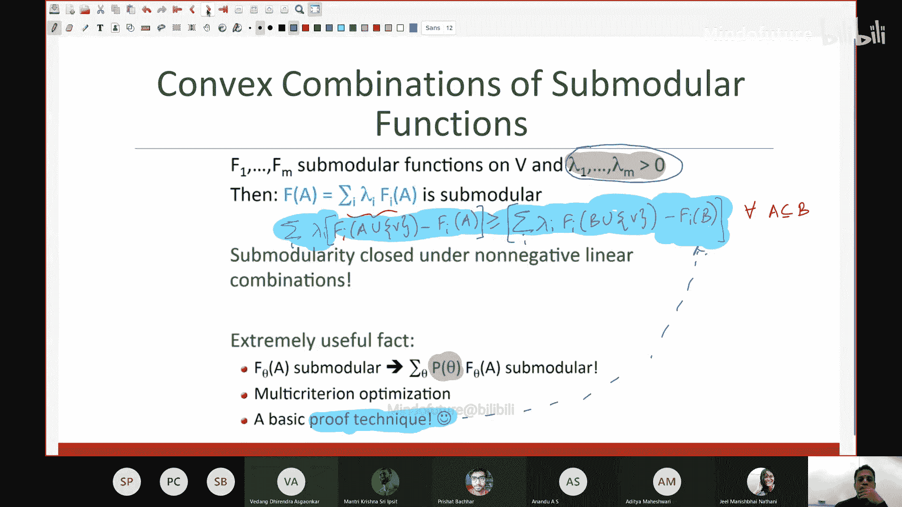
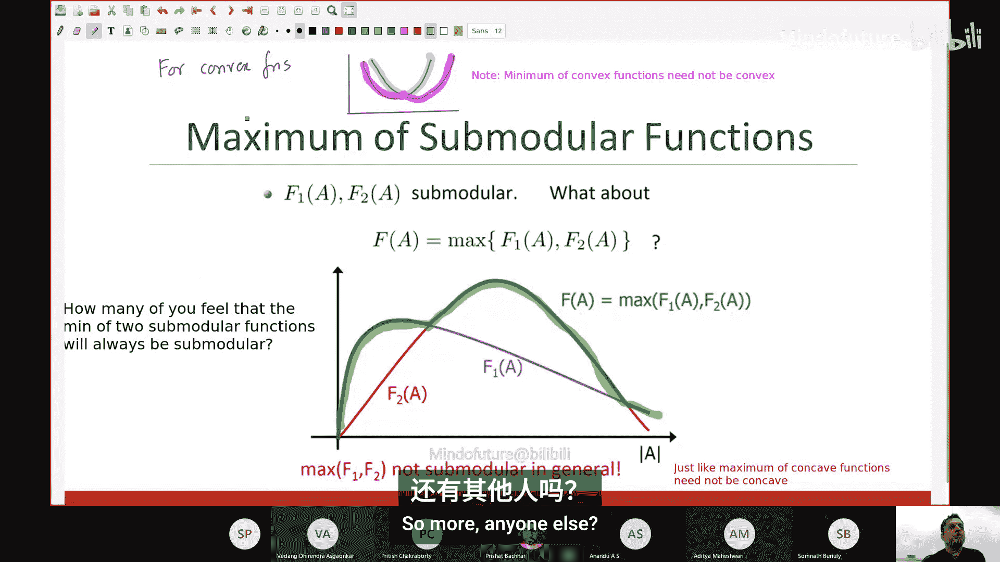
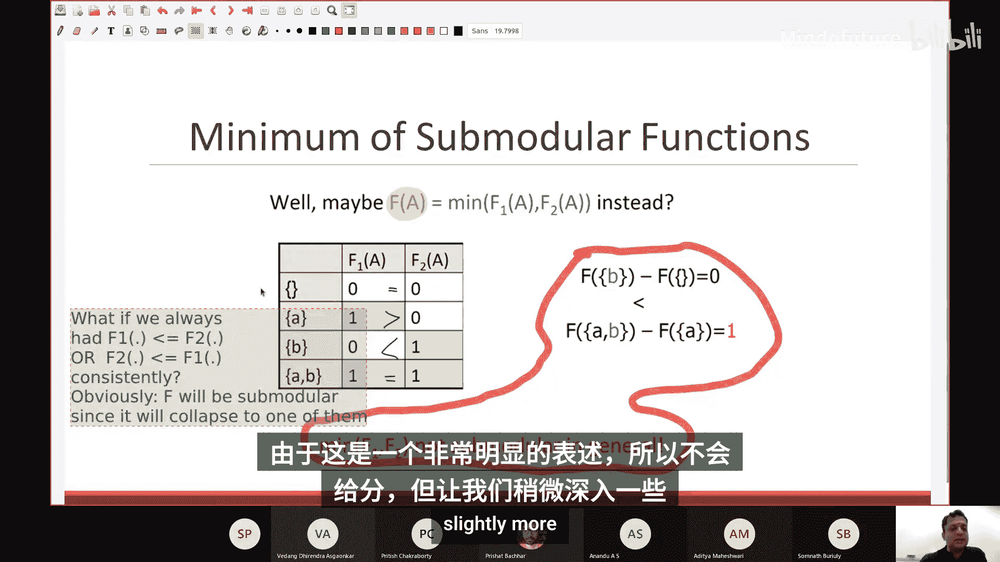
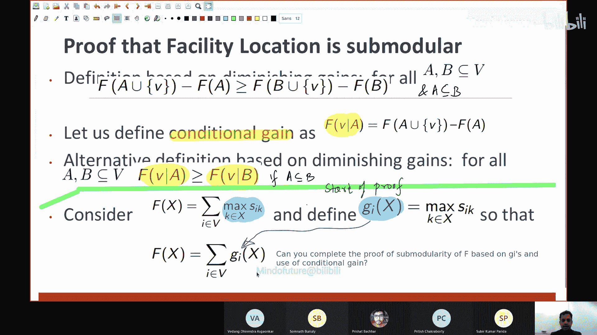
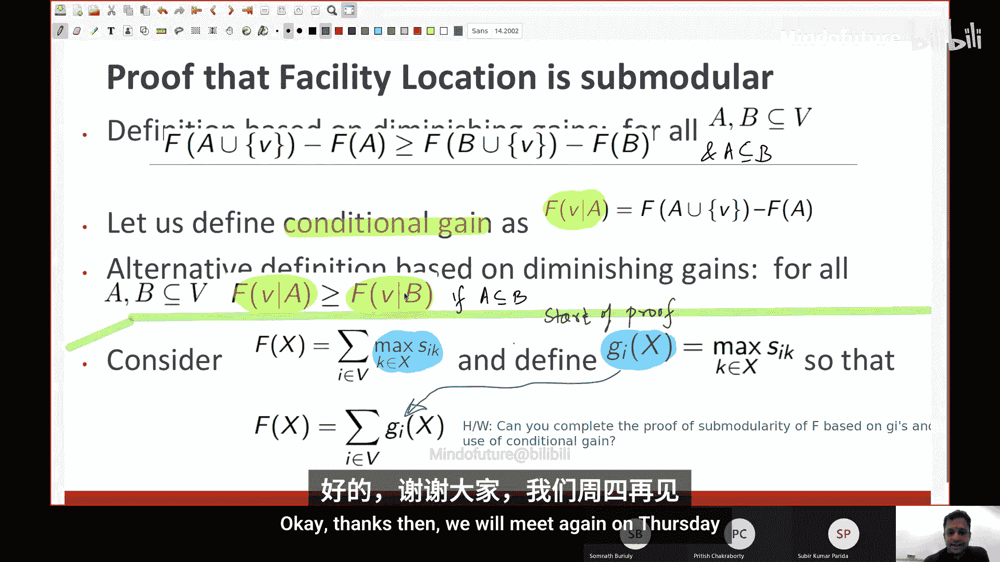

# 【印度理工学】机器学习优化 ｜ Cs 769 Optimization In Machine Learning p26 P26_第二十二讲_28-3_优化与机器学习_子模函数的性质__极大化和极小化的例子 -BV18cBSBJEH1_p26-

Yes。

So welcome everyone to lecture 22。Okay。We look at some model functions。Some of the。

Further properties and examples and move towards optimization problems。So。

We got started to discrete optimization machine learning。 We have kind of。Or done some。

Definitions and intuitionions of some modularity。And we look at the modeling power today。

And the examples of submodal function。And examples also submod optimization almost simultaneously。

Before we move on to。Optimization algorithms。Okay， so we saw this。Is a recap？

How we saw that general combinator optimization is very hard if you have a special structure。

We could do something more useful。And。Some modelular functions， therefore are interesting。

 They are also interesting because。They have this diminishing returns property。

 which kind of will remind us of concave functions。But we'll also see that。

They do resemble convex functions。In some me。Okay， so when you look from maximization perspective。

 they do resemble。One K functions。And we also saw。The example of number of distinct colors。

Or balls in an on as an， as an example， of a motivation。so the whole idea of diminishing returns。

 the more items you buy the mold the discount。U。And there meant many problems in a discrete labeling problem。

 summarization， where you go to place a sensor。 Again， this is a recap。 So I will。

Mo on to our homework problem。So before that。We saw this example of modular functions。

 We saw that modelular functions are those way， which are both。

Somemodular and a negative supermodular。They get is also sub model。

 That is their both submod supermod。嗯。And basic idea is that because of this， you can。Decompose。

The function word set to function word。Elements of the。So that I can do。I find functions again。

 recap。And we had a notion of monotone。Monoone function， you could also Moone submodular functions。

Set function is called monotone a。You know， as you grow the set， not in size， grow the set itself。

 obviously the size will also grow。The function value doesn't decrease。So。

Function value should not decrease。As you。的方。都 do the same。

A canonical example of this is the ainality。Cnerity function。Which is， also。6 one or two。

What else is it？From the previous slide。啊， it' also morning。你。The size of a set is。

Size of the individual elements in the。many other examples。Infence in social networks。Enroppy。而且g的。

Index for the random variables。The function。Is mono born。In fact。

 it also turns out to be some model discrete topy。Information gain is an example of her。

Moner bone function。Information game， we'll see whether it's a model or not。

Or under what conditions it so？It for Michigan， always monotone。What we。Under some conditions。

I if some， someone。Yeah， and basically conditions are independence condition。

 conditional independence。Like Nas。谢谢。But more about that later。O。So oh， something is gone yeah。

Sight， slight formating issue。So there's a homework problem I had left for you， right？

Anyone thought about it。Are all monotton functions are modelular？Honestlyestly。

Are all sub functions monoone。InSomes are already given a hint。Information gain is one or to。

 but it may not be a model。I've already said that that information gain always is more。

But only under some conditions， is it some model？But in general。

 if you want to answer such a question， you could actually construct functions。 That's important。

 You could actually construct functions。Here's a function I have constructed。Very simple function。

This function， whatever I done I've said， just call funny if whatever you want。On the empty set。

 its value is zero。On a single ten set a its one for single set single ten set B is valuable。1。😡。

What happens when I add A and B have both elements A and B， it's  three。😡。

Does it look like diminishing returns？啊。So in fact this is a form of an attractive potential right we'll talk about this today。

 but whats an attractive potential potential you are saying oh， if A and we come together。

 suddenly their value is greater than just having A or B alone。

So the two are attracted to each other。😡，It is monotton， it does increase。But it is not sub。

Try and construct when you get a homework problem， right， just try try and construct。In fact。

 it's supermod， it's negative submod， because if you try and plot it。😡，It， it really has this。

Not diminishing returns， but growing returns。😡，Instead of becoming like， it's like。

It's becoming like this。This supermod。Yes， Emily many。Inti class of modular functions。

 Well modular functions are sub are submodular。嗯。Not all some model functions are model。

 but mod functions are also model。Just like they have equality in strong inequality。Yes， exactly。

 that's so be very careful。 that's why homework attempt homework problems， you know。

 you won't make such passing statements you sometimes you as you you know the answer。

 but that's not the answer。In fact， this is a strictly supermod。Then it could not be。十啊十么。

So if you want you call it strictly supermod， because inequality strict。

Is negativegaivity strictly sub。So I gave this example in the last slide。Tventional information gain。

Based on entropy。It turns out that information gain is actually a difference of two submodel reference functions。

 So that means difference of submod reference functionss which are mono。But not。Some model。

 difference of some modelular functions， Most is not some model。 I mean。

 there are some conditions that maybe， but generally， it doest not。The other way around as well。

Not every submod function is mono。😡，So you'll see examples of diversity phase functions， loggged at。

 disparity means some。I mean， any diversity based function you will see it's not Delie monoto。

More diverse points。Doesn't mean that the volume of spread is increasing。意思咧。Okay so。Gordon radio。

So this is the general summary of function classes leading from the homework problem。

You have submodular functions， you have supermodular functions and at the intersection。

Here are these modular functions。Okay so these are right intersection modelular functions。

 which means E submodular， supermodular subset of submodular functions is Moto and submodular functions。

There are also lots of nonm and some other functions。

 and then there are some dispersion functions we see。It's like disparity men， disparity is some。Okay。

Great you。This disparity in men。And disparity some。我得别。

Dispersion function are not submodular functions。 they kind of have nice properties like sub modular functions。

 You'll see that。Okay， so let's look at some properties and these properties will be very helpful。

En showing certain， by certain functions are sub。So the first is conx combinations of submodular functions。

There's a model。Our intersections is fixed sets。Someone。Unions have fixes。It's quite conditioning。

Unions called conditioning。 intersection is called restriction。So both of these are someone。I mean。

Some modularity preserving。Compliment。Functions are sub， they call reflection。

And we look at two equivalent definitions of submodular functions。

 actually that I don't know if you've seen your assignment。The assignment has that problem。所。

Yeah first question。So obviously， you I leave it to you as homework as assignment。

Minimum maximum of modular functions。这 question信 think about it。

So I'm going to leave that more like question right now。You'll see when it。

Some modularity came on accident， some modular in connectivityivity， in fact。

 we'll also do information game， which I will be mentioning you。あYou know。

Some modular mutual information。Information functions。It may not have always a modelular property。

 but you see。Okay， so first property， convex combinationminations of submodular functions。

Some of these are very， very intuitive。 I mean， I don't think we need to even improve right。

If you have diminishing returns like F of a union B minus F of a is greater than equal to F of B。

 union B minus F of B for a subset of B， now just keep adding。A and B and B are fixed this F1。

 F2 add。😡，Irrality is preserved very simple， right？So for how if。Ie。Union need。Minus FA。Great。

 then you come to F。Be union。We。What as if IEB。For all。K subject of B。All I need to do is。

Multiply this entire expression。The lambda， that's it。Well Ladais are our positive。系い。

So if I multiply the right hand side and left hand side both by lambda I。And then， R。

You still will hold right and you can just take this if you want now。

 you can act a little smart and say， oh I can do this。So can I？Do this。 I'll just take。上面形容出。

Or rather distribute the summation as well。Think should go right。 You got it。Very straightforward。

So I added this La this distribution of the submission。Poster。

So it's closed on a non negative linear combinations， iss very helpful， for example。

You could now have these lambmbda eyes。😡，Also replaced。My pro is。P us。

So a probabilistic combination of some mod functions is also some more。

Can that help you give rise your distributionency as possible。

Can do my credit optimization the very exactly the proof technique I gave you is exactly what。

Is pointed well。Exactly。It alifting me。

Any questions？

Okay， on， then let's look at more properties。 These are even simpler， I would say。I mean。

 restriction is just saying。If you have a W。Which is a subset。Of me。

And every time I evaluate S F of S， now I call it F prime S， Im going to intersection with W。

W is fixed。So W is fixed。In fact， all of these are fixed。All the examples are fixed。

 So I'm going to do in this intersection with a fixed guy。这 is谁不说。I don't think we should in fact。

 most of the time， I'm not going to just give。Likewise， if you have W is a subset， but in this case。

 the w is again fixed。But you do a union with W every time I evaluate the function。😡。

It's called conditioning。The first one was called restriction， it's called conditioning。

This is also going to give you some model。放弃。And now， a third one。In this case。

 I'm going to basically take a compliment。F off。A prime of s is submodular function f applied to the complement of S。

😡，That's说 game。OrF prime。Is the submular functions F sub model in all these cases。Motion air applied。

He。你。Okay， so please note in all these cases， F this。Submodlar already。's declared afront submlar。

 That's why were able to do all of this。S is any subset of subset of。 Obviously。

 your ground set very often even skip V these a set of。All possible elements。

He's like seeinging Aden。you can restrict it like I did in my counter example for homework。

 I restricted my。Set to these right So your I could explicitly call out and say that。In this case。

 my。V。I's exactly A and B。This is universal。Okay， so all of these are mueller again。

 very simple to prove。As I said。There are two equivalent definitions of sub mod directly。

One we have already seen is diminishing gainss。This is what we also will be using often。

But there's under the property， which I can provide the intuition about。

Union intersection for all AB in subset of B FO a plus F of B。

Its greater than equal F of a union V plus F of a intersection B。So are modular functions。I can。

 for example， cardinality， what happens？What happens for cardinality？F of A plus F of B。And F of A。

 union B。Plus f of。A intersection B。So A and B are in green and orange or whatever， right？

But now I can highlight。That union。So what is the union。This is their entire thing。Right， in that。

The intersection has been counted。I think工 did。Only once， only once。

So F of a union B here it's been counted， but now I'm adding F of a intersection B again。

For cardinity。系 so。This part has come up again。So on the other hand。

 f of A plus F of Bs says I'll count a also come to intersection along with a。

Count the B part different from a Also the intersection。 So what is the inequality。If is a co cod。

寄过嚟。诶。So you're your signal no。In the case of somewhat modularity。

What we have so far referring to as diminishing returns seems to have another characteristic。

That if I add the two sets， a function on set a function on the set B。

 then I'm getting something more than。Their union plus the。Okay。

SoThat's also kind of diminishing greet， but this is a career assignment。晕了。Ding return。

We should be bigger greater than equal。 I mean it could be one of the big。

 So question is in diminishing gains。Should the V be bigger than Nb obviously？😡，A you ha ha。

 what is a mistake here。Oh。Yeah呀。这是10岁。I made a mistaken。Or a subject of B， subject of。你。

Thats supporting， whereas intersection， union intersection doesn't require that。😡。

At any two sets can be。Okay， let's look at maximum。Maximum of submodular function is in submodular。

So you have be a scene for convex functions。 What did you see for convex functions？

What do you see if you had？Thisis function。 and see。This function。 And what is a maximum。This， right。

It's convex，5 not。But maximum of submodular functions， which seem to be like concave functions。

 and here I've shown there as concave functions。Does't seem to be sub model。In fact。

 maximum of concave functions is not concave。Okay， so I would say in fact。Just like maximum。Of conq。

Functions need not be con。In general。Of course， if it's a linear function， it can't give。In fact。

 the other way is you could also say the minimum of convex functionss if I take the minimum of these two。

😡，That's， is that some modeler。If I take the minimum of you to。sorryrry。

 minimum of two convex functions， I it convex？啊。😮，TheCon functions need not be cons。ok。So。

 maximum of sub model functions。Like concare functions doesn't appear to be some right if you take the max here。

 that's what we are shown。Take this part in green。It doesn't appear to be somewhat。

 not diminishing returns is lost。They're going up and they're going again then up。你。

It's not always shaped downwards， sometimes gets shaped upwards。😡。

So then what you might be tempted to say。What would be your immediate temptation？

They look like diminishing returns。 their max is not。 they are like on capes。

 obviously their max is not expected to be submodular。Max of two submodular functions。

 Do you think the min of submodular functions will be sub modelular。Yes。😊。

How many of you feel the min of sub model from model？You为。Any other show of hands。

As you ask a question。How many of you feel。面の嗯。Some model functions。On this be some。

So more anyone else， you don't feel so。

You don't think them。Anyone on the call。

Show of hands。So， you feel it's not good someone。Yes。😊，L选。ok， ok。So。

You feel probably because they we have like conca functions， right。系。The issue is that。

Even though we wish it there， that's not the case， they don't even behave like conga functions consistently。

And here's an example， again， by counter example。So F1 a0，1，0，1。F 2A is 0，0，1。Okay。

And you can check F of b minus F of empty set0， F of a comm B minus F of a is equal to1。What is F Fs。

This minimal。Right， so this is。Less than there's not showing diminishing returns。So for this reason。

 I mean， in the counter exam， this counter example is good enough to show is the proof。

That's not some model or there are exist。Cases when it's not sub。Thank。😊。

But there's something interesting here。ok。If I ask you a question， okay， if what happens is a fun。

And F 2 are， is there any inequality between F1 and F 2 in general。

Is f1 a always less than equal to F 2 is F 2A always less than equal to F1 a？😡。

So let me ask a kind of leading question。What if。We always。Had a fun。

A1 whatever argument less than equal to f2 for the same argument。Or。We had a school。

The same argument less than equal to。If fun。No of them consistently。Which is not the case here。

 right， This is not consistently。One is not consistently greater than the other。

You see the inconsistency here， right here？F is equal to if here F1 is greater than。Cd。

F 2 A is there。Theyrenot consistently。One greater than the other， right？

It turns out that your intuition holds in that case。It was some credit to you。Right so。Soty。Right。

Good。It conflict exactly。Great。So， obviously。F will be someone。Since。即佢。Ys。Okay。

 so no matchs to me for making a very obvious statement。But let's make slightly more。

Or。So they took from them。Ho spot。

Hello。😊，嗯。How many how many minutes have you missed because there I think。Metal goage。

For how many minutes did you miss the clock。So不给色。Sy。Theous。Yes。Oh you didn't miss Sccha。

I can continue， right。做。

So what if we always had one of these， certainly there'll be FLB sub model because it cos to one of them。

But let me ask you some slightly more。Interesting question， What if？

If fund minus F2 or F2 minus a fund was monoone。😡，Yeah。Have fun。Minus F 2。

 obviously argument with argument or F 2。Minus。If fun was。我呢个。Again。

 you know that we don't really have monotousity here either。Do we have monitoringity here？

If formula minutes F2 as I keep doing the set。Do we get monoposity。I didn't not读 so。

I keep adding elements。Increasing your fund management。Right it's 1 minus-0，8。Okay。I A B is 1-1。

But it be。It is。😊，0 minus1。继续 a fun。us F2。At B is -1。So以。At these will kids。I zero。This one。And。If。

I find myself at cool。我几个啊逼。Is you。It is a problem。 It's not monotto。Right。So， it turns out。

That if a farm have tools won or two， then mean of a one come have two or more。

So it more than just no。One being always greater than India。Exactly。So yeah， no proofs。

 I think are trying to provide some intuition。Sony。What if F。야呀 이得未。Okay， so question was。

 what if a fun。F 21 is as fun as borrow。Ifform F2， or obviously。F21 is it。Its么。The cemeter is。

The next， very interesting。Property that quantity over some model functions some。讲期我冇多十万就房七十万。

And the simplest example is like， let's say， I have size cardinality。西缩记。Next mod。系。

What about square root function。What is the nature of square root。Is gone。So what does this imply。

According to this。Square root dog。Gality。Yess。我 little quite啲十门。

So the feature based functions well see are submular。Obviously， you know。

This also is not limited only to modular functions。😡。

Given a concare function G and monotonnes a model function。Then G of F of S is still subial。

It's also horse。For monotons of all functions。It's if you have positive modular function M。So。

 this is。The interesting thing is it' not just modelular As。😡，It's monoone， it's positive。

So that's important you need it to be mono not on。Or post sub specifically because。

The positive modular function is going to be moreto。K of Boston。They're always。我。

So feature based functions we see some model。For example， if you're on some kind of a network。

Deep neural networks。 So if you create some， if there are con functions， it's compressed。

Then you can basically get some model of function。It doesn't hold if M is negative， for example。

The modular function is negative should be positive because not only you can have more on。Okay。啥了都给的。

In fact， we'll see a stricter result later。电视。Positive modular。

Because positive mode as a question in second line。

 should be positive some model no monoone some model。

 but positive modular functions will also be monoone。😡，And there will be also some model， obviously。

Posum is not negative。 I mean， greater than zero。在个。A thisia stricter relation。Between。Quity。

And some modularity， later。See a I mean， it's a related stricter relation。In terms of， you know。

 composition， but we well see that that there's a stricter， if and only relation。

 stricter when I say stricter， I mean， if only something is similar model only if something is complicated。

So but wait for that。 But I think in that case， in that。Setting。

 I will recap this discussion of once。Sorry。So you can say it's not negative。Yeah。

 that's a good point。Yeah， like me just change this non negative。O。So， with this。I know。

 you understood a bunch of。Induic properties， compositions， et cetera。

 because we have meant so much for conveity。They are not going through all the results again。

 but should be very straightforward to understand。I mean， this makes sense also because。No。

 diminishing returns， that's explicitly carried forward here， but it has to be increasing。

 otherwise you。That diminishing returns won't necessarily issue up when you apply on a monoton function other model function。

Someone。Okay， so here are some instantciiations and we'll look at some of them。😡，嗯。有啊。

We may look look at them in slightly different order。

 but they have representation functions that you're trying to represent。Some points， facilities。

Some诶。Food outlets， which you want to。Set up such that those food outlets cater to the population as a facility。

 that a representation。We see graph cut also saturated coverage examples。That was reading functions。

嗯，嗯。Which basically look at how diverse were spread out the points。U。I are not a mod。Ds。

Especially men and some。 They are not some model。都。呃。Be here。Similarly。Very， very closely。And。Also。

 graph cut also some model under certain conditions， not always take a summary。Okay， so。

Coverage function， set cover， Probabil set cover， feature based functions are largely sub model。

You tried to cover a bunch of concepts。As against points。

 So representation functions are about covering representing points。

Whereas coverage functions are about representing features。Covering features。Attributes。

So that distinction will help。Appreciate their definitions。And also importance function。

 How you put into something Scity is an importance。 That is moduleular。

Information function like usual information。ThereSome modeler under certain conditions。

 I talked about it earlier。They may be monoroone。Monoone。

 but some model under some independence assumptions。Entropy， on the other hand。

 discrete entropy is always someone。😡，that's always a。

 I will not mark whatever someone of understanding。Okay。

 then then the other discounted cost functions， clustered con or modelular functions。

 I told you conver modeler， we expect it to be some some model if the。Model the function is。Monione。

 clear or non。Cerate cooperative cost。 if you look at the homework。

 homework example was a cooperative cost example。But there are modelular co courses with。

 so that was not necessarily， that was supermodular function。Okay， and then。The enabled functions。

 bipartite functions。 We see some of these complexity。 These。

 I would like to point out that these are not functions we use too much。

 These are more interesting from a minimization perspective。Which we will not do really in the class。

Okay。But we never talk about these functions。Okay， so let's look at minimization。 In fact。

 I'm beginning with the last the reverse。 well discuss the reverse， almost in the reverse order。

So let me just make a note of that。We will discuss。The smoke， and。Revis。

That's doing the reverse order because we will not be interested in building upon them so much。

So what is the first， again， I remind you we are looking at。These。

 the discounted cost function and complexityity functions。So what are these。 So first。

 is cooperative costs。I'll give examples of each of these more detail， but you can see this。

The reason it's some model。Is that you're looking at a set a and how much let's say this is my set A right。

Let me shade it in a different color。So let's say my set egg。So consist of these points。

 they are which I amount 1，2，3，4。喂 so。What I'm doing here is。Looking at the intersection。

 E A has the P1。 So A has。1 and detecting with B1。Right， A intersection section B1。Is one comment。

A intersection B3。Itsful。A intersection P2。I to。Like。说。R I is like the。Reward cost。

 cost associated with P， let's say R1。Is fight。R2 is three， r3 is  three。And R2 is， let's say， one。

It's basically saying my how much important is to associate with each。So， I look at。

Interse PI and for every point in that set。For example， one and3 intersection with P1。

 I'm going to assign one。That's what it's mean。So this function， what do you see the blue part？😡。

What is the nature of this function？Sation1 G。In a intersection B， what is this？Some面緒も areれ。It is。

It is modular。This is totally mod。A square root of that is。

Someone and then summation we have seen non negative。It's a model。So then the simple reason is。Non。

Me get do。Some。Off。Square room。Ofmodular。Functions in simply words。A off。Not negative。Okay。

 so it's important。I什。So it's important to note that each of these R should be greater than equal to 0。

R I should be greater。Obviously。Second example is attractive potentials if you have I mean again。

 I look at the examples next slides but why they are some modelular or under what conditions are some modelular。

😡，So attractive potentials， the word here basically means。That you have。The energy associated。

Right with EIG。With one and one。Should be greater in some sense。

I want one and one to be attracting their Ss mode。In fact。欢嚟。She would expect。EI J 1，1。Plus， EI J 0。

0。Should be greater than。이I J 10。Plus EI J 0，1。That's what we mean by attractive potentials。I mean。

 that's exactly what we might attract your potential。So as long as they're attractive。😡。

Then you can show that this function is someone， I'll give you a reason later。😡。

In two degrees than me。A third to use cases is complexity。

Let's let us assume that you' are trying to build。Some translation corpus。Or language model。

Or speech corpus。But I want to make sure that by。Let's say I want some toy model。

RightWhich I'm going to build on this。So my time model， I would like to build a small vocabulary。😡。

So what you see on the right hand side is like the vocabulary。这是我干。

So I want the let's say I want to look， I all these are minimization by the way。

 right Ill give an interpretation later one， but I want a low vocabulary model。😡。

Which covers the entire corpus。So， that's complexity。But let's look at each of these in some mold。

Someone understanding。So let's look at the first， which is cooperative course。😡，Okay。

 what is the intuition， the first one？Let's say it's breakfast time and you want to。

Basically buying certain items。You want to buy milkshake， you want to buy some musk millillalon。

 you want to buy some sandwich。Now， you know that there are some locations where you get these。

Get something in market 1， something good in market 2。Right， some things you get in market 3。Now。

 we would like to get all of them in one place。😡，So you want to minimize the cost of procuring these good。

The cost is time to shop and price of items， both。Maybe if you go to one market。

 they'll give a discount as well。Right so time to shop。

 let's understand the intuition for time to shop。RightIf all items。A procured。In one or few。

Oneun kidss。单 to shop。Be less。Right。😊，On the other hand， the price of items， again。

 they can be discounts。😡，So if all items are purchased from a。Itm a similar， I'm on a kick。

The smaller and and。The more be。Number of icons。You manage to purchase。In a single mark。

Or is that discount。Possivity。So this is an example of minimization。So you see these two parts。

Time to shop。Cost， there's a cost part。So this's a guy got of fixed overhead。

 if you go to one place every every and obviously within that market will take some time。😡。

And the number of items， two items， but then then again， we can look at discounts。

Number of shoppers a number of items， in some sense。Actually， this should be。So in the first place。

 in the first place， you're buying basically。U。One item， the second page buyinging two items。

So this turns out some model。 I mean， I'm not really， you know， I think。

I have not really accounted for。The discount possibility。 So I must。 I should just。Change this tour。

Something wishful， I haven't done that。We have offered the same cost。So more specifically。

 more generally， this could be done。 I haven't done this。So sorry， can't see that color。Okay。

 so this。Not。S。Here， you could do that in journalismism。Okay。

 so that's exactly what I said F of a is a over all the partitions p1 P2 p3。

Of the sum of all the elements I buy from each partition， but。With a diminishing part。

 just a square root part。Like next example， second example， because that's clear right。

 second example is attractive potentials。So。Here， let's say I want to segment an image。😡。

And imagine that， all the。Once correspond to those which are outside image， okay， this is one。

All the blacks。At once。All the whites are zeros。ゼ one。Graphal models， if you've done a course。

 then you've come across a problem of segmentation。So， I want to look at。

what pixel is befitting a door。 That's the energy part， right。I excite。Is the saying if pixel。

H if Pixson。Xite。It does not。Actually， we want to reduce right so if Pix excite does not。Resemble。A到。

It doesn't look like any part of a dog， for example， that pixel it。So that's okay。

 that's not variant。 I mean， that's fine。 That is important， but that is just module。😡，がもりがい。

But what is will draw attention is the second part， the submodlar part。

Or under some conditions in its moment， this is the partition part。😡，And hell be basically saying。

Dat。Exactly what I brought up earlier。If EIJ， sorry， I made a small mistake there。

I should have been the other way， I mean。I was saying。That EI J 1 month plus EI J 0。

0 should be less than equal energy。Energy off。Similar configuration should be less than the energy of different configuration was less than any。

 I made a mistake。That's the same thing we're seeing here。You're saying that EI J 10。

If I go from one to zero here。😡，120， these are all  one，20， right or0 to1。The guts。

Should be greater than medical do。The energy associated with being within a region。

He if I'm just within a region。And betters。This， interestingly， the fact that there' is some model。

 you can associate it with the second property of some modulararity。

F of S plus f of T is greater than equal of F of S union t plus F of S intersection。😡。

So modity can be true。Losing the。Second。Equalality definition。

That's why we brought up the property offering。Which one？啊。This is correct， energy。

 we want to minimize energy， high energy， So think of you know icing models。😡，Iing models。

 if you have electron spins。What would you like， high energy or low energy configurations？😡，Right。

So therefore， know， if you have a similar。Positives， right， sitting together， then you have。Okay。

 that's a different thing， but basically negative of that urttic。So you you high energy。租。Here。

 you would like the similar to come together。The idea is the same。 want low energy configuration。

 So this is low energy。Okay， now you can think of this having only the first component。😡。

Ass basically is。Only the first component is basically S having only the second component on is basically E。

Right and having。Neither of the configurations is。As intersection B。Being empty。

 having both configurations here。It's a union。So you can do this mapping， simple mapping。

 you can show that this is a model， such a function。If， if this property holdss。

This property is a modularity basically， I mean， so it's the same thing basically。

 so function is a modelular if。😊，So E is so let me just explain。He is aorinate。Dely。Property。

It's called spatial coherence property。On the aist force。再做来回。Is this clear。Basically， it's likeing。

Is this so instead terms of saying the model already can be associated。

Or other special Cohens pocket。That's what I mean。이렇게 simple association。Onen example。

 complexity functions。So as I said， you may be often interested in a low vocabulary， so oh， yes。

 true， that's let's say I want only 50 words。😡，Building my language model。What 5 right。

So I can look at notion of complexity。Each x is going to be covered by。第一。Gamma E F of A is， gamma A。

 the gamma X is the complexity induced by the。Subsject of。Then cannot measure of。

 It could also be a measure of size。So。We not go into this This is again。

 this is very can be proved to be some model very simple。 and often this is。The concave over modular。

You know。It。Impossible choice， which is also a popular choice。哦干嘛？D see。Square root of the size of。

So on the minim， the number of points I selected a。

So now look here look at the maximization aspects and again， some of these will prove。

 some will just you know give intuition。So these are all maximization perspectives of modelular functions。

If you want to have sensors to be placed， where should I place the sensors。I want to play cs as that。

 I'm I cover the area well like I want to。Fick A Stder room。Obviously。

 you don't want all the three AC sitting right blowing here。

 right want them to be distributed there so that there's coverage。That happens to him， I mean。

 it's very obvious in this， right。You have diminishing returns。 If you put too many in one place。

 more than next A that you are。You'll all be pushed out of the room， right， you'll run away。🤧嗯。So。

Diversity。The more the spread out， Oh sorry， the more。The points are diverse。

Larger will be the volume of them。Area that， let's say。Qulyhyd that encompasses these points。

That's Logged at example， information if I'm trying to select features。😡。

So this is like volume example。I coverage example， very obvious sensor。Sos a go。

Example layer is features if I have to select select features as that。I represent the class as well。

So features are， for example。F just。R say X 1， x 3。You know， conveying。Max information。

Of the class labeled Y。So I want to select those in green。Which are where can remax information。

Representation。I want to pick up my points。Green ripping and the blue。Which will be basically by A。

 right？Let's say this is all others。So， this is。完结。Element of aid。This is。A J。

Elet of a in blue and basically now each of these Js。

Will be closest to one of the points in the ground set。The entire set。

So eyes are basically ranging over all the points in the set。😡，So I want and then SI similarity。

 so S saying， SIj is saying。Similarity between the I point to some say J cluster。

These cluster are represented。So find the most similar cluster representative for each point。😡。

And sometimes across all points。Exempary。Finds， find the most。Similar。好来的。Find。

Cluster representatives。So doc。The most similar。Cluster based similarity。Summed across。All points。

Is max maximist。Okay， I'll see each of these now a little carefully。

But this is just to give you an idea， this is a gamut。So let's start with representation functions。

That again， multiple options here。 The first  one I showed。

 first 1 I discussed was what I showed there。Okay， so what we have here is a similarity kernel S IG。

😡，S iG。It's saying， okay， how similar this point？废。😡，Okay， similarities like。Then。

S similar will be very high。Right，But you could have a fight。

And some may be very less similar to each other。TheDagonal will be， of course， high。😡。

You have seen kernels SVMs and all that， it was a similarity kernel。Diaagonally。Could be di dominant。

So。Based on this is， what you do in representation functions， you're saying， I'm going to know。

Let's look at facility location。 In fact， I'll show that I'll prove that facility location is sub。

So what is specific location saying okay， I want to look at for all points I exactly what I wrote' let me just。

Ipy this part is exactly what I wrote of a central location。And this is represented here。 This is。

Example， find cluster representative。 So I'm going to find these cluster representatives in the form of。

These facilities， factories。It could be malls。These are clustera representatives。Now。

 these cluster representatives may not coincide with the people， but that's okay。😡。

So I want to find the cluster present details。So are all the points， which are all the people here。😡。

In different locations。けそ。These are all people， these are not points。So， I want to find。

The cluster percentage are the most similar cluster so now look at let's try associate right obviously every group of people is not going to visit every mall you don't have people from Goal listening Mumbai malls they many local malls right So then obviously what I need to do is is people are all there what I need to find the binding。

So。So most so there are a lot of clusters across all points。

 but what I want to do is the most similar cluster part。😡，Okay， so what is the most similar。

 This is the most similar test， you make it double。This are more similar cluster。

 This are a more similar cluster。These will go together。Right。But now this guy。

 this way will go here。 so I can just do an association。Now this guy will go here。And so， yeah。

 I hope I have to drawn all the links okay。So based on this， I want to know this is theI max4I。

 that's exactly what Max is doing。😡，For you right max4 K and X So S Ik is just finding those。

Pink edges。Spae， in the sense， youre not， is spars said because you're not looking。

 you're not picking all the edge， right。this kid。This is facility location。Now， facility location。

Might not land up covering all the points if I have a budget， let's say I can only set up four malls。

😡，I may not be able to。Cover， you know， Har Shala， maybe four walls because there'll be very few people representing。

Locate， remote location， right， That's exactly what happens here。You'll find that。

Outliers are not represented。I mean， outlier itself is a very relative term， but no。

Certain points may not be replic。Oakland Lakepoints。Obviously。

 you don't want to say any location is an outlier。Outlier。L points。Might not。Getpresent。

you can see that in the figure on the right that we have only representation for。

Some of these points， I for all the other questions So you have a presentation from this。

Is the all representative。Because there are more points。

 so the number more the number of points close， the more there is voting for that candidate。

Saaturated coverage。Now saturated coverage， what is it doing？😡，It says that instead of a max。

 look at the difference between facility location and saturated coverage。😡，Here， instead of a Mac。

 max， I'm looking at a。Some。Some of similarity， all the points。

Are contributing to every point in x x is a subset that I want， right。clusterluster representatives。

Is in a inix。So in the case of saturated coverage， every point in x is being voted to from every point in V。

😡，It on。Every point in groundstead。He is。Voting through a similarity function。For every。

Point in the subject。Being considered。So there's kind of， you know， no max， there's no max。

 there's no sparsity。Those pass that selection。Bg。😡，I say， well you can vote up to a limit alpha。😡。

Beyond alpha， I don't count your votes。😡，That limit alpha is what creates。There's some modularality。

 always it to be modularity， right， this part is itself modular。😡，But。

Up to a limit Al is what brings a twist in the story。Okay， so this makes it some， I mean。

 this otherwise is modular。The party in Elis modular。But this part makes it some。Is it here？How。Yeah。

 that's a situation。Outli you're saying outliers will come in depends on the alpha value， right。

 so question is question is saturated recovery should not capture the outliers。😡。

So if you set a very low value of alpha。😡，And yes， even if very few people vote for you， you're fine。

Actually， it depends。 I mean， you like to think of it It depends on the budget， because if。But yes。

 potentially satgiurated coverage might pick up outlayers or some suitable value outside。

It's a good point。And that's every it's also for every。

Point has a different contribution So that's also not that。Okay。

So you want to put alpha I that's also for， there's an alpha I。But it can be independent of I。

 it can depend on I。Okay， so the basic idea is clear， right？Okay， graph cut on the other hand。

 what it's trying to do， I think I don't know if I have I probably have slides on each of these here。

Yeah， graphra card。Graaf let me go to the next slide。 That better。 Too much karing。Graphcon says。食饭香。

A set act to be subset。And of that， I'm trying to identify a subset。If is a v。

 this is an x is the entire set V， right？So graph is that。I'm going to look at。

How well the points in x are representing？The points in we through a similarity。

But there is a slight trick。 So I want to look at similarity of x to V。

 but I want to discount for the cell similarity。 So there's a there's a cell similarity。

 which I want to。Discourage。I mean， X always represent X itself well， right， I mean。

 look at the example we showed earlier， diagonal dominant， right we just copy this part， right。

We showed this diagonally dominant case， right So if it's diagonally dominant。

 obviously points in X represent themselves evil well。Let me， in fact， use the same color coding。

So what you're going to do is I have the x。Let me actually use green。Okay。

 so I have my X and what I want to do is I say， oh。这个是你。嗯。

I want to make sure that the cell similarity of x to itself。Is being discouraged。So discourage。

Which is reflected through。Dagonal dominance。Is that it。And just tight。 I just getting too missing。

Okay， so module of that， what you are trying to do。Is。

Maximize the similarity of points in x to the points in V。😡，that part。

Is being angry So this entire similarity， how well is x representing E。ThatThat's this part。

In some sense， IN V， X and V， but I'm doing a subtraction， right？😡，So。

This is the representation part some overall， so it said sum not math。😡。

Very similar to the to the Saurated coverage case。Theys that you don't have a mean that's。

There's not five， but here what I've done instead is I say， okay。😡。

I'm going to subtract from that this part， which is cell similarity。You know男的。Should we at least。

How much。Lambda is discounting， right or sub similararity。Lambda should can lambda be less than one。

 does it make sense？Because look at the first component， sumation Oi， sum Ox， J sum J orx。😡。

So lambda should be at least one。😡，But it turns out that it is not mono on some model when Lada is less than two。

😡，So after lambda is greater it iss also mono2。So you don't want to kind of totally suppress that's what it's saying you don't want to totally suppress all similarities points in X should represent themselves well。

 but not more than they represent the points in me。😡，You can put that as a simple message， right？

Orange and eggs。啊。Yeah， lab has equal to a greater。Okay， yeah or you're saying， yeah， yeah。

 you're right， it is some modelr otherwise。So， represent。嗯。Apoints。Can we。M- x。 So the sta eggs。More。

And the represent。Inces。That's basically。What we are trying to say。Okay。

Let's try and prove so these are I've already given this example。

This your graph card example I've given here， so this would probably help you。So， you're trying to。

Identify a set of points x。Say Zach。Or then maybe the。The points here are in green。

 you could think of them as one potential， they represent the other points well。

Or is going to be similar narrative。So let's look at them。Facility location。

 which is in the center I'll show proof the others are not very difficult Sa a recovery is actually very simple。

😊，Okay， so the proof is idea as as follows。Because something is gone wrong。嗯。

Something has gone wrong to feel permiting。Okay， I'll try and see how to fix this。So yeah。

 I hope you can read this the definition based on。ADminishing。Dminishing returns。

For all A B in a subset of V。So。I mean， more or less is's okay， just some things are going really。

Okay， so。this is the definition we know， right F of A Union B minus F of A is greater than F of B。

 Union B minus F of B。For all A B， subset of V， where。A is also。Substively。

Now let's define this conditional gain， a conditional gain is F of V given a minus F of a union V minus F of a。

 So it is a very compact notation， conditional gain。

So another definition we can give in terms of conditional gear is single that f of A。嗯。

If a V given a。It's going to do guy a B given B if As。Subsid of B。Basically。

 saying the conditional game with A is greater than the conditional game with B。

So now let's consider this the sec this part below is where I the proof begins。 So far。

 I've just defined。Just some definition。 So this part。Is where we begin the booth。Okay。

 I'm going to give you a beginning here and you have to help me complete it。 so consider effectses。

Facility location， Max O， KN X， S IK， Samu INB。And have now defined GX。

Sas that this GI exists corresponds to this component。

I don't want the entire I don't want to deal with the entire function。

 local ideas deal with it in parts。😡，And that's exactly Gx。So I can just plug in GX。Basically。

 for any single point， I just find the most similar。Egg， all right， and then。A point Gaix。

And plug that in。How do you complete this proof。And hint I'm giving is use conditional gain。

 which are already provided。And use Gs。Can you complete the proof？Please straight。And you complete。

Appro。Of some modularity。Just give me that basic idea if you don't want to like。Of F。Based on。Gs。

And use of conditional game。Any thoughts。Anyone on the call could also please suggest answers。

Oh， we already fight， I didn't realize。

清得。Okay， I'm going to leave there homework for you to think about。s if you are pretty much there。

 right so this is actually a homework problem for you。

And that will also kind of prepare you for your assignment Yeah in assignment。

 you have some proofs to be made right let's do this one very thoroughly。I will not do many more。

 This one will look thoroughly。Okay， so all those number problem。Okay， thanks then we meet again。

Tsney。

