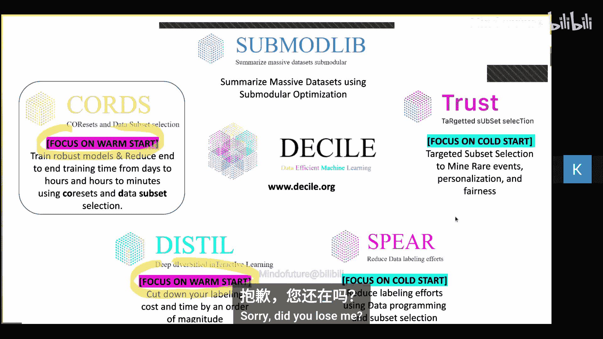
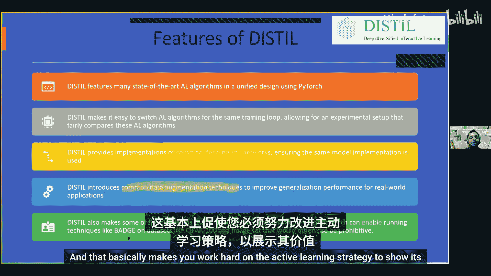
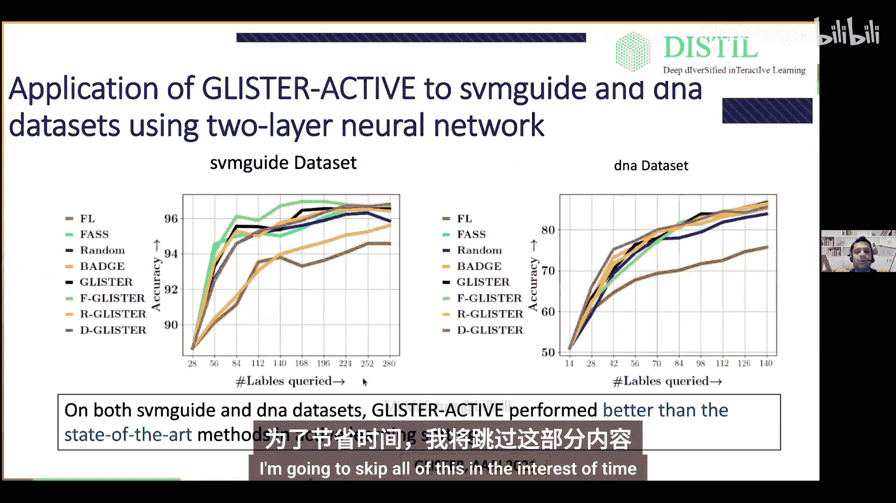

# 【印度理工学】机器学习优化 ｜ Cs 769 Optimization In Machine Learning p28 P28_最新技术()_与Ganesh Ramakrishnan一同了解数据高效性机器学习 -BV18cBSBJEH1_p28-

Kicking off our next session is none than I don't know Colin。 you want to introduce Ganesh。 I mean。

 I will stay say that I'm an ITB alumins。 I'm very， very proud to have Ganeher， but Colin go for it。

😊。

Hi， yes， I'm very excited to introduce our next speaker， Gsh Sharaak Krishhnan。

 who's currently an Institute chair professorfes at the Department of Computer Science and Engineering at IIT Bombay。

His areas of research include human assisted AI and resource constrained environments。

 learning with symbolic encoding and domain knowledge and machine learning。

And other areas of efficiency and machine learning。Is a。

Gnesha has received awards for his research such as。

The IBM faculty awards and other awards from Kualcomm， Microsoft。

 as well as the IoT Bombay Impactful Research Award。And at Abacus。

 we've been very lucky to collaborate with Ganesh recently。

 and so I'm very excited to hear the talk so Ganesh， please take it away。Thanks， Colin。

 for a very generous。

Introduction， thanks for hosting this talk。Is going to screen share。嗯。

Can you please confirm that youre able to see my screen？Yes， we can see your screen。Thanks。

So I'll give a brief overview of a platform that。Myself and my colleague。

 Rich a year at the University of Texas， Dallas have been building。S with a。

Whole bunch of our students， both at Rity Bombay and at Duty Dallas。U。

The idea behind this platform is to make it possible for people in resource constrained environments。

To be able to build models， both in data efficient and compute efficient manner。

So the talk is meant to present our open source toolkits and youd really like to encourage the。

Audience here， the community at large build upon our toolkis in two ways。

 either you can integrate new algorithms or well be very happy if you could use tool these toolkits in your applications。

We are all aware that deep learning has achieved near human performance in multiple fields。😊，There。

Strong growth in the both in the complexity of the networks as well as the number of networks。And。

The issue then is。Has deep learning been solved。Yes。

 deep learning has reached performance in several tasks。

 but the problem is that you need large data sets and massive models。In addition， they could be。

Issues of fragility owing to biases in the data。There could be massive labelsque。In addition。

 the process of labeling data itself is very expensive。Just to give you。

And insight it to the kind of。Cost incurred in。Dcomp intensive deep learning models， for example。

 to train a bird model in Wikipedian book corporate data set。You could incur 200。

000 USD whereas for a single deep model for NLP with network architecture search。

 you would incur 237 million I mean this is IR Indian rupees but 3。

2 million so the you can also measure the impact in terms of carbon footprints。

The other aspect is labeling cost。 The labeling cost， of course， increases as you go from。

Image to text where the cognitive load is high and we also。

Presented representative numbers for other labeling tasks。So overall。

 there is need for data preparation， model training。

 model validation and model deployment and at each stage there is cost。😊。

Could we be both data and compute efficient？Across this pipeline。

The contis are that you you like to reduce your labeling or be efficient and effective in your labeling。

And also be robust in the process to distribution shift。ACommon framework that。

We would exploit through our modules is subject selection。You have ground set B。

 this is the ground set B。Of all the data points。And what we seek is a substantive points。

That's as good as the ground set。With respect to an information function， F。Now。

 what kind of sub selection are we after， So we could look at。Selecting subset of a label data set。

So that we could reduce the training time。 And this is typically what happens when we have a。

Cal start setting where we don't have I'm sorry when you have a warm start setting when you have lots of label data。

 but you also have the cold start setting where。Plenty of unlabeled data， very little label data。

And in such setting， you would like to reduce the labeling cost。There are other settings like。

You know， you would like to select subset of model parameters to reduce inference time and so on and so forth。

There's been a lot of research in this direction over the years， of course。

 and here's a bunch of keywords。A representative of the approaches used in this area。

 greedy representation learning， metal learning， semi supervised learning， streaming。

 submoder and so on。But the issue is that there's been a lack of good toolkits and benchmarks in this space。

So what you're going to present is the data efficient machine learning。Which has several modules。

 I'll begin with submod live。😮，Which is a at the heart of all the other modules。

 submod is a library for summarizing massive data sets using submodular optimization。

What is subular what is a submodular function， here's a simple representative example。Consider F。

The function， which says a number of distinct colors of balls in an ur。On the left hand side。

 you have the set a and on the right hand side you have set B， a superet of a。You have a ball。

 which is V， the blue colored ball。The marginal gains of adding the blue colored ball to the smaller set a。

Is greater than equal to the marginal gain of。Adding the same board to the largest set。

Such a function is a submod is sit， submodlar function and。

Some modelular functions exhibit this diminishing returns property。What we have in some live。😊。

Is extensive documentation， and several。Somemodular functions and their maxs all implemented。

Installation is as simple as a Pip install described here。

One are the different classes of submodular functions， broadly three representation。

 diversity and coverage， but you could compose these with queries。

Querries that seek information or queries that try to hide information。嗯。😊，So in this first case。

 you see the query person seeking information on person as a representative divers or high cover summary。

 therefore youd like to。Ensure that the selected subset has people。

 but then they must have people in different poses or different people on the other hand。

 the second case， you would like to hide the personal information。😊，We'll see how both。

Qury and privacy could be slapped on each of these classes of。Some modular functions。

So let's look at the broad。Outline of instants of set functions。

Representation functions include facility location， graph cut。

Diversity includes dispersion functions， determinal point processes。

 coverage functions include set cover， probabilistic， et ce， and feature based。

Importance functions are largely modular functions。They are basically some modeler。

And the negative is also submodular。The information functions。

 which I alluded to in the previous slide through the example of。

Quries and privacy preserving said these are encapsulated at mutual information and conditional gain。

 and these could be used in conjunction with all the others。

There are a bunch of others which we will talk about today discounted cost functions and complexity functions。

 some of these become more interesting when youre looking at some modelular minimization。😊，收。

We'll let's next look at information functions which we would invoke once we outline examples of each of these three classes。

Information functions have traditionally been very popular through entropy。

We are aware of discrete entropy， the joint entropy of variables index by s in this case and this discrete entropy turns out to be a submodular function。

But what you see here is the conditional gain。The game on。201度A。

Because this great entro is are smaller， obviously there's diminishing returns。嗯。Now。

 this conditional gain itself has some interesting properties。

 that's what's highlighted here in yellow。But you could also have mutual information。😮，Now。

 it turns out that mutual information and information and conditional gain。😊。

Could be composed with any other submodular function in place of entropy。

So this is a more generic definition of some modelular mutual information。嗯。

IF a comma  Q is the function applied to a plus the function applied to  Q minus the function applied to a unit  Q and basically it's measuring how relevant is this set A to the query queue on the other hand。

The example of conditional gain now generalized to some model function classes。

Is measuring the irlevance of the privacy set P。Eles of the set A to the privacy set B。

And what you see below are。Instances of。Both mutual information and conditional gain。

Apped to the different classes of some modelular functions。

So supplement presents a unified framework of extractive。

Wey and private privacy preserving sub selection。Very good look at。Stctor。You。

 you're trying to maximize a modular function。Identify a sub constraint。In thequty。

Sensitive subset selection。 You're trying to maximize a。Mutual information function。

For any reasonable choice of F。Theres some modelular functions， the recipe that we have provided。

And you could do the same with conditional gain。Finally。

 you would also put together the query relevance and irrelevance to the privacy， he said。😊。

Through the Penal gain mutual information， CGMI functions here。

Of course we have some degen rate cases which correspond to when the query is the entire ground set or when the privacy is the entire privacy is the empty set。

😊，So let's look at representation functions。😊，A canonical example is of facility location you want to identify some k facilities such that these facilities cater to the market at different locations or also possibly raw material supplies so the。

😊，Points here in red are the facilities。But there's a cardinality constraint you typically have you would want to locate K facilities。

Now。Underlying the choice of the facilities is aity， similarity between any two pair of points IN K。

😊，And the facility location problem。Is to identify for every point I in the ground set thus。

Most similar facility care。啊。And overall， you like to say maximize the facility location function。

 identify a subset。X， then maximize the physical location function。

You could likewise have a saturated coverage where you you are looking at coverage。

 which we will talk about a little later， but then you are also clipping the value based on an alpha I。

😊，Or graph cut， we are looking at a combination of similarity between the。

Subset and the ground set while discounting for self similarity within the。Selected subject。

And what would representation functions do with they try try and pick representative samples from each of these clusters while possibly leaving out outliers because they are not really worth representing。

😊，So effectively， these would pick centroids。Now， what happens if you apply information functions to facility location。

So you see here。The FA is a max。And when you now look when you put in the conditional gain on B。

 you are basically now discounting for the max similarity of every element in B from the max similarity of every element in a so on the other hand。

 if you look at mutual information between A and B。

 youre looking at the min of those max similarities。嗯。The next class is cover functions。

Where you're trying to cover a bunch of concepts， maybe keywords here， Cat dog birdird man Beach。

 and youd like to identify a subset of documents。That cover these concepts。

Or you might be trying to cover。Objects， male， car， greenery， etc cetera。

And that process identify a relevant subset of images。

So the basic idea is to select instances which cover all the concepts。

You could also have a probabilistic version where you have the probability Pj of an image i covering concept J or a document i covering word J。

🤧嗯。Yeah， this allows for probability of covering concepts and you could again。

 have mutual information variances。As well as conditional gain variances for weighted set cover and probabilistic。

Set cover。Finally， you could also have feature based functions where you're looking at coverage through the features space。

And typically you would use a concave or modular function。

 so the total contribution of you feature you in the set of images as could be a modular function and concave or modular gives you some modular functions。

And you could also have our composition of these through deep sub modular functions。嗯。Final classes。

That diversity class。原。诶。Aware of how you would。Capture the volume of the points。Through。

The determinant the volume of the。Polydron。That encapsulates points through determinant。 Now。

 in the case of DppP， you're looking at similarity between pair of points， the log did。

LA is the submi spanning the subset of points。Through the similarity kernel。

This turns out to be a submodular function。There are of course， other diversity functions as well。😊。

You not expect。All diversity functions to be monitor in general because as you keep adding points。

 you would not necessarily you know expect the function to itself increase。

 but yeah several of them are some modelular or exhibit some modularity like properties。

So the idea here is picking items as different as possible and and you notice that in this process the outlier has been picked。

 which was left out when you when you consider the facility location or the。

The representation class of functions。You could likewise also do you know dispersion min dispersion sum。

 dispersion min sum sum and dispersion min sum min are not submodular dispersion in sum is。嗯。

So as a summary， we have a bunch of。Submodular functions。 several of them are monotone。

 as I mentioned， the log deck is not a monotone submodular function。

 likewise graph cut and mutual information aren。But there are also non some modelular functions such as disparity men and disparity sum。

Now you could slap the mutual information conditional gain and combination of these on all of these functions is a table not necessarily meant to be pars and such a short duration but sufficient to highlight that all of these have been implemented in submod rather the maximization of these functions so what are we talking about in terms of maximization we get to that now。

The master optimization problem is that you want to maximize this function f。

 which could be either the submodular function MI function Cg or a CGM function subject to some cardinality constraint。

Let's get some glimpses into variance of this master optimization problem。嗯。第。

Most intuitive algorithm is a greedy algorithm。And the idea here is just pick the next element E。

 which leads to the maximum gain。How good is a set SK composed of the first k greedy selected elements。

 it turns out that it is not that bad at all。This constraint， of course， is the card constraint。

And it turns out that SK has an approximation。 I this entire algorithm has an approximation guarantee。

In practice， of course， it's very good。 So you can see that for a problem of that of self sensor placement youre trying to place sensors to cover。

😊，Feed。The greedy choice is almost as good as optimal。In theory， it turns out that。第。

Function evaluated on the greedly selected set。Is at least1 minus1 over 1 over e times the function evaluated on the optimal set S star。

And this is quite encouraging， though， of course， as I said， in practice。

 the results the greedy algorithm often does as well as the。😊，Be bru。嗯。However。

 it turns out that no pulmonary time algorithm can do better than this in the worst case so。😊。

This is pretty reassuring。嗯。You could also have budget constraints instead of giving the equal weightage to every element you could have a CE。

And in which case， you do a greedy， as well as a modified greedy。Where you are。

Our accounting for the cost of the element by looking at the conditional gain。

And it turns out that it has halfd the previous approximation factor。😊，But there have been。

 of course， several other investigations into this space。嗯。Similarly， the3 algorithm。Framework。

Could look at。Cdality or。A weighted cardinality or a weighted cost。

Constrained and you could look at maximizing either monoone some modelular functions in which case you have the the in guarantees we talked about or。

In many cases， some modelular functions without monotity。And this is the oral greedy algorithm。

It turns out that some lip makes this entire space。Which could be somewhat。

Intimidating to a newcomer。 it makes somewhat live basically makes it very easy。

 Just a few lines of code。 here you see。You could use special location to identify this diverse set of points in purple here。

 you could use FLM where you have this query here in green。

And that has influenced the choice of the subset of the same cardinality and you can see that the green。

😊，Has drawn a couple of points close there a couple of the selected points close to the cluster where it belongs。

 On the other hand， you could also have a conditional gain。

 all you need to do is specify this red point as the conditioning very conditioning privacy set and suddenly you find that the points are selected points are all pushed away so very easy to visualize as well。

嗯。Now we look at a couple of other modules in theile where we have leverage submod are built significantly on top in a very nontrivalal manner。

 the simplest extension is trust targeted subset selection to mine rare events。

 postization fairness and I also kind of divided the remaining part into the coal start that is trust and sp and subsequently the warm start setting the coal start setting we basically are struggling with label data。

So we don't have too much label data， so what can you do in the case of less label data。

 so imagine that you have a large unlabeled pool。😊，And you， you know your target domain， for example。

 you might be looking at。Anomalous behavior。Your target is on nighttime images。

 whereas your un data set has day and night both。So the use of mutual information based functions could help you identify a targeted subset that is aligned close with a target that should be labeled in order to do well on the target domain。

嗯。And this is enabled through trust， again extensively documented and very easy to play around with there are many use cases。

 for example， if may have you may want to tune your model based on the behavior of the Confucian matrix。

😊。

Where you would like to identify target classes through the diagonal elements or you would like to condition or。

Guard your against the confusing classes based on the of diagonal elements。

 so you can do performance based data selection。 As I already mentioned。

 you could do rare class enhancement selecting and labeling rare events to improve the model performance like in the case of the night images。

Or you might do targeted selection for personalization such as handwriting personalization。Yeah。

 more about that at our。A recent paper at at 2022， but all this is available at trust and yes trust not only has the some model of functions and the MI functions。

 but also combinations of MI and C G functions。嗯。And yes there there are some representative results on how press helps improve performance on rare class and performance based selection in the interest of time I think were already running very late so I'll refer you to our paper where we have more detailed experiments and a couple of actually follow up works which are also an archive where we talk about the use of such a setting in know semiy settings for medical dataset sets as well where the problems really are finding a needles in a haystack。

😊，And you'll find that each of these functions contribute in a very different way， for example。

 logged at MI which is meant to get you diversity you can see a very impressive performance in terms of gain and accuracy with respect to the budget。

😊，嗯。Sear is another。Slightly different dimension to the cold start setting where you don't necessarilyle。

系啲肺。The label set through the initial exemplar set， but you may also have。Rules or programs。

 So sp leverages data programming through and subset selection。

I'll illustrate now through a natural language example so imagine you are trying to classify questions such as in the T data set if the text contains how you would think of the question as being a description question on the other hand if it contains how long you would think it's a numer question now obviously you can see this conflict between these labeling functions and therefore it becomes important to aggregate across these so the LA is a label aggregator。

Of course these are simple examples we can have more complex examples where given pairs of entities barak。

 Michel， etcter you like to identify whether they are spouse or not。

 and in text it's often not very difficult to write simple rules labeling functions which may not be extremely robust but it might form excellent starting points。

😊，And the idea is once you design these weak labeling functions。

 you can apply them on data through label aggregators and therefore generate your label set and that's been a typical paradigm sp allows for that again it' is very well documented and very easy to use。

😊，You could also do this through images in the case of images。

 you could you know in the case of Google album， you are organizing the photos into folders。😊。

And you can add photos to an albumics when the photo contains a particular person name。

 and then you could therefore identify other images which look similar to that initial image。

 which could act as an exemplar。😊，嗯。Now， this way you could create albums and rules through exemplars to automatically add photos to the album。

However， they could be。Issues， for example， you get incorrect classification this image is of the wrong person being ta as maybe sooner seem it turns out to be one folder。

So， what we allow in SPR is multiple aggregators aggregators that would allow you to you know weed off the wrong signal you are getting through spurious incorrect classification through exemplars。

😊，We use we have implemented。Some of the aggregators from snorkel from Stanford。

 But we have our own aggregators beginning with cage from Tri 20 where we bring in。

Priors associated with the labeling functions。 So when the when the person writes the labeling function。

 often the the designer of the labeling functions is able to。

Asso some confidence at the least saying that the living function one is。

More plausible than labeling function 2 and which is more plausible than labeling function 3。

 So simple insights of this form could lead to significant stability in a an extremely unlabeled setting that we are dealing with。

 unsupervised setting that we are dealing with。However， in more recent work。

 we have graduated beyond that beyond that is so unlike the conventional。Data programming approach。

 which lets you generate the label data and learn discriminative models subsequently。More recently。

 we've been working on joint approaches， which are also reflected in this year。

 The idea behind joint approach is that。Not only are you given the labeling functions。

 but you also may have small amount of label data which would be identified through something like targeted sub selection。

😡，And eventually， what you have is a jointly trained model。

 a model that doesn't just take the output of the generative model and。

Thhold on the probability is to get a discriminative model。

 but which jointly learns on the label data set as well as the labeling function model。

So here are some of the state of art algorithms that are implemented in sp。Some of these are ours。

 but several of these which are marking their other state of the art approaches。

 which are implemented。😊，And the basic idea is semi supervised data programming where you have a feature model could be any deep picture for feature it could be the butt based representation。

😊，Which operates in conjunction with a labeling function model， which is marked in blue out here。

And the idea is you would like the feature based model to agree with the ground truth labels on the label data。

Have low entropy on the unbeled data。A threshold version of the labeling function model should agree on the feature model on the unlabeled data。

😮，And you may not want to threshold， but rather。Make the probabilities of the。

Labeling function model the feature model agree on both the unlabeled and labeled data。

 Now it's not necessary to have all these components and you we report very interesting combinations at work with intuions this the last component is this precision guide I gave。

And this example of how you could very prioritize labeling functions over each other。

 the person designing the labeling functions very well knows intuitively how good deal one labeling function is in comparison or another labeling function。

 So these Christian guides。Play a very significant role in bringing stability。

And these can be also tuned or set on validation data。收呃。

The other component here is that the label data itself， which appearss in a couple of places here。

 does this label data have to be。Identified in an ad hoc manner。 Well no。

 this label data could be also intelligently selected and。Here's an example。

 the machine could come back to the human and say well you seem to be your model seems to be confusing between these two people are they the same or different right so this kind of proactive data subset selection could be with the goal that the selected subset should complement and not subsume the labeling functions。

😡，嗯。And that's exactly where our work on a conditional。Again， our privacy preserving。我ians gu handy。

To give another very simple example， you see these labeling functions LF1 and LF2 which seem to be fairly confident on examples S1 and S2 LF1 says that S1 is a spam LF2 says that S2 is not a spam and they seem to also tend to agree with each other however on。

😊，S 3 and S4， the labeling functions seem to be totally confused and they are actually contradicting each other as well。

So this is the subset that would be worth labeling because this subset gives you insights beyond the labeling functions。

😡，And that's exactly what we've been also looking at how we could combine different sub selection schemes in conjunction with the labeling functions。

😊，And here's one simple example that our approach perform significantly better the than even handps。

 So if we were to handp the labeled examples。😊，You would not necessarily be making the wisest choice instead if you if you let the the model pick the labeling the labeled examples to be labeled。

 you would benefit the labeling function model as well。嗯。

I would now very quickly present an overview of the other two settings。😊，啊，one的。

And both of them operate in the warm start setting when you have sufficient amount of label data。

But I will tell you that this notion of warm start is also a bit relative。

 I mean as you keep growing your data， you would also need to make sure that they don' you don't have model drift So we talk about that in dis。

是的。🎼Differentquly deep interact。不是。嗯。一而。Sub such and data subset selection， the is the deep models。嗯。

I mean， all of us familiar with support vector machines would know how these support vectors can make a world of different。

嗯。嗯嗯。嗯。In you know， inbox settings can be obtained through core sets。嗯。

Sorry， did you lose me。We can hear you now， just fine。It was just moment， yeah。Yes。😊，Okay， thanks。苏诶。

In court， we present a whole bunch of coret and efficient training mechanisms。

These are some use cases of cards。You could do efficient。

 robust supervised or semi supervised learning。You can also do efficient hyperparmeter tuning by using small subsets of the label data and we are very happy that you know there's some investigation on network architectures that you are doing with Colin and the Apic team。

😊，🤧嗯哼。So there are several algorithms is implemented within cards the list keeps growing。

 some of them are our own works。I'll talk about a couple of them。

 I'll specifically talk about Glistster and grad match because they do， in some sense。

 also subs some of the others。So lets begin with Glister。

 What' is the idea of data subject selection and Glister。You given a training data set， U。

On which you can measure your。Log likelihood。嗯。Typically would estimate the parameters thes on the likelihood function evaluatedval on the。

对ing里头。How well。We are also assuming that we have access to a validation data。

 and this is typically used for parameter tuning， but we would like to make。嗯。

Use of this validation data in a slightly different manner and more tightly more tightly integrated with the training process itself。

And that's what we try to do in a couple of our works。嗯。

So one important point here is as we seek a subset of the training data says that the resulting model performs the best with respect to validation。

If you would like to make sure that the subs selection algorithm is as fast as possible， obviously。

 you don't want the subs selection time to eclipse the overall training time。And also in the process。

 can we show theoretical guarantees for such sub selection schemes？😊。

So how do you I write data for efficient and robust learning？😊。

So our approach is select a subset that maximizes the validation log likelihood。

Of the model train on the training data subset。 So subset is on the training data。

 whereas what you are measuring is the validation log likelihood。

 The parameters are estimated on the training data subset。 And let's see how that happens。So。

 here in the。Inor。Optimization problem or you。Aspect， were looking at。

Theta is estimated on the subset of the training data。

 But on what grounds are we identifying the subset， Well， the subset should be such that the。

Validation lock likelihood。Or is maximized。 That's the outer level problem。嗯。收。Well。

 is this even feasible。Well， instead of validation。

 we can also use a full training data set thats just a side note。

The challenge is that inner optimization problem can be very difficult。 I mean。

 youd need to solve this every time you identify subset。

And then go back and identify the next subset。Right， so that could be an issue。

Solving the in optimization problem can be very expensive。嗯。

And if you go to do it in close form exactly obviously you know or even attempt to do it in to convergence。

 you can defeat the purpose of selecting a subset for fast faster training。 Now， there are some。

 you know， reasonable forms you can derive when you're looking at knife base or nearest neighbor。

 we don't talk about that， but that's dealt in prior works that Ri I has published。😊。

But what were going to do is look at approximations for speed up that could hold for more complex and real worldish law network models and objective functions。

And what， what is that approximation， Well， one the first is online one step approximation。

 So you take the。One step gradient update， single gradient step towards the training subset look like you would assign direction。

That's the first。And now， based on this， you could identify the subset every time again， but then。

That also is expensive。 So just because you have plugged this theta here doesn't mean that the sub selection now is going to be fast。

So of course， before we move to other practical aspects let's look at some interesting properties。

 So when the validation log likelihood function is a negative logistic loss or the negative squared loss or the negative hinge loss。

 the have optimization problems in instance of cardinality constraints or modular maximization in the special case of negative cross entropy loss we have weak of modularity which we won't talk about here。

😊，嗯。So we recall that some modularity has this natural diminishing returns property and therefore we can use this and you can also use a simple greedy algorithm to find a data sub as right But as I pointed out。

 this is also going to be expensive because。😊，You as as I'm going to talk about next。第。

Evaluation of this function for every element that you try and add is going to be very expensive。

 like greed algorithm。Right， so instead of。Working with this complex objective， how about。

A tail series expansion。So that you can further up proximity optimization problem ignoring higher order terms and what you observe is now the the influence of the subset is only in the second term。

 The first term is just the previous iteration of theta used to evaluate the log likelihood and the entire validation set。

😊，So this is done at each it of the greedD algorithm。And as you can see， this， this not product。

 in fact， opens up many other revenues。 One of them is， of course， that the this。

GD sub selection scheme now only needs to identify this dot product for every new element added。

So it reduces the basically the need for multiple forward passes over the validation data。

 that' is exactly what we have now gotten out here。So this is different from， of course。

 doing tailored approximation up front。 We did this tail approximation after。

The one step gradient approximation。 Otherwise， you would have just had a modular problem。 So of。

So what do you get because of this。Well， we can now do stochastic gradient descent on an initial set。

 get the parameters and the new parameters you can again do a greedy data subset selection。😊。

Based on which the new set of parameters obtained。 So alternate between the parameter updates for for a couple number a couple of epochs and the sub selection。

嗯。So data selection is done every Alipo。There are further computational aspects in the interest of time I just want to mention them so we could select a subset every Lpos we also know think of use engineering tricks such as largely gradients only being used and also stochastic greedy selection and all greedy selection algorithms are used for subset selection which which do pretty well in practice so I didn't get the time to talk about multiple you know greedy variants implemented within some model but know some of them are as good as the greedy in theory and some of them in practice turn not be as good。

😊，So whats interesting is that under certain condition Glistister online convertverss optimizer of the validation loss。

😊，1 by length square kind box。And the upper bound that we get for the difference in the validation loss with respect to the optimal parameters has this interesting cost theta。

 which measures the dot product between the training likelihood gradient and the validation sorry Gish just step in deep apologies but some of our panelists from our next panel have to leave soon is there any way to wrap this up in a minute are you doing it soon Yes I' almost done。

Yes， so very few efficiency results you can the main takeaway is that we get almost 3x speed up with no loss in accuracy and if you're okay with little loss you can do better and 10 x speed up for automl which is with hyperparmetricmeter tu in no loss in accuracy and there are also robust results where you can we again see consistent speed up the last component of our work that distill work which I'm going to just talk about how it builds on cards but there are many other things we do in distill the idea is to cut down the labeling cost in a warm start setting。

😊，Again， distill is very easy to use what's interesting about distill is that we allow whole bunch of active learning algorithms。

 state of the art to be used where the human can use that algorithm to identify the subset to be labeled next and it also makes it very easy to switch the active learning algorithms with different implementations of common deep neural networks and another very important thing is we allow for data augmentation which often eclipses know any gymnastics you might do with your active learning scheme so data augmentation is very critical here and and that basically makes you work hard on the active learning strategy to show its value。

And a couple of other engineering aspects here as well and these are the algorithms implemented。

 but specifically with the Glistister which I talked about earlier。

 we do Glister active where you select a subset of points box to be labeled and add a current label set so you basically now you can use hypothesized labels in gllister active instead of working with a true labels that's because now we also want to deal with unlabeled data points。

😊，And yeah， this Glister active has been profiled here。 but yes。

 you're welcome to visit our paper and also the takeaway messages。

 Glister can achieve 7 x speed up at 10%，3 x speed up at 30%。

 And you can see as you increase your law you are okay with compromising on the laws。

 you get more speed up。 And that's all with active learning as well。😊。

RightI'm going to skip all this in the interest of time and a whole bunch of leader boards have been set up and the most important thing is we've been able to make extensive use of our work in several applications both variety bomb and elsewhere we had award winning works on video analytics for the Indian security agencies where we have made extensive use of efficient effective data subset selection've been also working with Abaca IBM research on efficient autoMl we made good use of this for lower resource language settings through for optical recognition and machine translation。

 especially post editing for low resource languages we made extensive use of sp and trust there and likewise for personalizedized speech recognition we made use of trust and we have upcoming very interesting use cases of all of these in biomedical imaging。

Thank you。 Thanks for your attention。 I hope。You'll all take interest in making use of the libraries I talked about under data efficient machine learning。

 Thank you very much。

