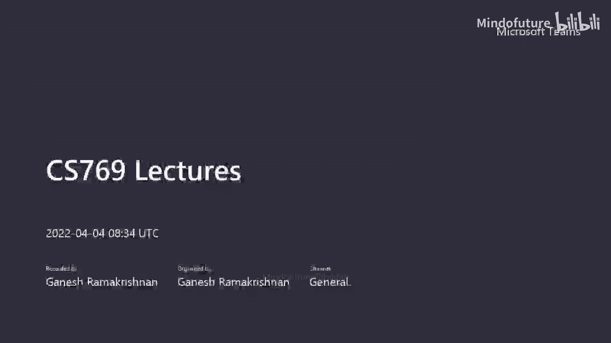
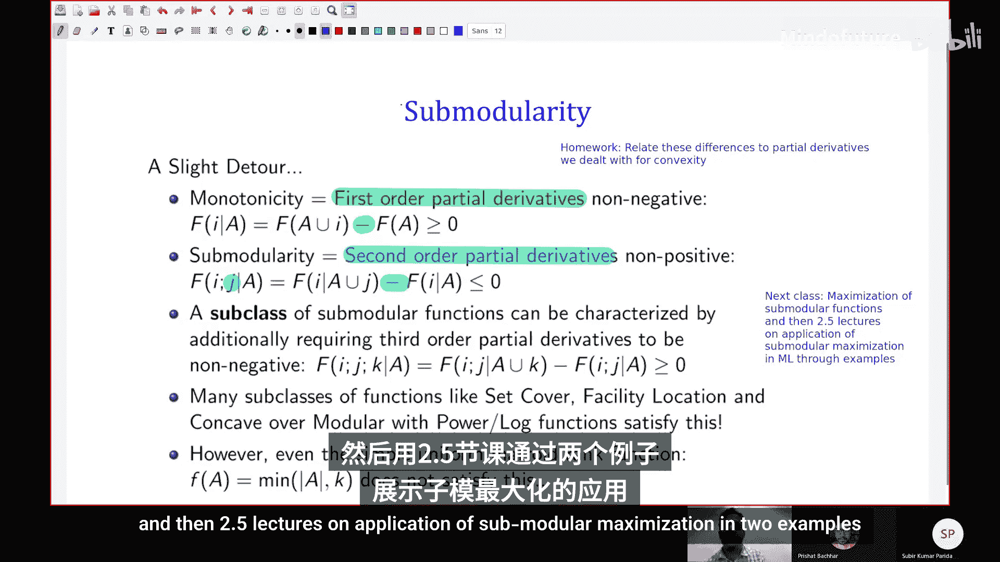

# 【印度理工学】机器学习优化 ｜ Cs 769 Optimization In Machine Learning p29 P29_第二十四讲_4-4_优化与机器学习_基于熵函数性质的子模信息函数构建 -BV18cBSBJEH1_p29-

这 lecture着。24。We will now conclude our discussion on interviewpy related properties of some model functions。

And quickly do some model information functions。And also look at submodular function maximization。So。

Briefly recap that we talked about。Information functions beginning with the definition of entropy。嗯。

And then we also looked at a notion of。The information gain， right， So H of a union E minus H of。

H of X A， that's a game you get。So what about that， So we there are。Entropy， mutual information。

 information game， conditional entropy to add to this conditional entropy。

Then we also defined the notion of kale divergence。Yeah。And soon。嗯。So yeah。

 beginning with conditional andtrophy。Yeah。Aha， this one。Thanks。Yeah。Okay。

 and this one is here is a minus。啊，确都没兴趣有确人都没兴趣。Sony。😊，He doesn a mine as you。对。Oh， sorry。

 that's not it quite here， there's already a。that's fine。 This， This was all fine。

 I think only the previous slide there was a minus mistake。

So we refine the mutual information as well。Which is kind of。

How much is the information that X and Y share between each other and the best visualization of mutual information would be here this。

The figure will be sticking around sticking around for most of the y。 So you know you have edge of x。

Given y on the left hand side， h of y given x on the right hand side and this intersection is the I of x comma y。

 the mutual information。I mean， just representative。And H of Xcoma wise is ending。

A joint improvement。Thank you。😊，嗯哼。😊，So what is in words IX comm y is a reduction in the uncertainty of x due to the knowledge of y。

 but it's symmetric it's also the reduction in the uncertainty of y due to the knowledge of x。

That's why you can im view this as the intersection roughly。Caale divergence。Again， it's asymmetric。

 it's not symmetric。 it's basically the distance between two probability。Moss functions。Again。

 computed as expectation so D of P with respect to Q is the expectation of log of P divided by Q with respect to P。

 so the expectation is with respect to P。😡，嗯。On the other hand。

 if you write a D of Q given with respect to P。Then you'll have exactly the opposite keyX。

How does  QX divided by？So it's asymmetric indexs。How does an inflammation in equality， it says that？

😊，Be of。E with respect to Q is。Always positive， not a non negative and equality holds only if the andq are exactly the same distribution and that senses bit of symmetry mod of this they are a symmetry I that okay。

So this again recap， right， So we proved this。 I'm not going to go this again， but recap the proof。

Is part information inequ？lose's the information in equality。So without further ado。

 we wouldd like move to the homework problem， homework problem was。

To complete the approval of submodularity of， right。Where did we leave ourselves， we said well。

Ie of Xcoma Y。Can be also viewed as a care divergence。Okay， then again。

 bracket is missing K divergence。Between。The joint distribution of P joint distribution of x and y and the independent distribution of x and y。

The left hand side is the independent distribution of X and Y。好。Distribution。

X and Y under independence。And what do we have the left hand side is a joint distribution。

And we know that information in equality tells us that this will be always greater than equal to zero。

嗯。Okay， and in fact， the equality holds even only if。诶。Xcel， Y are a dependent。

The joint is the product of the marginal。So therefore from this。

We know that mutual information between x and y is always greater than equal 0。Be just the same as。

Removing the dependence of the part conditioning on y what gives information you get about X。

 if you remove atomics。That's a。Indu a verbal definition of。Which information that we saw here。Okay。

 so this is interesting。 So now basically what is this saying， it's saying that。

H of x given y is less than equal h of x with equality only text y and independent。

Another way of looking at this edge of x given。Y is less than equal to h of。Eggs given。

Why union oh sorry， HX even。M decentcent。So you would view H of x as h of x given the m。😡。

Now can you， how will you extend this to get the proof of some modity of age？😡，Any suggestions？

Can this view help you。H of x， even wise like the current gain， right， no gain。但些人都比。Any thoughts。こ。

Why is singleton？O。What if I say？So M said I have a white prime， which is a subset of。😡。

Why see note thatmp said。It is upset of why？What if you had。A white image one subject away。

So I want to extend this to that case。What would that be。H of eggs given what。😡。

Is less than you could achieve of。Eggs given work。嗯可以。一个是。大 guess。If whitelash is small。

 it's actually covering less of it。 And therefore， again， you get by。

Adding more to wide dash to get y the marginal gain through you get through x is going to diminish diminishing returns。

 So we have to basically extend this proof。😡，So I'm not going to do that in the class youll have to now define you'll have to define something like additional divergence。

So we add d of px comma y from d of Px。Wellhy imagine now you condition the care damages。叫。Okay。

 so above blue pathology can be generalized to prove that h of x given y minus H of x given y。

Is greater than equal to zero。Whenever white prime is subset to white。And I mean。

 the inequ equalityality will hold only if the conditional distributions are the same given by prime and given y。

Okay again， this is extension。This is basically extended。From probability of X given y。

I probability of x。Which is the same as saying that they are mutually independent， right？不。ok。

Is that fine？It's just a lot more nots， but。嗯。天dy。Could require。No， like we had this。Inequality test。

 right？What was it going？You see this information equally。所以嗰个点。Yeah。Informational inality。

on conditional care evidence。There's a little more involved， which will will not be。

But I think you got to prove methodology you。O。Okay， so's clear now。怎会。

So we have basically proved that。Entropy is submon。But we see a lot more properties。

This gradientroppy， we had made no assumptions。😡，Other than the fact that it just created copy。Okay。

 so this is the again， the pictorial depiction。嗯。Now， what if I look at？😡，This mutual information。

 i comma X。So so， so， I mean， I define this iconomic， right， I use Is as a tool to prove the。

Some modularity of。Introbs。But what about is a modity by itself。😡。

Is I sub modeller now we can ask a whole bunch of questions Okay。

 so let me ask these questions before I go to the next slide basically will be over so questions。

What about。So modity of I。Now moment you say some modity I here have to ask viewed as a function of what viewed as a function of x comm a y viewed as a function of y viewed as a function of x。

 obviously it symmetrysymmetric。😡，But users function both or one of them fix the other moving， right。

Med as。Function of both all。That x slash white。喂。😊，I could also ask what about some modularity？

Or properties， I mean some modity in other properties。😡，Of say a of eggs given way。😡。

The conditional entropy。If so。Yeah， I think。We should be very clear it's not just a modularity and other properties。

ok。K the next try and answer these questions next。😡，What do you think， what what is your view。

 do you think all these will use a modeler？Any opinions？去。对。Let's started。Information gain。

 so note a definition little carefully got about information gain mutual information we have information gain is nothing but mutual information viewed as a function of one set of random variables。

 okay。😊，So this is。Information gain is mutual information。We would as a function of the first。

Set of arguments。Okay， I know。 So you have x from a Y。 What is the。If I remove the y condition on x。

😡，From H of y then basically the part that is mutually informative is there。

 but viewed as a function of a so for example， if I'm adding features。😡。

Let's say why is a class label， right， so let's say。😡，It'd be easy to illustrate using say。

 let's say why is class？In a classifiedify。And x。Is features x1 is one feature。

Extrue another feature。Ex on the feature， in fact， I can have a subset of features also。

XA is a subset of features。😡，So let's say this is X， a subset of features。So I'm trying to see， well。

 how much is that X informative viewed as a function of a， y is kind of fixed？😡。

I don't want to keep changing the classes obviously。

 I don't want to say information of one set of features with a respect to class one and another set of information features with respect to class two makes no sense right so this is。

X8。Okay， so this is mutual information。😡，We waitedted on the class。 Think of it as。Okay， so no。

So we're still looking at this this area， we're still looking at this area only。只能一个人就睡。

So it's still looking at this bonding here。😡，With respect to the。Now。

 it turns out that Fa is not always a model。😡，Okay。

 and we'll show one special case when it's just sub modeler。The reason to say is not some modeler。

 very verbally explained is that。Even if you fix the plus white。The features themselves。嗯。咩。

ComFor example， let's say one feature is height， measured measured in inches。

Are their features height measured in centimeters？Okay， so are there really independent， I mean。

The features are not independent。So there could be a lot of correlation between the features。

But if given the class label， these features are independent。😡。

If I tell you that its a particular class and the features are designed says that they are independent in a feature。

😊，Then you can claim that， dear。That this information gain someone。Okay， so。

IfA is not only some model， I'm just going to give a very。They might be dependent。given given。那屌。

So for example， the height of a person in centimetersmeter is height of a person in inches。😡。

Are they independent given， you know whether a person is。Underweight or not。你。一ji。嗯。Next one is。

Hide in centimeters。Ex two。Is height。In in。Probability of x1。Com my it's too given。W。

 whatever you know。You know， under。Is it equal to probability of x1？Given underweight。

Into probability of x2。Given underweight。No。The right so so at least they should be conditionally imp。

Given why。So I never move this description now。O。谂啲该嘅政府。嗯。ok。So what you could do is， however。

 if they are independent， you have heard of my base class。Features X are independent of feature Xb。

 given the class level， if that happens。Then let's see what the decomposition is F of a is I of y comma X a。

😡，Which is h of x a minus h of x a given y okay this should be all familiar with you this are exactly reproducing the definition。

😊，Okay， this turns out to be a of Xa now if they are conditionally independent。

 that this is an interesting part。😡，H of Xa given y is the same as sum for all the A' indices。😡。

Let's say x1， x 2， x3， x1， x5。So this decomposes why because we know my Bay assumption will mean that。

Probability of。Exegu and white。Is product forward。A and A of C。Probably of a small a given one。Okay。

 so then you can easily show that there's any this equality holds right entropy is log of。

It involves a lot of probability so we can show this easily。其实。

Information gain can be somewhat learned under this assumption。

W now what happens is you have a submodular function。

 minus is a modular function is this is the first component。😡，It's a model。 You already know。

The second component is now modular。It's sub minus model， some model， minus model。

 which will be sub model。Is that okay。However， what you all often do is。You can。

 you boldly go ahead and say， well， even without leg base， let me try and。Minimize this。Why。

 because actually it's a difference of two submodular functions。 So it's a difference of。😡。

Some model functions X even by it's also some models， after all。😡，No， fixed to one for the fixed one。

Yes。Because its just conditional distribution right conditional entropy is like same as entropy where you are conditioning on  one y。

Okay， so。Now， given this difference of some modular functions。

 there are ways of optimizing this as well。Okay， so the way you there is an entire set of methods called majorurization minimization。

嗯。Could be optimized。要先。So we basically you alternate， right， you try and。

axIf you want to maximize right， you would say maximize the first component and then minimize the second component。

😡，Maage I N。咩意思？But anyways， that's just。For your。Knowledge this kind of difference， right so。

What you'll do is you'll alternate between the first component。Whi you majorize。

 we consider majorizing that。And you know， the second component。

Minimize that in case hold maximize the all。Okay， and the other possibility is if even if it's not conditionally independent。

 you can make a submodel approximation。😡，So what you do is okay。

 you don't do h of x a minus h of x a given y， but you approximate this whole thing。😡。

The second component。They are not independent， but let me just make a base assumption。

 You know that9 base is an assumption after all， right。

 so many classifiers with by which so many you know data sets where base ast whole。 you still learn。

 and it works pretty well， right。At least the creative learning right was one of the most formidable baselines。

So you could do that。 You could just go ahead and say， okay。

 I'm going to do anyways make that assumption。 And that's that's a。That some little approximation。

It okay。This is clear， I mean it' wouldd be nice to just write down these basic expressions as we proceed。

So what have you seen so far is recapping， you've seen that。

Mutual information viewed as a function of。One of the arguments， X。Is a model when。

The components of X are， conditionally independent， given the。The other set of random variables why。

But ir respect to assumption。Sometimes you can make a sub approximation and make that nine base assumption。

喂 my系。However， the submodularity of inpy doesn't require any of these assumptions。😡。

Entropy is always a discrete entropy always a。Okay， so we have some monotonone， some model functions。

 some of these we have seen and we have enough motivation now in all monotonone some model graph cut visual information。

Okay， by the visualual information is。It's a model under those assumptions， which is not monotoism。好。

Entropy， by the way， is monotto。 I think， I think we saw that already。 entropy is monoton。 is some。😡。

But as you keep increasing the size of the set。The entropy cannot decrease， it only increase。

I think we have seen a proof that one of these statements we had already seen。So provingrov the case。

So this is a picture so far of what we have seen now we go to。😡，Do the following。几实啊。So again。

 we look at this bird's eye view。 We have some model functions wanted on some model。And then。

Supermodular functions and then a big class， a big subset of some modelular functions has to do with Npro。

But don't be able to look at。Using the formulations around the enpy， mutual information。

 information gain。 What if you use that for other submod functions， Okay where do they fit。

Where do other submodular functions？Where， where does Where does。Application of。Information。见。

Et cetera， which we see， right， information gain， conditional entropy。Et cetera。uply。

F when applied to other submodular functions let say other other than entropy。Okay。

 so that that's a curious thing。 I mean， just to you an idea， right， if you。

Yeah monitorone some modelular functions if you。So while entropy was here。

Moment I applied information gain。Inform gain。Basically， you know， based on the enthtropy。

Was strling between monoton and nont。 Oh sorry， it was str between some model and non non some model。

 Where was that。汤。This is a failure， right， So I it probably brought me。Obviously non monitorton。

Does this information be？So then we are curious what happens？

When we apply the same concepts to other submodial functions。你是接。So this is the application。

Application of information again， for example。This is where。Okay， so let's see that。

So we'll now define these information measures。Which is related again to your assignment。

 your second assignment。Or application related to yourself。Okay。

 so we'll define that and then give examples。Okay， so recall all these information theore concepts once more。

 right， which is entropy。On discrete random variabless， mutual information。We've seen that。Basically。

 looking at h of x A plus H of x V minus the h of x U a。Basically。

 if you are dealing with site functions， this would be intersection。😡，But it's more entropy。

 it's not just sick。😡，So it's like this view。你 this is哎哟。诶 a个方面。And有有边。

To keep this approximate image in mind。And then conditional entropy was what？

The one on the right hand side， right？This part is a conditional entropy。Hdge of X。A you an explain。

我得你。Look me。Even andly。That this would be a of。英語分。But now you can do fancier things。You say okay。

 condition entropy， I can do conditional neutral and information as well。

So what does this entail saying I'm saying that I can do a。H of x a comma Xb。Give an exceed。Okay。

 so just to be， I do the same thing as what I did here about。

 and now I'll bring a conditioning on Xy。Like we did conditioning on X week。

So I can have these combination basically youre seeing also information between information in the intersection of A and V。

Given that she is already good。So you've done probability distributions， condition distributions。

Think think of it， but in a discreteet sense， because now you're talking what ind is on random variables。

😡，So that's quite a discrete。Optimization setting。I it you。Okay， so why is this so interesting。

 why is entropy suddenly becoming so exciting for us？😡，Well。

 it looks like when Sharon defined know the inequalities for atropy。

 he didn't know about some modularity。Sometimes there are different communities。

 whether it's graphical models whether it's you know entropy。

 many of these evolved in different communities in different ways， they never spoke to each other。

So Sharon Hatys。Three properties。We refer to f of phi equals0。

 that is the function entropy on an empty set being 0。Entropy being monotone。

F of a greater equal F of B， if a is sub super sector of B。

And he had a slightly different notion of some modularality or different word for some modularality called it two alternative。

😊，And now you can see， well， this is related to the second definition of some modality or second equivalent property of sub modularality。

😊，Two alternative。Is the。Second， equal end。Definition of some of that。Which is f of a plus f of b。

 that alternative is greater than equal to f of the union plus f of intersection。😊。

I mean you can see this in the same right so F of a plus f of B F of a plus f of b is greater than equal called F of a union B plus the F of a intersection B。

 which or would have certain equality if you were just looking at。😊，We card model reference。不极。

So that's the reason you know， there is such a strong bonding between entropy and some other functions。

Now， property 3。Implies non negativity of mutual information。喂。In fact。

 it implies non negativity of mutual information and conditional mutual information both I'm going to leave this as homework for you。

 you have to think about it okay。And another homework I'm going to leave for you is properties is one and2。

😡，Together， apply non negativity of entropy and conditional entropy。😡，Okay think about this。 Why。

 why these properties hold。So mutual information。Oral mutual information。

 which is basically very grossly mutual information。😊，That's non-neing。And properties one and2。

Are they together reply the。Non negative non negative enthtropy。And condition。

This land not very difficult should be able to reason it out easily。So basically entropy。

 condition entropy， mutual information， conditional mutual information， all of these are。😊，那那个对。

That's a very nice thing to do， right？But there is another interesting thing There's theres one might be wondering well。

Are there other functions that behave like entropy？So there seem to be polymyoid functions。See。

 some functions in general need not be monotone， there not be you know normal licenses the some function on M not be。

So think of a huge circle sub model just sub modelular functions。

And a part of that is a subset of that is what is now being talked about as polymicoid functions。😡。

And I'll tell you what why this meroid right its related to matrix so I haven't really included those slides。

 but let me just for a minute I'll use this example so you know mates and their ranks right。😊。

So what are the rank of our meetings？Next exist a。What is rank A。Just give me a verbal definition。

What is the line coffee。等人。O。Dimensional column space。The maximum number of。Independent columns。喂。

 now。Is this maximum number of independent columns？Normalized， if I give you zero columns。

What is the rank？0。Okay， so let's just write down its properties。It's a rank of empty。Empty matrix。

 I mean， if I basically rank of I mean， not just matrix。 rank of， I think better to say is rank of。

gaals。A subject of going。知道看。There's a maximum number of independent columns in that circle。

So rank of empty set。Is going to be 0。What if you know， what about mono in the city？😡。

Is rank what do you think if I keep adding columns。😡，To the argument of rank。Will they让 shouldn该我。

Ranggoly， right？The It function。Is monotone。Very simple。Some modity。

So if I give you think of the other definition some modularity， right if I give you a matrix。😊。

And know。to this matrix a。I add an additional column。It is an additional column I'm adding。

 It's call it E。If I add E to a。😡，As against adding E。To a subset of a or a sub super set of a。

SoLet's say I have a super set of a， which is。Gardder。Okay this is B。Okay， so B is super。

So what can I talk about？Think of it。Augmented with E。Mus the rank of a like How much the value。

E is bringing to a。As against say， the rank of。B， which is superet of a。

In conjunction with E augmented with E。So this， yes sorry this is not I don't don't know what to say comma。

 let me just put up comma that's easy。It's not condition。啊。Mineus a rank of B。

What do you think this property will be？Great than equal to， right， Because you can imagine that E。

 if I add a column E to V， I mean。The set of independent columns。😡，May not。

Letly group the additional set of independent columns， not the additional set of independent columns。

May remain the same， but cannot certainly grow， right。

So there' is more value that e is potentially going to add to a than it to go to add to B So you see this is the reason that this you see this matteroid this matteroid structure is a generalization of what we have in matrix。

So we'll actually not go more than that。😡，As far as me is concerned right。ok， so。

It turns out that any such function， which has satisfies these three properties。 Okay。

 so I'm going to just。Highlight these three properties again。These three properties。

Any such function is called a， a polymeide function。😡，Which is normalized。😮。

Which is monotone and which is submodlar。And it turns out that polymeride function generalize entropy。

😡，ok。So， get it。Okay， so now question is okay， let me know we have brought up another dimension。

 which is entropy， when does entropy really fit in the scheme of these things？😡，OkaySo this is endpy。

OkaySo the question is entropy this entire set？Where is entropy？Is it a subset here？

Is there a subset here like this or does it coincide with the entire polyoid functions。

 What do you think。Subject， you think it's a subject。Next yeah， it done out。Okay。

 so which sorry that come this later。O，这 is。嗯。So you're right。

So polymeroid functions strictly generalize entropy。😡，So indeed。

 that that picture I showed you earlier。I should have change the order of the slides and this actually holds。

Okay， this， this is the right picture。要く。submodular functions， you have entropy。And you have。

Polyide functions， which are subset of some other functions， but a super set of。

Interability functions。Okay， and there's a reason and some of these I a little fast on that。食等手大。哦。

This holds for all convex combinations of entropyic functions。😡。

And it contact and some model information measures will not satisfy this。😡，In fact。

 even polyoid functions do not satisfy this。 So is inequality。 This is very much。Thishi is equality。

I'm sorry， this is inequality only， is this inequality。Okay， this is very characteristic of。

The some model information functions。I'm sorry this is characteristic of entropy that so entropy will entropy functions need to satisfy this inequality。

 which。😊，Polymyide functions are not obliged to some other functions are not obliged。

So there's a constraint which is only for the subject， not for the entire is this here。

And that's basically looking at， you know given four random variables。

 its looking at combinations of four random variables for which you have certain inequality x I of x3 comm x4 minus I of x3 x4 given x1 so we will not spend more time on this right now。

It's a strict subject。Okay。Study。我。I'm going to。 So I'm gonna cover some mod information measures。

Okay， so， now， so what you are saying is now we are want to generalize our observations on。

En to repeat to some smaller functions。😡，All of our mutual information gay dis。Information gain。

Conditional entropy， all of that will generalize。 Okay， so here are our definitions。If。😡，啊。

Is that information， it's called the information。What is submodular mutual information。

 it's exactly the same as mutual information， but you have replaced the submodular function with error。

😊，Okay。That's only thing give。That's what we mean by some smaller mutual information。😡，In general。

 that's how we get some more information functions。In mutual information。Inmunent information。

With place。嗯。Intropy。Some any some difference。Okay so you have seen this。If you had H。If edge。

 you'll get mutual information， right？Sitting。好。F， S H。You get regular nutrient。Likewise。

 you can define a conditional gain。Gain of adding。B to a。

Is the gain of a union B minus the function of or information function of a union B minus the information function only。

So same thing， everything is now going to be。Now， we just have F here。

 You have F in the superscript here， like our mentioned， we are F of a given B。And like before。

 you can have combinations of the two。😊，You can have F of a given C plus f of B given c minus f of the F of a union B given C that is。

Visual information between a and some model or visual information between A and B givenancy。

Is this glue。So this is what we mean by somemod mutual information。😡，Just replace entropy。

With some model I give you some model information functions， including visual information。Okay。

 so some model information。Measures， the notionion is clear from the name。

But for some model conditional gain is is again information when you add set A to set B。😡。

Mutual information is a joint information between sex， A and B based on F。😡。

And we'll see for each of those functions like set cover representation。

 what each of these means we say you see some samples。😡，Independence。

We can also look about independence like we talk about enthtropy， you know。

 h of a x comma y is h of x plus h of y if x and y and independent。

We can have a similar notion of independence module order the sub model function and not inpy。😊。

So notion of independence is maximally different mindset。And we， but through the lens of F。

 F is basically the lens。ok。And this is exactly what I was saying some model information functions are also a strict super set of entro entroic information functions。

So entropy is a subset strict subset of some functions， strict subset of polymeoid functions。

And some model information functions are also strict super intertroobic information functions。

 all that introic information that has to offer right so now we are just kind of gone ahead from some sorry from entroic information which includes no。

All these gain functions。Mual information。Cail that if you want and so on。I know you going do。心么。去。

In fact， there exist the polymeide functions， me ion functions。

 which do not satisfy the inequality above。Okay， just as an aside。

 so some of these slides are moving a little fast and then again slowdown when we look at very specific examples。

We just more properties。So， as I said， you know， you can have a notion of independence in the case of enpropy。

Right mutual information between and B， if now is zero with respect to F。

 then you say that two sets are independent with respect to F。You you remember。

 when was the mutual information meeting x and y 0？啊。We call that IX comm Y。Was0 if8。

X was a end of y， right because。It's because I X Y。boss。Could also have been written as I of x minus。

I have thanks given mind。So they are independent and I of x given by is I of x， it becomes zero。😡，ok。

So you can also talk about conditional dependence。You can see I A and B are conditionally independent given C with respect to the lens of the F。

😡，IF of A B givenancy is 0。They are like notions of pairwise independence。ok。

You can also talk about multi sets of model information。

 something we are not going to build upon this is going to be a little kind of breezy and I would say this is this is like really extra optional no if you are very curious about it but let me give you an idea what these are doing。

So if you are given multiple sets now， you can have a notion of submod or total correlation。

 how much are these sets correlated？So it's generalizing。The notion of visual information。

Which information I only look at。IA plus Ib minus of I of a intersection B。So I of a union B， So we。

 this is generalizing。So， you had。I of a comma B。Is I of a。Thus I of V。

Minus on the I of a union B right now what youre saying is well。

 I generalize it and say if I if I had an I of AI， what do I do？Right， a12。嘅温度系几。Then I'll say， well。

 I'll do the summation or I equals 12 k。哦。Of I of AI-1。 So this first part is clear。

 The first generalization。Its key。And that's exactly what we having here。But the second part。

You saying well， the generalization on the second part will also be that。

I do a union over all the yearsI。That's the second point。You now I can do this all any。

Some what function。If。So this is total correlation。

 but there is another related notion of multiai mutual information。😡，Okay。

 what here you do is basically。😡，SoYou know， the inclusion exclusion， right。So what is this doing。

 so this is basically implementing inclusion exclusion。😡，So what is it doing here it's saying？啊。

Depends on the size of T， if size is even， then you'll have positive sign。

So let's kind of write it down what might it look like。So this's a minus out already。做。

So initially you'll have。This will be basically what summation over i equals 12 k。Of IeAI。

 So this will be the same as above。Exactly the same as above。 The first right。

 If you have single element。It will be a negative here and one more negative here。Right。

 and that part is same。But now you stop jumping to a union directly。 Okay。

 Also a final component will remain this I mean， something similar to this you have an the part in green。

 But now you're growing it in stages。 You're saying the second component will be。Minus。

For all possible， I1ma I2。You have I of A I1。我么AI读。

So initially you thought they were all independent， but now you are trying to reconcile don。

 what if theres some dependence？But then Ill overcapture dependence between the AIs。😡。

So I want to now do course correction and say， well。Let me add back what I earnly subtracted。

 so is inclusion exclusion。😡，So you say AI1， if so not， it's the same thing。

 So its I hope it's clear right， I1， I2。系 three。Of i a i one。别系都。E d。安顺。Okay。

 so you can kind of now imagine this is another definition。

Instead of jumping from just is adding these intermediate terms here。😡。

Adding all these intermediate terms instead of the green part。So you can think of this。

you have probably done pairwise independence。Okay， so all this has analogies and the analogs and。要是。

Independence of random variables as well。ok。Okay， so you can actually illustrate this pictorially。😡。

F of a given B， we have that before F of a given B， you look at this region， right？😡，嗯。60例线。

So it's going to be a little tricky to highlight all of this。so。十温度。Yeah。This is F of a in me。

which is basically what f of a union B minus e above B。😡，F of B， given a likewise， I can look at it。

 but f of a intersection B， F of sorry mutual information between A and B。

 we had likened that to this intersection region， right？😡。

SoA given B was like trying to exclude the part of B here I'm looking at what is common between the two。

😡，But now you can do the same thing for。K equals3， that's the second part here。

So you can look at IF of a given B union C， so now I can look at which two sets are conditioning on and like if it was a given B。

 I would have just taken this。And I said， right？I been A given B， maybe there's no A given B right。

Yeah， there's no。 I mean， that's like this A even B this。But if I were to look at。A given。Be unioncy。

Then this would be the region I'm talking okay。😡，Okay， so I hope you got an idea。

If you're looking at a comma B given C， okay let's look at just one more example。😡，A， comma B。

 that is some mutual information between A and B， on let's look at B and C that way。😡。

Between B and C， it is a region。Between B and C。But given in。So is B and C orderly。

 this would have been。I of B command C， but now since I want to con on a， what am I looking at？

I only look at this part。嗯。This is me。Com嘛系给你。If you get these two examples。

 I think others will follow。All the others are basically medium of。Are these two examples here？O。

Okay， so I would like you to know maybe you would be asked some question like this just map it intuitively if you know well you understand what conditioning does what intersection does。

So try and identify so homework， I mean， I would say this homework。Pry and identify。

Legions and corresponding。Information functions。When I see information function。

 it did not be mutual information， it could be any of these。So I might be， you might be told， okay。

 what about。This region。What does this capture？Okay。

So now let's look at examples of some model sorry of information functions when I say information functions we are really talking about some model information functions。

😊，Okay， so more functions。😡，Simply。I just have three different things right。

 I mean I scream I have some pineapple， I have some juice。So。

F of a for modular functions is some of the individual elements。But momentai condition。

 F of A given B， what does it mean。It's a said difference I look at the weight of all the elements in a which are not in B。

 let's just write simple verbal descriptions you okay。😊，It's sum of weight of all。Elements。

Which are in A and not in B。What is IF？Some off。Weights of all elements。冇点。电里。I mean。

 I can just extend the same thing and say。The last one， the second last one of all elements。

He jot in。嗯。All age。So modeling is very simple to understand。😡，You can actually expand it， right。

 And what is independence basically is saying。I of a comm B zero means。😡，There are no。

 there's no weight associated with the elements intersection is0。

That's the only way unless some of the weight I de generate on 0 Otherwise only way you can if all elements of。

 I'm just assuming， sorry， assuming that all elements are non。0 weight。

This is clear so simplest is entropy， it is modular if the variables are independent。😊，呢个 simistic。

But， let's look at。Waied set power。Yeah， I' tried to give some explanation there So three read the text a little bit more and we'll also keep writing。

As we describe。So gamma will be the elements covered。

 so let's just recall right so if these are the documents。Okay documents。

And a is a subset of the document。 A is always going to be a。😡，Subet of that。Doocks。

 which are these basically these are the entire set works。Each document is going to cover some words。

😡，Yeah。So theres gamma， let's just I write down the gamma here。And let's call it D1。滴都。机址人重叔。

What is gamma of D1？D1 covers dog， bird。Beach。按数咧。So that's what gama is。So in general gamma of now。

 let's look at this right。 So gamma of。D one comma。力度。Is what you take a union。

Of all the elements covered， so it's dog reads。😡，I didn drop cat。He was scared。Oh， I made a mistake。

The st in written that guide image。It was cat。冇认。其 so嗯。Now， if I consider two elements d1 and D2。

 then looking at。Cadboard beach for D1， but D2 covers dog。😡，Oh。

 some links are missing let me do D3 thing we do is not fully specified like to the D3。Okay。

 so what is B1 comma decrease coverage？D3 covers bird again， right。

 D3 covers some other concept also。 So bird will not be repeateded twice。 is a union， right。

And then you have other terms covered by D3。So this union has taken care of her。Kind of repetitive。

Beach。So that's where the diminishing returns comes， right？😡，ok。😊。

So now what is F ofA is the weight of all the。Elements govern。So， for example。In this case。

Itll be the。Make off say God。Last weight of bird。L weight of meat and so on， correct？

W of all the elements in that。E given thee。Okay， so now I think I should put a B。

 So all this was a a was。Sure let's mention， Alex just take A to B。For this entire slide。

 let's say a is d 1 D3 okay。And next， consider a particular B。Actually。

 we can only take B is D2 because yeah， others are not named， so B is D2。And D2 covers dog as well。

 right？😡，So F of a given B is what the weight of all the the not the documents， but the。😡。

Elements covered by those documents， the words covered by those documents。😡。

What that turned out to be。So now what we have to do weight of those covered by a and not covered by B right so dog or dog nobody covered is it dog D2 did not cover。

😡，So I'm a little at loss。 I have to put some more edge here to make sense of this。 So let me。嗯。Yeah。

 so dog was not covered by anyone else unfortunatelyly， but let let me put this link to board。왜た模습니다。

入都上面。So this will lead to。What really do W of。So I would not have a weight of cat。

Plus weight of beach， but I have to sub the I will not have the weight of。😡，Bird， right。

I don't care for the weight of dog because dog never occurred in D1 or D3。😡。

So what is weight set cover doing is basically。It is basically just some adding the weights of terms。

 but terms covered through。The set elements of a。 That's where the similar modularity comes。

 Otherwise， it's the same idea。 you understand。So that no。bed of。喂。

It has no weight of word word because。D2 also covers。冇。Thatds issue。Okay。

 so mutual information would be what I mean its it's again now it's becoming very trivial because all you're seeing is coverage measured through sorry rates measured through the coverage。

😡，So this will be weight of。A and B， both。So but they should be in both。

 So what does the term go in both， it's only。I think only bird， right。非种离谱。看死我。

And independence is if that is big is if。The coverage of A and B。😡，Is thisjoin？亲。Okay。

 so you can go back and just write down these simple。s I mean， simple， simple explanation。

 what's happening？边唔讲唔紧。Thanks。Okay， and this IF。Information A comma B is again。Be of terms。各位把。屋机系。

安全。Okay， so I will not spend as much time on all the others。😡。

You can similarly come up with probabilistic coverage Now the whole notion of coverage is probabilistic otherwise the so this you look at this P of a。

Subtraction from B。 So that coverage has to be done enough。

Probilistic man So instead of a gamma right， you're looking at a probabilistic measure of how A and B are different in the in the case of a subtraction from B or how much intersection they have in the case of a comma B。

其实 all。The previous notions of coverage。你讲。Problemistic。Okay， so it is it is slightly trickier。

 I must say。😡，For say location， let's just look at the terms here。

So what you'll have in the physical location case is F of a is。The most similar。Element from a。

For each element I right so in fact， we had a name for this we used to call it G。😡，I want a fix a。系。

Now f of a given B is what you saying， well， Im already given B。

 so I have to I have to now look at how much similar。😡，A point in I is to a point in a。😡。

But I want to subtract how similar that point， the max similarity of a point from I to a point in B。

😡，So this like a margin margin of difference between margin of difference between what the the difference between。

B point， there's more similar point in a from the most similar point in B。The max of zero command。

 that is conventional because that's you can't have negative values。😡，So difference between most。

Similar point in a。And mean most。是啦。Or didnt be。It max， I would say。我。

Okay so I got a lot of these can if you just write on the verbal descriptions。

 you'll be able to remember them better。😊，Let's look at this information， information。

 what it's doing， it's saying， well， I will find the most similar。😡，Um guy from a。

 most similar guy from B and look at what's the mean of the two because it's intersection。Right。

 Max is if I were probably considering a union。 but here youre looking in the min。Men of the most。

Similar values。先诶。It about intersection it should be you want you want the fo to be similar to both A and B。

That's why you're taking me。Okay， and likewise， you can do for multiple sets。

 which you will not get into。Yeah。So you can now look at inlay some coverage。

 This is basically facility location。 So if you know， I mean， this is。Not just location after。

This is a graph cut。Majicap。InGraford get a lambda here， right？Okay。

 so if I looking at the mutual information now between A and B。

Is basically the sum of all similarities from A to B。What do you do？And here。

 I've already explained what is is。 So if to V slash a because V the complement of a is a graph card function。

 so。Let's actually take an example， let's say this is。一。And。This is the。诶一个员。Are you pray。So。

 in this case。What are we doing， Were looking at the graph cut， the cut of。😡，Cut involving。

These edges。So， these edges。This is exactly the graphite function that is IF。😡，Okay。

 independence is if the similarity between the。Every pair of points in A and B is zero。😡。

So then that's when you say that you have independence。Okay， so anyways。

 you have an assignment where you can try out these functions，ok。

What are properties so were go to run over these examples I wanted to spend a little bit more time。

 but properties we again want to just understand those properties。Okay。

 so if F is a polyoroid function， so recall that we had that big image good to have that image all the time。

嗯。This image is important。Okay。我的。So remember that polymeide functions generalized entropy。

 they had you know one or own。Right， submoder。Plus monoton。Plus， normalizedist。It's gonna normal。

 right。So if it is polyitoid， then not for any arbitrary sublar function so。

With the assumption that F is。Polymeoid， we belongs to this blue region。Then F of a， F of a given B。

 all of these are non negative。😡，So these cannot be set for all sub modular functions。😡，I mean。

 certainly for entropy， we certainly hold for entropy and more， that's what we are trying to say。😡。

Entroic information。And more that is for all。Poly Hyroid。Information functions。Okay， and moreity。

So some of these are monotone， some are not everything。

 so F ofA obviously F ofA will be monotone if you're dealing with polymeide functions。😡。

So that some of this just holds monotonity because you're dealing polymeride function so for example。

 f of a will hold to be monotone， but f of a given B will also be monotone because in some sense its just conditioning on B so it just a new think of it as a new distribution right a condition on B。

It's monotone in a。Information， mutual information is monoton in a for a fixed B and recall what is mutual information doing its thing。

I mean， the reason， roughly。Is that IF of a given B a Qcomma B。I。What is the entropy of？Okay。

 minus D。En you have A given B。Okay it's going to be monotonone because as you keep adding conditioning。

😡，As the gains are going to be。As the conditioning part increases a enroppyia basically enroppyia vague or nothing。

Entropy of A given B， now you're growing the set。😡，So the because of somewhat diminish return。

 So therefore， there is going to be greater than equal0。Not only is good。 you know。

 it's also as you keep adding the as you keep growing the a。This gap can only increase。Okay， again。

 we won't have the time to keep doing all the proofs IF of a comma B， given C is monoton in a。

For a fixed be。For a fixed C and motor and B for fixed A and C。

 so I think the key key point to understand in this third statement is the fixed parts it says fixed。

😊，C must always be fixed。😡，If you are comparing with respect to A B should be fixed or B A should be fixed。

😡，That symmetry is， but the Z C C part should be fixed always。

And then you have upper and lower bounds F of a is greater than equal F of a given B。

 So we have seen that this is again holding because of the some modularity of。😡，If。

F of a is greater than f of a given B。啊。Now， info the mutual information between A and B is greater than equal to the。

Somemodular function on the intersection， so we already has been trying to intuitively relate mutual information through with the intersection。

 right。But it turns out that it' is slightly different from the function。

 the submod function itself on the intersection。😊，Okay， this， this would be any， I mean。

 equality if you were dealing with modelular functions。😡。

This would be equality for modelular functions。In fact， both would be qualities。😡，好击。

And this image information is less than equal to the min of。F pay and F B。

 now you recall we we found some inequality like this in the case of。Which is。A city location。

we actually associated the mutual information with the min right。So we call facility location。

Not only physical location and it's。Muture information。ok， finally啊。O等我都讲 yeah。是。是。有。れで。

How is information gain monotone given that。啲で。嗯。边。你问啲。我你几星几多得十蚊。第六啲。唔咩，你今刚俾见我听。

You don't remember the third segment， right。But that is for a fixed B is monoton in a for a fixed B。

So the statement in some is very very very much a combination of the previous two statements。

So then your question is about the second or the first。

 which one is your question the third one follows from first and second。每个是。Okay， your question is。

 okay， this plus I mean， this plus this equals this in some sense。😡，好今日发生。Well， first one。

I think the first one doesn't imply the second。Part you not to expand on this。

 So I was just trying to say that as you keep growing the a， this gap is only going to increase。

So I mean， this like this is a common thread before both of them， but first one doesn't imp this。😡。

You have to go into the details， detailed you know steps of de。I never implied on the first in。So。

 I'm going to just。I mean， I'm going to leave this as a little bit of extra reading for you if you want。

The whole concept of differences can be thought of as gradients。

So if monitor the city is saying that F of I given a is F of I union a union I minus F of a。😡。

Its called the this is the first order differences。啊，Yeah yeah。

So I just want you to leave you with this aspect of foot for thought。

Because we are done so much for to a convex city gradient double derivative。

 so think of you know how some modularity is basically related to second order partial derivatives where youre looking at icon comma J given a。

With respect to how much difference I got with respect to J。😡，安你到底。😡。

So this is like a second order partial derivative。😡，It's because of the G。Okay， so I mean。

 addition to the previous two homeworks。I would say this。我们可。Be of。

These differences we have differences to partial derivatives。嗯。

Okay and what we'll do next class is now quickly move on to maximization well look at algorithms for maximization on Friday and the last two lectures actually even start starting next class well be doing lots of applications we'll do the algorithm of maximization and just plug into applications so maybe almost two and a half lectures of applications for machine learning so I just make a note。

嗯。Next class， I would say in less than half of next class， maximization。Of some modular functions。

And then 2。5 lectures。On application of submodular maximization。You know。都你下。Okay。Thank。

Lookinging for to， thanks。

