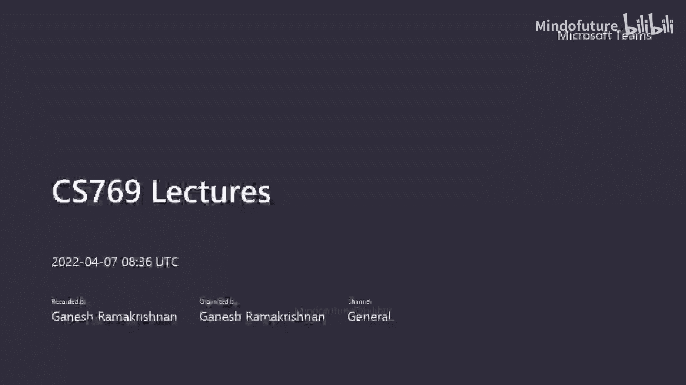
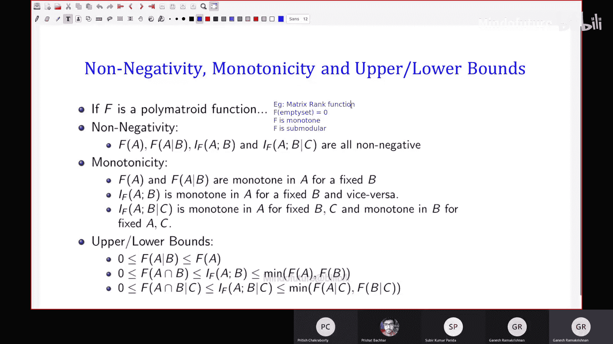
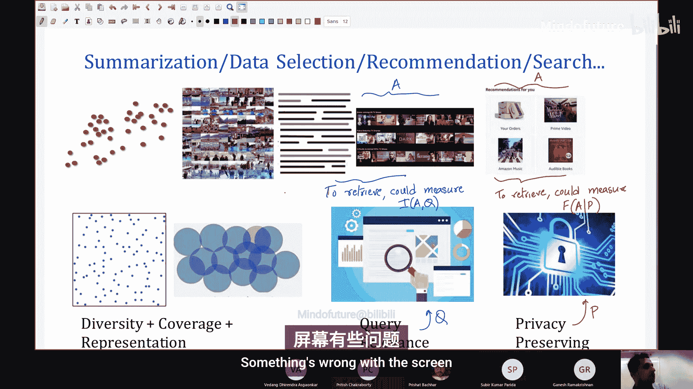
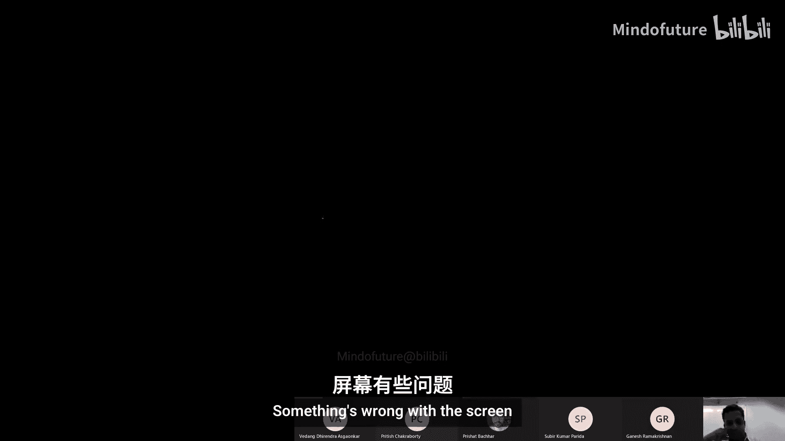
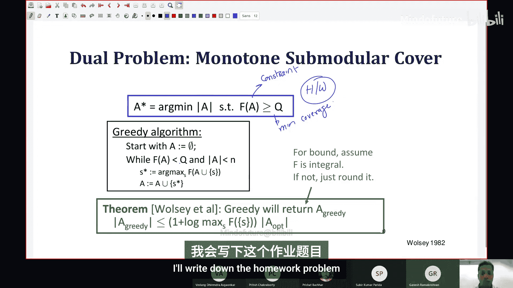

# 【印度理工学】机器学习优化 ｜ Cs 769 Optimization In Machine Learning p30 P30_第二十五讲_7-4_优化与机器学习_一般子模优化问题__极大化问题的算法 -BV18cBSBJEH1_p30-

直接佢啲费。We conclude our discussion on some other information functions。

Look at submodular function maximization and the submodulate library and its applications。

So very briefly， we talked about the submod information functions and here are some。Properties。

That we flashed in the last class。So recall what is a polymermicide function I mean the best way to remember polymermicide function is。

Maeds。Dnk， right what， what。啊。What are the properties of metric land function？F of MP set。Yes。😊。

Empty set of columns is。记录。F is。冇 not懂。that someone。Right， when we talk about the。A is busy you walk。

这是个好。

Okay。So now if it's a polyoid function， then there are some properties。I want。你们这个人。It's not big too。

But not only it's not negative function and on。A condition and D is non negative。

 The mutual information is non negative conditional mutual information is also non negative。啊。

To just make a note， we won't go back and do the definition that we have been doing for our way。

Monettonity is not for mutual information。But it's monoity。Is for the first argument。

Of a F I also the conditional gain。Likewise， a monotity is for IFAV if you have B fixed。😡。

Then nexts a function of， you can't have it as monoton for both。So just taking this ahead。

 you know if you have B and C fixed。😡，Then it's moton in A。

 or if you have A and C fixed it moton in B。😡，Also诶。The conditioning。Has a。Increases in size。

 in some sense， function。A you reduces or we always thought of F of A as， you know。

F of a condition only the MPC。But then there's a lower amount of zero because we already seen it's not negative。

😡，This property。And F of a intersection B。less is a lower bound for mutual information between him。

We always visualize visual information as the information of the intersection。😡。

But here we see that function value in the intersection is still less than the visual information。

Because it's not the intersection is' through the function that we see the mutual information right？

So that slight difference you saw in the case of sector you could have。To destroyjoings。

Which have overlapping coverage。And this is less than equal to the min of the two function values。

And yes。I mean then the last inequality kind of is a generalization of the second last speaker。😊。

ok 啊。No。F of A given B。😡，If我。A and F of a given B are both sub submoder。

 but F of a given B is neither sub modeler or supermod in B so we can't。😡。

Make either assumption for B。Then we move on to。Partial derivatives， right？

So that brings us to the next set of slides。But you said that。

Some modularity of the mutual information depends on some higher order derivatives。

 in a specific case， third order partial derivative is being model。Okay，就 that呃。你应该。Yeah。

 I think I miss this just like this。So how is it related so monotonity requires that the first order partial derivative is are non negative。

 some modularityities about the second order monoity is about first order。嗯。

Somemodularities about second order of washing derivatives。

Being non positive and that that should ring a bell in your mind because you always eliminate some mortality to on cavium conxity。

But here it is non positive， so it's concating， right？

Punky functions have second new kind of non negative so non positive。

Second order of Russian derivatives。反到し。A non cost second or partial or a non cost definite。去事。

What this？哦。稍俾都。So you could also now talk of third out of partialial therapist。

 which is important for future information， that's what I mentioned。😡。

Third are of partial derivatives to be。Non negative。And what does that mean it means that。

Here in some second order， I was looking at I。e。😡，3。😊。

The gain in terms of I when you have an additional element J in the conditioning。

Here you're talking about adding two elements in in the case of。Third order partial derivatives， ING。

In the presence of k as guess without the presence of K。So。啊。I mean。

 you could draw some connection with say ifs。Smoothness， if you want。系嗯。Yes。Yeah。

 but I won't do that formally。But it turns out that this。

The non negativity of the third order partial derivativemeters。😡。

This is satisfied by set cover facility location。按叫我我老。

Power law function so so that we would imply that。These functions。Should have submodder。

Mual information。是。Yeah， but then simple。In youform rank from the ran make rank。

Is an example of parliament。That does not satisfy this we may not be cardity of a co。O。

 so this is yeah this our know。Case of third error partial derivatives。

Now let's look at applications。So。If you are looking at something like。41 argue a query。

And in response to that。I want to measure how good the set is。

So that query relevance can be viewed as a problem of， you know。

 or reing query relevant documents be viewed as a problem of maximizing。Mutual information。系 i。

We think of this as a measure。So take you order to achieve this。如过面一些人。Yes。The Mu information i。

e of the set， let's say' call a。Comma you， where does it stop。It's say a very cu being host。Likewise。

For privacy preserving。😡，I could hug。A bee。And I might。Again， I'm might be interested in no。

 so my personal information not being given me。By face inflammation should not be moving。So。

 to retrieve。What would be me。没事。Something like the conditional gain of a。一问题。谢谢。😊，结个。这个是道。

Those on the call just wait a second。A problem。佢先。ok。嗯。You could also have combinations of these。

But I have query and privacy preserving goals， right？

So basically what we are now providing unified framework for extractive query and privacy processing summarization so you could have。

😊，You know， a combination of cover is representation and diversity and this is very agnostic right you could say max maximize。

The with respect to x subset of B。Aple eggs。But in the query sensitive or retrieval setting。

 you would say max except V。F of x。Rather than IF of the same thing。It's formal。

The privacy preserving case， you would say Max。X of or B。I use app directly， but careful。

Ex conditional。But any of these， any combinationminations？

That's exactly what I do now I could further put a cardinality constraint。Cality is important。

 especially if the function is monotone， if a function is not monotone， I might still do a going。😡。

Third of cardinary so cardary constraints are absolutely unavoidable。嗯。When F。不了。Otherwise， you know。

 you keep doing the set the function value you will be happy so。There's no limit。其实嗯。

We'll see a little bit more of this today because we'll to be talking about optimization algorithms。

😡，Yes， Google。哦。怎。Sony。还。What privacy can do？So imagine that I have my face information。Or。

I want to search。for god死交啲。不过大 dont want to。I know people identity were driving cars。

So I might say I。Ex we could be set up all images。And he would be。一般。这 is。

So what would be the retrieve x？X would be images without people。as a result。

 of'm maximizing if experiment。Exactive。I'll see， I'll show more example。

So you could have a combination， I can say I want， I don't want to avoid people images。😡。

But I might say that。I'm interested in night。ExSo therefore I'm looking in。

Summaries which are nighttime images without people。And show what examples。是。

These are the extreme cases when Q is V。It's basically。FO x is given P。But you was。

The Q being the entire set B is vacquious redundant。😡，Right and therefore， it just vanishes。

It's effect not yet。Likewise， if you have。The privacy set is empty。And you would have。Again。

 predominantund。Information。Its sort of thing。Sensivity to people I say sensitive to nothing。

 I just get the same old summary。And that's also affected you。Okay。

 so this is what gives you a uniform unified。Optimization formulation。With these extreme cases。

 being special cases。If F is a polyit function satisfies the property that。

Rriipple partial derivatives are non negative。Then。

This is my all the biology virtue of all the results so far。Then I a comm O， So this is Q。呃q b。

Is more submular in for fixed Q&。Okay。This is all fine， but now we are going to the next part。😡，What。

😮，What is the implication of all this with respect to algorithm？😡，Well， it turns out。

That a greedy algorithm。For some model and maximization the achieve is one minus one over the approximation。

 in fact can see this at the moment。😊，Okay。Having motivated sufficiently motivated so many different class of functions now let's see how algorithms can be effective for this。

Okay， so this is just to kind of give you this idea again so you can do。

Subset selection is representation， diversity and coverage。And you can do query focused sumization。

 I give this example， this is an image set。Be。You can see， where is person？Then I get only people。

 very privacy is person。So these are two different。6， if you have whereies person and this is eggs。

 it is。Auto mags。Or XQ are maxs for an acceptable B。X cardinality as K or this case two。哦 i f。

X form码Q。我有得闲。What is this， this is again， of size two。This is exceed。Dis augmentments。

Over the x sub C v the cardinality of xze。Les than anything to do。Of the conditional gain of。Ex you。

喂。Is this a。什咩意思。It's not sumization。So now if if your F is a。

S representation function that it's trying to represent。All the images well to facility location。

 right？The British is diversity。Then I'm not trying to represent I mean I may even get outliers。

As you've seen before， right diversity you may give you outliers like this。But in a way。

 that is sensitive， too。Thequity you。Or maybe agnostic to。😡。

Coverage will look at how concepts are being covered rather than images being covered。😡。

If these last questions。我。Yes， a good point。 So here， for example， you see woman。

That's in the spirit of summarization， it's not just about two men， it's got a woman。😡。

Li like long hair and a man。Whereas in the second summary。

 you will find the two different colored terms， right car one， which is red。And maybe long。

Where its what a side view。But this is I should say， side。And this is a black talk。And front you。

So has certainly got diversity， I mean， it's got the summary。Right， so this is our。其是。

Welcome to read this paper forpism。斗声啊自己去到去做啲嘢。你过个啲边。I this， I'll bring this up again later on。

 but then we give use cases。In addition to this query， here's another use case。

So imagine that I ahead。A queue， which is night time。That's what we call the target。😡。

And then I have my V。Which is a lot of unlabeled data。So what will I do？I take Manlevel data P。

 look at Q and do target sub selection。How is targeted sub selection going to operate。

 it's going to say well？I'll say。I啲。This a Max。This is my key a maxs for x sub of V to want put。

Partinnerality constraint， if you're smallerto， especially you must。

Award of the information function， some information function at IF。of第一个吗？我 xq。

This is my target subsid， now identify the target target subsetid。😡，And I label it。

Why because it looks like nighttime images。And it's a subset of the unlabeled data which is worth labeling because it's aligned with my target。

Is it you？This maybe and then you can keep doing。 In fact， you can keep the loop on augment。

Cate more label data， retain your amount。都。This is not scale， not is when we'll talk about scale。

So this is this part of sub regularlyly， but specifically we have。😊，Li called trust。Within theile。

Where is this implemented？It's a design methodologyy。嗯。We have cardss， we have distill。

 but there's some trust。So yeah， trust this parted。Okay， but many of these functionalities are in。

Some more some more so I。I focus work on sub。结稣。写一十半月。And really be going over。系个风少。租。

It has a rich suite of functions， regular sets， some all the mutual information， all that。

 but now what we'll move to is different optimizes it suppose。So from optimization perspective。

 is a mod it like convexity or concavivity。😡，It turns out it has properties of both。😡，啊。

What we focus on more is this concavity properties in terms of max wage。So there are conve aspects。

 which is about dual and efficient minimization。RightWhi I'll not talk about much because it convex extension。

😡，So the usage is probably maybe relatively less。😡，In machine learning， in machine learning。

 a lot of you say otherwise。So you can actually come up with this kind of it's called lowerA extension。

Actually are extensions as well。😡，Into the convicts。放全 on mix skill la。

And they're very efficient solvers for。Some model minimization。However。

 from a concavivity perspective， we have always found that some modularity behaves very much like con functions because of this。

Eishing returns。好。So I guess what you see。Now it turns out that there's something even stronger in terms of connection with con KVT I had promised this will come up later now it has come up。

😡，The fact is。If FA is a model。And f is defined defined as G。Punction G on the gar。

Then it must be that G is1。And if G is conve， then it must be that I someone。😡，So a function F。

Defined to be a function G on the cardinity of a is a model you can only the function G is on the cardinality somewhere。

You've seen an example， I mean， you've seen in a square root earlier， right？Square root then I know。

 for example， square root of。一。Partary give is someone。What's an infant only pre both of us？Okay。

 so the conre aspects are interesting from maximization perspective， as you would expect。

Convet for minimization。嗯。However， for context aspects。Soldvers are more efficient。😡。

Effic should pull along in tank hormone。For example， know， feel thankful。

Bap estimation on graphic models。Under simple sub modarality conditions。

There are well known polynomial time algorithms。Let's say you have grid。Okay。

 so and you're trying to find say graduation。Or you make segmentation。

W you remember the submodular property that as we're trying to do energy minimization。Energy of zero。

 zero plus one one。T be less than the energy of 01 and 10。啊，说理啊大这。哦，知道知道问 one lessons。

So for image meditation。With。Some more function。啊知啦。放 on your thing。If you should。喺个 books。

And that's because。Why would your minimization permit？ok。

But these are mostly inference less of learning that they are very useful in inference。😡。

They also can be useful for a feature。啊， composition。P should an induction。So so Francis Ba。

 and I've also done work in the past。If you're interested， we can point you to that。

 but we want to focus more on。😡，マaximizationの。啊。For maximization， unfortunately。

Many of the problems are empty hard。generally the problems atP hard。How about they are。Very。

 you know， there。Are greed algorithms？Which job。Are very effective in practice。And often have。

OhGood approximation guarantees， I'll talk about what that means。Yes。So that's one reason we。

Are able to do something useful but also on K？Actually， lots ofbuive problems we can solve。

 like because the algorithms are efficient。😡，Then are。

And the algorithms are not only effective in practice。😡。

They also have some good approximation guarantees。It was like a somebody。Convict aspects。

Or the left hand side。Animization。Has polynomial time。Algorithms。

 there are cons continuous extensions like lowestA extension。

Moutions are subd and sub differentialents。You you remember this right？

That those have are pretty warm。There's also a notion of contextuality。

 discrete separation and so on。But us。黄俊娇。Constant factor， approximation algorithm or maximization。

There are also extensions somewhere my duty。Well in my direction。Instead of subgras。

 you cannot talk super gradients this is an example of a super gradient。It's uptending from the top。

😡，And under certain restricted settings， you can also talk of dual。

 We talk a little bit of will allude to。😡，You know like arrangement。Remember， you use a La function。

That we certainly couldt。Okay， this is a bird。So now， longevital maximization of submar。即系嗰啲 insulin。

machine啊。So what's the more general problem？You have function here。

It could be diversity representation coverage， right？Applied on subset a of the ground setting。

F could be monotone， it may not be monotone。It could also be sometimes related to submodular functions but not exactly submodlar you've seen dispersion functions。

喂。😊，不见的。面心就般。啊。Now， since the function can be monotone， it's often important to have a car。gar。

Constrain award generally a selection cost。 So C is a cost of selecting a subject。

And you want to make sure that that doesn't exceed your budget fee。So this is a master optimization。

😡，你个装的。ok。So诶。FOA， for example， could be some modelular utility。

 C could be a supermodular cost function。You could also have combinations。

 so you could have U minus E。So in general， the problem is NPhar。😡，And we can show。

That a specific example of if system。So you can show that this kind of co constrain set cover problem。

 the very specific cases itself。😊，不必啊。So obviously， the general problem。这B号。And we are to impact。

Is as hard approximate as hard to approximate as maximum independence at。Okay， but despite this。

There have been efforts for exam maximization now you go to the following you can actually be ambitious and a mixed in teacher program。

😊，A series of mixed media programming， for example， as early as 1981， Nem Hauser right there。

I will show some other results from them how today。Which are not about exact maximization。

So they have been other works on using constrain generation， branch and bomb。

So you basically at every point， every step， you find an upper bound。嗯哼。😊，So obviously these are。

 you know， useful， but then。They are explanation in the worst case， So therefore。诶。

They are really not practical。😡，This are not practical for operational amenities cities。

So what we do instead is。Next， we' consider simple functions and see if there are interesting algorithms and interesting approximation guarantee。

So we'll start with borrowed on some modelular functions。啊摩ton。

Would mean that you need a coary construct， otherwise is a function integrate。😡。

So for example we can see that the cost function here is says the size of thes。

 put have also other cost functions we'll look at other cost functions soon。Okay。

 so the greedy algorithm， the simplest of the lot is as follows as you say。E star is O Maxax。😡。

Of all the elements E。Which are not in the currently。Populated sick。SI， you begin with SU。

Then what you do is。As one。You identify for S one， you identify。You stop。Is all the elements？

Across all the elements E in the set B minus S0 is the set B。😡，Of， just。

F down E was the current status can。So then what you'll do is you'll have。S1。Equals a0。明年提下。

And then now you' will consider the next E star。EW star1 only whatever。So that will be a Maxs。

Or E in V minus。Theyre pretty easy stuff， all you can see。inus S 0 which is sorry S1 is just one。

Subtractive。But now you look at F。咦。😊，Previous Easter talk。I mean， you want to call it。

E double story。He start。今年几。It is that simple ingredient。你稍于多个啦。G wings。Sorry before after that。

 youll do a to。This one。Union heats。So how good is this kind of escape Sk is？Set after cardinarality。

K is6 right， so Sk is such that size of Sk is equal to。Okay。

Just one or only obviously function cannot decrease possible that。😡。

Some element doesn't lead to any increase at all。As was also the cardinalality maybe isn key。Ss。系い。嗯。

How good is this？😮，In practice。Okay， anyone has stride using。Have you evaluated the goodness？Okay。

 so it turns out that。If you're trying to do sensor placement。You can see these are sensors most。

 I each sensor has a area of coverage。Look at the information can basically the gate body eat says。

In an optimal setting， optimal is someone some or you know some good force gives you the optimal setting。

😡，Okay， and then you look basically look at。That is a function of the number of cs placed。

 you find that will。The greedy algorithm is not too far for the opt。Of course。

 as the number of sensors may increase， the guide react be expected to widen。But it's， you know。

 sometimes the 90%，95% of accurate。即 we诶 optimism。So。How good is greed in practice。

 Read can be very good in practice。But。😡，That's more to。In clearly also。Really can be very good。

Can be able to do this proofly carefully。啊。So it turns out that。the function applied。

On the set obtained after case steps is key。Is at least as good as1 minus10 and to the function only optimal set。

😡，What does one minus going over？Roughly。63。喂。So that's pretty good 063 times the a optimal is the lower bound on the function at S obtained using 3。

Or monotons are more levels。In fact， no permanent and algorithm can do better than this is the worst case that do。

😡，First case of them。If for some pathological if you can you land up getting this so you remember the worst case is always done by construction。

😡，We did that， right for。You know， remember the lips continuity。Smoothness combinations， right？

And this by those。哦，你说是呃呀。Gianです。It it's not just gradient this gradient and it's unvariing。三第对要。

Okay， so that probably explains。关了吧。学好哦。Why this is a very reasonable。攞able。So let's try and do this。

 I'm going to get get started and then we'll。you can probably note down some important steps。

So we're going to have AI as the chain or by the G algorithm， which means that。I began the。A0。

 then I added an element to EI。李云嘴。To get a1。这是 we one。Then I V2。fin you when we do what the new。Re。

余云度二。The chain order in this is important。But we also have an A star， which has V1 star。

 V2 star Bk star。😡，Obviously。know it's monoton。 So we'll assume that are all the k。

Budget was exhausted in constructing your Ata。But the ordering won't matter。ok， so诶。

In an arbitrary order。Here， the ordering doesn't matter any though。AI is the ordering markets。

That's how you're constructstructing。So opt of FA star is the value of the optimal solution。😡，好。

A very important key step I'm going to outline here。😡。

SoFO A or there are multiple ways you can write fO A。啊。One thing you're going to see is that。😡。

You can write F of AK as a telescopic sum。From Astar to AQ。Can you think of how you would read it。

That's going to be key， okay， key step。You our proof。Many of the rational will just follow。

 but this might require a little bit of thinking on your。So can I write this？As so。

A chain of differences。So that。In all in in subsequent terms that。

Some of it terms of differences get cancelled with the previous one。So can I write this ask？Whatrry。

Be giving anyone as one vi。So let's say Dk given a k minus1。So what is that？

VK given ak minus1 is VK union ak minus1。us。And then。😊，Smission o okay，啊 o， sum哎。I equal one。

Is this good？We just explain this right this this BI Bk。Union， we1 to B became a minus。吃哥。Yeah。

 it's E。We want to be giving， right， So this is。Anytime here， if you want the expand。个可用。别云已经。

Whens April。Do1 k minus1。Last therefore。Anyone who he came on as one？Mus equal。你温你嘅唔书。喂。

So many of these terms will get cancelled out， so this will get cancelled out。I right。

 so what will remain at the end？There will still be some of minus F。Yeah， so a0 is empty。

FO v1 minus F。And for firing。😡，That mean if for5。 now， give assume you have a5 to be 0。 if of5 is 0。

 then you have。Wolly it knowing。Now， is F of5 required to be zero here， let's come to that。😡。

F is greater than equal。But you didn't assume that at fire is empty。Is that required？

So we see that so we'll see that next， but the key step is the telescopic。Followed by。Applicational。

哦，冇龙多力视频。喺十万年。Yes。These are the keys。Justs call it skips。This is the first step we are shown here is。

One a telesco itself。Okay， so now I'm going to use slightly differently。

 So I'm going to use telescopic summing， but I'm going to use telescopic summing not on。😡，嘅系。

Just will wait wait for me。I wonder inequality， so f of a star is less than equal F of a star union A。

😡，For all， are you less equal。And we'll write the reason， why is this true？😡，For all I。e。

Why would this inequality hold？Let's give reason here。Is this the？It's monoton。

So to A star I just add any AI， it cannot decrease。The second step I've done is telecopic summary。

 so this is what we're going to look at really carefully。

But only thing is I have applied telescopic Iming from previous side。😊，apply do。我。Apply to what。

F of a star union here， that's it， a change of algorithm。ok。

So if you want we can Delta delta is basically gate， so if you want call it Dlta call it。😡，系。If。

 who's going to help you？So data， let me just like this。Nexts side the summ， j equals 1 to k。

Agenda in this is also。This looks like the j equals 1 to k of delta of the J star。😡，even aI。Well。

 what is this。Sation。And like this so this is nothing but FO。We just stop。哦，系。Did you start union。A。

Union we star2。BG minus one stop。Winness。I have the same thing， but VJ star we VJ star right AI。

唔容易运手。All the way EGM is one start。诶。😊，And then the next term。

 so now you can see it's the same thing basically unfold。😡，Last。The same。

Minus so you know now you'll keep doing this， you'll have the same term。aming up again。

It plus n minus。Except for the last term， which will be what？😡，好。AI because J equals one to K。

By the time I have added all the key。SoWhat I shouldn't have done thiscake。 You should have used the。

I share have this case。I should' use企業你。J should have been just。I great。Okay。And finally。

 k will be equal to or j will be equal to one。😡，And j equals1， what we have， what did we have？

He have just， you know， FO。They the first domain be。B1 star minus equal。Yeah， so just broad。系个时复。

Yeah。And therefore， if you bring this minus of F of AI。To the left left hand side。

You can get that fear you。So， just。somebodybody。The storm。

This term plus this green term brought to the left hand side。I a。咩行。😊，Oh， I forgot， yeah。

 star is A star Union this this is。First， okay， so this else， I should point out。嗯。Distill。

Is nothing but effort is are un。This is near if O Star Union AI is exactly this。F f a i电样。We stop。

The gray， the green end up。业流公司。So than minus。The minus had marked being green， which is undesirable。

不是。我要复机。Is this clear， so this step？It's like let's topic something， that's it。😡。

That's why in the previous slide I took a simpler telescopic summ on A。😡，Yeah， you know。

 you can played the AI union。有。Yeah。おすて。Okay， so this is question is why are we uning AI with ASA？😡。

Well， it's part of the proof don Le。So you just bear with it because there are a bunch of illegal coming out of police this where all that will vanish right so left hand side is something we are comfortable with。

😡，Pa。诶。😊，So right hand， we want to get into something we are comfortable。A good question。

Yeah f of a star on the left hand side， and we want to see what how we can simplify the right hand。

Okay， so after that。The green part will remain through there will be no change in this FF AI that will remain what will do is which you are comfortable to right is exactly what you like right that the gray part you do like and you'll do away with the gray part。

You brought in some overhead and get for the proof et。So what is happening here is VJ star。

 what is VJ star given AIE？It's just Vj star is and。Element added， right。

But we it's just some element of AC。😡，There was no ordering between the elements of the A。😡，退收因我。

Please ask questions if you are， I mean， I don't mind going through on this。😡，我得。Each media star。

Was just some。Element of history， there was no order ordering between the elements of。

So therefore what I do is。Instead of， you know， bothering ourselves。边度。The index。On the J star。

 we'll do everything the index。😡，So I'll just call it J。识熟息。Ws this is any Z in east。😡。

W should I give it a particular name Viji？Or why should process with the name， I gave it a name。😡。

For telescopic coming， but other than that Dj stars just some z。So that's what we have done here。😡。

In the expression below。We just call it zedally stuff。😡，And。Any such said is， so if you want。

 you can continue if you want， you can say。😡，I can keep。Let me just think so。The summation。比较唔止。

Delta is the same as gate， right？Of he。Sa see， I'm just expanding this AI。AI union。We won start to。

He gave only one star。I'm saying， this is。And then this is for j equals 1 to k。

And you're saying that well a star。Itcel was just as we1 started。嗯该。No。

This V would be abstracted into Z， so if you can can write this as。😡，We'll do that abstractstruction。

 but the other point I want to make is is Vj star。😡，When added to a larger set of AI。

 a super set of AI。Is going to give you less gain or not more game than an added to A right so this。

😡，This inequality should hold。So is illegal holds。喂。Because。Even without the summation。

 the inequality holdss。So it sends this works。Byice sub Mar。I this is this here。

That's what I was trying to show here。This using submodularality when we say this holds by submodularality。

I'm just reading the old you'll see。什么题。But not only that， now I have also abstracted the into。😡。

So I've said， okay， this is the thing。I mean， whether I call it BJ star or just Z Z doesn't matter right so I'll just say。

😡，Is that any start of there？that给问题。This step so let's give it name if you want， call it。

Thiss a step two。St2 see。是的。Next， next slide， which slide。你。生十别。一。そうです。In East。

 there may be some these。Which are not in AIs。这是。重清。It you be smaller。

 see the question and the point is。😡，This AI union BI to Vj star cannot be smaller than。

 it may turn out to be the same as AI。😡，So as and。If you want， let's be very specific AI union。

We wont start to。DJ might of one star。Is a super set。ok见。Or cannot be a subset for me。

Is this step too clear know， if people ask questions。

 this is good that you're asking so many questions。😡，Okay， so the step three。This one。

So in step three。嗯。We are seeing that well。S。When it's getting added to AI cannot be better than VI plus1 minute got added to AI。

😡，And that reason is very simple。You're saying that。You have added VIm sorry。

 V plus one itself was considered。😡，Because it was rs over all the elements， which were not an AI。😡。

Of the Delta we given。So this is very。So那个呃。Step three， me elaborate here。So， since。VI+ one is R max。

Over all the elements in the current。In B， which are not in AI。我水便。So when I was at AI。

 I tried to find the next element with you maximum gain。😡。

Why virtue you have the greedy algorithm itself right？😡，So therefore， what I can see is。

The deelta V plus 1。Given AI cannot be less than the delta。Z given AI。For any z。点。😊，哇。

See you be an AI。Can you said it？So let's look at this equality again， right？即。

And you want to make sure that this Z is only with respect to those points which are not in AI。😡。

Said the A star， how do you assure that？Maybe suddenly， somebody can argue。That is set。哦。

See can send me a part of it？Can Z， as part of it， I give you better gain。😊，Then subject not in air。

So let me write this one。So I'm making this key for any Z in any star。😡，This words。

Why because this holds for any Z。😡，A star minus AI also。

So this was what any B any B in B minus AI is that a。傻逼。A star is not greater than me， right。

 it's a subsetid of me， it's an outside me。😡，So this is a small observation basically this is a main thing V plus one is that from B minus AI that maximizes de v even right？

And this includes all the zs in a star minusus。Thank you。😊，But obviously。

PI plus one cannot be part of Pi。抽水机啊。Okay， so this is straightforward this part we have no problem at I design。

Now you add this for all the Zies stuff' going to say you know deelta V8 plus one given here。😡。

But now the summation on set has become redundant here， right in this state？😡，The sum面 on and know。

Yeah， I can like this here。Commission with respect to Z has become redundant。Therefore。

 it's you love。K times deta V plus one here。That's it。 So now after this。

 which just rerange the terms we have just take the。你得 you that I1 say。

So we have after all of these tips。If a start。People less than you couldute for AI。

Thek and delta of B plus1 given AI。And now you just rearrange it for me。😡，Tta up V was what givenI。

Just so。冇会。Btop。Its greater than you go to 1 upon k times f of a star， which is the same as all。

这个是不行？inus f of A， the whole divided is this okay。ok。

So now we are pretty much there now just a little bit more left so again I。😡，Have those relations？

An office that。Now I'm going to look at the deelta I。

 the difference between the F of a star and f of AI subsequently， right？as I keep growing here。

So deelta is opt to minus f of AI， then delta time minus delta plus minus is f of AI plus  minus f of AI。

😡，So the oil啲。Order will change because this is negative。

Data i minus deta i plus one is a O I plus one a O。This is exactly the CMs。No I just。第两杯诶。

Tel time Delta plus one is the same as deelta of VI plus VI plus one given。

The conditional gain of adding Vs for 2 a。这是呃。So。What we have from the previous。嚟。

When we say delta V plus 1 given AI is greater than equal 1 of1 k right。

 like let me just bring that up again。Okay， so I'm just recording。Again。

 the understanding that this term on the right hand side was exactly de time minus de time。걸 워。

O to minus f of AI is delta。😡，So we just plugged in all these different terms for Im。😡，Okay。

 so now I have， I just want to write the expression in terms of data is the gap of the。

Function on AI from the off that's。So Delta I plus one therefore。

 you know you can bring the delta to this side1 minus1 of 1 k Dlta now you can see where the e is coming1 and1 away right this this should be very exciting to everyone。

Just inequality is a key。Delta i plus 1 is less than equal to 1 minus1 or 4 k deta I。

W can to play this？I can apply this recursively。That gives me data case。

Les than equal 1 minus1 over k。10 one kid， raise the whole SDk。Crite this again。And。Why is？

How often does how how long does this go， Well， it goes as long as。Telta 0。All， and what is delta 0？

😡，Leta0 is。Or minus of is you。ok， so。啊。So can I say that this is less than equal to opt？😡。

Op minus F of A U。😡，Is that less to work。就是大就 this is呃。We didn't need a dont be said to。

Deal business。the whole thing is。Oh。都系四个度。That's it so。Lit as cadence too。Infinity， askK。

 you can keep。Let it go large right， what will that be？😡，1 minus over1 over k， the whole is2 k。

It can return to。关一帮。一。Right in fact， there's an upper。 this is a strict inequality。

This is an equal domestic inequality。This。1 minus。1 upon k。

 the over race to k is less than equal to1 upon p。So that's how we get this。

So I think the rest is simple a data case again substituted to be opt f ak。😊。

This gives us the final result， F KK。functionun evaluated at the。K steps of greedy。

Maybe at least one minus mono end off。是速き。Any questions。ok。Okay， so this is。

Monoone submodlar function with greedy algorithm。Giv you at least one man is going to worry about 。

63 times the opt。But what is？You have some other constraints， budget constraintss。Not。😡。

Cardinary constraintsstraint， right so generalizing beyond carddary constraints。😡。

So now I'm here on the go go proofs the I think the intuition of one very elegant proof the proof was completed。

So what happens if you have say？Gast。😡，CE， a social needs element。

Well you might say let me have a modified greedy e star is R max over all the elements E that I could add to a site。

😡，But the marginal gain divided by the cost， just like gain per cost。😡，Or conditional gain for cost。

If you just give me your name。你。Fromish being。What unit cost？

So I'm not looking at just conditional again alone。Okay， so really in going 2004 said。

You can do this， but do the following before you run this， you need to do a little bit more work。😡。

Okay， so this this is the。Cost sensitive greed algorithm。But'ch。呃。

You start with all possible initial sets， LJK。😡，Okay。

 don't you know don't basically decide on one particular so its effectively saying that okay initially you do a kind of bruteful search on all triples。

So you're basically doing a。This is the initialization part。With all possible initial sets LJK。

 that leads to order and cube complexity。Ely， what we' are saying is。你是呢个。Find the best。Relect。啊，有。

气温几度。three。都不多。Ps search。If you， if you did this。And then resorted to a modified greedy。😊。

You get a1 minus100 approximation again。😡，ok。This is when you have budget comes。😡。

But obviously you're not very happy with this right why because order and cube， I mean。

 what is the complexity of greedy when？😡，喺呢就。I they're exclusive。What's the complexity of greeding？

就是几点。Complexity is what？And， so what do you do， I every。Samt。You scan all the end， so。

But you did this for how many times。肥的最黑。N plus n -1。N minus k， right？And myscape was wonderful。

So youre looking at N L， right？Oh。Looking about ordering。But let's look at。This right。

 so this this is order in。😡，But after an initial。😡，Order in queue。不 just too much。Can do you。

 can you do better？So the same idea。What。This is a follow up work from Leskoc。Let's goex said。

 let's add an additional step。So instead of doing this， we're canceling those work。

Can we just cancel this？Instead of doing this， what Lesco is says that the core algorithm of modified data you use。

😡，But you also run the normal greedy。😡，喂。就。It's possible that。It's not worth taking the。

 the conditional game per。Unit cost。Just go Nor。So ultimately what youre going to do is look at normal game like the per unit cost is coming only because you have a cost constraint。

😡，Why put it in the constraint， Try running normal greet。Run a normal， modified C， and。

Pick the best better of the team。😡，好好。So yeah， so that's being avoided here， right？😡，我系。Yes。

So the question being asked is。😡，Why not do this NQ instead of NQ for the first three to3？😡。

Oh yeah see you can do it practice， you can do many things。

 but then what is the approximation guarantee you get。😡，So。In fact， in fact， I will tell you， I mean。

 simple greedy also works pretty well。😡，Right but issue is approximation guarantee you can get using some of the trick So I mean。

 there have been some recent work which have tried to bring down this order and cube order and square also well。

But still otherance there might be prohibitor。 this complexity is still just。What is it harder？

Its order in Q。And the approximation factor， this still gives you。😡。

An approximation factor of not a one man oneri， but this is not very satisfying。😡。

RightSo this is basically now you've got to。43，6，5 wasn。You are not happy。Okay， so but in practice。

 as I said， you know， even this works well。😡，So these is all summary of the greedD algorithm framework。

 You have a motor on sublar function。And you can do。LD selection， or you can do a cost。

Normalize greedy selection shift the is the budget。Okay。

 I want you to give some thought to this I'll talk about it， this is going to be a homeworks problem。

😡，And what is your homework about？So there is a dual approach。What is a dual problem here？So in fact。

 I would encourage as a homework to try and code it in a simple idea and I'll tell you we have tried this out。

😡，So the dual problem is that I have。I would see some model assumption in my constraint。Oh。Oh。

I put the submodular coverage， for example。minimumone coverage。I don't want coverage。😡。

Less than some。Q。喂。But find the largestwa thing that satisfies mine。😡，W。

Can turns out the same greedy algorithm。 What I want to do as a homeworkr， just try implementing the。

For the same problem， try both。And see what works better I'll tell you surprisingly both， I mean。

 the approximation guarantees are different， but in practice， they give simple results。阿阿你讲到复讲。

Thanks， then。

