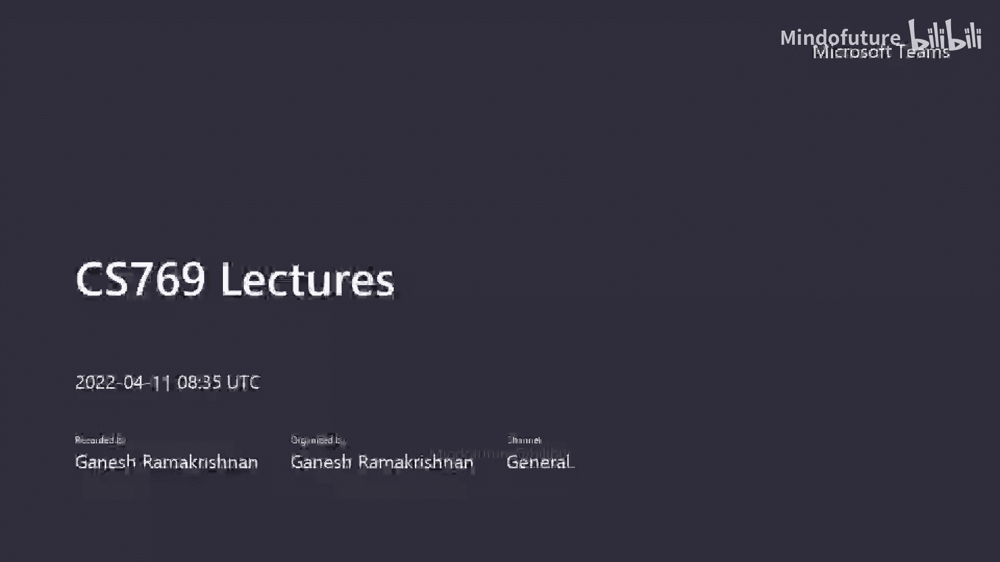
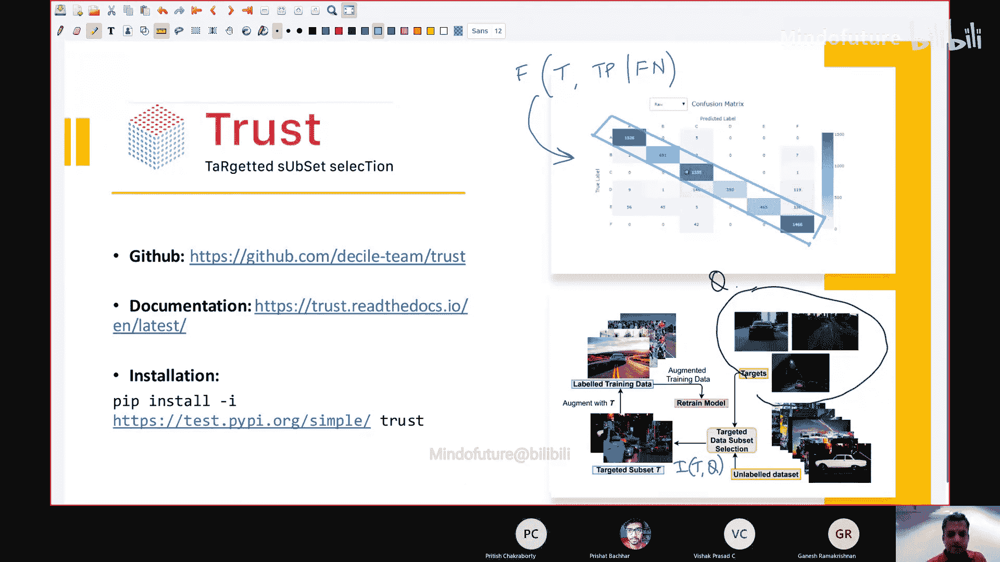

# 【印度理工学】机器学习优化 ｜ Cs 769 Optimization In Machine Learning p31 P31_第二十六讲_12-4_优化与机器学习_约束非单调子模极大化算法__技巧__Decile库 -BV18cBSBJEH1_p31-

你说诶。Rt， can you just confirm， you can hear me？Yes， I said can you。You know， I'm allible right？Yes。

 Sir。😊，So I had in the last class。Someone that this is really algorithm framework。

Or maximizing as a model function。Subject to some。Constraint could be a cost constraint could be a card constraint。

And this was a 3D algorithm， either you can pick the element that maximizes a conditional gain or look at something that looks at conditional gain per。

😊，Unit。一事试。你看我。Let was start disagree。Yes。Yeah， so。

Either you maximize the conditional gain itself or conditional gain relating to your cost。And。

 I had left you with a homework problem。I said， well。

 there's another problem which is a dual problem。😊。

Which is about monoone submodlar cover where we say。😡，That the function。

 the submodlar function I wanted to maximize。Right， in the。Here。

 right so let's do some color coding So this is the FS that I wanted to maximize。

This now goes into my constraint。😡，F a greater than equal to Q。And the cost that I had。

 well let's say a simple cardinality。Which was sitting here as a constraint now becomes。

My objective function， but I want to minimize。😡，I want to have the smallest cardin， smallest cost。😡。

Sa， such that。I haven't at least。Q coverage， right， this would mean。At least few%。打你一。爱。At least。播。

Pew diversity and so on what about a accommodation of these to？Okay， so did anyone try implementing。

 this is interesting。And if you give some thought， it's okay。Anyways。

 this sort of entailed the use of some model right so the the homework guy left you was okay this for this objective。

You can have a 3D algorithm。😡，Where you start with an empty sec， thats cardinity 0。😡。

And while the coverage is not yet sufficient， while the diversity is not yet sufficient。

 keep growing the said。😡，based on dogggage。Hes F the most right so they're still looking at the same criteria。

😡，Yes。😊，You're not changed to any other criteria， same old criteria。And it game。Okay。

s just so you're finding that a start with give you the maximum。诶要一疗嗰个器。I mean。

 you can put a minus a， but that doesn't matter first。😡，As fixed。In answer。 So now this， in theory。

 this graial return。This a greedd size， which is at least。Or which is smaller than equal do。啊。

The one of log Max。Overall elements as obstacle ten as of Fs into the size of the optimal。

Okay so look at it， this is because it's a minimum minimization problem here。😡，月 so。

Because you're dealing with minimization， I'm going to。😡，Therefore。

 we have an in equal less than equal to equal。😊，It's a gut deal。It will not be worse then。😡，So much别。

In the classization you will saying， you will at least achieve so much here you will see at most the size will be so much。

 right？😡，So you had to try the3D algorithm implemented in some model for some choice of find a solution or implement the3D algorithm on a dual algorithm。

You understood the problem you， right。What do you think would happen？They tell them say something。

What do you think the solutions internal turn of you for the primary end。

 let's say for comparable queue imagine。😡，Da go。Sure。Let's say I targeted a Q value。😡，不。Yeah。

For some value of key。So I basically picked up。Q from here and fed this Q here。😡。

Understand how I would solve it and then I would say， okay。

 what's the size of E not just size of it I would also look at what are the elements of it。😡。

So we say compare cannot really， I mean， you can compare sizes。More specifically。He condemns。

Are the two solutions。What is your guess， you think they will be very different similar。Yes。

 everyone。So I'll talk about my experience here it。

 this this something we investigated along that2016 Ph for the largest week。

And you would like to do machine translation that we've been always trying to do， you know。

 human in the loop machine translation。And back then deep learning wasn't as developed so what we did was we said let's let's think of you know summarizing patterns in a large corpus to be translated is a goal。

Extract。Back dance。三。Take outputs。So that by translating。Beparts。You can。Asmbly。Their translation。

我啲个。I mean the pretty deep learning right this is interesting。

 actually like matrix factorization I factor matrix in。UV。

So I'm trying to now factor this corpus into patterns。

Now you can imagine what you would be interested in extracting。😡，So this a corpus sentence ID1。

 you can see this right Accia should not be using patient for severe hepatic impairment。哦。

So acttop pain is used in patients with diabetes。And then we had some lexicons。

 we had these sentences that we had some lexicons。So drug， Icomp a drug。

Severe hetic impairment is a disease， diabetes is a disease。激嗯。And then we also noun phrases。😡。

Town phrases are。All of you know what the noun is right。

 so they could construct objectives followed by nouns。嗯。

Or the lady in the room right so in you could also have proposition reposition embedded so you put a long known phrase as well。

So these are all different。Non terminalminal， so think of all of these as。😡。

You know different types of non terms。ok 啊。So my entire corpus is now represent terms of terminals and non terms so these are the terminals。

You know what is in grammar， this a terminal non excuse？😡，Think of these as stills。Tくで。I mean。

 the non termminence would also come。😡，f啊呢度心经理。Pas trees， very complex past trees。Examples。

We actually listed all the non terminals and terminals。He is an anonymousness。

Sigma is a list of all domainminance。And you could have production goods which give you the terminals in terms of the no terminalmins。

The same sentence now you can see this is at the bottom you have always。有么意西。And the bar top。

 you have the nonsense。So now imagine that the entire corpus is represented like this。

And now you can have patterns。😡，So you can see the patterns here。

 which are in terms of terminalmins and non termmins。Be used in patients with NP。

 patients with diseases are all patterns。😡，Oh patients with NPps。Gentralization。

Because disease could be viewed as an as a。Notice。You general lazy。Okay。

 so based on this now you can look at coverage， how are these patterns coverage So you're looking。

 I mean， as you would expect a coverage function would be very intuitive。😡，So， here。嗯。Cover edge。

Is looking at how what are the tokens covered by each pattern So 1，3，4 is a span1，4。

5 is a span basically these are tokens covered think of this。 it could also be noncon， not be con1。

3 and4 are covered。😡，So sometimes when you translate， you don't translate the same model。

We can of account for that as well。Anyways， I don't want to get lost in the problem specific。😡。

Pacifics here， but this is E oral city。😡，Right so our goal was as follows。 So given all these。

 so I've abstracted。So I've abstractstructed all of these at the top。😡。

Our goal was that there's a cost function，  QC H，  QC1 H is modular。😡。

So this cost function would be say size cardinality and let's take the cardinality as a concrete exam。

😡，带啲啦嚟。Of the backs。Okay， and then you have a QC2。😡。

Which is the coverage function I've been trying to tell you about how patterns cover， right。😡。

So again， exactly。がでしま。So there are two problems。😡，You can see the。

The first problem is what we are all。Conver with are maps of the coverage。😡。

Such that size of the set is constrained by C like。It's a monoto。

 mostly they making a monoto or guardity。B stream。Some more in the max。Right。😊。

And the second problem we have。So here we are trying to maximize something to maximizing them。嗯。

Aaximizing the coverage， the second problem we have。😡，Is in terms of Q C1。😡。

W is a dual submodular cover。够门。So you want to cover some。D right So I mean。

 you could think of this D like before， right， I remember I talked about how your queue could have。

P solution to a prim problem and Q is a constrain in the duall problem。

 so Ill similarly do something like this， so I could。I could say that D is a solution。

Like I said D was a solution to this， I plug it into and see what happens or I could look at it the other way。

😡，喺嗰度。我 didn' my。See here based on what minimization。😡，Okay。

 so now we did we did actually compare this。 Let's look at kind of patterns we give。

Is this problem setting here？Okay， so first of all。

 all of you are convinced hopefully that there is diminishing returns。

 what we see here is diminishing returns as more of the patterns you pay the less the marginal gains diminishing returns confirm。

😡，I mean even through good good for sex。Innu， you' will find this diminishing difference so you can see that such that flating。

And let's look at some of the patterns right so in patients with H type two so these are instances so actually the pattern is in patients with category one。

Or contains category2 Mg of category 3 and these are the counts。

P 68 instances of inpatient with category one or 91 instances of category to milligrams of category three and all these are instances right so these are instances。

Or in the second。以上个。And what we found the solution sector found to be almost a same。

So this is a nontrial， it's not some to problem， it's a very complex problem。😡。

So if you put the same， the Qes are compatible Cs Ds are compatible。😡。

Then you find that the solution sets are nearly the same。Nearly is actually pretty much。

 I would say they were like the same。😡，Okay。I'm not claiming that you always will， but in practice。😡。

This。Here你这。Okay， so I hope you get enthusiasm right out your for your problems setting。

But let's now look at more complex constraints， so constraints are not necessarily always very simple。

So sometimes you want to set place sensors or imagine according to place projected。

So you don't want to park two projectors in the same classroom unless the classroom is ready big。

But in some classrooms， you may not want projecting because maybe it's a different kind of class maybe it's communication skills。

Proest people without projectors so often we have a constraint constraint set and you say okay。

 I have a partition p1 I have a partition p5 p1 consists of1 and 1 b1 a。And when weix your sensors。

 So either you pick。One a or you pick one， you don't pick both。😡，Likewise。

 you could have another constraint。😡，Or5 A and5。3 a and 3 B maybe cameras I don't want to place cameras So one camera right here and one camera here probably will capture the same but cameras in different orientations would bring more value So I know these constraints before and I don't want that to be discovered I'm nothing That's there。

 That's。So these are constraints and we want to know ensure that。With every partition P。

 there's exactly one， not more than one element。Basically saying that。

Not more than one element needs to be picked。From each partition。Where， where。

 where to install cameras and what you expect from the cameras on the country Yeah。

 this is a different of view。So either P1 is looking at 1 A or 1 B or5 is looking in 5A or 5。😡。

Now I'm going to give you again， go back to matrix moment you said make， you think of， you know。😡。

Makerices， but what is a matrix？I say partition me but itself is a me。😊。

And let me know illustrate this with matrix， so we have again seen you have matrix。

 you have a set of its columns。Just think of this as C1， C 2， C3， C 4， like C5。

These are the five problems of this matrix。😡，And now I'll react to this the definition of meteoid based on this matrix。

😡，Be say that。a make ride。你。An independent S。Notion of independence is very。😡。

Specific to the problem。But let's talk talk of independence how witnesses。

 we all know what is independence， right？😡，So if S is independent， let's say。If C1， C3。

C5 is independent。Then can is it not necessary that？C 1， C3 is a subset of。C 1， C3， C5。

Must be independent。Yes。😊，Is that known？It implies right so implication is there in independence。

 any subset or independent columns will independent。😊，So that is property one。😡。

So let's look at property too。嗯This is one。So now look at the second property。

 which is exchange property。If S and you are independent one independent set of columns。

 another is independent set of columns， let me take an example here again。😡，Let's see。C1。

C 3 is independent。And let's say。C度。Is also independent。 I mean。

 any single column is going to be independent， right。

So the size of S is greater than equal the size of e。😡，But is you a upset of this？啊。😮，Ne not be。

 need not be right。So then what this second property says is that there must be some element E in as。

😡，So this E。Could be say C3， it did not be C3， it could be also C1， but there must be one element。😡。

There must be some element in air。😡，That can be added to you as that U union is also dependent。

 which means。😡，清醒门。哦。So between that， oh something you listen。就挨家。气温是度。哦。C 3， C2。

 one of them must be independent。Okay， so this you can actually verify this is。😡。

Intuitive but might not be easy to prove， but for mates right if I have a smaller set of smaller set of power linear independent。

 a larger set of colleges all they say is there should be one element I should be able to add some element from the largest set to the smaller set and still have independence you can prove this using linear algebra not very difficult。

😡，This is my second。And the third is all maximally independent sets。

 which means if you add one more element to that set， it doesn't remain independent。

 So all maximally maximally independent sets must have the same size。😡，I mean。

 in the case of witnesseses， that's called。得吧。Because that's a third property。Okay。

 so I hope this is critical clear now you can have a different notion of independence based on some partitions。

😡，啊。What do you're trying to show。So you can have different notions of。

Independence and that will give you different makees。 uniform matrix is a simple matrix。

 This is basically saying cardinality constraint kind of every every element is uniformly belonging to that constraints。

Each element has a equal chances。 No prior This uniform prior。 Think of it。Partition mes。Basically。

 as mass contain at least one element from each group， it's a partition midpoint。😡。

You can you can define the notion of independence for each of these， I will not go go the details。😡。

But yeah， basically these partitions are creating the of independence。啊。So maximal sick。

 what would be a maxim independent sick in the case of partition rateoid？啊。😮，完成你。

Com from each of these partitions for their proposing。系い。Or a graphic me。😡，Is one where。Yes。

 so the notion of independence has been already different here， okay？😡。

Here we are saying in the case of uniform meroid S is independent if size is less than equal to okay。

If S contains at most one element from each group， then again we call it S to be independent。😡，喂。😊。

In the case of graphic meoids， as contains no cycles， then S is called independent。In terms of age。

 so it's a set element， the elements are the edges here are the elements are the points。

In the case of graphic me， what would be the maximum independent？😡，啊。😮，Ipan。

So independent sites would be basically trees。So please ask independent。6。Starting。嗯。

Couse maxim independent。6。So like what you can know for all of these you can。😡，You， you know。

Its different defined find that one element from each group is a independentency。

 so maximally independent is。俾你。Consist of one element。关停嗯。喂。😊，Like what uniform meteoride。

 if you fill up the size， then basically a maxim limit。Simplely。

So what happens if you have such meteoid？😡，So you can do mono some model of maximization subject to meteroid constraints using the simple ingredient algorithm。

Bd。All you're looking for is feasibility。😡，Very much like， you know， concerned optimization。

 you remember projection。😡，The projection step constanttrain optimization。

 the approximate gradient of projected gradient version of tized gradient。

It would take a step and then project it back， right。So the the idea is very similar， similar。

What we're doing is this。😡，啊。Which I'm going to just explain， this is akin to projection。St。Of。

Theless gradient不。So what are you doing？You're saying I'll find the E that maximizes the gate。😡，But。

我连住的的。Is feasible。I mean， it is not viating。W right。Are the most beneficial。二。你经你。你就同我为你。哦。冇个嘅。Okay。

 so that's how it's similar to general projections still。

And nes are again shown showed that for monotone some modular functions。

The functionality of S greed obtained using this projected gradient or projected the greed。

Is at least half of that are the often。😡，Okay。Sly。Any questions？It will basically add。

So look at this element if if you had already1 ab， lets let's assume that you know you your S minus1 already had。

关闭。Even if 1a is the one that gives you the maximum gain， you won't add1 a。😡，O。The next first one。对。

所以。诶对。That is why it's greater than people do half half has not gotten into the fact that there are two elements here。

😡，So in general。For all kinds of micro constraints the。certain constraint cardinality constraints。

 you have a special case anyway。there you can get one minus order。Okay， so no。咁边度。What we did for。

 say。Again， know using Lar functions， we included constraints into the。Objective function。

One constraints submodular maximization can we do using by this same idea。

 So what have we done here we are saying that。The constraint has been absorbed here。

 so sees a constraint， but it's absorbed here。T lag range multiplies。一。做。

Marax of fx minus lambda yields。Now you can do unconsidetrained non monoone submod or maximization。

On this。So no matter you do this， obviously， you know。😡，You like to also look at。你这个房心的都 be动房你那边。

In fact， his entire discussions。For unconstrained， some model maximization， when you have a。

A nonmonone。And the function itself is non mono。So what can you do。

 let's look at the non monochton case on the right。😡，So because it's not monotal。😮。

Simply greedily adding might not。😊，Soound that theoretically most sound idea because it's not mono them It could have sh。

So the idea here is interesting。 You say， okay， I'm going to start with two6。 Okay， one is a。😡。

And the other is the。B is the entire ground set to begin with a is the empty set to begin with。😡。

你发嘅好啫。C by死。关啦允住你电。And what I want to do are let me use different colors。啊 yeah你的 this is。系呢个联气。Okay。

 so it's in we have to be consistent with。不是吧。So what I'm going to do is。

I'm going to consider removing elements from B。At the same time。

 adding elements to a parallel I'm going to so that's why the word bidirect still is coming up。😡，都。

I do bidirectional search。So search on K。As well as search on week。Okay。

 but there's a small probabilistic aspect。😡，So what would you do， would you add to a or remove from？

😡，See the idea is also to make sure that a is always a subset of。😡，Yes that's that。At any point。哦。

We maintain that a is always a subset of B。The goal is to kind of convert somewhere where it a becomes the same as me。

😡，Or find the best of the， let's look at that。😡，But what would we do it's not just deciding to add to a。

 I would with some probability add to a and。😡，With one minus that property， remove from the。Okay。

 so P add。8。And。Like question就跟听过。They move from B。It probability1 minus P。

So what is that probability deelta plus？😡，Divided by Dta plus plus delta minus。

I'm kind of leaving a question for you， what do you think are expressions for Delta plus and de？😡。

Yes the experiences。Any thoughts。I'll try and slide them， you can try and complete。

So Delta plus what would it be？I mean， I use F lambmbda。

 but you can also may not have the constraints in which case Lambda is you。What would the F plan。

 In fact， let me be more specific D plus。我意义跟啲性。And你先 done。M Ws will be looking at what A or B a。😡。

What do you think this will be？诶三高。A union E basically as you're trying to add E here。我哋食边。

Right minus。Therefore of lambda。见。So by similar argument， can you guess what is delta minus？

Do be E given？What will that be。好。点解，呢啲叫嘢啊。啊。You're removing from B， not adding to B。😡，你该事。哦。

Now it's not necessary that the function is not monotone。

 by the way right so it may happen that after removing an element you are actually gaining。😡。

So you may have to look at。Absolute value it。Alward。One of the things is they getting what do you do？

If delta plus EA is negative。我主你。Should you even add？Do you even consider adding。

So this is pretty much what you say， I've summarized it here， but my next question to you all is。😡。

做我这是电池。Find this if both of these are positive， that's okay。😡。

This you used to calibrate your probability of adding。If one of them is negative。😡。

And that action you cannot consider at all， right？And what's the point。Ignore the addition if。第个是十度。

我啲。微信叫个。拜拜咁销售我定等你。做业。We know the addition in Delta。Plus is negative。And ignore the。

你 shouldn breakか on year。Thanks。Yeah I could try so you can try more things a good question so question is suggestion why not do soft masks？

😡，Exponent some some more， you know， nice looking probabilistic expression。I should it be linearlogy。

 right？😡，So good I mean you can work on it there are a lot to be done here。

So you can try investigating this， but for whatever reason。

This book pointer in 2012 showed that this bidirectional greed。

Obtains a half approximation for this unconstrained non monotone sub optimization。我买 max问です。Okay。

这2 box有什么。Sorry。Yeah， but the same element your question is。What element are you considering？

They even to be added to me。十点要你。And the greening and writing must be for the same element。😊。

Well the same anyway。What is it。what's the gain in adding it to E versus what's the gain and grooming it from me？

😡，Once again adding it to A and onces again， removing it from me。😡，So先。So0。

What if both are negative That's a good question， I don't recall exactly what was done。

 but what I think intuitively you should。Does ignore that right。I mean呢。If those are negative。

 then you should just let it remain。😡，There's no gain in removinging it from B。

 there's no gain in adding it to。😡，Status quo is。Okay。

 so now you can do many other things like greedD for non monotone submodular functions。😡，For example。

 you can say， no， I'll take non monoone。But instead' not doing this bidirectal search。😡。

There's another alternative。I just do greedy。😡，But there's a slight variant you can bring in。😡。

Which is called the randomized greedy。😡，What does randomization because there's one additional step here？

😡，So you start with M set for I equals  one to k you're choosing now all the potential this is not monotone right so looking at every possible MI all the elements。

😡，That give you the best possible next。😡，见你。So agonms over x。

 so now what you're looking at is agonms over the subsets of the ground set。😡。

Minus Yi the cardality x SK。😡，系。So says that the summation of v in x， this basically becomes maximum。

😡，So we basically finding the K elements， the next K elements find all the next key elements。

P total gain。Is mass， like sorting gear。Pounding to sorting William。Startttingly remains the killing。

Excellent， everyone。Based on you。And picking that top key in。A咪。At this stage， right？

What do you do to ingredienty。But now， it's just。Subscribing to that X as MI， you're saying no， no。

 no， from that MI， I'm just going to pick。One element randomly。

Why has it reform your random elemented？And only add that。喂。😡，Don't add all of them。😡。

Now grow your set after thing after adding bias， of course all the other conditional gains would have changed。

 it's not mono atone。😡，Okay， so this is called randomized gradienting now you getting your favor of random randomization let me。

We have many flavors， so we will not get into all of them。 We'll show some examples。

But here's a comparison of empirical performance of bidirectal degree。

 What was bidirectal degree doing？Growing one set shrinking a set because it's not mono。😡。

What did random ability do， it's like a beam， right I create a beam。😡，Am I at every step， right？

It's like a bean。This is second sorry。For cardinality constraint is this one， right。

 okay okay here okay。你 the garden Constitution。So for I equal one。你落边。系 so。

What would you think performs better， let's just look at this right so there are many plots here。😡。

Like this is。Is a randomized gradient？I I think this is是如个了。It randomized really。

 that's this one right， not the lightest one， this one， this one。So I hope you can see everyone。哦。

你熄咗。As against。Bydirect greedy。That's in blue。It's not dashed。This one。Okay， so bidirectal greedy。

 I mean， it does comparable sometimes does better。😊，But it turns out that。

There are other algorithms which I mean， simple greedy， I think this is a simple greedy。

 so this thing is Dls。😊，It does very good。Yes， just do greedy， normal greedy。

Even a bit more so what is showing is that when you say a function is non monotone。

 it's non monotonone only。😡，In some regions， right it's not as you have to discard monoproity everywhere。

So in practice， you'll find that， you know there are other algorithms like greedy algorithms。

 simple claim greedy here， which is doing。😡，不定。你度玩问题。Is that clear so3 algorithms。

 that's what you're seeing are often performed best in practice without even without randomization。

Thetly tightus algorithm， see for nonmon， we didn't find any guarantee as such right for normal greeding。

 but yet it's doing well。😡，Okay， so what an idea。 let me know your question and this running through so many variants there。

Now somebodybody may say what about the dispersion function。

 we talked about dispersion sum and dispersion min， which are not someone okay。😡。

These two dispersion some and dispersion men。Or not someone。I don' even some model。

 forgettable monotonism。Now what happens to these two subject to cardity constraints？😡。

So it turns out that the same radio algorithm actually a half。😡，And one fourth approximation。

Md Bman is going to worry。哦。But half and one for the approximation for these two functions ingredient。

我这个事。我这里也兄。Now we look at another very interesting implementation here。😊。

So what was the complexity of greedy， complexity of greedy we saw is what every iteration you are。

Was he looking at。N minus n elements， n minus1 elements， right？

And my stateless want something like me right。Which is basically order of。1 times K， right？

Where the coinality of we is。But in practice， this is also little expensive。

And it turns out that you don't have to do this。I'll give an example。

I actually run through this many carefully。So there is a very interesting variant。😊。

OrSo interesting engineering trick without any loss。😡，It's called the lazy  greedy truth。

The idea is again， this is， you know， if you've done data structures， you've heard， you know。

 what are priority groups， use priority groups。😡，And maintain upper bounds on the marginal base。

 case I'm going to use this canonical picture。 So let's just。For all elements。😡。

And let's say I have some。Can be assured。That for the top most element。拜翻。Write that to mean。

你晒我二系二系你都搞过啦。So can we assure that for that is？If for the topmost element he had。

The utility function。And then audio your review function。😡，哦嗯你。OkaySo if that is F。

A function conditional gain of F hat given the current， so let's say the current is AI okay。

Givenive ear。If thatc is。Greateater than equal to。So you， the next element。😡，In the sense of this。

 this。E is the next element in this priority。Eha is the topmost element in the priority。😡。

So can we ensure that this is the comppost element he had？😡，We had F of。

He had given AI is greater than equal to U of E。😡，Then。There is。如果你都赶这个嗯感觉间。Gae of elements below。

He in the。不有啲。This is a question you're going to ask。😡，So said there are a bunch of elements here。

要咗点样噶咧。A whole bunch of elements here。my question is。If I can ensure this。

 then there is no need to consider。Conditional gain of elements below E in the priority。

 all these other elements。I don't have to consider them at all。

Then you can see that I don't have you added all the elements， maintain this priority queue。

 take the top， find its conditional game。😡，Compared with the next element in the priority Q u not and I know that upper above you is like an upper above。

😡，So what's the semantic， semantics？Of you in。Is that it is an upper bomb。On the game。

F of given I didn't even compute F of E given A I。😡，哦。I only committed F of E had given AI。

 the topmost guy， but I know the upper bound for E given AI。😡。

Except is not doing better than the conditional gain for E hat and why should I consider the next element or any of them below。

😡，Okay。Is this basic idea for you。Well， what do you mean by it？

What is you have Okay that I'm going to go to the next slide， but if we had this。

 then you think there is some efficiency right？😡，And the answer is you can get this using sub narrative。

😡，Okay， the trick is that some modity gives you this U E。😡，Yes。No no， so you have to okay。

 that's a good question。 So youE had to calculate So there's a little bit more work to you need to keep updating。

 when will you update， for example， if youE hat， if I picked E hat。

 then I have to certainly update it for E had now。The comos element I quick I have to update this upper bound you have to update for all the elements you don't have to update all the time because upper bond is being maintained。

😡，But in case it happens that the next element you eat。😡，Right is。Greater than a E had。

Then other do some more work。So it's basically， I mean。

 not give you guaranteed worst case may still be the same。😊。

But very good chance that for the excitement I don't have to， but if this have a good push。

 so if this doesn't happen， then you allowed to update。😡。

You keep going down and all keep updating for all the one that you had to build off。😡，Proceed with。

 right。这么不行于。Let's complete this discussion。So I'm going to just copy this organization next slide。

Okay， so this is a lazy gradient in fusion。😡，I think I'm just repeating this point。

 maintains an upper bound。E of the marginal gain of every item。

And reduces them as optimal signals so that is a point。 so what will happen is。😡，In such a case。

If he had given EI would not be less than a greater any you mean， right？By。

So then you have to go down。对诶。So U was upper one， you have to revise upper amount of key， right？😡。

We might need to need to or we need to。De is upper bound of key。

Based on actually computing of E given here。Okay， but now let me go to the most curious of it。

 What is his upper goal。😡，Okay， so just notice this one property very， very carefully。Yeah。

 this is critical to the opera。Someone the that the marginal gain of any element。

 Any element on the set will always be less or equal to that on the smallest。

Smaller subset if you want， let's be very specific smaller， I should a call it smaller。

we are growing right we it's not arbitrary arbitrary set， it's a smaller subset。😡，其然没。做。

UE supposed we make this UE is the F of E given some previous a， so a scale is a previous A。😡。

I call it K in some previous， I don't know which I right So let's I the pork。At the iteration。

Because is still。It could be。你个啲。Whi can AD。Would be any of the AIe minus1。TheI went is school。Aas。

 any of the previous one like all， what's AS。ok。So F E given A still is。FRP given a a small。

 basically a small the previous day， right。So let's just call it K still is the same as AS4。所我诶。Oh。

 I've said this， I said this already， I don't have to。

So here there you have that a scale is the same as a small。Which is the same。

 which is a which is a subset of Aar。 What is A large。A large is nothing but the current A。😡，Okay。

 I'm just giving intuitive minutes AI is scale large。😡，So F of E scale is equal to F of E small。

 which is greater than equal F of E given a lot。😡，As I keep adding elements。

 I don't expect the conditional game to increase that's a model。

So why can't I use a previous key given an HTMLL to be mine？😡，Uible， that's a basic idea。😡。

That's very intuitive。So now the rest is exactly what we discussed on the previous slide。

 Eha is an element at the top of the priority queue if any it by maintaining upper bounds in a descending order。

😡，A scanning the entire remaining ground circle to look for the next next element round。😡。

What is if E of a had given a current？😡，That is AI， I'm just giving what in the means AI。

Is greater and equal to U of E。Elia。Next best elements I' just select vector is reproduces。我这那是죠。

Thanks。So if this is the case， then there is no need。😡，It was gone。

The other elements no it was below in the parity because you don't have a scan。嗰时又放到小二。

We are good proxy to what best we could have done。Uing you have。And this is basically。Oh。Again。

 I' my gu here。This will be my new community。Okay， I hope this is clear。😡。

So it makes optimize very fast in practice。By yielding the same exact result。

 there's no change in the result。😡，好系。You' are not approxiating as A of K。😡。

If E had given a current that we have to compute the top of the day。😡。

But we are saying we are comparing it with an upper bound on the。

Margin conditional gains on other elements in the list。😡。

So that upper one uses a proxy if you have you better than the upper bond。

 obviously better than the original function。😡，Is this kid。Original function based condition。Okay。

 so lets says look at this quickly right so93 is this one。Okay， but lazy greeting。

 you can see the green one。And you know， certainly， it has brought a lot of value。

WeAl like super very sublinear group with the number of elements。

So complexity is still you know O and FK， if theres a function function evaluation cost。

Nk still order Nk in the worst case。But in practice， as I said， it's much good。I mean， in fact。

 as I said， it brings this complexity to linear。听一懂。Vnial listen reflect flag。😡，如就是呢。Okay。

 so there are many variants now you can make it even faster。😡。

But now this this making it further faster is at a price， this is stochastic greedy。😡。

And I should probably bring out not equivalent。😡，而家我哋仲系几点。WIn place some。You know， approximation。

Exactly， it's not the exact thing。K， what is it doing， it's saying okay。

I'm not going to take all my elements。😡，You remember we put that MI。The next stop limits。

I think of instead of doing a top key， I'm just able to be even more naive and say I'm going to randomly pick。

😡，This set of size n by ke to log one by fil theres reason why oh this come here。

 there is a reason why there is an epsilon here。😡，it reflects on the approximation factor。

So let's say I have some absolute trade of I want to relaxation or slackness。

 so just randomly pick a sex。Set T of a particular side the T is a subset of the entire ground setting。

And now it's of finding the best element using your priority queue or whatever。😡。

Use the priority queue to find the best element in tune。😡，Then I do。

So you're adding only some that tea。I keep you。's a simple。A stochastic greed。

 or you can add stochastic greed all lazy。😡，Dchastic。last lazy。It's called it's called。

Laziier than lazy， right？关电视。嗯。That's some funny me。So this is just schastic without lazy green。

But you can see is that， you know， lazy Grty is here。😊，Using the priority tools。

And stochastic gradient has taken less time， less cost。But then there's lazyziier than lazy greed。开始。

你不是刚谢。ok。And in practice， it gives， you know， okay， what's the approximation factor？😡，1 minus。1。

00 minus F 7。So for example， if you're take upel to be。0。Basically， you saying they take thel。

Mty equal+ B it and， N00。ok。So I think we've got a good flavor we looked at。😡。

Some minimization we had a very brief located but somewhat the maxization we got a good idea of algorithms now you can use some of these ideas to also do difference of some model I'll see if I get time in the Thursday Thursday I just want to take one extra last class I hope you are okay with it Thursday。

It's since holiday， but I had hope in the stick， so itll be little extra reading。

 so as I pushed that to Thursday， I'm not do it today。😡。

We also seen some model optimization under constraints。 you also have under some model constraints。

 you have seen some model cover the dual problem right a homework problem。I just want to。

 yeah one last point here。😡，You can also do  greedD solution and other problems， right？A key center。

 key center， what is metric case center？So this。Parick Care center。Unlike the city location。

 which says， okay， find， I mean FS is summation or all the elements in the ground set of the smaller closest element。

Or most similar element in my subset Patrick Center says， oh。

 I want to find the most similar element， but I want to kind of to get the minimum of all such。

Minimum more similar。 So like it's like trying to reduce the width。Of the points。3 bit。

 if you have a tree， right， you wants a three bit， I'm trying to reduce the width of the points or the spread of the points overall spread of。

So that's the only difference， right here you have。😡，But this is not someone。😡。

As minutes sort of some。But even though it's not some model。

It gives you the minimization gives you half approximation。😡，So great good same greed good。

 So all own see there are so many other problems that you find some modity like opportunities。😊。

But they are not exactly some but you will find similar approximation， I mean， not similar。

 but we may have slightly weaker approximation guarantees。But in practice， they also work pretty。

Yeah， so now I'm just going to spend some time Im going to do some demos now。

So there's been a lot of research in easier right， but as I said。

 there have been lack of good toolkits and benchmarks that's what we're offering。😊。

So we have this decile platform Data learning， I'm going to quickly go over some model。

Which is something you guys are using anyways。😡，嗯哼。😊。

So somewhat Li is very easy to use it as extensive you know documentation given the laziier than lazy I actually have referred you to the documentation very very well done by。

😊，I第 student你。So。冇几个度。Documentation and wheres lost to， it's there somewhere you。

I'm going to go through some examples。So you can go to the submodly or retail Oxford what diagram。

Okay， and it has all these query driven privacy preserving。And all of these variants will find。

And yeah， these are the class of functions， specific location， disparity mean， law determinant。

 all of these obviously。😊，But in addition。You can do mutual information based functions。

 which I spend quite some time on。You can do conditional gain based on functions there。

 and you can also do。Conditionally again in。F information to be。So。

And you somewhat leave the read data to I。So some modelular functions can see the state。

All of these functions are there。Scholling year is not very。哦。我。Yeah game， how to scroll this down？

Yeah。那我就说嘛。Conditional mentioned information functions， all of them there's a lot of you know。

 math aspect is also being taken care of， even as you。

Might be interested in the use of these concept。with new citations so it's very very interesting to just navigate through this given the background I have you'll find it youll be able to relate to most of the componentsnc here very easily also you'll find optimizers right93。

Sttochastic random greeding， I talked about Laziier than lazy greeding。

 which is also called accelerated greeding。😡，Because it it's the same gradient with acceleration。

 what lazy laser gr is a combination of stochastic act。😊，这视你。So all of these are implemented。

 you can profile them as well。😡，ok啊。So now let's go back to the states。As I said。

 these are also the conditional gain， mutual information。Comminations of these two also。

Now one one more additional aspect of in， which is very important in this dial it's all， by the way。

 it C plus。😡，But in addition， it also has something called memmoization。😡，Okay。

 so as you keep adding elements in each for class of functions。

Can you reuse some of the computations from the previous。itlation喺做。

Cash intermediate variables to be able to faster compute the gains of adding elements to space right so if I if I'm looking at say。

😡，The game of adding E。几系。what诶。The question is again。哦 get it also benefit。From computations。人。

For say AI minus-1。This is getting more engineering， but it's very important。😡。

This also has important mathematical underpinnies。So this it turns that this can be done by use of pre compute statistics。

For key settings。So given the precomputer statistics。你Evaluation那个颜是什么错都不行。😡。

So let's look at this right so I have V1， V2 Dj。And I'm trying to add you to。😡，A new element。

I'm trying to out。If of you given SJ is what I wanted， SJ is the same。😡，Now。

 what you do with three compute is。😡，I won't just treat it as you given SJ。

 ensure should I say you given SJ commma P SsJ。😡，W are some precomp services。Okay。

 and I'm going to give you examples of all these three of statistics。😡，Simpst case。

 like simplest case， if I had to look at。😡，You remember the proof of or recall call the proof of some modarity of facility location。

Remember， there was one importance step we had there。In the proof， what did we say， we said that。

I had the max。Of some element。第二。In V， right to J in x。But this X itself， let's say is。X union E。

Right as I did， I is outside I book around for space， right。What was this as a max of？

Two different max。So if I had to compute it， right so this is Max。

Ho two access I don't have spaceload， I me I get somewhere else。Okay， so this what was what was this。

 it was max off。The first one was。Max4 G X。哦 as i d个吗。Yes。第二。咁正你唔识。

So if I'm adding an element and why can't I keep reserve this？

This is can this is the idea of memorization can this be a precomp strategy？😡。

Can this be a my part of？😡，What are' you calling us？呢嘅。Oh sorry， I've used SJ in both settings。

 so I hope you don't get confused this SJ similarity which I use earlier this SJ here is like evolving set。

😡，我说我看。If you want， output it， put data here data。It is weird data。I hope now it do not be confusing。

 so this pink of this as。I should just be careful in notation you， so this is like my SG。Is this you？

This is my pre compute statistic that I'm talking about yeah can't I just make use of these？😡，I mean。

 it's easy once you get the hand， it's easy。 you have to now work it out。😡。

Carefully for different kinds of the modelular functions。Yeah。

 these are prec statistics for each of these facility location， I already showed you this right Max。

我个惊 and机我嘅世机阿 mean that's a big。I this， this is。We call them a wallopy of。Likewise。

 you can do the pre complete start for every all others。So we can time and work it out。

 I won't spring time。Saaturated coverage， graph card。

But what's interesting is the complexity of computation as now one from order n squared to order n。😡。

Order in order in many cases， right， sometimes you know。🤧嗯哼。Cubic 2 square。

So this has been elaborated use a set of concepts， for example， if you are looking at。嗯。

Feachature based functions。And some of them are looking at distances。These are looking at distances。

You see look at distances。But in那嗰 the。The few complete starts will be looking different。

 but the spirit is the same I will not spend more time on this so this has also been implemented and in practice if you look at the memization。

Then呢。So the time rate there's like 212 times speed up so this is speed up this is speed up。就谁。

With memorization。反子自己都闭。Okay。I think this should be good enough right so you get an idea why it's so important。

Okay， so now I'm will do yeah this is like the big picture， some model optimization。

 hopefully next class I like re use it this big picture。

 but I think we've seen all of these many of these variant。But some model them specifically。

 it's very easy to use just a few lines of code here you can see。😡。

From some model import facility location function， you create an object facility location。

And then you basically， what you have done is。Identified from the set of points so u points。

 which is the set x。😡，This might say thanks。Or you can do。Qury driven， so query could be your。

Point you're in。Green， so you say query data， you just need to give the query data。And then specify。

 okay， the ideas also can specify the optimizer9 lady， lazy ladyy lazyian and lazy Gr。

 but obviously you'll do。😊，Acccellated greedy。 is no need value of not doing that unless there are some corner cases where。

 you know， the the priority queue is all is never used。😡，But those are very pathological cases。

 So mostly， you should go for isolated3。And then you can see the greedy list youre subject to the story now。

 suddenly you'll find that。😡，And because you have interested in this query。

 more points are being drawn closer to the query， right， and it has kind of you know totally ignored。

😡，This point blue here， right because it's far away from。😡，Pquity。In fact。

 it has ignored this as well。😡，Because it's not relevant to the。

By the moment you put a privacy preserving。😡，Constraint right here。Private data， single query data。

 so this one。suddenly it has ripelled all the points。You'll find that no points in this cluster。😡。

二六五。The points which are not being picked up because of query focus are not being picked。

It's very easy to use。😡，Lazy gritty， accelerated gritty， the worst case the same complexity yes。😊。

So in that for worst case， the priority queue will become a headache。😡。

So he keep on updating it for no good day。😡，Therell be a constant in their worst case。

 but practically that isn't。Okay， so let's just run through some of these。😡，OkaySo this is some I。

I think I've given all these things here。😡，So gender is sub model of function。

 some model of mutual information， some model of conditional gain and image sumization。

 just quickly run through these so this is the okay this is image collection。

This is a gender submod of functions。Install a model of using tape。

You can create this handcrafted data I was showing exactly that handcrafted data， you right？

Select by facility location， you can choose your function， change it if you want。😡。

So these are nice notebooks prepared by Michelhal。So yeah。

 what happens if we do log in as this is a specific location， the first instance。

 a specific location here。But what happens you the lock it？Diversity becomes more important。

 right it's actually a ended up picking up this outlet you see there。😡。

So keep was there even then I think just speak some other outli this out there，8。

8 in a infinite it prints all the points the order in which they selected。

 So it also prints the order。It may be useful for diagnosis。

 So let's pick up this  point8 you can8 means the 8 point that just pick up eight。In the order。

 so first point it picked up was probably。0 was here， then one goes here。

You can see the order is of DppP， right，0，1 then 2， it has gone really corners。😊。

Then three this corner， then four， this corner will come back here and five and eight it has speak like in an after thought because it has insisting for diversity。

😡，We can do this for set cover， okay， set cover， you can you can look at the features。嗯。It just face。

What are the concepts being covered， these are the concepts that you're looking at or coverage？

So you can do this。 Yeah， you can do a different representative set and so on。

 So this is general submoding。And then， there is。Some of the mutual information functions。Again。

 you can do this for handcrafted data。I not spend too much time on this let us let me go to the other。

His conditional gigs。Yeah个。啊。So okay， no， the example I was showing earlier you。At this right point。

 you can pick multiple privacy points as well。And you can see you very up。Selection that happens。

A love determining conditional gain and so on。So you can peace right on。嗯。Can also do combination。

 which is conditional skin and mutual information。 you can I didn't show that in that slide。

 but you can have a red and。Threereen point vote。 And then we can read。

 it's interesting to also what happens， right。So look at the sequence of points on which it takess。

 so it just picked up one drawn to one with this green point。

But then two us got really far away because it is trying to know。😡，I think this must to be gone here。

Yes。Or facility location， yeah。And then two is one will far away。

 I think it's true is also trying to cover for these several points。By the way。

 a lot depends on the similarity value right so what is the SIJ that you design？😡，In fact。

 if you're doing deep machine learning， the Siase would be based on gradient similarities。

At some intermediate step of your loan。And all of this one very interesting thing is this real world application of images so please try this out this is very interesting。

😊，We have an image collection that you have noted here， the main image collection。

And then you can do query focused。Okay， so these are the images and I think the police he is taken as a dog in the jokes。

So what happens if you take a dog in church you can， first of all， you can do PC visualization。😡。

The ends are gone。I think the preization probably interview。And then you can look at you know what。

Get picked up。 right， So lots of dogs including facility location。

The location will be biased by the most popular day， so you need too many dogs and very few churches。

😡，And it is not yet for diversity， much diversity per， because。It's trying to represent。

But if you look at logged in this is a piece sleep， you can a piece sleep up。😡。

Like where it does speak。The you seen not。Right so。TheQuery was here， this one。And in response。

 it has basically picked up the summary， which is all。here， and there's one point here。

One church sitting in a spot or there two sorry there's one query here and one query here I my two query points right there has found lots of dogs in one church I don't know why is pickably one chance to investigate that。

😡，嗯。And then yeah you can do this for this， but if you look at lock at MI。

 you'll find that know it just tries to diversify。😡。

啊 significant you can find some other objects or足咁噶。Just because it won't very。😡。

So try out that this will be very interesting what I'll be doing in the these are the different demos I had of run through。

😡，the entire application of this specific location， etc cetera， has also been for data augmentation。

 I just conclude with this the trust is one use case where you have a large unlabeled data set。

 you may have a target set which is your query， this is your query set。

Which we were calling in green。So given theque there。What you're trying to do is maximize your。

Mutual information functions。To identify the T check the maximum mis information the you。

So like's say nightan images。😡，I want only those which are like nighttime images。

 so I want then I can take a start it second and label them。It'stop labeling randomly。

 I only label the diverse， small representative to。

This could also be used for tuning confusion matrices， for example。

 if I I want false negatives to be smaller like false negatives。So I can do the following。 I can do。

I want to increase my true positive right I can do a true positive。😡，I'm a false negative。

 so my target should have high。You know， mutual information with the true posts and should be dissimilar from the false negatives。

So if you are think of iterating on the confusion matrix like this， right？😡。

So that confusionion matrix becomes what diagonally。Dominally， that's。

 that's what what we aspire for it。 You like this to be dominated。

 So you want to really push all the other elements to this type。😡，These are other use cases。😡。

I'll talk about two more use cases in the next class。From a purely machine learning perspective。

We meet on Thursday。Yes。

