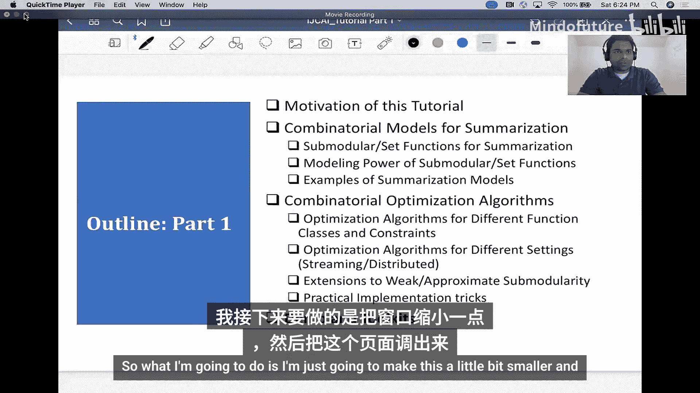
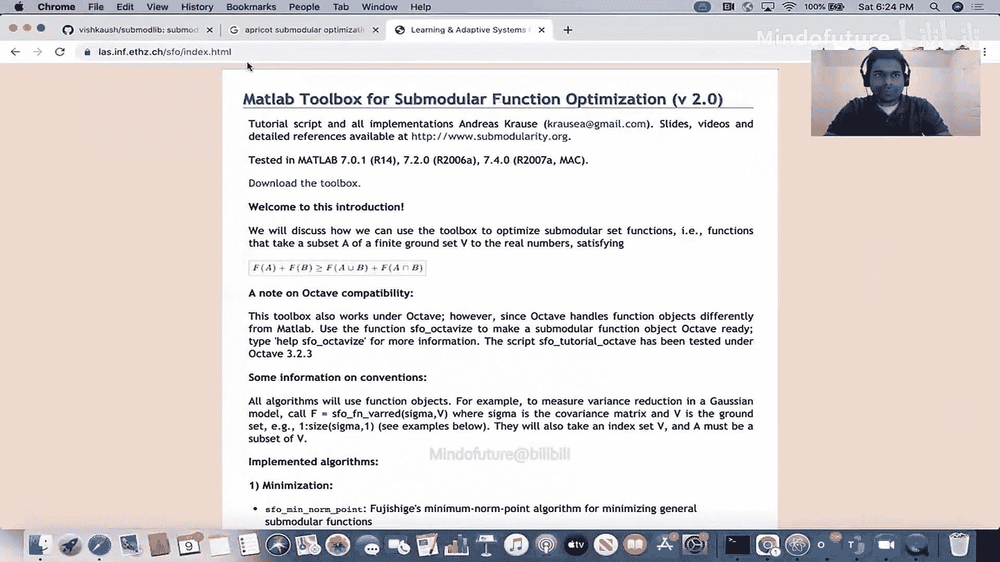
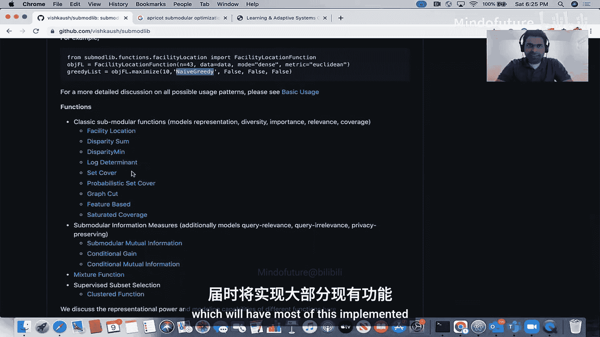
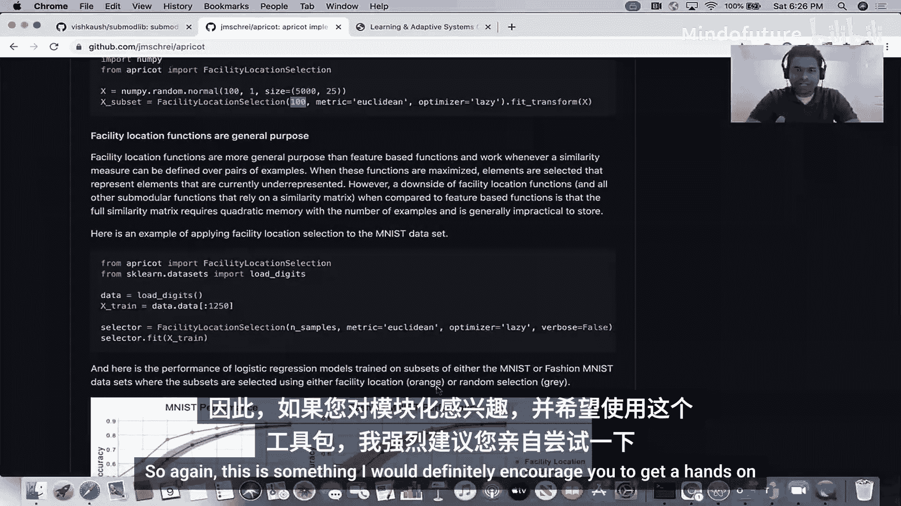
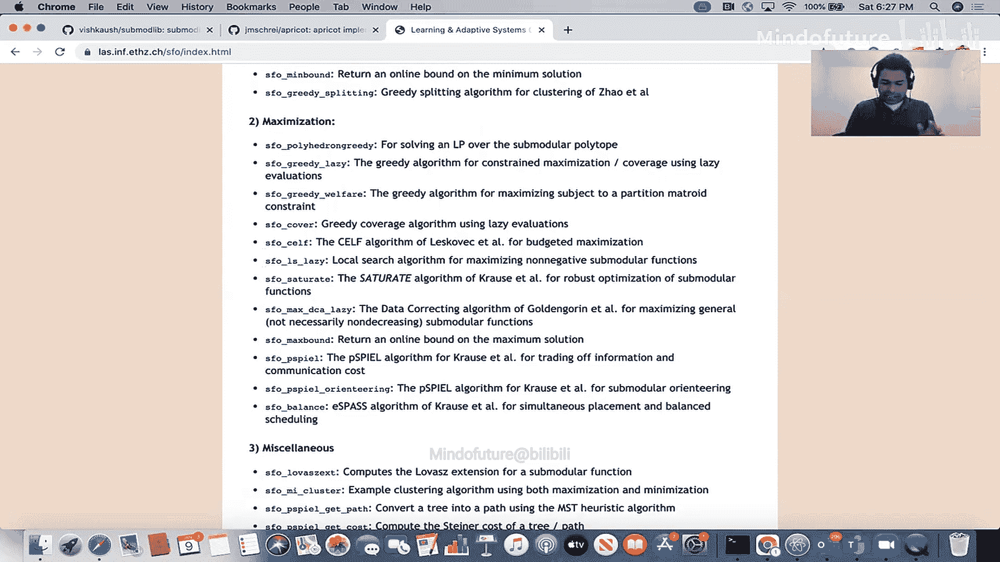
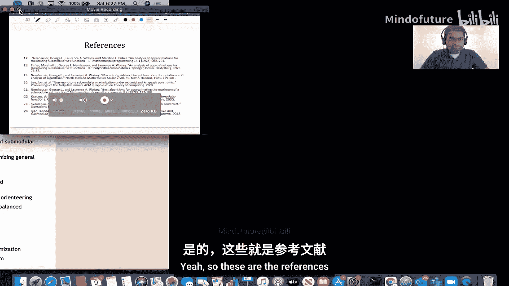
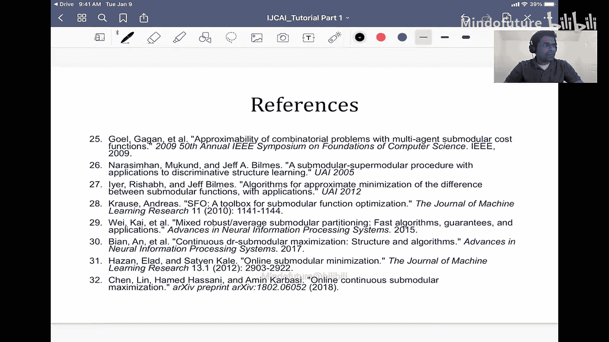

# 【印度理工学】机器学习优化 ｜ Cs 769 Optimization In Machine Learning p32 P32_IJCAI 2020教程第一部分_用于数据__特征__和主题摘要的子模优化_ -BV18cBSBJEH1_p32-

Hi everyone， so welcome to this HK 2020 tutorialial。

This is the first part of the tutorial and the topic of the tutorial is suborial optimization approaches towards state data and feature subset selection Okay so first part of the tutorial will be presented by me my name is Rishb Ayer。

I'm an assistant professor at University of Texas at Dallas。

And I kind of mostly work on the areas around submod optimization and data subset selection and feature selection kind of problems。

The second part of the talk will be presented by Gnesh Sham Krisrhna。Who is a professor at IIT Bomb？

Okay awesome so we'll get right to it so the so I'll start by kind of giving a motivation of subset selection problems in machine learning and then I'll actually talk about the so the first part will actually focus on more of the theoretical and algorithmic aspects。

So in this first part we'll actually talk about combin models for summarization。

 so this will include things like understanding the role of submodular functions。

 the modeling power of submodular functions， examples of kind of submodular functions and so on and so forth。

The second part of this talk， the second part of the first part of the tutorial will focus on optimization algorithm so in particular we'll study submodal optimization algorithms for different function classes and different constraints will then look at optimization algorithms for different kind of real world scenarios so things like streaming scenarios。

 distributed scenarios and so on and so forth， then we'll actually talk about some extensions to approximate submodularity and how a number of functions have not really submodular but approximate submodular and what can be shown theoretically for such problems。

And finally， we'll actually go over some practical implementation tricks， right？

And the second part will be covered by Grne so Grsh will actually focus on three specific applications the first is data subset selection essentially how do you select subsets of data right well why do you want to select subsets of data you want to select subsets of data maybe to train efficiently right so you can reduce the training training cost and the training time by say factor of 10 if you select a 10% subset you might want to select a subset of data to actually label right so that means you have a lot of unlabeled data and you select from a subset to label there therefore you can reduce the labeling cost。

And so on and so forth right the second part will focus on feature selection right and in some sense well also talk about rule selection over here so why is this important well you have kind of features today and the features are growing right particularly with deep neural networks you have a growing number of features。

😊，So how can you select subsets or features so that you can actually compress machine learning models？

The third part will focus on data summarizations， we will actually so here we will talk about things like video summarization。

 image collection summarization and text summarization。

 so we have massive amounts of data how do you summarize this for human consumption。😊，Okay。

 so we'll start with a kind of brief motivation right so there's a growing impact of deep learning and machine learning this this holds for a number of。

Number of areas today like personalization， robotics， logistics。

 autonomous vehicles just to name a few right a lot of internet companies can apply over here search engines like Google B recommendation systems like Amazon。

You name it right so you have large number of companies they serving ads where're serving you know。

kindind of recommending items to users or kind of product search pages or whether it's just kind of giving kind of social media companies like Facebook etc right so all of these kind of involve personalization and the second part is things like logistics and robotics and again this is actually a kind of growing area where more and more deep learning and machine learning is been used。

And finally there's autonomous vehicles and kind of the kind of related industries right so you have kind of areas like kind of standard machine learning。

 computer vision， natural language processing， speech recognition。

 all of these are kind of relevant to this as well as numerous other industries。😊，Well。

 so with deep learning， there is the associated so essentially deep learning can be thought of so I'll just add a quick slide over here。

 so essentially deep learning。对rry。Can be thought of having two aspects right the first is growing this growing size of models。

So deep models typically you require extremely complicated scale of models to deploy and to use and with the growing complexity of models you have the growth in accuracy right so growing。

Model complexity。Employs growing accuracy。But the second aspect is also growing data sets。

Right and each of these in turn also produce side effects， so side effects include good。

Growing amount of cost in both deployment and training growth in the cost of labeling right kind of getting these last supervised data sets there a cost of labeling and so on and so forth。

RightSo there is naturally this data explosion right which is associated with this growing data sets and kind of large amounts of human and machine generated data is created by the minute right so how do you essentially find events of interest for humans to consume and secondly since deep learning modelss require massive amounts of data and they are extremely compute intensive how do we essentially make deep learning more efficient。

So deeppling is extremely data hungry and this is clear as you can see over here you have kind of growth in the amount of accuracy as the number of data points increase right so this is just one such example the y axis here is the mean average precision the X axis is the number of examples in millions right and this is the performance of object detection。

So one of the side effects of growing amount of data required for deep learning is the staggering training cost of deep learning right so training a bird model for example。

 would cost somewhere between 10，000 to $200，000 depending on the data set and depending on the configuration and so on and so forth right？

Similarly training a single deep model for NLP with network architecture search this again with this particular paper the back of the envelope calculation is that it would cost around 1 million to train such a model right training a elbow model again it would take third 14 days and training a YoO V5x model on a  V00 GPU would take around  eight days right so that means that there is a large amount of cost involved in training such models there is a lot of time involved as well。

The second problem is that labeling large data sets is very expensive right so each of these cases whether it's classification。

 object detection 3D point clouds or text classification the cost is somewhere between $50，000。

 $252 200，000 right so that's approximating the range。Of labeling just 50，000 examples。Um。

 but many of these problems actually require much， much more amount of data right so a critical need play is to be able to do machine learning in a data efficient manner。

The second aspect the third problem so the first problem was the cost the second problem was the first problem was a training cost and time the second problem was a labeling cost the third problem is again this is very relevant for real world data is the noise and imbalance in data right so you have an increasing occurrence of the long tail problem here on the left where you have certain classes which are underrepresented so there's a kind of large imbalance and again Gsh will actually talk about is more so just ski through this very quickly the second aspect is the noise the label noise right so you have a lot of these data generated from the web from web search and web search often noisy so you have label noise。

The fourth aspect or the fourth problem is the data overload for human consumption this is something we face all the time I face this every day I have so many pictures being taken and you know I just feel hardest after hardest with these pictures it will probably take me hours and hours to really go and kind of segregate these images right is there a natural way or a kind of simple way automatically to be able to segregate the images and kind of provide me the right kind of images that I need and probably delete the images that I don't need right so how do I summarize large amounts of data and of course you want to keep many factors in mind when you're doing summarization you want to keep you want to keep the personalization aspect the user specific intent of summarization in mind you want to keep maybe potentially certain queries that you really care about certain privacy constraints and so on and so forth right。

😊，All right， so。A kind of main focus of like the second part again of this tutorial would be the efficiency of machine learning right so and in some sense while this is kind of growing can see that most of the papers actually are kind of increasingly focusing on accuracy as opposed post efficiency right but there is still a growing trend where a few papers now are kind of studying efficiency as well。

And I think this is really important right so there's this growing trend now in machine learning particularly nearly recently in the last two three years with obviously kind of。

Kind of fueled by the growing cost and the growing time consumption of training these deep neural networks。

 except for a few large corporate companies。Most companies really don't have the resources。

 most academic labs don't have the resources。Who train such art scale machines on your models。

The second goal like as I was pointing out earlier is how do we effectively consume this growing amount of data right so this tutorial would focus on this in some sense part one so part one。

Would focus on the algorithmic and the theoretical aspects of summarization。

 data summarization and data sub selection and part two。

Well focus on efficient learning and efficient visualization right so this includes we'll talk about data subset selection。

Feature selection。And sumization。And part one， well actually talk about modeling。

So we talk about submodular functions。And the modeling aspects。And the algorithm algorithmic aspects。

嗯。All right， so I'd like to acknowledge a lot of my students and collaborators and friends that you know I've kind of worked on this topic in the last several years so I'd like to acknowledge a lot of their collaborations in this and also they themselves have published actually a number of papers in this area so there's not just going to be my work but also a number of other research labs that have been focusing on this particular topic。

I'd like to acknowledge Jeff Bom， Stephanie Geka， Andreas Crosza， Kaiwei。

 Michelhal Koll Michael Giddy for some of the slides that I borrowed to make this tutorial。

Okay so we now come to this big data problem in machine learning right inherently there is and kind of this is something that people have realized in the last 10 years or so that there is really a need for big data in machine learning right so for example this is just one example that has and Iros in 2007。

😊，Conindduct with some initial experiments for an image completion problem and they saw that with 10。

000 images， the results were very discouraging。But when they actually increase the image correction to 2 million。

 they immediately saw kind of。J in the performance right this is natural right because big data really has all the patterns that you want to learn and this will really help in in kind of training a machine learning model。

The converse side of this is that big data is plagued with redundancy and the big question really that kind of I'm really interested in is that how can statistical predictions and actions be made cost effective with the right small data？

😊，Right so we are not saying that we just use any arbitrary small data that is not going to be useful we want to be able to use the right small data and the right small data hopefully would be more similar to the big data as compared as compared to the kind of random small data right。

So I'll just kind of highlight this point， so it's so the goal of this in some sense。

 this entire tutorial and kind of my focus， right？All right now is to find the right small data。

And hopefully this right small data would be。Comparable in performance to the big data。

Which is much better than a random small data。And again I'm just providing some kind of a peek ahead over here just so that you know you are kind of motivated from this tutorial so we'll see。

 for example in the second part provided by Gnesh， we will see that just as an example on CF4 10 right so we we do data subset selection on C4 10 and we actually talk about the algorithmomic technique that achieves this with just 10% of the subset of CF4 10。

We are able to get a performance which is about two to two and a half percent lesser than the full accuracy。

So the full accuracy is around 94% and we get around 92%。嗯。

With just 10% subset right and this is through a kind of efficient learning slash data subset selection scheme its suppose an adaptive data subset selection so the data subset changes every few epos so it's not turning on a fixed subset the subset can slightly change as the learning progresses but。

But the algorithm at any given time is just focusing on a very， very small subset of data。

And this very simple idea actually gives around 12% boost over a random subset if you were just do this nicely by taking a random subset throwing out the rest it could get around 80% accuracy right so we get 92% so again this is the kind of main main summary if you will of you know this tutorial that how do we find the right small data says that it is comparable to the big data and much much better than the kind of random small data。

Okay。So I'll just kind of illustrate this again right so in some sense this is like maybe this is like random small data。

You have some idea of the patterns here， but it's not complete in any way or form， right？

Okay you get a little bit more data again this data is somewhat random， maybe slightly biased。

 not not completely random though it's kind of slightly biased because just giving just giving you part of the story right but it's a little bit more data again。

😊，Then you get more data right and then you kind of understand that you know there is some more information that my small data is missing and finally this is big data right so big data has a lot of patterns well one it kind of has information of what is the feature space that is being covered right so this is like x1。

This is like2 this is just two dimensional data it kind of covers the regions of where the points hold。

 but not just that it also has density information right so it has for example that okay this particular piece is kind of highly dense and populated and here there are many samples over here right converse you know this piece is dense and on the other hand you know these pieces are slightly sparsed right？

So data is mostly focused on the mirror so there's kind of information like this that is there secondly we also potentially have class information right so there is maybe some decision boundary that supports that kind of that separates this class。

Okay， so now just as a thought experiment that think of this like machine learning。

 I'm sure all of you have studied this in standard you know support vector machines in kind of standard machine learning right if you were to if you were to。

Rin a decision boundary right so say a support vector machine say this is just sorry I just just make this a little bit more clear。

So， C。Say this is。This is a binary classification right so I have my positive examples here。

 I have my negative examples here right in theory。😊，If I were to be able to train a model。

I would be able to know that all right this region is comprised of my negatives。

 maybe I just need to focus on this part of my model right and conversely this is my positive so I just need to focus on this I can kind of completely ignore this area right？

😊，Because it would not really matter as much， for example， my support vector， my my my my kind of。

So in some sense these are my support vector right and the decision boundary really depends more upon these kind of the examples here as opposed to the examples far away right the second aspect is I also want diversity so if I if there is a lot of redundancy over here then maybe the redundancy is not that great and I can kind of eliminate the redundant examples and I can get diversity。

😊，So that's where I mean by the right small data。So this is one example of a core data or a summary。

 right this core data is more from a representation perspective。Or a diversity perspective。

Right but if you kind of additionally add that you know this is being used， for example。

 for training a machine learning model then you might kind of have this information as well right so you might want to get kind of more points that are closer decision boundary for kind of support vector。

So things like this is what we will actually study in this particular。

Okay awesome so I'll quickly point out that there are actually several flavors of similar tutorials that have been done those tutorials have been slightly more focused on the algorithmic and theoretical aspect of some modularity as opposed to directly kind of the applications itself。

 so things like the ICML。😊，Ptorial， maybe is there was actually a workshop for several years at NuI/NPS。

 there have been some tutorials at ISIT and a few different tutorials on data summarization at CBPR。

😊，嗯。😊，嗯。All right。So with this， we actually now talk about subbodial functions。

And actually we'll first talk about visual definition of submodularity。

 the modeling power of submodular functions， examples and so on and so forth right second part of this the the part one would focus on optimizational guidance。

😊，Okay， so。嗯。Let's see， all right。So imagine so basically I kind of define some terminology right now。

 right so we define V。As essentially the ground set， right so this is also called a ground set。

Right or it basically is the set of all possible data points in my universe right so I'm essentially talking about subset selection right so what does it mean by subset selection well you are selecting a subset of something right so that something is a ground set so ground set is my entire set of data points。

It could be my entire C for 10， it could be my entire image net right and I want to select the right subset of this。

😊，So one way that subset selection problems are kind of modeled is that you define a valuation function F that applies to each subset right so I have my entire ground set over here V right and I have my f which goes from2 h to B to R what does2 raised to B mean is it basically is a set function that applies to any particular subset that two raised to n number of subset as well as the notation2 h to B right so this means that any subset a of V you can apply this valuation function right so I take this subset a and there is a cost associated with this subset right so f measures this cost。

Alright， so as you can imagine if there is no specific structure on F then optimizing this is very hard right so in general this would be NP hard。

 it will not just be NP hard it will be N NP hard to approximate it。

So you cannot even get any approximation guarantees。

UmSo what if there is some special structure and one such special structure is the property of submodularity？

Is what we would talk about in this in this tutorial and we will actually then in part two connect how several of the data selections slash feature selections slash summarization techniques。

😊，Actually kind of rope in back to some modularity。Okay， so what is sub modularity。

 So submodularality is actually a very， very intuitive diminishing returns criteria right what it basically says is that the。

😊，As you go from a subset to a superet， so as the context of the set grows the gain of adding element shrinks right so defined here a according subset here a right and I I have a new item P。

And this is a subset B and I have a new item。Right。😊，So， F of a。

Theyine f of a as the number of distinct colors of the balls in the urn right so here there are two distinct colors so this is two。

And F of a union v is equal to three right because there is a new green new blue color being added。

 so the number of distant colors grows from2 to 3。Similarly。

 f of b is equal to 3 already and since blue color is already there。This is a。So the gain。

 which is f for v given a right in this example is actually1。

 which is greater than the gain of adding B to B， which is U。😊。

So what the model that it says is that as I have more information a new item adds lesser and lesser information this is very very intuitive right any information function you have a set of items you want to model the information content of the set of items。

 it would intuitively be some model。😊，The negative of a submodular function is supermodular right so what supermodular means is that as I add more items。

😊，In some sense there is a gain right so it goes basically the marginal value of adding item increases as the context of the set grows so in some sense the supermodular function is more iing like a convex function right？

😊，So essentially a convex function is something like this， right， so as you increase。

In terms of the size or as the context of be said grows the gain increases right so the gain for example over here is only this much。

😊，But the same gain now is much larger right so as the function grows， so this is super modular。

Conversely。Submodular function is concave function， right because as you。嗯。So again。

 as the size grow so of well， this is a decreasing concave function。

 but you could also have a increasing concave function， right？So you could have a concare function。

 which looks like this。So initially the gain is large， right？算了。

Yeah so so so basically this is a gain initially right and then as the set grows the gains the gain shrinks to shrinks to something small。

Yeah。Alright， so again this is another way of kind of define of thinking about some modularity that kind of from the perspective of corporateoperative costs of discounts right so the more items you buy the more discount you would likely get so imagine that you buy a hamburger and fries you are more likely to be thrown in the poke for free as opposed to when you just buy pricees right so there's this discount that you get the more items you buy。

There are actually two equivalent definitions of submodularity the first is diminishing gains which we saw this is the the diminishing gains definition right now the second definition is a union intersection which says that f of a plus f of b is greater than equal to f of a union plus f of a intersection right？

😊，And the union intersection definition。Actually holds with equality and similarly this also holds with equality when the function is additive or modular right so we actually see this right now next that a set function is modular if the gain of adding an element E to the set a is independent on the set a right just depends on E so it is W E or it is equal to f of E。

😊，Okay。😊，All right， so we also say that a function is monotonic or monotons a modular。

If as the context of the set grows， so as you go from a subset to a super set。

 the information function also grows right so that means that。When a is a subset of B。

F of the came is actually less than important。If as you go to a larger set it has more information this is very intuitive right and number of suborial functions like influence functions enpropy functions。

 information gain， etc， they are all monotone suborder。Okay。

 so now well spend the next few next few minutes actually talking about the modeling power of submodular functions。

So。Yeah， so essentially think of somemodular functions from a perspective of summarization right so when you are summarizing a large data set you want to modelular function。

That can store the information content of a subset right so imagine now I have a subset a and I have a subset B right think of the information as the number of distinct scenes that are there in the image or the number of number of different people that are there in the image or just the information that the image provides us right and somehow you want to kind of model this as an information function。

So as you go， so you have again， recall this is A and B， and now I'm adding this element to B， right？

As I go to a superet it is more likely that there is going to be something so again this is V right there there will be something that is similar to this new item as opposed to the subset right so as you see over here the gain of B given a is actually going to be greater than F or B given。

😊，Hence， this is sub。So again， this is just a proof by figure。

 but you would expect that lot of summarization and data subset selection problems are are submod right？

😊，So now well actually take a look at a few different examples， so we'll take a look at。

Some representation functions， so well see for example fe location and graph cut as examples of representation functions you look at diversity functions we take a look at coverage importance information discounted costs and complexity right so I think these are like different facets of some modularity that we see so we start with information sorry we start with representation。

So what does the representation mean representation means that I have my data set。

And I want to find a subset that somehow represents this entire data set what does it mean it means that wherever I have clusters of points I should have a kind of representation for my summary in those clusters。

Essentially what this means is that if there are some outliers， for example here right。

 my summary may not focus as much on the outliers， it will focus more on the kind of points that are more cluster or more representative。

Right， so again， this is an example I have。😊，These clusters and as you see。

 the summary kind of picks points from each of these clusters。

 but it completely ignores the outlier point over here。

One example of of a representation function is fe location this objective in fact。

Is actually to is actually very similar to a K meteiooid objective。

 right which is some of IV max K in XSIK。😊，And again I'm not going to spend too much time right now where you can kind of see this the sity right so so k meteors actually operates on distances so instead of a max it's a min and instead of maximizing the first location you are minimizing the key meiooids right but essentially they are both connected by just a minus sign。

嗯。So as we can expect， representation functions will pick centoids。So as I said， right。

 facility location is very similar to key meteiooids and then there is this other problem called metric key center。

 which is more of the robust version。😊，Of this this is not submodular。

 but is actually kind of related to submodularity and it turns out that there is a similar greedy algorithm。

😊，Thatll apply， so of course we'll take a look at these algorithms a little bit later。Okay。

 the second kind of functions is diversity functions and diversity functions essentially mean that I don't really care about representation。

 I just want my points to be as far away as from each other as possible， right？😊，So again。

 imagine that I have， even though I have these clusters。This time。

 actually I book an outlier point in lieu of。A kind of more central cluster right so even though there are three three images over here my diversity function does not care about number of images there could be 10 images here。

 but just because it's kind of similar in some sense。😊。

To you know some of these other images right it doesn't think it's diverse enough right so what diversity focuses on is kind of getting points which are as far away and diverse as possible。

So this is under dispersion function， which is minimum pair by distance。

 this also turns out to be something similar to pick points as different as possible。

Another kind of function is coverage functions and coverage tries to tries to select。

A subset so that it covers a set of concepts right so imagine I have a set of documents over here so this is D1 this is D2 and so on and so forth right and each of my documents now cover certain concepts。

This is an image example right so I have my I have my image here and this image covers a car this image covers a car。

 this image covers greenery， it covers a male and so on and so forth that so there are concepts covered here and now I want to get a minimum subset of images so I will get basically for example this image this image this image。

😊，And this image， right and this subset already covers now all of my concepts。😊。

So sometimes this is like similar to diversity and representation but it's yet slightly different here you can arbitrarily define these concept spaces and define then coverage functions on these concept spaces。

😊，嗯。Another example is probabilistic and the probabilistic set cover function does not necessarily。😊。

Force a particular does not does not kind of force a hard assignment right so you don't need that this image you really have a car you can say that with a certain probability there's a car with certain probability there's greenery with certain probability there's a beach and so on and so forth right so you have this probabilistic vector so each image has this probabilistic vector Pj and then you define this。

This proistic set cover so if my PIs are binary I get back my set cover function so this is in some sense a generalization of my set cover。

Another example is feature based functions feature based functions operate on features induced by models and try to try to model diversity across the。

Again， this is somewhat led to coverage because each of my features covers certain certain concept space and I want to kind of get a coverage or a diversity across these feature spaces。

 so that's what is induced by feature based functions。😊。

An extension of feature based functions was recently studied called deep submodular functions so deep submodular functions basically kind of do this hierarchically and in some sense you can kind of learn an end to end deep model which learns the features and also kind of。

It is aligned with as amodular function， right so this is kind of known as deep submodular functions。

Finally， we look at information functions and information functions are essentially functions that are defined on random variables。

😊，So in particular you have a subset of random variables。

 you can define the entropy of a subset of random variables and this entropy of a subset of random variables。

 you can kind of model the information content of this and this is itself turns out be a submod function right so if I model h of Xs where xS is the joint basically is the variables indexed by subset S and h of x is the joint entropy of all of these variables。

 this function turns out to be sub model。And actually， the proof of this is remarkably simple。😊。

So the proof basically says that it。Kin of goes by the idea of information never hurts so that means that you can basically define the gain of adding an element to a subset A and if a is a subset of B right then you kind of have this diminishing returns by the information never hurts for so discrete entropy is a submod function。

So motivated by the connections to entropy， we actually study。

 we kind of take a slide detour and study what is known as submodular information measures。

 which was kind of recently studied and kind of connected with various application machine learning。

So I'll go over this a little bit quickly but I'll try to give you the main idea of whats going on here so again recall that you can define the entropy of a subset of random variables given two subsets A and B you can define the mutual information between X A and Xb and this is gather standard mutual information the entropy mutual information you can define the conditional entropy which is edge of X a given Xb。

And finally， you can define the conditional neutral information。

 which is the mutual information with Xa comma Xb given Xc。😊。

So it turns out that that tell with the early days Shannon。

I think in his 1948 paper or maybe sometime later actually kind of studied the concept of the inequalities captured by entropy right and he said that there are three fundamental properties of entropy。

😊，One is that it's actually normalized， so that means that the entropy of themp set or there's no random variables at zero。

Its monotonone so that means that as you add more random variables the entropy only increases and third is what is what he call the two alternatives is basically submoddarity which entropy satisfies which is f of a plus f4b is going to equal f of a union d plus f of intersection。

😊，So he said that these three properties are actually kind of kind of characterize entropy and you can get a lot of the inequalities from these so you can characterize entropy。

😊，Using this well， if put Shannon didn't know whether this class of functions is exactly entropy or not and that is what we actually see。

 it turns out it's kind of the class of submodular functions or polymetrooid functions in instance this monotone。

 the class of monotone submodular functions or polymeoid functions is strictly more general compared to entropy。

😊，Right。But essentially， from property three， we actually get the non negativity of mutual information and non negativega activityivity of conditional neutral information。

And properties one and two imply the non negativity of entropy and conditional entro。喂。Exactly。

 so essentially you can kind of generalize this to say that the function。

 any function f satisfying these three properties is exactly the class of what is known as polyinator functions。

Right for the question。Is that is polytrioid functions？actually are polyoid functions。

Equient to entropy。Or entroic functions， right？So it turns out that unfortunately no。

 polymeoroid functions are actually richer than entropy functions。嗯。

So I'll kind of quickly come to this and I'll jump back right so this was shown in actually much later in 1997 '98 by Zhang Gen J where they showed that actually entropy also additionally satisfies certainly inequality。

嗯。Wwhich in general polyoid functions may not satisfy right so there are examples of polymeroid functions which actually do not satisfy this inequality but entropy actually satisfy this inequality so what this means is that entropy is actually a kind of more restricted class of information functions compared to submoddular information or polymeroid functions so this now kind of motivated us as well as several others to actually study what do we exactly mean by submoddial information functions。

So you can define a standard information function or a submodular function。

 basically as this function f of a， but now you can define submodular mutual information as the mutual information between who subsets A and B as IF of a comma B is f of a plus f of B minus f of a union B。

😊，Then you can study the conditional gain， which is f of a given B as F of a unit and B minus f4 B。

 and finally the conditional subor of mutual information， which is IF of a comma B given C。

 and this is F of A given C plus f of B given C minus f of A union B given。😊。

So what is the intuition going on here right well submodular information is just the information of a subset a so it's clear from the name submodular conditional gain is the gain in information of adding a set A to a set B so this is essentially F of a given and B。

😊，The mutual information is the joint information between A and P。

 but this joint information depends on the function there。And finally。

 is we can also study the motion of independence。As what are。

A kindin of widthets A and V are independent， what does it mean for a to be independent with respect to B in terms of this function F？

Okay， so I'll quickly define again a generalization of these two k sets。

 so this is called multi set submodular information so you can define a total correlation。

And also you can define actually the multiet mutual information of this。

 I won't dwell unfortunately too much on this if you want you can take a look at our recent old 2021 paper where we actually introduced this。

 but actually I'll step back now and actually try to understand this using some examples。So。

Let's take a look at weighted set cover right so you recall that you have a set of documents D1 D2 and each document covers a certain set of concepts and now you can define gamma A as my covered set of concepts right and of gamma a is I but a weighted covered set right I kind of forgot to mention this but when you're looking at a set covered you can also associate weights with my concept space so imagine you're doing summarization and you have your words and you want to kind of find a summary that covers as many words as possible when you can assign a weight each word。

And the weight can be essentially how unique the word is for example。

 like somewhere like TF IDDF right so imagine you have words like is at that these words can of appear very frequently don't want to really consider those as much in summarization that we can assign these weights when you're doing summarization。

😊，Similar， you can define f of a given B as w of gamma A and minus gamma B。And again。

 this is very interesting， right， because now the conditional。

Information of f of a given B is actually the weighted sum of the concepts the concept difference right so it's gamma a minus gamma B so essentially imagine that set a covers five concepts and but set B even though set B is much larger it actually covers the same five concepts the additional information is actually zero。

喂。😊，嗯。IF of a comma B which is the mutual information。

 is the joint information between gamma A and Gamma B right so it's the W of Gamma A intersection gamma B。

And again， this is also intuitive right so I have so instead of looking at how similar my sets are。

 it could be possible at A and VR。Completely disjoint sets， but if they cover the same set of items。

 that means that their mutual information is high。And similarly。

 we can actually define these extensions of。嗯。Multise information and independence independence is very interesting so independence means A and B are independent not necessarily they are disjoined。

 they could be disjoined right but they are independent if they cover completely different sets so there is no intersection between their covered sets。

Again you can do facility location with a standard facility location Ill kind of talk a little bit about the mutual information right so the mutual information here is you're taking a min between the amount of representation so recall face location is a sum over I in V kind of takes how well is my current point V represented by set a right？

😊，Now， what I'm doing is that I'm taking the minimum of the two representations right so the mutual information or joint information is。

What is the minimum amount of joint representation that each of my points have on the entire set right and I take a sum of this so this I think very interesting and potentially very useful。

As I'll skip this another function again you can kind of define the IF okay so so actually I'll talk about this so it turns out that with this particular function you actually get exactly the graph cut function so this is sum of I and A I sum of J B S Ij and you take the IF of a comma B minus a right this is exactly the graph cut so graph cut itself is actually a submodel mutual information function。

Similarly， you actually have a form for probabilistic coverage。All right。

 so like why ceremonial mutual information are interesting right well they're interesting because you can actually kind of come up with some mathematical properties of this。

 but beyond the mathematical aspects and the kind of mathematical niceness of these functions，😊。

It turns out to also be relevant for many real world applications in particular summar right so thinking again of summarization you can now in addition to modeling aspects like diversity coverage representation。

 you can additionally also model aspects of query relevant。

 so imagine that you are taking the mutual information between a and a query set queue。😊。

I want to model in terms of F how much joint information is there between A andq right so this is the submodular mutual information and also define the submodular conditional gain as f of a given p right and now this is that what is the additional information a has。

😊，Over and about。Right so you can think of this from a perspective of irrelevance or privacy constraints because in some sense what this will do is this to try to maximize f of a given P it will try to get a set a which is as different from P as possible right so this equivalently can be thought of like minimizing。

😊，The mutual information between A and B。Why not try to make it zero， for example。

 try to make it independent。All right。So I think with this。

 we will almost kind of conclude this part of the motivations and the examples and the modeling capabilities of cellmodular functions so I'll conclude this by just kind of giving the difference classes of cellmodular functions so as you can see most sub modular functions are actually monotone。

So in some， there are kind of natural information function as you increase the set to the set。

 the context of the set or as the context of the set grows the information grows but some functions are actually not monotone an example of this is diversity right？

😊，Diversity kind of morals how far away or spread out the function is and if I add new points I could actually reduce diversity a little bit right because imagine that。

Imagine that you have two points so you have four points very far away right and now you kind of add a new point over here in the middle or maybe you add another point here the diversity reduces so think of like the minimum pair ofwise distance right minimum pairwiseization actually now reduces because。

Your point is now where kind of close by， right？So a lot of these function are actually non monotonone and there are a few functions which are even non submodular or non submodular。

UmAnd we will actually look at now classes of algorithms that handle each of these cases， monotone。

 non monotone， and non submod。All right， so this is just a kind of a visualization。

 you have a supermodular functions， you have a submodular functions。

 you have the intersection over here。Which is essentially the class of modular function with。

 which is basically both。A submodular and supermodular。

 then you have the class of like monotone functions。Right。

 and then you have the non monotone functions and finally dispogenion function the dispoion function examples of non submoular function right so so the general class of。

Set functions and of course you have kind of weekly submod approximately submodular functions and。

This is essentially where you can still give some theoretical care。Okay。

 so now with this wheel study optimization。So we will kind of。

So it'll help us a little bit to think of this master optimization problem and this master optimization problem which we focus on in this tutorial。

Is submodular optimize submodular maximization right。

 so since we are kind of thinking of submodular functions as。😊。

Information functions or diversity functions， right？

You want to maximize the diversity you want to maximize information。 So， for example。

 think of the application of。Data subset selection， right you want to find a subset of data points。

Which have， which has as much information as possible。 So given a budget constraint， for example。

 you want to。Find a subset of 10% which has as much information or has as much information as the full subset right so that you can find the right small data。

So。As a result， we will focus on someor maxization。

 but having said that it does make sense to study subor of minimization as well。

 but we won't actually focus it in this tutorial because it's not as relevant for kind of summarization data selection kind of problems。

😊，Okay， so you have basically the master optimization problem and you are maximizing your F of a and typically there will be a constraint right so constraint could for example be a size constraint。

That my size should be at most B right so say 10% but I could also have a budget constraint where this is anapsack right so actually study why or where Napsack makes sense and what exactly is a NApsack constraint。

F here could be monotone non monootttonone dispersion functions。

 non submodular functions potentially right， and typically we will think of this as F model models aspects like diversity representation coverage。

Information important， so on and so forth。Okay。So。Now we will talk about the first class of submodal optimization problems and this is monotone submodial maximization right so this problem basically ask the following that can I maximize okay can I solve this optimization problem where I'm maximizing over s of f of S such that the size of s is less than equal to key right so this is my constraint。

And as I was saying， this is just a simple budget kind of a size constraint， right？

And here c of S and equal equal the size of S， right？the algorithm actually for this is very simple。

 it's what is known as a greedy algorithm and the idea of the greedy algorithm is that I have my current subset。

😊，S right so I have my current subset s and amongst my rest of the item。

 which is v minus S I'm trying to find the item E that has the largest gain。

 so I'm trying to maximize。E in v minus S of F of S union rightequally you can also write this as f of E given s right because this is f of S union D minus f of S but when I'm searching over E f of S is constant right so the same as maximizing f of S so I basically take the r of max over here right this is exactly what this step is。

And once I find my r back I just add because the function is monotone this quantity is guaranteed to be greater than equal to0 right so what this means is that by adding this I am guaranteed to not reduce my objective value so without loss of generality we can assume that my subset f of S or sorry that once I install this right I get Sk。

😊，The size of SK will be equal to k， I can assume this without loss of general but that I basically continue this till I add key items。

😊，So the question is that how good is my subset SK right so this is measured in terms of approximation guarantee and typically what we want to say here is that we want to say things like f of Sk is greater than equal to alpha f of S star。

😊，So alpha which is less than1 is my approximation guarantee because this is an maximmatian problem so my opt could be。

 for example 100 and I can guarantee my algorithm can guarantee theoretically if say alpha is 0。

8 it can guarantee that I will get at least 80。😊，He。

 this particular and algorithm them gets at least 8。😊，In practice though。

 right it doesn't mean that in practice 180 in practice I would likely get 95 or 98 right and therefore what you see with real outcomes。

😊，So in practice greedy algorithm gets an approximation guarantee of 0。

98 right for many problems in practice it works really really well right and it's a very simple kind of myopic greedy algorithm just looking at one step at a time and adding an element right so its very simple very easy to implement very scalable and hence very natural for subset selection problems because as we will see actually later it makes sense for subset selection itself to be extremely extremely fast right it should be lightning fast。

😊，And in some sense， the GDL borrow them and is some of its variance， as well see later in this。

Section。Will will provide us。All right， so how good is greedy in theory？So this was a very。

 very old result by Nemhauser Eal in 1978 where they actually showed that a greed algorithm satisfies f of Sk greater than equal to 1 minus1 over e of f of S star and this is the optimal solution。

😊，啊。They also showed that no polytime algorithm can do better than this in worst case。

So what this means is that in theory this is the best we can achieve this factor is roughly equal to 0。

63。😊，Of the optimal， right？嗯。And it turns out that the proof of this actually is relatively simple。

 I'll maybe spend a minute just going over the main idea of the proof， right？

Define AI to be the chain of sets formed by the real algorithm。

 so recall that the real algorithm starts at the empty set it keeps adding elements right one at a time so at iteration I I have a subset AI and this has elements we want to VI。

Theyote a star to be the optimal solution in any any arbitrary of the order。

 right the order here does not matter。And F here is a monotonone sub modular function。

 we'll assume that。F is greater than equal to zero so actually by the way this is taken from a blog over here I'm kind of just kind of source just at acknowledging this blog and then define OPT as f of a star right so what we will prove is that f of ak is greater than equal to 1 minus1 over e of CoPT。

So what's the proof so the main proof is actually just five or six lines right the rest of it is kind of just some manipulations on top of this so the main proof follows as follows we start with f of a star and f of a star is less than equal to f of a star union AI this follows from monotonity right so as I add more and more items the value the information content of F phenomenaial increase。

😊，this is exactly equal to what I do is that I just so your denta is nothing but the gain right so this is nothing but f of Vj star given a union。

The Itop。Me J minus1 star。So all I'm doing here is that I'm kind of breaking this into basically kind of like a telescopic sum so like many of you have seen proofs of in optimization continuous optimization telescopic sums are used all the time right so all I'm doing here is writing this as a telescopic sum so essentially what I'm doing is I'm starting from F F of I'm kind of writing down a telescopic sum for this quantity which is f of h star within AI minus f of AI right and this I can write as a difference between consecutive sets that come in this chain and I can take any arbitrary chain way right so this is how this is what this particular term would be。

😊，Now I apply some modularity right so because of some modularity， I can actually take a smaller set。

Of this， which is f of AI and I can replace this with arbitrary Z right because this AI is fixed now so this is nothing but actually this term is rewrite as f of z given AI right。

So I've just used a modular， all I've done is that I've gone from this equation replacing this larger subset with a smaller subset because I replaced a larger subset with a smaller subset。

 I get less than。😊，So I only increase it by taking a smaller subset because of some modulararity。

All it so I have this and then what what I notice is that at step I the V plus1 is the a max quantity so I replace this entire thing by this fixed quantity which is VI plus 1 given AI and then I have k times this delta。

 so now after rearranging these terms， what we get is this gain which is f of which is the greedy gain at it。

😊，AI is greater equal to1 over k times opt minus f of AI so I think this is the key step now that we will use for manipulation the rest of the proof is just simple manipulation on top right so what what happens defined deelta I as OPT minus f of AI they notice that delta minus delta I plus1 is nothing but the key。

So this is the gain that we had over here。So this gain。

 which is delta I minus delta I minus 1 is getting equal to 1 over k times delta。

So this this step basically just rewriting this and introducing delta I okay。

Then notice that delta i plus 1 is less than equal to 1 minus1 over k and theta equal because what I do is I take delta i plus 1 on this side and delta I on this side and I just rewrite just flip the inequalities。

So now what I can do is that I can kind of multiply this from i from0 to k right and I get this because recall that delta 1 would be less than 1 minus1 over k times delta 0 delta 2 would be less than 1 minus1 over k times delta 1 and so on and so so I multiply the LHs and the RHs and I get delta k is less than equal to 1 minus1 k base2 k multiplied by delta0。

Okay now recall that delta 0 is nothing but OPT minus f of the N set right without loss of general you can assume f of the n set is 0。

 but if you don't want to make the assumption you can just notice that delta 0 is actually less than equal to O。

Because f of the MP cycle at least be greater than equal to 0。

 we assume that the function is greater than equal to 0。😊，哎。😊，So。Hence。

 delta k is less than 1 minus 1 over k raised to k of OPT and this in turn is less than 1 over e of OPT right why is this the case because1 minus x is less than equal to e raised to minus x。

Okay so 1 minus1 over k， so this implies that 1 minus1 over k is less than e raised to minus k right so I raise both to the power k so 1 minus 1 over k raised to k now sorry this is 1 over k。

是。This is minus1 work k right， so this is less than this race to k is less than ease to minus1。

So 1 minus 1 over k H2k is less than 1 over e multiplied by OPP。哎个问。And again。

 just kind of rearranging this because delta k is OP minus f of ak。

 this is less than equal to1 over E times OPP rearranging this we get f of ak greater than equal to 1 minus1 over E multi to。

So again， it's a very， very simple proof took me probably five minutes。

 maybe three to four minutes to over but very very powerful right so most of the proofs。

Kind of on other variants on submoderator， which we see in some way or form actually use the techniques from this not not exactly。

 but。I mean。Can do the same intuition holds right because you always want to use the notion of submodulator so if。

 for example， you don't have monoity， then you can you know。

Maybe go around it in some way by not having monoity but still kind of getting a result from that and so on and so forth so you have different proof techniques which we won't actually cover in this tutorial like in the interest of time。

 but just want to give you the main idea of this very， very kind of fundamental。And seminal。

And end result from 1978。Okay， so now we will go to one more level of complexity and instead of having a size constraint。

 which is size of s less than equal to k， we have a budget constraint。

 which is basically the sum of E and S C of E is less than equal to P， right？And。

The the idea of the budget constraints is as follows so it's not necessary that each of my items that I'm trying to summarize have the same cost right so think of an application like document summarization where I'm summarizing sentences right so I'm summarizing a document but each of my items are sentences right so I want to select a subset of sentences that kind of will form a summary of my document。

This is called extractive summarization。In this， it actually makes sense to do budget constraints because your constraint may not be on the size or the number of sentences。

 but it could be on the word limit。But different sentences could have different number of words。

 so that's why each each sentence has a cost。All right， which is the number of words。

 and then you could have a budget constraint like this。

So how does this apply for budget constraints right well what you need to do is you need to run a modified greedy so this modified greedy actually。

Takes e star equal to a max of F of SI union E minus f of S divide by C， right？And actually。

 what the theoretical kind of guarantee is for requires that you run both the standard Gy without the cost。

Without the C in the denominator right and we modify gradient and pick the better amount that right and that has a half times 1 minus1 over E。

It turns out that you can actually do a partial enumeration and what I mean by partial enumeration is considered all subsets of size 3。

😊，Why is it three when that really depends on the proof technique。

 I think I suspect that this can probably be。😊，It be improved。

 but I don't think anyone has really proved this until now。

 whether there is a 1 minus1 over E for the standard gradient algorithm or not。

But you do this partial enuberation of order and cube and then you get this subset。

And once you get the best subset you run degree on top of that and that actually has a 1 minus1 degrees。

 so in fact， you run the cost sensitive degree which is the same as this version here。😊。

So you can summarize in general， right for this budget constraints to all them the real algorithm as follows。

 you pick the best cost sensitive item， which is F of v given as divided by C of me。

And update it until my budget is is satisfied at C of S less&P。

 so as soon as C of S becomes better than B stopped。So this is the greedy algorithm。

And this has the guarantee we spoke about。All right。

 so now well talk about a slightly different problem which is known as a submodular set cover right and in the submodular set cover what I'm doing is that I'm actually flipping I'm actually flipping my objective function to from sorry if you recall my objective my optimization problem was。

😊，A such that size of a is less than k of f of a， right？So in some sense。

 you can come up with a dual version， which is to minimize size of a。

Such that F of a is greater than。Okay， so this problem is called a submodular set cover。

Or is that more than to go it？So all I've done here is that Im saying that my function should at least be a certain value it turns out that this also actually very very natural think again of an application like data sub selection type。

Imagine that if measures a loss or an accuracy， right？I want to have my likelihood function or my。

Los function to be as high as possible right or sorry my loss function to be as low as possible or my accuracy or likelihood to be as high as possible right so for example I can say that I want my likelihood somewhere close with a full likelihood。

So I want to find a subset a so such that f of a is greater than equal to。😊。

Right and hopefully essentially this could be what is a smallerest subset。

 what is a smallest subset that I can get such that I don't sacrifice anything on accuracy right and maybe the answer is for a particular data set it's 30% right so I can kind of remove 70% of a data without without really losing anything on accuracy but it could be that for a certain data it's only I couldn' only remove 10%。

😊，So I think both versions of the problems are interesting。

 the budget constraint is interesting if you really have a budget constraint and you want to operate within that budget constraint。

 it could be resources for example you you don't have as big a GPU and you want to get your experiment results as fast as possible you want to do hyperparameter tuning you really want to operate on a small subset。

 but you could but on the other hand if your goal is really to speed up training without sacrifice your accuracy。

 maybe the submodular cover makes more sense。Allright， so。

I will give just the main idea of matroid constraints it's not again super relevant right now for some of the applications we'll be talking about so I won't spend too much time here but you can actually think about slightly more complicated constraints than just NApsack constraints and budget constraints and these are matroid constraints so matroid constraints one example of a matroid constraintsstrain could be where I have configurations of cameras right so basically cameras point in a certain direction and I want to select a subset so that I I pick only one like at most one from each of my configurations so say for example I have my constraints to be P1 is1 a1b way2 B3 a3B and so on and so forth right。

So I could require that my s of the size of S intersection pi is less than equal to one for all I。

So this is called a partition meorroid constraint。But meteroids in turn actually generalize many more interesting combual structures。

So for example， you could have a uniform meoid and this is exactly kind of size constraint right partition matteroid is basically select at most one element from each group you could also have a graphic matteroid which basically is like a spanning tree for example so spanning tree is an example of a graphic mateteoid。

😊，And so on and soide， so we have many other constraints like this and they kind of can be fitted in this kind of nice combinial structure called meteoids。

So the properties of a matteoid is that if s is independent a subset of s also is independent right so independent sets in matteoids are basically sets that satisfy this property that you are asking for。

 for example， if size of Ss an equal to k then this is an independent set of a matteoid。

They also satisfy Washington known as an exchange property and also have this property where all maximal input sets should have the same size so again I won't dwell too much into this there are many many texts you can do a Google search for a Wikipedia page or metroice to get just the basic idea of what meroids are。

It turns out that a very simple greedy algorithm extension of a greed algorithm works for me constraints you select Rgon max of F of SU E as long as SU is feasible right and continue thisill SU is feasible right so once you hit a maximal independent set you stop。

😊，For monoton submodular functions， the greedD satisfies a half times f of S star over here。

 so you get a slightly worse factor， so when 1 minus1 over is 0。63， you get a 0。5 now。

 but it's still constant factor。Okay so now we will look at nonmonton submodular functions so you can also relax f to be nonmontone and here you need to run a variant of a greedD algorithm called a randomized grid right and what the randomized greedD does is instead of picking the best item。

It actually picks the top K。Items that have the largest green and randomly picks one amongst the top。

so essentially it tries to maximize this sum and basically maximize this sum is the same as picking the top K and pick y uniform random element from the set MI。

 right which is the top K set。😊，And then you add。So this randomized grid algorithm actually has the required guarantee。

 which is1 over e again slightly versus1 over es roughly around 0。3737， so it's not as good as 0。

5 or 1。63， but this is this is still constant factor again， right？Allright。

 so there is one more slight variation in the formulation where so we studied first budget constraint then we sorry size constraint then we studied budget cons then we studied sub model a set cover then we studied NA meroid constraints right and then we look at nonmontone functions so there is one more variant where you can actually add the constraint as a part of the objective so something like a lagangian which you are familiar we can continuous optimization right so we add this over here and this becomes now so even if f is monotone。

Even if F is monotone， this entire thing is actually non monotton。Because I've subtracted from Cx。

 it's just a modular because C is additive or modular， but it's not mono。

But now I don't have a size constraint anymore， so this I converted this into an unconstrained problem right and this is now an unconstrained non mono submodomic anation problem。

It turns out that we can do a bidirectional drill algorithm here。

So what the bidirectional real algorithm is is that you maintain two sets A and B and you go down either direction right so you start with equal to empty set b equal to B and then for I from1 to n with a certain probability then the probabilitybaities based on this delta plus variable delta plus plus delta minus delta plus is the gain of adding this particular item I to the set a and the delta minus is the gain of removing from set B。

And with this probability， you either add or you remove。喂。😊。

So essentially what this means is that you flip a coin with this particular probability if the coin and the coin is P add right so the coin says head you add coin says subtract I mean if coin is zero or tails you actually remove from right so either case what happens that a either grows and B shrinks and it's a randomizer algorithm them right finally it will converge at one point after n gras the subid it converges to it turns out has a half approximation for unconstrained submodize。

O。There is a slight variant of algorithm for having f being submodular plus dispersion。

 so dispersion functions， for example， the minimum pair by distant function is not submodular。

But still you can actually combine it with a submodular function and get a constant factor guarantee so it turns out that you can get a half and a one fourth guarantee for submod plus disparity sum and submodular plus disparity min optimization problems so this was a very nice result by theco thatal 2013。

Okay， so now coming a little bit into the algorithms and the computation aspect so I promised you that the greedD algorithm is very very scalable right that comes with a caveat right the greedD algorithm is relatively scalable because just looking at adding one element at time but it has to do the order and search right so the compity of the greedD is order and K。

😊，Times the number of function evaluations right now imagine if k is 5% of n。

 this would still be order than square。This is not good， right？

So there is there are actually two kind of variants of this which we study the first is what known as a lazy greeny algorithm and the lazy greedity algorithm does the following so it actually implements parity cues and maintains upper bounds on the marginal gains。

And essentially based on the priority cues it decides whether to kind of pop an item or not。

 and it kind of implements this in a lazy manner so if many of you have kind of studied lazy algorithms in a CS and algorithm class I won't go to the exact algorithm right now。

 but it turns out that this brings the complexity in practice。

To be something much faster than the night， right？In still the worst case complexity is still order NKF right so there are functions where you need to do a lot of re sorting operations and then it actually becomes somewhere very close to this。

😊，So。This is still not that great right so there was a very recent paper by Mirza Soleman at 2014 I believe it's a crple AI paper。

😊，And here the author showed that you can get a provable order n approximation algorithm。

whichhich gives an approximation of。1 minus1 over e minus epsilon right so epsilon is this parameter which basically decides how close to 1 minus1 over you can get and you trade this off by actually having a log1 over epsilon so you pick random random set t of size anyway by k multily by log1 over epsilon right so it's a random set and you just pick the best item so again a greedy algorithm does a search and order and search right。

This says that you just do an n over k log 1 over epsilon search so it's much much faster and because you're doing this k times the total complexity is actually order n log 1 over epsilon right so imagine epsilon is say10 to minus3 log 11 over epsilon is 3 right so the complexity is actually 3 n so it's still linear。

And with this， you can actually get very close to 1 minus every me times of the approximation。

In practice it actually turns out to perform very well right so there are different variations of epsilon and this is again the performance it's much much faster than lazyly right？

😊，算了。Okay。So啊。There are actually several several other optimization problems in submodal submodal optimization which we didn't actually study in this tutorial one is unconstrained submodial minimization which is polynomial time then there is constrain submodial minimization and there is also difference of submodial or minimization submodial optimizationization subject to submodular constraints also called SCSCSSK robust and average cost submodular partitioning so we don't talk about submodular partitioning but again this is something very very natural for many applications in like data partitioning for example clustering distributed training。

 diversified training and so on and so forth。Continuous sub modularity， online optimization。

 so on and so forth。I did cover a lot of different flavors of optimization algorithms in the interest of time。

 but we will cover a few more settings， so we will look at two specific settings。

 one is streaming and one is distributed。So the idea of a streaming algorithm is that data comes in in a stream。

 right so it's a data stream coming in one by one。And the question is with this data stream coming in。

 I want to decide that once I look at item I want to decide whether I want to add it or not right so I just do one passover the data in the online map。

The way this algorithm works is that it actually maintains several different subsets so it's actually got a slightly higher memory cost right so it maintains different subsets called seeds and each of these seeds have thresholds right and then once a new item comes you can you compare with with each of my seeds right and then you take the max。

😊，Of the gains given by different subsets， and then you basically decide whether you want to add it or not。

So it turns out that the sea streaming algorithm is a single past half approximation。哎。

So essentially， the fundamental idea here is that you need to maintain K different cs or k different possible subsets。

And in the end of your stream， you just take the Mac amongst all of them。Okay。😊。

So this algorithm is order N， it's a screaming or an online algorithm。And it's a half approximation。

没个。It turns out there are a few other improvements over this there are ways to improve the memory footprint and the computation complexity。

 there are extensions to other constraints there have been some work of incorporation of aspects like fairness and also incorporation of concepts like swapping and maintaining running summary so basically you might have a scenario where you want to maintain just one summary but you want to potentially allow for swapping of elements right because you have a very very large stream and you want to always maintain a running summary that is representative right so imagine you have something that you know maybe it's a video and you have a continuous video stream of a surveillance camera and you want to maintain a running summary of this。

So there's a recent work which kind of does this。Okay。

 so now we will look at the second setting which is distributed daily right so imagine you have massive amounts of data of the order of。

Say 1 billion，200 billion。嗯。So how do you handle data sets of this size？So what you do here。

 obviously this data cannot fit into a single machine right so you have multiple machines。

You randomly split the data in these multiple machines and on each。Data set。You run a summarization。

 right， so you select a size case subset on each of my。嗯。嗯。

Machines right and I get the K summary so K is really small right think of k to be for example0。

1% so it's extremely extremely small so you are just taking those case subsets and youre aggregating them finally over here and then you get your much smaller subset right so again again you actually run green。

So if there are M machines， this is going to be m times k and you get greedy and you runt greedy and you get K。

It turns out that this also has an approximation guarantee， but it is not a constant factor。

So this was one of the first papers to actually study distributed for model optimization。But then。

There was a follow up work which actually showed that you can do something very simple。

Where you actually have these different k different。嗯。

So you have m different machines you aggregate them right。

 but then you actually take take the summary and again do one more step of taking the k plus one or sorry the m plus one solutions and again do one more round of query right？

Or sorry so sorry， sorry so so so so you don't run greedy。

 what you do is you pick the best amongst the m plus one solution， that's it。And this， it turns out。

 has a half times  one minus one approximation factor。So this was an interesting paper in 2015。

 which actually showed this result for distributed。Okay， so finally。

We have weekly or pseudo submodder functions or pseudo submod optimization。

And a number of natural functions are actually pseudoos a modular。AndAnd。

There are actually a few different approaches of solving this looking at pseudo sub modularity。

One is where you define this for monotone functions right so this is the definition for monotone functions and this is the definition for nonmonton functions right essentially what Hoos submodity says is that if this was a modular then this particular value then gamma would be one over here。

But pseudo submodarality allows for gamma not to be one。

 say gamma gamma being less than one and still you can actually kind of get a subulator。

So you have gamma weekly submodular and then you have submodular modular and gamma pseudo submodular。

So if gamma is greater than 1 f is sub mod， right for non thermomodular functions。

 gamma is between 0 and 1。And if F is monod then pseudo and weekly submodular are same。

 but for nonmonone functions the weekly submodular actually makes sense。

 so this is again there have been quite a few number of papers that have studied this notion of weekly submodul web and gamma weekly submodular functions。

But the main point is that you can get a theoretical guarantee right so you can show a 1 minus Eh2 minus gamma for a gamma weekly sub mod function you can show a gamma multiplied by Eh2 minus1 over gamma。

For a gamma weekly survival in a non monotone case。

 right and the monot case is 1 minus e ratio minus gamma。Okay， so now to end。

I'll actually end with this and then I'll give I'll just go over a few different toolkis for submod optimization so this will be the last two things we should cover so first we talk about memorization right so memorization was this was actually a recent paper which actually showed that you can do this very simple trick of precomputation。

And precomputation actually kind of works at a function level right so for each specific function you can cache the kind of intermediate variables and maintain these precomp statistics for each subset x but as the D algorithm proceeds you can use the statistics to actually compute the gain much faster so given the precompor statistics the evaluation of the gain is much more efficient。

So it turns out that this gives significant speed ups compared to just simply using the value oracle model。

And for a number of functions you can actually come up with these precom statistics right and this actually almost always reduces the complexity by a factor of n or a factor of size of x or something like that。

 right？😊，So this is。in some sense a very kind of practical kind of trick that is used and most of the libraries today that kind of implements about optimization do this so we will actually review so this is actually an example of the role of pret statistics right so this is a lazy degree algorithm and these are two other algorithms which we didn't cover in this tutorial one is a minimum nonpoint algorithm and the other is SCC submodular cover sub submodular cover submodular constraint。

嗯。So we see， first of all， that with memorization that this scales very well。

Even up to like 10 million right on a single CPU， of course you can do distributed versions where again you do memorization and the complexity remains the same once you go to a billion or maybe order of a billion sized data sets。

😊，But the without with or without memorization， we see that there is this drastic。

Reduction right with memization so basically for example the case agree with acid location the time goes from 48 seconds to 0。

31 seconds I think this is for the this is for the 4000 side dataset sets right of course once once you go to much larger 100000 it won't even run with our memorization so you have to you have to really use memorization。

All right， so with this， let me quickly pull up a few different。tipss。So， the first one。Is submod？

Which basically is based out of C plus plus。But has an extension in Python right so so basically both of these are python pool because theres there's a slightly older toolkit in MAlab called Sfo I won't actually be covering that but。

You can feel free to check that out as well， I'll actually pull that up also in the interest of completeness。

Yeah。m sorryrry。Just in a mix sorry I'm just pullinging this up。So。Yeah，So what am we doing。

 Im this we do。

Thank this a little bit。Smaller。And。Bring this page up。Sorry。

Okay， so the first one is called submodib and this is actually created by one of my Gacious students。

 Vi Ca。And。This one is as I was saying is built on C++ but it has a front end in Python and use the use case of is very simple right so you just say from submod function or face location import import face location function and then you can do you can kind of define the face location here as face location define the n as the ground set size the data set that you want to define。

The the mode of defining the kernel and the metric for the kernel right and this also internally actually computes the kernel for you and then you do greedy list equal to objective F dot maximize。

And then this gives here you also give the algorithm， so this is like93。

 but you could do lazy3 stoastic3。So there are several functions implemented here and several mutual information functions and also several optimizers so a lot of this is work in progress。

 this is still being developed actively hopefully in a month or so we will actually have the next release which will have most of this implemented。

But there is a slightly more stable toolkit which was built in Python again。

 but unlike Sam La this is actually done completely in Python so it might be a little bit slower because it's Python based but I think this also equally offers the same amount of utility right so this also implements a number of some optimization functions a number of optimizers and there is also this is also very similar right so you import facility location and then neuro roof selection and basically have the number of data points here metric optimizer。

And so能做福 So again。This is something I would definitely encourage you to get a hands on practice on if you're interested in some modularity and would like to。

Use this third toolkit is a MALap toolbox on somemod optimization。This one。

 unfortunately is in MATlab， so it's not as useful。But it it's still there， it's a little bit slower。

 but it's also based on proprietary software that is MAL。Um。

 but these are the three options I would definitely encourage you to try whichever one you are more more familiar with。

And give it their shot。All right， so with this actually will end。

 these are all the references for the toolkit， sorry， so let me just。

Yeah， so these are the references and I'll be putting the slides up on the tutorial webpage as well。

 thank you so much for your patience and for attending the first part the second part of the tutorial will be covered by Gnesha Ram Krisrhna。

All right， thank you so much， Have a nice day。

