# 【印度理工学】机器学习优化 ｜ Cs 769 Optimization In Machine Learning p33 P33_IJCAI 2020教程第二部分_用于数据__特征__和主题摘要的子模优化_ -BV18cBSBJEH1_p33-

hello。And a very warm welcome。To the second part of the tutorial。On submodular optimization。

Approaches toward data and feature subset selection。I'm Gnesh I'm Christianan。AProfessor at IT Boay。

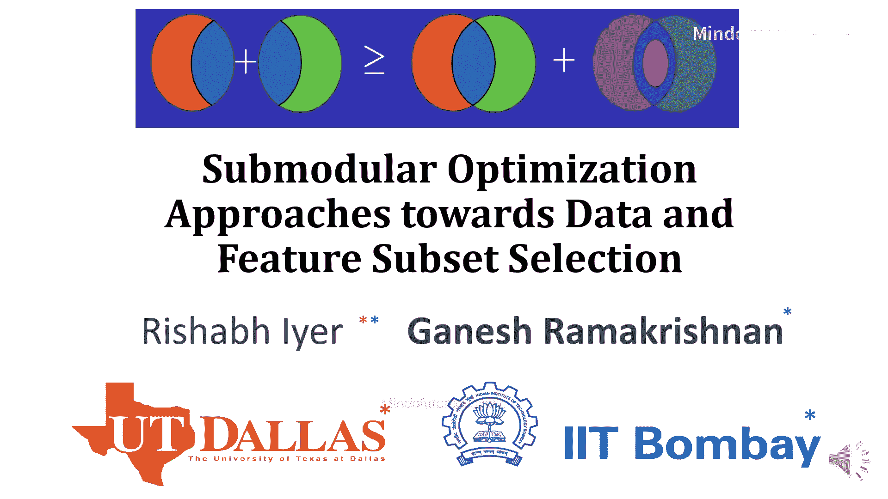

In this part， we begin by first presenting approaches to data selection。Sketching。

 often invoking submodular functions。We'll then move on to active learning。

Several active learning algorithms are actually built on top of data selection strategies。

 and several of them actually make use of somemodularity。Finally。

 we move to a very complementary area， which is data selection。For data programming。So， imagine that。

 in addition。都。😔，Some subset of points。Potentially unlabeled。On which you induce。Labels。

You also have access。2 ruin。Or labeling function。What will be the best way of combining。

Some amount of label data and rules。So， that。We can get robust learning。

Will look there after look at。F selection。Moving from instant space to the feature space。

There are methods in information， thetic， feature selection。

Use of weeks of modularity in feature selection， categorically feature selection and so on。

The final part of her talk there part two。Would deal with summarization。Now。

 summarization can be viewed as data subset selection。However。

There are some unique requirements here。And there are also interesting problem settings both in the image。

Video。And finally， text。Doomains will。Present several of their applications。

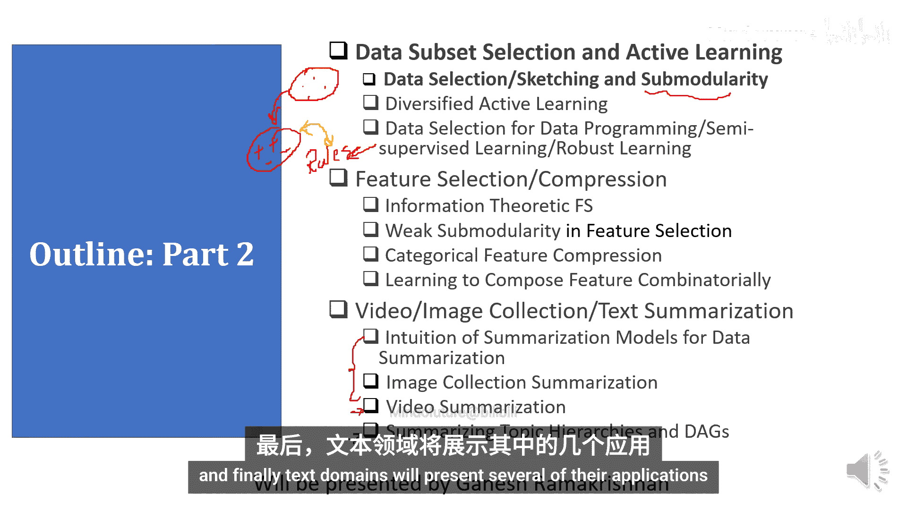

You might recap that。Laabbelling data sets can be extremely expensive。

Some computations that we have done based on crowdsourcing platforms such as Google and Amazon。

Is that， let's say you have 50000。Image， data set。For classification。嗯。

Identification of a class labels using crowdsourcing could。Cost anywhere between。$5000 to $32，000。

Likewise， if you had to label 50，000 large image data set for detection。Object detection。

The cost would range between 10000。Dollars to $45，000。And if you had to label a 50。

000 large 3D point cloud。The cost is going to be even more phenomenal。嗯。And when it comes to text。

 you have to spend a lot of time also parsing the text， reading the text。

 and therefore the cost can be higher。Arranging from 50000 to 1，50000。

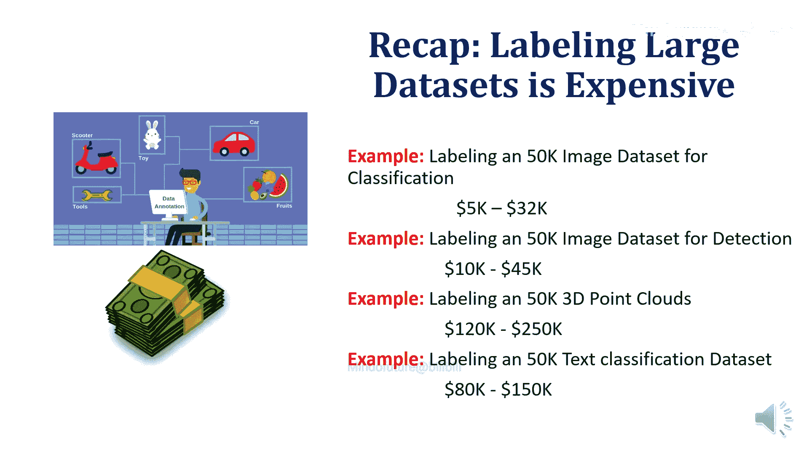

你。Other issue is that you may have。Noise in the labeling。 Now。

 you might want to very cheaply procure labels through say text search or remate search。

 as you can see in this figure。Imailade search might be deceptive in giving you somewhat。

Les noisy responses， but mind you， you're looking for a ladybug through an image search。

 but you probably also have got a honeybee here。And you asked for a Honda Ac。

 but you've also got a B BMW so。This noise of different sort based on the process you have employed to get your label data set。

 the other issue is that label dataset sets can have a very long tail there are large number of labels。

 as you can see here。Which have low frequency。And they are often not very well represented。In。

In classification problems in the extreme classification literature， for example。

 people have come come come up with measures such as propensity。In to basically try and counter。This。

Bs in the labeling where rare labels get typically ignored just because their instances are very few。

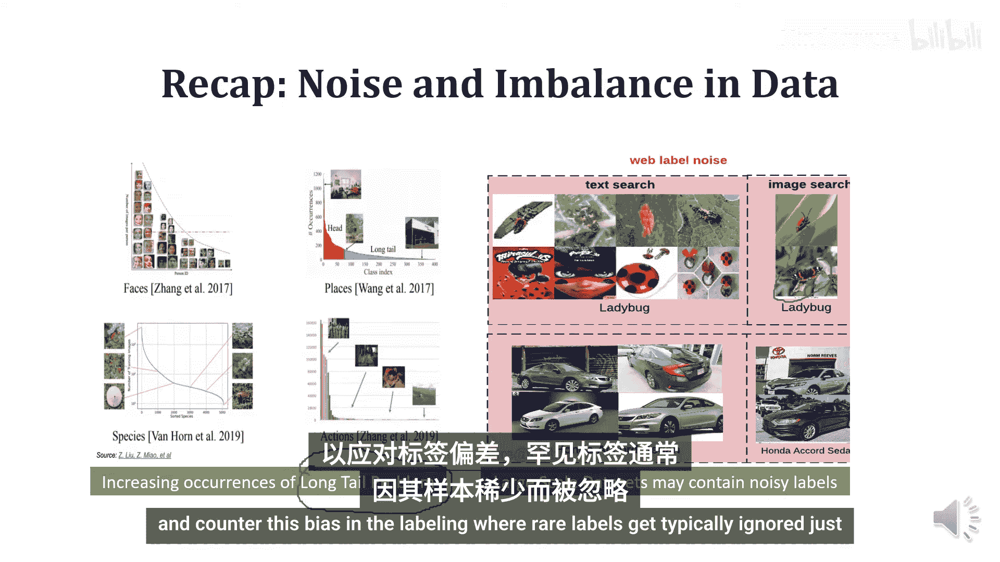

Now， let's say we wanted to make machine learning。Data procurement。Efficient。And also。

 use of machine learning data。efficientfficient as well as robust what would you do what we identify is that the model training and validation are a cycle repeated several times。

That's followed by model deployment。Now in the data preparation you have data labeling and feature engineering。

 we will certainly address some of the issues in data preparation。

 but even after you have obtained the labels you have to iterate several times over the model and validation set。

So that's the problem model selection。Is it a possible that we can。

Take a subset of the date training data。In order to ensure that we can run this operation several times more efficiently。

With some training budget。嗯。So the production system constraints are that data labeling itself is very time consuming expensive and noisy。

Fishsure selection has a lot of latency。And memory。Issues in terms of storage。

The model training can be very compute intensive and again time consuming。

Hyperparmed tuning is extremely time consuming because it requires several iterations to the model training itself。

And finally， we have the issue when the training and the deployment scenarios have some difference。

The distribution shift， for example。So can we drain models under these constraints without sacrificing on accuracy？

This is a question we are attempt to answer。So what are the components of robust10 data efficient machine learning？

From efficient machine learning perspective， you want to reduce the labeling cost or time。

And reduce the training time and compute as well。Of course。

 we also want to reduce the compute infrastructure。

What can we do to reduce hyperparameter tuning and network architecture search time？

And how can the direction and training time reflect in better hyperparameter tuning time？

We'll also look at the。process of procuring data through a paradigm of data programming using labeling functions or rules。

In conjunction with some semi supervised learning。These are comprehensive efficient machine learning。

 as far as robust machine learning is concerned， you want to reduce a feature noise。

Be robust to class imbalance。 Look at out of distribution。Yes， so there are many problems。

 we'll try and survey some approaches。So here are some applications of data subject selection sumly。

 which is quick training and inference， quick hyperameter tuning。

Bbeling from unlabeled data the elements of active learning here as well as semivised learning and finally robust learning。

So here's the setup。We assume that the parameters theta。Characterize the machine learning model。

We have a training data set。You。And a validation data set， V。The loss， for example。

 the likelihood function could be evaluated either on the training data set U。

 in which case we use the sub。B。So mind you that T corresponds to the label dataset set U。

 the subscript T。The subscript V corresponds to the validation data set。

 so the likelihood function can also be measured on the validation data。Typically， the theta。

Optable parameters you would estimate on the training data using the label data U。And in general。

 we are looking at the goal of selecting a subset of thelabel data says that the resulting model performs the best。

Now， how do you factor in the likelihood or the loss function on the validation data in conjunction with objective on the training data。

 I mean， this is what character prices。The different approaches。The challenges as follows。

Let's say I have to identify a subset of you， and you has。And elements。We know that。

The number of possible subsets of you。Is to to end。Well， we might design a good。Function。

 and by good function， we mean， say some model of function as discussed in the part1。

So submodular function makes the search over this space of subsets efficient with some reasonable approximation guarantees。

The issue is as follows。 We are not only dealing with the subset selection。

 The subset selection has to interleave with the parameter estimation。Theta star over the。

Log likelihood function， for example。No。If you were to attempt a close form solution for Hita star and then go back and subset the going back and forward is actually going to be extremely。

I'm consuming。And hence， even if training on 10% subset gives you 10x faster training is a lucrative proposal。

We want to make sure that the sub selection has negligible time complexity because ultimately it's going to have some wrapper。

Involving the parameter estimation。Also， it's interesting to see if there are theoretical guarantees of sub selection algorithms in the context of machine learning where we have parameter。

 theta stars to be estimated as well。😊，So we begin with a very vanilla approach。Which is。

Use submodular functions as proxy functions for data subset selection。And this has been， of course。

 finding a lot of use both practically and from the machine learning perspective。

Interesting analysis has also been done。So given a ground set， we。

You have a set function which measures how would the subset。X is， and as we have seen。

The optimization problem of maximizing Fx subject to the cardinality constraint。

Has a greedy algorithm with a good approximation guarantee one minus is1 over。

 even if its a submod and in practice。We do even significantly better。

 Often you land up getting close to the optimal solution。And when F is a dispersion function。

We can attain a half。Approxiation factor gap。Guarantee。Now。

 several papers have used proxy sub modelular functions， specific location。

 which is some model feature based functions like。weighted set cover functions， which are submodular。

And then of course， you can have dispoion functions， log determinant， which is also submodular。诶。Now。

 are they the right models well， interestingly？Experis have shown。

Dimminishing returns and these are across a whole bunch of papers and we find the same trend diminishing returns。

 So hence it just makes sense to use submodular functions。Can we move beyond。

Some model functions as proxy and seeing what can be done with the actual objective itself。

 can that be a modeler。So well study three approaches。

 which are reasonable data selection approaches and show。That then naturally induce a modity。

 So we move now to approach2。Here we try and choose a data subset which approximates the gradient of the entire data set。

In this。We also factor in weights。So， let's say。A subject X D。Has a point I。With。Waiate assigned。

W It。The gradient of the loss corresponding to the height point is li。

This is needless to say on the training dataset set， that's what you see as the subscript capital T。

What we would like in this setting is that the weighted average of the gradient of points belonging range of the loss for the points belonging。

To the selected subset。Approximates。The gradient on the entire data set。

 and this is a full gradient on the right hand side。The ys is interesting。

 well this characterize is core6 they said that you identify xt。啱。We now look at。

Conditions for the convergence of either the full trading laws。In which case。The L。Generalized。

In the expressions below。Return out to be L。Or。😮，Validation loss。

In which case L will turn out to be LV。So the convergence result shown here will help provide a strategy。

To select the weights。WTs and the subset X T。Which in turn will influence the parameters theta t。So。

 the idea is that。The upper bound of the mini b of difference of losses evaluated at。Per。

Be N dust do。Where L Theta star is a desired loss。This upper bound has two terms。The first one is。

Based on the rate of change of the trading data。Basically， an upper bound on the。Being loss。Eror。

The gradient of the training loss error。The second洞。Which is the。

Some of the errors with respect to the individual folks。

Indicates that effective data selection should try and have this low value of error And what is this error basically。

Well， this error。It's basically。A non differenceence。

Of the weighted sum of the gradient on the selected subset Ft。From。The full。

Gradient now the full gradient could be either the validation gradient or the training gradient。So。

 for example， the goal of data selection is to select a subset。That approximate a full training set。

 you will try and minimize。This error with L set to LT。As you look at L set to L， if you want to。

Select subset that approximate the validation set。So this is a very general recipe。

And as well see for some interesting algorithms。The dot product between the tra and the validation and grades also become very important。

The theorem indicates that an effective data selection algorithm should really try and have this。

Eral mini mice。 So this is another way we can basically now pose the problem as。We is given。

A cardinality constraint on the subset eggs。Try and estimate the parameters WT and also identify the subset X T。

Such that。The difference of the weighted some of the。Greandients。On the subject。From the。

The gradient on the entire set L is as low as possible。So。One of the。

Algorithms published in 2020 called Craigray。Is actually derived as an upper bound。

To the error that we discussed in the theorem。And the upper bond is basically a facility location。

 in the following sense。So， if you apply。The triangle inequality to the summation width。

A particular assignment of weights and what are these weights。说。Basically。

 you imagine that you're assigning every element I。To an element P。说啲。In the specific example。

If this is an I。The cross。Is the corresponding。闭啲矮。That it is assigned to。

So the py eyes are the representatives for the eyes。If。This is the assignment。 and if the WJs。

Are basically the count of the number of the I that were assigned to an element J。

Under this condition。嗯。We can apply。诶。Or rather， expand。

The sum or I in x of Wy times the gradient LT theta T as a sum over all the elements in either U or V based on what W is set to be。

Of this gradient。 So now， what we have done basically is take the summation outside。

Over all the elements in W。And the second step is we apply the triangle inequality。

Where we take the norm of the summation to be less than equal to the。

Sumation of the norm differences， the norm of the differences。Now， this。

Can be sure to correspond to the facility location。 Well， you'll have to， of course。

 not look at the minimum， but the maximum。But it suffices us to understand that basically what you have obtained as these the assignments of pi ice is the Kmeoids。

And what you have is a k meite problem is an upper bound to the original error。

 So this is the K meite problem。We can similarly formulate the maximization version。

 and then youll find that the function is exactly the lower bound is exactly the facility of location function。

😊，嗯。So maximizing the facility location function in the。The market in in the。Maximization version。

Under the cardinality constraint。That the number of these points。In Xt is， say， less than equal to K。

 Now， this turns out to be。A constant a model of maximization problem for which。

 as we have seen the first part， there are efficient 1 minus 1 over approximation algorithms。So。

너 Craig algorithm르um。Optimizes a facility location based upper bound。Now， as a result， Craig。

 based on facility location based data selection could require larger subset sizes to achieve some desired。

Epsilent error and the gradient。Difference。Can we do better by。Directly optimizing the error term。

As in here。And it turns out that we can。So we directly optimize this error function。

With a regularization here。😊，Which gives us also some strong convicxity。

We could also convert this into a maximization problem。So imagine that you have this E lambda x。

Minimized over W。And if we define an F lambda。Exgg。As an L max， as we have。Heard in the first part。

This。There's an equivalent function， which you would equivalent。Maximize。So。

F lambda x can be shown to be approximately submodular。And it basically admits in1 minus。E XP of。

Minus gamma。Approxiation guarantee。So the greedy algorithm obviously on F lambda x can be very appealing。

 however， it turns out。😊，That it needs to compute the game。Of every element J with respect to x。

Order。Nk number of times， my case a budget and then the number of elements in the set。

So this can be very。Computationally expensive。Therefore。Instead of greedy algorithm on this F lambda。

We have an even better proposal。Which gives us， actually。Similar result。And that's the。OP algorithm。

Ororgonal matching pursuit。Which is run with a cardinality constraint。啊。More of x less than K。

You could also run it with a slightly different error constraint。

 but let's say that for the time being we look at the。Cdality constraint。

And that basically returns this 1 minus EXp minus gamma。啊。Under the cardinity constraint。

What is the algorithm， basically you looking at the error。Now， initially， of course。

 you you do you have not added any element。 So you just have。The second term。

 depending on whether you have used W to be the U or the。啊。B。Validation set are that。Training set。

Now， what you do is look at the projection of this error term for each。Element I， in that set。W。

The projection is measured along。The gradient of the laws。With。W。Wch is U orV。You choose that。

Element I with whom the projection is maximum。And add that element to x。

So this is for every element INW。Now， having added that element。😊，So you not。

 please note that you're not solving。E lambda and then computing F lambda。

 you are basically you know adding elements incrementally。For the new element that is added。

 you find the。WP。For all the elements that have been added so far in x。Now， you compute your。

New error term。aught。😮，嗯。Now， from3， you go back。You have a revised estimate of R， again。

 compute that element i in either U or V， which has the highest dot product。

IL is the highest dot product with respect to the complete data gradient。And again， choose that I。

 which has highest projection added to x。Use in a regression， which can give you close form solution。

Keep doing this until the one of the conversions criteria。 Now， if modx is less K。

 we already mentioned that we get an interesting。😊，approximationroxiation guarantee1 minus ExP。

1 minus gamma， which is what is given by。Vattuue of approximate of modularity。Now， it turns out。

That this is one way in which the dot product influences the dot product between the gradient influences the algorithm。

 we will see another way in which the dot product between train and validation gradient influence conversionvergence。

So we move on to this third approach。Well。The goal is to choose data subset。

That approximates the performance of the full training dataset。Or possibly validation set。😊。

As a bilel optimization。So here's the bilel optimization。You are measuring。

The loss on the validation set。Estimating parameters。

All the training set now we have very explicitly defined the roles of both the training and validation set。

However。The loss on the validation set should be minimized with respect to the subset。

S of the training set on which the parameters theta have been estimated。So S has influence of theta。

Therefore the。Iea is that you want generalization， generalized performance on validation set。

 find the right subset of the training set that。Gives you this best generalization。嗯。😊，Now。

 it turns out。That the inner problem。Has a close form solution。

In the case of several simple classifiers， such as knife base， nearest neighbor or linear regression。

Specifically。The case of ni base， you have a log likelihood function and a maximum likelihood parameters。

Turn out to be very simply close form expressions。And。Under certain assumptions。

Such as some cardinality constraint。 and the fact that the。Classes are balanced。

The data is balanced across all the classes， your。Log likelihood function is a feature based。

Smodular function， moreon submodular function。Of the set。

So therefore you have efficient greedy algorithms。Which are also effective。Likewise。

 for the nearest neighbor classifiers again， you get close form expressions。嗯。

And the parameters theta once they are obtained used in a close form expression。Likelihood function。

Turns out to be a facility location function under some similar simple assumptions。

On the class prize。Howeverello。诶。This is not messy acceptable to us because。呢。

So you solving the inner optimization problem。Even in close form。

Will still entail solving the outer optimization problem several times。

For every subset that you select。So it basically defeats the purpose of selecting a subset for faster training。

And also， we want to generalize beyond the losses mentioned in the previous slide。

 such as you know linear regression loss， least square loss that is。

Or the nearest neighbor and9 base losses。 So for these two reasons。

 you would like to see what more can be done。 Can we interleave。The solving of theta。With。

Subting of eggs。So is there a way that the outer ag max problem and the inner ag maxax problem can be interleaveed？

For moral efficiency。So， here' one。Step towards that， which is an online one step meta approximation。

Where we approximate the inner optimization。Problem。By taking a single gradient step。As you can see。

This is a single gradient step。Toward the training of the subset log likelihood ascent， right？说啲。

Substitution of theta star in the outer optimization problem。In terms of this one step approximation。

Gives us this new optimization problem。 Now， how do you solve this， What do you。

Do it's it note that there exist。Lock likelihood functions。LV。And LLT and basically corresponding。

Training and validation data sets such that this equation。The optimization problem here。

I and be hard。However。If the validation。Set log likelihood is either。Negative law。

 negative logistic loss。Or negative squared laws。Or negative hinge loss or the negative perceptron losses。

This is。Reasonably。Wide variety of loss functions that get employed in real world machine learning。

 So in all these three cases。The optimization problem becomes an instance of the cardinality constraints submodular minimal maxization problem。

Which means you have。1 minus1 over e。Approxims for the greedy。I got them。Also。If。啲。

LLV turns out to be a negative cross entropy loss。Even then we have some modularity。

 but we have weak some modularity。With the approximation guarantees that have been already discussed。

No。Why would。We want to go further。Well， it turns out that if you have to。

Employee the greedy algorithm。In either of these case， either of the cases。诶。

To compute the gain for every element。Yi。Given a particular current configuration， say SK。

 so youre going from Sk， select the E and go to Sk plus 1。But for this， to compute the gain。

 youll actually have to compute compute。你。Lg likelihood on the validation data。This can。

Require several fault passes， especially if the network is a deep network。

Users can be very computationally expensive。说。If you employ and tailors in this approximation。On the。

啊。Validation objective here。And what have you done， basically。

 we have taken only the first order approximation。We have restricted ourselves。

To LLV Theta plus the dot product between。The gradient of LLV。诶。Per with the。

The second component of the argument。So this obviously this dot product is going to be interesting going forward。

 we have already seen that alignment between the validation and training data sets can be very important in general and we are going to see that in our convergence。

B。Now， it turns out that with this， all we need to do with this first order approximation by ignoring the higher order terms。

We will only need to have K。Forward passes。For calculating the validation log likelihood。

Cresponding to the budget。And we'll also have。Additional K backward passes to complete the validation log likelihood gradient。

The backward passes are required for the gradient。嗯。Now， we can further。Ruces this itself。Is useful。

 It turns out that。Instead of computing。The log like you heard。

K times we can and forward passes K times， we can use stale likelihoods。嗯。

And compute the validation log like you would only all。So， this is precisely。

One of the engineering tricks we use。Where。We recompute the validation log likelihood only r times instead of k times。

And you still。Love likelihoods。放。The gay by art。Greedy steps。In addition， we also try other options。

 which is。Sttochastic greedy selection。嗯。So， stochically select。An element greedily。嗯。Also。

 we consider other optimizations， such as avoiding。Selecting the subset every epochse。

 but select rather。The subset， every。G一 box。I sorry， every Ali box。嗯。And further in deep networks。

 we may use only the last layer gradients during inner and out optimization problems for subset selection。

We also have tried different regularizations。On top of our algorithm gl to prevent overfitting。

 And examples are facility location and。Random regularization。

The idea is to at least not do worse than facility location of the random visualization。嗯。

And therefore， in that way。Prevent warfitting。

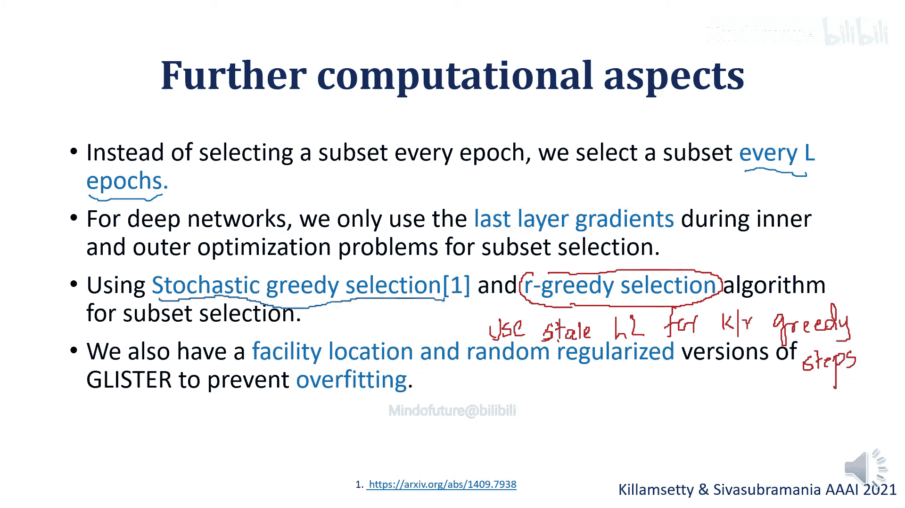

So this is the overall strategy。Where we initialize with random parameters and a random subset。

You have Lpo of stochastic gradientding descent on Sn。That gives you a theta L。Now。

 you do a greedy data subset selection。With the tailored approximation。And you get an S1。And now。

 basically，' going to apply。Emoripo。Of stochastic gradient in descent to get theta to L。And so on。No。

What about convergence properties？

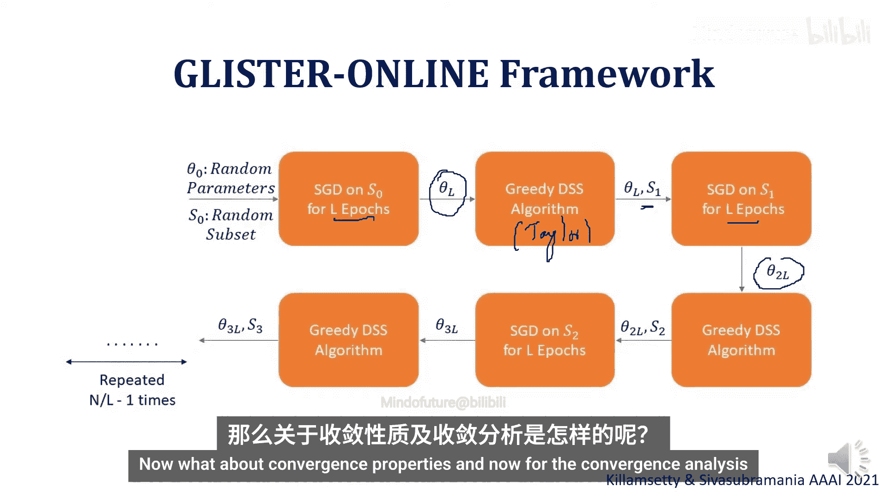

And now for the convergence analysis。So。If you basically insure。

That de validation loss function LV is lips smooth。

With some constant and the gradient of training and validation losses。

The norms are bounded by sub sigma T and Sigma V respectively。😊。

Then the validation loss will always monotonically decrease with every training a book。Now。

 you can also show。That there's a convergence order of one of upon epsilon square number of e folks convergence。

If you assume that。The dot product of the。Validation and the training loss are always greater than equal 0。

嗯。安人。嗯。This is data min。Basically， which is the minimum。

Of the normalized values of the gradient normalization with respect to the。

Norm of the gradient it itself upper bone or the norm of the gradient。Then， theres this interesting。

A result。That the minimum of the deviations of the loss。From the optimal loss， is upper bound。

By a town which is one upon square rootee， which is what gives you one upon Epsilon square。He box。

And that this is additional term。嗯。啊。Now， what is this term。

 it's basically involving square root of one minus co theta。Where costta is。Basically。

 the dot product of the gradient。 Now we remember。That。

Taylor approximation chooses a subset that maximizes。

That dot product between the gradients of the training loss and the validation loss。

So we expect that the angle between the subset training gradient and validation loss gradients will be。

Close to 0。So， therefore， we would expect this。A value to be。You know， roughly or attending to one。嗯。

Now， the deelta min must be greater than zero， which is also reasonable。嗯。

It's reasonable because having close to zero gradients。On the subsequent gradient set。

Would imply overfitting on the training laws。So we would really not like to worship it。

 And then so this way we can justify。Are different elements of this convergence result。

 the fourth category of approach is selecting data subsets by minimizing a divergence。And。

Sheino hera ago in 2013。He motivated this problem for sentence set selection。Using features。

So the motivation is to view the data subset selection objective as minimizing some K divergence between the original full data distribution and the subset。

In the feature space。So。The mu X is a maximum likelihood estimate。Basedest。Distribution。

On the features set you。嗯。And。With respect to the full distribution。In practice。

 you can use any of the submodular models， such as representation， coverage， diversity， et cetera。

As proxy functions for data sub。As a first application。

 we evaluate the efficiency of our sub selection methods to enable learning。From lesser data。

 yet incurring minimal loss in performance。So here are results， for example， the first application。

Ken nearest neighbor classification， the phase and gender data sets。

So as hypothesized using only a portion of the trading data， say even 40%， as you can see。

We get similar accuracy as with just using the entire 100% data。Moreover。

 we observe that facility location。Performs much better than random sampling。

This is facility location at 40%。Performing much better than random sampling。And also。

Better than disparity men。Which is the one in red here。

Proving that facility location is good proxy for nearest neighbor classifiedifier。

 So this kind of reinforces connections between。Different objectives。

 And iss a modelular function here， for example， facility location。

We see this both on gender recognition and face recognition data sets shown here。

We also have some interesting results with Glistister。

When we use the validation data for generalization。So we basically see that Glister achieves a 7。

2 x speed up。Add just 10% data subset。3。5 x speed up at 30% and 2 x speed up。At 50%。So obviously。

 with decreasing speed up。And。Increasing data set。We do find that the accuracy gap decreases。But。

The accuracy gap， even with just 10% data set with which either 7。

2 x speed up isn't really that high as 2。5% per for 10。嗯。on Mnt。

We find that lister achieves a three x speed up at。10%。While losing only 02%。

 So they exist data sets。Where the the speed up。Is significant because with a smart selection of a subset for generalizing on validation set。

 you hardly see any accuracy drop。Here are results on robust learning。 What happens if there's a。

Glass shift。 G distribution shift。Or this introduction of noise。 So we find that。

Even in these settings， Glister can perform even better than the full data。And that， too。

 by a significant margin，15 to 20%。In terms of accuracy。This is， of course。

 in both class imbalance and noise settings。The results are evident here。 You can see the。

A significant improvement。 The Exor has。There are， of course， now different。

Blister plus facility location as a regular riseizer。Whereas in on the right hand side。

 it it just gllister without the regularization。So how about data subject selection for hyperparmeter tu in settings outside Glist？

嗯。And well， there are very interesting observations。

You are able to select typically 5 to 10% of the entire data。And therefore。

 it's much easier to tune the hyperparmeters on the subset。So， we notice that physical location。

Function generally has positive gain compared to random。And except for one of the hyperbarmeter。

 disparity min also beats random。So we observed that hyperparmeters chosen by fe location obtained the best result。

Which is 10。5% improvement in the top5 accuracy compared to the hyperparmeters chosen by the random set。

And how about unsupervised data sub selection？There's another application。

Where we look at the problem of labeling massive data sets。

 specifically when the data comes from videos。Videos can have a lot of redundancy。

 it doesnt prove effective to end up global given the redundant data。So。The data here is unlabeled。

 so we need to apply unsupervised data subset selection。

And we achieve subsets of various sizes using unsub severe summarization compare the results to random you said see that disparityity has the best results followed closely by facility location。

Both these methods achieve almost 5% improvement compared to random subset in terms of mean average position。

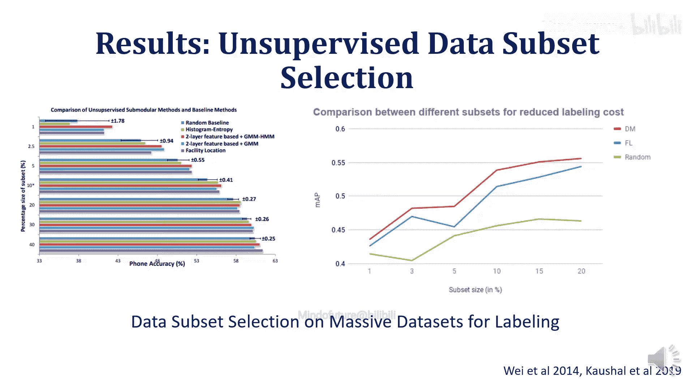

Also， diversity is more important here compared to representation。你老母。

To the next application of data subset selection， which is active learning。Specifically。

 diversified active learning。

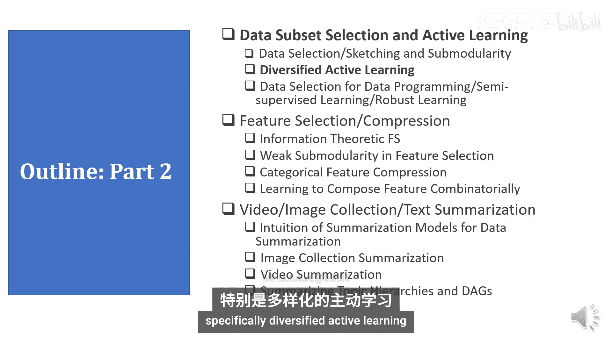

To begin with， well assume。That。In diversified active learning， we have。A warm start。

 which means that we have reasonable amount of。Lbel training data。Based on which。

The estimated uncertainties are reliable。And therefore。

 based on these reliable estimates of uncertainties。We are able to query from the unlabeled pool。

To find。The uncertainty。Of example， class uncertainty of examples， x。Maybe possibly sword them。

And let the oracle assign label to those uncertain examples。Now。

What would you do Pick the most uncertain samples to label。For example。

 pick that once with the highest value of entropy。Entropy is a modular function。However。

 we realize that in practice the human labeler labels data in batches not individually。

So if they've been selected in batches， would we like redundancy， why not pick。Maybe diverse。Yet。

 uncertain instances to label。And diversity could be measured through DppP。呃。

You would also like to ensure that these instances are high coverage that they cover different aspects of the distribution。

So， high coverage。You could ensure。嗯。Using the facility location。

Or you could look at feature coverage。Using weighted set cover。

So for multiple reasons mentioned here， it makes sense to have。Diversified active learning。

Look at the set of instances， instead of。Looking at an individual instance。So， yours。

The first step filtered active submodler selection。As expected。

 the first step would be uncertainty filtering remove data that the system is already。

Certain certain about， and as have said before。This is what we refer to as worms start。Setting。

The system， certainty about instances。Can be assumed to be correct。And thereafter。

 we have subset selection。On the examples to be labeled。啲。Difference is that。

Because we don't have the。Labels， we will use hypothesized labels。

On the F so that you get diverse and possibly representative sets。Subss selected。嗯。

So this is called filtered active sub model selection。And。We compare results on object recognition。

 phase recognition and scene recognition data sets as well。There are many classes。

 especially in the latter。When there are more classes。

 we find facility location giving better results。Diversity works better than representation。

 particularly when the size of the dataset set is small。For two class classification。

 there is a lot of similarity the data set。For example。

 there is more than one image for the same person。In that case of two class classification。

 it is not surprising that diversity works well。嗯。In each case。

 we see that subset selection algorithms when。Executed on top of uncertainty sampling。

Outperform vanilla uncertainty sampling。And of course， random selection as well。Is outperform。

Moreover， the effect of diversity and representation reduces。

As the number of unlabeled instances reduce。In which case， uncertainty sampling already works well。

In practice， that would be the point where the accuracy saturates as well。你做。

Look at influence waste sampling。What if。You measured。The impact that a selected unlabeled example。

With possibly imputed labels would have the overall accuracy and likely or likelihood of。

The classifier that's being learned。Obviously。It'd be。Difficult to find close form expressions。

We can only look at influence in an expected sense， as mentioned here。

And we also have looked at approximation schemes for quick computation， but in general。

 we find that there is a lot of value in looking at influence based sampling。嗯。

Title of also reinforcing that uncertainty by itself may not help capture diversity and representativeness。

The second approach is based。On an interesting upper bound。On the。Empirical。Risk。

And the upper bound has this。First component in terms of the red dots， which is a train error。

And there is this component involving these points in blue， which form the cores said。

So this gives you the core set loss and it turns out。That。

This problem is equal into picking a set of data points， the problem of。

Minimizing the upper bound is equivalent to picking。A set of data points， which maximizes。啊。

This interesting objective。Which is basically a robust version of facility location。

So what you do in facility location is that you have。A sum。 And here you have a max。

And that's why we call it a robust version。Of the facility location objective。

The problem is also known well known as the case center problem。So， you need to。Big。The red。

 the green points。Such that the maximum。Distance of a red point to a green point。Is minimized。

So that's a criterion for picking those green points。Now， it turns out that this is not some model。

But closely related， in fact， the greedy algorithm gives you。To approximation。

So we clearly observe the significant advantage。That。Cet algorithm yield。

Over most other state of the art。And this is a domination for a reasonably large number of label images。

As they are picked。I。Other approach。To subset selection for active learning。

Is kind of a variant of craig。But he called that cr。Minimize an upper bound。

To the minimum value of the sequence。哦。Lost differences。With respect to the optimal loss。

And the upperpper bowl was basically。The normed difference。Of。The weighted average of gradients。

Computed on the subset。Selected。With the difference with respect to the full gradient。

Computed or the entire training or validation set。No， bad。Say as well。

Instead of assuming that the labels are known， let us。Impute the labels。

Or have the labels determined using the currently trained classifier？

So the idea is to pick a set of examples where diverse gradients， very much like Craig。啊。No。

If you use facility location as a diversity function。

 it turns out to be very closely related to Craig with。As I mentioned earlier。呃 using。

The imputed or guest labels。Where the guest labels come from。The classifier train so far。嗯。However。

 Craig， that did something more which badge doesn't。 And that probably makes。

Leave some scope for improvement for bad。So。Greg further looked at an upper bound， as you mean that。

The loss is convicts。And the upper one turns out to be actually nothing but。Awaed。Feature function。

Difference。So feature function on the subset versus feature function on the entire set。And。

That makes Craig more efficient。Bge is also related to。Interactive submodel of sub selection。

But unlike fastS， which require uncertainty def filtertering。

 batch doesn not require uncertainty filtertering。Actually picking diverse gradients ensures uncertainty and diversity together。

Which makes it a much more holistic approach。And we later on show that。诶。

The Glister algorithm that was discussed earlier。Actually。

 it has several of these advantages when it's improvised for active learning。

And here are results again with batchge with diversified gradients。

 back then certainly batchge had an edge over the state of the art because of its overall holistic approach。

 though computationally it probably is a little handicapped。Accuracy wise， you do find that it。

It maintains a consistent lead。Over the state of the art， then。

The state of the art then include entropy based， of course random。

And some existing coreet algorithms then。So coreet is basically a diversity based approach。

Where the embedding of each example is computed by the networks penultimate layer and the samples at each round are selected using a greedy。

Further' first travel condition and all labeled examples。Conf that you see here。

Is an uncertainty based active learning algorithm。That selects a batch of examples with the smallest predicted class probability。

Mge。Is。An uncertainty based active learning algorithm that selects the bottom B example sorted according to the。

Examples multi class margin， So based on margin based classifier。Entropy。

Is basically uncertainty based active learning algorithm that selects the top B examples according to the entropy examples predictive class probability distribution。

 so effectively its based on a modular function。Abi。😔，Is active learning by learning。

 it's a bandit style meta active learning algorithm。That actually selects between。

Two of the algorithms。We just core set。And con at every round。

 you could think of it as a kind of ensemble。In the active of learning。Sinceense。And。

Rand is the knife baseline。 where you say like the random。K examples to query each round。

Our core set。Is。Obviously， coming reasonably。I mean。

 it's performing really reasonably well in the two cases， A and C， but。Pretty the open ML data set。

 you find that the performance is quite pathetic。In this approach number four， selection by proxy。

The idea is that。The U of first。A trim down or a proxy version of the oral model。

This is used to estimate。The utility of individual training data points。

Select the most informative ones for trading。 The large target model。 In fact， you can have multiple。

Levels of proxy， as you can see here。嗯。So。The proxy is basically， a scale down。

Version of the target model。And you can have multiple set scale down versions。嗯。

The idea throughout is to basically select examples and decreasing order of their uncertainty。

Now they use different notions of uncertainty。One minus is a probability of a class or one minus is a min probability of a class。

 they also look at an entropy。Interestingly， they have shown。Up to 1。6 times to 1。

8 times speedd upon C and data set。By just selecting 60% of the subset of the data。

Approach 5 is an improvisation of what was discussed earlier。 Sub selection using Glister。

This is called listeractive。The idea is very much like a badge。

 which was kind of an improvisation of Craig。Here we select a subset of points every ill epoch to be labeled and add it to the current label set for model training。

So， like badge。The use is made of hypothesized labels。For unlabeled points。

During the inner level optimization。It was discussed at length earlier。

And after each sub selection is model is trained on the label set for L box before the next subset selection。

On a number of data sets， we find that glister active perform better than state of the art。

Which includes batch。Of course， Bage is a is a stiff competitor， however。Glistster Act also has。

The advantage of。Computitional efficiency。 So we do find that。E Ger， in one case。

 and in the other other case， D Ger。嗯。Have doing have been doing well。

 but what character Gers also is computational efficiency。

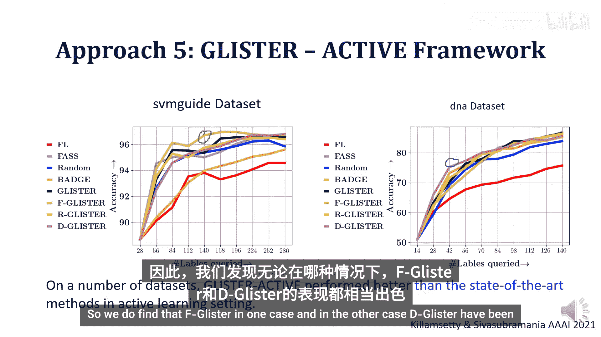

We move on to the last part of this data sub selection， active learning。嗯。

And this is about use of data programming and some amount of semi supervised learning。

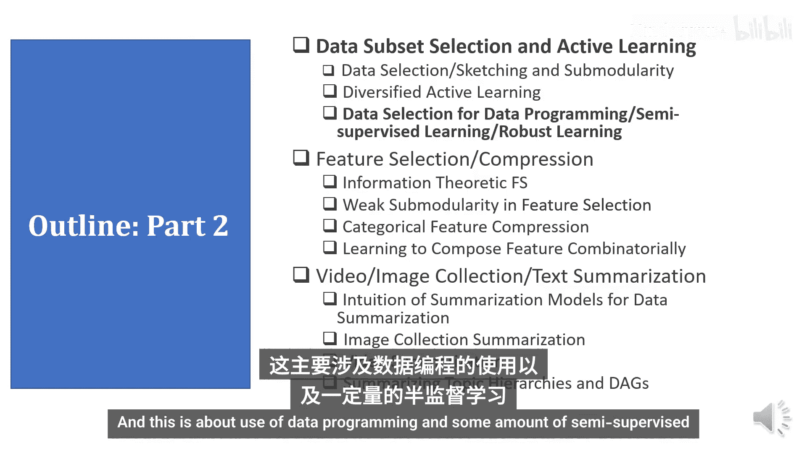

So。Suppose we had multiple labelers。These labelers could be rules。

It's also possible that some of them are humans are weekly trained classifiers based on。

Small amount of human label data。Now， what we find is that with multiple labelers。

If you had multiple labels as well and little or no training data。

 it becomes very important to estimate labeler reliability。One。

Simple idea to estimate labeler reliability。Would be to look at。

The divergence of a labeler from the majority label。And you can intuitively guess here。That。Labler。

C seems to be all over the place。嗯。At least in the first domain。And in fact， it's all over the place。

 even in the second domain。 And labeler B is probably not。Very， well equipped with this first domain。

 which is of clocks and gaugees。Labeller A， on the other hand， seems to have。Reasonable reliability。

It seems to be kind of determining the majority score in many ways。

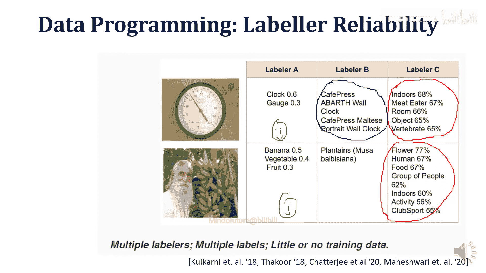

书。It's possible that labelers also have complementary expertise。 Can they mutually benefit。

From there。Individual expertise。嗯。So that we can come up with better consensus models。

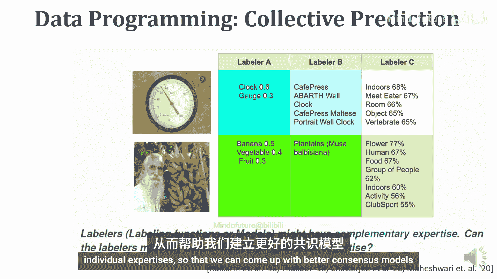

Coming to active learning。What are the examples on which the labeler seem to have high divergence？嗯。

So that by introducing these these examples， for example， the one here。诶。The clock engaged。

 there seems to be too much confusion， even with a more reliable labeler a。So。

Should these label these examples be labeled？And therefore， complement the。

Labeling function of the rule。To oral effect result in a very effective and high quality label data set。

You also want to ensure that we are minimizing the oral label。Labelling budget。

So we don't want too many examples to be label here。So there's an area that's being developed。

Data programming and。In conjunction， subject selection to。

What we want to do is not just develop consensus amongst the labeling functions， but also identify。

The subset of examples to be labeled， so that。As you can see in this figure， there is this。嗯。

Feature based。Function if。The consensus more function。 And then there's a。

Rule or the labeling function based consensus Model G。嗯。Now， you like the F and G。

Or the data based estimation， the parameter based estimation and the labeling function based estimations。

To agree。When。On both need the label and unlabeled data set。

And certainly you like that on the label data set， the feature features are learn。Lly。

With low entropy on the unlabeled dataset set。hy also。Agreeing on the unlabeled data set。

With the feature base。Prediction function。Agreement between the future based prediction function and the labeling function。

Based prediction function。So。Of course， this labeling functions themselves need not be always discrete valued。

 They can also be continuous valued。 That's something。We reported at AI 20。

And we also explored important models of consensus in our 18 paper。And more recently。

 we've been looking at this combination。Wch you see here。Domination， based on。

Both label and unlabeled data。And that is the work we can refer to here。

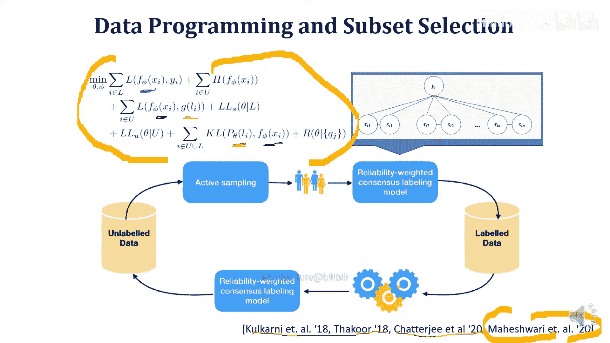

We know more。Second component of part2 which is feature selection and compression。

Which has also seen the use of subject selection commin。Problems。

 and specifically the use of sub model functions。 we begin with。Information。

 theore feature selection， move on to weeks of modity in feature selection。

cateategryical feature compression and finally learning to compose features comminutarily。

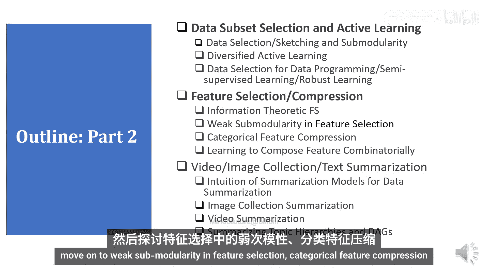

So first， feature selection。Often the feature space， as you see here in this example of text。嗯。

Its such that the operations。Of x， following y。Which to form phrases is not really commut。说。

How do you find。Compositions of these basic features。In a very large space。

Given certain constraints on the compositions。嗯。So。The feature section framework。Typically， is that。

You generate。A subject。Look at the learning algorithm。 E evaluate the performance。

Go back and generate the next subset。This， of course， assumes that obtaining the features is itself。

啊。Possible in reasonable time， but maybe。In certain domains， such as medical domains。

 a feature obtaining。It all could be a costly affair。So there are two issues here。 One is。

 how do you save on。你。Overall， search base exploration。So that at runtime。

 we can save one prediction time and model size becomes compact。And the second is， yes。

 the often construction of features itself。Can be expensive。

Several natural feature selection frameworks， actually。Do involves a modality。So。

One of the first approaches in this space of generating test。And the what based。

On mutual information。Mual information is often used for feature selection itself。嗯。no。

The mutual information I。e。 is unfortunately not。Always。Some么。However。

 if all the exercise are conditionally independent， given the white。Then。FA， just。

Characterized with the mutual information x a comma y turns out to be submodder this is。

A fairly intuitive right information never hurts。 And then there's， of course。

 a saturation with respect to。Information as you keep including。

So this is kind of hinged on the9 base assumption。嗯。Now， often you don't have the N assumption。

But even when that Ie is not sub model。It is。Showd to be the difference of submodular functions。嗯。

Even with。This estimating the MI can be difficult when you have very large feature sets。

Let's say you need to explore and construct those。Peictures。Hence。嗯。

Many mutual information based feature selection frameworks。Approximate the mutual information。

By breaking it into two parts。The first is the relevance。And the second is the redundancy。

And the idea here you want is that you want to。Maximize their relevanceance。And minimize redundancy。

Therefore。The object is often called MRMr。MrMr is almost like like the graph cut。

And the MMM algorithm is an approximation of a theoretically optical optimal maximum dependency feature selection algorithm that。

Maximizes the mutual information between the joint distribution of the selected features。

And the classification variable。 So this is basically。Its。This's an approximation。

Of what we had set out to do。沙周度。Maximize。As M amount approximates the estimation problem with a series of much smaller problems。

Each of which only was only two variables。As you can see here， there are only two variables involved。

In a series of problems。It uses pairwise drone probability， which are more robust。

And it is formed to perform a very effective feature selection， even with this MRIMR。Approximation。

Recently， pass it all worked on cost of our future selection。

And the setting is that instead of one genric set of features applicable， say to all patients。

Can we have a clustered approach for feature selection？So， using absorb。Features。

 you could just cluster patients into groups。No。The training data。

 you could be given demographic information。That could be used to cluster patients into groups these are these are basically patient clusters。

And。as as already stated， possibly different features may be relevant to different people。

So now on the patient clusters， you use the visual information。

Feature selection module and perform joint training， Basically your gain use。M IMr。嗯。

There's an additional component here。Where you're also concerned。With a cost。

 So there's a cost area feature selection。嗯三。Tests for patients might incur cost。

And it is not necessarily。Cost in terms of money。But it may also have other side effects。

So and that's exactly where the patient clusters based on observed features helps。

To the correlation of feature。Sets with patient groups。So for certain set of patients。

 certain features。Should not be even considered。Another approach is to maximize a law specific objective。

For finding the right subset of features。For example， a linear regression。

 can we find a subset of features A？Sas that the resulting model has see the highest R square measure。

No， ask。Has been studied by dozenson Camp。嗯。And。They found， basically that。The log likelihood。

It generates the our measure。Is weekly submodder。If L is a restricted smooth and strongly cons。

The notion of weeks of mod implied by those and compared。Basically involves a similarity issue。

The sub light ratio is。Toughly， the。Ratio of the sum of the marginal gains。

Obtained from the elements in a set。C。With respect to the game， with respect to the entire as itself。

So it's intuitive that this ratio。If it's greater than equal to one。For every possible。Subset。

Only then we can treat the function to be。Some model。嗯。

And it turns out that for some weeks of modularity defined in terms of。

The thermomodulator to the ratio， you can actually come up with data dependent bounds for approximation。

 basically gamma dependent bounds。Approxiation。So。The stream well generalizes autogon matching pursuit。

And forward selection algorithms， we did talk about。OMP earlier in the tutorial。

And thanks to weeks of modularity， since if it's monotone， we get an approximation guarantee of。

1 minus E 2 minus n by capital limit。So the smaller capital limb。For those of them you have it。啊。

Analylysis of algorithms for strong convex function with。Smoothness assumptions。

These basically are the restricted strong convection and restricted smoothness parameters respectively。

Betany etal in 2018 looked at another very interesting variant。For features。Subject selection。

But this was in terms of categorical feature compression。We waitedted on this function a。

F is a function that takes in say feature。Fature这个 China。哦。Japan。And maps them。To a single category。

试运。So嗯。你。Ppo sold by F。Is basically that of mapping。The feature column。Into a more compact set。

Which is the compress features it。You can think of these as clusters。Now。

 you want to maximize the mutual information。Of this， not feature selection。

 but kind of feature compression。On the set of features。

And maximize the mutual information with some given classes， for example。The favorite fruit。

 which could be。What the class C corresponds to。Now。This。Pro。Though， it appears。

Interestinglyly complex， it's actually possible to re parameterameterize as a submodular function。

And there's a quasi media time algorithm。Achiees 1 minus1 over the approximation。

Also better me at all show that it's possible to achieve a distributed login。Approxiation。Now。

 there has been。Significant work that has looked at learning compositions of features。Efficiently。

For example， let's say we're trying to learn。Model for classifying cars is on。

What symbol Boolean features。嗯。嗯。The sales。And prize。And couple of other features， LSB， eta。

And their combinations。Which。His character is， largely。Here through conjunctions。啊。Give me learn。

To compose these basic features as conjunctions。To create interpretable rules。Waied rules。

With associated。Wes， WYs。Such that。嗯。The resultant classifier is accurate。

 which means you either using hnge laws or some logistic laws。

You maximized and not only obtained the weights and the rules。But also， obtain the combinations。

Of the basic features that created those rules。Now， it turns out。That you're actually searching。

A large search base。 Now， the search base can get even more complex。If you're looking at。

 say patterns。Not just conjunctions， but。Sequences。So selection of contigous patterns in a sequence。

In most settings， the search base can be written as a lattice。你 the机。conjunction， you have conivity。

 but in the case of sequence sequences you don't have。Compet really。So with many have conjunctions。

 it's possible to write。See the sum of product。As product of some， you won't get those。

Privilege is when you're looking at contigular sequences。In general。

 the idea is given a large lattice you want a subset of nodes in the lattice。

Which correspond to really these compositions of those。Hyomic features。Such that you do well。

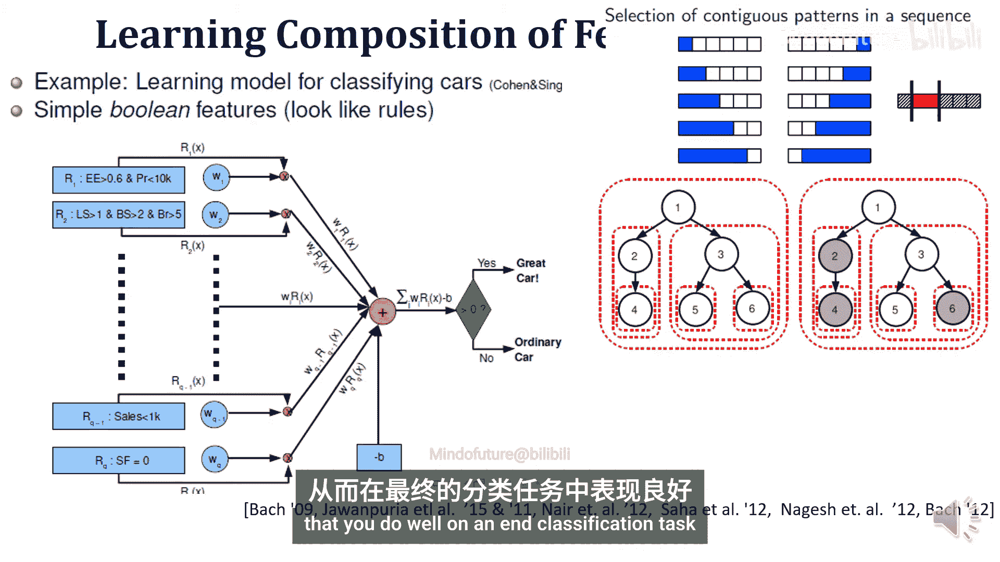

On an end classification task。 So what are the tools that really is possible。嗯。

Supervis subset selection of latticees。Now it's possible to create use of block norm regularizations to basically get。

Ss。Combinations。So you may want only。A small number of such loans。Moreover。

 you may also want each of the rules to be compact。So。

You look at convex relaxations via are L1 LP blocked on regularizers。

With a L norm over individual block and by block we refer to。

Let's say all the descendants of a particular。It's called the descending norm。

So if you have an L1 norm on the entire descendant block， then you get spars。

Set of descendment blocks。 You may additionally impose chaity within each block。2 kind of。

Ensure that you get compact rules。So there are efficient mirrordicent based a set algorithms on the duall with efficiently comp sub differentials。

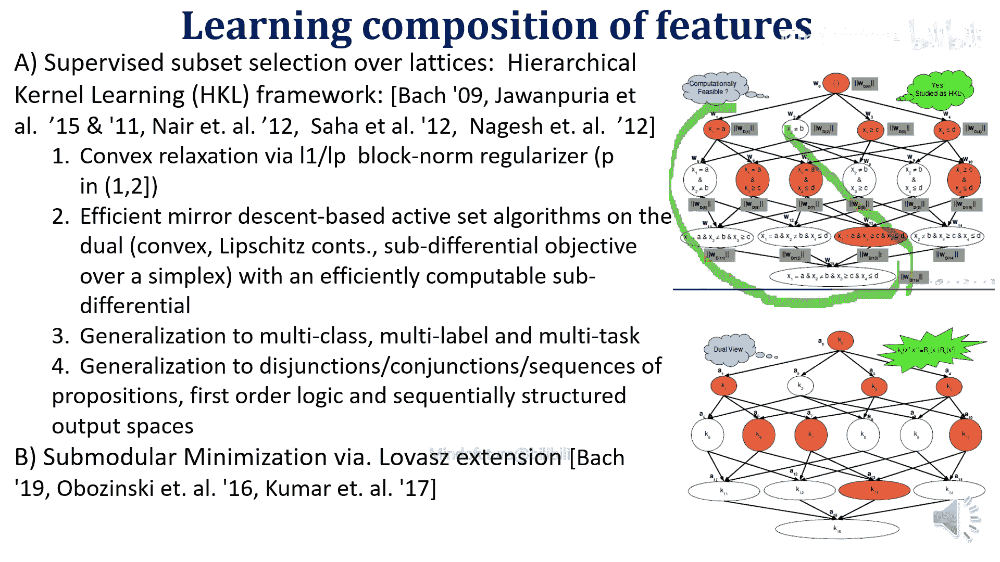

This has been generalized to multi class， multila， and also multitask。嗯。And yes。

 there's also been work to to address， say disjunctions， conjunctions。

A sequences of propositions and in general， first order logic under some。Important assumptions。

 such as de composibility。And also sequentially structured output spaces。嗯。

A lot of this has been made possible also。By submodel of minimization， whereas a lowest extension。

Now move on to the final part of this presentation。Which is video image， text symbolization。

We begin by providing intuition that underlies most of the summarization models。

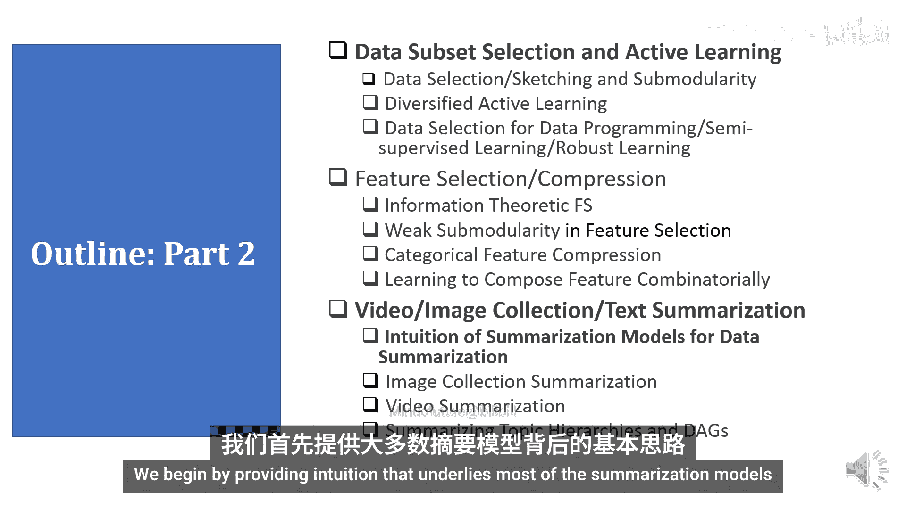

The idea is that you you want to summarize a large collection of images or text documents。Sas that。

The summary has diversity， coverage and representation。Often， you want。

To bias the summary based on some query。So you want elements to be relevant to the query。嗯。

You may also want privacy preserving summaries in which case you want to hide the query。What of the呃。

Plic use case is image collection， let's say。You have a large album。

And spans the spanning multiple years， multiple grips that you have。

Taken based on which you've taken the images。嗯。And you may want query basedase。

 let's say I want all images that are around beaches， I may in fact also one the other way。

 which is privacy preserving， I don't want images which have some private information。好。

In media summarization， the flavor has been slightly different。Because you also are。Interested in。

Sequences of sharks。So nevertheless， the flavors of generic summarization and query based summarization remain。

 there's also this entity based summarization。Where your query is not really。Keyword。

 but it could be be an entity， for example， get all the faces in a view。

This is more about certain object categories that you want to retrieve。啊。Here you often。

Fallll back on redundancy across the frames。啱。The third application is new summarization。

Lots of news articles。you may want a normal summary or summary specific to a query query。

 say Trump or coronavirus， or you may want queries that ignore topics。

Issues that you're not interested in。老里。Common approach underlying all of these is feature extraction to begin with。

嗯。And then you instantiate some submodular function。

One of your favorite similarity based coverage based， feature based functions。

Invo summarize the summarization algorithm， which will be budget sumization or coverage summarization。

Which we have already discussed。Now， to give an idea of。How the summary is influenced by。

Measures such as representation and diversity。下。So consider these images。啊。

If you're only looking at diversity。Something like。嗯。He points here，4，9，1，2， et cetera。

 which are really outliers get picked up。Whereas if you want representation youd really try and cover all these clusters。

 but it might happen that you land up missing out isolated points， which should be also covered。

 which is actually the case there are lots of isolated points。So this is where there's a trade off。

 You probably want a combination of。嗯。Representation and diversity。

 as we have always wanted in other subset selection instances。So we want a cr that helps identify。嗯。

嗯。Accommodation， given。Some training set， based on which。The combinations can be calibrated。

那 here是那个 example例先。嗯。We want to highlight the importance of representation here。For example。

 if you were to just。select。嗯。Frames based on diversity， you probably get。

Very spurious frames such as the one in the。AConcluding frame。Theres no information whatsoever。

Coverage functions， on the other hand， are trying to do feature based coverage。

And therefore probably get meaningless frames just because in total， these meaningless frames。

Have good coverage of the features。This is exactly where representation can step in。Of course。

 representation with some amount of diversity。Coverage so you can kind of guess what the frames would be that would get selected。

I mean， something like this。嗯。And something like this。

It basically captures two people and one person。嗯。And so on。

 so you're trying to get representative canonical upset。Now， as far as video sumization is concerned。

There have been specific approaches to get diversity that also looks at sequential information。

 for example， sequential DPs for video summarization。

There have also been KBPs which have been used for image sumization improvised for。V do sumization。

Basically， by conditioning a standard DPP。On the event that the set has a caity。G。嗯。嗯。Of course。

 there are complexities that arise because of this。Because you have marginal probabilities。

That the k gives rise to。The ensembles directly model the probabilities of observing each subset。

Which offers a convenient target for optimization。Here you can see the effect of including representation。

You'll find that。嗯。That's very。Represent or useful for TV show summarization。For example。

 for another use case surveillance， so surveillance you would probably want。嗯。

To look at diversity mode， And that's exactly the case， because you。If you were to look。

Only at representation and coverage， you not find。AnAnomalous cases， the outliers， which probably。

Our。The most important set of frames to discover。

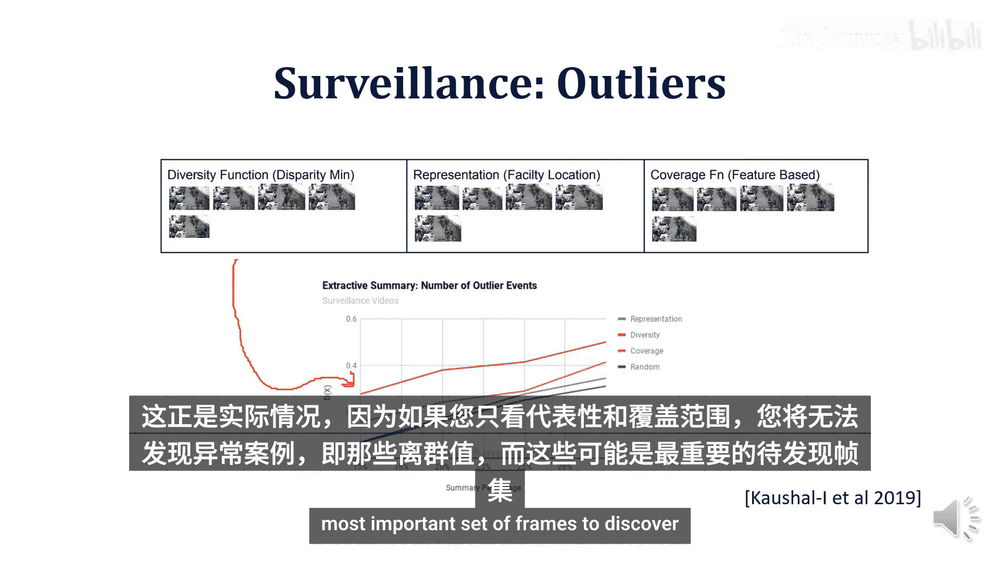

嗯。So what would disparity mean correspond to diversity？that's in the case of surveillance。

 And here you find。That physical location， which。Gets your representation is a bit redundant。

 whereas the disparity men， which gave you diversity。

Give you maybe a frame where there was no one present at all。

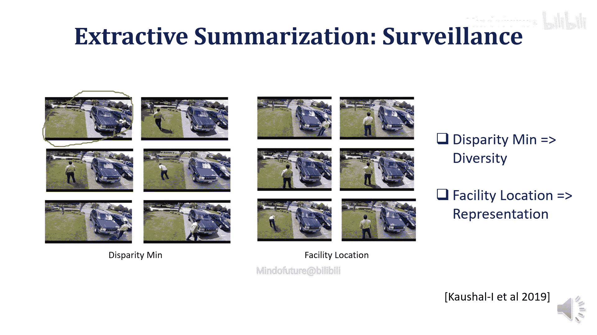

You can also do object based summarization。In which case， no， disparity men。

Might give you false fosters。Just because you're looking for arbitrary diversity。嗯。As here。

But physical location， on the other hand， is trying to be representative。

Of different kinds of phrases， let's say you want to do a phase based summarization and therefore might be a default choice。

However， coverage might be even more useful because。You want to not just。Get representation。

But ensure that even several tail faces or rather faces， which are very。Less frequently observed。

 And as you can see here， there's a serious。 some of these poses are not captured in the facility location。

 but they are captured。嗯。ちょとかわ。

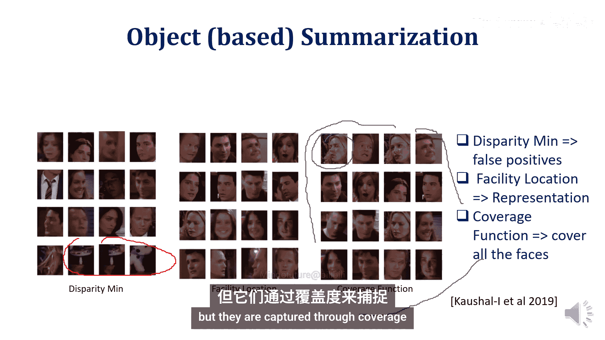

Coming to the next part。Imitte correction summarization。

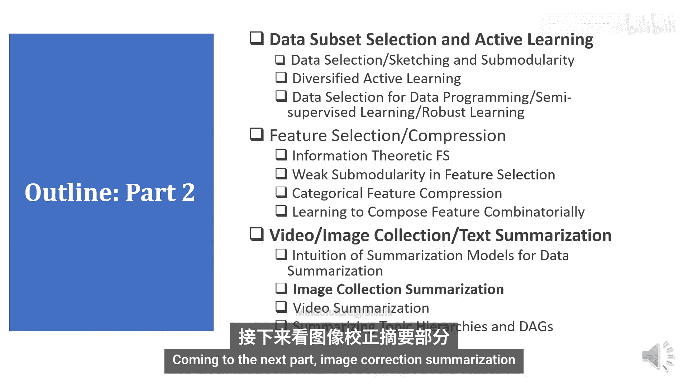

Yeah。The work got initiated by Siachk it all in 2014 the first。Image summarization data set with。

14 image collections，0 pictures each。And 400 human summaries for each image collection via Amazon Dot。

Amounting to around 5，500 summaries。The evaluation was based on Be ro。Based on。Features。

 image features。And another highlight of the work was to surrogate losses proposeds。

As a part of we Roach， base road of weroach。In their max margin loss。嗯。

The idea for optimization was that you have a bag of sub model functions capturing different aspects of the problem。

 This could be coverage function。Facility location。

Or feature based or such coverage based functions and also diversity functions。

 The idea is to learn mixtures of some of functions。Using max margin learning， that's exactly where。

The surrogate losses based on the evaluation of mero。嗯。Please start playing a role。

The present generalization of the image summarization。哦。That is。Privacy preserving。

And also query sensitive。We begin with privacy preserving。Companent。

It is basically defined as a conditional。嗯 yeah。The conditional gain。off。X given P， F of x given p。

Is basically F of。X union B minus F of P。 So this intuitive only measures how different。Is the B。

From the eggs。And this makes sense。For privacy preserving， because we really want。

The difference or the。The X summary to come out to be different from P and not reveal anything about privacy。

아 there。嗯。Function that one can define on any existing set function。

 including some model of functions is。That of mutual information。

Also called some more limited mutual information。So given x comma Q， say x and the query。

 the mutual information。Is defined as。F of。X。Last F。You。inus evolve。X union Q。So note that this。

 in contrast with。Have a fix given B。Which， which was basically F of x。Union B。Minus F。哦变。

So why privacy look for the difference。The mutual information。A based。Function of F。Look sad。

The similarity between x and Q。And therefore， it's natural to model the mutual coverage of share information。

Between the extracted summary and the query queue。诶。We can also。Gendralize。

Through this master optimization problem。Specified here on the right。I have x comma Q given B。

And this can help capture work equity and privacy。Now。

 how about optimizing what are the properties of these different functions？So。All these functions。

Are non negative and monotone in one argument with the other fixed。However。

 even if the function effects sub modelular。你。Qury based mutual information function。And。The。

Qury plus privacy。Basedest。Conditional some model mutual information function。

Are not necessarily some model。In one argument， even with the others fixed。However。

 it turns out that several instantiations actually turn out to be sub model。

 and that's very interesting。Which means that a simple greedy algorithm gives you1 minus one of the approximation guarantee for the master optimization problem。

So this is the unified modeling of the different flavors。 you just。S a。S and D。Two different values。

 for example， S， if is the entire universe and T is empty Then you get generic summarization。

Qually focused if SSQ and these is5hi privacy preserving。S is the entire universe。And D is。

The privacy preserving query。And update when S is universe。

 and let's say T is an existing set which you want to update。And the very interesting examples。

 PI of PI， we call this P IM。And a for parameter some combunral information measures。

And it turns out that this generalizes several。Existing functions。We also have。

Several parameters here。Which look at， for example， the trade of。Between。Coverage， diversity。

Representation， and so on。嗯。And this generalizes several past works， including Roj。

 which was referred to in the work of Siachk。

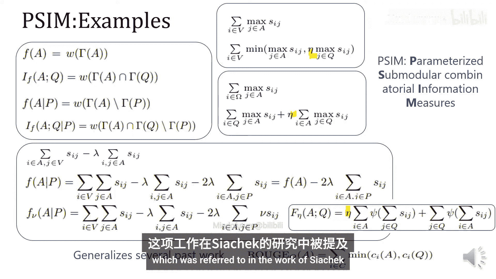

For example， if this was the image collection。And， let's see。The function F was。Goverage function。

With the query set being say。Flower and God。What would you expect。As a response。Well。

 since we are interested in covering flowers and cars。You would basically get。哦。

Peak the one example of。A flower and another example of garden and notly covering all flowers。

On the other hand， if you were only looking at diversity。You'll probably get one flower， one flower。

 and then one natural sea and also human。If you're looking out the relevance of flowers。

 you get all the flowers。If you were looking at irrevance。And you get diversity modo the person。

Because person is what the privacy preserving pivot was。Now， coming to video summarization。

Vdeamization， of course， brings and。A lot more complexity beyond images。I justt see him'm dying。

With video sumization， you have the additional advantage。Of some redundancy。嗯。So therefore。

 the approaches there have been significantly。系。Specific to videos and therefore somewhat different from what has been applied for imagemate summarization。

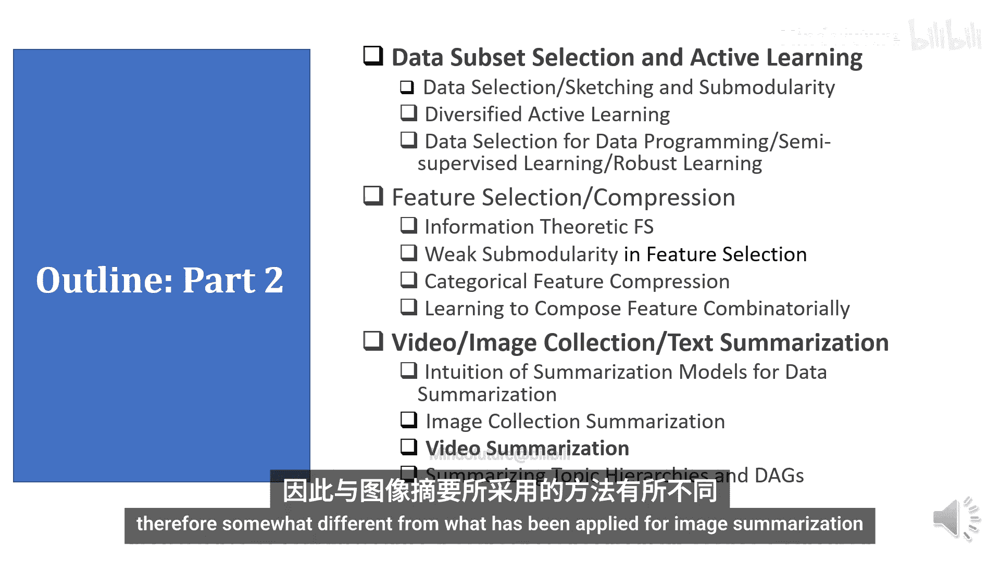

。One of the oldest data sets was by Gily Eal in 2015 with 2 25 videos and 390 grant truth summaries。

The challenge has been consistency。So you'll find that across users。

It's very hard to insist that different users create the same。

A groundro summary or nearly the same groundro summary by。Basically， consistently picking up。

The same set of frames。And that's generally been also a quality criterion， internallate consistency。

Very difficult to attain in， though。These are other data sets， TV some。Maybe some and so on。

The longest。Of them。In comeses of number of hours。Has been U egocentric， which is a very different。

Gre altogether when you have camera mounted on the person's head and then。

It's really capturing videos from the point of view of the person。Read the camera。So besides that。

Maybe some are probably the largest nine hours。With 260 videos。

 a duration of one to five minutes and average 2。5 minutes。

So the issues there are either too few videos or two short videos or videos only a one type。

 which is egocentric。So we present a new data set and a new paradigm。Which is visioity。

 which which has a significant。The large。Fooage， just 71 hours。With 67 videos。

With a duration of 14 to 121 minutes an average of 55 minutes。嗯。

The way the summies have been developed for this wide spectrum。嗯。

I based on continuity intent and diversity。And it's driven by rich annotation so that different flavors of summarization。

And other tasks are supported。So the summarization makes the process of video summarization。

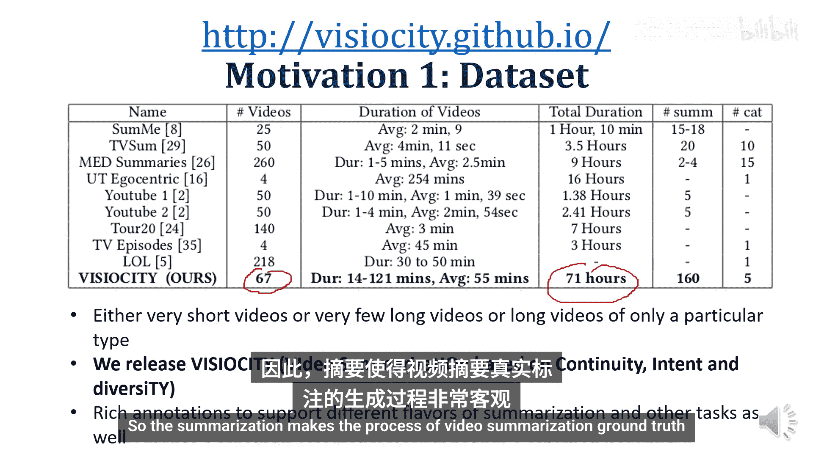

Gund through generation， very。Ojective。So this is the other motivation， no single right answer。

Is a characteristic of existing data sets a very context dependent。

 depend on purpose of its summaries required a bird summary。Will be very different from。

Sa a surveillance， somebody。Subjectivity， because two persons who are creating the ground truth may have very different preferences。

Let's say even watching a TV serial like friends， two summaries could be very different based on the。

Ls。And also， there is dependence on the high level semantics of the V， for example。

AVisually same and semantically different or a semantically different than visually same。好。

score score nearly a goal nearly scored versus。As a goal actually scored。 So usually。

 they could be very same。But sematictally mean very different。

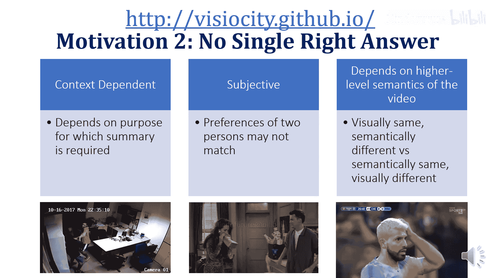

So again， highlighting the issue of consistency in human subm。

Well find a number of human summaries which basically agree on a particular segment is very difficult while this is attested by previous work。

 we also found this。嗯。So， for example。This here are two different snippets which are which have a agreement across。

Different annotators and now why do they agree well？

It turns out that they agree because there's some objective criterion they seem to be implicitly following which is。

That the gold scored。So why not go by？

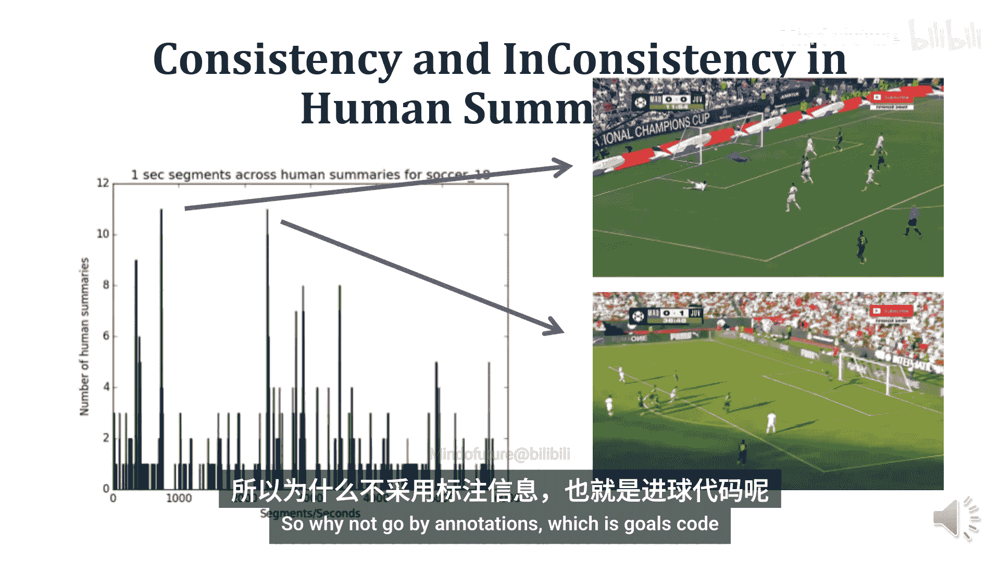

Annotations， which is gold。So to circumvent this problem of no single right answer。

Learn from a combined reference summary versus learning from separate reference summaries。What。We。

Went about is。Creating a recipe for creating a reference summaries of desired length having different characteristics using annotation information。

Its also very difficult to get summaries for long videos， whereas this this objective criterion。

Makes the process more seamless。And we can evaluate media summaries with a respect to reference summaries which have actually been created using objective criterion。

嗯。Or you could use the annotations themselves indirect ground truth。To evaluate video summaries。

 so we propose。A suite of measures that score a summary on different characteristics。

And we could learn from a combination of loss functions instead of a single loss function。

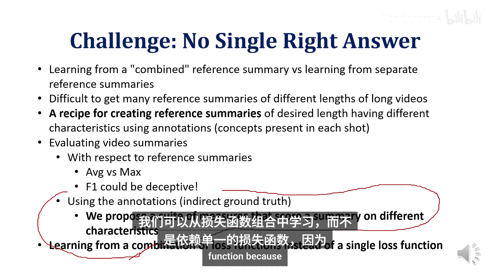

Because we have seat of measures to score sum。嗯。So we have67 long and diverse videos。6ix categories。

As I pointed out， each category can have very different flavor of summaries。

And the concept andnotations were very short。

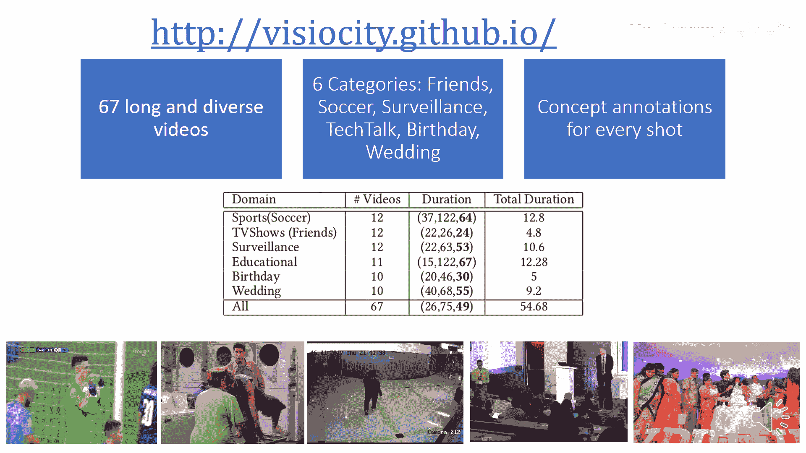

Here is what the annotations would look like。The concepts were re short， indirect ground truth。

There could also be megaV events which span multiple frames or segmentsigms。

And text andnots are better than scores or ratings because ratings and scores can associated be associated with text allnots。

 but not vice versa。 So we wanted the process to be asked。Less lo is possible。

As objective as possible， have no chronological bias。

C capturing a semantic content through word textex。From importance and also diversity perspective。

And obviously， we want to be able to address the right problems， which you mean。

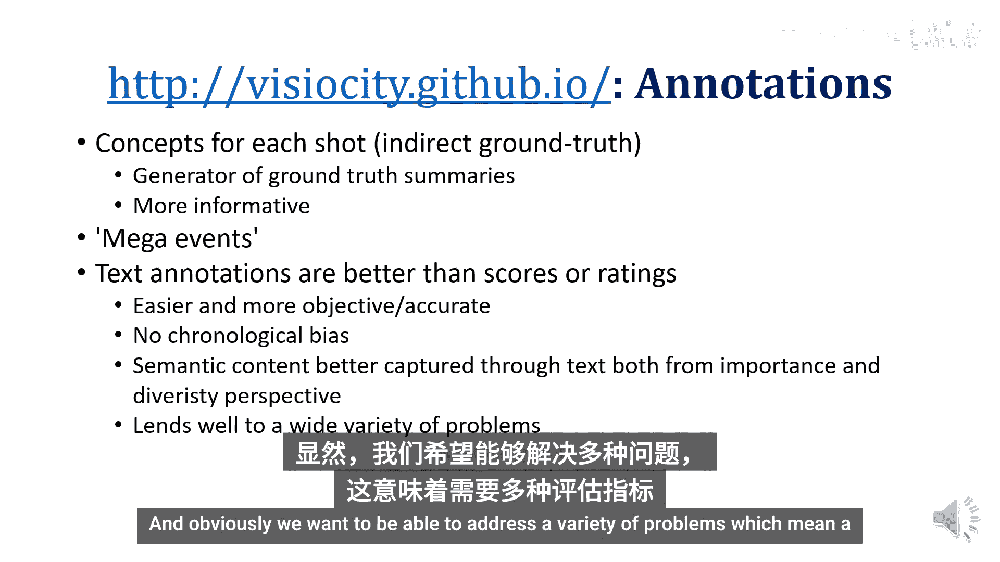

A variety of evaluation measures， this is our annotation tool。Where you could define keywords。

 identify keywords that exist in the shot。嗯。咩。And basically， as you populate the dictionary。

With new keywords， subsequent shots can avail of those。

 so the idea is to minimize redundancy you know using synonymous keywords of keyphrases。

The user can also mark mega events for multiples and effects， for example。

snippet could be a transition。

Or it could be a part of a mega event。嗯。Now， what are the approaches for learning？Well。

 whether it's visioity or whether you other data sets， once you have ground truth。

 you could use any of the existing state of the art。And gigly is one such work。

Where they visualize videos as segments or circles。A circle size is an interestingness estimate。

And where is a spatial proximity。Is a measure of similarity。

the idea is combined objective of interestingness and diversity。The notion of。

Interestingness is obviously modular。So therefore for the size of the circle。Is basically。

A model estimate。我呢个方程。Here are some more details， Interness is simple。

 some of the scores are the elements whereas representativeness。They used。

It cameme a right objective where you were minimizing distance of each segment。

 the video to the closest segment in the summary。And here's the。Sigegment in the summary X。

They also brought in a notion of temporal representativeness。

So that there is some smooth sales in the video。And that was a notion of uniformity。嗯。

As pointed earlier。嗯。Most of these previous dataset sets have had。嗯。

Groundro summaries of different durations。 And so therefore， when。

The combinations of these three components。Interestingness。

 representativeness and uniformity was computed。Or rather learned。诶。

On summary length of one minute to 20 seconds as against summary length of two minutes。

You find that the importance given to representativeness has increased。

And the importance to interestingness is degrees。Also。

 a little bit more focus on uniformity because you have longer summaries。

So this is where a bit of subjectivity does keep it。

There have been many other attempts at video summarization， which we will not get time to go into。嗯。

Basically， learning。DPPs， for example， media MMMR， which was maximum margin relevance。

 adaptation of an old ID applied originative majors。And also text。There's been。

Work on use of LSTMs along with DppP。 In fact， DP improvised。

With LSTMs be to get both sequential information as part of the summary。

As well as diversity that DPP is offered。嗯。😊，Some people have also looked at other notions such as visual repraing。

啊个 ahead。The story。Aaptive user context driven summarization。

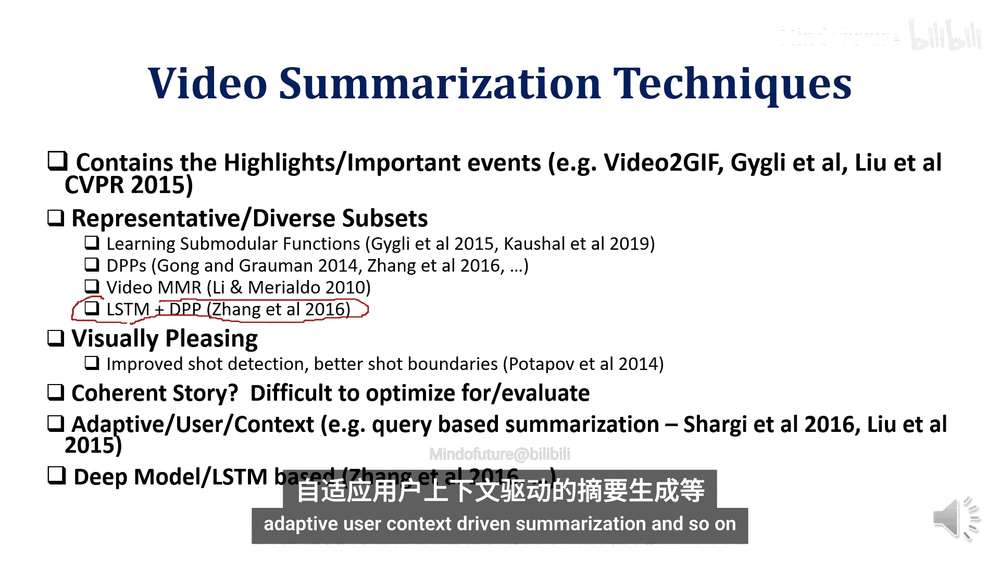

And so on。Now， what comes a good summary really depends also on the domain， for example。嗯。

You may be looking at diversity objects or people tracks as against representation。

Of faces and emotion actions or scenes。

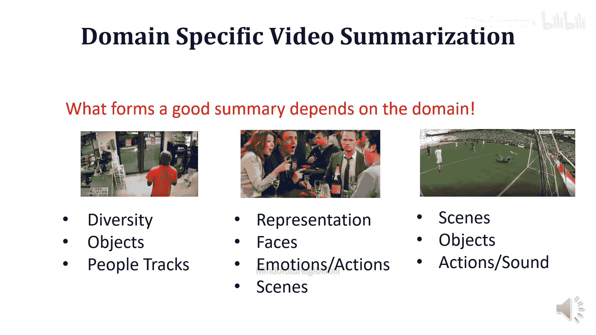

说。One might be interested in a mixture of diversity representation and coverage。嗯。

And here's a maxsmodgen。Framework that we proposed。A couple of years back。嗯。

Where we look at the margin。With respect to a whole bunch of loss， a whole bunch of。

So modelular function。And to evaluate video superization。We look at positive ratings。

Native ratings and redundancy。A loss function， which encourages the positive ratings。

 speedizes negative ratings。And saturates redundancy。

So here are some results on domain specific media summarization。We find deck。

If you were to basically。嗯。Look at the full the joint submodular and modeler。 It does better than。

For a particular domain。Learning the weight combinations does best。

 and it also helps when you learn mixture from the same domain then across domains。

So therefore it's useful to train if you want to evaluate on birthday， youd rather train on birthday。

So this is bird on bird。Entry exit on entry exit and so on。Another important takeaway is that。

Some of the top component features would intuitively correspond。To the corresponding domain。

 for example， for birthday。We find that。Object features like cake， etc cea。

Become interesting concept and object features。Whereas in surence， diversity becomes very important。

In the case of。Cricket， you would be interested in events。Now， also correlating the top components。

 so let's say。On the right hand side， we look at components with the highest individual score。

We're optimized。Ass against the left where you have looked at the top。Components based on。

Learned ways， and interestingly， we find that。Learning the mixture is a very liable way。

Of ensuring that you have right domain summaries， the right features trigger triggering for the domain summary。

There were other approaches for video summarization through online video summarization。

Spase dictionary learning。Long， short term memory。 We won't get into the details of these。

 This has just been provided。Summalization has。Also found applications in other domains。

 such as summarization of topic hierarchies。So let's say you have a hierarchy of topics。

From Wikipedia。And you're interested in a subset of topics。That cover。The documents。

 which are shown as leaves。Each of the intermediate nodes in this da。Covers a handful of documents。

 however。There's redundancy。 There's no point in selecting。Notds。M sub each other。

So you might want to select either。Some abstract node or some specific notes or a combination of the two。

 such that。You have maximization of coverage of the documents。 At the same time， you're able to。

Meet the budget constraint。That is。You have an upper bound on the number of elements that get selected from this da。

Now， this has been studied in several works at the past。

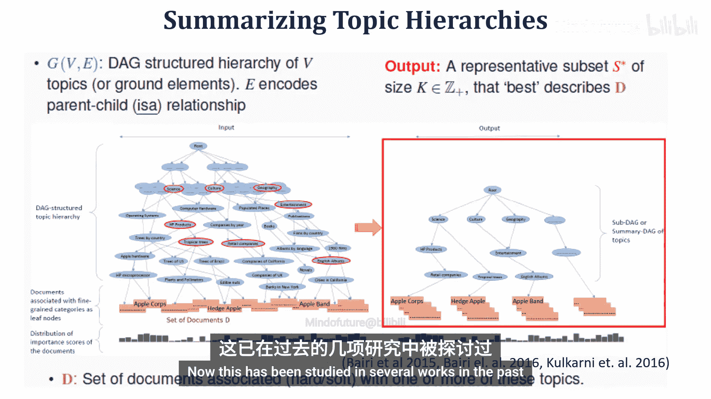

Here's a working example you're given a document collection。

And you have a knowledge graph you need to identify。A subset of concepts shown here in the form of。

A word cloud。From this large hierarchy or dad。And as a concrete use case， you might have。

150 technical documents，00 subjects under science tracks。

And how do you extract the subset of concepts。So here are statistics now with a knowledge graph like Wikipedia。

 this is Wiki 14， things have grown further。 and as you can see。

 the number of categories are in the tens of。Millions。However。

 when you run the large number of categories through the pipeline of a method that invoke subset selection。

Says that the subset is diverse， the subset has good coverage， and each node is of high quality。

You would find that you create and create this work cloud of 100 categories。

 the font size is proportional to the number of documents under that categories。

And we it a manual comparison out of top 20 categories 15 are in agreement with actual true categories。

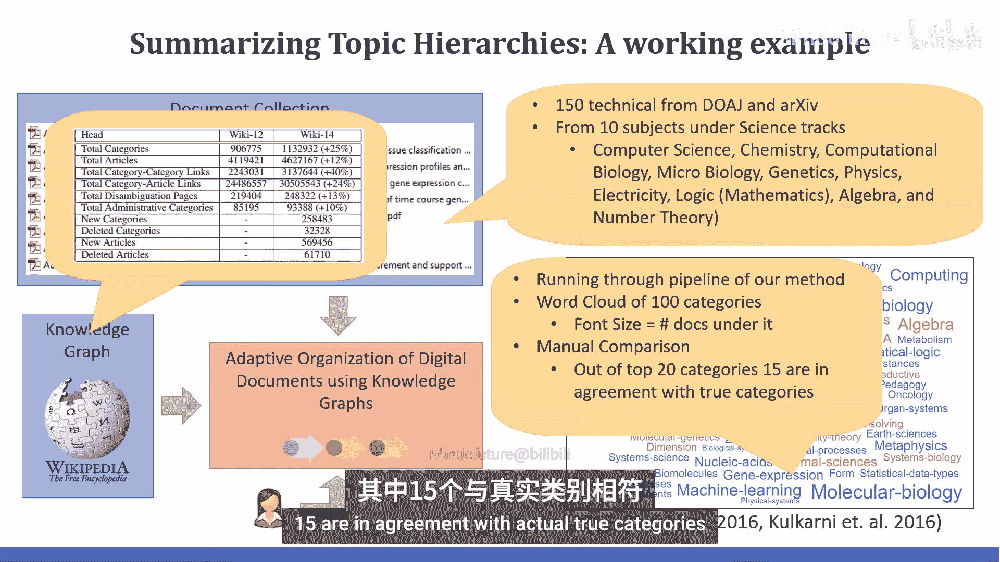

And what are the submodular functions Ex are coverage based。

 which help select categories with good coverage of leaves。You could also have specificity。

 the more specific a category， the more。You would like to select it。

You would like the categories to be relevant。And you like the categories to be very clear。

 All of these can be。Mododeed as modular functions。

Subsject selection has also been applied for other tasks such as pattern extraction。

 let's say in domain machine translation。Now， these patterns also form a directed acyclic graph。

Where you could have abstractions in the form of category 1 and category 2 and category 3。Now。

 what is the right level of abstraction of phrases？How should we interleave these abstractions。

 along with the actual lexical entities that are those are the words。Again。

 this is a search problem over a very large search space。

Nots of quality which is quality of individual patterns and quality of set of patterns both are required when it comes to quality of set of patterns。

 coverage， diversity and kinds of measures we have talked about some of them not being submodler for example。

 disparity become very important。

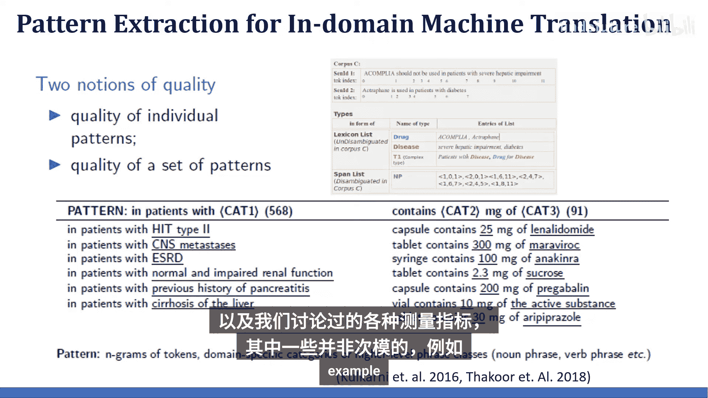

So here is a summary we talked about。Data subject selection and active learning。

And three different components there in feature selection and comparison。Again。

 information the mix of modularity and categorical feature compression。

 we concluded with learning to compose features comminarily。We talked also about。B。Advances in。

A very related area， which is some model minimization。Also。

 context relaxations that have found used in speech selection。And， finally。We。

Concluded with applications of。Subset selection and video image and text summarization。

Including summarization of topic hierarchies and daAs。

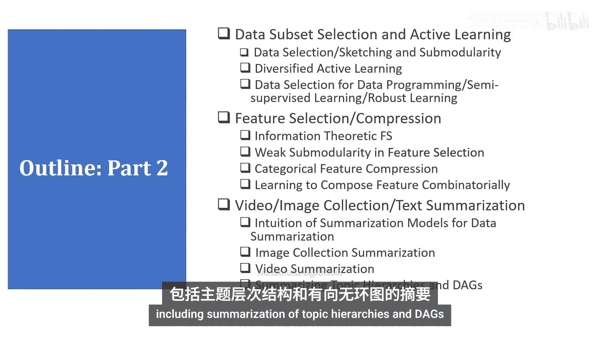

Thank you very much for your attention。

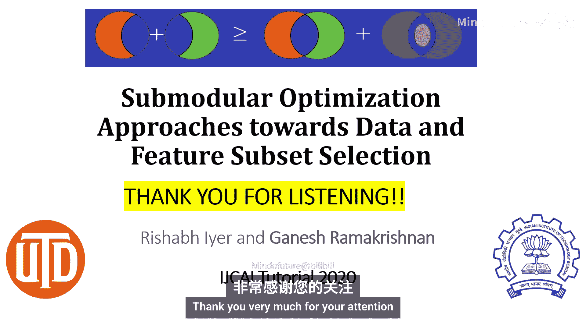

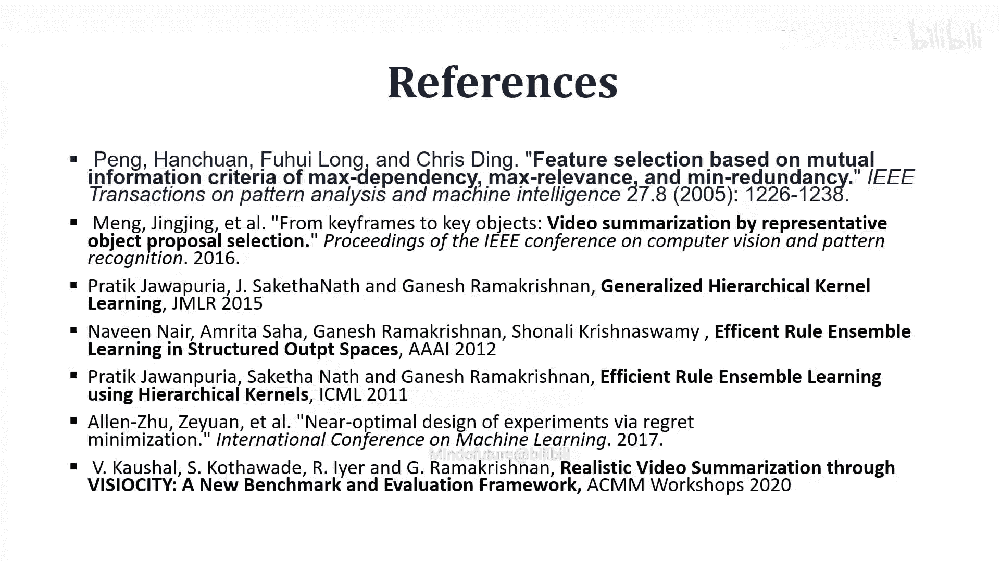