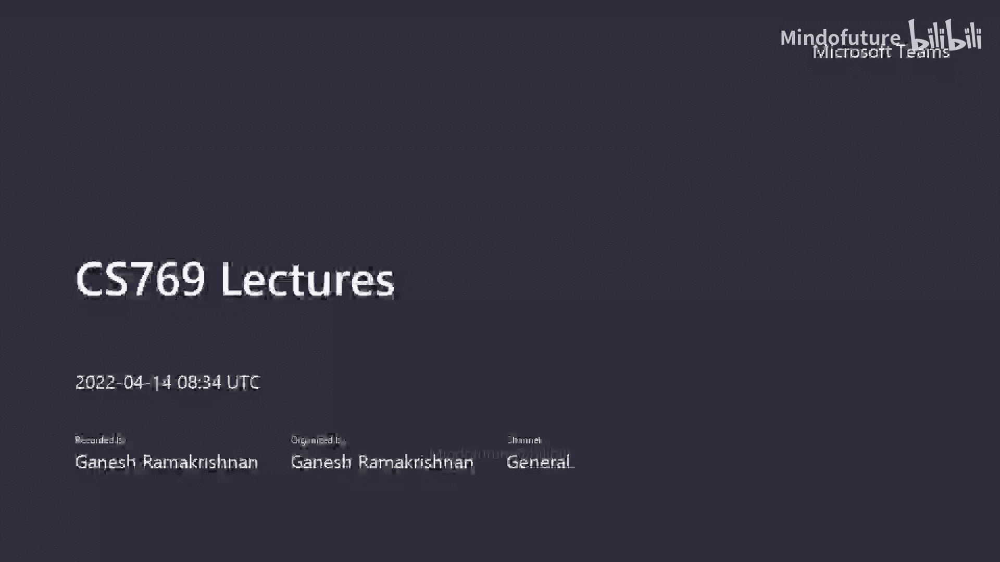
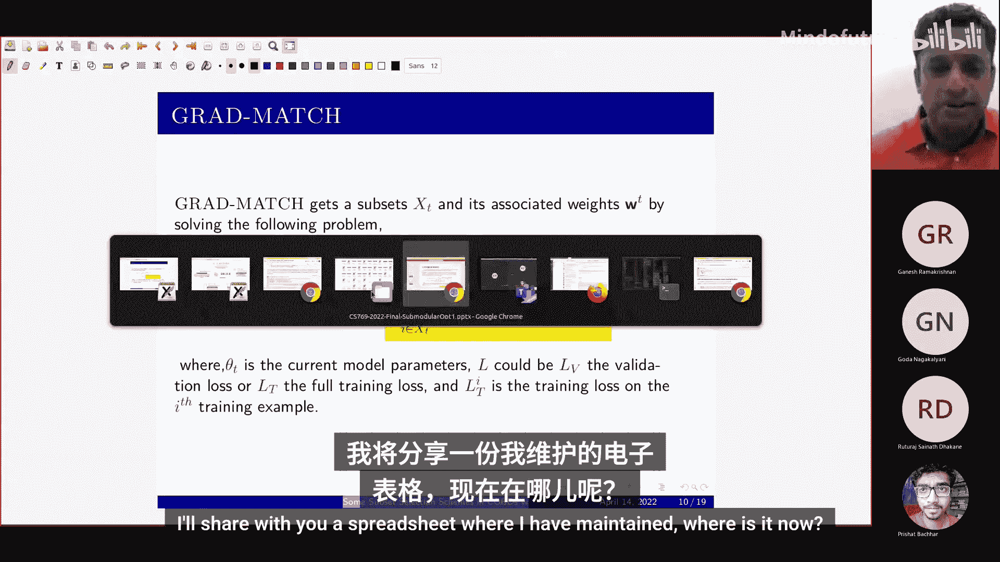
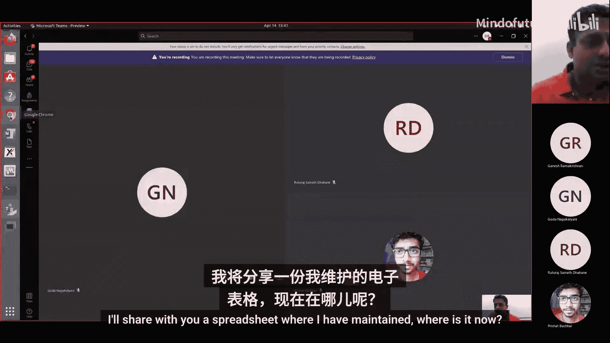
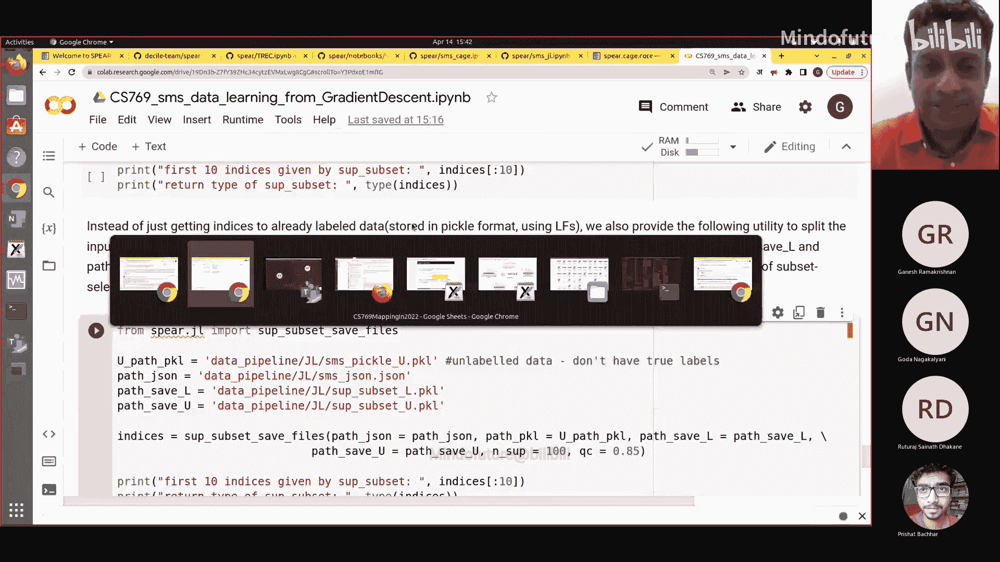
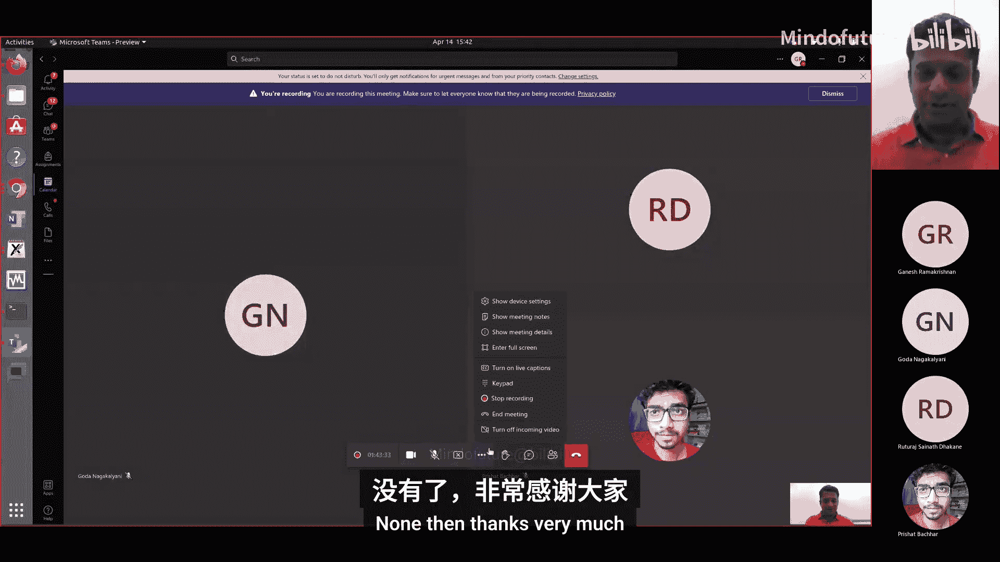

# 【印度理工学】机器学习优化 ｜ Cs 769 Optimization In Machine Learning p34 P34_第二十七讲_14-4_优化与机器学习_子模优化算法__Decile机构相关应用结束 -BV18cBSBJEH1_p34-

I'll be largely focusing on designor and its applications。嗯。Yes， well， a lot of it has a modularity。

系。So。Okay， yeah， so a lot of it will be of course leveraging some model functions。

But not necessarily completely。So理cap。That。Illustrated somewhat live with some tutorials in packet。

Aful。R to some of the children from groups and also have a kind of has a homework。嗯。啊 you个然做 this。

Is there any questions in here？For general， some modelular functions。

 some of the mutual information conditional gains them。Conditional gain mutual information。

 then there was also inmate summarization。The movie单。啊。This is the use case of trust I talked about。

😡，Which package is some of those target accepted selection。For example， you can have。

I just one active learning。The use case of active learning。Oh。Actually， yeah， active learning。

Is one use case， but for。Or plus。哦。So you have some night images， you probably kind of uptick。

AWe unlabeled data that's aligned。阿你象。Subsject of the。Un呢 data。With the target images？

If you then label。The ams。哦喺咁啊 i有 x个啲。Autograph woods。

This will give you the target subject which you label。

Pro also do this for performance based data selection。All you could use is for personalizing。

1 hundred。So there are multiple algorithm implemented within trust。哦。喂。I would no more。

The next one dispute。Okay， so I'll give a little bit more details on this。

It's data programming and subs selection， so how does subsets selection even come into play here。

Let's understand the big picture here。This is a setting again called the Po start setting where you don't have too much of label data。

Socap， I talked about this picture。系系嗰要唔食。I talked about this picture it， so you have a full start。

Using trust for also course start using scale some super data programming。

When you are very less labeled， they are no label。Okay so。Reduce labeling efforts using data program。

What are data， what is data programming you begin with say some labeling functions or rules。

For example， if tax sentence how。The question is a tight description the explain is how long it's a nu。

 simple， right but these rules conflict。Therefore， there's a need need。

For what is for label aggregation。Where you are sorting out or create creating consensus between conflicting labeling function。

Okay， so this is the idea here。It's not just one each of these， all of these create create consensus。

And this is very important， you know， especially when you are considering resource constrain machine learning setting where you can't have kind effort。

 the luxury of having all your data systems label。also is very aligned with the fact that when you ask humans to label。

You give them some annotator guidelines。All youre saying is if there is a scope for converting your annot guidelines。

😊，Into leveling functions and why not。Okay， so just， here's an example， another example。

Paak and Michelle visited Stanford University the doctor for a college visit。

 write a simple program that table plus one， the people in the example above are married minus one if they are not married and zero the programs I'm sure。

系， so often。啊。You provide annot guidelines。We be interviews。

be converted and these would be converted。点府。一边同事。Okay， so。We and these are basically。哦。Programs。

LF example between example at person example at person two and after example at person two and their daughter that were their daughter is there right that their daughter is there after example or person two。

 then return number one。Of course， now many those here to explain a lot more is a help code of the entire sphere platform。

Now you could apply these to unlabeled data。And。Create consensus phase annot createdated exam。

But obviously what you could also have is some label data and this is where we can talk about use of subject selection。

优或者。喊我师。哦，你边记咗。Which。Potentially， compliments。The the LFs on unlabeleded。Okay so that's a use case。

So label data is therefore you know we'll come to this little later。If there in dotted lines。

 it's optional。So we first begin with the rest。Oh。Ill give you examples for all of this we begin with this rest and here also we will talk about。

Some of these specific， for example。So we begin with this。

And then we'll bring in label sets subsequently。And we will also talk about how we intelligently subset the label set。

 what is that label set， why such a label set required why labeling function not sufficient。😡。

Okay so I mean this is a big problem definition I'm also hoping that some of you get inspired to tackle this big real real issue right the reality is you have Sunday distances I some maybe labels said。

😊，we hope to have， but often what you have is a large unlabeled data set。You。

 you may have labeled set， but you may be partially labeled or you may have none of them。😡。

But you have labelers， both human and machines possibly noisy and Android and you can think of them as having some parameters lambda so the idea is you won't even learn those parameters lambda。

And Taoj is like the response of labeler， Lambda J and trigger。So I just zero think of Jesus。

Outputs almost those living functions of programs。And I would say the realistic goal is expand the label data set。

 minimize minimize labeling cost and train， any land values。😊，They are attainable， right？

So this is you may have none， in fact， as I say。你唔系。系我你。Soir。嗯，因为。这定。其实啊。

Okay let's look at image labelings。You could have human labels。

 You could also have machine labels or you could have。Non ML based label。

You could probably just do template matching。I can have exemplars。

 I can have an example of a bond right here。Or example of bananas。So。Could be rules， elects。

Or exemplars。😡，诶啊。Would be。Object databases。一条六啱。That's how things use face solutions to function before deep learning。

😡，嗯。😊，And you can see that， these labelers would give different weightages in those 68 points rate clause。

In fact， these are very weak trained models， and you can see they're all over the place。 in fact。

 some labelers or some labeling functions。They are pretty precise。

 some of them are not right some of them gives scores， some of them don't give scores。😡，So。

 this is you。So so some of these might give folks。😡，Some living functions， right。今面。Sports。开始。

I mean the percentage of they are。Fs is not a big deal。Some others discrete。

 these are discrete living companies。😡，Okay， so we want to make sense of all of these across multiple images。

😡，Instances。Okay， all right so the first objective would be。Lveer reliability。

I mean you can see that these labourers have some complementary expertise， some living functions。

I seem to be doing well right here， Sler seems to be doing well here。

Whereas we are quite concerned about label altogether。It seems to be too。

Ex spreading itself so good thing， right？Legular P seems to be okay on this， but not very good here。

😡，For the first second object， So you want to kind of make overall sense。As I said。

 these would be human， but we'll talk about。Programs or these are like for us。

 these are going largely programs。W wrote the program。

Whether program itself is MLl model we concerned about for us there a black box。

Black box but consistent programs right so you don't have a random element。😡，Therefore。

 we can provide it。hos a performance。And。冇细。Okay， so the second is now our first objective is profiling the loop。

 right？😡，Second is， you're profiling what you want to do， you want to do。Collect your prediction。

You want to aggregate the label predictions of India labels who generate consolidated high confidence label predictions。

😊，For each instance so here we have kind of shown where you would like to be。

 you like to say okay it's a cloth not dogs right， like to say it's a second one， it's a banana。

 it's a fruit， it's not a vegetable。Right， so maybe there are other labels from other labelers as well。

And now going get to text you take more text and then dumb back to images later on。嗯。

So these are examples of livinging functions if some word in spouse stick is present between1 and E or then two words of each other return was one hence return zero。

You can actually design this， not very difficult at all。😡，And yeah， here lets you。

Design all of these。这。你好。Let's say that the labelers are the labeling functions。

So let's say you have lack of human label data。Human design labeling functions assigning noisy labels or instances。

Use is able to generate cable data， This is exactly the goal of data program。😊，啊。

So there's some existing platform at Stanford called Snoorrkel。诶 mean， for example。

It is it has one discrete problembabil graphical model where you look at the。

Lambda parameters associated with labeling functions。And living options。For a particular instance， I。

😡，Look at the output sorry， look at the output of the living functions for instance by。

And try and consolidate its labels into。This why。That's what it tries to do so if it coming direction is not important。

 but the idea is you go from the。Lbeling function outputs。Two， three desired me。

And what it does is it has shared parameters the agreement and disagreement of labeling forms。

就做个 order。Yes。So， as I said。诶。We begin with。The labels assigned by the labeling functions。Let cea。

 and living。So you had this Lambda one， I1 the lambda IN other。Label the sameberg labeling functions。

 two instance I。In some instance， I。So what it lets you do is says， okay。

 I going to have these P Theta parameters， theta is a parameter and associated probability distribution P Theta。

嗯。Where it's trying to。Maximize。Some join probability distribution through these potential functions。

 Ep by J。Pj is basically looking at。啲。Signal associated the strength of the signal associated。😡。

Or the value to be given the thats supposed to the value to be given to a signal associated。😡。

But with the eighth example for the jailde living。So if Lada Ij equals Kj。

 that holds it case Kj is a case labeled。Just个 label。indeed Lada IgSS Kj， then associate parameter。

 Gita J Y。Otherwise， make it paraid it doesn't agree。The5 day should be minus00。😡。

To think of this as the potential。Okay， so this is what snnorkel did， and that's like a base model。

到前出过。That's秘。But the bigger issue， which we delve into our 2030 paper is that it's very highly sensitive。

😊，Two initialization， number of its， learning grade， etc。其实。When you do some gradients right？好。so。

What youring disease。These are the issues。😡，啊哦小。sing。It gets all good using any creative scheme。

But even without iterative algorithm。These are issues。喂我 big us。Yeah。

 I can't get into the details here。 We can look at our paper， but。It turns out that you can just。

Pipty Association。Of the。Labeling functions like Cta parameters， and we just slipped there。😡，Okay。

 so this。So theta， you make it minus theta， this big plus theta。

And it turns out that the likelihoods can be maximized。😊，It's something silly like this。

Because it's unlabeled， you don't know what the ideas， right？😡，Okay， so that's one。

 And the second is。That it does not support continuous labeling functions。

 this basically requires lambda Ij equals Kg。So。This is just discrete margin。好啊。Sorry。Oh。Yes。哦。Yes。

So it can also wind is a labeling function can also abstain from。So this is zero otherwise。

 let me just highlight it so this basically says。G for you。你边同学。

Abstains or just it emergency emergency。Optstreams for you。行， so的一个 up去。Like human leaders will say。

 I don't know the mean。我你。Yeah， but ultimately we。Not just discrete or it does not support。😡。

Continuous leading。一。So then we speak we will broader one solution to those natural issue。

He says continuous and quality guided labeling so quality guiding。

Heres the issue I brought up at the top， right high sensitivity。So we say， well。

 we can do quality value。And we also brought in continuous。So there go。Can deal with deep learning。

 embeddings and so on。So given n labeling functions， which can be continuous or discrete。

 now we have slightly different model。The each s function Lambda G for a given instance X。

Outputs are label Lada Ij equals KjF figure。😊，As outputs0。 So in look， in some sense， it looks like。

The this one。But it can also。嗯。Have Laage has a continuous value load， so can also offer the score。

 which is what we wanted to continu as。😡，诶细姐嗰边知道。Okay， so therefore now all you see。

这实九位云就 basically先。If it that whether's triggered or not， right， this。

 this first part is saying whether it's triggered or not。And the second part is a sport。

It's anything thing night weather。啊。There's a school associated and a school association。

So obviously only many triggers will have a school。😡，A way the forward is meaning this。到六啲。

So let's look at continuous label functions， for example， you can say。Well。

 I have a particular dictionary between two words。😡，I mean even the amount entities。

Look at all the words between you need to。And look at an element of some digitalction we called the sp dictionary。

 let's say Im trying to identify whether x is a spous or by or not。😊。

I could look at the cosine similarity。Max value the cosine similarity across all。😡。

You那 all will be across all you那 all Lee。Of elements， you know。You coming from the spouse dictionary。

And they say we。Coming from words between the is women。

You could also look at others and then this is for a particular classes， is for a class plus one。😡。

告诉你。There are many others you can design like you can look at。Other dictionaries。

 changing dictionary， for example， sort of spouse dictionary， family dictionary。

 all you could look at the edit distance between。😊，You问你。So the seed set。

 what do you mean my seed set here， seed said may say。Barack and mission， right you can。一般那不同。We are。

Any sir。这个 see。And we is a mission。So then maybe the text in the in the text。

 you have something like。You was just by。Right， and me with my De Michigan。啱你输六百万俾。

So you could look at。There long distance。Of the entities from what the UND are sorry not Barak and Michel I I mean even need to。

好。We UN andB are already。We' distance。Sos start point assumptions and now what we do with these is interesting。

😡，So given that we have no continuous course。With an indicator continuous land graduate。

 it's continuous， you can also have discrete only， right。

Continueous languageage just indicating whether。I should consider this for SIG or not。

And then Tower I， which is basically， as I said。嗯。Indicating whether it Ta J is zero means that we create。

Or it it could trigger exactly for one of the labels。😡，So now we have slightly modified。

functionion啊 modified potential嘢。And what is this Zipine？Some explanation is in order here。

So here what we do is we kind of。Asssoociate the different I want to point out is you associating。

Each living function to a particular class。So therefore we say EXP of theta J1。

You're not letting it become negative。😡，so you can see the difference。Zi cannot become negative。

Elier allowing it to be done。They it do。废。😡，And that that actually the flipping issue was coming up right you just flip flip the detailss and the association and class levels and you will get them maximizing of likelihood。

 but he said well change it。So these cannot become negative。啊，呢个要。unlike the earlier fight。

So ESP of Tita JY， y is class J is the living function。But it only。即你边讲清嘅先。

Fire living with function doesn't be free。 It fires and fires me。 It must be for that loss。

That's important difference you made。The second we did was， what if you have？😡。

And so this is It waiting stick yet this was for。It is equal。So also this vehicle， not a continuous。

For continuous， also we made a change。😡，AndI'm going to just。I like， this is a continuous part。睇你政府。

So in the continuous part， the difference is that we assuming we are。

Using a parameterized data distribution。 So if you are familiar with data distribution。

From your basic ML course。It was a prior for。So吧nolly。ok。

So this is like you know whether the living function fires or not is a kind of a knowledge distribution。

 so now beta is like acting as a prior。😡，But even in beta， we have。啊阿花。A and Vita8。

Which basically correspond to a prior knowledge of how how confident we are that does living function。

😡，So you can bring in a f prior though your phone doesn't make a big difference。Otherwise。

The the prior associated， so to speak the fact that it will agree will basically。

It's an agreement of the labeling function to the true labeling。😡。

Alpha T is a kind of prior on the disagreement， so you see this。Let me。So Al D is a disagreement。

The segment of what is emitted by the。Gling function with what the true label we are trying to estimate right？

Alpha a， on the other hand， is an agreement， right。😡，Yes。And is one otherwise otherwise， again。

 as before is when the living function recrateates。😡，So that four itself is not。Useful。这 is so。

Otherwise。嗯我 eleven。He things。空见。Okay， and this gives you。For all， joint distribution。

 I mean the joint distribution we can also have the Z data and normal。This is oral picture here。

The route rules at 50 time。啊细接近细 by阿你。Okay， so I've given some more details here if you're interested。

家个。Alpha a is Q J C， pi JY， and we are parameters of the agreement distribution。

That's exactly what I said about。The parameters they further time this these parameters themselves are also kind of further。

Subparmetrics so Al Phi is，qj， subqj，it's a quality。 It's a quality associated。

The labeling function in terms of agreement， quality prior and this is a disagreement prior。

So I won't go too much details of these right so buy this particular choice， but think of these as。

The mean value associated with the labeling function firing correctly。

So that the sports are meaningful based on。The prior understanding。Okay。

 so is this is basically the probabilistic model。We'll use this。And theyre doctor。

You can just compare gauge model potential。It's always positive。😡，EXPG GYU。

It fires and move on if it bes。Whereas a historical model potential has this issue， right？哦。

So if you said so basically if you said k theta j commma plus 1 is minus of theta J minus on the K model。

 what would you expect？Dta J plus1 equals C J minus minus of Tta J minus1。The case model。

 what would happen？Soally。You're basically again maximum， that's exactly what I was trying to point。

这是隶术。This is later parameterization meaning constable solutions。

So basically you can still simplify cage model to the snorkel model if you couple how do you get the snorkel model from the cage model so you can recover if you want。

😡，So first is， if you couple the Utahtaj by parameters in5iG。😡，嗯。

So if you say that the theta J by parameters are coupled。😡，You don't let them so much for。激动。

Not including continuous election associated potentials。That again give you us normal model quoation。

 So here you see the J be rather than positive， but for positive and negative and each living function was associated with a particular class here you're like leaving it completely free。

😡，So you your time， I'm sorry I'm sorry， the other way。

 and I'm saying is your your time right These are being tired。

Tta J Y if Lada J is J minus theta JY if Lada J is not equal。

 So if you couple the theta JY parameters here on the left， you land up getting the snogle model。

And not including continuous L and the associated potentials， we'll also give a cultural model。😊。

Next we also shows this Q JT， which I talked about here。😡，Oh。Can talk about this QJD I。Thank。

I got what the huge needton is next。So quality good。

So the QJ C is also kind a quality guide sitting deep inside the prior。😡，But there's a more explicit。

But right， those are more explicit。A more explicit quality guide than PJC。那个拒求人都不认思。Okay。

 so I you just look at that one。Okay， so in addition to this likelihood。

 we have this very important component。This is actually a very important component。

 which brings stability。😡，嗯。One reason I gave you for the unsability of the unsupervised learning。😡。

Kage in sel。Is that the parameterization was really satisfactory。But the other reason。

On the other way is being stability。Is by adding this all？你说。Likelihood plus all。

What is this R saying， Okay R is basically saying that。

If I also you to prior about how accurate a level functions， say 90%， 80%。😡。

Or I might be able to say that a particular labeling function LF1 is more accurate than LF2。

 which is more accurate than LF3。😊，So then I can say that QJ。好租。关闭。Is rather thanequ you。估地你直里工资。

So you can sync。Acus。To largely honor the ordering concerns。Because if you're giving human rules。

 you might as well also tell which of them you are confident about。😡，And in practice。

 we found that know。Ex exact number on。The engineer。So this is the way of reflecting， so reflecting。

被告人。So so matchs the long joint distribution of Pta y of y and tauj。

With user provided quality guides。😡，纠结。This is something user to provide。😡。

And for continuous LS parameterized data distribution to combine quality guides and learning so there we saw this we already saw a role that UJC was played so that there also there's a role。

😊，Yeah and can empower programs to stabilize training via easy quality guides。😊。

We also look at other options， but I will not get into all of these right so sign Penel and rock parameters and all that you not discuss this。

😡，So。This is our view formulation。😡，What is， all the previous things remain as it this。But， no。Q。

 J T log of P theta y equals K J， given tauj equals K J。 Basically now。

 this is like the Kl divergence between。The user defined prior and the。M头。Simply that。

Dear dirgligence。这边。is it design diet。我都冇人知。You specifically know this。U竟。呢个个调姐出啊诶你个。

L of P theta p theta y equals kj and1 minus P should I agree with 1 minus。ok啊。Yeah。

 the rest I will not get into， I mean， how you can write down these expressions as detail。

So now this is your overall formulation。Theta R on the left hand side。And in the site and auto the I。

我不觉得每不要。呃，老好。And some of our prior works， we've also looked at other aspects。

 you how interlavel correlation。How you can do active learning sampling。So I'm skipping this。

 but this is like more more of。More on the label savingaving function characterization。

And this becomes useful， especially via multiple labels。😡，So not just one label。

 let's say you have label called spam。😡，And said nearly back。喂。So then the two are related， right？😡。

Or wisepan versus。Imates fun。 Yous say youre looking at YouTube videos。 because spam is in the voice。

 So somebody is。We have a good phrase， but the voice is always missing。哎So。

What on labeling functions and connections。With the multiple labels。我一般。你们。

Youre looking get the correction between names。And in fact， we also look at how we can。

Inded labeling functions。So not' just a program industry。

And I would say yes in very recently you had some people in。Can introduce。ok so嗯。

This is just what I'm talking about you know， robust C programming。嗯。You have each supervision？

Complement the。Living functions with Western teachers。Additionally， very few labeled dig instances。

 this is where we are going to。然后我那个。Laabbeling functions can be also have some instances examples which are available。

They talk about that。YeahAnd Ill give motivation to that。

And well try and know minimize more equations， we not have expressions to。

I'm just illustrating the same with unit example plus in even design。NLP rules。

 you can also have exemptemplar right so imagine you're trying to organize photos in an album。喂。😊。

And you can say， well， this is an exemplar。And you must have seen Google photo album tries to pick up related images and puts them under that right so same if my brother。

 all of these look like my brother。😡，As photo should also mentioned。

 the photoconed person name would be beginning， but then thereafter you could also generalize based on。

He made sibling。你说教育部。This is are exempt and based on which。You found maybe similar people。

But you can see that there are some incorrect examples here， iss an incorrect image。

 now we see that well it's not necessary， it's basically daily functions， even if you consolidate。

Sometimes it's I mean it it looks very difficult beyond our perception of conduct。

 beyond the image similarity to be able to determine。What this image is like。

 that's a brother image of whatever right。😡，So can labor data help？

Because it expands us the horizon of God giving consumption。😡，Okay， so that's what we provide in sp。

 So if we provide in sp。Not only the use of。AKage kind of， you know。Laabbel aggregation model。

But we also let you incorporate labeling theing so this cascaded approach which you see is where I take some labeling functions you could give some outputs y 1。

 y 2 y3。我估度位。And then I think the output antenna dis one， so the two are disjoint。

 the two are completely theres a great wall of China separating the。This。Agregate。诶，我我阿ly。

Aggregation。放 opo。Of labelbeling functionss。 you do that once。Like strain discriative。Ps。黄啲。

Agggregated levels。喂。😊，Whereas what we say is that， well， you don't have to do that。

 you can use your labeling functions。You can add some label data。Plus， labeled it。And that can be。

 that is what exactly we are having this joint approach。

If you don't train a model after labeling the people。😡，You use your livinging functions， right。

 you use some label data。And learn your model joint。ok。So this is are significant departure from。

Loly。Prole which you know， boost data programming。You just label the data and then use it here the joint approach。

😡，To significant。你报纸。I'm snorkel andre。Cascade approaches。They use label data。Aa join。你说是。

Lal data plus labeling functions。D。Okay， so 아무 just run new through。

I think this to make it more interesting。So let me just go through cage this is thing。

Cage is the previous one， which didn't have any label data。😡，So you can I just go back give you。忘记。到。

These so。This cascaded approach， I just want to give you an idea of what is cascaded approaches do？

So what they do is you can。That define an number of full labels。You define your precur。

 continuous scores， peer library functions。Some living function definitions are given so for this spam。

This the SMS spam， SMS， whether it is a spam or not， based on a bunch of keywords。

And he was treated as search patterns。Can also look at multiple keywords， the intersection。

All these are labeling functions， some of them most of them are continuous。

 few of them at the top pair district right。So you can see continuous ones。

They're looking at amount of similarity。What similarity between。What's。In the next hand。

 what's in addiction？Okay， so then you so far there's no level data， right？

So I accumulate all the labeling functions into rules。Now you apply these to data that's loaded。😡。

The why is used not saw。😡，The labels are used not for any training。

so I think this should be pointed out very clearly。This is largely to evaluate。😡，Okay。

 so now what have we done， we have imported the pre labelbels class and used to label data。

 so we are not used any label data we' are creating the label data。😡，Kind of。

Now this label data once' you create。😡，That's the left part， right that was the left。This far。

You've generated model， generated model， created。喺个同。Importantmport preload， sorry the。

And use it to label data。 So now the part one has ended now the part two， the second part。😡。

label data and now you can access the label data。To to train any disagree。

So you can fit and predict and you know that that's this is exactly where the the labels are getting used because now you're trying to come up with accuracy。

😡，🤧。Okay， so you'll get some accuracy numbers at here。It is missed the accuracy part。

So you can basically predict the accuracy final test accuracy。4。7。

You can also computer fun and whatever。So this is kids， this is what I should at the。😡。

But now let me give an ideas。The same MSMS is， you can do something called a joint loop。

The difference I point out。So pretty much large part of this state。

 we the same labeling function such as processor。😡，嗰个知度。But now you'll employ joint them。😡，激啊。

The joint learning还 comes here。嗯。Out of you know， completeness for completeness。

 we have also written how。The label data can be obtained。So yeah， you' would like join them。去。

And you do this between so now you see something new has come up， something called feature model。😡。

So far we only had the label function model the， but now suddenly a feature model has come What is a feature model。

 the feature model is for the model you're trying to learn。Right the end the morning。

Which case did not or the data programming general paradigm doesn't care for。

Okay so this this is the key and maybe I'll just take us screen shot of this this is important this is what it distinguishes。

If you could have neural network， you could have logistic regression。Any of these。哦。不行。没有。谢谢谢。我这不是么说。

Okay， this is the differential。Thejo learning。好教明。There are different shapes。The joint learning。

 great exercise。暂住咁样先。应该沟吗。Thishi is what I show you。ok ，如果啲系念。好。So here you can basically use。哦。

Any model。so this model， the joint layer model that you have the a model。This would be a new term。

This would be a neural network， this would be an LR。Which is being trained in conjunction。Okay， so。

These are some state of the art algorithms and some of these， which I said we do join learning。

So this does joint money。This is a joint that I talk about the difference。几咗。

So some of these we joined them in Vi。哦。This you can cascading。Okay， what is now the joint them。

 semi supervised data programming through join them？Letre try and understand that part。所1 you呃。

I'm trying to give you a 50，000 high description or getting into details， right？

The key features here are you have a feature model， which I showed you in that。

Tiger this feature model。不是吧。There's a feature model， do you。我家到。

Could be a neural network model or whatever。And then you have your typical labeling function model。

Which I've talked about that would be your cage just notable。😡。

And then k divergence you can measure between the feature model and the living function model。

 you can in fact measure different things between the feature model and living function model and that those different measures are listed here。

Okay， for example。The first one， what you're doing here？😡。

You're looking at how the teacher model agrees with the。Lieverty。This is the conventional， you know。

W is only to give annotation rate， this is a conventional。Supervised goals。

It there's nothing more of say you。The second component is work。It's saying well。

On the unlabeled data， how much is the entropy of the feature volume？诶。嗯。

This has been done in lots of unsupvised learning literature。😡。

So you don't want the future model to have people。You want to have some center certainty on the unbeled data。

The third component is saying， well， now just the third component is not it started bringing together a feature model in play。

😡，And the labeling function model and right in blue so。The store competencies。

If I were to look at the output of the labeling function model。

 the GL mentioned above is a label prediction from the graphical model so this。😡。

Imagine that you bring。The G here。Tomographical model how？

What the label is like and then look at the feature models prediction on the unlabeled so agreement。

On the discrete。哦布。What is crized。Output of elect model。你 the。You generally。On the unlabeled data。

Does makes sense？Only data。 how are they， no you're looking at all kinds of consensus。

 not just consensus of living。Consensus with the feature function on label。

 unlabeled on right to on label。 Now you'll also see data coming。

The fifth component for the fourth component is looking at。

How the labeling functions perform on the label data。

 that's something data programming doesn't care for in general。

 so data programming is only creating the label data。But we are saying that， no， no， you may want。

To use that。Aable data to also calibrate your living functions。Given that you have Lib。

 you didn't have it some other thing， right？😡，租。啊你。So basically， measuring。包括。And lives。好大的。我拜我。

Influenency。哦。哦， sleep。Infencing。嗯， he lives。呢想你边。Well， that's only one problem。I mean。

 all of can even plug and play， and choose some of them， drop some of them as well。😡。

The fifth component is how these seeta perform among the unbeled data。 This is the conventional。

 This is what we have been using so far in the。Data programming literature。 This is the conventional。

Data programming， objective。So in data programming object in data programming。

 you don't have access to your。😡，Label data at all， and there's no feature board。

So this is all they will do。Is this making senses？哎呀这事情都百不理分。嗯，就应那个就别了多。

And then the second last component is looking at the KL divergence。😡。

The between the distributions of the feature model and the distribution of the。有边咁信号。

On combination of unlabeled and labelbeled data。哦。Probabilistic agreement， it's like a probabilistic。

Agreement of elect and teacher。What is on label。系空机会。这种。

That's a second last component and the last component。Is what I spent some time on early。😡。

This last component is B。I mean， the quality guide for data boom， which I。

I said it has been very effective。The QJs which can tell you how good one label function as for one。

其说个是诶。This is assuming you have the label data already， right？

Is this a big picture here you any questions here？Okay， so I bring an interesting perspective next。

I say， well， all this is fine， but who gives you the label data and that's exactly where success selection can go。

😡，I think this needs a lot more exploration as someese has been exploring it further， right。

 I think this needs serious attention。 how do you get that label data。

I give one a motivation to identify that the label data if you just choose it blindly it might be relevantundren you can choose a randomly random random by the way it's a very good very difficult baseline but we if you have experienced it in many areas random is not that easy baseline it's a formidable baseline。

😡，But that doesn't mean you don' not try to beat it because you know。

 when you look at large data sets， even random may not be good。😡，So。嗯。

So you want to intelligently select the label data。😡，I'm just giving you kind of， you know。

One more example。Imagine that you have this photo algorithm。

 So you were confused about whether two images are the same or not。😡。

Imagine going to the user and asking oh are these the two same one。😡。

Why because the labeling function， the exemplars have failed， they're confused。😡。

So this would be such a nice feature I and Google algorithmms as provisions， but。

Can we actually improve on the models， same different not sure。

So this is the key proactive data subset selection。

 selected subset should complement and not subse the labeling functions。

I would say compliment and maybe to some extent supplement， but not subs。

 you don't want you to sub right you don't want it to be redundant with respect specific to the labeling information。

😡，So this， I think can lead a lot of investigation。I mean， you can， for example。

 go back and do privacy preserving。😡，You can see my just labeling function。Is my what I as he？我这。嗯。

That means， I want。I want examples label data。That is automatic Max。What the conditional gain。off。

Amental what。The data to be。I say label data， I mean data to be label。我哋都 be。

Agmatic work for the Thanksgiving given。The label functions。Something like this。

Or some proxy for the label。😡，So this is one way of doing it。😡，But you may say that know。

 I don't want them to be totally disjoed。 I mean， they should have some agreement because if you look at。

😡，This objective here。We also looking at agreement。

Why are we looking at agreement if they want to be you want the labeling function and label data to be totally complement？

So some agreement is also equal。😡，要按中 you。Some， a good moon。已经。LF signals。

 labeling function signals and。Fature signals。我的呢个女。So therefore this kind of motivates。

Also to look at， you know。The mutual information， I。Could I look at I X trauma。

The labeling functions。喂。😊，So that's where I can say that IF may probably in practice。

 you may need a combination。😡，Canas leaving this foot for in practice。

 you might actually need the mutual information of X for。Some LF。Based on some I mean。

 these are all proxies right so you can think of this as proxy or kphs。

And then other proxy of LF conditioning the condition。I don't。

 I'm just leaving Jesus food for thought。I'm going to give like one motivate last motivating example。

😡，Imagine you have these labeling functions11 as developed。你啊 kind know。

You have these examples as one as two， S three as。😡。

Labeling functions one and two are for two different plus labeling function one。Its for stand， right？

This read if STTP or STTP is in coming takes a return plus one， otherwise。A说是的。

Whereas LF2 is for non spa。关速观看。If length of comment is less than five。😡，W than written minus1 else。

as always absolutely。喂。嗯。So。Let's carefully observe what's happening here。On these two examples。

For S1， which has two label plus one。😡，LF one， what does it say， it says what？

Labing function one saves it is。That。The label function to abstracts。Whi you are okay。

 so there's no conflict。这还没有。😡，It's like in some sense， maybe reinforcing altogether would be a scam。

On the other hand， the second case is S2 living function one。It abss。And living function two。

 it says oh， it's minus1， it is not a one。😡，Again， there is agreement， right？So overallal。

 there's an agreement between these。😡，But looks， let's look at S3 example is3 and is4 in the green。

 right？😡，So here you can see that， you know， now there's a conflict here。

Gabing function one says oh0， I astate。😡，你边方心。Two age options。

this is a problem right now how what what should you do label both of them have seen whereas an S。

It's the other way around， right？You're basically saying， oh。

 labeling function one for as far as says， oh， it's a spa。And this says it's not as spec。

There's a conflict。But these would be the examples that you should identify to be labeled by the human。

That's what I've put in three， can we do sub selection， choose label data using conditional ruless？😡。

Is this motivation here？ok。So this way help you generalize the test now you about the action features also if you look at the features on the other hand。

😡，Features F1 F2， I mean， these are very indicative of。The right classes has in school。

Teacher one seems to be triggering for span and teacher two seems for triggering for non span。

And that seems to be very much in their like， so feature space would benefit。😡，系租得你会。谢些年对。没什么。

But however， what I want to still point out is， even if you don't do all that intelligent success selection。

😡，Even if you do some random subs selection run superi subs selection， superi subs selection。

 these are not MICG functions not。M I CG， but simple submod。十是。

Or you random with these two better than random， obviously。😡。

And what we find most importantly is that if you use these for sub selection， you do better。

Then a whole bunch of handp scheme for subset selection。These are hand pickedked。And you rather use。

something of。Intelligence sub selection。Gs just hand picking， in fact。

 hand picking can sometimes do worse given that runup such a selection。

I'm not getting details of what is unsupervised supervised， you can read the data。

 but give you a flavor。😡，Of white it sophisticatedistic Michaels。三个机。

Your your English should pick up research list from you。I know we are kind of running out of time。

 so maybe I'll I'm going to summarize that living。Very briefly。

Cds is all sets in data sub selection now we are motivated this is a warm start setting。

 these were cold starts so this warm starts。😡，There you lots of data， label data already。

 right imagine。😡，That you have诶 you already。还有感谢。Lots of label data。Even in such a setting。

 there would be a case success election。😡，For efficient training。For robust training。😡。

So these are the trained robust models， reduce end training time from days to hours and hours to minutes。

There are a whole bunch of approaches for and so on。

 I'm going to just give you some flavor of how you could tackle this problem。So cards， by the way。

 before I go to cards， I just want to show you the one more thing， right？Yeah。

 I just wanted to show you this。Well I不 forgot to show this。

The same co notebook I had given you earlier。 You remember this。Oh。SMS spam。

 I've given you this very good when you did that logistic loss。

You remember all the RO conditions I ran you through all of that。

So in the same notebook at the bottom， you'll also find how sub selection can complement。

OkaySo the stick you would do。There is gradient particular gradient descent， a couple of others。

 proximal gradient descent is also there。哦。我有人。So。哦。

So all proximal and all of these are also put in here in proximal derivativeism。😡。

I probably forward to show you this earlier。So you can run through all of this。

What I was also shown here is how you could imagine that for the same as time reader say。

If I use labeling functions。How I could use semisvise them。这边是外协带。It saying the brief process。

 the continuous scroll is vary functions so again all that has been integrated into the same notebook。

And you can basically check the joint learning algorithm can compare its performance to this is compared。

yeah， you can go over this。 You can see how the join running。Pform in the respect to people。想么。Yeah。

 I think it just I clicked on that wrong， but yeah you know it。Okay，So I'll go with this one。

Find this to the school。对。This kind of this old notebook probably is like a。哦。

One stop不 shop for all of you。这不过我就行。我哋觉得做。Pas anybody a discussion。So God is this you know。

And the goal is also very much motivated by conventional discussion on support recognition。

So you know that support vector machines， not all the points contribute to determining a classifier。

 so can we determine that subset of points for efficient learning？我如果是。

For maybe efficient hyperparmetricmeter optimization or efficient network architecture search。😊。

someing that some some believe。Can that be done So yes。

 that's exactly what college this investigates and a lot of。系的。大け就是 you。

Here is a use case of efficient robust， supervised learning。

Some years is learning hyper a parameter unit， network architecture。

The idea is you don't need the entire， sub should be good it。

So you have a whole bunch of 알고 implemented。嗯。생활을 바로 바로올 수 있는지요。

So I'm going to say these Craigs is on side but。Llistister， grab nutss。

TheRe is actually common groups cellcom， and this are some of the older papers。

So let's give you a flavor of one such。😡，Thank you。Prob me in fact。

 I have very detailed slide on convergence in case you are fascinated with the earlier performance analysis。

喺个 show them呢 last。So let's start with list。Tide the enlistlister is that。

You have a training law like。😡，Which is evaluated on the entire training data set。

But can we identify a subset of you？😡，It is relevant based on a validation set。Can we identify？

A subset of the entire training。谁如我。My favoriteing。On a validation。Certain to me。

Can the bee tell you what subject of U would give the same effect as you。诶。😊，Oh。

And how do we do that， so here's the idea。😡，So instead of having Teta star aax on you。

 what if you did a Teta star agonax on a subset？😡，Can we say that this is a say？

And we say that this Teta star is as effective as Teta double star just agon match。玻知道。我诶你啲而家讲啊心湿食。

as subible。And here I'm seeing this is where。The validation lens comes in。

Can the validation lens help you。Its so validation means。And。That validation log likelihood。

 that validation lens is the validation log likelihood。I'll combine them in the next slide。

 but this is what I'm trying to see the validation links to give you the S such the entire it。😡。

Is this。我哋个先听。We want the subjectness of use that the resulting more on performances list。Now。

 you have to again keep this in mind that the subset selection algorithm needs to be passed。😡。

So make the success selection a bottleline。感觉说量都会。And of course， you know。

 you like to bask in the theoretical guarantees of such a selection algorithm。

So this is the problem setting， how do we assess the I data efficient and robust learning？

Select a subset that maximizes the validation work likelihood of the model trained on the data subset。

Okay， so this what I showed in the highlighting in a blue view。

I'm going to just use the same color coding。I'm saying that the lens that we wanted on the validation set is these arguments outside lens。

I want a a subset of U or the training set with a particular cardinality。

Suchs that the likelihood on the validation is maximized。

When you use the parameter theta from the inner loop in the inner optimization problem loop。

Learn on the subject。Tta is earnedt on subid S when that theta leads to maximization of validation。😡。

I mean， this also is exciting and interesting because you're not limiting the use of validation to some。

 you know， a fall loop on hyperparmeters， right sometimes。😡。

We also wonder why validation is being used for ineffective right。

Py gun validation itself be more tightly squeezed into optimization。😡，It is going to be one way。

 one view。So， of course， you know， in a validation， you could also use the full training set。😡。

Vidation gives you a generalization。Is this pictureia？我 then来呃。The details are maybe I mean。

 youll be glance for them， but the this thick picture is important。

This is a big picture of bilel optimization but you can find lots of bilel optimization in fact。

 you recall your medicine， you had a bile optimization， right。😡，That variable optimization。

 you remember the was it discrete， did you have any discrete optimization there or were both inner and out optimization continues？

😊，你听吗。😊，做我得定嘅。For when both continues， there was Lada in both cases right there was Lada and there was a set of parameters Cta。

我再跟进你。They were both their rooms。Can go back and。ok稣。Here we have， of course。

 inner optimization as sent and the out there is discrete。😡，This is discrete。

And the inner oneness continues。Okay， so now I'm going to go to go this a little fast。

 so what happened is it happens is if in optimization。😡。

Is this is what be really optional I'm not going to over the details。

 but if they either are if it's if it turns out to be you know either。内ベ内ベ classifiedifier。

Or if it turns out to be nearest neighbor under certain assumptions。

It can be solved in closed form and it really an overall。Outer optimization problem， which is sub。😡。

So outdoorer optimization in the India is N base， the outdoor optimization for data sub selection。

Becomes a feature based function。And we have talked about feature based functions basically coverage function。

😡，Some么六。Or if if you have a nearest stable classifier as the inner optimization or the inner optimization。

 the outside out round becomes a facility location， which is mono sub model， right？😊，ok。

So this has been dealt with as early as in 2015。TheIn optimization problem in otherwise is going to be difficult in general you do not have eyepes and nearest neighbor being used all this。

😡，So if you have a more complex optimization problem which are to solve and then you're going to do subject selection。

 it's just going to be。😡，Un unmanageable right。So and it can also defeat the purpose of selecting a subset for fasting。

 what's the point of。😡，So one thing you can do is one one step meta approximation what you do is the inner optimization。

 you say， okay， I won't use the exact objective I'll an I'll do this approximation。

I'll said this to be Theta， the previous it is theta plus the gradient though。On the subject。

So I don't do a full optimization， right？😡，So that's exactly what we have substituted here inside。

It is on my approximation， so now instead of saying having an inner optimization。

 I just did have gradient。😡，按直即讲掂。That making sense。Enthusia broxs。So in a in our。

Minimization is gone。😡，But。What is the advantage？😡，Does this him？Okay。

 so it turns out that the validation log likelihood is now negative logistic loss。😡。

Which is moreistic， right？N getative squared loss。😡，Kingjios。You can have any results。

Degative percent pro loss in all these cases。It becomes a carddinity constraintsstrain。

 a model maximization body， so now this is giving you something。😡，It。诶。

I'll give you some slides where you can look at these additional tools。😊。

And it turns out that if you have a negative cross enthtropy loss。😡。

Then you have something called weak submder。😡，So this I'm going to just quickly。

It's been what is weak or？I didn't want to just present weeks of learning without a motivation。

 this one of motivation。😡，What is weak someone？But otherwise， it's a。

What is weak subor in fact there are two notions there's a notion of weak submoder and there's a notion of pseudo subor。

😡，And so。This is weak someone on the right hand side。And a subset of it。

I'll explain how it's a sub coming， it's a subject， the subject is called pseudo someone。😡。

There'slects。So the difference is that in the function is pseudo subm。

If the incremental gain of adding。bunchun of elements key from gate， you have a set game。😡。

And A is disjoined from B。我送你边。So let's say there's a B here。And then there is an A already provided。

So for and B consists of lots of elements， E is a canical element from me。😡。

For some over all the elements E given a。😡，Is greater than equal to some gamma times the function B function。

On entire S given it， So all know what is condition again， like who all conditional。啊。

Weeks of modularity says no， weeks of modularity。I won't look at。Just inequality on gamma。

 I'll relax it， so this are relaxation。Moment as say relaxation， what would you expect？

What would be a subset award。 So you' are saying it's a min of gamma F Ep given in。

 which was already here， right， We already had that function on the right hand side。

So this function comes up with you。打翻 f b二零零。开始。Comma 1 by gamma fb given the mean these two because we are not put any con on whether gamma should be less than one or greater than one。

😡，Yes。So。You think week similar will be general or more specific and so？😡。

I just take final over this。😡，What do you think will be involved generally？点婚。😊，吓。😮。

We will be more yeah。So this may not be true， right？Exactly， in fact， this is you have gamma weekly。

Hand par weekly is in fact more gentle than some model， if more gentle than pseudo sub model。

The place where pseudosmodular and weak and somemodular be intersect。It's basically modelular comes。

If a model， if an only gama is red well not。就说咱赶那现在干嘛干走题。哦。If it's a modeler， you only come with。

All this is is optional slides， but just to give you a bigger picture。😡。

For non some modular functions gama is between0 and 1。

If is monoton then pseudo basically becomes leaky， that's also an interesting connection。😡。

Especly when youre non monitor functions， so V is a mod definition。😊，That makes more sense。

 a more general gamma。😡，喺边啲。还再说。This is a big bigAnd then what happens if you have a degree algorithm applied here？

😡，So the greedy algorithm， you can apply to monon functions。

 the greedy algorithm at E 1 minus e is to minus gamma approximation or gama B3 or even sos sub mono。

And for nonmon them is it's basically gamma era is minus one by the。Okay。

 so I just want to compute this one one interesting use case。 So now we have already found that by。

By simplifying the in optimization， right？We have done well。

 but even that is not good enough because we want to do the inference。😡，LLV on this。

 you have to do this for every element E in S in order account singular to do this。Conditional gain。

 conditional gain of LLD of E given as。Can be expensive。Oh， there's a problem with。 Can you hear me。

This can be expensive。So there's one more step approximation that you can do。我就是。

I'll do what tailor he is across。😡，Okay， so LLV Teta is not of Teta plus some argument is LLV Cta。

Which is kind of more stationary， right， the theta is sub previous box theta。😡，Plus， a dot product。

Measuring the alignment of the gradient on the subset with the gradient on the validation。😊。

It's very interesting。系啊 I know系。All brilliant。Element of reading that's good clearing validation and trainings and crs。

 the subset and the validation in。😊，This is done in each form of the mutation of the greedy algorithm。

😡，But this is interesting because now because of this very important approximation。😡。

You don't have to do multiple forward passes。😡，The LT can be used as it is。😡，我在别。

You guys have to take a new element， look at the doctor， new doctor。😡，Forer。Each。

Anyment that you are。just measure。The updated document。Okay。

So that is probably the most interesting thing and the reason I brought this up is the lots of measure lots of functions you try and do。

Our time operator gradients。Looking at gradient alignmentment。

 in fact get a follow worker of ask called Gr match has being a previous piece of work called gray。

 which actually looks at gradients。😊，So gradientin themselves are very interesting。

 This is overall idea。 you you do success selection， you find new set of parameters again。

You do DSSS data sub selection and then you find new set of parameters you alternate to be used。😡。

But without getting into too many details this if this I just want to conclude to this important point。

That even in terms of theory。You get order one or Epsilon square across of1。 you remember wrong。

analysis。 So you can show that。Opika algorithm convert optimizer can water1 by Excel。

And the interesting another interesting point that comes in the result is this。

In the endorsement cors。The mint over the validation loss and the optimal loss。

I super bounded by something that evolve again this blood product。

 the same blood product I showed in the previous。Yeah。What product of the gradient and the subset。

I have very detailed slides on these， how I can post them as optional reading。And。

I I kind of highlighted in yellow， these slides。At least the algorithm is there and you know assume the validation subset training now satisfied equation that this dot product is greater than equal zero do product comes up in one multiple places。

😊，So I'm just highlighted that。The convergence group is all provided here。I'll share this with you。

And this LED us to the next next model。 right where you say， okay， you can measure problem like。

 you also measure the。The difference between the two grade， the do product is highest when aligned。😊。

The difference is also 0。You trying to minimize the difference of the gradients。跟啲落嚟。

So this is another paradigm you measuring the difference between the buildingss。😊。

That gives us the gra match I。But interestingly， you know。

 this gives you 3 x straight up with no loss in accuracy。😡。

It just maybe and if you want some loss in accuracy， you're okay like 1，2%。

 then you can get 10x feet up。AndWe have shown and results given for Ibarmeter community。

And you can also issue show results for robustness。7 x2 if I x7 x speed。

 when you're trying to the robot because validation data set gives you robustness。

 but also gives this speed because of the success selections。

I'm not going to go into any further details。 so please do do look at odds and dist dist still is that。

Divers by interactive learning。And again， you know this this is this can。

This featureses whole bunch of algorithms。A lot of them is the whole idea and again。

 interactive learning is you don't。😡，Select one point at a time， but you select a subset of points。

I think there's a lot to be done at the intersection of data programming， interactive learning。

 right？And。And that's the reason I'm quite excited about presenting to so think of you know。

 future research problems project if you want to let that unfold in this direction。😡。

Or any kind of follow up research you want to work on for papers？又冇人艺信。

I think this interactive learning is interesting because you're not again looking at selecting up individual points at a time。

😡，And it this still also introduces many。D augmentation to me so that the generalization for is good。

And there are several state of the art algorithms that have been noted。

So data augmentation would basically mean， you know， I flip re make images， right？哦，从呢 ask。

Is the active learning doing the same thing that data augmentation would do。

 you don't want data augmentation。To be earnly done the active learning active learning should add the additional value。

 that's why we added the data augment and we in fact。

 found that a lot of the so called benefits previous active learning records celebrate they get unknownone when you do data augment。

That's that's the reason at one point It and you know， we've shown how gllistster， for example。

 you can do pseudo， you can identify hypothesized labels or pseudo label。on十四。我都睇得啦都。

Yeah I'm not getting into this。The thing is we have been very benefited by use of these techniques and multiple applications。

 including OCR and so on， a part of the video analytics work。

 we actually were benefited from the use of interactive sub selection。😊，So。Yeah。

 I think we have too many slides， but these applications。

 this kind of has conclude the applications front， right？😊，嗯。Yeah， I to end with this picture。

 I so you're welcome to。Contribut to use different aspects of someone。We can please stop here。

You can I mean， I'll share with you a spreadsheet。

We have maintained。

嗯。So where we have maintained。行行。So， cards。Also， there are very nice notebooks。诶过拉门 books。

Likewise for assembly supervision and hyperparmed un。

 I'll share all of these with you we can try out data in compute efficient learning。都看。

Interesting to see hyperpar tuning work， especially how you get 10x speed out。

So I'll share these with you and then the distill part， again。

 very nice notebooks that you could make use of。I'll share his notebook with you We to mode they are of course there on the design page。

Yes。Any last question on of coming？

你我个歌。Londonondon， thanks。

