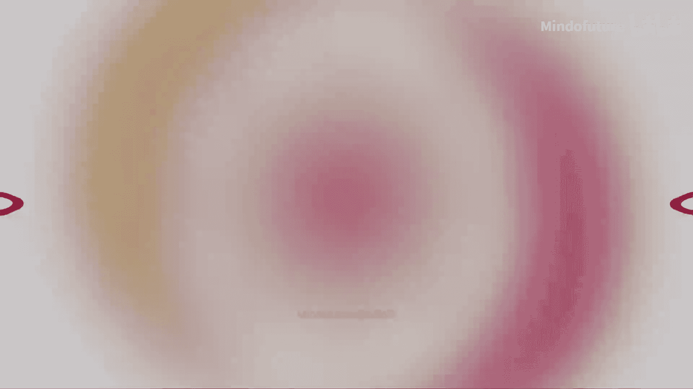
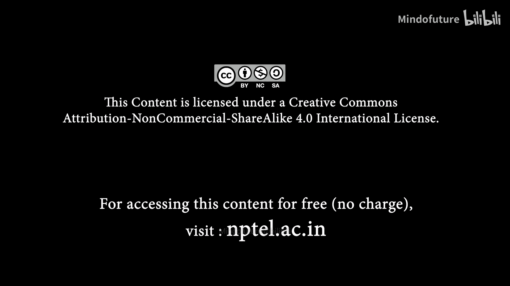
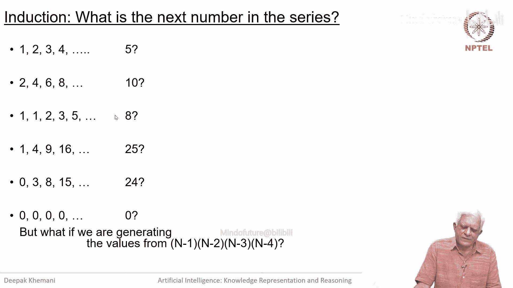

# 【印度理工学院】知识表示与推理 ｜ Knowledge Representation And Reasoning p01 P01_1.1-引言 -BV1c4zNBmEyF_p1-

So welcome to this course on knowledge representation and reasoning。As you can see from the title。

It is a kind of a subtitle for artificial intelligence。But I would say。

That if you want to build intelligent agents。Then knowledge， representation and reasoning。

Is the essential core of such an agent？If an agent doesn not know what is the environment that it is operating in？

And if the agent cannot make inferences。About what it knows。

Then you would hardly call it intelligent。So we'll begin with our overview of。

Representation and reasoning。Before getting on to the details， maybe after a few。Lectures。

 essentially。So what we will cover now is the introduction we start with。More of influencing。

And then move to representation a little bit later and then carry on from there as we dive deeper into the course。

So， I want to begin this with a quote。😊，From a fictional character。嗯。From literature。

From a person who's considered。My many need to be。One of the most intelligent people。In fiction。

And the code talk talks about knowing something that we know something and we can reduceduce something。

Because that is going to be the crux of our course， you know， what is the reductions that we can do。

With what we already know。So， here' is a quote first， I will let you know the name in a moment。

Some of you will recognize it from the quote itself。You will not apply my precept。

 he said he is a person shaking his head， how often have I said to you？

That when you have eliminated the impossible。Whatever remains， however improbable， must be the truth。

Then he says。We know that he did not come through the door。The window or the chimney。

We also know that he could not have been concealed in the room as there is no concealment possible。

When， then did he come so clearly。They are talking about some person who should not have been there。

And the character we are talking about is Sherlock Holmes。From this novel called the sine of 4。

 the author is Arthur Conan Doyle。The book as you will see， as you will notice， was written in 1890。

So much before， all of us were born。But already。In popular。Minset， this。Act of making inferences。

 making reductions， especially in the in the cases of you know detective stories was very much there essentially。

So， we are of course interested in building intelligent agents。And by intelligent agents。

 by now I think the accepted definition of an agent is that it is a program which is persistent。

 which means it persists all the time that it is not like you run a piece of code and then it does something for you。

It's autonomous， in the sense。That when it is executing， it is taking its own decisions。

It's proactive。That it it sets upon what is the goals that it wants to achieve， of course。

 as a user you might give it some high level goals。But at a operational level。

 it decides the goals for itself。And in that sense， it is also goal directed。So。

One of the most well known agent。Software that was implemented by NASA this was many years ago was called RA 1 remote agent 1。

And what the whole idea was that you give it some goals， send it into space。

And then they wanted to they demonstrated that it could not take decisions autonomously that even if。

It ran into some problems or falls or something it could detect the falls and you know get around them in some way if there is redundancy built into the system and so on。

But the basic idea of intelligent agents is that they are autonomous， they are persistent。

 which means that they exist。As long as they are alive， like all of us。

They are proactive in the sense that they decide what is the next course of action to be done and they have goals to achieve essentially。

Now。An intelligent agent in a world carries a model of the world in its head。So we do it。Naturally。

 that it doesn't come as a。Something that requires effort to us because we are always aware。

Of what is the situation we are in So， for example I am sitting here in front of the camera recording this video。

 so I am aware of my surroundings I am aware of everything I am aware of the machine in front of me。

So。That is of necessity for any agent to be intelligent that you should be able to model the world that you are existing in or your domain if you want to be more specific。

In your head， essentially。The model may be an abstraction， you can never。

Represent the real world as it is as somebody has said that if you if you represented the real world in the same level of detail。

😊，Simulations would require the same amount of time as it does in the real world essentially。

So of course， whenever we create models of things， we always do abstractions essentially。

Now our self aware agent。If an agent is to be intelligent one presumes it must be self aware。

 it will model itself in the model that it carries in its side essentially。

So this diagram that I am showing you is from a book which I wrote about eight years ago。

Called the first course in artificial intelligence。And so here we are， this gray area is the。

World in which the agent。Exist。This human head like figure is the agent。

Inside the head of the human head like figure is an abstraction of the。Well， as you can see。

 the abstraction is not。Does not reflect the world accurately， but it as long as it does us。

Useful purpose abstracttractions are good enough essentially， and we are saying。

That the model of the world in its head。Should contain a model of itself if it is to be self away。

So when you talk about knowing things。There are several ways of。

In which one can know something and lot of people including philosophers and psychologists have studied this。

So lets just try to an some of the ways in which we we know that something is true essentially。

The first thing is empirically， so empiricism involves acquiring knowledge through observation and experience。

😊，So you see something。And you know that it's there。 So I see。

An apple tree in the mountain mountains。And then I know that there is I am looking at an apple tree。

 essentially。In fact， there's a whole school of philosophy which says that。

If you can see if if you want to believe that it is there， you must be able to see that it is there。

So， seeing is believing as some people say， but in this modern world as you must be aware one has to be careful about what was what one sees。

 especially if it is enough。😊，Screen of some sort on your mobile phone or on your laptop or on your desktop。

 because a video that you may be seeing may not be。The truth， you know。

 you must have heard about deep， fake videos。So， another way of knowing is the scientific method is the process of systematically collecting and evaluating evidence to test ideas and answer questions essentially。

😊，So if somebody gives you some some some statement about you know， that lets say it is very cold in。

In Manalli， for example， Manalli in India。Then one way of doing that would be to you know do a scientific test you would just go there and test it and see that it is really cool so the scientific method basically involves doing experiments to answer questions whether something is true or not and physics is full of that essentially so they always keep doing experiments too。

Vify that something is2 or not。So Galileo， for example， famously supposed to have dropped。

Something from the leaning tower of Pisa， a feather and a stone to kind of try to show that they fall at the same pace or something like that。

Intuition， all of us rely a lot on intuition。Intuition simply says I feel that this is the case I feel that it is going to rain today I feel that I will miss my train or something like that and things like that intuition tells you something essentially somehow it tells obviously we have a large subconscious mind and things keep churning there and maybe some conclusions pop out and then we say we have an intuition of this so rather than examining the facts and using rational thought intuition involves believing what feels what one feels to be true。

😊，Authority。Accepting ideas because some authority figures say that。That they are true essentially。

 so of course。A large section of mankind believes in some kind of a religious authority and if they tell them something then they are willing to believe that。

But more。Sikeingly。You must have encountered children about three or four or five or six years old and you ask them how do you know this and they will tell you my teacher told me all my mother told me。

So， that is a knowing something because somebody in a position of authority has told you and obviously you must be able to trust that authority。

Lastly， the thing that we are interested in is rationalism。

It involves using logic and reasoning to acquire new knowledge essentially that if you know certain things。

 what else can you claim to know？So you can see that some of these ideas I've got from this website。

And you can go and have。At this。So， when we say reasoning so this course is title knowledge representation and reasoning。

 we largely mean making inferences essentially and by making inference we mean that if an agent knows something。

By whatever means that we have seen that you know， you can see it or somebody has told you that this is true and that kind of stuff。

And what else can the agent know so that internal process which the agent does。About。

Generating new information into your head or at least making information which is implicit as explicit is called inferluencing。

So， our course will focus to a large extent on。Making influences。

There are three type of inference that you can talk about。The first is called deduction。

From a given set of facts infer another fact that is necessarily true essentially so this necessarily as we will see is the important is a defining feature of deduction。

And then you are moving from cause to effect， essentially。If you go in the reverse direction。

 if you go from effect to cause then we would say that you are doing abduction and it has been shown that abduction is not always a valid form of reasoning and therefore we can say that what you are doing in abduction is possibly true。

So， example of deduction would be that if you know that you have， let us say a certain disease。

Then you can infer that you will show those symptoms that necessarily follows because there is a causal connection between disease and the symptoms that occur because of that。

What we do in the world most of the time is go in the other direction that we look at the symptoms and then we infer the disease now that may not necessarily always be true。

😊，And， but it's possibly true， essentially。 And that is why if you go to。A doctor to， you know。

 consult。Her for your ailment she might ask you to go and do some tests you narrate the symptoms the doctor asks you a few questions and then says go and do this test essentially。

The reason is because symptoms don't necessarily。Don not necessarily indicate what the disease is of course they give you a good idea sometimes you can be pretty sure but not every time。

The third form of inference is induction that from a given set of facts infer a new fact。

Also known as generalization so recognizing that the number of entities in the domain share some common property。

And then assert that as a general statement essentially so you look at a few examples。

And then you make a generalization from there。So， here is a。Here is something that might happen。

You might look at。Your are surroundings and you may say that the people leaf is green。

 the Tamain leaf is green， the name leaf is green， the mango leaf is green。

 and then of course you may arrive at a conclusion that all leaves are green so this process of moving from a set of examples to a general conclusion is called induction。

Now， the election。Here is another quote from Arthur Conan Doyle， he says。呃。His is collective。

 which is shouldlock whom says。That beyond the obvious fact that he has at some time done manual labor。

That he takes snuff。That he is a free missionson， that he has been to in China。

And that he has done a considerable amount of writing lately I can deduce nothing else。

 so the key word here is deduce essentially social locoms of course is。

If you have read some of his stories， you would know that he is kind of famous for making these deductions and arriving at conclusions which are not obvious to other people。

Another quote to Sherlock Holmes here crime is common， Shelock Holmes is a detective。

 so his stories are mostly to do with detect detection after the crime。He says crime is common。

 logic is there。Therefore， it is upon the logic。Rather than upon the crime that you should dwell essentially。

 you must be able to。Connect together the dots that the different events are showing essentially。

 and that。Connecting the dots together。Can is the process of influence that we are interested in。Now。

 as I said， abduction is not always sound。If not always valid。

So here is an example also from Chlockcomb St。嗯。We will look at a few examples from shallow homess before we move on to。

The main part of the course。So， this is a inspector as you can imagine in such stories the inspectors are not as smart as the detective otherwise。

The detectives would not be so famous。So， the inspector is saying that the man might have died in a fit。

But then the jewels are missing essentially and then he says a， I have a theory。😊。

These flashes come upon me at times。What do you think of these homes？Shorter was。

On his own confession with his brother last night。The brother died in a fit。

On which shelter walked off the treasure， how was that。

The inspector is trying to imagine what must have happened so of course you cannot deduce what must have happened you can only kind of guess what must have happened and these kind of guesses are often called as abduction essentially。

Of course， in this case。😊，His cases got some flaws as Holmes reveals to him in a moment。

As to on which his home says the dead man very considerately caught up and locked the door on the inside。

 So obviously that is not possible。 So what。What。The inspector is guessing as to what might have happened。

Homemes shows that that is not consistent so abduction is always just a starting point of making an inference。

 but after that you must verify it in some form to make to kind of validate that this is indeed what is happened and that is what doctors do all the time in a sense that they they come to a conclusion that okay you must be having this particular disease but then they ask you to go and get a test done so that the conclusion is validated。

There is another interesting form of logic that we will look at towards the end of the course only。

And that is called epistemic logic。Epismic logic。Logics deal with multi agent systems。 And nowadays。

 you know， you want to develop multi agent systems。

 So you want to develop an army of robots which are doing things or man machine teams which are doing things。

 So they should be able to reason about what the other。Team member knows or does essentially。So。

 epistem logic。An epistemmic logic allows us to present statements about what an agent knows。

 about what other agents knows。So， for example， you might say。That Lina knows。That我觉得。

Has gone to the book show。 Orna knows， the Suita knows。That's acious coming。

These kind of statements can be captured in logics， which are called epistemic logic。

There are also something very similar close to epimic logic called those projects which talk about belief instead of knowledge essentially now。

Knowledge and belief are closely related。When we say knowledge in terms of logic we mean sentences which are necessarily true which are true in the word beliefs may about false statements so you know there was a time when everybody on the earth believed that the earth is fl essentially now that was a belief essentially。

So people may carry beliefs essentially。So here's Shelock home again。Hmes again， he says。

It is my business to know what other people do not know essentially。So。

 he is aware that the reduction that he is making。Are not being made by other people。

Then he also says that what you do in this world is a matter of no consequence。The question is。

 what can you make people believe you have done essentially？So。

 here is an example of induction that everybody encounters at some point。

You are given a series of numbers and you also to predict what is the next number so here are some pretty simple looking examples。

So what comes after one，2， three，4？Almost everyone would say five。What comes after 2，4，6，8？

Then it must be 10 because we are talking of maybe even numbers。What comes after 1，1，2，3，5？So。

 maybe we are talking about the Fibonacci numbers here， so then the next one would be 80。

What about this one，1，4，9，16 then。So， it looks like we are talking about squares essentially of numbers。

 so maybe the next one is 25。This one is a little bit trickier。😊，0，38。

15 what should be the next number So if you look at this and the series above that you can see that it is one less than the number in the series above then so maybe a n square minus1 that we are talking about so the next number should be 25。

What should be the next number if I give you four zeros， what should be the few number？Well。

 you would not be blamed if you said the fifth number should be 0， but it is possible。

That we were generating the values from this polynomial。

 which is n minus1 into n minus2 into n minus3 into n minus4。Then of course， it wont be0。

So induction has its pitfalls。We will come back and continue with this discussion in the next video。

