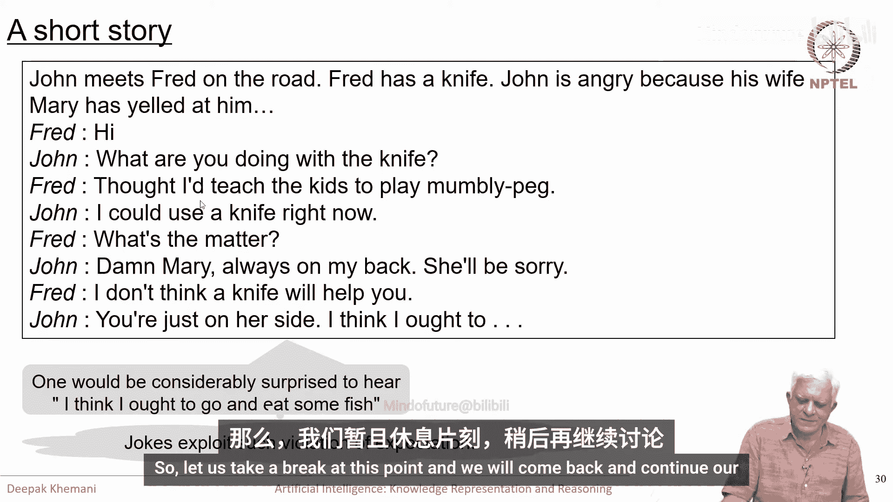

# 【印度理工学院】知识表示与推理 ｜ Knowledge Representation And Reasoning p02 P02_1.2-溯因推理与预期 -BV1c4zNBmEyF_p2-

。Wele back。We have been talking about agents and knowledge and reasoning。Making inferences。

So here's an example which， again， illustrates the kind of thing。1 has to do。

 So imagine that you are a striker。For a football team and you are running towards the opponent goal。

With the ball。So， your team is shown in blue here and opponent team is shown in red here。

So we are running forward with the ball。And as you can see， other players are closing in towards you。

One defender and one goalkeeper is also coming towards you and in this situation。

You have to make decisions。So。That is what we are talking about that autonomous agents。

In some world some domain has a goal to achieve so when you say a goal to achieve we mean an objective not so much as a goal in football。

And a set of actions to choose from to strive for this goal essentially。 So an agent has to you know。

 be very aware of what's happening。 It must have a representation of。Its domain in its head。

 it must have representation of what other agents are doing and it must have。Access to。

What are the strategies and plans that people use in this situation？

And based on all that you take a decision。So what would you do？Would。Possibly。

Hit the ball not towards a goal， but to a different region。

Where your teammate is heading towards and that your teammate may have。

A better chance at scing their goal。So， if this were to happen， then you know。

 one would definitely say that。The player is intelligent essentially。

But you make a lot of abstructive inferences when you are doing that。

If you are running with a ball in a football game， you must be aware of where the other players are so thats a。

Case for modeling the domain in which you are operating。

And what they intend to do so you must be able to make inferences of what other players。

Are likely to do an intention。Can be。Guested if you know what are the standard ways in people Act。

 what are the standard plans that people use in different situations if you are aware of that and if you see some action which is part of that plan then you can make an inference of what their intention is or what their goal is if you want to say。

This inference of intention comes from background knowledge you must be knowing you should know。

 for example， you know what do people do in football games。

 that's why you know games have coaches and they keep studying the moves of opposing teams and they keep making strategies and plans and。

So on， essentially。This kind of knowledge that the player uses on the field comes from training。

You should be able to imagine that if you kick the ball to where your teammate should be running to。

Then he would have a better shot at the goal。This ability to imagine。Is a key。

Aspect of intelligent behavior， you cannot imagine。You cannot think of intelligent agents。

Which cannot imagine。What will happen if they do certain actions essentially so to be able to do that of course they must have access to a lot of knowledge as to what is the domain they are operating in and what are the possibilities of actions that they have and what would be the consequences of those actions and also in multiageent games like football what the other players might be。

Doing essentially。So， the opponents no doubt are thinking about that too。

Why is that opposing team player running towards the spot。Because。She has also figured out。

That you have an intention of passing the ball to your teammate。And。

She would like to block that essentially so making inferences inference is a basic cognitive act for intelligent minds essentially。

We are all the time making inferences， some of them may be true， some of them may not be true。

 but all the time we have flight of fancy flights of imagination。嗯。And you know。

 making sense of what we are seeing by infiling other things essentially。So。

 in this recently published book called the Myth of artificialificial Intelligence。

 the author Eric Lason says that most of the inferences that we make as humans are abductive in nature。

Because most of the time we are confronted with some situation。And we have background knowledge。

And then we make inferences essentially。Abstruction is like guesswork essentially that okay。

 this is what could be the reason。😊，For whatever you are seeing， some action or event or whatever。So。

 abduction is guesswork based on what we know about the world and some people。

Make more informed guesses than others essentially。

 So maybe people like Sherlock Holmes make better guesses。And so。No。

Whenever we are making inferences， we are talking about expectations， essentially。

Abducttive inferences generate expectations that you expect to see。

Something so if you see dark clouds。Then you expect that it might rain essentially。

So on a football field， for example。😊，You may make inferences about what is a goalkeeperper expected to do。

 what about your teammate？What are the opponent opposing team players likely to do so you generate expectations of all this and then based on that you kind of monitor your own activity。

 your own plan and if necessary。Do a change of course and you know maybe choose a different plan so all that happens very dynamically and very quickly。

So， these kind of inferences， of course， have to be done。Very quickly。

Now there are something called garden path sentences， so if you read this sentence。

 the old man's glasses， you may expect something。But suddenly。

 you read the rest of the sentence and that expectation is kind of violated in the sense that when you talk about the old man's glasses。

 you maybe were thinking of reading glasses or spectacles or something like that。

 But then suddenly you find that they were filled with sherry， So your。

Word sense about what you meant by glasses has changed you started when you are reading the sentence。

You had an expectation that it will be something to do。

 maybe his glasses were broken or maybe his glasses were lost。Or whatever。

 but suddenly you read the rest of the sentence。And you filled with a little bit of a surprise essentially because of the fact that you had generated expectations。

And that expectation was violated and then you had to revise。Of how you understood the sentence。

 essentially， so jokes。Depend upon such expectation violations essentially and expectations cannot be like deductions。

 so that is what we are trying to say that objectiveductive inferences you make you you imagine a lot of possibilities。

But that doesn' not mean that they will necessarily happen decision So here is a joke also from She combs。

 but not by Sir Arthur Con Doyle。This kind of illustrates that when you are making inferences。Then。

 there is such a。C of choices and ocean of possibilities that you have to choose from that it's not always easy to even。

Make the most obvious ones。So here here。Here's the story。So。

 accordingly this which is narrated by somebody else。

WellHmes and Watson are on a camping trip in the middle of the night。

 Holmes wakes up and gives Dr Watson a nudge。Whatsson， he says。

Look up in the sky and tell me what you see。 Wason says I see a million stars。Homes。

Then homes are same and what do you conclude from that Watson？So Watson gives you a long explanation。

He says， well astronomically it tells me that there are millions of galaxies and potentially billion of planets astrologically I observe that Saturn is in Liu。

Hrrologically， I deduce that the time is approximately a quarter past  three。 Meteorologically。

 I suspect that we will have a beautiful day to Morrow。 Theologically。

 I see that God is all powerful， and we are small and in insignificant。What does it tell you homes？

And whom says。Whatson new idiot someone has stolen our tent so you can see that when you are reading the story you did not expect something like this and that is how jokes operate essentially they lead you up to some listening and then。

They present something slightly different。Do you。No， there was this。School。

Of thought at Yale University Roger Shank in his group。

 they did a lot of work on expectations and they wrote programs to understand stories and stories in English。

And。They used a mechanism to generate expectations to understand those stories。

 So let us see an example given by Roger Shank in his book。Read this story。

And then we will discuss it。Okay， so we have held back the climax for you。

But you know that after reading all this stuff， this conversation between Fred and John。The listener。

Who is reading this or you， for example？Has some expectations as to what is it that John is about to say now clearly John is。

Upset with Mary and he is asking for her life so it could mean anything。

Where do this expectation comes from， Shank is。That expectations they come from various sources。

One is from the syntax and the semantics of the。Text that you' are talking about。That do you expect？

When he says， I think I ought to you expect some kind of a verb which will talk about some action and things like that。

Then。A conceptual structure which represents something which is like an action。And。

A type of filler for it essentially so we will see this a little bit when we look at Shaang's work later。

Is that。で？Hypothesize。Stuctures which they call as conceptual structures and those conceptual structures had some information put into them and there were some gaps and those gaps basically generated the expectations and so you will look for something which will fill that gap a gap is like a blank essentially。

The context will tell you as to what to expect。The conceptual structure predicts an action context delimits the range of possible actions for example。

End relationship。Hurt someone。Go to some place。Eote these are kind of reactions you would expect when you see that people have had a fight and are angry with someone。

Caros。Very often， people do to。For example， gain sympathy or to inform about intent and so on。

 especially。 So people talk for a reason， essentially， because they want to communicate something。

 So there is a conversational expectation that John is going to say something which。Maybe important。

It also depends on what do you know about John if John is known to be a convicted murderer。

Then you would know that handing in the knife is not a great idea， but on the other hand。

 if you were to be an aowed pacifist。Then you。May have different expectations so expectations come from various things they come from the structure of utterances。

They come from the context， they come from world knowledge。

 they come from the fact that conversation is outdone for certain purpose。

 they come from the world view of the listener about what you know about this person。

And what is accepted within the culture essentially so different cultures have different things。So。

 Rogerger Shank asked as to what kind of knowledge structures in memory would generate such expectations that if you are listening to a story。

好。Would a program be able to say， okay， this is what I expect to see next。No。

If you got something like I think I ought to go and eat some fish then you would be very surprised essentially and as we have said the jokes expert such violation of expectations you are not expecting him to say that oh you give me a knife I want to go and eat some fish。

m。So， what is important is that we do generate expectations when we listen to stories。

And we are interested in knowing as to what kind of knowledge in the heads of the agents。

Would be useful in generating such expectations。So let's take a break at this point and well come back and continue our discussion。

