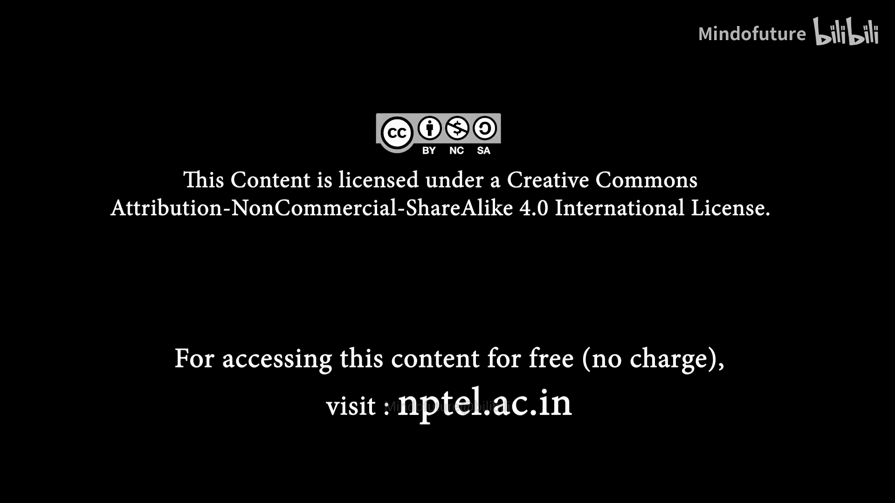
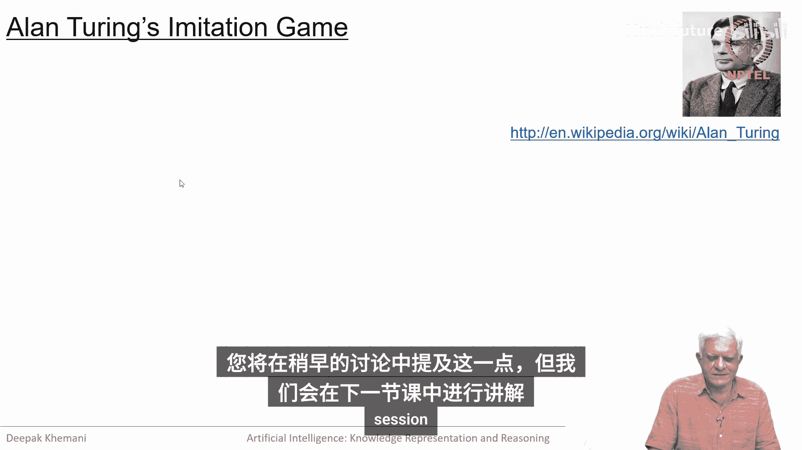

# 【印度理工学院】知识表示与推理 ｜ Knowledge Representation And Reasoning p03 P03_1.3-论机器学习 -BV1c4zNBmEyF_p3-

So welcome back。 We have been talking about。Making inferences。And we have。

Observed that basically there are three kinds of inferences that you can make one is deduction。

Which is。What some people would say logical that logically it follows。嗯。This conclusion。

One is abstruction which says that okay typically it follows or maybe that is a possibility。

And the third is induction， which is。Generating a new generalization， essentially。

We have seen some small examples of each of them。And we will see more of reduction。

 most of the course will be about reduction。So， scientific progress begins with abstruction so you are looking for causes essentially why did the apple fall this is what Newton might have asked？

And then he must came up with the theory of gravity， essentially。Because gravity causes it。

 so gravity causes things to fall on。And by looking at Apple fall one can say that it fell because of gravity and then of course you can go ahead and make an generalization and say that gravity is there and you know it affects all objects and things like that。

So， induction is about informed generalization， so you might create a hypothesis。

 for example formats last serum。Apparently Fmat wrote about his Qlum。

In the margins of a book and then he said that I found a short proof for this。Unfortunately。

 that proof was never found and it took more than a couple of centuries for the rest of。

The logic community to discover the proof of the formats last year。

NowIf there is a goldbacks conjecture， you should go and look it up essentially。

It says that any even number can be expressed as a sum of two。Rams。And there is also a be conjecture。

 which is kind of a general of for mass loss。When you say its a conjecture， we mean that。

We think that it's true。ItMaybe it's a process of induction that you have looked at many examples and you have arrived at the conclusion that it is true。

But there is no proof yet essentially。So it's not yet a theorem。So。

 we may make these things and they get validated by deduction so by making implicit explicit so deduction is the process。

Of making whatever is implicit in whatever is known explicit， I think。

It is already there it already logically follows from what has been said deuction only makes it explicit essentially。

Or you can go and validate something by an experimental validation so for example physicists have done experiments which demonstrated that light bends around gravity essentially so you know if if there is a massive star or something then light will bend around。

Look。Please。But it's only induction that adds new knowledge to the。What what people know if this。So。

 by this， we mean not necessarily new factual knowledge if you see something new then you are adding something new to your。

Reository of what you know， but induction creates a new type of knowledge。

 essentially a new kind of generalization。So， as we have been discussing with V examples。

 the real world is very complex and especially if there are other agents which are acting in this real world。

😊，And。An agent may have goals， the agent may have perception of its domain which may be perfect or imperfect。

The agent may have access to a set of actions which may be deterministic or which could be stochastic。

 There may be other events happening which are。Kind of natural events， you might see。And in all this。

 an agent has to operate。 It has to create a。Picture of what is the world it is operating in。

What is the situation and what are its goals and what it should do？And that sort of stuff。So。

 humankind is a problem solving species essentially。

Here what I am saying is that problem solving can happen through two ways。

 one is through first principles。And the other is through some kind of a knowledge based method。

 essentially。And the knowledge basically comes from experience。And。

Memory based fe is an area of work in which people try to use experience。Directly， essentially。

But you can also learn something from experience and that is the process of learning or machine learning as we see。

knowledgeledge also talks about ontology and domain semantics and that we will spend quite a bit of time on that。

And that is also necessary for doing reasoning by first principles if you are writing a search program to do something。

 if you are writing a search program to play a game， for example。

Then you need to work with the domain ontology。So， in this course。

 we will be covering the knowledge and the ontology kind of。Thing and the reasoning aspects。

I have a companion course which is called AI search methods for problem solving and in there we look at the algorithms for first principles kind of problem solving。

Now， nowadays。Everybody uses the term artificial intelligence。

But most of the time people mean machine learning when they say artificial of intelligence because that's how。

嗯。This whole。Whole enterprise has taken off essentially。This has happened， because。嗯。

Of increasing computing power， increasing access to data and the machine learning methods which work with data have been quite effective essentially。

But I would like to kind of。The market。Or chart out what you mean by AI by AI。

 we mean symbolic knowledge representation and problem solving。

Though it would contain machine learning because machine learning is in some senses。

So' a field of here。But machine learning is concerned with making sense of data。

So you go from data to information， so people use terms like big data processing。

 recommender systems， so if you go to Amazon or something and you are surfing for some product and it keeps suggesting you newer things which are similar。

YouTe also does that。So， predictive analytics as to what is it that you are likely to buy and much of that is driven by their desire to show you advertisements。

For stuff that you might buy essentially， and of course， advertisers pay。Amazon or whoover。

The other kind of thing that we do is classification that you look at some data and you classify it essentially。

This is where deep learning has played a big role。And especially with images and languages so you can。

You know now that programs are capable of labeling images with whatever other objects inside that image。

And deep learning is a。Buzzword。Now， if you look at the human cognitive architecture。

 how do what do human beings do essentially so in this diagram that I have drawn。😊。

There are three concentric circles； the outermost circle is signal processing essentially so that is where you make sense of signals。

Our eyes。Get light trees and you know we process images， sounds we process and so on。

 so all kinds of signal which we process and produce something else from there。

Then there is this neuro fuzzy reasoning。It is largely made up of neural networks and things like that。

 so what they do is they take that digitized signal or discreitized signal。😊，And。Do the processing。

 which would。Do things like recognition， a pattern recognition or classification and so on。

But what humans do and what kind of distinguishes humans from other people is the inner core。

Of symbolic reasoning that we represent things as symbols and we will expound upon this definition as we go along。

And we do things like logic and knowledge representation， we talk about ontologies。

 we talk about semantics or meaning， we talk about natural language understanding。

 so understanding is the key phrase there。We talk about memory， we talk about search algorithms。

 we talk about problem solving planning。And models。We'll look at some of those things as we go along。

But it has been said by many people that this inner coal is what distinguishes humans from。😊。

Other agents， the other agents could be machines or the other agents could be other animals。

 essentially。This is also something that we would ascribe to saying that。

We are thinking creatures that you know。We have this ability to think。

Which is sometimes synonymous with intelligence。Machine intelligence。

Currently is focused on this neuro fuzzy reasoning part。So， machines are very good。

At image processing， computer vision， speech recognition， deep neural networks， graphics。

 machine learning， neural networks， pattern recognition。Speed synthesis is robot control。

And knowledge this thing。 So these are this is an area which lies in between。

Symbols and signals essentially。Machines。Have learned to make this connection between signals and symbols。

 So mostly it is from left to right on this slide that you are sensing something and you are producing symbols。

 but it can also be。From right inside going out into the world where you are generating actions or you are generating animation。

Or you are generating speech， essentially。So if you have your favorite social media site。

This is what it is doing。For a large extent。What it does is that of all the millions of people who use that site。

 they extract data from that and draw whatever conclusions that they。Have to do。So that's also。

Information processing agent。It's just that。The focus is more on neurofuzzy reasoning here。

 whereas as I said in the previous slide， humans are known for this symbolic cognitive activity。

 the ability to make inferences which is going to be a significant part of that。

Image labeling is something which has been very successful in the recent past。

So that if you show an image to one of these systems which has learned through。

 which is a neural network which has learned。It would generate some labels essentially so if you show this image on the left the system would come up with labels which are symbolic in nature3。

Grass， sky。That's why they are lying in there。Small circle of symbols that these machines work。

 The reason I have drawn this circle as small is because。

These machines are not able to process these symbols。 They are not able to。

Make inferences based on what they see essentially they are able to see most definitely they are able to see that there is a tree。

 there is a grass， there is a sky。But they don not know what that what what is a tree or what is grass essentially they have learned to identify to give a name to this image。

😊，Which is that it has got tree it is got a tree in it。

 it is got some grass in it and its got the sky in it。

The same capability is used by governments all over the world nowadays。To do facial recognition。

 so some governments are of course more oppressive than others。

 but basically surveillance is a big thing which many， many governments are doing。

And they would like to you know know， as to who is it that they are looking at。

 maybe it's an in a shopping mall， maybe it's an an railway station or whatever the case maybe。

And face recognition is basically。😊，A task which is like classification that you you know that that every person is like a。

Has a name， so it's like a class label so you can look at our image and say this person is Smith or this person is Peter and so on。

So， there was an article which I read some time ago with our it is called human level intelligence or animal like abilities。

So he was kind of trying to analyze as to what is it that machine learning can do essentially So one of the things which either he has said or somebody else had said Im not quite sure。

Maybe toar Russell。Sell it sometime。呃。The statement is that everything that machine learning does now humans do in the blink of N essentially。

And we need huge amounts of computing power to do that。

Then other people have made observations that eagles and snakes。Have better vision systems than us。

Cats have superior navigation abilities。Dogs recognize and react to human speech。

African grey parros can mimic human speech so everything。

That modern day machine learning systems can do。Can be done by many of these other life forms。

And yet。None of these animals have the cognitive abilities and the intelligence typically attributed to human essentially。

So this is just。Coorroorration of the fact。That human intelligence。Is simply beyond。

Pattern recognition that we do other things。Which。Are equally， if not more important。

So ourney Brook who。He is a computer scientist at MIT， he has written an article。In which。He。

Says the same thing in a different way。He says now suppose a person tells us that a particular photo shows people playing Frise in the park now that is something which machines can do。

Then Brook says we naturally assume that the person can answer questions like what is the shape of the Frisbee roughly how far can a person throw a frisbee can a person eat a Frisbee so if I were to show you a picture of a Frisbee and if I were to ask you these questions you will be able to give these answers。

Assuming you are familiar with a Frisbee。Computers that can label images like people playing Frisbee in a park have no chance of answering these questions he because simply the only thing they know is to produce that label。

They don't have an understanding， they don't have a model of the world。

 they don't know what is a park， what is a human， whats a Fribee。So。

 they have no idea what is the person that parks are usually outside the people have ages that whether there is anything more than how how it makes a photo look and so on。

So， the point we are trying to make is。There is more to AI。Then。

 pattern recognition and machine learning。And that more。

Is the ability to represent knowledge and reason with that the ability to create models of your environment and imagine how。

Actions。Would result in what the actions would result in。And so on。Boke Lord Ne also quotes。

Marvin Minsky， he says that Marvin Minsky call words that carry a variety of meanings as suitcase ver。

 so learning is a powerful suitcase word it can mean。Do so many different things。

 it can refer to different kinds of experience。So， he says that when people hear that a machine learning is making great strides in some new domain they tend to use as a mental model the way in which a person would learn。

That new domain。However， machine learning is very brittle。

And it requires a lot of preparation by human researchers and engineers。Special purpose coding。

Special purpose sets of training data。And a custom learning structure for each new problem domain。So。

 yes， we are making strides in machine learning。But we don't have general learning machines。

 people are working towards those kind of concepts。

But our machine learning algorithms work with for specific problems， and they have to be。

Kind of custom made solutions essentially。 So how do we measure intelligence。

 that's been a debate which has been going on for a long time。嗯。Ever since。

The field of artificial intelligence was coined by John McCarthy in the Darmouth conference or even before this steer came up with this idea that you are going to talk about。

Even earlier。But we will do this in the next session。

